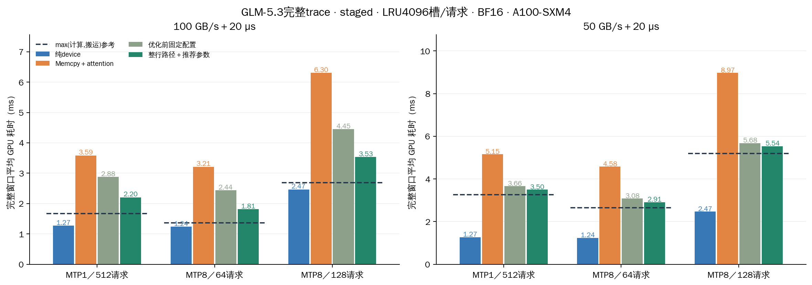

# A100：100 GB/s 融合 MLA kernel 优化

状态：全部验证完成。100 GB/s完整trace矩阵 195/195 格，无LRU最终比较 84/84 格，5pass最终确认 12/12 格。

## 主要结果

以下均为完整GLM-5.3 trace、staged＋LRU4096槽/请求、100 GB/s＋20 µs，5次冷启动完整窗口确认。旧默认fetch16/split on，旧同参数和新实现均为fetch24/split off。

| MTP | 请求 | 旧默认 µs | 旧同参数 µs | 新实现 µs | 比旧默认降低 | 比旧同参数降低 | Memcpy加速 | 高于重叠参考 |
|---:|---:|---:|---:|---:|---:|---:|---:|---:|
| 1 | 512 | 2885.27 | 2521.29 | 2193.83 | 24.0% | 13.0% | 1.625× | 31.8% |
| 8 | 64 | 2462.30 | 2180.34 | 1833.68 | 25.5% | 15.9% | 1.756× | 34.1% |
| 8 | 128 | 4388.65 | 4160.36 | 3560.53 | 18.9% | 14.4% | 1.770× | 32.3% |

相对旧默认的变化包含参数与代码收益；同参数列单独核对代码收益。参考以上的剩余差距仍需保留，不能把本轮改进写成所有100 GB/s参数都已在理论参考10%以内。



图：完整trace、staged＋LRU4096、3pass矩阵均值。旧列为原矩阵固定配置，新列为最终实现与推荐参数；黑虚线为逐步max参考。5pass同轮确认见上表。

本轮保持单cooperative kernel、真实GLM-5.3访问trace、4096槽/请求LRU、数学计算、缓存政策与链路模拟规则。生产头文件增加一个大batch的整行staged路径；不采用探索中的动态队列、扩大attention tile、改变fetch块大小或寄存器三级流水。原5304格数据保留，本文将优化结果单独列出。

## 改动与启用条件

原路径对尾部行生成partial states并在全grid barrier后merge。新路径在足够多独立行时，每行直接完成attention并输出，省去尾部分片及合并；编译期固定staged、整行及不拆Host工作项，去掉不可能执行的原地读写回分支。容量足以容纳全部选中条目时，attention只读HBM，远端模拟计数/等待仅保留在真正取数的fetch路径；等待staging就绪的协议仍保留。

自动派发条件为stage=True、host_split=False、64 heads、query行数≥4×SM数、staging容量≥query行数×最大KV长度。未满足条件使用原通用kernel。最终构建中六个原通用kernel的反汇编指令文本与基线一致，证据见compiler_summary.json。

A100-SXM4的100 GB/s推荐：达到432个query行时设置host_fetch_ctas=24、host_split=False；较小形状沿用fetch16/split on。两者都开启host_stage=True，trace回放开启4096槽LRU；无LRU扫描关闭缓存。新路径不需要新的API或编译开关，尚无本轮H800实测。

```python
wrapper.host_stage = True
wrapper.host_fetch_ctas = 24
wrapper.host_split = False
wrapper.host_staging_rows = num_query_rows * max_kv_len
```

## 测量和参考

A100-SXM4 GPU0计算、GPU1为真实NVLink远端；50/100 GB/s模拟在同一物理路径注入。完整trace每请求1024连续assistant位置，MTP1/8分别1024/128次launch，3次冷启动pass全步算术平均；确认轮为5pass。无LRU使用四个快照和全部七个远端比例。数据载荷固定seed BF16，真实的是访问序列；不包括模型其他层或生成接受率。

GPU event与guard/16步CUDA Graph避免CPU入队间隙进入计时，miss诊断在事件外。Memcpy保留实际GPU搬运、必要cache scatter和完整attention，CPU LRU规划/Host整理在外。纯device使用原矩阵同输入正常构建参考，完美重叠参考逐步计算mean(max(C_t, unique miss bytes_t/B))；它假设理想重叠，不计附加延迟、LRU维护及SM/HBM争用。

## 完整trace：100 GB/s全部形状和延迟

| MTP | 请求 | 延迟 µs | 优化前固定配置 µs | 本轮 µs | Memcpy µs | 纯device µs | 重叠参考 µs | 相对原矩阵降低 | 高于参考 | LRU引用命中率 | fetch/split |
|---:|---:|---:|---:|---:|---:|---:|---:|---:|---:|---:|---|
| 1 | 1 | 0 | 46.66 | 46.84 | 48.91 | 32.61 | 32.61 | -0.4% | 43.7% | 85.31% | 16/on |
| 1 | 1 | 2 | 48.71 | 48.65 | 50.26 | 32.61 | 32.61 | 0.1% | 49.2% | 85.30% | 16/on |
| 1 | 1 | 5 | 50.91 | 51.59 | 53.42 | 32.61 | 32.61 | -1.3% | 58.2% | 85.31% | 16/on |
| 1 | 1 | 10 | 56.58 | 55.98 | 58.52 | 32.61 | 32.61 | 1.1% | 71.7% | 85.32% | 16/on |
| 1 | 1 | 20 | 65.91 | 66.55 | 68.17 | 32.61 | 32.61 | -1.0% | 104.1% | 85.30% | 16/on |
| 1 | 2 | 0 | 56.24 | 56.03 | 61.68 | 41.74 | 41.74 | 0.4% | 34.2% | 87.37% | 16/on |
| 1 | 2 | 2 | 58.02 | 57.49 | 63.86 | 41.74 | 41.74 | 0.9% | 37.7% | 87.36% | 16/on |
| 1 | 2 | 5 | 61.04 | 60.51 | 66.63 | 41.74 | 41.74 | 0.9% | 45.0% | 87.36% | 16/on |
| 1 | 2 | 10 | 65.93 | 65.60 | 71.65 | 41.74 | 41.74 | 0.5% | 57.2% | 87.36% | 16/on |
| 1 | 2 | 20 | 75.74 | 75.48 | 81.50 | 41.74 | 41.74 | 0.3% | 80.8% | 87.36% | 16/on |
| 1 | 4 | 0 | 66.87 | 67.20 | 80.45 | 47.24 | 47.29 | -0.5% | 42.1% | 83.48% | 16/on |
| 1 | 4 | 2 | 68.92 | 68.64 | 82.43 | 47.24 | 47.29 | 0.4% | 45.2% | 83.47% | 16/on |
| 1 | 4 | 5 | 72.08 | 71.88 | 85.53 | 47.24 | 47.29 | 0.3% | 52.0% | 83.47% | 16/on |
| 1 | 4 | 10 | 77.06 | 77.20 | 90.50 | 47.24 | 47.29 | -0.2% | 63.3% | 83.47% | 16/on |
| 1 | 4 | 20 | 88.95 | 88.87 | 100.92 | 47.24 | 47.29 | 0.1% | 87.9% | 83.47% | 16/on |
| 1 | 8 | 0 | 90.60 | 90.38 | 96.04 | 51.01 | 51.17 | 0.2% | 76.6% | 86.80% | 16/on |
| 1 | 8 | 2 | 90.72 | 90.76 | 98.46 | 51.01 | 51.17 | -0.0% | 77.4% | 86.80% | 16/on |
| 1 | 8 | 5 | 91.68 | 90.00 | 101.23 | 51.01 | 51.17 | 1.8% | 75.9% | 86.80% | 16/on |
| 1 | 8 | 10 | 94.02 | 93.27 | 106.45 | 51.01 | 51.17 | 0.8% | 82.3% | 86.80% | 16/on |
| 1 | 8 | 20 | 107.07 | 106.62 | 116.56 | 51.01 | 51.17 | 0.4% | 108.4% | 86.80% | 16/on |
| 1 | 16 | 0 | 139.26 | 139.23 | 166.35 | 83.46 | 83.85 | 0.0% | 66.0% | 86.53% | 16/on |
| 1 | 16 | 2 | 139.22 | 139.35 | 168.28 | 83.46 | 83.85 | -0.1% | 66.2% | 86.53% | 16/on |
| 1 | 16 | 5 | 139.73 | 139.81 | 171.38 | 83.46 | 83.85 | -0.1% | 66.7% | 86.53% | 16/on |
| 1 | 16 | 10 | 141.74 | 142.17 | 176.59 | 83.46 | 83.85 | -0.3% | 69.5% | 86.53% | 16/on |
| 1 | 16 | 20 | 159.85 | 159.96 | 187.17 | 83.46 | 83.85 | -0.1% | 90.8% | 86.53% | 16/on |
| 1 | 32 | 0 | 253.52 | 253.54 | 288.13 | 122.16 | 130.61 | -0.0% | 94.1% | 85.27% | 16/on |
| 1 | 32 | 2 | 253.62 | 254.01 | 289.88 | 122.16 | 130.62 | -0.2% | 94.5% | 85.27% | 16/on |
| 1 | 32 | 5 | 253.89 | 253.91 | 292.56 | 122.16 | 130.59 | -0.0% | 94.4% | 85.28% | 16/on |
| 1 | 32 | 10 | 254.78 | 254.26 | 298.18 | 122.16 | 130.59 | 0.2% | 94.7% | 85.27% | 16/on |
| 1 | 32 | 20 | 273.43 | 272.95 | 310.96 | 122.16 | 130.60 | 0.2% | 109.0% | 85.27% | 16/on |
| 1 | 48 | 0 | 420.73 | 421.48 | 371.77 | 149.87 | 166.56 | -0.2% | 153.1% | 86.76% | 16/on |
| 1 | 48 | 2 | 420.74 | 421.47 | 373.76 | 149.87 | 166.56 | -0.2% | 153.0% | 86.76% | 16/on |
| 1 | 48 | 5 | 420.90 | 421.06 | 377.78 | 149.87 | 166.56 | -0.0% | 152.8% | 86.76% | 16/on |
| 1 | 48 | 10 | 420.54 | 421.16 | 382.68 | 149.87 | 166.58 | -0.1% | 152.8% | 86.76% | 16/on |
| 1 | 48 | 20 | 423.16 | 422.90 | 394.85 | 149.87 | 166.60 | 0.1% | 153.8% | 86.76% | 16/on |
| 1 | 64 | 0 | 468.87 | 468.21 | 605.26 | 288.28 | 293.70 | 0.1% | 59.4% | 86.05% | 16/on |
| 1 | 64 | 2 | 468.76 | 468.54 | 605.65 | 288.28 | 293.69 | 0.0% | 59.5% | 86.05% | 16/on |
| 1 | 64 | 5 | 468.71 | 467.98 | 609.95 | 288.28 | 293.69 | 0.2% | 59.3% | 86.06% | 16/on |
| 1 | 64 | 10 | 468.74 | 468.91 | 615.65 | 288.28 | 293.69 | -0.0% | 59.7% | 86.05% | 16/on |
| 1 | 64 | 20 | 487.13 | 486.45 | 625.49 | 288.28 | 293.69 | 0.1% | 65.6% | 86.05% | 16/on |
| 1 | 96 | 0 | 744.47 | 748.43 | 709.91 | 266.47 | 322.45 | -0.5% | 132.1% | 86.36% | 16/on |
| 1 | 96 | 2 | 743.58 | 747.50 | 711.35 | 266.47 | 322.45 | -0.5% | 131.8% | 86.36% | 16/on |
| 1 | 96 | 5 | 745.73 | 749.70 | 714.42 | 266.47 | 322.45 | -0.5% | 132.5% | 86.36% | 16/on |
| 1 | 96 | 10 | 745.65 | 748.73 | 720.32 | 266.47 | 322.45 | -0.4% | 132.2% | 86.36% | 16/on |
| 1 | 96 | 20 | 756.82 | 761.50 | 731.95 | 266.47 | 322.45 | -0.6% | 136.2% | 86.36% | 16/on |
| 1 | 128 | 0 | 778.07 | 791.52 | 1116.25 | 511.84 | 527.53 | -1.7% | 50.0% | 86.41% | 16/on |
| 1 | 128 | 2 | 778.31 | 792.11 | 1118.50 | 511.84 | 527.53 | -1.8% | 50.2% | 86.41% | 16/on |
| 1 | 128 | 5 | 778.22 | 794.72 | 1123.18 | 511.84 | 527.53 | -2.1% | 50.6% | 86.41% | 16/on |
| 1 | 128 | 10 | 781.40 | 796.62 | 1129.45 | 511.84 | 527.53 | -1.9% | 51.0% | 86.41% | 16/on |
| 1 | 128 | 20 | 844.99 | 858.98 | 1139.34 | 511.84 | 527.53 | -1.7% | 62.8% | 86.41% | 16/on |
| 1 | 192 | 0 | 1206.19 | 1210.90 | 1374.90 | 517.86 | 633.90 | -0.4% | 91.0% | 86.54% | 16/on |
| 1 | 192 | 2 | 1208.11 | 1215.22 | 1379.29 | 517.86 | 633.90 | -0.6% | 91.7% | 86.54% | 16/on |
| 1 | 192 | 5 | 1211.06 | 1219.35 | 1383.38 | 517.86 | 633.90 | -0.7% | 92.4% | 86.54% | 16/on |
| 1 | 192 | 10 | 1211.49 | 1222.41 | 1390.18 | 517.86 | 633.90 | -0.9% | 92.8% | 86.54% | 16/on |
| 1 | 192 | 20 | 1256.20 | 1273.47 | 1401.16 | 517.86 | 633.90 | -1.4% | 100.9% | 86.54% | 16/on |
| 1 | 256 | 0 | 1381.86 | 1382.55 | 1920.86 | 765.13 | 879.72 | -0.0% | 57.2% | 86.44% | 16/on |
| 1 | 256 | 2 | 1393.10 | 1394.76 | 1922.25 | 765.13 | 879.73 | -0.1% | 58.5% | 86.44% | 16/on |
| 1 | 256 | 5 | 1395.12 | 1396.70 | 1930.64 | 765.13 | 879.73 | -0.1% | 58.8% | 86.44% | 16/on |
| 1 | 256 | 10 | 1395.05 | 1405.41 | 1940.41 | 765.13 | 879.73 | -0.7% | 59.8% | 86.44% | 16/on |
| 1 | 256 | 20 | 1503.53 | 1508.57 | 1952.93 | 765.13 | 879.73 | -0.3% | 71.5% | 86.44% | 16/on |
| 1 | 384 | 0 | 2074.00 | 2077.02 | 2724.41 | 1020.46 | 1265.48 | -0.1% | 64.1% | 86.52% | 16/on |
| 1 | 384 | 2 | 2083.83 | 2089.90 | 2734.83 | 1020.46 | 1265.48 | -0.3% | 65.1% | 86.52% | 16/on |
| 1 | 384 | 5 | 2084.75 | 2090.57 | 2744.51 | 1020.46 | 1265.46 | -0.3% | 65.2% | 86.52% | 16/on |
| 1 | 384 | 10 | 2086.44 | 2098.32 | 2753.81 | 1020.46 | 1265.48 | -0.6% | 65.8% | 86.52% | 16/on |
| 1 | 384 | 20 | 2214.87 | 2234.69 | 2768.52 | 1020.46 | 1265.48 | -0.9% | 76.6% | 86.52% | 16/on |
| 1 | 512 | 0 | 2615.06 | 2134.18 | 3535.00 | 1270.29 | 1664.32 | 18.4% | 28.2% | 86.50% | 24/off |
| 1 | 512 | 2 | 2615.72 | 2143.58 | 3548.35 | 1270.29 | 1664.32 | 18.1% | 28.8% | 86.50% | 24/off |
| 1 | 512 | 5 | 2631.26 | 2145.88 | 3564.01 | 1270.29 | 1664.31 | 18.4% | 28.9% | 86.50% | 24/off |
| 1 | 512 | 10 | 2628.77 | 2153.90 | 3571.94 | 1270.29 | 1664.30 | 18.1% | 29.4% | 86.50% | 24/off |
| 1 | 512 | 20 | 2875.31 | 2202.81 | 3586.17 | 1270.29 | 1664.31 | 23.4% | 32.4% | 86.50% | 24/off |
| 8 | 1 | 0 | 90.31 | 89.17 | 94.36 | 48.71 | 48.77 | 1.3% | 82.8% | 67.51% | 16/on |
| 8 | 1 | 2 | 90.74 | 89.75 | 96.07 | 48.71 | 48.77 | 1.1% | 84.0% | 67.48% | 16/on |
| 8 | 1 | 5 | 92.43 | 91.58 | 99.22 | 48.71 | 48.77 | 0.9% | 87.8% | 67.49% | 16/on |
| 8 | 1 | 10 | 97.07 | 96.62 | 104.11 | 48.71 | 48.77 | 0.5% | 98.1% | 67.44% | 16/on |
| 8 | 1 | 20 | 112.39 | 112.79 | 114.10 | 48.71 | 48.77 | -0.4% | 131.3% | 67.47% | 16/on |
| 8 | 2 | 0 | 131.05 | 131.20 | 148.48 | 78.84 | 79.02 | -0.1% | 66.0% | 74.19% | 16/on |
| 8 | 2 | 2 | 131.45 | 131.46 | 150.68 | 78.84 | 79.02 | -0.0% | 66.3% | 74.14% | 16/on |
| 8 | 2 | 5 | 131.75 | 131.50 | 153.86 | 78.84 | 79.02 | 0.2% | 66.4% | 74.21% | 16/on |
| 8 | 2 | 10 | 133.24 | 132.86 | 159.54 | 78.84 | 79.02 | 0.3% | 68.1% | 74.18% | 16/on |
| 8 | 2 | 20 | 150.62 | 150.82 | 169.32 | 78.84 | 79.02 | -0.1% | 90.9% | 74.19% | 16/on |
| 8 | 3 | 0 | 188.43 | 186.83 | 200.62 | 82.60 | 85.54 | 0.9% | 118.4% | 72.37% | 16/on |
| 8 | 3 | 2 | 188.78 | 188.62 | 203.38 | 82.60 | 85.51 | 0.1% | 120.6% | 72.39% | 16/on |
| 8 | 3 | 5 | 188.20 | 188.32 | 206.91 | 82.60 | 85.54 | -0.1% | 120.1% | 72.39% | 16/on |
| 8 | 3 | 10 | 189.57 | 188.81 | 212.44 | 82.60 | 85.54 | 0.4% | 120.7% | 72.37% | 16/on |
| 8 | 3 | 20 | 207.65 | 208.73 | 226.20 | 82.60 | 85.54 | -0.5% | 144.0% | 72.37% | 16/on |
| 8 | 4 | 0 | 251.49 | 252.50 | 273.14 | 116.17 | 119.27 | -0.4% | 111.7% | 73.36% | 16/on |
| 8 | 4 | 2 | 251.74 | 251.01 | 275.67 | 116.17 | 119.26 | 0.3% | 110.5% | 73.37% | 16/on |
| 8 | 4 | 5 | 250.91 | 250.93 | 278.85 | 116.17 | 119.26 | -0.0% | 110.4% | 73.35% | 16/on |
| 8 | 4 | 10 | 252.07 | 251.19 | 283.85 | 116.17 | 119.26 | 0.3% | 110.6% | 73.36% | 16/on |
| 8 | 4 | 20 | 264.67 | 264.48 | 296.11 | 116.17 | 119.23 | 0.1% | 121.8% | 73.53% | 16/on |
| 8 | 5 | 0 | 300.92 | 301.21 | 380.18 | 183.39 | 183.88 | -0.1% | 63.8% | 73.36% | 16/on |
| 8 | 5 | 2 | 301.16 | 300.46 | 382.68 | 183.39 | 183.88 | 0.2% | 63.4% | 73.38% | 16/on |
| 8 | 5 | 5 | 300.83 | 300.72 | 385.99 | 183.39 | 183.87 | 0.0% | 63.5% | 73.39% | 16/on |
| 8 | 5 | 10 | 301.06 | 301.18 | 390.44 | 183.39 | 183.88 | -0.0% | 63.8% | 73.38% | 16/on |
| 8 | 5 | 20 | 316.59 | 317.32 | 401.43 | 183.39 | 183.88 | -0.2% | 72.6% | 73.40% | 16/on |
| 8 | 6 | 0 | 434.22 | 433.71 | 341.69 | 146.09 | 148.86 | 0.1% | 191.4% | 77.40% | 16/on |
| 8 | 6 | 2 | 434.25 | 434.41 | 344.53 | 146.09 | 148.86 | -0.0% | 191.8% | 77.39% | 16/on |
| 8 | 6 | 5 | 433.92 | 434.26 | 346.73 | 146.09 | 148.87 | -0.1% | 191.7% | 77.37% | 16/on |
| 8 | 6 | 10 | 433.62 | 433.65 | 352.37 | 146.09 | 148.87 | -0.0% | 191.3% | 77.38% | 16/on |
| 8 | 6 | 20 | 435.15 | 436.00 | 363.10 | 146.09 | 148.87 | -0.2% | 192.9% | 77.34% | 16/on |
| 8 | 7 | 0 | 462.10 | 462.13 | 524.33 | 276.02 | 276.46 | -0.0% | 67.2% | 76.70% | 16/on |
| 8 | 7 | 2 | 463.39 | 461.43 | 523.81 | 276.02 | 276.46 | 0.4% | 66.9% | 76.70% | 16/on |
| 8 | 7 | 5 | 462.17 | 461.90 | 524.98 | 276.02 | 276.46 | 0.1% | 67.1% | 76.69% | 16/on |
| 8 | 7 | 10 | 461.78 | 462.03 | 534.79 | 276.02 | 276.46 | -0.1% | 67.1% | 76.70% | 16/on |
| 8 | 7 | 20 | 462.78 | 463.82 | 543.94 | 276.02 | 276.46 | -0.2% | 67.8% | 76.69% | 16/on |
| 8 | 8 | 0 | 470.65 | 470.86 | 541.05 | 281.19 | 281.93 | -0.0% | 67.0% | 78.66% | 16/on |
| 8 | 8 | 2 | 471.03 | 471.69 | 541.69 | 281.19 | 281.93 | -0.1% | 67.3% | 78.60% | 16/on |
| 8 | 8 | 5 | 470.77 | 470.78 | 545.10 | 281.19 | 281.93 | -0.0% | 67.0% | 78.62% | 16/on |
| 8 | 8 | 10 | 470.64 | 471.06 | 549.43 | 281.19 | 281.93 | -0.1% | 67.1% | 78.64% | 16/on |
| 8 | 8 | 20 | 471.99 | 472.95 | 563.65 | 281.19 | 281.93 | -0.2% | 67.8% | 78.64% | 16/on |
| 8 | 10 | 0 | 512.11 | 513.49 | 614.01 | 285.03 | 286.59 | -0.3% | 79.2% | 76.71% | 16/on |
| 8 | 10 | 2 | 512.04 | 512.95 | 615.56 | 285.03 | 286.59 | -0.2% | 79.0% | 76.72% | 16/on |
| 8 | 10 | 5 | 512.37 | 512.75 | 618.54 | 285.03 | 286.59 | -0.1% | 78.9% | 76.73% | 16/on |
| 8 | 10 | 10 | 512.23 | 513.03 | 624.69 | 285.03 | 286.59 | -0.2% | 79.0% | 76.71% | 16/on |
| 8 | 10 | 20 | 517.87 | 517.11 | 635.31 | 285.03 | 286.59 | 0.1% | 80.4% | 76.70% | 16/on |
| 8 | 12 | 0 | 671.66 | 669.65 | 657.62 | 261.93 | 274.06 | 0.3% | 144.3% | 76.45% | 16/on |
| 8 | 12 | 2 | 673.01 | 670.00 | 659.85 | 261.93 | 273.98 | 0.4% | 144.5% | 76.49% | 16/on |
| 8 | 12 | 5 | 671.36 | 670.55 | 662.55 | 261.93 | 274.00 | 0.1% | 144.7% | 76.49% | 16/on |
| 8 | 12 | 10 | 673.04 | 672.20 | 669.13 | 261.93 | 273.98 | 0.1% | 145.3% | 76.52% | 16/on |
| 8 | 12 | 20 | 678.46 | 677.73 | 679.34 | 261.93 | 274.01 | 0.1% | 147.3% | 76.50% | 16/on |
| 8 | 14 | 0 | 602.17 | 601.63 | 975.36 | 500.69 | 501.97 | 0.1% | 19.9% | 77.52% | 16/on |
| 8 | 14 | 2 | 602.29 | 602.24 | 978.40 | 500.69 | 501.97 | 0.0% | 20.0% | 77.43% | 16/on |
| 8 | 14 | 5 | 602.53 | 602.66 | 983.04 | 500.69 | 501.97 | -0.0% | 20.1% | 77.41% | 16/on |
| 8 | 14 | 10 | 602.50 | 603.25 | 985.65 | 500.69 | 501.97 | -0.1% | 20.2% | 77.37% | 16/on |
| 8 | 14 | 20 | 640.76 | 640.49 | 999.83 | 500.69 | 501.97 | 0.0% | 27.6% | 77.36% | 16/on |
| 8 | 16 | 0 | 677.30 | 679.94 | 1020.83 | 502.99 | 504.93 | -0.4% | 34.7% | 78.48% | 16/on |
| 8 | 16 | 2 | 676.93 | 678.34 | 1023.88 | 502.99 | 504.93 | -0.2% | 34.3% | 78.48% | 16/on |
| 8 | 16 | 5 | 677.57 | 680.97 | 1025.53 | 502.99 | 504.93 | -0.5% | 34.9% | 78.47% | 16/on |
| 8 | 16 | 10 | 678.01 | 680.41 | 1033.64 | 502.99 | 504.93 | -0.4% | 34.8% | 78.45% | 16/on |
| 8 | 16 | 20 | 709.03 | 711.48 | 1043.85 | 502.99 | 504.93 | -0.3% | 40.9% | 78.47% | 16/on |
| 8 | 20 | 0 | 819.91 | 820.90 | 1084.34 | 505.03 | 508.31 | -0.1% | 61.5% | 79.97% | 16/on |
| 8 | 20 | 2 | 822.26 | 820.55 | 1087.30 | 505.03 | 508.31 | 0.2% | 61.4% | 80.05% | 16/on |
| 8 | 20 | 5 | 820.22 | 821.50 | 1092.67 | 505.03 | 508.31 | -0.2% | 61.6% | 80.05% | 16/on |
| 8 | 20 | 10 | 820.77 | 824.33 | 1097.21 | 505.03 | 508.31 | -0.4% | 62.2% | 79.99% | 16/on |
| 8 | 20 | 20 | 844.65 | 848.66 | 1106.85 | 505.03 | 508.31 | -0.5% | 67.0% | 80.00% | 16/on |
| 8 | 24 | 0 | 1046.89 | 1046.75 | 1226.84 | 507.27 | 519.68 | 0.0% | 101.4% | 78.85% | 16/on |
| 8 | 24 | 2 | 1046.33 | 1047.90 | 1228.82 | 507.27 | 519.72 | -0.2% | 101.6% | 78.84% | 16/on |
| 8 | 24 | 5 | 1046.11 | 1048.80 | 1231.61 | 507.27 | 519.64 | -0.3% | 101.8% | 78.86% | 16/on |
| 8 | 24 | 10 | 1048.72 | 1050.46 | 1237.79 | 507.27 | 519.66 | -0.2% | 102.1% | 78.87% | 16/on |
| 8 | 24 | 20 | 1074.20 | 1074.27 | 1250.42 | 507.27 | 519.66 | -0.0% | 106.7% | 78.87% | 16/on |
| 8 | 28 | 0 | 1030.88 | 1032.51 | 1647.81 | 744.87 | 750.88 | -0.2% | 37.5% | 77.94% | 16/on |
| 8 | 28 | 2 | 1031.04 | 1033.85 | 1644.46 | 744.87 | 750.90 | -0.3% | 37.7% | 77.97% | 16/on |
| 8 | 28 | 5 | 1033.72 | 1039.07 | 1647.73 | 744.87 | 750.91 | -0.5% | 38.4% | 77.97% | 16/on |
| 8 | 28 | 10 | 1033.65 | 1039.17 | 1654.31 | 744.87 | 750.90 | -0.5% | 38.4% | 77.95% | 16/on |
| 8 | 28 | 20 | 1130.19 | 1131.38 | 1663.19 | 744.87 | 750.91 | -0.1% | 50.7% | 77.95% | 16/on |
| 8 | 32 | 0 | 1238.81 | 1245.65 | 1807.27 | 751.09 | 779.43 | -0.6% | 59.8% | 77.07% | 16/on |
| 8 | 32 | 2 | 1241.23 | 1242.83 | 1807.17 | 751.09 | 779.50 | -0.1% | 59.4% | 77.06% | 16/on |
| 8 | 32 | 5 | 1240.24 | 1246.32 | 1812.60 | 751.09 | 779.34 | -0.5% | 59.9% | 77.08% | 16/on |
| 8 | 32 | 10 | 1244.38 | 1249.77 | 1815.94 | 751.09 | 779.07 | -0.4% | 60.4% | 77.12% | 16/on |
| 8 | 32 | 20 | 1309.63 | 1308.90 | 1827.07 | 751.09 | 779.29 | 0.1% | 68.0% | 77.10% | 16/on |
| 8 | 40 | 0 | 1473.52 | 1477.43 | 1925.14 | 756.78 | 817.81 | -0.3% | 80.7% | 79.52% | 16/on |
| 8 | 40 | 2 | 1471.29 | 1474.39 | 1926.01 | 756.78 | 817.90 | -0.2% | 80.3% | 79.52% | 16/on |
| 8 | 40 | 5 | 1476.88 | 1479.05 | 1930.73 | 756.78 | 817.92 | -0.1% | 80.8% | 79.52% | 16/on |
| 8 | 40 | 10 | 1478.92 | 1483.56 | 1932.67 | 756.78 | 817.87 | -0.3% | 81.4% | 79.52% | 16/on |
| 8 | 40 | 20 | 1576.32 | 1583.55 | 1943.37 | 756.78 | 818.04 | -0.5% | 93.6% | 79.52% | 16/on |
| 8 | 48 | 0 | 1752.70 | 1758.09 | 2412.86 | 996.42 | 1038.27 | -0.3% | 69.3% | 79.39% | 16/on |
| 8 | 48 | 2 | 1754.14 | 1759.26 | 2411.54 | 996.42 | 1038.61 | -0.3% | 69.4% | 79.36% | 16/on |
| 8 | 48 | 5 | 1754.25 | 1763.06 | 2414.49 | 996.42 | 1038.46 | -0.5% | 69.8% | 79.37% | 16/on |
| 8 | 48 | 10 | 1755.13 | 1765.22 | 2420.79 | 996.42 | 1038.22 | -0.6% | 70.0% | 79.39% | 16/on |
| 8 | 48 | 20 | 1818.29 | 1823.11 | 2432.86 | 996.42 | 1038.52 | -0.3% | 75.5% | 79.35% | 16/on |
| 8 | 56 | 0 | 1889.96 | 1631.12 | 2925.90 | 1233.71 | 1277.27 | 13.7% | 27.7% | 78.92% | 24/off |
| 8 | 56 | 2 | 1889.70 | 1627.70 | 2928.06 | 1233.71 | 1277.02 | 13.9% | 27.5% | 78.94% | 24/off |
| 8 | 56 | 5 | 1897.49 | 1629.33 | 2932.10 | 1233.71 | 1277.09 | 14.1% | 27.6% | 78.93% | 24/off |
| 8 | 56 | 10 | 1893.60 | 1637.73 | 2934.19 | 1233.71 | 1277.12 | 13.5% | 28.2% | 78.91% | 24/off |
| 8 | 56 | 20 | 2042.70 | 1647.67 | 2949.60 | 1233.71 | 1277.15 | 19.3% | 29.0% | 78.90% | 24/off |
| 8 | 64 | 0 | 2213.02 | 1779.77 | 3190.89 | 1236.77 | 1367.72 | 19.6% | 30.1% | 78.57% | 24/off |
| 8 | 64 | 2 | 2203.76 | 1788.21 | 3191.91 | 1236.77 | 1367.58 | 18.9% | 30.8% | 78.57% | 24/off |
| 8 | 64 | 5 | 2204.83 | 1795.45 | 3199.19 | 1236.77 | 1367.83 | 18.6% | 31.3% | 78.56% | 24/off |
| 8 | 64 | 10 | 2217.28 | 1790.97 | 3198.92 | 1236.77 | 1367.67 | 19.2% | 31.0% | 78.57% | 24/off |
| 8 | 64 | 20 | 2435.39 | 1814.92 | 3212.29 | 1236.77 | 1367.75 | 25.5% | 32.7% | 78.56% | 24/off |
| 8 | 72 | 0 | 2495.41 | 2021.75 | 3708.19 | 1472.79 | 1590.92 | 19.0% | 27.1% | 78.20% | 24/off |
| 8 | 72 | 2 | 2493.55 | 2031.77 | 3717.46 | 1472.79 | 1591.31 | 18.5% | 27.7% | 78.18% | 24/off |
| 8 | 72 | 5 | 2493.12 | 2020.67 | 3714.25 | 1472.79 | 1591.29 | 19.0% | 27.0% | 78.18% | 24/off |
| 8 | 72 | 10 | 2492.83 | 2029.75 | 3727.62 | 1472.79 | 1591.21 | 18.6% | 27.6% | 78.18% | 24/off |
| 8 | 72 | 20 | 2637.94 | 2054.48 | 3735.72 | 1472.79 | 1591.29 | 22.1% | 29.1% | 78.18% | 24/off |
| 8 | 80 | 0 | 2672.80 | 2234.39 | 3863.61 | 1479.97 | 1653.49 | 16.4% | 35.1% | 78.97% | 24/off |
| 8 | 80 | 2 | 2672.38 | 2243.05 | 3874.03 | 1479.97 | 1653.36 | 16.1% | 35.7% | 78.98% | 24/off |
| 8 | 80 | 5 | 2675.01 | 2251.09 | 3868.06 | 1479.97 | 1653.40 | 15.8% | 36.1% | 78.98% | 24/off |
| 8 | 80 | 10 | 2688.57 | 2253.62 | 3873.17 | 1479.97 | 1653.64 | 16.2% | 36.3% | 78.97% | 24/off |
| 8 | 80 | 20 | 2876.11 | 2269.75 | 3886.19 | 1479.97 | 1653.65 | 21.1% | 37.3% | 78.97% | 24/off |
| 8 | 96 | 0 | 3102.62 | 2640.71 | 4840.94 | 1958.43 | 2079.09 | 14.9% | 27.0% | 78.74% | 24/off |
| 8 | 96 | 2 | 3105.43 | 2647.98 | 4853.45 | 1958.43 | 2078.55 | 14.7% | 27.4% | 78.76% | 24/off |
| 8 | 96 | 5 | 3108.37 | 2645.55 | 4859.83 | 1958.43 | 2078.65 | 14.9% | 27.3% | 78.76% | 24/off |
| 8 | 96 | 10 | 3117.43 | 2659.06 | 4866.07 | 1958.43 | 2078.78 | 14.7% | 27.9% | 78.76% | 24/off |
| 8 | 96 | 20 | 3311.77 | 2681.99 | 4871.09 | 1958.43 | 2078.98 | 19.0% | 29.0% | 78.75% | 24/off |
| 8 | 112 | 0 | 3593.69 | 3088.61 | 5571.19 | 2215.80 | 2387.94 | 14.1% | 29.3% | 78.76% | 24/off |
| 8 | 112 | 2 | 3609.70 | 3110.48 | 5580.04 | 2215.80 | 2387.75 | 13.8% | 30.3% | 78.78% | 24/off |
| 8 | 112 | 5 | 3597.43 | 3124.41 | 5585.34 | 2215.80 | 2387.66 | 13.1% | 30.9% | 78.78% | 24/off |
| 8 | 112 | 10 | 3620.02 | 3100.27 | 5591.87 | 2215.80 | 2387.94 | 14.4% | 29.8% | 78.77% | 24/off |
| 8 | 112 | 20 | 3930.62 | 3144.41 | 5617.35 | 2215.80 | 2388.15 | 20.0% | 31.7% | 78.76% | 24/off |
| 8 | 128 | 0 | 4099.12 | 3485.55 | 6257.41 | 2467.18 | 2691.48 | 15.0% | 29.5% | 78.94% | 24/off |
| 8 | 128 | 2 | 4120.90 | 3503.32 | 6259.19 | 2467.18 | 2691.54 | 15.0% | 30.2% | 78.93% | 24/off |
| 8 | 128 | 5 | 4118.92 | 3492.07 | 6265.67 | 2467.18 | 2691.14 | 15.2% | 29.8% | 78.95% | 24/off |
| 8 | 128 | 10 | 4142.60 | 3513.34 | 6277.44 | 2467.18 | 2691.24 | 15.2% | 30.5% | 78.94% | 24/off |
| 8 | 128 | 20 | 4450.15 | 3533.37 | 6302.09 | 2467.18 | 2691.43 | 20.6% | 31.3% | 78.94% | 24/off |

小形状沿用同一通用kernel和原参数，表中小幅变化视为重新测量波动，不作为实现收益。原矩阵固定fetch16/split on；大形状本轮还改变为推荐参数，因此上表是配置整体对照，代码与参数贡献再用下面的同轮控制区分。

## 同轮5pass确认：默认、同参数旧实现与新实现

| 链路 | MTP | 请求 | 实现 | fetch/split | 本文 µs | Memcpy µs | 纯device µs | 重叠参考 µs | 高于参考 | pass均值 µs |
|---|---:|---:|---|---|---:|---:|---:|---:|---:|---|
| 100 GB/s＋0 µs | 1 | 512 | base | 16/on | 2617.65 | 3529.59 | 1270.29 | 1664.53 | 57.3% | 2580.18, 2619.07, 2622.06, 2631.16, 2635.77 |
| 100 GB/s＋0 µs | 1 | 512 | base | 24/off | 2486.77 | 3532.29 | 1270.29 | 1664.52 | 49.4% | 2452.23, 2487.60, 2492.10, 2499.61, 2502.33 |
| 100 GB/s＋0 µs | 1 | 512 | final | 24/off | 2133.34 | 3527.30 | 1270.29 | 1664.33 | 28.2% | 2104.62, 2136.04, 2140.43, 2140.33, 2145.26 |
| 100 GB/s＋20 µs | 1 | 512 | base | 16/on | 2885.27 | 3570.60 | 1270.29 | 1664.52 | 73.3% | 2858.93, 2885.54, 2892.06, 2894.91, 2894.91 |
| 100 GB/s＋20 µs | 1 | 512 | base | 24/off | 2521.29 | 3571.27 | 1270.29 | 1664.53 | 51.5% | 2496.44, 2522.42, 2525.15, 2528.91, 2533.53 |
| 100 GB/s＋20 µs | 1 | 512 | final | 24/off | 2193.83 | 3565.37 | 1270.29 | 1664.31 | 31.8% | 2163.03, 2196.14, 2199.70, 2204.05, 2206.23 |
| 50 GB/s＋20 µs | 1 | 512 | base | 16/on | 3663.34 | 5152.88 | 1270.29 | 3261.12 | 12.3% | 3660.35, 3662.75, 3664.34, 3664.58, 3664.69 |
| 50 GB/s＋20 µs | 1 | 512 | base | 24/off | 3665.15 | 5153.90 | 1270.29 | 3261.11 | 12.4% | 3662.63, 3664.92, 3665.50, 3665.33, 3667.36 |
| 50 GB/s＋20 µs | 1 | 512 | final | 24/off | 3497.76 | 5152.04 | 1270.29 | 3260.57 | 7.3% | 3495.52, 3497.90, 3498.73, 3497.75, 3498.91 |
| 物理NVLink | 1 | 512 | base | 16/on | 2593.76 | 2654.81 | 1270.29 | 1273.24 | 103.7% | 2560.04, 2601.19, 2597.80, 2604.84, 2604.94 |
| 物理NVLink | 1 | 512 | base | 24/off | 2436.14 | 2649.49 | 1270.29 | 1273.24 | 91.3% | 2391.45, 2445.00, 2445.98, 2448.83, 2449.44 |
| 物理NVLink | 1 | 512 | final | 24/off | 2081.87 | 2645.12 | 1270.29 | 1273.24 | 63.5% | 2058.49, 2084.94, 2085.81, 2088.98, 2091.13 |
| 100 GB/s＋0 µs | 8 | 64 | base | 16/on | 2250.03 | 3204.29 | 1236.77 | 1367.75 | 64.5% | 2230.82, 2248.12, 2254.86, 2249.39, 2266.94 |
| 100 GB/s＋0 µs | 8 | 64 | base | 24/off | 2168.46 | 3197.86 | 1236.77 | 1367.71 | 58.5% | 2135.50, 2168.53, 2181.63, 2173.96, 2182.70 |
| 100 GB/s＋0 µs | 8 | 64 | final | 24/off | 1801.73 | 3203.25 | 1236.77 | 1367.70 | 31.7% | 1774.81, 1800.55, 1821.88, 1802.28, 1809.14 |
| 100 GB/s＋20 µs | 8 | 64 | base | 16/on | 2462.30 | 3219.00 | 1236.77 | 1367.53 | 80.1% | 2437.95, 2467.33, 2471.54, 2467.80, 2466.90 |
| 100 GB/s＋20 µs | 8 | 64 | base | 24/off | 2180.34 | 3224.97 | 1236.77 | 1367.68 | 59.4% | 2152.54, 2180.39, 2184.94, 2189.82, 2194.02 |
| 100 GB/s＋20 µs | 8 | 64 | final | 24/off | 1833.68 | 3220.56 | 1236.77 | 1367.67 | 34.1% | 1813.85, 1821.42, 1847.46, 1834.92, 1850.78 |
| 50 GB/s＋20 µs | 8 | 64 | base | 16/on | 3085.36 | 4592.18 | 1236.77 | 2649.26 | 16.5% | 3083.72, 3083.34, 3087.42, 3085.20, 3087.14 |
| 50 GB/s＋20 µs | 8 | 64 | base | 24/off | 3062.12 | 4592.77 | 1236.77 | 2649.19 | 15.6% | 3060.20, 3062.67, 3062.49, 3062.83, 3062.42 |
| 50 GB/s＋20 µs | 8 | 64 | final | 24/off | 2910.30 | 4591.68 | 1236.77 | 2649.13 | 9.9% | 2910.16, 2909.19, 2911.10, 2910.56, 2910.47 |
| 物理NVLink | 8 | 64 | base | 16/on | 2216.13 | 2382.67 | 1236.77 | 1236.77 | 79.2% | 2184.87, 2222.54, 2221.97, 2223.74, 2227.52 |
| 物理NVLink | 8 | 64 | base | 24/off | 2062.74 | 2385.11 | 1236.77 | 1236.77 | 66.8% | 2032.44, 2066.79, 2074.45, 2069.53, 2070.47 |
| 物理NVLink | 8 | 64 | final | 24/off | 1738.08 | 2380.09 | 1236.77 | 1236.77 | 40.5% | 1705.28, 1738.60, 1757.39, 1736.58, 1752.52 |
| 100 GB/s＋0 µs | 8 | 128 | base | 16/on | 4079.29 | 6240.45 | 2467.18 | 2691.44 | 51.6% | 4038.56, 4081.10, 4095.87, 4081.56, 4099.38 |
| 100 GB/s＋0 µs | 8 | 128 | base | 24/off | 4141.34 | 6256.01 | 2467.18 | 2691.44 | 53.9% | 4104.50, 4142.89, 4143.51, 4151.77, 4164.05 |
| 100 GB/s＋0 µs | 8 | 128 | final | 24/off | 3520.61 | 6271.63 | 2467.18 | 2691.45 | 30.8% | 3494.83, 3513.38, 3531.30, 3524.58, 3538.95 |
| 100 GB/s＋20 µs | 8 | 128 | base | 16/on | 4388.65 | 6255.56 | 2467.18 | 2691.31 | 63.1% | 4364.79, 4380.41, 4401.86, 4391.13, 4405.05 |
| 100 GB/s＋20 µs | 8 | 128 | base | 24/off | 4160.36 | 6282.64 | 2467.18 | 2691.34 | 54.6% | 4137.64, 4155.50, 4171.50, 4160.68, 4176.46 |
| 100 GB/s＋20 µs | 8 | 128 | final | 24/off | 3560.53 | 6300.64 | 2467.18 | 2691.16 | 32.3% | 3527.63, 3561.90, 3581.26, 3557.18, 3574.67 |
| 50 GB/s＋20 µs | 8 | 128 | base | 16/on | 5660.84 | 8972.11 | 2467.18 | 5191.22 | 9.0% | 5661.30, 5660.64, 5660.37, 5662.04, 5659.83 |
| 50 GB/s＋20 µs | 8 | 128 | base | 24/off | 5769.30 | 8969.30 | 2467.18 | 5191.31 | 11.1% | 5768.10, 5769.86, 5767.59, 5768.98, 5771.96 |
| 50 GB/s＋20 µs | 8 | 128 | final | 24/off | 5538.16 | 8974.06 | 2467.18 | 5191.11 | 6.7% | 5536.22, 5537.16, 5540.61, 5536.89, 5539.94 |
| 物理NVLink | 8 | 128 | base | 16/on | 4044.35 | 4671.71 | 2467.18 | 2467.18 | 63.9% | 3997.29, 4048.28, 4065.99, 4045.38, 4064.80 |
| 物理NVLink | 8 | 128 | base | 24/off | 3932.37 | 4700.67 | 2467.18 | 2467.18 | 59.4% | 3916.23, 3935.80, 3945.71, 3931.86, 3932.26 |
| 物理NVLink | 8 | 128 | final | 24/off | 3452.36 | 4728.20 | 2467.18 | 2467.18 | 39.9% | 3421.74, 3457.90, 3461.11, 3447.95, 3473.11 |

## 无LRU：四快照、全部远端比例

| 链路 | MTP | 请求 | 远端目标 | 优化前同轮默认 µs | 本轮 µs | Memcpy µs | 纯device µs | 重叠参考 µs | 高于参考 |
|---|---:|---:|---:|---:|---:|---:|---:|---:|---:|
| 100 GB/s＋0 µs | 1 | 1 | 0% | 33.02 | 32.77 | 34.47 | 33.02 | 33.02 | -0.8% |
| 100 GB/s＋0 µs | 1 | 1 | 5% | 43.09 | 43.18 | 45.48 | 32.77 | 32.77 | 31.8% |
| 100 GB/s＋0 µs | 1 | 1 | 10% | 43.86 | 43.35 | 46.17 | 32.68 | 32.68 | 32.6% |
| 100 GB/s＋0 µs | 1 | 1 | 15% | 45.74 | 46.25 | 47.19 | 32.77 | 32.77 | 41.1% |
| 100 GB/s＋0 µs | 1 | 1 | 20% | 47.10 | 47.96 | 46.76 | 32.68 | 32.68 | 46.7% |
| 100 GB/s＋0 µs | 1 | 1 | 25% | 47.96 | 48.55 | 48.55 | 32.94 | 32.94 | 47.4% |
| 100 GB/s＋0 µs | 1 | 1 | 30% | 53.25 | 52.57 | 49.75 | 32.94 | 32.94 | 59.6% |
| 100 GB/s＋20 µs | 1 | 1 | 0% | 33.19 | 32.85 | 34.56 | 33.02 | 33.02 | -0.5% |
| 100 GB/s＋20 µs | 1 | 1 | 5% | 60.07 | 60.16 | 62.81 | 32.77 | 32.77 | 83.6% |
| 100 GB/s＋20 µs | 1 | 1 | 10% | 61.70 | 61.44 | 64.09 | 32.68 | 32.68 | 88.0% |
| 100 GB/s＋20 µs | 1 | 1 | 15% | 63.66 | 63.74 | 65.37 | 32.77 | 32.77 | 94.5% |
| 100 GB/s＋20 µs | 1 | 1 | 20% | 64.60 | 64.77 | 66.73 | 32.68 | 32.68 | 98.2% |
| 100 GB/s＋20 µs | 1 | 1 | 25% | 65.96 | 66.30 | 68.35 | 32.94 | 32.94 | 101.3% |
| 100 GB/s＋20 µs | 1 | 1 | 30% | 86.19 | 85.59 | 69.80 | 32.94 | 32.94 | 159.8% |
| 50 GB/s＋20 µs | 1 | 1 | 0% | 32.94 | 33.28 | 34.73 | 33.02 | 33.02 | 0.8% |
| 50 GB/s＋20 µs | 1 | 1 | 5% | 60.76 | 60.42 | 63.40 | 32.77 | 32.77 | 84.4% |
| 50 GB/s＋20 µs | 1 | 1 | 10% | 63.06 | 63.23 | 65.96 | 32.68 | 32.68 | 93.5% |
| 50 GB/s＋20 µs | 1 | 1 | 15% | 64.77 | 65.54 | 67.93 | 32.77 | 32.77 | 100.0% |
| 50 GB/s＋20 µs | 1 | 1 | 20% | 67.75 | 67.24 | 69.97 | 32.68 | 32.68 | 105.7% |
| 50 GB/s＋20 µs | 1 | 1 | 25% | 70.74 | 70.83 | 72.62 | 32.94 | 32.94 | 115.0% |
| 50 GB/s＋20 µs | 1 | 1 | 30% | 88.92 | 88.15 | 74.50 | 32.94 | 32.94 | 167.6% |
| 100 GB/s＋0 µs | 1 | 512 | 0% | 1671.25 | 1215.49 | 1404.59 | 1264.21 | 1264.21 | -3.9% |
| 100 GB/s＋0 µs | 1 | 512 | 5% | 1862.40 | 1460.48 | 2041.17 | 1268.57 | 1268.57 | 15.1% |
| 100 GB/s＋0 µs | 1 | 512 | 10% | 1966.59 | 1513.39 | 2647.04 | 1269.76 | 1269.76 | 19.2% |
| 100 GB/s＋0 µs | 1 | 512 | 15% | 2093.82 | 1936.98 | 3247.79 | 1268.31 | 1812.42 | 6.9% |
| 100 GB/s＋0 µs | 1 | 512 | 20% | 2718.89 | 2555.14 | 3849.64 | 1267.71 | 2415.13 | 5.8% |
| 100 GB/s＋0 µs | 1 | 512 | 25% | 3340.54 | 3184.04 | 4455.17 | 1267.71 | 3021.28 | 5.4% |
| 100 GB/s＋0 µs | 1 | 512 | 30% | 3967.32 | 3804.50 | 5055.74 | 1268.14 | 3623.19 | 5.0% |
| 100 GB/s＋20 µs | 1 | 512 | 0% | 1674.75 | 1214.04 | 1403.73 | 1264.21 | 1264.21 | -4.0% |
| 100 GB/s＋20 µs | 1 | 512 | 5% | 1856.94 | 1456.13 | 2060.03 | 1268.57 | 1268.57 | 14.8% |
| 100 GB/s＋20 µs | 1 | 512 | 10% | 2004.05 | 1546.15 | 2669.65 | 1269.76 | 1269.76 | 21.8% |
| 100 GB/s＋20 µs | 1 | 512 | 15% | 2517.76 | 1968.13 | 3265.54 | 1268.31 | 1812.42 | 8.6% |
| 100 GB/s＋20 µs | 1 | 512 | 20% | 3269.89 | 2585.34 | 3869.27 | 1267.71 | 2415.13 | 7.0% |
| 100 GB/s＋20 µs | 1 | 512 | 25% | 4030.81 | 3214.08 | 4473.51 | 1267.71 | 3021.28 | 6.4% |
| 100 GB/s＋20 µs | 1 | 512 | 30% | 4805.21 | 3844.69 | 5076.05 | 1268.14 | 3623.19 | 6.1% |
| 50 GB/s＋20 µs | 1 | 512 | 0% | 1678.25 | 1213.35 | 1400.75 | 1264.21 | 1264.21 | -4.0% |
| 50 GB/s＋20 µs | 1 | 512 | 5% | 1974.95 | 1523.11 | 2656.94 | 1268.57 | 1268.57 | 20.1% |
| 50 GB/s＋20 µs | 1 | 512 | 10% | 2688.51 | 2537.64 | 3865.34 | 1269.76 | 2421.96 | 4.8% |
| 50 GB/s＋20 µs | 1 | 512 | 15% | 3914.67 | 3762.94 | 5067.26 | 1268.31 | 3624.85 | 3.8% |
| 50 GB/s＋20 µs | 1 | 512 | 20% | 5136.21 | 4982.78 | 6270.63 | 1267.71 | 4830.26 | 3.2% |
| 50 GB/s＋20 µs | 1 | 512 | 25% | 6367.91 | 6221.40 | 7490.56 | 1267.71 | 6042.56 | 3.0% |
| 50 GB/s＋20 µs | 1 | 512 | 30% | 7598.68 | 7439.53 | 8678.66 | 1268.14 | 7246.39 | 2.7% |
| 100 GB/s＋0 µs | 8 | 16 | 0% | 494.68 | 493.74 | 561.75 | 501.76 | 501.76 | -1.6% |
| 100 GB/s＋0 µs | 8 | 16 | 5% | 577.96 | 576.26 | 625.32 | 501.50 | 501.50 | 14.9% |
| 100 GB/s＋0 µs | 8 | 16 | 10% | 569.86 | 570.03 | 674.99 | 501.93 | 501.93 | 13.6% |
| 100 GB/s＋0 µs | 8 | 16 | 15% | 566.02 | 565.42 | 718.25 | 502.53 | 502.53 | 12.5% |
| 100 GB/s＋0 µs | 8 | 16 | 20% | 587.52 | 586.84 | 762.28 | 503.04 | 503.04 | 16.7% |
| 100 GB/s＋0 µs | 8 | 16 | 25% | 588.20 | 587.95 | 801.54 | 503.38 | 503.38 | 16.8% |
| 100 GB/s＋0 µs | 8 | 16 | 30% | 590.08 | 590.17 | 849.75 | 503.47 | 503.47 | 17.2% |
| 100 GB/s＋20 µs | 8 | 16 | 0% | 492.80 | 494.93 | 560.64 | 501.76 | 501.76 | -1.4% |
| 100 GB/s＋20 µs | 8 | 16 | 5% | 576.51 | 576.68 | 643.67 | 501.50 | 501.50 | 15.0% |
| 100 GB/s＋20 µs | 8 | 16 | 10% | 575.66 | 577.11 | 696.83 | 501.93 | 501.93 | 15.0% |
| 100 GB/s＋20 µs | 8 | 16 | 15% | 574.63 | 572.07 | 738.05 | 502.53 | 502.53 | 13.8% |
| 100 GB/s＋20 µs | 8 | 16 | 20% | 589.57 | 589.23 | 786.26 | 503.04 | 503.04 | 17.1% |
| 100 GB/s＋20 µs | 8 | 16 | 25% | 588.29 | 586.58 | 827.14 | 503.38 | 503.38 | 16.5% |
| 100 GB/s＋20 µs | 8 | 16 | 30% | 599.89 | 597.59 | 869.21 | 503.47 | 503.47 | 18.7% |
| 50 GB/s＋20 µs | 8 | 16 | 0% | 492.63 | 492.63 | 561.24 | 501.76 | 501.76 | -1.8% |
| 50 GB/s＋20 µs | 8 | 16 | 5% | 574.12 | 573.44 | 682.92 | 501.50 | 501.50 | 14.3% |
| 50 GB/s＋20 µs | 8 | 16 | 10% | 574.89 | 577.11 | 777.22 | 501.93 | 501.93 | 15.0% |
| 50 GB/s＋20 µs | 8 | 16 | 15% | 595.97 | 594.60 | 862.12 | 502.53 | 502.53 | 18.3% |
| 50 GB/s＋20 µs | 8 | 16 | 20% | 598.36 | 599.04 | 948.22 | 503.04 | 503.04 | 19.1% |
| 50 GB/s＋20 µs | 8 | 16 | 25% | 649.90 | 649.64 | 1031.00 | 503.38 | 503.38 | 29.1% |
| 50 GB/s＋20 µs | 8 | 16 | 30% | 730.62 | 727.89 | 1117.53 | 503.47 | 534.51 | 36.2% |
| 100 GB/s＋0 µs | 8 | 128 | 0% | 3035.73 | 2388.22 | 2785.96 | 2454.44 | 2454.44 | -2.7% |
| 100 GB/s＋0 µs | 8 | 128 | 5% | 3144.96 | 2407.17 | 3127.30 | 2458.03 | 2458.03 | -2.1% |
| 100 GB/s＋0 µs | 8 | 128 | 10% | 3335.25 | 2650.28 | 3503.02 | 2458.88 | 2458.88 | 7.8% |
| 100 GB/s＋0 µs | 8 | 128 | 15% | 3359.40 | 2732.97 | 3840.51 | 2455.64 | 2455.64 | 11.3% |
| 100 GB/s＋0 µs | 8 | 128 | 20% | 3357.18 | 2746.11 | 4186.97 | 2457.26 | 2457.26 | 11.8% |
| 100 GB/s＋0 µs | 8 | 128 | 25% | 3520.00 | 2902.02 | 4512.51 | 2455.47 | 2455.47 | 18.2% |
| 100 GB/s＋0 µs | 8 | 128 | 30% | 3558.66 | 2987.61 | 4861.35 | 2456.58 | 2456.58 | 21.6% |
| 100 GB/s＋20 µs | 8 | 128 | 0% | 3084.03 | 2418.43 | 2778.54 | 2454.44 | 2454.44 | -1.5% |
| 100 GB/s＋20 µs | 8 | 128 | 5% | 3192.75 | 2463.66 | 3200.51 | 2458.03 | 2458.03 | 0.2% |
| 100 GB/s＋20 µs | 8 | 128 | 10% | 3363.33 | 2620.84 | 3472.55 | 2458.88 | 2458.88 | 6.6% |
| 100 GB/s＋20 µs | 8 | 128 | 15% | 3315.88 | 2691.33 | 3832.66 | 2455.64 | 2455.64 | 9.6% |
| 100 GB/s＋20 µs | 8 | 128 | 20% | 3507.88 | 2802.09 | 4194.30 | 2457.26 | 2457.26 | 14.0% |
| 100 GB/s＋20 µs | 8 | 128 | 25% | 3565.40 | 2949.38 | 4532.65 | 2455.47 | 2455.47 | 20.1% |
| 100 GB/s＋20 µs | 8 | 128 | 30% | 3625.39 | 2987.52 | 4866.39 | 2456.58 | 2456.58 | 21.6% |
| 50 GB/s＋20 µs | 8 | 128 | 0% | 3066.11 | 2400.77 | 2767.62 | 2454.44 | 2454.44 | -2.2% |
| 50 GB/s＋20 µs | 8 | 128 | 5% | 3355.14 | 2642.26 | 3507.54 | 2458.03 | 2458.03 | 7.5% |
| 50 GB/s＋20 µs | 8 | 128 | 10% | 3340.80 | 2723.24 | 4185.60 | 2458.88 | 2458.88 | 10.8% |
| 50 GB/s＋20 µs | 8 | 128 | 15% | 3568.98 | 2908.25 | 4845.31 | 2455.64 | 2455.64 | 18.4% |
| 50 GB/s＋20 µs | 8 | 128 | 20% | 3636.99 | 3109.46 | 5530.71 | 2457.26 | 2735.55 | 13.7% |
| 50 GB/s＋20 µs | 8 | 128 | 25% | 3880.02 | 3641.09 | 6198.87 | 2455.47 | 3420.46 | 6.5% |
| 50 GB/s＋20 µs | 8 | 128 | 30% | 4486.14 | 4335.70 | 6893.65 | 2456.58 | 4104.36 | 5.6% |

## 其他链路回归：完整trace＋LRU4096

| 链路 | MTP | 请求 | 原矩阵固定配置 µs | 本轮 µs | Memcpy µs | 重叠参考 µs | 高于参考 |
|---|---:|---:|---:|---:|---:|---:|---:|
| 50 GB/s＋20 µs | 1 | 1 | 68.36 | 69.61 | 70.98 | 32.62 | 113.4% |
| 50 GB/s＋20 µs | 1 | 4 | 100.68 | 100.50 | 114.54 | 49.30 | 103.8% |
| 50 GB/s＋20 µs | 1 | 16 | 183.63 | 183.37 | 232.68 | 105.54 | 73.7% |
| 50 GB/s＋20 µs | 1 | 128 | 1051.85 | 1053.50 | 1540.71 | 822.22 | 28.1% |
| 50 GB/s＋20 µs | 1 | 512 | 3662.27 | 3499.56 | 5154.50 | 3260.59 | 7.3% |
| 50 GB/s＋20 µs | 8 | 1 | 128.53 | 129.32 | 137.28 | 54.14 | 138.9% |
| 50 GB/s＋20 µs | 8 | 4 | 310.14 | 310.10 | 391.17 | 197.96 | 56.7% |
| 50 GB/s＋20 µs | 8 | 16 | 886.76 | 886.99 | 1376.29 | 650.52 | 36.4% |
| 50 GB/s＋20 µs | 8 | 32 | 1642.51 | 1643.27 | 2552.01 | 1404.67 | 17.0% |
| 50 GB/s＋20 µs | 8 | 64 | 3082.23 | 2909.63 | 4581.42 | 2649.02 | 9.8% |
| 50 GB/s＋20 µs | 8 | 128 | 5679.23 | 5536.70 | 8968.71 | 5190.85 | 6.7% |
| 物理NVLink | 1 | 1 | 45.36 | 45.75 | 44.76 | 32.61 | 40.3% |
| 物理NVLink | 1 | 4 | 60.15 | 60.35 | 69.20 | 47.24 | 27.7% |
| 物理NVLink | 1 | 16 | 128.60 | 137.20 | 129.25 | 83.51 | 64.3% |
| 物理NVLink | 1 | 128 | 733.90 | 780.98 | 853.39 | 512.39 | 52.4% |
| 物理NVLink | 1 | 512 | 2456.00 | 2081.54 | 2650.06 | 1273.24 | 63.5% |
| 物理NVLink | 8 | 1 | 83.39 | 85.67 | 76.59 | 48.71 | 75.9% |
| 物理NVLink | 8 | 4 | 231.33 | 247.73 | 199.70 | 116.17 | 113.2% |
| 物理NVLink | 8 | 16 | 625.87 | 668.84 | 793.29 | 502.99 | 33.0% |
| 物理NVLink | 8 | 32 | 1120.78 | 1234.06 | 1330.87 | 751.09 | 64.3% |
| 物理NVLink | 8 | 64 | 2051.48 | 1728.17 | 2376.03 | 1236.77 | 39.7% |
| 物理NVLink | 8 | 128 | 3786.62 | 3435.16 | 4707.47 | 2467.18 | 39.2% |
| 物理PCIe | 1 | 1 | 54.70 | 56.16 | 62.77 | 32.76 | 71.4% |
| 物理PCIe | 1 | 4 | 111.06 | 111.78 | 129.55 | 63.40 | 76.3% |
| 物理PCIe | 1 | 16 | 250.96 | 260.33 | 314.41 | 188.03 | 38.5% |
| 物理PCIe | 1 | 128 | 1734.48 | 1736.96 | 2260.08 | 1517.48 | 14.5% |
| 物理PCIe | 1 | 512 | 6412.71 | 6253.27 | 7942.11 | 6029.09 | 3.7% |
| 物理PCIe | 8 | 1 | 159.41 | 161.60 | 170.23 | 92.28 | 75.1% |
| 物理PCIe | 8 | 4 | 461.99 | 462.22 | 552.23 | 365.41 | 26.5% |
| 物理PCIe | 8 | 16 | 1418.58 | 1423.18 | 1922.95 | 1199.90 | 18.6% |
| 物理PCIe | 8 | 32 | 2825.98 | 2826.74 | 3889.88 | 2596.86 | 8.9% |
| 物理PCIe | 8 | 64 | 5309.97 | 5157.97 | 6963.99 | 4898.52 | 5.3% |
| 物理PCIe | 8 | 128 | 10058.17 | 9942.77 | 13600.40 | 9597.33 | 3.6% |

## 邻近fetch CTA复核

| fetch CTA | split | 延迟 µs | 本文 µs | Memcpy µs | 重叠参考 µs | 高于参考 |
|---:|---|---:|---:|---:|---:|---:|
| 20 | off | 20 | 3650.93 | 6262.22 | 2691.43 | 35.7% |
| 28 | off | 20 | 3524.58 | 6265.20 | 2691.17 | 31.0% |

20与28个CTA的候选使用与final完全相同的header/benchmark路径；其raw文件以neighbor_开头，单独列出，不计入最终195格矩阵。尝试用不同variant标签重复执行时，因隔离include目录未创建而在CUDA分配前失败；原始邻近参数实测保留。

## 诊断与未采用候选

原staged/fetch16配置的内部时间戳显示：平均约0.202 ms后开始fetch，最后一个fetch CTA约4.010 ms完成，attention约4.234 ms完成，merge最晚约4.406 ms完成；准备/解析约0.20 ms，LRU项通常在0.254 ms前结束。诊断写时间戳会扰动代码，不替代正式计时，具体数组和逐步结果保留在phase_summary.json。LRU不是额外差距的唯一来源，取数吞吐、计算资源分配及尾部合并同样重要。

上述阶段数据来自优化前通用路径；最终整行路径未取得同条件的无竞争阶段剖析，不能将旧阶段耗时直接当作最终实现的归因。最终路径的未插桩总时间、命中和miss字节来自完整测试。

| 候选 | fetch | split | 100 GB/s＋20 µs、MTP8/128请求 µs |
|---|---:|---|---:|
| whole | 24 | on | 3523.33 |
| local_loop | 24 | on | 3530.54 |
| queue | 24 | on | 3555.90 |
| fullrows | 24 | on | 3581.16 |
| regpipe3 | 20 | on | 3630.75 |
| whole | 32 | on | 3636.06 |
| fetch128 | 32 | on | 3638.80 |
| local_loop | 32 | on | 3644.95 |
| fetch128 | 24 | on | 3669.03 |
| fullrows | 32 | on | 3684.93 |
| queue | 32 | on | 3694.32 |
| fastpipe4 | 24 | off | 3774.99 |
| tile64 | 24 | off | 3783.18 |
| faststage | 32 | off | 3885.55 |
| fastpipe4 | 32 | off | 3897.89 |
| tile64 | 32 | off | 3900.24 |
| fullrows | 16 | on | 4113.01 |
| regpipe3 | 16 | on | 4128.35 |
| queue | 16 | on | 4184.91 |
| whole | 16 | on | 4236.41 |
| tile64 | 16 | on | 4242.16 |
| base | 24 | on | 4247.59 |
| local_loop | 16 | on | 4249.76 |
| base | 32 | off | 4268.62 |
| fastpipe4 | 16 | on | 4283.19 |
| faststage | 16 | on | 4309.36 |
| base | 16 | on | 4385.86 |
| fetch128 | 16 | on | 4719.03 |
| regpipe3 | 12 | on | 5121.05 |

## 正确性与结论边界

本目录已审计577个比较格、944,064次计时launch、59,760段有效队列，采样最大绝对误差0.00692034。源码、绑定、每步miss、数学输出、guard和均值逐项核对，原矩阵SHA未变。完整测试状态：0，输出见pytest_final.log；新增整行路径测试覆盖完整输出、Graph连续回放、padding、全本地切换和缓存内容。

本轮取得的是指定100 GB/s条件下的单kernel改进，不把max参考之上的差值全部称为不可避免开销。参考未计入附加延迟、准备/维护、SM和HBM争用及流水尾部；需要继续按实测距离评价，没有达到10%内的格子保留实际差距。小batch沿用原实现，不能将大batch收益推广到所有形状。

所有原始样本、逐pass/逐步数据、失败和未采用候选、源代码快照均保留。平面数据：[results.csv](../temp/glm_trace/tune_100gb_20261030/results.csv)，审计：[audit.json](../temp/glm_trace/tune_100gb_20261030/audit.json)。

寄存器三级流水保留一块数据在寄存器中，资源检查无local spill，但12/16/20个fetch CTA仍分别需要约5.121/4.128/3.631 ms（100 GB/s＋20 µs、MTP8/128请求），均未超过最终约3.56 ms的确认结果，因此未合入。较少fetch CTA的带宽不足与较多fetch CTA占用attention资源之间仍存在取舍，不能仅靠增加在途块数消除当前差距。早期一次尝试在前一基准进程退出时触发独占检查，未分配实验数据；失败日志保留，正式regpipe3由监督脚本串行完成。
