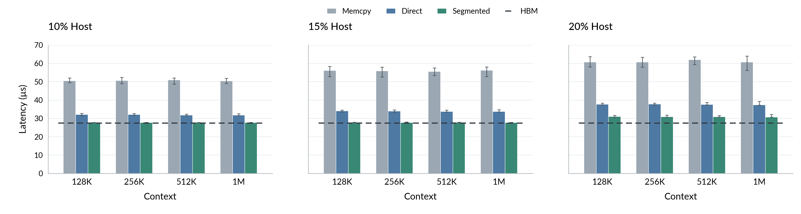

# Host KV 直访 attention 优化汇报

## 背景与目标

长上下文下，KV cache 会占用越来越多的显存。我们希望把部分 KV 放在 CPU 内存中，给 GPU HBM 腾出空间。在本次 DSA top-k=2048 设置下，attention 只读取选中的 2048 个 token，但其中的数据如果来自 CPU，就要经过 PCIe，可能拉长 attention 的等待时间。

这次关注的是：选中的 token 有 20% 及以下来自 Host 时，能否基本保持全本地性能；进一步把比例提高到 25%～30% 时，能否将算子吞吐下降控制在 20% 以内。这里的 Host 命中率指本步选中数据的来源比例，不是整个 KV cache 的容量占比。

## 做了哪些优化

- 把本地计算和 Host 读取并行安排，让 GPU 在等待 CPU 数据时继续处理本地部分。
- 去掉上一版的 HBM 临时中转，由计算单元直接把 Host 数据读入片上内存，减少搬运和等待。
- 分段读取，先用已经到达的数据开始计算；同时调整工作分块，改善 25% 命中附近的计算效率。

这些调整已集成到 attention 的直访路径，原始算子和历次实现的结果也保留了下来。

## 测试结果

测试在 A100 上进行，使用 BF16、单层稀疏 decode attention，top-k=2048，上下文为 128K～1M。对比三种方式：提前拷贝到 HBM、原始算子直接读取 Host，以及优化后的直访。

下表取 **1M 上下文、随机命中**，单位为 **µs**，数值为 40 轮测试的中位数。提前拷贝包含 H2D 传输和 attention；CPU 整理数据及 top-k 计算不计入表中时间。

| Host 命中率 | 提前拷贝（Memcpy） | 原始直访（Direct） | 优化直访（Segmented） |
|---|---:|---:|---:|
| 0% | 27.44 | 27.38 | 27.68 |
| 10% | 50.39 | 31.76 | 27.71 |
| 15% | 56.16 | 33.72 | 27.71 |
| 20% | 60.66 | 37.34 | 30.69 |
| 25% | 65.67 | 41.66 | 34.89 |
| 30% | 69.75 | 46.02 | 40.06 |

**10% 和 15% 已接近全本地，差距约 1%。** 20% 时，相比原始直访，耗时缩短约 18%；但相比全本地仍增加约 12%，CPU 拉取还没有完全隐藏。

25% 和 30% 相比原始直访分别缩短约 16% 和 13%；最近一轮调整相对上一版优化实现又分别缩短约 10% 和 7%。不过，算子吞吐仍比全本地下降约 22% 和 32%，**尚未达到允许下降 20% 的目标**。随机命中下，128K～1M 的结果接近，整体趋势一致。

数值正确性、重复执行和 Host 数据更新检查均通过，也确认了 GPU 实际读取全部选中的 Host 数据。这些结果是单层算子的性能，完整模型的收益还需要端到端验证。

## 下一步

Host 数据到达后，仍有计算和结果合并需要完成。按本机实测带宽估算，25% 和 30% 的有效数据传输分别约需 22 µs 和 26 µs，30% 已接近全本地约 27 µs 的算子时间，留给后续处理的余量很小。接下来重点缩短这部分尾部，继续争取让 20% 及以下更接近全本地，并将 25%～30% 的损失压到目标范围。

## 附图

不同上下文长度下的 GPU 耗时，随机命中。三组柱子与主表对应，误差线为 p10～p90。深色虚线 HBM 是各上下文长度下纯本地原算子的实测基准，约 27.4 µs。

[25% 对比图](../temp/host_attention_comparison/host_25.png) · [30% 对比图](../temp/host_attention_comparison/host_30.png) · [完整表格与图](../temp/host_attention_comparison/report.md) · [设计说明](mla_host_direct_design.md)
