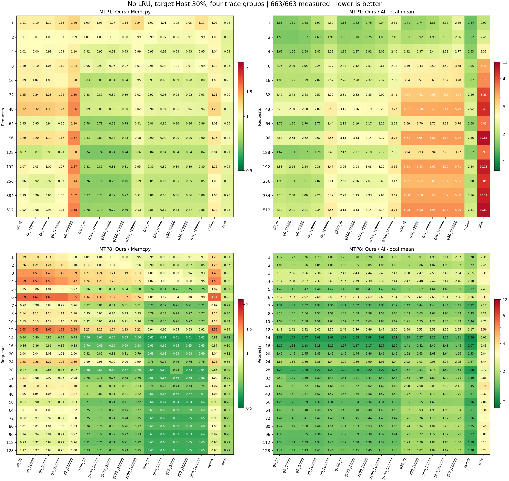
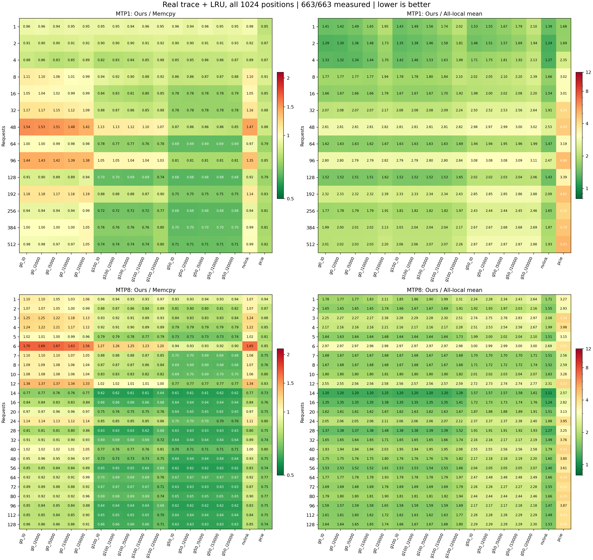

# GLM-5.3 真实 trace：远端 KV sparse MLA kernel 完整性能对比

报告更新时间：2026-10-30 12:17:32 +0800。

实验范围：不开 LRU 4641/4641 格；连续 LRU 663/663 格。
**状态：全组合实验与审计完成。**

本报告全部性能数据来自A100-SXM4-40GB；模拟带宽/延迟不是H800实测。

完整性审计：5304/5304个比较格、312/312个本地参考格，1,955,940次计时launch；15种链路校准与稳定性复测通过。采样数学校验最大绝对误差0.00692034。逐文件SHA和计时队列覆盖记录见audit.json。

## 实测摘要

- 不开LRU：已完成4641格，本文快于Memcpy 2643格；按±3%阅读阈值：快于3% 2368格、接近535格、慢于3% 1738格。本文÷Memcpy范围0.598–2.076，本文÷本地平均范围0.866–10.821。
- 真实trace＋LRU：已完成663格，本文快于Memcpy 538格；按±3%阅读阈值：快于3% 512格、接近45格、慢于3% 106格。本文÷Memcpy范围0.610–1.696，本文÷本地平均范围1.112–5.048。

### 汇报时应强调的结论

- 真实trace＋LRU、100 GB/s＋20 µs：39个形状中36个快于Memcpy，等权几何平均加速1.217倍，耗时为纯本地参考的1.954倍。
- 真实trace＋LRU、50 GB/s＋20 µs：39个形状中39个快于Memcpy，等权几何平均加速1.374倍，耗时为纯本地参考的2.299倍。
- 固定staged配置在部分小batch和物理NVLink格子仍慢于Memcpy；这份完整矩阵保留了这些结果，不能概括成所有参数均已胜出或已接近纯本地。
- 真实trace回放的原始远端引用比例为99.951%–99.953%；开启4096槽LRU后，本文引用命中率为67.44%–87.37%，各batch/MTP的unique命中率、引用命中率及最终远端流量见逐格表。

### 典型参数摘录

这里固定摘录1/4/16/128请求及四类链路；无LRU取目标Host 30%。所有其他比例和batch仍见后面的完整逐格表，不按赢家挑选配置。时间单位µs。

| 场景 | 链路 | MTP | 请求 | 本文 | Memcpy | 纯本地 | 本文÷Memcpy | 本文÷本地 |
|---|---|---:|---:|---:|---:|---:|---:|---:|
| trace＋LRU | 100 GB/s＋20 µs | 1 | 1 | 65.91 | 69.04 | 32.61 | 0.955 | 2.021 |
| trace＋LRU | 100 GB/s＋20 µs | 1 | 4 | 88.95 | 101.16 | 47.24 | 0.879 | 1.883 |
| trace＋LRU | 100 GB/s＋20 µs | 1 | 16 | 159.85 | 187.26 | 83.46 | 0.854 | 1.915 |
| trace＋LRU | 100 GB/s＋20 µs | 1 | 128 | 844.99 | 1139.09 | 511.84 | 0.742 | 1.651 |
| trace＋LRU | 100 GB/s＋20 µs | 8 | 1 | 112.39 | 115.44 | 48.71 | 0.974 | 2.307 |
| trace＋LRU | 100 GB/s＋20 µs | 8 | 4 | 264.67 | 296.42 | 116.17 | 0.893 | 2.278 |
| trace＋LRU | 100 GB/s＋20 µs | 8 | 16 | 709.03 | 1044.07 | 502.99 | 0.679 | 1.410 |
| trace＋LRU | 100 GB/s＋20 µs | 8 | 128 | 4450.15 | 6287.30 | 2467.18 | 0.708 | 1.804 |
| trace＋LRU | 50 GB/s＋20 µs | 1 | 1 | 68.36 | 71.93 | 32.61 | 0.950 | 2.096 |
| trace＋LRU | 50 GB/s＋20 µs | 1 | 4 | 100.68 | 115.10 | 47.24 | 0.875 | 2.131 |
| trace＋LRU | 50 GB/s＋20 µs | 1 | 16 | 183.63 | 232.51 | 83.46 | 0.790 | 2.200 |
| trace＋LRU | 50 GB/s＋20 µs | 1 | 128 | 1051.85 | 1539.34 | 511.84 | 0.683 | 2.055 |
| trace＋LRU | 50 GB/s＋20 µs | 8 | 1 | 128.53 | 136.98 | 48.71 | 0.938 | 2.639 |
| trace＋LRU | 50 GB/s＋20 µs | 8 | 4 | 310.14 | 390.27 | 116.17 | 0.795 | 2.670 |
| trace＋LRU | 50 GB/s＋20 µs | 8 | 16 | 886.76 | 1374.82 | 502.99 | 0.645 | 1.763 |
| trace＋LRU | 50 GB/s＋20 µs | 8 | 128 | 5679.23 | 8968.73 | 2467.18 | 0.633 | 2.302 |
| trace＋LRU | 物理 NVLink | 1 | 1 | 45.36 | 46.52 | 32.61 | 0.975 | 1.391 |
| trace＋LRU | 物理 NVLink | 1 | 4 | 60.15 | 67.90 | 47.24 | 0.886 | 1.273 |
| trace＋LRU | 物理 NVLink | 1 | 16 | 128.60 | 122.89 | 83.46 | 1.047 | 1.541 |
| trace＋LRU | 物理 NVLink | 1 | 128 | 733.90 | 801.55 | 511.84 | 0.916 | 1.434 |
| trace＋LRU | 物理 NVLink | 8 | 1 | 83.39 | 78.25 | 48.71 | 1.066 | 1.712 |
| trace＋LRU | 物理 NVLink | 8 | 4 | 231.33 | 189.93 | 116.17 | 1.218 | 1.991 |
| trace＋LRU | 物理 NVLink | 8 | 16 | 625.87 | 743.69 | 502.99 | 0.842 | 1.244 |
| trace＋LRU | 物理 NVLink | 8 | 128 | 3786.62 | 4436.40 | 2467.18 | 0.854 | 1.535 |
| trace＋LRU | 物理 Host PCIe | 1 | 1 | 54.70 | 64.28 | 32.61 | 0.851 | 1.678 |
| trace＋LRU | 物理 Host PCIe | 1 | 4 | 111.06 | 127.26 | 47.24 | 0.873 | 2.351 |
| trace＋LRU | 物理 Host PCIe | 1 | 16 | 250.96 | 295.60 | 83.46 | 0.849 | 3.007 |
| trace＋LRU | 物理 Host PCIe | 1 | 128 | 1734.48 | 2199.55 | 511.84 | 0.789 | 3.389 |
| trace＋LRU | 物理 Host PCIe | 8 | 1 | 159.41 | 170.40 | 48.71 | 0.936 | 3.273 |
| trace＋LRU | 物理 Host PCIe | 8 | 4 | 461.99 | 544.01 | 116.17 | 0.849 | 3.977 |
| trace＋LRU | 物理 Host PCIe | 8 | 16 | 1418.58 | 1872.98 | 502.99 | 0.757 | 2.820 |
| trace＋LRU | 物理 Host PCIe | 8 | 128 | 10058.17 | 13553.39 | 2467.18 | 0.742 | 4.077 |
| 无LRU，Host30% | 100 GB/s＋20 µs | 1 | 1 | 86.10 | 69.72 | 32.94 | 1.235 | 2.614 |
| 无LRU，Host30% | 100 GB/s＋20 µs | 1 | 4 | 115.29 | 116.31 | 47.96 | 0.991 | 2.404 |
| 无LRU，Host30% | 100 GB/s＋20 µs | 1 | 16 | 236.80 | 248.23 | 83.97 | 0.954 | 2.820 |
| 无LRU，Host30% | 100 GB/s＋20 µs | 1 | 128 | 1317.46 | 1526.19 | 511.32 | 0.863 | 2.577 |
| 无LRU，Host30% | 100 GB/s＋20 µs | 8 | 1 | 97.71 | 102.83 | 49.15 | 0.950 | 1.988 |
| 无LRU，Host30% | 100 GB/s＋20 µs | 8 | 4 | 282.79 | 246.53 | 115.97 | 1.147 | 2.439 |
| 无LRU，Host30% | 100 GB/s＋20 µs | 8 | 16 | 599.89 | 876.46 | 503.47 | 0.684 | 1.192 |
| 无LRU，Host30% | 100 GB/s＋20 µs | 8 | 128 | 3644.25 | 4886.44 | 2456.58 | 0.746 | 1.483 |
| 无LRU，Host30% | 50 GB/s＋20 µs | 1 | 1 | 88.49 | 74.58 | 32.94 | 1.186 | 2.687 |
| 无LRU，Host30% | 50 GB/s＋20 µs | 1 | 4 | 132.69 | 139.35 | 47.96 | 0.952 | 2.767 |
| 无LRU，Host30% | 50 GB/s＋20 µs | 1 | 16 | 317.01 | 354.30 | 83.97 | 0.895 | 3.775 |
| 无LRU，Host30% | 50 GB/s＋20 µs | 1 | 128 | 2028.97 | 2420.99 | 511.32 | 0.838 | 3.968 |
| 无LRU，Host30% | 50 GB/s＋20 µs | 8 | 1 | 113.83 | 116.91 | 49.15 | 0.974 | 2.316 |
| 无LRU，Host30% | 50 GB/s＋20 µs | 8 | 4 | 285.53 | 299.78 | 115.97 | 0.952 | 2.462 |
| 无LRU，Host30% | 50 GB/s＋20 µs | 8 | 16 | 729.26 | 1119.83 | 503.47 | 0.651 | 1.448 |
| 无LRU，Host30% | 50 GB/s＋20 µs | 8 | 128 | 4487.17 | 6903.72 | 2456.58 | 0.650 | 1.827 |
| 无LRU，Host30% | 物理 NVLink | 1 | 1 | 47.27 | 44.37 | 32.94 | 1.065 | 1.435 |
| 无LRU，Host30% | 物理 NVLink | 1 | 4 | 77.99 | 75.18 | 47.96 | 1.037 | 1.626 |
| 无LRU，Host30% | 物理 NVLink | 1 | 16 | 152.92 | 145.07 | 83.97 | 1.054 | 1.821 |
| 无LRU，Host30% | 物理 NVLink | 1 | 128 | 826.62 | 876.80 | 511.32 | 0.943 | 1.617 |
| 无LRU，Host30% | 物理 NVLink | 8 | 1 | 83.80 | 69.80 | 49.15 | 1.200 | 1.705 |
| 无LRU，Host30% | 物理 NVLink | 8 | 4 | 253.01 | 159.74 | 115.97 | 1.584 | 2.182 |
| 无LRU，Host30% | 物理 NVLink | 8 | 16 | 541.10 | 620.63 | 503.47 | 0.872 | 1.075 |
| 无LRU，Host30% | 物理 NVLink | 8 | 128 | 3135.32 | 3305.81 | 2456.58 | 0.948 | 1.276 |
| 无LRU，Host30% | 物理 Host PCIe | 1 | 1 | 68.78 | 71.34 | 32.94 | 0.964 | 2.088 |
| 无LRU，Host30% | 物理 Host PCIe | 1 | 4 | 160.77 | 172.63 | 47.96 | 0.931 | 3.352 |
| 无LRU，Host30% | 物理 Host PCIe | 1 | 16 | 516.61 | 535.55 | 83.97 | 0.965 | 6.152 |
| 无LRU，Host30% | 物理 Host PCIe | 1 | 128 | 3544.92 | 3880.79 | 511.32 | 0.913 | 6.933 |
| 无LRU，Host30% | 物理 Host PCIe | 8 | 1 | 115.46 | 127.32 | 49.15 | 0.907 | 2.349 |
| 无LRU，Host30% | 物理 Host PCIe | 8 | 4 | 370.26 | 414.72 | 115.97 | 0.893 | 3.193 |
| 无LRU，Host30% | 物理 Host PCIe | 8 | 16 | 1222.91 | 1534.04 | 503.47 | 0.797 | 2.429 |
| 无LRU，Host30% | 物理 Host PCIe | 8 | 128 | 7947.26 | 10055.51 | 2456.58 | 0.790 | 3.235 |

±3%是便于阅读的差异分组，不是统计显著性检验。小于pass间波动的差距不宜宣称稳定收益；CSV/JSON保留每次pass均值及极差。

### 传输约束和剩余差距

以下固定列出MTP8、1/4/16/128请求的连续LRU。理想传输仅按实际unique未命中字节/设置带宽计算；理想重叠参考=max(纯本地均值,理想传输)，没有加入附加延迟、LRU或同步开销，因此用于解释差距，不替代实测或证明数学最优。时间单位µs。

| 链路 | 请求 | 本文 | 纯本地 | 理想unique传输 | 理想重叠参考 | 本文÷重叠参考 |
|---|---:|---:|---:|---:|---:|---:|
| 100 GB/s＋20 µs | 1 | 112.39 | 48.71 | 24.94 | 48.71 | 2.307 |
| 100 GB/s＋20 µs | 4 | 264.67 | 116.17 | 98.96 | 116.17 | 2.278 |
| 100 GB/s＋20 µs | 16 | 709.03 | 502.99 | 324.54 | 502.99 | 1.410 |
| 100 GB/s＋20 µs | 128 | 4450.15 | 2467.18 | 2595.96 | 2595.96 | 1.714 |
| 50 GB/s＋20 µs | 1 | 128.53 | 48.71 | 49.90 | 49.90 | 2.576 |
| 50 GB/s＋20 µs | 4 | 310.14 | 116.17 | 197.58 | 197.58 | 1.570 |
| 50 GB/s＋20 µs | 16 | 886.76 | 502.99 | 648.99 | 648.99 | 1.366 |
| 50 GB/s＋20 µs | 128 | 5679.23 | 2467.18 | 5191.78 | 5191.78 | 1.094 |

### 参数分布图

图中无LRU展示目标Host 30%；其他比例仍见完整逐格表。灰色为未完成，图标题注明已测格数；数值越低越好。

### 按链路汇总

各格等权；几何平均用于概览，详细结论以对应batch/MTP/Host比例的逐格实测为准。部分完成时不作全矩阵结论。

| 类别 | 链路 | 已测格 | 快于Memcpy格 | 几何平均加速比 Memcpy/本文 | 几何平均 本文/本地 |
|---|---|---:|---:|---:|---:|
| nocache | g0_l0 | 273 | 90 | 0.892 | 1.535 |
| nocache | g0_l2000 | 273 | 86 | 0.897 | 1.528 |
| nocache | g0_l5000 | 273 | 94 | 0.903 | 1.533 |
| nocache | g0_l10000 | 273 | 96 | 0.909 | 1.551 |
| nocache | g0_l20000 | 273 | 69 | 0.890 | 1.640 |
| nocache | g100_l0 | 273 | 170 | 1.033 | 1.575 |
| nocache | g100_l2000 | 273 | 172 | 1.038 | 1.577 |
| nocache | g100_l5000 | 273 | 175 | 1.042 | 1.585 |
| nocache | g100_l10000 | 273 | 176 | 1.048 | 1.600 |
| nocache | g100_l20000 | 273 | 176 | 1.036 | 1.666 |
| nocache | g50_l0 | 273 | 201 | 1.127 | 1.763 |
| nocache | g50_l2000 | 273 | 203 | 1.130 | 1.769 |
| nocache | g50_l5000 | 273 | 200 | 1.132 | 1.778 |
| nocache | g50_l10000 | 273 | 204 | 1.136 | 1.795 |
| nocache | g50_l20000 | 273 | 205 | 1.142 | 1.830 |
| nocache | nvlink | 273 | 91 | 0.896 | 1.399 |
| nocache | pcie | 273 | 235 | 1.170 | 2.166 |
| lru | g0_l0 | 39 | 20 | 0.976 | 1.780 |
| lru | g0_l2000 | 39 | 20 | 0.978 | 1.783 |
| lru | g0_l5000 | 39 | 21 | 0.988 | 1.787 |
| lru | g0_l10000 | 39 | 23 | 1.001 | 1.802 |
| lru | g0_l20000 | 39 | 23 | 0.984 | 1.899 |
| lru | g100_l0 | 39 | 35 | 1.246 | 1.796 |
| lru | g100_l2000 | 39 | 35 | 1.249 | 1.803 |
| lru | g100_l5000 | 39 | 35 | 1.255 | 1.811 |
| lru | g100_l10000 | 39 | 35 | 1.261 | 1.830 |
| lru | g100_l20000 | 39 | 36 | 1.217 | 1.954 |
| lru | g50_l0 | 39 | 39 | 1.377 | 2.186 |
| lru | g50_l2000 | 39 | 39 | 1.378 | 2.196 |
| lru | g50_l5000 | 39 | 39 | 1.377 | 2.213 |
| lru | g50_l10000 | 39 | 39 | 1.377 | 2.241 |
| lru | g50_l20000 | 39 | 39 | 1.374 | 2.299 |
| lru | nvlink | 39 | 21 | 0.989 | 1.648 |
| lru | pcie | 39 | 39 | 1.241 | 3.506 |

## 1. 研究对象与报告口径

只测 sparse MLA kernel 及必需 KV 搬运，不模拟模型其他部分。三种比较对象是：本文单 cooperative kernel、先 Memcpy/GPU gather 后本地 attention、纯本地 attention。全部查询形状为64头、BF16、512+64维KV、top-k2048。Q/KV为相同随机BF16值，访问索引来自GLM-5.3权重对固定语料的因果计算；不是完整模型生成或真实MTP接受率测试。

Host比例在本报告中指**原始KV需要从远端读取的条目比例**，不是LRU命中率。无LRU部分按固定(request,position)映射指定0/5/10/15/20/25/30%，同时报告实际比例；源trace局部性保持，按四个间隔位置采样单步。LRU部分除最新token外KV原始驻留远端，不人为指定缓存命中率，连续跑完1024位置后记录缓存及最终远端比例。

LRU命中率是对真实top-k索引，在本报告指定的驻留规则、4096槽容量和逐launch LRU政策上回放得到的结果，并非从生产部署直接采集的缓存计数；换容量、驻留策略或请求调度后可能改变。

两部分的原始远端驻留规则不同：无LRU指定0%–30%，连续LRU除最新token外原始KV均在远端。因此不能直接用两部分表格的耗时差声称开启LRU的净收益；各部分均与自身相同输入的两个baseline比较。

## 2. 数据、设备和完整参数

设备：A100-SXM4-40GB双卡，GPU0运行，GPU1为真实NV12远端；物理PCIe为NUMA0 Host pinned内存。模拟链路是在同一真实远端路径上使用原有虚拟链路时钟，带宽按字节收费、访问附加延迟。模拟构建与纯本地下限分别使用独立JIT；不启用可选SMALL_PREPARE优化。全部形状固定使用batched staged路径、fetch CTA=16、Host item=64；单行也显式走该路径，避免旧单query实现缺少完整模拟钩子造成低估。这里评估固定配置，不逐格挑选最优配置。

- MTP1 请求数：1, 2, 4, 8, 16, 32, 48, 64, 96, 128, 192, 256, 384, 512。
- MTP8 请求数：1, 2, 3, 4, 5, 6, 7, 8, 10, 12, 14, 16, 20, 24, 28, 32, 40, 48, 56, 64, 72, 80, 96, 112, 128；query行数=请求数×MTP。
- 模拟组合：不限速/100/50 GB/s × 附加0/2/5/10/20 µs；另加物理NVLink和PCIe。
- 每格3次测量pass；LRU每pass从冷开始，包含第一步；主表为全部步骤/全部pass的算术平均。
- 无LRU取真实窗口偏移0/256/512/768的四个MTP分组，索引随位置改变；每格均检查输出。
- 连续LRU用完整1024位置：MTP1=1024次launch，MTP8=128次；每请求4096槽。
- 请求绑定在所有batch间使用相同前缀，不随batch重新随机选层/窗口。超过84组可用层×窗口后重复绑定，地址空间仍独立，报告不将其称为512个独立真实会话。

trace来自4个完整assistant窗口，每个1024位置；doc1起点35184/41887/48296，doc3起点50621，每窗口21个indexer层，共84组层×窗口。原始top-k有效性和assistant检查通过；原语料全角色block loss gate没有通过，不能据此声称完整模型质量已经验证。MTP8是连续8个实测位置组合，不包含推测生成接受率。batch>128时本地near物理KV按128请求复用，远端和LRU槽按请求独立；这影响本地cache局部性，应将此作为实验范围限制。输入来源和每请求层/窗口绑定保存于raw JSON。

不同请求可绑定不同indexer层的真实窗口，且该绑定在整个回放期间固定。这是由真实访问序列组成的合成batch，不是线上调度器采集的同层并发请求批次；结果用于比较kernel处理这些访问模式的耗时。

## 3. 计时与正确性

链路校准：15种模拟组合全部通过=True；原始记录为同目录calibration.json。

| 设置 | 设置GB/s | 实测GB/s | 附加延迟µs | 实测依赖读µs | 校准 |
|---|---:|---:|---:|---:|---|
| g0_l0 | 0 | 255.11 | 0.0 | 0.962 | 通过 |
| g0_l2000 | 0 | 255.29 | 2.0 | 2.053 | 通过 |
| g0_l5000 | 0 | 254.59 | 5.0 | 5.155 | 通过 |
| g0_l10000 | 0 | 252.24 | 10.0 | 10.265 | 通过 |
| g0_l20000 | 0 | 258.19 | 20.0 | 20.510 | 通过 |
| g100_l0 | 100 | 99.96 | 0.0 | 1.423 | 通过 |
| g100_l2000 | 100 | 99.93 | 2.0 | 2.053 | 通过 |
| g100_l5000 | 100 | 99.90 | 5.0 | 5.135 | 通过 |
| g100_l10000 | 100 | 99.89 | 10.0 | 10.280 | 通过 |
| g100_l20000 | 100 | 99.72 | 20.0 | 20.526 | 通过 |
| g50_l0 | 50 | 50.04 | 0.0 | 1.428 | 通过 |
| g50_l2000 | 50 | 50.05 | 2.0 | 2.053 | 通过 |
| g50_l5000 | 50 | 50.03 | 5.0 | 5.150 | 通过 |
| g50_l10000 | 50 | 50.02 | 10.0 | 10.296 | 通过 |
| g50_l20000 | 50 | 50.00 | 20.0 | 20.526 | 通过 |

CUDA event括住实际GPU工作。每16步一段预先入队，段前GPU等待保护区，记录CPU入队时间和GPU保护区耗时，正式样本必须全部在GPU保护区结束前完成入队，否则整任务失败且不标完成。段间同步保留LRU状态；模型加载、索引上传、CPU规划、参考计算和warm-up不计入主耗时。首次检查pass不参与平均；正式3pass记录全部逐步原始样本及pass均值。

连续LRU后续使用每16步CUDA Graph录制，每段在每个pass回放一次，每步仍用external CUDA event记录；录制本身不执行kernel，不改变LRU，整段GPU工作一次提交，因此没有CPU逐步入队间隙。不含capture/graph launch主机时间，仍保留逐步事件、miss及graph输出正确性锚点。与原guard计时的完整窗口交叉检查：100GB/s＋20µs、MTP8单请求，本文差−0.16%，Memcpy差−1.75%；两份数据均留档。早期5个完整LRU校验格中4格仍用已通过guard的计时，原始JSON逐段记录timing_queue，报告不把两种计时方法隐去。

长trace的校验pass在第0/1/中点/最后一步，检查首/中/末query行与数学参考的一致性；Graph路径还在已选检查点的段末核对回放输出。采样范围与最大误差逐文件保存，不将这些检查描述为每次launch的所有query全量参考验证。

可复用的Graph在不同pass重新回放；每次pass开始都清空本文LRU，Memcpy按同一离线冷启动规划逐步重新装入数据。Graph只复用操作描述，不复用上一pass的LRU热缓存。

Memcpy baseline维护真实缓存KV和有效索引：离线CPU计算精确逐launch LRU、发出未命中搬运，持久槽保存命中页，放不进缓存的本步页写临时槽；attention在正确命中/未命中数据上执行，采样query行与数学参考比较。GPU gather/H2D、写缓存槽及attention均计时；CPU LRU规划和PCIe CPU gather不计时，后者另保存耗时，所以它是GPU部分对照，不是完整CPU+GPU延迟。没有沿用此前只搬未命中却缺完整缓存结果的计时替身。

大batch的Host源数据按段打包，避免为完整窗口一次保留上百GB的pinned内存。每步拥有独立源缓冲，并在该段GPU完成后才释放；CPU打包和索引上传仍在事件外，实际H2D、缓存scatter与attention仍全部计时。每份新数据记录其预打包内存上限。

无LRU Memcpy使用连续的本地staging，直接H2D/gather写入该区域，不额外scatter。修正前已通过的本文样本原样保留，只重测对应Memcpy，前后源码SHA与旧Memcpy样本都记录；主表只接受memcpy_path_version=2的对照。LRU因持久槽不连续，保留必要的scatter。

纯本地baseline正常构建、每个选中KV均预先放在本地且输出正确，数据准备在计时外，只计attention。主表用算术平均；另外保留同形状最快实测样本作乐观计算下限。纯本地是零远端传输参考，不是数学证明的绝对最快kernel；所有比值原样保留，不强行截断到≥1。

本地参考将每一步所需的远端页去重、紧凑放置在本地staging，再用相同query和完整selected KV计算。因此它是可容纳于40GB设备的全本地工作集参考，不要求把所有请求的整个64K历史同时放入本地。对应no-LRU比较逐个Host比例使用完全相同映射的四个位置本地样本，另有273个本地对照格；LRU比较取完整1024位置的本地均值。

如何解释距离本地极限：若每步仍需搬运B字节，带宽W GB/s，则仅传输理想时间为B/(1000W) µs；以max(本地计算实测,理想传输)作为理想重叠参考。该参考中的本地时间来自指定attention实现，不能视为所有可能kernel的数学下界。因此远端流量较高且链路只有50GB/s时，本文/本地显著大于1并不全是调度浪费。matrix.csv/json额外保存这一乐观参考，不计附加延迟且不用于替代实测。

baseline的离线LRU规划另通过独立Python oracle，覆盖逐步淘汰、同stamp并列、MTP内重复、容量溢出与实际payload映射，结果为planner_check.json；完整1024位置真实trace的串行/并行规划逐数组和逐步payload复核见planner_real_trace_check.json。计时保护区和诊断读取不计入kernel事件；CPU标量写GPU造成的隐式同步已在正式采样前排除。失败和预实验保留在failures/，不进入汇报表。

| 类别 | 本文最大pass极差/均值 | Memcpy最大pass极差/均值 |
|---|---:|---:|
| nocache | 18.73% | 15.34% |
| lru | 6.47% | 4.29% |

这里的最大值覆盖全部参数格，反映三次pass间的最大波动；汇报小幅收益时应同时查看该格的pass均值。

## 4. 不开 LRU：全组合结果

时间单位µs。本文÷本地越接近1越好，本文÷Memcpy小于1代表本文更快。
### 不限速＋0 µs（g0_l0）

#### MTP1

| 请求 | query行 | 目标Host% | 实际Host% | 本文µs | Memcpyµs | 纯本地µs | 本文÷Memcpy | 本文÷本地 |
|---:|---:|---:|---:|---:|---:|---:|---:|---:|
| 1 | 1 | 0 | 0.00 | 33.19 | 34.47 | 33.02 | 0.963 | 1.005 |
| 1 | 1 | 5 | 5.07 | 43.01 | 44.63 | 32.77 | 0.964 | 1.312 |
| 1 | 1 | 10 | 9.55 | 43.61 | 45.31 | 32.68 | 0.962 | 1.334 |
| 1 | 1 | 15 | 14.45 | 45.82 | 45.82 | 32.77 | 1.000 | 1.398 |
| 1 | 1 | 20 | 19.18 | 46.59 | 45.57 | 32.68 | 1.022 | 1.426 |
| 1 | 1 | 25 | 24.01 | 47.19 | 46.17 | 32.94 | 1.022 | 1.433 |
| 1 | 1 | 30 | 29.20 | 51.54 | 46.51 | 32.94 | 1.108 | 1.565 |
| 2 | 2 | 0 | 0.00 | 39.68 | 45.06 | 42.58 | 0.881 | 0.932 |
| 2 | 2 | 5 | 5.15 | 48.47 | 54.53 | 42.15 | 0.889 | 1.150 |
| 2 | 2 | 10 | 9.81 | 51.97 | 55.81 | 42.15 | 0.931 | 1.233 |
| 2 | 2 | 15 | 14.72 | 57.26 | 57.43 | 42.41 | 0.997 | 1.350 |
| 2 | 2 | 20 | 19.36 | 61.10 | 60.07 | 42.24 | 1.017 | 1.446 |
| 2 | 2 | 25 | 24.25 | 63.83 | 61.35 | 42.07 | 1.040 | 1.517 |
| 2 | 2 | 30 | 29.57 | 64.94 | 64.26 | 42.41 | 1.011 | 1.531 |
| 4 | 4 | 0 | 0.00 | 47.27 | 52.22 | 48.04 | 0.905 | 0.984 |
| 4 | 4 | 5 | 5.15 | 55.13 | 62.55 | 48.13 | 0.881 | 1.145 |
| 4 | 4 | 10 | 10.05 | 66.05 | 66.99 | 48.21 | 0.986 | 1.370 |
| 4 | 4 | 15 | 14.88 | 69.72 | 70.57 | 47.87 | 0.988 | 1.456 |
| 4 | 4 | 20 | 19.65 | 72.79 | 73.30 | 47.79 | 0.993 | 1.523 |
| 4 | 4 | 25 | 24.52 | 75.35 | 76.63 | 47.79 | 0.983 | 1.577 |
| 4 | 4 | 30 | 29.64 | 79.87 | 79.45 | 47.96 | 1.005 | 1.665 |
| 8 | 8 | 0 | 0.00 | 66.82 | 55.38 | 51.46 | 1.206 | 1.299 |
| 8 | 8 | 5 | 5.06 | 95.06 | 70.66 | 51.20 | 1.345 | 1.857 |
| 8 | 8 | 10 | 10.13 | 97.19 | 77.14 | 51.29 | 1.260 | 1.895 |
| 8 | 8 | 15 | 14.89 | 102.83 | 83.29 | 51.37 | 1.235 | 2.002 |
| 8 | 8 | 20 | 19.72 | 101.80 | 88.75 | 52.05 | 1.147 | 1.956 |
| 8 | 8 | 25 | 24.69 | 102.49 | 92.93 | 51.54 | 1.103 | 1.988 |
| 8 | 8 | 30 | 29.71 | 105.47 | 96.26 | 51.37 | 1.096 | 2.053 |
| 16 | 16 | 0 | 0.00 | 100.35 | 89.00 | 81.32 | 1.128 | 1.234 |
| 16 | 16 | 5 | 5.08 | 146.18 | 111.19 | 81.49 | 1.315 | 1.794 |
| 16 | 16 | 10 | 10.14 | 155.82 | 123.90 | 82.01 | 1.258 | 1.900 |
| 16 | 16 | 15 | 15.09 | 152.92 | 131.16 | 82.77 | 1.166 | 1.847 |
| 16 | 16 | 20 | 19.95 | 153.51 | 138.15 | 83.11 | 1.111 | 1.847 |
| 16 | 16 | 25 | 24.92 | 163.75 | 145.32 | 83.54 | 1.127 | 1.960 |
| 16 | 16 | 30 | 29.97 | 166.49 | 152.75 | 83.97 | 1.090 | 1.983 |
| 32 | 32 | 0 | 0.00 | 167.00 | 131.58 | 119.89 | 1.269 | 1.393 |
| 32 | 32 | 5 | 5.07 | 256.43 | 166.66 | 122.28 | 1.539 | 2.097 |
| 32 | 32 | 10 | 10.10 | 261.12 | 182.44 | 122.37 | 1.431 | 2.134 |
| 32 | 32 | 15 | 14.99 | 277.76 | 197.21 | 123.05 | 1.408 | 2.257 |
| 32 | 32 | 20 | 19.86 | 289.62 | 212.65 | 122.79 | 1.362 | 2.359 |
| 32 | 32 | 25 | 24.88 | 288.43 | 226.65 | 122.62 | 1.273 | 2.352 |
| 32 | 32 | 30 | 29.99 | 304.30 | 242.94 | 122.28 | 1.253 | 2.488 |
| 48 | 48 | 0 | 0.00 | 217.43 | 162.47 | 148.39 | 1.338 | 1.465 |
| 48 | 48 | 5 | 5.02 | 348.42 | 206.76 | 151.04 | 1.685 | 2.307 |
| 48 | 48 | 10 | 10.05 | 352.34 | 229.12 | 151.47 | 1.538 | 2.326 |
| 48 | 48 | 15 | 14.93 | 365.91 | 252.42 | 151.89 | 1.450 | 2.409 |
| 48 | 48 | 20 | 19.85 | 393.90 | 274.52 | 150.61 | 1.435 | 2.615 |
| 48 | 48 | 25 | 24.88 | 412.50 | 297.13 | 150.36 | 1.388 | 2.743 |
| 48 | 48 | 30 | 29.95 | 420.35 | 318.89 | 150.70 | 1.318 | 2.789 |
| 64 | 64 | 0 | 0.00 | 292.35 | 315.82 | 285.70 | 0.926 | 1.023 |
| 64 | 64 | 5 | 5.00 | 372.91 | 368.04 | 289.79 | 1.013 | 1.287 |
| 64 | 64 | 10 | 10.05 | 402.18 | 398.17 | 289.45 | 1.010 | 1.389 |
| 64 | 64 | 15 | 14.94 | 423.94 | 427.18 | 288.51 | 0.992 | 1.469 |
| 64 | 64 | 20 | 19.91 | 463.02 | 456.28 | 288.60 | 1.015 | 1.604 |
| 64 | 64 | 25 | 24.91 | 471.72 | 487.17 | 288.43 | 0.968 | 1.636 |
| 64 | 64 | 30 | 29.97 | 489.73 | 517.12 | 288.34 | 0.947 | 1.698 |
| 96 | 96 | 0 | 0.00 | 389.80 | 291.07 | 263.25 | 1.339 | 1.481 |
| 96 | 96 | 5 | 5.00 | 651.86 | 360.45 | 268.37 | 1.808 | 2.429 |
| 96 | 96 | 10 | 10.04 | 665.77 | 405.25 | 266.75 | 1.643 | 2.496 |
| 96 | 96 | 15 | 14.97 | 691.03 | 450.30 | 266.75 | 1.535 | 2.591 |
| 96 | 96 | 20 | 19.97 | 704.17 | 494.85 | 266.75 | 1.423 | 2.640 |
| 96 | 96 | 25 | 24.97 | 738.22 | 539.22 | 266.92 | 1.369 | 2.766 |
| 96 | 96 | 30 | 30.02 | 703.15 | 583.77 | 267.18 | 1.205 | 2.632 |
| 128 | 128 | 0 | 0.00 | 530.52 | 566.10 | 507.14 | 0.937 | 1.046 |
| 128 | 128 | 5 | 5.01 | 617.90 | 649.90 | 512.34 | 0.951 | 1.206 |
| 128 | 128 | 10 | 10.06 | 620.46 | 711.25 | 511.57 | 0.872 | 1.213 |
| 128 | 128 | 15 | 15.02 | 640.51 | 770.39 | 511.74 | 0.831 | 1.252 |
| 128 | 128 | 20 | 20.01 | 654.08 | 828.59 | 511.91 | 0.789 | 1.278 |
| 128 | 128 | 25 | 25.01 | 718.25 | 889.00 | 511.40 | 0.808 | 1.404 |
| 128 | 128 | 30 | 30.04 | 827.22 | 947.29 | 511.32 | 0.873 | 1.618 |
| 192 | 192 | 0 | 0.00 | 729.69 | 571.14 | 513.88 | 1.278 | 1.420 |
| 192 | 192 | 5 | 5.02 | 1006.59 | 685.31 | 518.40 | 1.469 | 1.942 |
| 192 | 192 | 10 | 10.04 | 1039.53 | 775.85 | 517.46 | 1.340 | 2.009 |
| 192 | 192 | 15 | 15.02 | 1055.57 | 863.49 | 518.40 | 1.222 | 2.036 |
| 192 | 192 | 20 | 20.02 | 1062.31 | 952.58 | 518.06 | 1.115 | 2.051 |
| 192 | 192 | 25 | 25.03 | 1076.48 | 1041.24 | 518.06 | 1.034 | 2.078 |
| 192 | 192 | 30 | 30.04 | 1206.02 | 1130.75 | 517.80 | 1.067 | 2.329 |
| 256 | 256 | 0 | 0.00 | 1015.04 | 846.08 | 758.78 | 1.200 | 1.338 |
| 256 | 256 | 5 | 5.03 | 1032.70 | 992.26 | 765.61 | 1.041 | 1.349 |
| 256 | 256 | 10 | 10.04 | 1094.83 | 1110.36 | 765.44 | 0.986 | 1.430 |
| 256 | 256 | 15 | 15.02 | 1137.15 | 1227.69 | 765.01 | 0.926 | 1.486 |
| 256 | 256 | 20 | 20.02 | 1169.49 | 1346.82 | 765.01 | 0.868 | 1.529 |
| 256 | 256 | 25 | 25.02 | 1292.46 | 1463.98 | 765.61 | 0.883 | 1.688 |
| 256 | 256 | 30 | 30.04 | 1511.68 | 1581.82 | 764.33 | 0.956 | 1.978 |
| 384 | 384 | 0 | 0.00 | 1335.47 | 1130.33 | 1016.83 | 1.181 | 1.313 |
| 384 | 384 | 5 | 5.02 | 1383.77 | 1333.08 | 1018.28 | 1.038 | 1.359 |
| 384 | 384 | 10 | 10.03 | 1638.23 | 1510.91 | 1019.22 | 1.084 | 1.607 |
| 384 | 384 | 15 | 15.01 | 1681.92 | 1684.74 | 1019.14 | 0.998 | 1.650 |
| 384 | 384 | 20 | 20.00 | 1723.65 | 1863.08 | 1017.43 | 0.925 | 1.694 |
| 384 | 384 | 25 | 25.01 | 1874.09 | 2039.04 | 1018.11 | 0.919 | 1.841 |
| 384 | 384 | 30 | 30.01 | 2200.75 | 2215.85 | 1018.37 | 0.993 | 2.161 |
| 512 | 512 | 0 | 0.00 | 1673.22 | 1406.46 | 1264.21 | 1.190 | 1.324 |
| 512 | 512 | 5 | 5.02 | 1863.77 | 1670.57 | 1268.57 | 1.116 | 1.469 |
| 512 | 512 | 10 | 10.03 | 1866.92 | 1905.66 | 1269.76 | 0.980 | 1.470 |
| 512 | 512 | 15 | 15.00 | 2004.31 | 2138.28 | 1268.31 | 0.937 | 1.580 |
| 512 | 512 | 20 | 19.99 | 2052.86 | 2374.31 | 1267.71 | 0.865 | 1.619 |
| 512 | 512 | 25 | 25.01 | 2473.64 | 2610.69 | 1267.71 | 0.948 | 1.951 |
| 512 | 512 | 30 | 29.99 | 2913.37 | 2845.53 | 1268.14 | 1.024 | 2.297 |

#### MTP8

| 请求 | query行 | 目标Host% | 实际Host% | 本文µs | Memcpyµs | 纯本地µs | 本文÷Memcpy | 本文÷本地 |
|---:|---:|---:|---:|---:|---:|---:|---:|---:|
| 1 | 8 | 0 | 0.00 | 57.77 | 53.16 | 49.58 | 1.087 | 1.165 |
| 1 | 8 | 5 | 5.08 | 81.49 | 62.46 | 49.41 | 1.305 | 1.649 |
| 1 | 8 | 10 | 9.84 | 88.49 | 64.34 | 49.58 | 1.375 | 1.785 |
| 1 | 8 | 15 | 14.76 | 89.94 | 67.84 | 49.24 | 1.326 | 1.827 |
| 1 | 8 | 20 | 19.53 | 86.44 | 69.55 | 49.15 | 1.243 | 1.759 |
| 1 | 8 | 25 | 24.56 | 85.08 | 71.00 | 49.24 | 1.198 | 1.728 |
| 1 | 8 | 30 | 29.54 | 87.04 | 72.96 | 49.15 | 1.193 | 1.771 |
| 2 | 16 | 0 | 0.00 | 84.57 | 85.25 | 78.08 | 0.992 | 1.083 |
| 2 | 16 | 5 | 5.26 | 128.77 | 96.00 | 78.51 | 1.341 | 1.640 |
| 2 | 16 | 10 | 10.10 | 139.78 | 100.61 | 78.08 | 1.389 | 1.790 |
| 2 | 16 | 15 | 14.97 | 140.37 | 103.68 | 77.74 | 1.354 | 1.806 |
| 2 | 16 | 20 | 19.74 | 135.08 | 106.75 | 78.25 | 1.265 | 1.726 |
| 2 | 16 | 25 | 24.74 | 137.30 | 111.36 | 77.99 | 1.233 | 1.760 |
| 2 | 16 | 30 | 29.95 | 144.81 | 115.29 | 78.25 | 1.256 | 1.851 |
| 3 | 24 | 0 | 0.00 | 114.18 | 88.75 | 80.98 | 1.287 | 1.410 |
| 3 | 24 | 5 | 5.27 | 178.86 | 102.91 | 81.41 | 1.738 | 2.197 |
| 3 | 24 | 10 | 10.16 | 188.16 | 109.57 | 80.98 | 1.717 | 2.323 |
| 3 | 24 | 15 | 14.97 | 187.90 | 115.54 | 80.81 | 1.626 | 2.325 |
| 3 | 24 | 20 | 19.80 | 188.25 | 119.64 | 81.75 | 1.573 | 2.303 |
| 3 | 24 | 25 | 24.88 | 196.78 | 125.10 | 81.75 | 1.573 | 2.407 |
| 3 | 24 | 30 | 29.97 | 194.73 | 128.60 | 82.60 | 1.514 | 2.357 |
| 4 | 32 | 0 | 0.00 | 155.82 | 125.27 | 113.32 | 1.244 | 1.375 |
| 4 | 32 | 5 | 5.23 | 235.52 | 141.99 | 113.24 | 1.659 | 2.080 |
| 4 | 32 | 10 | 10.21 | 247.89 | 149.42 | 114.26 | 1.659 | 2.170 |
| 4 | 32 | 15 | 15.02 | 250.28 | 156.42 | 114.43 | 1.600 | 2.187 |
| 4 | 32 | 20 | 19.80 | 272.21 | 163.58 | 115.46 | 1.664 | 2.358 |
| 4 | 32 | 25 | 24.79 | 269.40 | 168.19 | 115.80 | 1.602 | 2.326 |
| 4 | 32 | 30 | 29.77 | 274.35 | 172.89 | 115.97 | 1.587 | 2.366 |
| 5 | 40 | 0 | 0.00 | 200.36 | 201.30 | 180.74 | 0.995 | 1.109 |
| 5 | 40 | 5 | 5.26 | 206.34 | 219.39 | 181.67 | 0.940 | 1.136 |
| 5 | 40 | 10 | 10.31 | 217.60 | 230.74 | 182.61 | 0.943 | 1.192 |
| 5 | 40 | 15 | 15.19 | 229.03 | 238.08 | 182.70 | 0.962 | 1.254 |
| 5 | 40 | 20 | 20.01 | 248.58 | 244.99 | 183.13 | 1.015 | 1.357 |
| 5 | 40 | 25 | 24.99 | 257.71 | 250.45 | 183.30 | 1.029 | 1.406 |
| 5 | 40 | 30 | 29.97 | 270.68 | 256.77 | 183.13 | 1.054 | 1.478 |
| 6 | 48 | 0 | 0.00 | 206.34 | 157.61 | 142.59 | 1.309 | 1.447 |
| 6 | 48 | 5 | 5.24 | 318.38 | 178.77 | 142.76 | 1.781 | 2.230 |
| 6 | 48 | 10 | 10.18 | 334.42 | 188.42 | 143.87 | 1.775 | 2.324 |
| 6 | 48 | 15 | 14.92 | 341.76 | 198.06 | 144.64 | 1.726 | 2.363 |
| 6 | 48 | 20 | 19.85 | 365.82 | 205.14 | 145.49 | 1.783 | 2.514 |
| 6 | 48 | 25 | 24.89 | 368.47 | 211.46 | 145.92 | 1.743 | 2.525 |
| 6 | 48 | 30 | 29.93 | 368.64 | 217.69 | 146.01 | 1.693 | 2.525 |
| 7 | 56 | 0 | 0.00 | 275.03 | 306.43 | 274.52 | 0.898 | 1.002 |
| 7 | 56 | 5 | 5.11 | 276.91 | 328.02 | 275.71 | 0.844 | 1.004 |
| 7 | 56 | 10 | 10.12 | 288.34 | 342.27 | 275.37 | 0.842 | 1.047 |
| 7 | 56 | 15 | 14.89 | 302.85 | 350.21 | 277.08 | 0.865 | 1.093 |
| 7 | 56 | 20 | 19.85 | 341.50 | 357.21 | 276.39 | 0.956 | 1.236 |
| 7 | 56 | 25 | 24.85 | 350.89 | 365.48 | 276.74 | 0.960 | 1.268 |
| 7 | 56 | 30 | 29.95 | 363.86 | 372.31 | 277.08 | 0.977 | 1.313 |
| 8 | 64 | 0 | 0.00 | 276.31 | 310.27 | 278.61 | 0.891 | 0.992 |
| 8 | 64 | 5 | 5.09 | 329.13 | 333.14 | 279.47 | 0.988 | 1.178 |
| 8 | 64 | 10 | 10.15 | 365.14 | 347.99 | 280.15 | 1.049 | 1.303 |
| 8 | 64 | 15 | 14.93 | 379.73 | 356.52 | 280.32 | 1.065 | 1.355 |
| 8 | 64 | 20 | 19.84 | 415.91 | 364.63 | 280.58 | 1.141 | 1.482 |
| 8 | 64 | 25 | 24.84 | 433.41 | 372.91 | 281.00 | 1.162 | 1.542 |
| 8 | 64 | 30 | 29.79 | 436.22 | 381.87 | 281.69 | 1.142 | 1.549 |
| 10 | 80 | 0 | 0.00 | 313.51 | 313.69 | 282.03 | 0.999 | 1.112 |
| 10 | 80 | 5 | 5.06 | 394.58 | 341.25 | 282.88 | 1.156 | 1.395 |
| 10 | 80 | 10 | 10.09 | 399.62 | 356.10 | 284.42 | 1.122 | 1.405 |
| 10 | 80 | 15 | 14.92 | 438.19 | 366.68 | 284.33 | 1.195 | 1.541 |
| 10 | 80 | 20 | 19.82 | 440.66 | 376.49 | 284.33 | 1.170 | 1.550 |
| 10 | 80 | 25 | 24.81 | 450.65 | 387.75 | 284.93 | 1.162 | 1.582 |
| 10 | 80 | 30 | 29.83 | 451.41 | 398.17 | 285.27 | 1.134 | 1.582 |
| 12 | 96 | 0 | 0.00 | 374.78 | 288.43 | 258.56 | 1.299 | 1.450 |
| 12 | 96 | 5 | 5.08 | 590.42 | 320.00 | 260.86 | 1.845 | 2.263 |
| 12 | 96 | 10 | 10.08 | 637.78 | 336.47 | 262.06 | 1.896 | 2.434 |
| 12 | 96 | 15 | 14.94 | 635.05 | 349.10 | 262.23 | 1.819 | 2.422 |
| 12 | 96 | 20 | 19.83 | 646.06 | 362.41 | 261.80 | 1.783 | 2.468 |
| 12 | 96 | 25 | 24.86 | 676.27 | 376.15 | 262.66 | 1.798 | 2.575 |
| 12 | 96 | 30 | 29.88 | 635.73 | 389.29 | 262.31 | 1.633 | 2.424 |
| 14 | 112 | 0 | 0.00 | 485.21 | 559.96 | 498.35 | 0.867 | 0.974 |
| 14 | 112 | 5 | 5.09 | 498.43 | 596.05 | 499.80 | 0.836 | 0.997 |
| 14 | 112 | 10 | 10.08 | 498.77 | 612.01 | 500.05 | 0.815 | 0.997 |
| 14 | 112 | 15 | 15.00 | 513.37 | 626.69 | 500.39 | 0.819 | 1.026 |
| 14 | 112 | 20 | 19.90 | 508.50 | 641.45 | 500.39 | 0.793 | 1.016 |
| 14 | 112 | 25 | 24.94 | 535.47 | 656.73 | 501.16 | 0.815 | 1.068 |
| 14 | 112 | 30 | 29.94 | 536.83 | 671.91 | 500.99 | 0.799 | 1.072 |
| 16 | 128 | 0 | 0.00 | 495.27 | 561.75 | 501.76 | 0.882 | 0.987 |
| 16 | 128 | 5 | 5.07 | 578.22 | 599.47 | 501.50 | 0.965 | 1.153 |
| 16 | 128 | 10 | 10.14 | 557.74 | 615.94 | 501.93 | 0.906 | 1.111 |
| 16 | 128 | 15 | 15.09 | 566.27 | 632.92 | 502.53 | 0.895 | 1.127 |
| 16 | 128 | 20 | 19.99 | 575.06 | 650.75 | 503.04 | 0.884 | 1.143 |
| 16 | 128 | 25 | 25.01 | 588.20 | 668.16 | 503.38 | 0.880 | 1.169 |
| 16 | 128 | 30 | 29.99 | 591.02 | 685.91 | 503.47 | 0.862 | 1.174 |
| 20 | 160 | 0 | 0.00 | 573.44 | 561.07 | 500.91 | 1.022 | 1.145 |
| 20 | 160 | 5 | 5.03 | 699.73 | 603.14 | 502.95 | 1.160 | 1.391 |
| 20 | 160 | 10 | 10.11 | 694.78 | 624.13 | 504.58 | 1.113 | 1.377 |
| 20 | 160 | 15 | 15.06 | 702.63 | 645.89 | 506.03 | 1.088 | 1.389 |
| 20 | 160 | 20 | 19.95 | 711.51 | 666.54 | 505.51 | 1.067 | 1.407 |
| 20 | 160 | 25 | 24.98 | 703.49 | 686.59 | 504.32 | 1.025 | 1.395 |
| 20 | 160 | 30 | 29.97 | 735.15 | 707.41 | 505.60 | 1.039 | 1.454 |
| 24 | 192 | 0 | 0.00 | 715.35 | 562.94 | 503.47 | 1.271 | 1.421 |
| 24 | 192 | 5 | 5.03 | 861.61 | 610.39 | 507.65 | 1.412 | 1.697 |
| 24 | 192 | 10 | 10.06 | 955.22 | 636.25 | 507.73 | 1.501 | 1.881 |
| 24 | 192 | 15 | 14.99 | 953.00 | 661.67 | 508.25 | 1.440 | 1.875 |
| 24 | 192 | 20 | 19.91 | 944.55 | 687.36 | 507.65 | 1.374 | 1.861 |
| 24 | 192 | 25 | 24.91 | 961.45 | 712.28 | 507.65 | 1.350 | 1.894 |
| 24 | 192 | 30 | 29.94 | 942.76 | 737.28 | 508.25 | 1.279 | 1.855 |
| 28 | 224 | 0 | 0.00 | 775.77 | 835.24 | 740.95 | 0.929 | 1.047 |
| 28 | 224 | 5 | 5.05 | 820.31 | 887.47 | 744.53 | 0.924 | 1.102 |
| 28 | 224 | 10 | 10.10 | 849.58 | 915.88 | 745.05 | 0.928 | 1.140 |
| 28 | 224 | 15 | 15.02 | 827.99 | 947.80 | 744.79 | 0.874 | 1.112 |
| 28 | 224 | 20 | 19.92 | 844.37 | 976.98 | 745.05 | 0.864 | 1.133 |
| 28 | 224 | 25 | 24.90 | 869.03 | 1007.45 | 745.13 | 0.863 | 1.166 |
| 28 | 224 | 30 | 29.94 | 898.47 | 1037.31 | 745.64 | 0.866 | 1.205 |
| 32 | 256 | 0 | 0.00 | 1210.79 | 836.95 | 746.24 | 1.447 | 1.623 |
| 32 | 256 | 5 | 5.04 | 1252.52 | 894.46 | 752.04 | 1.400 | 1.665 |
| 32 | 256 | 10 | 10.10 | 1175.98 | 931.50 | 750.59 | 1.262 | 1.567 |
| 32 | 256 | 15 | 15.02 | 1231.10 | 966.91 | 751.53 | 1.273 | 1.638 |
| 32 | 256 | 20 | 19.90 | 1029.12 | 1002.15 | 750.93 | 1.027 | 1.370 |
| 32 | 256 | 25 | 24.93 | 1032.62 | 1036.37 | 751.96 | 0.996 | 1.373 |
| 32 | 256 | 30 | 29.98 | 1192.19 | 1071.45 | 751.45 | 1.113 | 1.587 |
| 40 | 320 | 0 | 0.00 | 1020.16 | 841.05 | 754.86 | 1.213 | 1.351 |
| 40 | 320 | 5 | 5.04 | 1167.53 | 907.35 | 758.02 | 1.287 | 1.540 |
| 40 | 320 | 10 | 10.07 | 1135.96 | 949.67 | 758.87 | 1.196 | 1.497 |
| 40 | 320 | 15 | 14.98 | 1164.97 | 991.49 | 757.42 | 1.175 | 1.538 |
| 40 | 320 | 20 | 19.88 | 1147.99 | 1033.13 | 757.59 | 1.111 | 1.515 |
| 40 | 320 | 25 | 24.92 | 1218.65 | 1074.52 | 758.10 | 1.134 | 1.607 |
| 40 | 320 | 30 | 29.96 | 1225.39 | 1115.99 | 758.61 | 1.098 | 1.615 |
| 48 | 384 | 0 | 0.00 | 1287.08 | 1113.17 | 995.24 | 1.156 | 1.293 |
| 48 | 384 | 5 | 5.01 | 1295.70 | 1187.16 | 998.66 | 1.091 | 1.297 |
| 48 | 384 | 10 | 10.06 | 1296.98 | 1237.50 | 998.74 | 1.048 | 1.299 |
| 48 | 384 | 15 | 14.96 | 1498.11 | 1287.17 | 996.35 | 1.164 | 1.504 |
| 48 | 384 | 20 | 19.88 | 1496.23 | 1336.83 | 997.21 | 1.119 | 1.500 |
| 48 | 384 | 25 | 24.92 | 1503.74 | 1386.67 | 997.72 | 1.084 | 1.507 |
| 48 | 384 | 30 | 29.95 | 1509.80 | 1436.59 | 996.69 | 1.051 | 1.515 |
| 56 | 448 | 0 | 0.00 | 1545.47 | 1382.66 | 1232.30 | 1.118 | 1.254 |
| 56 | 448 | 5 | 4.99 | 1567.74 | 1461.67 | 1236.39 | 1.073 | 1.268 |
| 56 | 448 | 10 | 10.07 | 1558.19 | 1521.58 | 1235.63 | 1.024 | 1.261 |
| 56 | 448 | 15 | 14.99 | 1548.89 | 1579.86 | 1234.69 | 0.980 | 1.254 |
| 56 | 448 | 20 | 19.93 | 1576.45 | 1638.31 | 1233.66 | 0.962 | 1.278 |
| 56 | 448 | 25 | 24.97 | 1579.69 | 1697.71 | 1233.49 | 0.930 | 1.281 |
| 56 | 448 | 30 | 29.99 | 1591.72 | 1754.79 | 1234.09 | 0.907 | 1.290 |
| 64 | 512 | 0 | 0.00 | 1589.76 | 1386.15 | 1234.18 | 1.147 | 1.288 |
| 64 | 512 | 5 | 5.00 | 1670.91 | 1476.78 | 1238.44 | 1.131 | 1.349 |
| 64 | 512 | 10 | 10.06 | 1722.97 | 1543.68 | 1236.91 | 1.116 | 1.393 |
| 64 | 512 | 15 | 14.97 | 1711.45 | 1612.37 | 1237.33 | 1.061 | 1.383 |
| 64 | 512 | 20 | 19.93 | 1787.99 | 1679.19 | 1236.82 | 1.065 | 1.446 |
| 64 | 512 | 25 | 24.95 | 1768.19 | 1746.09 | 1237.08 | 1.013 | 1.429 |
| 64 | 512 | 30 | 29.97 | 1827.58 | 1813.33 | 1236.65 | 1.008 | 1.478 |
| 72 | 576 | 0 | 0.00 | 1859.24 | 1647.62 | 1469.95 | 1.128 | 1.265 |
| 72 | 576 | 5 | 4.99 | 1874.52 | 1747.29 | 1473.54 | 1.073 | 1.272 |
| 72 | 576 | 10 | 10.06 | 1873.07 | 1825.19 | 1472.26 | 1.026 | 1.272 |
| 72 | 576 | 15 | 14.97 | 1996.63 | 1901.14 | 1472.26 | 1.050 | 1.356 |
| 72 | 576 | 20 | 19.94 | 2060.89 | 1976.83 | 1471.66 | 1.043 | 1.400 |
| 72 | 576 | 25 | 24.96 | 2068.14 | 2052.44 | 1472.00 | 1.008 | 1.405 |
| 72 | 576 | 30 | 29.99 | 2080.43 | 2128.04 | 1472.60 | 0.978 | 1.413 |
| 80 | 640 | 0 | 0.00 | 1893.72 | 1657.69 | 1477.55 | 1.142 | 1.282 |
| 80 | 640 | 5 | 4.99 | 2187.43 | 1763.50 | 1480.45 | 1.240 | 1.478 |
| 80 | 640 | 10 | 10.06 | 2165.16 | 1847.64 | 1479.51 | 1.172 | 1.463 |
| 80 | 640 | 15 | 14.99 | 2141.61 | 1930.50 | 1480.02 | 1.109 | 1.447 |
| 80 | 640 | 20 | 19.97 | 2143.40 | 2014.29 | 1479.08 | 1.064 | 1.449 |
| 80 | 640 | 25 | 24.99 | 2166.70 | 2097.92 | 1480.45 | 1.033 | 1.464 |
| 80 | 640 | 30 | 30.01 | 2207.40 | 2181.38 | 1478.91 | 1.012 | 1.493 |
| 96 | 768 | 0 | 0.00 | 2422.27 | 2192.98 | 1955.67 | 1.105 | 1.239 |
| 96 | 768 | 5 | 5.01 | 2454.10 | 2315.78 | 1956.61 | 1.060 | 1.254 |
| 96 | 768 | 10 | 10.06 | 2456.41 | 2417.32 | 1959.25 | 1.016 | 1.254 |
| 96 | 768 | 15 | 15.00 | 2458.71 | 2530.13 | 1957.89 | 0.972 | 1.256 |
| 96 | 768 | 20 | 19.99 | 2566.66 | 2615.30 | 1957.97 | 0.981 | 1.311 |
| 96 | 768 | 25 | 25.01 | 2629.29 | 2717.18 | 1956.95 | 0.968 | 1.344 |
| 96 | 768 | 30 | 30.03 | 2658.99 | 2830.93 | 1956.61 | 0.939 | 1.359 |
| 112 | 896 | 0 | 0.00 | 2598.91 | 2479.53 | 2209.28 | 1.048 | 1.176 |
| 112 | 896 | 5 | 4.98 | 2776.92 | 2620.50 | 2210.65 | 1.060 | 1.256 |
| 112 | 896 | 10 | 10.05 | 2775.38 | 2752.34 | 2211.24 | 1.008 | 1.255 |
| 112 | 896 | 15 | 14.99 | 2868.05 | 2855.77 | 2212.61 | 1.004 | 1.296 |
| 112 | 896 | 20 | 19.98 | 2864.64 | 2972.16 | 2209.96 | 0.964 | 1.296 |
| 112 | 896 | 25 | 25.00 | 2939.99 | 3088.81 | 2210.13 | 0.952 | 1.330 |
| 112 | 896 | 30 | 30.01 | 2984.19 | 3222.19 | 2210.13 | 0.926 | 1.350 |
| 128 | 1024 | 0 | 0.00 | 3035.31 | 2753.88 | 2454.44 | 1.102 | 1.237 |
| 128 | 1024 | 5 | 5.01 | 3149.23 | 2941.95 | 2458.03 | 1.070 | 1.281 |
| 128 | 1024 | 10 | 10.06 | 3371.52 | 3064.83 | 2458.88 | 1.100 | 1.371 |
| 128 | 1024 | 15 | 15.04 | 3336.70 | 3197.87 | 2455.64 | 1.043 | 1.359 |
| 128 | 1024 | 20 | 20.02 | 3330.73 | 3332.69 | 2457.26 | 0.999 | 1.355 |
| 128 | 1024 | 25 | 25.05 | 3443.29 | 3486.21 | 2455.47 | 0.988 | 1.402 |
| 128 | 1024 | 30 | 30.04 | 3472.38 | 3595.86 | 2456.58 | 0.966 | 1.414 |

### 不限速＋2 µs（g0_l2000）

#### MTP1

| 请求 | query行 | 目标Host% | 实际Host% | 本文µs | Memcpyµs | 纯本地µs | 本文÷Memcpy | 本文÷本地 |
|---:|---:|---:|---:|---:|---:|---:|---:|---:|
| 1 | 1 | 0 | 0.00 | 33.19 | 34.56 | 33.02 | 0.960 | 1.005 |
| 1 | 1 | 5 | 5.07 | 43.01 | 45.23 | 32.77 | 0.951 | 1.312 |
| 1 | 1 | 10 | 9.55 | 43.86 | 45.65 | 32.68 | 0.961 | 1.342 |
| 1 | 1 | 15 | 14.45 | 45.74 | 46.34 | 32.77 | 0.987 | 1.396 |
| 1 | 1 | 20 | 19.18 | 47.02 | 46.17 | 32.68 | 1.018 | 1.439 |
| 1 | 1 | 25 | 24.01 | 47.62 | 46.68 | 32.94 | 1.020 | 1.446 |
| 1 | 1 | 30 | 29.20 | 52.39 | 47.53 | 32.94 | 1.102 | 1.591 |
| 2 | 2 | 0 | 0.00 | 40.19 | 44.89 | 42.58 | 0.895 | 0.944 |
| 2 | 2 | 5 | 5.15 | 48.55 | 54.61 | 42.15 | 0.889 | 1.152 |
| 2 | 2 | 10 | 9.81 | 51.97 | 56.06 | 42.15 | 0.927 | 1.233 |
| 2 | 2 | 15 | 14.72 | 57.26 | 57.43 | 42.41 | 0.997 | 1.350 |
| 2 | 2 | 20 | 19.36 | 62.63 | 60.07 | 42.24 | 1.043 | 1.483 |
| 2 | 2 | 25 | 24.25 | 64.51 | 61.78 | 42.07 | 1.044 | 1.533 |
| 2 | 2 | 30 | 29.57 | 64.60 | 64.26 | 42.41 | 1.005 | 1.523 |
| 4 | 4 | 0 | 0.00 | 47.36 | 51.97 | 48.04 | 0.911 | 0.986 |
| 4 | 4 | 5 | 5.15 | 54.61 | 63.57 | 48.13 | 0.859 | 1.135 |
| 4 | 4 | 10 | 10.05 | 64.26 | 66.99 | 48.21 | 0.959 | 1.333 |
| 4 | 4 | 15 | 14.88 | 69.97 | 71.25 | 47.87 | 0.982 | 1.462 |
| 4 | 4 | 20 | 19.65 | 73.73 | 73.56 | 47.79 | 1.002 | 1.543 |
| 4 | 4 | 25 | 24.52 | 75.43 | 76.80 | 47.79 | 0.982 | 1.579 |
| 4 | 4 | 30 | 29.64 | 79.62 | 79.62 | 47.96 | 1.000 | 1.660 |
| 8 | 8 | 0 | 0.00 | 65.54 | 55.47 | 51.46 | 1.182 | 1.274 |
| 8 | 8 | 5 | 5.06 | 95.83 | 71.00 | 51.20 | 1.350 | 1.872 |
| 8 | 8 | 10 | 10.13 | 97.88 | 77.31 | 51.29 | 1.266 | 1.908 |
| 8 | 8 | 15 | 14.89 | 103.77 | 82.94 | 51.37 | 1.251 | 2.020 |
| 8 | 8 | 20 | 19.72 | 103.17 | 88.92 | 52.05 | 1.160 | 1.982 |
| 8 | 8 | 25 | 24.69 | 104.62 | 92.67 | 51.54 | 1.129 | 2.030 |
| 8 | 8 | 30 | 29.71 | 105.98 | 96.60 | 51.37 | 1.097 | 2.063 |
| 16 | 16 | 0 | 0.00 | 99.93 | 89.26 | 81.32 | 1.120 | 1.229 |
| 16 | 16 | 5 | 5.08 | 146.52 | 112.21 | 81.49 | 1.306 | 1.798 |
| 16 | 16 | 10 | 10.14 | 155.39 | 124.25 | 82.01 | 1.251 | 1.895 |
| 16 | 16 | 15 | 15.09 | 152.41 | 132.10 | 82.77 | 1.154 | 1.841 |
| 16 | 16 | 20 | 19.95 | 153.60 | 139.69 | 83.11 | 1.100 | 1.848 |
| 16 | 16 | 25 | 24.92 | 163.58 | 146.52 | 83.54 | 1.116 | 1.958 |
| 16 | 16 | 30 | 29.97 | 167.25 | 153.69 | 83.97 | 1.088 | 1.992 |
| 32 | 32 | 0 | 0.00 | 167.08 | 131.67 | 119.89 | 1.269 | 1.394 |
| 32 | 32 | 5 | 5.07 | 257.79 | 166.66 | 122.28 | 1.547 | 2.108 |
| 32 | 32 | 10 | 10.10 | 260.27 | 182.87 | 122.37 | 1.423 | 2.127 |
| 32 | 32 | 15 | 14.99 | 276.65 | 198.31 | 123.05 | 1.395 | 2.248 |
| 32 | 32 | 20 | 19.86 | 289.62 | 213.42 | 122.79 | 1.357 | 2.359 |
| 32 | 32 | 25 | 24.88 | 291.24 | 228.52 | 122.62 | 1.274 | 2.375 |
| 32 | 32 | 30 | 29.99 | 302.68 | 243.29 | 122.28 | 1.244 | 2.475 |
| 48 | 48 | 0 | 0.00 | 215.30 | 162.30 | 148.39 | 1.326 | 1.451 |
| 48 | 48 | 5 | 5.02 | 349.44 | 206.08 | 151.04 | 1.696 | 2.314 |
| 48 | 48 | 10 | 10.05 | 351.91 | 231.00 | 151.47 | 1.523 | 2.323 |
| 48 | 48 | 15 | 14.93 | 363.18 | 252.67 | 151.89 | 1.437 | 2.391 |
| 48 | 48 | 20 | 19.85 | 396.63 | 275.11 | 150.61 | 1.442 | 2.633 |
| 48 | 48 | 25 | 24.88 | 415.06 | 297.47 | 150.36 | 1.395 | 2.760 |
| 48 | 48 | 30 | 29.95 | 421.80 | 320.26 | 150.70 | 1.317 | 2.799 |
| 64 | 64 | 0 | 0.00 | 288.60 | 315.48 | 285.70 | 0.915 | 1.010 |
| 64 | 64 | 5 | 5.00 | 372.05 | 368.21 | 289.79 | 1.010 | 1.284 |
| 64 | 64 | 10 | 10.05 | 401.58 | 399.70 | 289.45 | 1.005 | 1.387 |
| 64 | 64 | 15 | 14.94 | 421.29 | 428.63 | 288.51 | 0.983 | 1.460 |
| 64 | 64 | 20 | 19.91 | 462.42 | 458.50 | 288.60 | 1.009 | 1.602 |
| 64 | 64 | 25 | 24.91 | 471.98 | 488.02 | 288.43 | 0.967 | 1.636 |
| 64 | 64 | 30 | 29.97 | 490.33 | 518.49 | 288.34 | 0.946 | 1.701 |
| 96 | 96 | 0 | 0.00 | 387.24 | 291.33 | 263.25 | 1.329 | 1.471 |
| 96 | 96 | 5 | 5.00 | 651.09 | 360.70 | 268.37 | 1.805 | 2.426 |
| 96 | 96 | 10 | 10.04 | 666.28 | 406.87 | 266.75 | 1.638 | 2.498 |
| 96 | 96 | 15 | 14.97 | 689.24 | 451.50 | 266.75 | 1.527 | 2.584 |
| 96 | 96 | 20 | 19.97 | 703.91 | 496.47 | 266.75 | 1.418 | 2.639 |
| 96 | 96 | 25 | 24.97 | 736.17 | 540.67 | 266.92 | 1.362 | 2.758 |
| 96 | 96 | 30 | 30.02 | 703.40 | 585.13 | 267.18 | 1.202 | 2.633 |
| 128 | 128 | 0 | 0.00 | 525.31 | 565.59 | 507.14 | 0.929 | 1.036 |
| 128 | 128 | 5 | 5.01 | 615.59 | 649.22 | 512.34 | 0.948 | 1.202 |
| 128 | 128 | 10 | 10.06 | 618.33 | 711.00 | 511.57 | 0.870 | 1.209 |
| 128 | 128 | 15 | 15.02 | 638.04 | 769.37 | 511.74 | 0.829 | 1.247 |
| 128 | 128 | 20 | 20.01 | 646.91 | 828.84 | 511.91 | 0.781 | 1.264 |
| 128 | 128 | 25 | 25.01 | 715.26 | 887.89 | 511.40 | 0.806 | 1.399 |
| 128 | 128 | 30 | 30.04 | 822.53 | 947.97 | 511.32 | 0.868 | 1.609 |
| 192 | 192 | 0 | 0.00 | 730.97 | 569.51 | 513.88 | 1.283 | 1.422 |
| 192 | 192 | 5 | 5.02 | 1001.30 | 685.65 | 518.40 | 1.460 | 1.932 |
| 192 | 192 | 10 | 10.04 | 1039.36 | 775.17 | 517.46 | 1.341 | 2.009 |
| 192 | 192 | 15 | 15.02 | 1052.84 | 863.40 | 518.40 | 1.219 | 2.031 |
| 192 | 192 | 20 | 20.02 | 1063.85 | 952.75 | 518.06 | 1.117 | 2.054 |
| 192 | 192 | 25 | 25.03 | 1076.48 | 1041.32 | 518.06 | 1.034 | 2.078 |
| 192 | 192 | 30 | 30.04 | 1159.77 | 1130.84 | 517.80 | 1.026 | 2.240 |
| 256 | 256 | 0 | 0.00 | 1013.42 | 844.03 | 758.78 | 1.201 | 1.336 |
| 256 | 256 | 5 | 5.03 | 1031.08 | 991.32 | 765.61 | 1.040 | 1.347 |
| 256 | 256 | 10 | 10.04 | 1094.83 | 1110.61 | 765.44 | 0.986 | 1.430 |
| 256 | 256 | 15 | 15.02 | 1136.04 | 1228.20 | 765.01 | 0.925 | 1.485 |
| 256 | 256 | 20 | 20.02 | 1171.29 | 1346.39 | 765.01 | 0.870 | 1.531 |
| 256 | 256 | 25 | 25.02 | 1251.41 | 1464.23 | 765.61 | 0.855 | 1.635 |
| 256 | 256 | 30 | 30.04 | 1461.50 | 1582.08 | 764.33 | 0.924 | 1.912 |
| 384 | 384 | 0 | 0.00 | 1336.66 | 1125.63 | 1016.83 | 1.187 | 1.315 |
| 384 | 384 | 5 | 5.02 | 1377.54 | 1328.98 | 1018.28 | 1.037 | 1.353 |
| 384 | 384 | 10 | 10.03 | 1639.77 | 1509.63 | 1019.22 | 1.086 | 1.609 |
| 384 | 384 | 15 | 15.01 | 1688.58 | 1685.08 | 1019.14 | 1.002 | 1.657 |
| 384 | 384 | 20 | 20.00 | 1728.60 | 1860.52 | 1017.43 | 0.929 | 1.699 |
| 384 | 384 | 25 | 25.01 | 1806.93 | 2039.64 | 1018.11 | 0.886 | 1.775 |
| 384 | 384 | 30 | 30.01 | 2118.40 | 2214.91 | 1018.37 | 0.956 | 2.080 |
| 512 | 512 | 0 | 0.00 | 1675.01 | 1405.61 | 1264.21 | 1.192 | 1.325 |
| 512 | 512 | 5 | 5.02 | 1853.35 | 1668.78 | 1268.57 | 1.111 | 1.461 |
| 512 | 512 | 10 | 10.03 | 1846.36 | 1906.18 | 1269.76 | 0.969 | 1.454 |
| 512 | 512 | 15 | 15.00 | 2001.07 | 2140.16 | 1268.31 | 0.935 | 1.578 |
| 512 | 512 | 20 | 19.99 | 2050.05 | 2376.19 | 1267.71 | 0.863 | 1.617 |
| 512 | 512 | 25 | 25.01 | 2380.71 | 2612.31 | 1267.71 | 0.911 | 1.878 |
| 512 | 512 | 30 | 29.99 | 2800.47 | 2846.72 | 1268.14 | 0.984 | 2.208 |

#### MTP8

| 请求 | query行 | 目标Host% | 实际Host% | 本文µs | Memcpyµs | 纯本地µs | 本文÷Memcpy | 本文÷本地 |
|---:|---:|---:|---:|---:|---:|---:|---:|---:|
| 1 | 8 | 0 | 0.00 | 58.11 | 52.99 | 49.58 | 1.097 | 1.172 |
| 1 | 8 | 5 | 5.08 | 81.24 | 63.74 | 49.41 | 1.274 | 1.644 |
| 1 | 8 | 10 | 9.84 | 88.66 | 64.85 | 49.58 | 1.367 | 1.788 |
| 1 | 8 | 15 | 14.76 | 89.94 | 68.52 | 49.24 | 1.313 | 1.827 |
| 1 | 8 | 20 | 19.53 | 86.87 | 70.31 | 49.15 | 1.235 | 1.767 |
| 1 | 8 | 25 | 24.56 | 86.44 | 71.51 | 49.24 | 1.209 | 1.756 |
| 1 | 8 | 30 | 29.54 | 87.04 | 73.90 | 49.15 | 1.178 | 1.771 |
| 2 | 16 | 0 | 0.00 | 85.85 | 84.39 | 78.08 | 1.017 | 1.099 |
| 2 | 16 | 5 | 5.26 | 128.26 | 96.17 | 78.51 | 1.334 | 1.634 |
| 2 | 16 | 10 | 10.10 | 140.71 | 101.12 | 78.08 | 1.392 | 1.802 |
| 2 | 16 | 15 | 14.97 | 142.59 | 105.47 | 77.74 | 1.352 | 1.834 |
| 2 | 16 | 20 | 19.74 | 136.19 | 107.61 | 78.25 | 1.266 | 1.740 |
| 2 | 16 | 25 | 24.74 | 137.64 | 112.04 | 77.99 | 1.228 | 1.765 |
| 2 | 16 | 30 | 29.95 | 145.15 | 116.14 | 78.25 | 1.250 | 1.855 |
| 3 | 24 | 0 | 0.00 | 116.14 | 88.58 | 80.98 | 1.311 | 1.434 |
| 3 | 24 | 5 | 5.27 | 179.54 | 102.14 | 81.41 | 1.758 | 2.205 |
| 3 | 24 | 10 | 10.16 | 189.10 | 109.06 | 80.98 | 1.734 | 2.335 |
| 3 | 24 | 15 | 14.97 | 188.25 | 114.01 | 80.81 | 1.651 | 2.329 |
| 3 | 24 | 20 | 19.80 | 189.01 | 119.55 | 81.75 | 1.581 | 2.312 |
| 3 | 24 | 25 | 24.88 | 197.21 | 124.93 | 81.75 | 1.579 | 2.412 |
| 3 | 24 | 30 | 29.97 | 195.07 | 128.85 | 82.60 | 1.514 | 2.362 |
| 4 | 32 | 0 | 0.00 | 155.22 | 125.53 | 113.32 | 1.237 | 1.370 |
| 4 | 32 | 5 | 5.23 | 234.58 | 143.02 | 113.24 | 1.640 | 2.072 |
| 4 | 32 | 10 | 10.21 | 247.38 | 149.85 | 114.26 | 1.651 | 2.165 |
| 4 | 32 | 15 | 15.02 | 251.56 | 157.87 | 114.43 | 1.594 | 2.198 |
| 4 | 32 | 20 | 19.80 | 269.40 | 164.18 | 115.46 | 1.641 | 2.333 |
| 4 | 32 | 25 | 24.79 | 268.46 | 168.96 | 115.80 | 1.589 | 2.318 |
| 4 | 32 | 30 | 29.77 | 275.88 | 173.91 | 115.97 | 1.586 | 2.379 |
| 5 | 40 | 0 | 0.00 | 201.22 | 200.19 | 180.74 | 1.005 | 1.113 |
| 5 | 40 | 5 | 5.26 | 206.93 | 218.88 | 181.67 | 0.945 | 1.139 |
| 5 | 40 | 10 | 10.31 | 216.75 | 228.27 | 182.61 | 0.950 | 1.187 |
| 5 | 40 | 15 | 15.19 | 228.61 | 237.23 | 182.70 | 0.964 | 1.251 |
| 5 | 40 | 20 | 20.01 | 247.38 | 244.05 | 183.13 | 1.014 | 1.351 |
| 5 | 40 | 25 | 24.99 | 256.60 | 250.20 | 183.30 | 1.026 | 1.400 |
| 5 | 40 | 30 | 29.97 | 270.42 | 255.49 | 183.13 | 1.058 | 1.477 |
| 6 | 48 | 0 | 0.00 | 204.80 | 157.61 | 142.59 | 1.299 | 1.436 |
| 6 | 48 | 5 | 5.24 | 316.42 | 178.18 | 142.76 | 1.776 | 2.216 |
| 6 | 48 | 10 | 10.18 | 334.17 | 188.76 | 143.87 | 1.770 | 2.323 |
| 6 | 48 | 15 | 14.92 | 341.85 | 197.38 | 144.64 | 1.732 | 2.363 |
| 6 | 48 | 20 | 19.85 | 365.31 | 205.06 | 145.49 | 1.782 | 2.511 |
| 6 | 48 | 25 | 24.89 | 366.25 | 211.37 | 145.92 | 1.733 | 2.510 |
| 6 | 48 | 30 | 29.93 | 369.24 | 218.62 | 146.01 | 1.689 | 2.529 |
| 7 | 56 | 0 | 0.00 | 273.07 | 304.73 | 274.52 | 0.896 | 0.995 |
| 7 | 56 | 5 | 5.11 | 275.80 | 327.42 | 275.71 | 0.842 | 1.000 |
| 7 | 56 | 10 | 10.12 | 289.45 | 340.99 | 275.37 | 0.849 | 1.051 |
| 7 | 56 | 15 | 14.89 | 302.51 | 349.78 | 277.08 | 0.865 | 1.092 |
| 7 | 56 | 20 | 19.85 | 342.44 | 357.72 | 276.39 | 0.957 | 1.239 |
| 7 | 56 | 25 | 24.85 | 351.40 | 365.74 | 276.74 | 0.961 | 1.270 |
| 7 | 56 | 30 | 29.95 | 364.03 | 373.25 | 277.08 | 0.975 | 1.314 |
| 8 | 64 | 0 | 0.00 | 274.77 | 308.99 | 278.61 | 0.889 | 0.986 |
| 8 | 64 | 5 | 5.09 | 328.70 | 332.37 | 279.47 | 0.989 | 1.176 |
| 8 | 64 | 10 | 10.15 | 362.84 | 346.54 | 280.15 | 1.047 | 1.295 |
| 8 | 64 | 15 | 14.93 | 379.14 | 355.58 | 280.32 | 1.066 | 1.353 |
| 8 | 64 | 20 | 19.84 | 419.50 | 364.46 | 280.58 | 1.151 | 1.495 |
| 8 | 64 | 25 | 24.84 | 433.07 | 373.76 | 281.00 | 1.159 | 1.541 |
| 8 | 64 | 30 | 29.79 | 438.53 | 382.89 | 281.69 | 1.145 | 1.557 |
| 10 | 80 | 0 | 0.00 | 314.79 | 313.26 | 282.03 | 1.005 | 1.116 |
| 10 | 80 | 5 | 5.06 | 395.95 | 342.02 | 282.88 | 1.158 | 1.400 |
| 10 | 80 | 10 | 10.09 | 400.04 | 356.35 | 284.42 | 1.123 | 1.407 |
| 10 | 80 | 15 | 14.92 | 437.33 | 367.96 | 284.33 | 1.189 | 1.538 |
| 10 | 80 | 20 | 19.82 | 439.21 | 378.54 | 284.33 | 1.160 | 1.545 |
| 10 | 80 | 25 | 24.81 | 450.56 | 389.29 | 284.93 | 1.157 | 1.581 |
| 10 | 80 | 30 | 29.83 | 451.75 | 399.79 | 285.27 | 1.130 | 1.584 |
| 12 | 96 | 0 | 0.00 | 372.91 | 288.43 | 258.56 | 1.293 | 1.442 |
| 12 | 96 | 5 | 5.08 | 583.94 | 320.26 | 260.86 | 1.823 | 2.238 |
| 12 | 96 | 10 | 10.08 | 636.59 | 336.64 | 262.06 | 1.891 | 2.429 |
| 12 | 96 | 15 | 14.94 | 636.50 | 351.06 | 262.23 | 1.813 | 2.427 |
| 12 | 96 | 20 | 19.83 | 645.38 | 364.63 | 261.80 | 1.770 | 2.465 |
| 12 | 96 | 25 | 24.86 | 680.28 | 376.92 | 262.66 | 1.805 | 2.590 |
| 12 | 96 | 30 | 29.88 | 635.48 | 390.23 | 262.31 | 1.628 | 2.423 |
| 14 | 112 | 0 | 0.00 | 483.67 | 560.21 | 498.35 | 0.863 | 0.971 |
| 14 | 112 | 5 | 5.09 | 499.03 | 596.82 | 499.80 | 0.836 | 0.998 |
| 14 | 112 | 10 | 10.08 | 499.80 | 612.86 | 500.05 | 0.816 | 0.999 |
| 14 | 112 | 15 | 15.00 | 513.71 | 628.22 | 500.39 | 0.818 | 1.027 |
| 14 | 112 | 20 | 19.90 | 508.84 | 643.16 | 500.39 | 0.791 | 1.017 |
| 14 | 112 | 25 | 24.94 | 535.55 | 658.09 | 501.16 | 0.814 | 1.069 |
| 14 | 112 | 30 | 29.94 | 537.77 | 673.28 | 500.99 | 0.799 | 1.073 |
| 16 | 128 | 0 | 0.00 | 493.48 | 562.26 | 501.76 | 0.878 | 0.984 |
| 16 | 128 | 5 | 5.07 | 578.56 | 599.30 | 501.50 | 0.965 | 1.154 |
| 16 | 128 | 10 | 10.14 | 557.82 | 616.79 | 501.93 | 0.904 | 1.111 |
| 16 | 128 | 15 | 15.09 | 568.49 | 634.62 | 502.53 | 0.896 | 1.131 |
| 16 | 128 | 20 | 19.99 | 573.44 | 651.26 | 503.04 | 0.881 | 1.140 |
| 16 | 128 | 25 | 25.01 | 589.14 | 668.50 | 503.38 | 0.881 | 1.170 |
| 16 | 128 | 30 | 29.99 | 592.47 | 686.17 | 503.47 | 0.863 | 1.177 |
| 20 | 160 | 0 | 0.00 | 566.10 | 561.49 | 500.91 | 1.008 | 1.130 |
| 20 | 160 | 5 | 5.03 | 700.33 | 602.97 | 502.95 | 1.161 | 1.392 |
| 20 | 160 | 10 | 10.11 | 694.53 | 625.32 | 504.58 | 1.111 | 1.376 |
| 20 | 160 | 15 | 15.06 | 703.23 | 646.66 | 506.03 | 1.087 | 1.390 |
| 20 | 160 | 20 | 19.95 | 716.29 | 667.48 | 505.51 | 1.073 | 1.417 |
| 20 | 160 | 25 | 24.98 | 705.11 | 687.70 | 504.32 | 1.025 | 1.398 |
| 20 | 160 | 30 | 29.97 | 733.53 | 708.52 | 505.60 | 1.035 | 1.451 |
| 24 | 192 | 0 | 0.00 | 708.01 | 563.11 | 503.47 | 1.257 | 1.406 |
| 24 | 192 | 5 | 5.03 | 862.72 | 609.88 | 507.65 | 1.415 | 1.699 |
| 24 | 192 | 10 | 10.06 | 956.59 | 637.95 | 507.73 | 1.499 | 1.884 |
| 24 | 192 | 15 | 14.99 | 956.33 | 663.13 | 508.25 | 1.442 | 1.882 |
| 24 | 192 | 20 | 19.91 | 948.22 | 688.98 | 507.65 | 1.376 | 1.868 |
| 24 | 192 | 25 | 24.91 | 963.67 | 713.56 | 507.65 | 1.351 | 1.898 |
| 24 | 192 | 30 | 29.94 | 943.53 | 739.84 | 508.25 | 1.275 | 1.856 |
| 28 | 224 | 0 | 0.00 | 774.31 | 829.70 | 740.95 | 0.933 | 1.045 |
| 28 | 224 | 5 | 5.05 | 817.66 | 882.60 | 744.53 | 0.926 | 1.098 |
| 28 | 224 | 10 | 10.10 | 848.81 | 912.64 | 745.05 | 0.930 | 1.139 |
| 28 | 224 | 15 | 15.02 | 829.78 | 943.19 | 744.79 | 0.880 | 1.114 |
| 28 | 224 | 20 | 19.92 | 847.45 | 974.08 | 745.05 | 0.870 | 1.137 |
| 28 | 224 | 25 | 24.90 | 866.73 | 1003.26 | 745.13 | 0.864 | 1.163 |
| 28 | 224 | 30 | 29.94 | 895.74 | 1033.56 | 745.64 | 0.867 | 1.201 |
| 32 | 256 | 0 | 0.00 | 984.83 | 834.99 | 746.24 | 1.179 | 1.320 |
| 32 | 256 | 5 | 5.04 | 985.77 | 893.01 | 752.04 | 1.104 | 1.311 |
| 32 | 256 | 10 | 10.10 | 993.11 | 929.71 | 750.59 | 1.068 | 1.323 |
| 32 | 256 | 15 | 15.02 | 1007.45 | 964.44 | 751.53 | 1.045 | 1.341 |
| 32 | 256 | 20 | 19.90 | 1029.21 | 999.25 | 750.93 | 1.030 | 1.371 |
| 32 | 256 | 25 | 24.93 | 1028.44 | 1033.98 | 751.96 | 0.995 | 1.368 |
| 32 | 256 | 30 | 29.98 | 1045.50 | 1070.51 | 751.45 | 0.977 | 1.391 |
| 40 | 320 | 0 | 0.00 | 1023.49 | 840.62 | 754.86 | 1.218 | 1.356 |
| 40 | 320 | 5 | 5.04 | 1167.19 | 906.92 | 758.02 | 1.287 | 1.540 |
| 40 | 320 | 10 | 10.07 | 1134.17 | 949.42 | 758.87 | 1.195 | 1.495 |
| 40 | 320 | 15 | 14.98 | 1165.82 | 991.06 | 757.42 | 1.176 | 1.539 |
| 40 | 320 | 20 | 19.88 | 1148.67 | 1033.22 | 757.59 | 1.112 | 1.516 |
| 40 | 320 | 25 | 24.92 | 1217.37 | 1074.35 | 758.10 | 1.133 | 1.606 |
| 40 | 320 | 30 | 29.96 | 1226.41 | 1116.16 | 758.61 | 1.099 | 1.617 |
| 48 | 384 | 0 | 0.00 | 1288.70 | 1112.41 | 995.24 | 1.158 | 1.295 |
| 48 | 384 | 5 | 5.01 | 1295.79 | 1187.16 | 998.66 | 1.092 | 1.298 |
| 48 | 384 | 10 | 10.06 | 1295.19 | 1239.21 | 998.74 | 1.045 | 1.297 |
| 48 | 384 | 15 | 14.96 | 1499.39 | 1288.11 | 996.35 | 1.164 | 1.505 |
| 48 | 384 | 20 | 19.88 | 1497.86 | 1338.03 | 997.21 | 1.119 | 1.502 |
| 48 | 384 | 25 | 24.92 | 1502.89 | 1387.86 | 997.72 | 1.083 | 1.506 |
| 48 | 384 | 30 | 29.95 | 1510.57 | 1438.04 | 996.69 | 1.050 | 1.516 |
| 56 | 448 | 0 | 0.00 | 1551.70 | 1384.79 | 1232.30 | 1.121 | 1.259 |
| 56 | 448 | 5 | 4.99 | 1564.33 | 1465.60 | 1236.39 | 1.067 | 1.265 |
| 56 | 448 | 10 | 10.07 | 1555.71 | 1525.16 | 1235.63 | 1.020 | 1.259 |
| 56 | 448 | 15 | 14.99 | 1550.42 | 1584.73 | 1234.69 | 0.978 | 1.256 |
| 56 | 448 | 20 | 19.93 | 1573.80 | 1643.01 | 1233.66 | 0.958 | 1.276 |
| 56 | 448 | 25 | 24.97 | 1577.39 | 1700.35 | 1233.49 | 0.928 | 1.279 |
| 56 | 448 | 30 | 29.99 | 1588.74 | 1758.29 | 1234.09 | 0.904 | 1.287 |
| 64 | 512 | 0 | 0.00 | 1588.14 | 1385.98 | 1234.18 | 1.146 | 1.287 |
| 64 | 512 | 5 | 5.00 | 1663.32 | 1477.63 | 1238.44 | 1.126 | 1.343 |
| 64 | 512 | 10 | 10.06 | 1720.75 | 1545.73 | 1236.91 | 1.113 | 1.391 |
| 64 | 512 | 15 | 14.97 | 1704.62 | 1612.12 | 1237.33 | 1.057 | 1.378 |
| 64 | 512 | 20 | 19.93 | 1784.32 | 1679.79 | 1236.82 | 1.062 | 1.443 |
| 64 | 512 | 25 | 24.95 | 1757.78 | 1747.11 | 1237.08 | 1.006 | 1.421 |
| 64 | 512 | 30 | 29.97 | 1825.62 | 1814.78 | 1236.65 | 1.006 | 1.476 |
| 72 | 576 | 0 | 0.00 | 1867.78 | 1655.38 | 1469.95 | 1.128 | 1.271 |
| 72 | 576 | 5 | 4.99 | 1878.95 | 1756.16 | 1473.54 | 1.070 | 1.275 |
| 72 | 576 | 10 | 10.06 | 1870.93 | 1832.53 | 1472.26 | 1.021 | 1.271 |
| 72 | 576 | 15 | 14.97 | 1974.53 | 1908.14 | 1472.26 | 1.035 | 1.341 |
| 72 | 576 | 20 | 19.94 | 2058.33 | 1984.68 | 1471.66 | 1.037 | 1.399 |
| 72 | 576 | 25 | 24.96 | 2064.21 | 2062.51 | 1472.00 | 1.001 | 1.402 |
| 72 | 576 | 30 | 29.99 | 2084.86 | 2139.73 | 1472.60 | 0.974 | 1.416 |
| 80 | 640 | 0 | 0.00 | 1893.97 | 1658.54 | 1477.55 | 1.142 | 1.282 |
| 80 | 640 | 5 | 4.99 | 2183.51 | 1765.46 | 1480.45 | 1.237 | 1.475 |
| 80 | 640 | 10 | 10.06 | 2159.70 | 1850.62 | 1479.51 | 1.167 | 1.460 |
| 80 | 640 | 15 | 14.99 | 2137.17 | 1931.78 | 1480.02 | 1.106 | 1.444 |
| 80 | 640 | 20 | 19.97 | 2137.94 | 2015.83 | 1479.08 | 1.061 | 1.445 |
| 80 | 640 | 25 | 24.99 | 2156.20 | 2100.31 | 1480.45 | 1.027 | 1.456 |
| 80 | 640 | 30 | 30.01 | 2209.02 | 2191.19 | 1478.91 | 1.008 | 1.494 |
| 96 | 768 | 0 | 0.00 | 2431.40 | 2204.25 | 1955.67 | 1.103 | 1.243 |
| 96 | 768 | 5 | 5.01 | 2449.15 | 2311.68 | 1956.61 | 1.059 | 1.252 |
| 96 | 768 | 10 | 10.06 | 2490.28 | 2440.19 | 1959.25 | 1.021 | 1.271 |
| 96 | 768 | 15 | 15.00 | 2451.88 | 2515.46 | 1957.89 | 0.975 | 1.252 |
| 96 | 768 | 20 | 19.99 | 2534.40 | 2629.38 | 1957.97 | 0.964 | 1.294 |
| 96 | 768 | 25 | 25.01 | 2626.65 | 2715.39 | 1956.95 | 0.967 | 1.342 |
| 96 | 768 | 30 | 30.03 | 2646.78 | 2816.43 | 1956.61 | 0.940 | 1.353 |
| 112 | 896 | 0 | 0.00 | 2611.71 | 2476.63 | 2209.28 | 1.055 | 1.182 |
| 112 | 896 | 5 | 4.98 | 2793.56 | 2621.61 | 2210.65 | 1.066 | 1.264 |
| 112 | 896 | 10 | 10.05 | 2765.57 | 2720.60 | 2211.24 | 1.017 | 1.251 |
| 112 | 896 | 15 | 14.99 | 2842.03 | 2835.54 | 2212.61 | 1.002 | 1.284 |
| 112 | 896 | 20 | 19.98 | 2888.79 | 2970.03 | 2209.96 | 0.973 | 1.307 |
| 112 | 896 | 25 | 25.00 | 2957.23 | 3090.35 | 2210.13 | 0.957 | 1.338 |
| 112 | 896 | 30 | 30.01 | 2952.02 | 3205.03 | 2210.13 | 0.921 | 1.336 |
| 128 | 1024 | 0 | 0.00 | 3091.46 | 2781.44 | 2454.44 | 1.111 | 1.260 |
| 128 | 1024 | 5 | 5.01 | 3129.60 | 2925.06 | 2458.03 | 1.070 | 1.273 |
| 128 | 1024 | 10 | 10.06 | 3330.39 | 3051.69 | 2458.88 | 1.091 | 1.354 |
| 128 | 1024 | 15 | 15.04 | 3350.78 | 3191.55 | 2455.64 | 1.050 | 1.365 |
| 128 | 1024 | 20 | 20.02 | 3352.41 | 3338.58 | 2457.26 | 1.004 | 1.364 |
| 128 | 1024 | 25 | 25.05 | 3412.82 | 3457.28 | 2455.47 | 0.987 | 1.390 |
| 128 | 1024 | 30 | 30.04 | 3485.95 | 3584.17 | 2456.58 | 0.973 | 1.419 |

### 不限速＋5 µs（g0_l5000）

#### MTP1

| 请求 | query行 | 目标Host% | 实际Host% | 本文µs | Memcpyµs | 纯本地µs | 本文÷Memcpy | 本文÷本地 |
|---:|---:|---:|---:|---:|---:|---:|---:|---:|
| 1 | 1 | 0 | 0.00 | 33.19 | 34.82 | 33.02 | 0.953 | 1.005 |
| 1 | 1 | 5 | 5.07 | 45.06 | 47.70 | 32.77 | 0.945 | 1.375 |
| 1 | 1 | 10 | 9.55 | 44.89 | 47.87 | 32.68 | 0.938 | 1.373 |
| 1 | 1 | 15 | 14.45 | 47.53 | 48.47 | 32.77 | 0.981 | 1.451 |
| 1 | 1 | 20 | 19.18 | 48.21 | 48.90 | 32.68 | 0.986 | 1.475 |
| 1 | 1 | 25 | 24.01 | 48.90 | 49.41 | 32.94 | 0.990 | 1.484 |
| 1 | 1 | 30 | 29.20 | 55.30 | 50.26 | 32.94 | 1.100 | 1.679 |
| 2 | 2 | 0 | 0.00 | 40.62 | 45.06 | 42.58 | 0.902 | 0.954 |
| 2 | 2 | 5 | 5.15 | 51.20 | 58.20 | 42.15 | 0.880 | 1.215 |
| 2 | 2 | 10 | 9.81 | 54.02 | 59.56 | 42.15 | 0.907 | 1.281 |
| 2 | 2 | 15 | 14.72 | 60.84 | 61.01 | 42.41 | 0.997 | 1.435 |
| 2 | 2 | 20 | 19.36 | 64.43 | 62.63 | 42.24 | 1.029 | 1.525 |
| 2 | 2 | 25 | 24.25 | 66.13 | 64.51 | 42.07 | 1.025 | 1.572 |
| 2 | 2 | 30 | 29.57 | 66.56 | 66.82 | 42.41 | 0.996 | 1.569 |
| 4 | 4 | 0 | 0.00 | 48.13 | 52.14 | 48.04 | 0.923 | 1.002 |
| 4 | 4 | 5 | 5.15 | 56.83 | 66.30 | 48.13 | 0.857 | 1.181 |
| 4 | 4 | 10 | 10.05 | 66.82 | 69.89 | 48.21 | 0.956 | 1.386 |
| 4 | 4 | 15 | 14.88 | 71.17 | 73.56 | 47.87 | 0.968 | 1.487 |
| 4 | 4 | 20 | 19.65 | 74.41 | 76.54 | 47.79 | 0.972 | 1.557 |
| 4 | 4 | 25 | 24.52 | 75.18 | 79.79 | 47.79 | 0.942 | 1.573 |
| 4 | 4 | 30 | 29.64 | 80.73 | 82.09 | 47.96 | 0.983 | 1.683 |
| 8 | 8 | 0 | 0.00 | 65.37 | 55.98 | 51.46 | 1.168 | 1.270 |
| 8 | 8 | 5 | 5.06 | 96.17 | 74.33 | 51.20 | 1.294 | 1.878 |
| 8 | 8 | 10 | 10.13 | 97.45 | 80.30 | 51.29 | 1.214 | 1.900 |
| 8 | 8 | 15 | 14.89 | 101.97 | 86.61 | 51.37 | 1.177 | 1.985 |
| 8 | 8 | 20 | 19.72 | 101.72 | 92.25 | 52.05 | 1.103 | 1.954 |
| 8 | 8 | 25 | 24.69 | 103.59 | 96.26 | 51.54 | 1.076 | 2.010 |
| 8 | 8 | 30 | 29.71 | 105.56 | 99.33 | 51.37 | 1.063 | 2.055 |
| 16 | 16 | 0 | 0.00 | 99.67 | 88.58 | 81.32 | 1.125 | 1.226 |
| 16 | 16 | 5 | 5.08 | 148.39 | 113.92 | 81.49 | 1.303 | 1.821 |
| 16 | 16 | 10 | 10.14 | 155.99 | 126.38 | 82.01 | 1.234 | 1.902 |
| 16 | 16 | 15 | 15.09 | 152.41 | 134.06 | 82.77 | 1.137 | 1.841 |
| 16 | 16 | 20 | 19.95 | 153.60 | 142.42 | 83.11 | 1.078 | 1.848 |
| 16 | 16 | 25 | 24.92 | 163.07 | 149.85 | 83.54 | 1.088 | 1.952 |
| 16 | 16 | 30 | 29.97 | 167.00 | 156.84 | 83.97 | 1.065 | 1.989 |
| 32 | 32 | 0 | 0.00 | 167.25 | 131.93 | 119.89 | 1.268 | 1.395 |
| 32 | 32 | 5 | 5.07 | 257.02 | 170.24 | 122.28 | 1.510 | 2.102 |
| 32 | 32 | 10 | 10.10 | 260.52 | 186.71 | 122.37 | 1.395 | 2.129 |
| 32 | 32 | 15 | 14.99 | 276.99 | 202.24 | 123.05 | 1.370 | 2.251 |
| 32 | 32 | 20 | 19.86 | 289.71 | 217.00 | 122.79 | 1.335 | 2.359 |
| 32 | 32 | 25 | 24.88 | 289.11 | 231.59 | 122.62 | 1.248 | 2.358 |
| 32 | 32 | 30 | 29.99 | 302.76 | 247.13 | 122.28 | 1.225 | 2.476 |
| 48 | 48 | 0 | 0.00 | 219.90 | 162.39 | 148.39 | 1.354 | 1.482 |
| 48 | 48 | 5 | 5.02 | 348.59 | 209.07 | 151.04 | 1.667 | 2.308 |
| 48 | 48 | 10 | 10.05 | 351.49 | 233.22 | 151.47 | 1.507 | 2.321 |
| 48 | 48 | 15 | 14.93 | 365.48 | 256.68 | 151.89 | 1.424 | 2.406 |
| 48 | 48 | 20 | 19.85 | 393.22 | 277.50 | 150.61 | 1.417 | 2.611 |
| 48 | 48 | 25 | 24.88 | 409.69 | 300.12 | 150.36 | 1.365 | 2.725 |
| 48 | 48 | 30 | 29.95 | 421.46 | 323.33 | 150.70 | 1.304 | 2.797 |
| 64 | 64 | 0 | 0.00 | 286.89 | 316.07 | 285.70 | 0.908 | 1.004 |
| 64 | 64 | 5 | 5.00 | 373.67 | 370.09 | 289.79 | 1.010 | 1.289 |
| 64 | 64 | 10 | 10.05 | 401.83 | 401.75 | 289.45 | 1.000 | 1.388 |
| 64 | 64 | 15 | 14.94 | 422.23 | 431.02 | 288.51 | 0.980 | 1.463 |
| 64 | 64 | 20 | 19.91 | 462.42 | 461.57 | 288.60 | 1.002 | 1.602 |
| 64 | 64 | 25 | 24.91 | 471.81 | 490.67 | 288.43 | 0.962 | 1.636 |
| 64 | 64 | 30 | 29.97 | 491.18 | 522.41 | 288.34 | 0.940 | 1.703 |
| 96 | 96 | 0 | 0.00 | 387.33 | 291.67 | 263.25 | 1.328 | 1.471 |
| 96 | 96 | 5 | 5.00 | 654.34 | 363.95 | 268.37 | 1.798 | 2.438 |
| 96 | 96 | 10 | 10.04 | 665.77 | 409.51 | 266.75 | 1.626 | 2.496 |
| 96 | 96 | 15 | 14.97 | 689.32 | 454.14 | 266.75 | 1.518 | 2.584 |
| 96 | 96 | 20 | 19.97 | 704.09 | 499.54 | 266.75 | 1.409 | 2.639 |
| 96 | 96 | 25 | 24.97 | 735.32 | 545.54 | 266.92 | 1.348 | 2.755 |
| 96 | 96 | 30 | 30.02 | 701.27 | 588.71 | 267.18 | 1.191 | 2.625 |
| 128 | 128 | 0 | 0.00 | 529.07 | 566.02 | 507.14 | 0.935 | 1.043 |
| 128 | 128 | 5 | 5.01 | 617.64 | 653.99 | 512.34 | 0.944 | 1.206 |
| 128 | 128 | 10 | 10.06 | 622.34 | 716.63 | 511.57 | 0.868 | 1.217 |
| 128 | 128 | 15 | 15.02 | 642.56 | 774.14 | 511.74 | 0.830 | 1.256 |
| 128 | 128 | 20 | 20.01 | 664.66 | 834.82 | 511.91 | 0.796 | 1.298 |
| 128 | 128 | 25 | 25.01 | 741.63 | 894.89 | 511.40 | 0.829 | 1.450 |
| 128 | 128 | 30 | 30.04 | 856.32 | 954.03 | 511.32 | 0.898 | 1.675 |
| 192 | 192 | 0 | 0.00 | 733.18 | 569.94 | 513.88 | 1.286 | 1.427 |
| 192 | 192 | 5 | 5.02 | 1002.07 | 688.98 | 518.40 | 1.454 | 1.933 |
| 192 | 192 | 10 | 10.04 | 1037.48 | 778.41 | 517.46 | 1.333 | 2.005 |
| 192 | 192 | 15 | 15.02 | 1049.69 | 866.39 | 518.40 | 1.212 | 2.025 |
| 192 | 192 | 20 | 20.02 | 1060.01 | 956.93 | 518.06 | 1.108 | 2.046 |
| 192 | 192 | 25 | 25.03 | 1074.09 | 1047.04 | 518.06 | 1.026 | 2.073 |
| 192 | 192 | 30 | 30.04 | 1158.49 | 1135.70 | 517.80 | 1.020 | 2.237 |
| 256 | 256 | 0 | 0.00 | 1013.50 | 843.78 | 758.78 | 1.201 | 1.336 |
| 256 | 256 | 5 | 5.03 | 1033.98 | 993.62 | 765.61 | 1.041 | 1.351 |
| 256 | 256 | 10 | 10.04 | 1092.52 | 1113.26 | 765.44 | 0.981 | 1.427 |
| 256 | 256 | 15 | 15.02 | 1138.43 | 1232.47 | 765.01 | 0.924 | 1.488 |
| 256 | 256 | 20 | 20.02 | 1172.48 | 1351.42 | 765.01 | 0.868 | 1.533 |
| 256 | 256 | 25 | 25.02 | 1258.15 | 1470.72 | 765.61 | 0.855 | 1.643 |
| 256 | 256 | 30 | 30.04 | 1460.31 | 1588.99 | 764.33 | 0.919 | 1.911 |
| 384 | 384 | 0 | 0.00 | 1333.67 | 1126.66 | 1016.83 | 1.184 | 1.312 |
| 384 | 384 | 5 | 5.02 | 1381.03 | 1334.36 | 1018.28 | 1.035 | 1.356 |
| 384 | 384 | 10 | 10.03 | 1638.91 | 1513.13 | 1019.22 | 1.083 | 1.608 |
| 384 | 384 | 15 | 15.01 | 1681.58 | 1691.14 | 1019.14 | 0.994 | 1.650 |
| 384 | 384 | 20 | 20.00 | 1724.25 | 1868.46 | 1017.43 | 0.923 | 1.695 |
| 384 | 384 | 25 | 25.01 | 1804.71 | 2046.98 | 1018.11 | 0.882 | 1.773 |
| 384 | 384 | 30 | 30.01 | 2123.78 | 2223.45 | 1018.37 | 0.955 | 2.085 |
| 512 | 512 | 0 | 0.00 | 1685.59 | 1400.49 | 1264.21 | 1.204 | 1.333 |
| 512 | 512 | 5 | 5.02 | 1859.93 | 1668.52 | 1268.57 | 1.115 | 1.466 |
| 512 | 512 | 10 | 10.03 | 1857.54 | 1906.69 | 1269.76 | 0.974 | 1.463 |
| 512 | 512 | 15 | 15.00 | 1997.31 | 2142.46 | 1268.31 | 0.932 | 1.575 |
| 512 | 512 | 20 | 19.99 | 2053.80 | 2379.86 | 1267.71 | 0.863 | 1.620 |
| 512 | 512 | 25 | 25.01 | 2381.91 | 2616.32 | 1267.71 | 0.910 | 1.879 |
| 512 | 512 | 30 | 29.99 | 2803.71 | 2855.08 | 1268.14 | 0.982 | 2.211 |

#### MTP8

| 请求 | query行 | 目标Host% | 实际Host% | 本文µs | Memcpyµs | 纯本地µs | 本文÷Memcpy | 本文÷本地 |
|---:|---:|---:|---:|---:|---:|---:|---:|---:|
| 1 | 8 | 0 | 0.00 | 58.20 | 53.25 | 49.58 | 1.093 | 1.174 |
| 1 | 8 | 5 | 5.08 | 83.03 | 65.88 | 49.41 | 1.260 | 1.680 |
| 1 | 8 | 10 | 9.84 | 88.83 | 68.10 | 49.58 | 1.305 | 1.792 |
| 1 | 8 | 15 | 14.76 | 91.14 | 69.89 | 49.24 | 1.304 | 1.851 |
| 1 | 8 | 20 | 19.53 | 86.70 | 72.96 | 49.15 | 1.188 | 1.764 |
| 1 | 8 | 25 | 24.56 | 86.70 | 75.01 | 49.24 | 1.156 | 1.761 |
| 1 | 8 | 30 | 29.54 | 86.53 | 75.78 | 49.15 | 1.142 | 1.760 |
| 2 | 16 | 0 | 0.00 | 85.08 | 84.31 | 78.08 | 1.009 | 1.090 |
| 2 | 16 | 5 | 5.26 | 130.39 | 99.75 | 78.51 | 1.307 | 1.661 |
| 2 | 16 | 10 | 10.10 | 141.14 | 103.51 | 78.08 | 1.364 | 1.808 |
| 2 | 16 | 15 | 14.97 | 141.91 | 107.43 | 77.74 | 1.321 | 1.825 |
| 2 | 16 | 20 | 19.74 | 136.53 | 110.08 | 78.25 | 1.240 | 1.745 |
| 2 | 16 | 25 | 24.74 | 136.70 | 113.92 | 77.99 | 1.200 | 1.753 |
| 2 | 16 | 30 | 29.95 | 145.66 | 117.59 | 78.25 | 1.239 | 1.862 |
| 3 | 24 | 0 | 0.00 | 114.86 | 89.17 | 80.98 | 1.288 | 1.418 |
| 3 | 24 | 5 | 5.27 | 182.87 | 106.67 | 81.41 | 1.714 | 2.246 |
| 3 | 24 | 10 | 10.16 | 189.44 | 111.96 | 80.98 | 1.692 | 2.339 |
| 3 | 24 | 15 | 14.97 | 187.82 | 118.44 | 80.81 | 1.586 | 2.324 |
| 3 | 24 | 20 | 19.80 | 190.21 | 123.99 | 81.75 | 1.534 | 2.327 |
| 3 | 24 | 25 | 24.88 | 197.46 | 128.68 | 81.75 | 1.534 | 2.415 |
| 3 | 24 | 30 | 29.97 | 195.33 | 132.01 | 82.60 | 1.480 | 2.365 |
| 4 | 32 | 0 | 0.00 | 154.88 | 125.01 | 113.32 | 1.239 | 1.367 |
| 4 | 32 | 5 | 5.23 | 236.12 | 144.38 | 113.24 | 1.635 | 2.085 |
| 4 | 32 | 10 | 10.21 | 247.21 | 151.81 | 114.26 | 1.628 | 2.164 |
| 4 | 32 | 15 | 15.02 | 249.43 | 159.06 | 114.43 | 1.568 | 2.180 |
| 4 | 32 | 20 | 19.80 | 268.46 | 165.80 | 115.46 | 1.619 | 2.325 |
| 4 | 32 | 25 | 24.79 | 268.20 | 171.01 | 115.80 | 1.568 | 2.316 |
| 4 | 32 | 30 | 29.77 | 275.37 | 176.13 | 115.97 | 1.563 | 2.375 |
| 5 | 40 | 0 | 0.00 | 201.47 | 199.77 | 180.74 | 1.009 | 1.115 |
| 5 | 40 | 5 | 5.26 | 206.93 | 221.35 | 181.67 | 0.935 | 1.139 |
| 5 | 40 | 10 | 10.31 | 215.55 | 231.51 | 182.61 | 0.931 | 1.180 |
| 5 | 40 | 15 | 15.19 | 227.16 | 241.41 | 182.70 | 0.941 | 1.243 |
| 5 | 40 | 20 | 20.01 | 247.89 | 247.21 | 183.13 | 1.003 | 1.354 |
| 5 | 40 | 25 | 24.99 | 257.37 | 253.70 | 183.30 | 1.014 | 1.404 |
| 5 | 40 | 30 | 29.97 | 269.74 | 260.18 | 183.13 | 1.037 | 1.473 |
| 6 | 48 | 0 | 0.00 | 207.36 | 157.95 | 142.59 | 1.313 | 1.454 |
| 6 | 48 | 5 | 5.24 | 317.44 | 181.33 | 142.76 | 1.751 | 2.224 |
| 6 | 48 | 10 | 10.18 | 333.23 | 191.32 | 143.87 | 1.742 | 2.316 |
| 6 | 48 | 15 | 14.92 | 342.36 | 200.02 | 144.64 | 1.712 | 2.367 |
| 6 | 48 | 20 | 19.85 | 366.76 | 207.79 | 145.49 | 1.765 | 2.521 |
| 6 | 48 | 25 | 24.89 | 366.42 | 215.72 | 145.92 | 1.699 | 2.511 |
| 6 | 48 | 30 | 29.93 | 367.62 | 222.04 | 146.01 | 1.656 | 2.518 |
| 7 | 56 | 0 | 0.00 | 272.81 | 300.37 | 274.52 | 0.908 | 0.994 |
| 7 | 56 | 5 | 5.11 | 276.31 | 326.14 | 275.71 | 0.847 | 1.002 |
| 7 | 56 | 10 | 10.12 | 287.91 | 339.37 | 275.37 | 0.848 | 1.046 |
| 7 | 56 | 15 | 14.89 | 302.85 | 347.22 | 277.08 | 0.872 | 1.093 |
| 7 | 56 | 20 | 19.85 | 340.31 | 356.01 | 276.39 | 0.956 | 1.231 |
| 7 | 56 | 25 | 24.85 | 351.57 | 364.80 | 276.74 | 0.964 | 1.270 |
| 7 | 56 | 30 | 29.95 | 364.97 | 372.05 | 277.08 | 0.981 | 1.317 |
| 8 | 64 | 0 | 0.00 | 277.85 | 308.82 | 278.61 | 0.900 | 0.997 |
| 8 | 64 | 5 | 5.09 | 327.77 | 335.10 | 279.47 | 0.978 | 1.173 |
| 8 | 64 | 10 | 10.15 | 364.46 | 349.27 | 280.15 | 1.043 | 1.301 |
| 8 | 64 | 15 | 14.93 | 381.44 | 358.57 | 280.32 | 1.064 | 1.361 |
| 8 | 64 | 20 | 19.84 | 416.68 | 367.87 | 280.58 | 1.133 | 1.485 |
| 8 | 64 | 25 | 24.84 | 434.35 | 376.32 | 281.00 | 1.154 | 1.546 |
| 8 | 64 | 30 | 29.79 | 439.04 | 385.28 | 281.69 | 1.140 | 1.559 |
| 10 | 80 | 0 | 0.00 | 315.14 | 312.66 | 282.03 | 1.008 | 1.117 |
| 10 | 80 | 5 | 5.06 | 395.86 | 343.98 | 282.88 | 1.151 | 1.399 |
| 10 | 80 | 10 | 10.09 | 402.18 | 358.40 | 284.42 | 1.122 | 1.414 |
| 10 | 80 | 15 | 14.92 | 438.02 | 369.75 | 284.33 | 1.185 | 1.541 |
| 10 | 80 | 20 | 19.82 | 444.42 | 380.76 | 284.33 | 1.167 | 1.563 |
| 10 | 80 | 25 | 24.81 | 451.75 | 391.51 | 284.93 | 1.154 | 1.586 |
| 10 | 80 | 30 | 29.83 | 449.54 | 402.01 | 285.27 | 1.118 | 1.576 |
| 12 | 96 | 0 | 0.00 | 372.99 | 288.51 | 258.56 | 1.293 | 1.443 |
| 12 | 96 | 5 | 5.08 | 589.82 | 322.90 | 260.86 | 1.827 | 2.261 |
| 12 | 96 | 10 | 10.08 | 637.44 | 339.97 | 262.06 | 1.875 | 2.432 |
| 12 | 96 | 15 | 14.94 | 634.97 | 353.96 | 262.23 | 1.794 | 2.421 |
| 12 | 96 | 20 | 19.83 | 645.72 | 367.02 | 261.80 | 1.759 | 2.466 |
| 12 | 96 | 25 | 24.86 | 679.08 | 380.33 | 262.66 | 1.786 | 2.585 |
| 12 | 96 | 30 | 29.88 | 635.82 | 393.05 | 262.31 | 1.618 | 2.424 |
| 14 | 112 | 0 | 0.00 | 485.46 | 557.23 | 498.35 | 0.871 | 0.974 |
| 14 | 112 | 5 | 5.09 | 499.20 | 595.54 | 499.80 | 0.838 | 0.999 |
| 14 | 112 | 10 | 10.08 | 500.22 | 614.74 | 500.05 | 0.814 | 1.000 |
| 14 | 112 | 15 | 15.00 | 514.47 | 629.33 | 500.39 | 0.817 | 1.028 |
| 14 | 112 | 20 | 19.90 | 510.81 | 645.03 | 500.39 | 0.792 | 1.021 |
| 14 | 112 | 25 | 24.94 | 537.43 | 659.97 | 501.16 | 0.814 | 1.072 |
| 14 | 112 | 30 | 29.94 | 538.54 | 674.99 | 500.99 | 0.798 | 1.075 |
| 16 | 128 | 0 | 0.00 | 494.59 | 562.52 | 501.76 | 0.879 | 0.986 |
| 16 | 128 | 5 | 5.07 | 576.77 | 602.20 | 501.50 | 0.958 | 1.150 |
| 16 | 128 | 10 | 10.14 | 560.30 | 621.40 | 501.93 | 0.902 | 1.116 |
| 16 | 128 | 15 | 15.09 | 566.02 | 637.95 | 502.53 | 0.887 | 1.126 |
| 16 | 128 | 20 | 19.99 | 578.05 | 654.68 | 503.04 | 0.883 | 1.149 |
| 16 | 128 | 25 | 25.01 | 588.80 | 673.71 | 503.38 | 0.874 | 1.170 |
| 16 | 128 | 30 | 29.99 | 593.83 | 690.18 | 503.47 | 0.860 | 1.179 |
| 20 | 160 | 0 | 0.00 | 567.30 | 561.66 | 500.91 | 1.010 | 1.133 |
| 20 | 160 | 5 | 5.03 | 702.04 | 605.95 | 502.95 | 1.159 | 1.396 |
| 20 | 160 | 10 | 10.11 | 695.64 | 628.31 | 504.58 | 1.107 | 1.379 |
| 20 | 160 | 15 | 15.06 | 703.23 | 649.98 | 506.03 | 1.082 | 1.390 |
| 20 | 160 | 20 | 19.95 | 712.28 | 670.55 | 505.51 | 1.062 | 1.409 |
| 20 | 160 | 25 | 24.98 | 709.80 | 691.46 | 504.32 | 1.027 | 1.407 |
| 20 | 160 | 30 | 29.97 | 733.78 | 711.77 | 505.60 | 1.031 | 1.451 |
| 24 | 192 | 0 | 0.00 | 712.19 | 562.77 | 503.47 | 1.266 | 1.415 |
| 24 | 192 | 5 | 5.03 | 860.25 | 613.38 | 507.65 | 1.402 | 1.695 |
| 24 | 192 | 10 | 10.06 | 958.12 | 640.85 | 507.73 | 1.495 | 1.887 |
| 24 | 192 | 15 | 14.99 | 958.46 | 665.77 | 508.25 | 1.440 | 1.886 |
| 24 | 192 | 20 | 19.91 | 949.93 | 691.80 | 507.65 | 1.373 | 1.871 |
| 24 | 192 | 25 | 24.91 | 965.97 | 717.06 | 507.65 | 1.347 | 1.903 |
| 24 | 192 | 30 | 29.94 | 946.26 | 742.57 | 508.25 | 1.274 | 1.862 |
| 28 | 224 | 0 | 0.00 | 774.40 | 834.05 | 740.95 | 0.928 | 1.045 |
| 28 | 224 | 5 | 5.05 | 817.92 | 888.58 | 744.53 | 0.920 | 1.099 |
| 28 | 224 | 10 | 10.10 | 847.19 | 920.41 | 745.05 | 0.920 | 1.137 |
| 28 | 224 | 15 | 15.02 | 827.14 | 950.78 | 744.79 | 0.870 | 1.111 |
| 28 | 224 | 20 | 19.92 | 844.63 | 981.08 | 745.05 | 0.861 | 1.134 |
| 28 | 224 | 25 | 24.90 | 866.82 | 1011.29 | 745.13 | 0.857 | 1.163 |
| 28 | 224 | 30 | 29.94 | 893.87 | 1041.66 | 745.64 | 0.858 | 1.199 |
| 32 | 256 | 0 | 0.00 | 980.48 | 837.97 | 746.24 | 1.170 | 1.314 |
| 32 | 256 | 5 | 5.04 | 985.34 | 898.82 | 752.04 | 1.096 | 1.310 |
| 32 | 256 | 10 | 10.10 | 992.43 | 936.11 | 750.59 | 1.060 | 1.322 |
| 32 | 256 | 15 | 15.02 | 1012.22 | 971.01 | 751.53 | 1.042 | 1.347 |
| 32 | 256 | 20 | 19.90 | 1028.52 | 1004.97 | 750.93 | 1.023 | 1.370 |
| 32 | 256 | 25 | 24.93 | 1027.41 | 1040.47 | 751.96 | 0.987 | 1.366 |
| 32 | 256 | 30 | 29.98 | 1046.70 | 1076.05 | 751.45 | 0.973 | 1.393 |
| 40 | 320 | 0 | 0.00 | 1024.17 | 841.22 | 754.86 | 1.217 | 1.357 |
| 40 | 320 | 5 | 5.04 | 1165.82 | 911.10 | 758.02 | 1.280 | 1.538 |
| 40 | 320 | 10 | 10.07 | 1134.93 | 953.34 | 758.87 | 1.190 | 1.496 |
| 40 | 320 | 15 | 14.98 | 1163.86 | 994.73 | 757.42 | 1.170 | 1.537 |
| 40 | 320 | 20 | 19.88 | 1149.53 | 1037.40 | 757.59 | 1.108 | 1.517 |
| 40 | 320 | 25 | 24.92 | 1216.94 | 1079.13 | 758.10 | 1.128 | 1.605 |
| 40 | 320 | 30 | 29.96 | 1227.52 | 1120.34 | 758.61 | 1.096 | 1.618 |
| 48 | 384 | 0 | 0.00 | 1286.83 | 1111.98 | 995.24 | 1.157 | 1.293 |
| 48 | 384 | 5 | 5.01 | 1296.55 | 1190.14 | 998.66 | 1.089 | 1.298 |
| 48 | 384 | 10 | 10.06 | 1295.96 | 1241.34 | 998.74 | 1.044 | 1.298 |
| 48 | 384 | 15 | 14.96 | 1499.31 | 1292.46 | 996.35 | 1.160 | 1.505 |
| 48 | 384 | 20 | 19.88 | 1493.16 | 1341.01 | 997.21 | 1.113 | 1.497 |
| 48 | 384 | 25 | 24.92 | 1499.56 | 1391.36 | 997.72 | 1.078 | 1.503 |
| 48 | 384 | 30 | 29.95 | 1507.67 | 1442.47 | 996.69 | 1.045 | 1.513 |
| 56 | 448 | 0 | 0.00 | 1544.45 | 1383.59 | 1232.30 | 1.116 | 1.253 |
| 56 | 448 | 5 | 4.99 | 1570.47 | 1466.97 | 1236.39 | 1.071 | 1.270 |
| 56 | 448 | 10 | 10.07 | 1554.18 | 1528.06 | 1235.63 | 1.017 | 1.258 |
| 56 | 448 | 15 | 14.99 | 1550.34 | 1586.18 | 1234.69 | 0.977 | 1.256 |
| 56 | 448 | 20 | 19.93 | 1572.10 | 1643.26 | 1233.66 | 0.957 | 1.274 |
| 56 | 448 | 25 | 24.97 | 1579.09 | 1703.34 | 1233.49 | 0.927 | 1.280 |
| 56 | 448 | 30 | 29.99 | 1589.33 | 1762.22 | 1234.09 | 0.902 | 1.288 |
| 64 | 512 | 0 | 0.00 | 1591.30 | 1388.37 | 1234.18 | 1.146 | 1.289 |
| 64 | 512 | 5 | 5.00 | 1665.37 | 1482.58 | 1238.44 | 1.123 | 1.345 |
| 64 | 512 | 10 | 10.06 | 1718.70 | 1552.64 | 1236.91 | 1.107 | 1.390 |
| 64 | 512 | 15 | 14.97 | 1709.57 | 1619.03 | 1237.33 | 1.056 | 1.382 |
| 64 | 512 | 20 | 19.93 | 1786.03 | 1688.66 | 1236.82 | 1.058 | 1.444 |
| 64 | 512 | 25 | 24.95 | 1759.74 | 1755.05 | 1237.08 | 1.003 | 1.423 |
| 64 | 512 | 30 | 29.97 | 1825.96 | 1821.61 | 1236.65 | 1.002 | 1.477 |
| 72 | 576 | 0 | 0.00 | 1856.94 | 1647.62 | 1469.95 | 1.127 | 1.263 |
| 72 | 576 | 5 | 4.99 | 1878.44 | 1751.98 | 1473.54 | 1.072 | 1.275 |
| 72 | 576 | 10 | 10.06 | 1872.04 | 1828.86 | 1472.26 | 1.024 | 1.272 |
| 72 | 576 | 15 | 14.97 | 1972.74 | 1906.60 | 1472.26 | 1.035 | 1.340 |
| 72 | 576 | 20 | 19.94 | 2059.09 | 1984.51 | 1471.66 | 1.038 | 1.399 |
| 72 | 576 | 25 | 24.96 | 2060.80 | 2060.46 | 1472.00 | 1.000 | 1.400 |
| 72 | 576 | 30 | 29.99 | 2080.68 | 2137.34 | 1472.60 | 0.973 | 1.413 |
| 80 | 640 | 0 | 0.00 | 1895.42 | 1655.81 | 1477.55 | 1.145 | 1.283 |
| 80 | 640 | 5 | 4.99 | 2182.14 | 1765.12 | 1480.45 | 1.236 | 1.474 |
| 80 | 640 | 10 | 10.06 | 2158.93 | 1849.94 | 1479.51 | 1.167 | 1.459 |
| 80 | 640 | 15 | 14.99 | 2134.78 | 1933.23 | 1480.02 | 1.104 | 1.442 |
| 80 | 640 | 20 | 19.97 | 2150.83 | 2029.14 | 1479.08 | 1.060 | 1.454 |
| 80 | 640 | 25 | 24.99 | 2159.10 | 2105.69 | 1480.45 | 1.025 | 1.458 |
| 80 | 640 | 30 | 30.01 | 2214.14 | 2197.25 | 1478.91 | 1.008 | 1.497 |
| 96 | 768 | 0 | 0.00 | 2428.93 | 2207.15 | 1955.67 | 1.100 | 1.242 |
| 96 | 768 | 5 | 5.01 | 2452.82 | 2320.90 | 1956.61 | 1.057 | 1.254 |
| 96 | 768 | 10 | 10.06 | 2453.25 | 2423.30 | 1959.25 | 1.012 | 1.252 |
| 96 | 768 | 15 | 15.00 | 2449.32 | 2523.65 | 1957.89 | 0.971 | 1.251 |
| 96 | 768 | 20 | 19.99 | 2523.31 | 2624.85 | 1957.97 | 0.961 | 1.289 |
| 96 | 768 | 25 | 25.01 | 2638.85 | 2746.54 | 1956.95 | 0.961 | 1.348 |
| 96 | 768 | 30 | 30.03 | 2645.67 | 2829.40 | 1956.61 | 0.935 | 1.352 |
| 112 | 896 | 0 | 0.00 | 2586.97 | 2464.94 | 2209.28 | 1.050 | 1.171 |
| 112 | 896 | 5 | 4.98 | 2772.65 | 2608.30 | 2210.65 | 1.063 | 1.254 |
| 112 | 896 | 10 | 10.05 | 2773.08 | 2729.05 | 2211.24 | 1.016 | 1.254 |
| 112 | 896 | 15 | 14.99 | 2856.96 | 2875.39 | 2212.61 | 0.994 | 1.291 |
| 112 | 896 | 20 | 19.98 | 2863.62 | 2963.37 | 2209.96 | 0.966 | 1.296 |
| 112 | 896 | 25 | 25.00 | 2929.49 | 3097.17 | 2210.13 | 0.946 | 1.325 |
| 112 | 896 | 30 | 30.01 | 2940.16 | 3198.04 | 2210.13 | 0.919 | 1.330 |
| 128 | 1024 | 0 | 0.00 | 3074.39 | 2776.83 | 2454.44 | 1.107 | 1.253 |
| 128 | 1024 | 5 | 5.01 | 3111.17 | 2920.79 | 2458.03 | 1.065 | 1.266 |
| 128 | 1024 | 10 | 10.06 | 3371.18 | 3082.33 | 2458.88 | 1.094 | 1.371 |
| 128 | 1024 | 15 | 15.04 | 3317.50 | 3184.47 | 2455.64 | 1.042 | 1.351 |
| 128 | 1024 | 20 | 20.02 | 3333.80 | 3337.30 | 2457.26 | 0.999 | 1.357 |
| 128 | 1024 | 25 | 25.05 | 3449.26 | 3467.43 | 2455.47 | 0.995 | 1.405 |
| 128 | 1024 | 30 | 30.04 | 3518.21 | 3628.03 | 2456.58 | 0.970 | 1.432 |

### 不限速＋10 µs（g0_l10000）

#### MTP1

| 请求 | query行 | 目标Host% | 实际Host% | 本文µs | Memcpyµs | 纯本地µs | 本文÷Memcpy | 本文÷本地 |
|---:|---:|---:|---:|---:|---:|---:|---:|---:|
| 1 | 1 | 0 | 0.00 | 33.11 | 34.73 | 33.02 | 0.953 | 1.003 |
| 1 | 1 | 5 | 5.07 | 49.49 | 52.05 | 32.77 | 0.951 | 1.510 |
| 1 | 1 | 10 | 9.55 | 49.32 | 52.48 | 32.68 | 0.940 | 1.509 |
| 1 | 1 | 15 | 14.45 | 52.48 | 53.25 | 32.77 | 0.986 | 1.602 |
| 1 | 1 | 20 | 19.18 | 53.16 | 53.76 | 32.68 | 0.989 | 1.627 |
| 1 | 1 | 25 | 24.01 | 53.85 | 54.44 | 32.94 | 0.989 | 1.635 |
| 1 | 1 | 30 | 29.20 | 65.02 | 55.21 | 32.94 | 1.178 | 1.974 |
| 2 | 2 | 0 | 0.00 | 39.94 | 44.80 | 42.58 | 0.891 | 0.938 |
| 2 | 2 | 5 | 5.15 | 56.32 | 62.98 | 42.15 | 0.894 | 1.336 |
| 2 | 2 | 10 | 9.81 | 58.62 | 64.17 | 42.15 | 0.914 | 1.391 |
| 2 | 2 | 15 | 14.72 | 69.97 | 65.71 | 42.41 | 1.065 | 1.650 |
| 2 | 2 | 20 | 19.36 | 74.50 | 66.65 | 42.24 | 1.118 | 1.764 |
| 2 | 2 | 25 | 24.25 | 76.46 | 69.63 | 42.07 | 1.098 | 1.817 |
| 2 | 2 | 30 | 29.57 | 71.77 | 71.08 | 42.41 | 1.010 | 1.692 |
| 4 | 4 | 0 | 0.00 | 48.30 | 52.05 | 48.04 | 0.928 | 1.005 |
| 4 | 4 | 5 | 5.15 | 61.87 | 71.42 | 48.13 | 0.866 | 1.285 |
| 4 | 4 | 10 | 10.05 | 73.56 | 73.90 | 48.21 | 0.995 | 1.526 |
| 4 | 4 | 15 | 14.88 | 72.62 | 77.82 | 47.87 | 0.933 | 1.517 |
| 4 | 4 | 20 | 19.65 | 75.43 | 81.15 | 47.79 | 0.930 | 1.579 |
| 4 | 4 | 25 | 24.52 | 77.40 | 84.14 | 47.79 | 0.920 | 1.620 |
| 4 | 4 | 30 | 29.64 | 89.60 | 86.78 | 47.96 | 1.032 | 1.868 |
| 8 | 8 | 0 | 0.00 | 66.39 | 55.04 | 51.46 | 1.206 | 1.290 |
| 8 | 8 | 5 | 5.06 | 98.65 | 78.93 | 51.20 | 1.250 | 1.927 |
| 8 | 8 | 10 | 10.13 | 99.07 | 85.50 | 51.29 | 1.159 | 1.932 |
| 8 | 8 | 15 | 14.89 | 104.36 | 91.05 | 51.37 | 1.146 | 2.032 |
| 8 | 8 | 20 | 19.72 | 105.81 | 96.68 | 52.05 | 1.094 | 2.033 |
| 8 | 8 | 25 | 24.69 | 106.24 | 100.78 | 51.54 | 1.054 | 2.061 |
| 8 | 8 | 30 | 29.71 | 115.03 | 104.11 | 51.37 | 1.105 | 2.239 |
| 16 | 16 | 0 | 0.00 | 99.67 | 88.49 | 81.32 | 1.126 | 1.226 |
| 16 | 16 | 5 | 5.08 | 152.41 | 119.21 | 81.49 | 1.278 | 1.870 |
| 16 | 16 | 10 | 10.14 | 155.48 | 131.33 | 82.01 | 1.184 | 1.896 |
| 16 | 16 | 15 | 15.09 | 152.49 | 139.52 | 82.77 | 1.093 | 1.842 |
| 16 | 16 | 20 | 19.95 | 157.44 | 147.63 | 83.11 | 1.066 | 1.894 |
| 16 | 16 | 25 | 24.92 | 165.72 | 158.81 | 83.54 | 1.044 | 1.984 |
| 16 | 16 | 30 | 29.97 | 169.73 | 161.79 | 83.97 | 1.049 | 2.021 |
| 32 | 32 | 0 | 0.00 | 166.83 | 130.99 | 119.89 | 1.274 | 1.391 |
| 32 | 32 | 5 | 5.07 | 259.07 | 173.91 | 122.28 | 1.490 | 2.119 |
| 32 | 32 | 10 | 10.10 | 258.90 | 190.55 | 122.37 | 1.359 | 2.116 |
| 32 | 32 | 15 | 14.99 | 276.82 | 205.65 | 123.05 | 1.346 | 2.250 |
| 32 | 32 | 20 | 19.86 | 298.07 | 222.12 | 122.79 | 1.342 | 2.427 |
| 32 | 32 | 25 | 24.88 | 288.77 | 241.07 | 122.62 | 1.198 | 2.355 |
| 32 | 32 | 30 | 29.99 | 306.69 | 252.16 | 122.28 | 1.216 | 2.508 |
| 48 | 48 | 0 | 0.00 | 218.11 | 162.39 | 148.39 | 1.343 | 1.470 |
| 48 | 48 | 5 | 5.02 | 355.93 | 213.85 | 151.04 | 1.664 | 2.356 |
| 48 | 48 | 10 | 10.05 | 362.15 | 238.42 | 151.47 | 1.519 | 2.391 |
| 48 | 48 | 15 | 14.93 | 377.00 | 268.63 | 151.89 | 1.403 | 2.482 |
| 48 | 48 | 20 | 19.85 | 401.83 | 283.90 | 150.61 | 1.415 | 2.668 |
| 48 | 48 | 25 | 24.88 | 412.33 | 308.39 | 150.36 | 1.337 | 2.742 |
| 48 | 48 | 30 | 29.95 | 422.14 | 333.06 | 150.70 | 1.267 | 2.801 |
| 64 | 64 | 0 | 0.00 | 293.29 | 315.14 | 285.70 | 0.931 | 1.027 |
| 64 | 64 | 5 | 5.00 | 380.67 | 375.89 | 289.79 | 1.013 | 1.314 |
| 64 | 64 | 10 | 10.05 | 402.01 | 406.44 | 289.45 | 0.989 | 1.389 |
| 64 | 64 | 15 | 14.94 | 425.05 | 435.97 | 288.51 | 0.975 | 1.473 |
| 64 | 64 | 20 | 19.91 | 464.13 | 468.39 | 288.60 | 0.991 | 1.608 |
| 64 | 64 | 25 | 24.91 | 472.15 | 498.01 | 288.43 | 0.948 | 1.637 |
| 64 | 64 | 30 | 29.97 | 509.10 | 529.83 | 288.34 | 0.961 | 1.766 |
| 96 | 96 | 0 | 0.00 | 385.37 | 291.24 | 263.25 | 1.323 | 1.464 |
| 96 | 96 | 5 | 5.00 | 659.80 | 369.24 | 268.37 | 1.787 | 2.459 |
| 96 | 96 | 10 | 10.04 | 667.82 | 415.40 | 266.75 | 1.608 | 2.504 |
| 96 | 96 | 15 | 14.97 | 693.50 | 465.07 | 266.75 | 1.491 | 2.600 |
| 96 | 96 | 20 | 19.97 | 706.47 | 509.01 | 266.75 | 1.388 | 2.648 |
| 96 | 96 | 25 | 24.97 | 733.44 | 554.92 | 266.92 | 1.322 | 2.748 |
| 96 | 96 | 30 | 30.02 | 700.76 | 598.44 | 267.18 | 1.171 | 2.623 |
| 128 | 128 | 0 | 0.00 | 526.42 | 564.99 | 507.14 | 0.932 | 1.038 |
| 128 | 128 | 5 | 5.01 | 613.80 | 658.26 | 512.34 | 0.932 | 1.198 |
| 128 | 128 | 10 | 10.06 | 617.39 | 720.81 | 511.57 | 0.857 | 1.207 |
| 128 | 128 | 15 | 15.02 | 637.70 | 782.93 | 511.74 | 0.814 | 1.246 |
| 128 | 128 | 20 | 20.01 | 667.65 | 841.64 | 511.91 | 0.793 | 1.304 |
| 128 | 128 | 25 | 25.01 | 753.75 | 902.66 | 511.40 | 0.835 | 1.474 |
| 128 | 128 | 30 | 30.04 | 871.25 | 961.96 | 511.32 | 0.906 | 1.704 |
| 192 | 192 | 0 | 0.00 | 732.50 | 570.37 | 513.88 | 1.284 | 1.425 |
| 192 | 192 | 5 | 5.02 | 1007.27 | 693.50 | 518.40 | 1.452 | 1.943 |
| 192 | 192 | 10 | 10.04 | 1036.54 | 787.71 | 517.46 | 1.316 | 2.003 |
| 192 | 192 | 15 | 15.02 | 1063.94 | 877.23 | 518.40 | 1.213 | 2.052 |
| 192 | 192 | 20 | 20.02 | 1071.70 | 966.57 | 518.06 | 1.109 | 2.069 |
| 192 | 192 | 25 | 25.03 | 1075.80 | 1056.43 | 518.06 | 1.018 | 2.077 |
| 192 | 192 | 30 | 30.04 | 1223.85 | 1148.59 | 517.80 | 1.066 | 2.364 |
| 256 | 256 | 0 | 0.00 | 1015.04 | 844.29 | 758.78 | 1.202 | 1.338 |
| 256 | 256 | 5 | 5.03 | 1032.62 | 1001.47 | 765.61 | 1.031 | 1.349 |
| 256 | 256 | 10 | 10.04 | 1097.56 | 1123.16 | 765.44 | 0.977 | 1.434 |
| 256 | 256 | 15 | 15.02 | 1139.46 | 1242.62 | 765.01 | 0.917 | 1.489 |
| 256 | 256 | 20 | 20.02 | 1171.88 | 1361.32 | 765.01 | 0.861 | 1.532 |
| 256 | 256 | 25 | 25.02 | 1321.56 | 1484.71 | 765.61 | 0.890 | 1.726 |
| 256 | 256 | 30 | 30.04 | 1545.64 | 1600.34 | 764.33 | 0.966 | 2.022 |
| 384 | 384 | 0 | 0.00 | 1335.21 | 1125.03 | 1016.83 | 1.187 | 1.313 |
| 384 | 384 | 5 | 5.02 | 1378.99 | 1341.18 | 1018.28 | 1.028 | 1.354 |
| 384 | 384 | 10 | 10.03 | 1639.59 | 1522.01 | 1019.22 | 1.077 | 1.609 |
| 384 | 384 | 15 | 15.01 | 1684.74 | 1701.72 | 1019.14 | 0.990 | 1.653 |
| 384 | 384 | 20 | 20.00 | 1723.99 | 1877.50 | 1017.43 | 0.918 | 1.694 |
| 384 | 384 | 25 | 25.01 | 1896.02 | 2055.85 | 1018.11 | 0.922 | 1.862 |
| 384 | 384 | 30 | 30.01 | 2237.27 | 2238.63 | 1018.37 | 0.999 | 2.197 |
| 512 | 512 | 0 | 0.00 | 1675.61 | 1405.95 | 1264.21 | 1.192 | 1.325 |
| 512 | 512 | 5 | 5.02 | 1867.86 | 1683.20 | 1268.57 | 1.110 | 1.472 |
| 512 | 512 | 10 | 10.03 | 1884.16 | 1923.50 | 1269.76 | 0.980 | 1.484 |
| 512 | 512 | 15 | 15.00 | 2003.03 | 2156.03 | 1268.31 | 0.929 | 1.579 |
| 512 | 512 | 20 | 19.99 | 2074.28 | 2397.44 | 1267.71 | 0.865 | 1.636 |
| 512 | 512 | 25 | 25.01 | 2515.63 | 2640.98 | 1267.71 | 0.953 | 1.984 |
| 512 | 512 | 30 | 29.99 | 2965.85 | 2872.23 | 1268.14 | 1.033 | 2.339 |

#### MTP8

| 请求 | query行 | 目标Host% | 实际Host% | 本文µs | Memcpyµs | 纯本地µs | 本文÷Memcpy | 本文÷本地 |
|---:|---:|---:|---:|---:|---:|---:|---:|---:|
| 1 | 8 | 0 | 0.00 | 56.92 | 52.91 | 49.58 | 1.076 | 1.148 |
| 1 | 8 | 5 | 5.08 | 87.98 | 71.77 | 49.41 | 1.226 | 1.781 |
| 1 | 8 | 10 | 9.84 | 88.32 | 73.47 | 49.58 | 1.202 | 1.781 |
| 1 | 8 | 15 | 14.76 | 90.20 | 75.26 | 49.24 | 1.198 | 1.832 |
| 1 | 8 | 20 | 19.53 | 86.87 | 78.08 | 49.15 | 1.113 | 1.767 |
| 1 | 8 | 25 | 24.56 | 87.04 | 79.96 | 49.24 | 1.089 | 1.768 |
| 1 | 8 | 30 | 29.54 | 87.98 | 81.32 | 49.15 | 1.082 | 1.790 |
| 2 | 16 | 0 | 0.00 | 84.48 | 84.74 | 78.08 | 0.997 | 1.082 |
| 2 | 16 | 5 | 5.26 | 135.85 | 104.70 | 78.51 | 1.297 | 1.730 |
| 2 | 16 | 10 | 10.10 | 138.67 | 108.97 | 78.08 | 1.273 | 1.776 |
| 2 | 16 | 15 | 14.97 | 140.63 | 112.21 | 77.74 | 1.253 | 1.809 |
| 2 | 16 | 20 | 19.74 | 134.91 | 115.37 | 78.25 | 1.169 | 1.724 |
| 2 | 16 | 25 | 24.74 | 139.35 | 118.78 | 77.99 | 1.173 | 1.787 |
| 2 | 16 | 30 | 29.95 | 144.73 | 122.20 | 78.25 | 1.184 | 1.850 |
| 3 | 24 | 0 | 0.00 | 113.58 | 88.32 | 80.98 | 1.286 | 1.403 |
| 3 | 24 | 5 | 5.27 | 190.98 | 110.17 | 81.41 | 1.734 | 2.346 |
| 3 | 24 | 10 | 10.16 | 188.50 | 116.82 | 80.98 | 1.614 | 2.328 |
| 3 | 24 | 15 | 14.97 | 186.62 | 121.34 | 80.81 | 1.538 | 2.309 |
| 3 | 24 | 20 | 19.80 | 196.86 | 126.98 | 81.75 | 1.550 | 2.408 |
| 3 | 24 | 25 | 24.88 | 196.44 | 132.69 | 81.75 | 1.480 | 2.403 |
| 3 | 24 | 30 | 29.97 | 194.73 | 137.13 | 82.60 | 1.420 | 2.357 |
| 4 | 32 | 0 | 0.00 | 156.59 | 123.99 | 113.32 | 1.263 | 1.382 |
| 4 | 32 | 5 | 5.23 | 244.31 | 149.85 | 113.24 | 1.630 | 2.157 |
| 4 | 32 | 10 | 10.21 | 247.47 | 157.10 | 114.26 | 1.575 | 2.166 |
| 4 | 32 | 15 | 15.02 | 250.54 | 164.61 | 114.43 | 1.522 | 2.189 |
| 4 | 32 | 20 | 19.80 | 269.40 | 171.78 | 115.46 | 1.568 | 2.333 |
| 4 | 32 | 25 | 24.79 | 278.61 | 176.55 | 115.80 | 1.578 | 2.406 |
| 4 | 32 | 30 | 29.77 | 275.20 | 182.95 | 115.97 | 1.504 | 2.373 |
| 5 | 40 | 0 | 0.00 | 201.73 | 200.45 | 180.74 | 1.006 | 1.116 |
| 5 | 40 | 5 | 5.26 | 207.19 | 227.07 | 181.67 | 0.912 | 1.140 |
| 5 | 40 | 10 | 10.31 | 215.89 | 236.03 | 182.61 | 0.915 | 1.182 |
| 5 | 40 | 15 | 15.19 | 231.85 | 245.76 | 182.70 | 0.943 | 1.269 |
| 5 | 40 | 20 | 20.01 | 248.32 | 251.99 | 183.13 | 0.985 | 1.356 |
| 5 | 40 | 25 | 24.99 | 258.30 | 259.93 | 183.30 | 0.994 | 1.409 |
| 5 | 40 | 30 | 29.97 | 272.21 | 265.22 | 183.13 | 1.026 | 1.486 |
| 6 | 48 | 0 | 0.00 | 204.03 | 157.87 | 142.59 | 1.292 | 1.431 |
| 6 | 48 | 5 | 5.24 | 322.47 | 186.45 | 142.76 | 1.730 | 2.259 |
| 6 | 48 | 10 | 10.18 | 334.51 | 196.95 | 143.87 | 1.698 | 2.325 |
| 6 | 48 | 15 | 14.92 | 341.93 | 205.82 | 144.64 | 1.661 | 2.364 |
| 6 | 48 | 20 | 19.85 | 365.65 | 212.82 | 145.49 | 1.718 | 2.513 |
| 6 | 48 | 25 | 24.89 | 374.02 | 222.55 | 145.92 | 1.681 | 2.563 |
| 6 | 48 | 30 | 29.93 | 379.90 | 228.52 | 146.01 | 1.662 | 2.602 |
| 7 | 56 | 0 | 0.00 | 269.74 | 298.84 | 274.52 | 0.903 | 0.983 |
| 7 | 56 | 5 | 5.11 | 276.82 | 328.70 | 275.71 | 0.842 | 1.004 |
| 7 | 56 | 10 | 10.12 | 287.66 | 340.99 | 275.37 | 0.844 | 1.045 |
| 7 | 56 | 15 | 14.89 | 303.19 | 351.23 | 277.08 | 0.863 | 1.094 |
| 7 | 56 | 20 | 19.85 | 339.11 | 363.35 | 276.39 | 0.933 | 1.227 |
| 7 | 56 | 25 | 24.85 | 353.28 | 370.69 | 276.74 | 0.953 | 1.277 |
| 7 | 56 | 30 | 29.95 | 365.14 | 377.51 | 277.08 | 0.967 | 1.318 |
| 8 | 64 | 0 | 0.00 | 277.25 | 308.31 | 278.61 | 0.899 | 0.995 |
| 8 | 64 | 5 | 5.09 | 332.80 | 339.88 | 279.47 | 0.979 | 1.191 |
| 8 | 64 | 10 | 10.15 | 365.65 | 354.47 | 280.15 | 1.032 | 1.305 |
| 8 | 64 | 15 | 14.93 | 383.66 | 363.43 | 280.32 | 1.056 | 1.369 |
| 8 | 64 | 20 | 19.84 | 421.97 | 372.65 | 280.58 | 1.132 | 1.504 |
| 8 | 64 | 25 | 24.84 | 433.15 | 383.32 | 281.00 | 1.130 | 1.541 |
| 8 | 64 | 30 | 29.79 | 443.22 | 389.80 | 281.69 | 1.137 | 1.573 |
| 10 | 80 | 0 | 0.00 | 315.56 | 312.66 | 282.03 | 1.009 | 1.119 |
| 10 | 80 | 5 | 5.06 | 396.03 | 349.18 | 282.88 | 1.134 | 1.400 |
| 10 | 80 | 10 | 10.09 | 400.73 | 363.18 | 284.42 | 1.103 | 1.409 |
| 10 | 80 | 15 | 14.92 | 438.02 | 376.58 | 284.33 | 1.163 | 1.541 |
| 10 | 80 | 20 | 19.82 | 444.42 | 386.82 | 284.33 | 1.149 | 1.563 |
| 10 | 80 | 25 | 24.81 | 454.23 | 396.89 | 284.93 | 1.144 | 1.594 |
| 10 | 80 | 30 | 29.83 | 450.56 | 410.79 | 285.27 | 1.097 | 1.579 |
| 12 | 96 | 0 | 0.00 | 372.39 | 288.34 | 258.56 | 1.292 | 1.440 |
| 12 | 96 | 5 | 5.08 | 591.87 | 327.00 | 260.86 | 1.810 | 2.269 |
| 12 | 96 | 10 | 10.08 | 637.70 | 343.72 | 262.06 | 1.855 | 2.433 |
| 12 | 96 | 15 | 14.94 | 633.09 | 360.02 | 262.23 | 1.758 | 2.414 |
| 12 | 96 | 20 | 19.83 | 646.66 | 372.22 | 261.80 | 1.737 | 2.470 |
| 12 | 96 | 25 | 24.86 | 679.25 | 388.44 | 262.66 | 1.749 | 2.586 |
| 12 | 96 | 30 | 29.88 | 635.31 | 401.07 | 262.31 | 1.584 | 2.422 |
| 14 | 112 | 0 | 0.00 | 484.95 | 557.06 | 498.35 | 0.871 | 0.973 |
| 14 | 112 | 5 | 5.09 | 497.66 | 599.89 | 499.80 | 0.830 | 0.996 |
| 14 | 112 | 10 | 10.08 | 501.25 | 620.97 | 500.05 | 0.807 | 1.002 |
| 14 | 112 | 15 | 15.00 | 514.56 | 634.88 | 500.39 | 0.810 | 1.028 |
| 14 | 112 | 20 | 19.90 | 516.27 | 653.91 | 500.39 | 0.790 | 1.032 |
| 14 | 112 | 25 | 24.94 | 537.86 | 668.25 | 501.16 | 0.805 | 1.073 |
| 14 | 112 | 30 | 29.94 | 539.22 | 684.03 | 500.99 | 0.788 | 1.076 |
| 16 | 128 | 0 | 0.00 | 493.23 | 561.83 | 501.76 | 0.878 | 0.983 |
| 16 | 128 | 5 | 5.07 | 576.51 | 607.23 | 501.50 | 0.949 | 1.150 |
| 16 | 128 | 10 | 10.14 | 560.81 | 628.39 | 501.93 | 0.892 | 1.117 |
| 16 | 128 | 15 | 15.09 | 567.81 | 642.22 | 502.53 | 0.884 | 1.130 |
| 16 | 128 | 20 | 19.99 | 583.59 | 664.75 | 503.04 | 0.878 | 1.160 |
| 16 | 128 | 25 | 25.01 | 587.09 | 679.51 | 503.38 | 0.864 | 1.166 |
| 16 | 128 | 30 | 29.99 | 592.04 | 697.17 | 503.47 | 0.849 | 1.176 |
| 20 | 160 | 0 | 0.00 | 567.72 | 561.66 | 500.91 | 1.011 | 1.133 |
| 20 | 160 | 5 | 5.03 | 698.45 | 611.16 | 502.95 | 1.143 | 1.389 |
| 20 | 160 | 10 | 10.11 | 693.85 | 634.79 | 504.58 | 1.093 | 1.375 |
| 20 | 160 | 15 | 15.06 | 704.34 | 657.75 | 506.03 | 1.071 | 1.392 |
| 20 | 160 | 20 | 19.95 | 712.70 | 677.89 | 505.51 | 1.051 | 1.410 |
| 20 | 160 | 25 | 24.98 | 703.32 | 698.45 | 504.32 | 1.007 | 1.395 |
| 20 | 160 | 30 | 29.97 | 735.23 | 720.30 | 505.60 | 1.021 | 1.454 |
| 24 | 192 | 0 | 0.00 | 711.25 | 562.35 | 503.47 | 1.265 | 1.413 |
| 24 | 192 | 5 | 5.03 | 869.97 | 618.15 | 507.65 | 1.407 | 1.714 |
| 24 | 192 | 10 | 10.06 | 958.89 | 646.14 | 507.73 | 1.484 | 1.889 |
| 24 | 192 | 15 | 14.99 | 972.71 | 674.65 | 508.25 | 1.442 | 1.914 |
| 24 | 192 | 20 | 19.91 | 950.61 | 699.56 | 507.65 | 1.359 | 1.873 |
| 24 | 192 | 25 | 24.91 | 967.25 | 725.25 | 507.65 | 1.334 | 1.905 |
| 24 | 192 | 30 | 29.94 | 944.38 | 749.99 | 508.25 | 1.259 | 1.858 |
| 28 | 224 | 0 | 0.00 | 774.83 | 833.11 | 740.95 | 0.930 | 1.046 |
| 28 | 224 | 5 | 5.05 | 830.98 | 893.87 | 744.53 | 0.930 | 1.116 |
| 28 | 224 | 10 | 10.10 | 849.66 | 925.87 | 745.05 | 0.918 | 1.140 |
| 28 | 224 | 15 | 15.02 | 828.59 | 957.78 | 744.79 | 0.865 | 1.113 |
| 28 | 224 | 20 | 19.92 | 847.79 | 988.25 | 745.05 | 0.858 | 1.138 |
| 28 | 224 | 25 | 24.90 | 879.10 | 1019.48 | 745.13 | 0.862 | 1.180 |
| 28 | 224 | 30 | 29.94 | 896.51 | 1052.33 | 745.64 | 0.852 | 1.202 |
| 32 | 256 | 0 | 0.00 | 985.69 | 837.63 | 746.24 | 1.177 | 1.321 |
| 32 | 256 | 5 | 5.04 | 983.89 | 905.90 | 752.04 | 1.086 | 1.308 |
| 32 | 256 | 10 | 10.10 | 994.30 | 945.92 | 750.59 | 1.051 | 1.325 |
| 32 | 256 | 15 | 15.02 | 1009.66 | 980.05 | 751.53 | 1.030 | 1.343 |
| 32 | 256 | 20 | 19.90 | 1028.61 | 1013.93 | 750.93 | 1.014 | 1.370 |
| 32 | 256 | 25 | 24.93 | 1043.46 | 1050.71 | 751.96 | 0.993 | 1.388 |
| 32 | 256 | 30 | 29.98 | 1046.02 | 1086.89 | 751.45 | 0.962 | 1.392 |
| 40 | 320 | 0 | 0.00 | 1025.37 | 840.87 | 754.86 | 1.219 | 1.358 |
| 40 | 320 | 5 | 5.04 | 1166.76 | 916.31 | 758.02 | 1.273 | 1.539 |
| 40 | 320 | 10 | 10.07 | 1137.49 | 960.77 | 758.87 | 1.184 | 1.499 |
| 40 | 320 | 15 | 14.98 | 1170.18 | 1002.67 | 757.42 | 1.167 | 1.545 |
| 40 | 320 | 20 | 19.88 | 1159.08 | 1045.42 | 757.59 | 1.109 | 1.530 |
| 40 | 320 | 25 | 24.92 | 1220.61 | 1088.77 | 758.10 | 1.121 | 1.610 |
| 40 | 320 | 30 | 29.96 | 1226.58 | 1129.56 | 758.61 | 1.086 | 1.617 |
| 48 | 384 | 0 | 0.00 | 1286.49 | 1112.75 | 995.24 | 1.156 | 1.293 |
| 48 | 384 | 5 | 5.01 | 1301.85 | 1194.58 | 998.66 | 1.090 | 1.304 |
| 48 | 384 | 10 | 10.06 | 1312.77 | 1247.32 | 998.74 | 1.052 | 1.314 |
| 48 | 384 | 15 | 14.96 | 1499.73 | 1300.39 | 996.35 | 1.153 | 1.505 |
| 48 | 384 | 20 | 19.88 | 1501.53 | 1350.57 | 997.21 | 1.112 | 1.506 |
| 48 | 384 | 25 | 24.92 | 1515.18 | 1401.26 | 997.72 | 1.081 | 1.519 |
| 48 | 384 | 30 | 29.95 | 1517.40 | 1452.46 | 996.69 | 1.045 | 1.522 |
| 56 | 448 | 0 | 0.00 | 1551.02 | 1385.90 | 1232.30 | 1.119 | 1.259 |
| 56 | 448 | 5 | 4.99 | 1569.62 | 1475.84 | 1236.39 | 1.064 | 1.270 |
| 56 | 448 | 10 | 10.07 | 1556.05 | 1537.28 | 1235.63 | 1.012 | 1.259 |
| 56 | 448 | 15 | 14.99 | 1549.23 | 1596.93 | 1234.69 | 0.970 | 1.255 |
| 56 | 448 | 20 | 19.93 | 1575.42 | 1654.95 | 1233.66 | 0.952 | 1.277 |
| 56 | 448 | 25 | 24.97 | 1588.57 | 1712.81 | 1233.49 | 0.927 | 1.288 |
| 56 | 448 | 30 | 29.99 | 1605.80 | 1773.99 | 1234.09 | 0.905 | 1.301 |
| 64 | 512 | 0 | 0.00 | 1591.21 | 1382.14 | 1234.18 | 1.151 | 1.289 |
| 64 | 512 | 5 | 5.00 | 1678.25 | 1484.89 | 1238.44 | 1.130 | 1.355 |
| 64 | 512 | 10 | 10.06 | 1722.62 | 1553.92 | 1236.91 | 1.109 | 1.393 |
| 64 | 512 | 15 | 14.97 | 1707.86 | 1623.21 | 1237.33 | 1.052 | 1.380 |
| 64 | 512 | 20 | 19.93 | 1786.88 | 1691.05 | 1236.82 | 1.057 | 1.445 |
| 64 | 512 | 25 | 24.95 | 1771.43 | 1759.06 | 1237.08 | 1.007 | 1.432 |
| 64 | 512 | 30 | 29.97 | 1826.22 | 1827.41 | 1236.65 | 0.999 | 1.477 |
| 72 | 576 | 0 | 0.00 | 1864.19 | 1656.32 | 1469.95 | 1.126 | 1.268 |
| 72 | 576 | 5 | 4.99 | 1887.32 | 1779.88 | 1473.54 | 1.060 | 1.281 |
| 72 | 576 | 10 | 10.06 | 1872.30 | 1846.27 | 1472.26 | 1.014 | 1.272 |
| 72 | 576 | 15 | 14.97 | 2004.48 | 1923.33 | 1472.26 | 1.042 | 1.362 |
| 72 | 576 | 20 | 19.94 | 2058.92 | 2001.49 | 1471.66 | 1.029 | 1.399 |
| 72 | 576 | 25 | 24.96 | 2068.74 | 2075.48 | 1472.00 | 0.997 | 1.405 |
| 72 | 576 | 30 | 29.99 | 2086.31 | 2154.75 | 1472.60 | 0.968 | 1.417 |
| 80 | 640 | 0 | 0.00 | 1903.62 | 1665.11 | 1477.55 | 1.143 | 1.288 |
| 80 | 640 | 5 | 4.99 | 2179.84 | 1773.31 | 1480.45 | 1.229 | 1.472 |
| 80 | 640 | 10 | 10.06 | 2159.45 | 1861.12 | 1479.51 | 1.160 | 1.460 |
| 80 | 640 | 15 | 14.99 | 2135.47 | 1949.53 | 1480.02 | 1.095 | 1.443 |
| 80 | 640 | 20 | 19.97 | 2138.20 | 2027.26 | 1479.08 | 1.055 | 1.446 |
| 80 | 640 | 25 | 24.99 | 2164.91 | 2111.06 | 1480.45 | 1.026 | 1.462 |
| 80 | 640 | 30 | 30.01 | 2205.70 | 2195.97 | 1478.91 | 1.004 | 1.491 |
| 96 | 768 | 0 | 0.00 | 2420.05 | 2194.18 | 1955.67 | 1.103 | 1.237 |
| 96 | 768 | 5 | 5.01 | 2463.06 | 2339.84 | 1956.61 | 1.053 | 1.259 |
| 96 | 768 | 10 | 10.06 | 2457.86 | 2444.80 | 1959.25 | 1.005 | 1.254 |
| 96 | 768 | 15 | 15.00 | 2445.99 | 2530.90 | 1957.89 | 0.966 | 1.249 |
| 96 | 768 | 20 | 19.99 | 2581.08 | 2633.81 | 1957.97 | 0.980 | 1.318 |
| 96 | 768 | 25 | 25.01 | 2633.98 | 2753.02 | 1956.95 | 0.957 | 1.346 |
| 96 | 768 | 30 | 30.03 | 2655.66 | 2839.38 | 1956.61 | 0.935 | 1.357 |
| 112 | 896 | 0 | 0.00 | 2629.21 | 2487.55 | 2209.28 | 1.057 | 1.190 |
| 112 | 896 | 5 | 4.98 | 2793.13 | 2637.99 | 2210.65 | 1.059 | 1.263 |
| 112 | 896 | 10 | 10.05 | 2774.27 | 2756.86 | 2211.24 | 1.006 | 1.255 |
| 112 | 896 | 15 | 14.99 | 2874.79 | 2859.86 | 2212.61 | 1.005 | 1.299 |
| 112 | 896 | 20 | 19.98 | 2880.00 | 2993.92 | 2209.96 | 0.962 | 1.303 |
| 112 | 896 | 25 | 25.00 | 2969.17 | 3109.55 | 2210.13 | 0.955 | 1.343 |
| 112 | 896 | 30 | 30.01 | 2968.06 | 3228.76 | 2210.13 | 0.919 | 1.343 |
| 128 | 1024 | 0 | 0.00 | 3059.80 | 2770.35 | 2454.44 | 1.104 | 1.247 |
| 128 | 1024 | 5 | 5.01 | 3110.23 | 2939.73 | 2458.03 | 1.058 | 1.265 |
| 128 | 1024 | 10 | 10.06 | 3357.61 | 3085.82 | 2458.88 | 1.088 | 1.366 |
| 128 | 1024 | 15 | 15.04 | 3337.39 | 3196.84 | 2455.64 | 1.044 | 1.359 |
| 128 | 1024 | 20 | 20.02 | 3350.02 | 3357.35 | 2457.26 | 0.998 | 1.363 |
| 128 | 1024 | 25 | 25.05 | 3460.27 | 3486.29 | 2455.47 | 0.993 | 1.409 |
| 128 | 1024 | 30 | 30.04 | 3478.53 | 3613.61 | 2456.58 | 0.963 | 1.416 |

### 不限速＋20 µs（g0_l20000）

#### MTP1

| 请求 | query行 | 目标Host% | 实际Host% | 本文µs | Memcpyµs | 纯本地µs | 本文÷Memcpy | 本文÷本地 |
|---:|---:|---:|---:|---:|---:|---:|---:|---:|
| 1 | 1 | 0 | 0.00 | 33.02 | 34.82 | 33.02 | 0.949 | 1.000 |
| 1 | 1 | 5 | 5.07 | 59.90 | 62.04 | 32.77 | 0.966 | 1.828 |
| 1 | 1 | 10 | 9.55 | 59.31 | 62.63 | 32.68 | 0.947 | 1.815 |
| 1 | 1 | 15 | 14.45 | 61.70 | 63.57 | 32.77 | 0.970 | 1.883 |
| 1 | 1 | 20 | 19.18 | 62.81 | 64.26 | 32.68 | 0.977 | 1.922 |
| 1 | 1 | 25 | 24.01 | 63.74 | 64.51 | 32.94 | 0.988 | 1.935 |
| 1 | 1 | 30 | 29.20 | 82.86 | 65.54 | 32.94 | 1.264 | 2.516 |
| 2 | 2 | 0 | 0.00 | 39.42 | 44.97 | 42.58 | 0.877 | 0.926 |
| 2 | 2 | 5 | 5.15 | 65.54 | 73.30 | 42.15 | 0.894 | 1.555 |
| 2 | 2 | 10 | 9.81 | 68.61 | 74.41 | 42.15 | 0.922 | 1.628 |
| 2 | 2 | 15 | 14.72 | 88.58 | 76.03 | 42.41 | 1.165 | 2.089 |
| 2 | 2 | 20 | 19.36 | 94.29 | 77.23 | 42.24 | 1.221 | 2.232 |
| 2 | 2 | 25 | 24.25 | 95.32 | 79.87 | 42.07 | 1.193 | 2.266 |
| 2 | 2 | 30 | 29.57 | 80.47 | 81.24 | 42.41 | 0.991 | 1.897 |
| 4 | 4 | 0 | 0.00 | 48.55 | 52.31 | 48.04 | 0.928 | 1.011 |
| 4 | 4 | 5 | 5.15 | 69.12 | 81.32 | 48.13 | 0.850 | 1.436 |
| 4 | 4 | 10 | 10.05 | 94.98 | 85.42 | 48.21 | 1.112 | 1.970 |
| 4 | 4 | 15 | 14.88 | 81.41 | 87.64 | 47.87 | 0.929 | 1.701 |
| 4 | 4 | 20 | 19.65 | 83.97 | 91.31 | 47.79 | 0.920 | 1.757 |
| 4 | 4 | 25 | 24.52 | 87.64 | 93.78 | 47.79 | 0.934 | 1.834 |
| 4 | 4 | 30 | 29.64 | 106.50 | 97.11 | 47.96 | 1.097 | 2.221 |
| 8 | 8 | 0 | 0.00 | 64.85 | 55.64 | 51.46 | 1.166 | 1.260 |
| 8 | 8 | 5 | 5.06 | 98.56 | 89.51 | 51.20 | 1.101 | 1.925 |
| 8 | 8 | 10 | 10.13 | 100.27 | 95.57 | 51.29 | 1.049 | 1.955 |
| 8 | 8 | 15 | 14.89 | 111.36 | 101.46 | 51.37 | 1.098 | 2.168 |
| 8 | 8 | 20 | 19.72 | 121.00 | 107.09 | 52.05 | 1.130 | 2.325 |
| 8 | 8 | 25 | 24.69 | 123.99 | 111.19 | 51.54 | 1.115 | 2.406 |
| 8 | 8 | 30 | 29.71 | 142.25 | 114.69 | 51.37 | 1.240 | 2.769 |
| 16 | 16 | 0 | 0.00 | 99.75 | 88.66 | 81.32 | 1.125 | 1.227 |
| 16 | 16 | 5 | 5.08 | 156.67 | 129.19 | 81.49 | 1.213 | 1.923 |
| 16 | 16 | 10 | 10.14 | 156.07 | 142.42 | 82.01 | 1.096 | 1.903 |
| 16 | 16 | 15 | 15.09 | 156.84 | 149.67 | 82.77 | 1.048 | 1.895 |
| 16 | 16 | 20 | 19.95 | 174.93 | 157.70 | 83.11 | 1.109 | 2.105 |
| 16 | 16 | 25 | 24.92 | 188.84 | 179.37 | 83.54 | 1.053 | 2.260 |
| 16 | 16 | 30 | 29.97 | 215.81 | 179.71 | 83.97 | 1.201 | 2.570 |
| 32 | 32 | 0 | 0.00 | 167.85 | 131.58 | 119.89 | 1.276 | 1.400 |
| 32 | 32 | 5 | 5.07 | 262.83 | 185.51 | 122.28 | 1.417 | 2.149 |
| 32 | 32 | 10 | 10.10 | 270.93 | 201.81 | 122.37 | 1.342 | 2.214 |
| 32 | 32 | 15 | 14.99 | 275.46 | 223.91 | 123.05 | 1.230 | 2.239 |
| 32 | 32 | 20 | 19.86 | 302.25 | 231.59 | 122.79 | 1.305 | 2.461 |
| 32 | 32 | 25 | 24.88 | 335.87 | 256.34 | 122.62 | 1.310 | 2.739 |
| 32 | 32 | 30 | 29.99 | 391.59 | 261.29 | 122.28 | 1.499 | 3.202 |
| 48 | 48 | 0 | 0.00 | 219.48 | 162.82 | 148.39 | 1.348 | 1.479 |
| 48 | 48 | 5 | 5.02 | 356.86 | 224.43 | 151.04 | 1.590 | 2.363 |
| 48 | 48 | 10 | 10.05 | 365.74 | 256.94 | 151.47 | 1.423 | 2.415 |
| 48 | 48 | 15 | 14.93 | 375.30 | 282.62 | 151.89 | 1.328 | 2.471 |
| 48 | 48 | 20 | 19.85 | 402.94 | 292.61 | 150.61 | 1.377 | 2.675 |
| 48 | 48 | 25 | 24.88 | 461.82 | 320.17 | 150.36 | 1.442 | 3.072 |
| 48 | 48 | 30 | 29.95 | 540.25 | 346.11 | 150.70 | 1.561 | 3.585 |
| 64 | 64 | 0 | 0.00 | 290.05 | 316.33 | 285.70 | 0.917 | 1.015 |
| 64 | 64 | 5 | 5.00 | 390.66 | 386.13 | 289.79 | 1.012 | 1.348 |
| 64 | 64 | 10 | 10.05 | 415.23 | 416.00 | 289.45 | 0.998 | 1.435 |
| 64 | 64 | 15 | 14.94 | 435.63 | 445.35 | 288.51 | 0.978 | 1.510 |
| 64 | 64 | 20 | 19.91 | 515.67 | 476.93 | 288.60 | 1.081 | 1.787 |
| 64 | 64 | 25 | 24.91 | 602.88 | 508.25 | 288.43 | 1.186 | 2.090 |
| 64 | 64 | 30 | 29.97 | 704.26 | 540.76 | 288.34 | 1.302 | 2.442 |
| 96 | 96 | 0 | 0.00 | 388.10 | 291.67 | 263.25 | 1.331 | 1.474 |
| 96 | 96 | 5 | 5.00 | 667.48 | 386.82 | 268.37 | 1.726 | 2.487 |
| 96 | 96 | 10 | 10.04 | 684.37 | 424.28 | 266.75 | 1.613 | 2.566 |
| 96 | 96 | 15 | 14.97 | 705.28 | 477.78 | 266.75 | 1.476 | 2.644 |
| 96 | 96 | 20 | 19.97 | 715.43 | 516.44 | 266.75 | 1.385 | 2.682 |
| 96 | 96 | 25 | 24.97 | 839.68 | 563.20 | 266.92 | 1.491 | 3.146 |
| 96 | 96 | 30 | 30.02 | 949.16 | 606.12 | 267.18 | 1.566 | 3.553 |
| 128 | 128 | 0 | 0.00 | 527.87 | 566.27 | 507.14 | 0.932 | 1.041 |
| 128 | 128 | 5 | 5.01 | 614.31 | 668.76 | 512.34 | 0.919 | 1.199 |
| 128 | 128 | 10 | 10.06 | 641.37 | 731.31 | 511.57 | 0.877 | 1.254 |
| 128 | 128 | 15 | 15.02 | 717.74 | 792.06 | 511.74 | 0.906 | 1.403 |
| 128 | 128 | 20 | 20.01 | 895.49 | 852.31 | 511.91 | 1.051 | 1.749 |
| 128 | 128 | 25 | 25.01 | 1074.43 | 907.86 | 511.40 | 1.183 | 2.101 |
| 128 | 128 | 30 | 30.04 | 1256.36 | 967.34 | 511.32 | 1.299 | 2.457 |
| 192 | 192 | 0 | 0.00 | 733.87 | 570.45 | 513.88 | 1.286 | 1.428 |
| 192 | 192 | 5 | 5.02 | 1013.25 | 703.32 | 518.40 | 1.441 | 1.955 |
| 192 | 192 | 10 | 10.04 | 1071.27 | 797.01 | 517.46 | 1.344 | 2.070 |
| 192 | 192 | 15 | 15.02 | 1083.31 | 886.02 | 518.40 | 1.223 | 2.090 |
| 192 | 192 | 20 | 20.02 | 1269.76 | 971.35 | 518.06 | 1.307 | 2.451 |
| 192 | 192 | 25 | 25.03 | 1529.86 | 1060.52 | 518.06 | 1.443 | 2.953 |
| 192 | 192 | 30 | 30.04 | 1798.14 | 1147.56 | 517.80 | 1.567 | 3.473 |
| 256 | 256 | 0 | 0.00 | 1013.33 | 844.80 | 758.78 | 1.199 | 1.335 |
| 256 | 256 | 5 | 5.03 | 1044.82 | 1009.66 | 765.61 | 1.035 | 1.365 |
| 256 | 256 | 10 | 10.04 | 1122.73 | 1132.20 | 765.44 | 0.992 | 1.467 |
| 256 | 256 | 15 | 15.02 | 1256.53 | 1247.40 | 765.01 | 1.007 | 1.642 |
| 256 | 256 | 20 | 20.02 | 1609.47 | 1365.33 | 765.01 | 1.179 | 2.104 |
| 256 | 256 | 25 | 25.02 | 1954.73 | 1475.16 | 765.61 | 1.325 | 2.553 |
| 256 | 256 | 30 | 30.04 | 2302.63 | 1594.54 | 764.33 | 1.444 | 3.013 |
| 384 | 384 | 0 | 0.00 | 1334.10 | 1125.55 | 1016.83 | 1.185 | 1.312 |
| 384 | 384 | 5 | 5.02 | 1441.88 | 1351.51 | 1018.28 | 1.067 | 1.416 |
| 384 | 384 | 10 | 10.03 | 1686.27 | 1527.13 | 1019.22 | 1.104 | 1.654 |
| 384 | 384 | 15 | 15.01 | 1809.15 | 1703.59 | 1019.14 | 1.062 | 1.775 |
| 384 | 384 | 20 | 20.00 | 2326.44 | 1873.32 | 1017.43 | 1.242 | 2.287 |
| 384 | 384 | 25 | 25.01 | 2850.82 | 2048.09 | 1018.11 | 1.392 | 2.800 |
| 384 | 384 | 30 | 30.01 | 3382.10 | 2226.77 | 1018.37 | 1.519 | 3.321 |
| 512 | 512 | 0 | 0.00 | 1674.84 | 1401.26 | 1264.21 | 1.195 | 1.325 |
| 512 | 512 | 5 | 5.02 | 1868.46 | 1687.21 | 1268.57 | 1.107 | 1.473 |
| 512 | 512 | 10 | 10.03 | 2002.43 | 1920.77 | 1269.76 | 1.043 | 1.577 |
| 512 | 512 | 15 | 15.00 | 2374.14 | 2151.17 | 1268.31 | 1.104 | 1.872 |
| 512 | 512 | 20 | 19.99 | 3082.92 | 2381.82 | 1267.71 | 1.294 | 2.432 |
| 512 | 512 | 25 | 25.01 | 3785.05 | 2615.89 | 1267.71 | 1.447 | 2.986 |
| 512 | 512 | 30 | 29.99 | 4495.70 | 2843.39 | 1268.14 | 1.581 | 3.545 |

#### MTP8

| 请求 | query行 | 目标Host% | 实际Host% | 本文µs | Memcpyµs | 纯本地µs | 本文÷Memcpy | 本文÷本地 |
|---:|---:|---:|---:|---:|---:|---:|---:|---:|
| 1 | 8 | 0 | 0.00 | 57.94 | 52.74 | 49.58 | 1.099 | 1.169 |
| 1 | 8 | 5 | 5.08 | 88.15 | 81.58 | 49.41 | 1.081 | 1.784 |
| 1 | 8 | 10 | 9.84 | 90.28 | 83.63 | 49.58 | 1.080 | 1.821 |
| 1 | 8 | 15 | 14.76 | 95.74 | 85.16 | 49.24 | 1.124 | 1.945 |
| 1 | 8 | 20 | 19.53 | 97.79 | 88.06 | 49.15 | 1.110 | 1.990 |
| 1 | 8 | 25 | 24.56 | 91.22 | 89.60 | 49.24 | 1.018 | 1.853 |
| 1 | 8 | 30 | 29.54 | 91.31 | 91.73 | 49.15 | 0.995 | 1.858 |
| 2 | 16 | 0 | 0.00 | 84.91 | 84.05 | 78.08 | 1.010 | 1.087 |
| 2 | 16 | 5 | 5.26 | 141.82 | 114.35 | 78.51 | 1.240 | 1.807 |
| 2 | 16 | 10 | 10.10 | 139.01 | 118.19 | 78.08 | 1.176 | 1.780 |
| 2 | 16 | 15 | 14.97 | 140.97 | 121.17 | 77.74 | 1.163 | 1.813 |
| 2 | 16 | 20 | 19.74 | 137.22 | 124.59 | 78.25 | 1.101 | 1.754 |
| 2 | 16 | 25 | 24.74 | 146.60 | 128.34 | 77.99 | 1.142 | 1.880 |
| 2 | 16 | 30 | 29.95 | 145.58 | 132.01 | 78.25 | 1.103 | 1.860 |
| 3 | 24 | 0 | 0.00 | 116.57 | 87.81 | 80.98 | 1.328 | 1.439 |
| 3 | 24 | 5 | 5.27 | 194.39 | 121.51 | 81.41 | 1.600 | 2.388 |
| 3 | 24 | 10 | 10.16 | 189.01 | 126.29 | 80.98 | 1.497 | 2.334 |
| 3 | 24 | 15 | 14.97 | 188.25 | 132.01 | 80.81 | 1.426 | 2.329 |
| 3 | 24 | 20 | 19.80 | 197.46 | 137.47 | 81.75 | 1.436 | 2.415 |
| 3 | 24 | 25 | 24.88 | 197.29 | 144.21 | 81.75 | 1.368 | 2.413 |
| 3 | 24 | 30 | 29.97 | 203.09 | 146.26 | 82.60 | 1.389 | 2.459 |
| 4 | 32 | 0 | 0.00 | 156.07 | 125.53 | 113.32 | 1.243 | 1.377 |
| 4 | 32 | 5 | 5.23 | 249.26 | 160.60 | 113.24 | 1.552 | 2.201 |
| 4 | 32 | 10 | 10.21 | 246.78 | 168.28 | 114.26 | 1.467 | 2.160 |
| 4 | 32 | 15 | 15.02 | 260.61 | 175.02 | 114.43 | 1.489 | 2.277 |
| 4 | 32 | 20 | 19.80 | 268.54 | 181.85 | 115.46 | 1.477 | 2.326 |
| 4 | 32 | 25 | 24.79 | 277.42 | 186.54 | 115.80 | 1.487 | 2.396 |
| 4 | 32 | 30 | 29.77 | 281.77 | 198.91 | 115.97 | 1.417 | 2.430 |
| 5 | 40 | 0 | 0.00 | 200.53 | 199.42 | 180.74 | 1.006 | 1.110 |
| 5 | 40 | 5 | 5.26 | 207.02 | 237.06 | 181.67 | 0.873 | 1.140 |
| 5 | 40 | 10 | 10.31 | 217.17 | 244.99 | 182.61 | 0.886 | 1.189 |
| 5 | 40 | 15 | 15.19 | 230.83 | 255.74 | 182.70 | 0.903 | 1.263 |
| 5 | 40 | 20 | 20.01 | 258.47 | 261.12 | 183.13 | 0.990 | 1.411 |
| 5 | 40 | 25 | 24.99 | 261.89 | 273.58 | 183.30 | 0.957 | 1.429 |
| 5 | 40 | 30 | 29.97 | 272.21 | 279.30 | 183.13 | 0.975 | 1.486 |
| 6 | 48 | 0 | 0.00 | 207.19 | 158.21 | 142.59 | 1.310 | 1.453 |
| 6 | 48 | 5 | 5.24 | 332.46 | 195.93 | 142.76 | 1.697 | 2.329 |
| 6 | 48 | 10 | 10.18 | 333.99 | 206.25 | 143.87 | 1.619 | 2.321 |
| 6 | 48 | 15 | 14.92 | 341.59 | 216.32 | 144.64 | 1.579 | 2.362 |
| 6 | 48 | 20 | 19.85 | 365.57 | 223.49 | 145.49 | 1.636 | 2.513 |
| 6 | 48 | 25 | 24.89 | 377.86 | 238.08 | 145.92 | 1.587 | 2.589 |
| 6 | 48 | 30 | 29.93 | 384.68 | 247.72 | 146.01 | 1.553 | 2.635 |
| 7 | 56 | 0 | 0.00 | 267.52 | 301.40 | 274.52 | 0.888 | 0.975 |
| 7 | 56 | 5 | 5.11 | 277.33 | 340.99 | 275.71 | 0.813 | 1.006 |
| 7 | 56 | 10 | 10.12 | 288.00 | 354.22 | 275.37 | 0.813 | 1.046 |
| 7 | 56 | 15 | 14.89 | 302.93 | 363.95 | 277.08 | 0.832 | 1.093 |
| 7 | 56 | 20 | 19.85 | 345.17 | 380.25 | 276.39 | 0.908 | 1.249 |
| 7 | 56 | 25 | 24.85 | 355.58 | 391.17 | 276.74 | 0.909 | 1.285 |
| 7 | 56 | 30 | 29.95 | 376.23 | 393.90 | 277.08 | 0.955 | 1.358 |
| 8 | 64 | 0 | 0.00 | 278.36 | 309.59 | 278.61 | 0.899 | 0.999 |
| 8 | 64 | 5 | 5.09 | 344.75 | 352.00 | 279.47 | 0.979 | 1.234 |
| 8 | 64 | 10 | 10.15 | 375.38 | 365.65 | 280.15 | 1.027 | 1.340 |
| 8 | 64 | 15 | 14.93 | 391.42 | 375.04 | 280.32 | 1.044 | 1.396 |
| 8 | 64 | 20 | 19.84 | 428.71 | 390.57 | 280.58 | 1.098 | 1.528 |
| 8 | 64 | 25 | 24.84 | 435.29 | 402.52 | 281.00 | 1.081 | 1.549 |
| 8 | 64 | 30 | 29.79 | 445.70 | 405.08 | 281.69 | 1.100 | 1.582 |
| 10 | 80 | 0 | 0.00 | 315.39 | 313.60 | 282.03 | 1.006 | 1.118 |
| 10 | 80 | 5 | 5.06 | 395.43 | 359.25 | 282.88 | 1.101 | 1.398 |
| 10 | 80 | 10 | 10.09 | 401.66 | 374.70 | 284.42 | 1.072 | 1.412 |
| 10 | 80 | 15 | 14.92 | 444.76 | 393.39 | 284.33 | 1.131 | 1.564 |
| 10 | 80 | 20 | 19.82 | 457.81 | 405.42 | 284.33 | 1.129 | 1.610 |
| 10 | 80 | 25 | 24.81 | 467.97 | 409.60 | 284.93 | 1.142 | 1.642 |
| 10 | 80 | 30 | 29.83 | 475.22 | 421.97 | 285.27 | 1.126 | 1.666 |
| 12 | 96 | 0 | 0.00 | 370.35 | 288.34 | 258.56 | 1.284 | 1.432 |
| 12 | 96 | 5 | 5.08 | 611.16 | 337.66 | 260.86 | 1.810 | 2.343 |
| 12 | 96 | 10 | 10.08 | 638.46 | 354.73 | 262.06 | 1.800 | 2.436 |
| 12 | 96 | 15 | 14.94 | 645.21 | 381.18 | 262.23 | 1.693 | 2.460 |
| 12 | 96 | 20 | 19.83 | 661.85 | 385.28 | 261.80 | 1.718 | 2.528 |
| 12 | 96 | 25 | 24.86 | 690.52 | 398.68 | 262.66 | 1.732 | 2.629 |
| 12 | 96 | 30 | 29.88 | 656.30 | 416.51 | 262.31 | 1.576 | 2.502 |
| 14 | 112 | 0 | 0.00 | 484.01 | 557.48 | 498.35 | 0.868 | 0.971 |
| 14 | 112 | 5 | 5.09 | 498.35 | 609.54 | 499.80 | 0.818 | 0.997 |
| 14 | 112 | 10 | 10.08 | 504.41 | 636.16 | 500.05 | 0.793 | 1.009 |
| 14 | 112 | 15 | 15.00 | 514.39 | 651.69 | 500.39 | 0.789 | 1.028 |
| 14 | 112 | 20 | 19.90 | 534.02 | 666.45 | 500.39 | 0.801 | 1.067 |
| 14 | 112 | 25 | 24.94 | 537.77 | 682.24 | 501.16 | 0.788 | 1.073 |
| 14 | 112 | 30 | 29.94 | 543.40 | 694.78 | 500.99 | 0.782 | 1.085 |
| 16 | 128 | 0 | 0.00 | 492.37 | 561.66 | 501.76 | 0.877 | 0.981 |
| 16 | 128 | 5 | 5.07 | 578.30 | 615.77 | 501.50 | 0.939 | 1.153 |
| 16 | 128 | 10 | 10.14 | 575.83 | 643.50 | 501.93 | 0.895 | 1.147 |
| 16 | 128 | 15 | 15.09 | 567.64 | 654.93 | 502.53 | 0.867 | 1.130 |
| 16 | 128 | 20 | 19.99 | 589.14 | 677.46 | 503.04 | 0.870 | 1.171 |
| 16 | 128 | 25 | 25.01 | 589.14 | 695.13 | 503.38 | 0.848 | 1.170 |
| 16 | 128 | 30 | 29.99 | 590.17 | 710.49 | 503.47 | 0.831 | 1.172 |
| 20 | 160 | 0 | 0.00 | 566.53 | 561.41 | 500.91 | 1.009 | 1.131 |
| 20 | 160 | 5 | 5.03 | 697.51 | 620.29 | 502.95 | 1.125 | 1.387 |
| 20 | 160 | 10 | 10.11 | 717.82 | 654.85 | 504.58 | 1.096 | 1.423 |
| 20 | 160 | 15 | 15.06 | 724.22 | 672.77 | 506.03 | 1.076 | 1.431 |
| 20 | 160 | 20 | 19.95 | 713.64 | 689.92 | 505.51 | 1.034 | 1.412 |
| 20 | 160 | 25 | 24.98 | 738.73 | 710.14 | 504.32 | 1.040 | 1.465 |
| 20 | 160 | 30 | 29.97 | 735.40 | 732.76 | 505.60 | 1.004 | 1.455 |
| 24 | 192 | 0 | 0.00 | 710.40 | 562.52 | 503.47 | 1.263 | 1.411 |
| 24 | 192 | 5 | 5.03 | 900.27 | 629.08 | 507.65 | 1.431 | 1.773 |
| 24 | 192 | 10 | 10.06 | 974.42 | 659.63 | 507.73 | 1.477 | 1.919 |
| 24 | 192 | 15 | 14.99 | 975.53 | 688.38 | 508.25 | 1.417 | 1.919 |
| 24 | 192 | 20 | 19.91 | 983.13 | 709.38 | 507.65 | 1.386 | 1.937 |
| 24 | 192 | 25 | 24.91 | 976.47 | 736.85 | 507.65 | 1.325 | 1.924 |
| 24 | 192 | 30 | 29.94 | 987.56 | 762.20 | 508.25 | 1.296 | 1.943 |
| 28 | 224 | 0 | 0.00 | 775.42 | 833.28 | 740.95 | 0.931 | 1.047 |
| 28 | 224 | 5 | 5.05 | 860.67 | 908.12 | 744.53 | 0.948 | 1.156 |
| 28 | 224 | 10 | 10.10 | 848.64 | 938.58 | 745.05 | 0.904 | 1.139 |
| 28 | 224 | 15 | 15.02 | 859.48 | 970.84 | 744.79 | 0.885 | 1.154 |
| 28 | 224 | 20 | 19.92 | 880.04 | 1000.02 | 745.05 | 0.880 | 1.181 |
| 28 | 224 | 25 | 24.90 | 892.93 | 1028.95 | 745.13 | 0.868 | 1.198 |
| 28 | 224 | 30 | 29.94 | 916.91 | 1059.84 | 745.64 | 0.865 | 1.230 |
| 32 | 256 | 0 | 0.00 | 981.16 | 837.21 | 746.24 | 1.172 | 1.315 |
| 32 | 256 | 5 | 5.04 | 984.66 | 923.05 | 752.04 | 1.067 | 1.309 |
| 32 | 256 | 10 | 10.10 | 1005.14 | 959.74 | 750.59 | 1.047 | 1.339 |
| 32 | 256 | 15 | 15.02 | 1038.93 | 989.18 | 751.53 | 1.050 | 1.382 |
| 32 | 256 | 20 | 19.90 | 1064.36 | 1025.71 | 750.93 | 1.038 | 1.417 |
| 32 | 256 | 25 | 24.93 | 1065.98 | 1058.05 | 751.96 | 1.008 | 1.418 |
| 32 | 256 | 30 | 29.98 | 1076.22 | 1093.89 | 751.45 | 0.984 | 1.432 |
| 40 | 320 | 0 | 0.00 | 1026.99 | 841.05 | 754.86 | 1.221 | 1.361 |
| 40 | 320 | 5 | 5.04 | 1166.59 | 936.96 | 758.02 | 1.245 | 1.539 |
| 40 | 320 | 10 | 10.07 | 1147.90 | 974.51 | 758.87 | 1.178 | 1.513 |
| 40 | 320 | 15 | 14.98 | 1169.49 | 1015.89 | 757.42 | 1.151 | 1.544 |
| 40 | 320 | 20 | 19.88 | 1220.61 | 1053.53 | 757.59 | 1.159 | 1.611 |
| 40 | 320 | 25 | 24.92 | 1225.22 | 1096.02 | 758.10 | 1.118 | 1.616 |
| 40 | 320 | 30 | 29.96 | 1257.73 | 1141.25 | 758.61 | 1.102 | 1.658 |
| 48 | 384 | 0 | 0.00 | 1289.90 | 1113.09 | 995.24 | 1.159 | 1.296 |
| 48 | 384 | 5 | 5.01 | 1302.53 | 1209.69 | 998.66 | 1.077 | 1.304 |
| 48 | 384 | 10 | 10.06 | 1420.80 | 1259.86 | 998.74 | 1.128 | 1.423 |
| 48 | 384 | 15 | 14.96 | 1523.37 | 1310.72 | 996.35 | 1.162 | 1.529 |
| 48 | 384 | 20 | 19.88 | 1534.29 | 1360.55 | 997.21 | 1.128 | 1.539 |
| 48 | 384 | 25 | 24.92 | 1561.60 | 1412.01 | 997.72 | 1.106 | 1.565 |
| 48 | 384 | 30 | 29.95 | 1565.78 | 1461.16 | 996.69 | 1.072 | 1.571 |
| 56 | 448 | 0 | 0.00 | 1549.74 | 1385.47 | 1232.30 | 1.119 | 1.258 |
| 56 | 448 | 5 | 4.99 | 1565.01 | 1487.19 | 1236.39 | 1.052 | 1.266 |
| 56 | 448 | 10 | 10.07 | 1563.22 | 1546.92 | 1235.63 | 1.011 | 1.265 |
| 56 | 448 | 15 | 14.99 | 1575.34 | 1608.36 | 1234.69 | 0.979 | 1.276 |
| 56 | 448 | 20 | 19.93 | 1605.72 | 1663.83 | 1233.66 | 0.965 | 1.302 |
| 56 | 448 | 25 | 24.97 | 1629.61 | 1722.11 | 1233.49 | 0.946 | 1.321 |
| 56 | 448 | 30 | 29.99 | 1654.61 | 1779.29 | 1234.09 | 0.930 | 1.341 |
| 64 | 512 | 0 | 0.00 | 1590.78 | 1388.89 | 1234.18 | 1.145 | 1.289 |
| 64 | 512 | 5 | 5.00 | 1739.78 | 1502.04 | 1238.44 | 1.158 | 1.405 |
| 64 | 512 | 10 | 10.06 | 1726.98 | 1568.68 | 1236.91 | 1.101 | 1.396 |
| 64 | 512 | 15 | 14.97 | 1765.38 | 1637.03 | 1237.33 | 1.078 | 1.427 |
| 64 | 512 | 20 | 19.93 | 1805.48 | 1701.21 | 1236.82 | 1.061 | 1.460 |
| 64 | 512 | 25 | 24.95 | 1839.10 | 1771.61 | 1237.08 | 1.038 | 1.487 |
| 64 | 512 | 30 | 29.97 | 1865.98 | 1836.80 | 1236.65 | 1.016 | 1.509 |
| 72 | 576 | 0 | 0.00 | 1856.77 | 1655.89 | 1469.95 | 1.121 | 1.263 |
| 72 | 576 | 5 | 4.99 | 1878.95 | 1782.95 | 1473.54 | 1.054 | 1.275 |
| 72 | 576 | 10 | 10.06 | 1891.33 | 1857.45 | 1472.26 | 1.018 | 1.285 |
| 72 | 576 | 15 | 14.97 | 2091.01 | 1931.35 | 1472.26 | 1.083 | 1.420 |
| 72 | 576 | 20 | 19.94 | 2099.03 | 2010.45 | 1471.66 | 1.044 | 1.426 |
| 72 | 576 | 25 | 24.96 | 2129.49 | 2080.85 | 1472.00 | 1.023 | 1.447 |
| 72 | 576 | 30 | 29.99 | 2157.23 | 2155.43 | 1472.60 | 1.001 | 1.465 |
| 80 | 640 | 0 | 0.00 | 1893.63 | 1655.98 | 1477.55 | 1.144 | 1.282 |
| 80 | 640 | 5 | 4.99 | 2184.02 | 1785.60 | 1480.45 | 1.223 | 1.475 |
| 80 | 640 | 10 | 10.06 | 2168.83 | 1878.02 | 1479.51 | 1.155 | 1.466 |
| 80 | 640 | 15 | 14.99 | 2137.60 | 1952.43 | 1480.02 | 1.095 | 1.444 |
| 80 | 640 | 20 | 19.97 | 2188.20 | 2036.31 | 1479.08 | 1.075 | 1.479 |
| 80 | 640 | 25 | 24.99 | 2231.04 | 2117.72 | 1480.45 | 1.054 | 1.507 |
| 80 | 640 | 30 | 30.01 | 2272.43 | 2197.25 | 1478.91 | 1.034 | 1.537 |
| 96 | 768 | 0 | 0.00 | 2418.18 | 2194.09 | 1955.67 | 1.102 | 1.236 |
| 96 | 768 | 5 | 5.01 | 2474.24 | 2353.92 | 1956.61 | 1.051 | 1.265 |
| 96 | 768 | 10 | 10.06 | 2457.86 | 2446.76 | 1959.25 | 1.005 | 1.254 |
| 96 | 768 | 15 | 15.00 | 2562.13 | 2548.39 | 1957.89 | 1.005 | 1.309 |
| 96 | 768 | 20 | 19.99 | 2659.75 | 2641.58 | 1957.97 | 1.007 | 1.358 |
| 96 | 768 | 25 | 25.01 | 2714.11 | 2752.77 | 1956.95 | 0.986 | 1.387 |
| 96 | 768 | 30 | 30.03 | 2746.03 | 2839.81 | 1956.61 | 0.967 | 1.403 |
| 112 | 896 | 0 | 0.00 | 2596.95 | 2482.52 | 2209.28 | 1.046 | 1.175 |
| 112 | 896 | 5 | 4.98 | 2790.23 | 2630.23 | 2210.65 | 1.061 | 1.262 |
| 112 | 896 | 10 | 10.05 | 2781.44 | 2744.75 | 2211.24 | 1.013 | 1.258 |
| 112 | 896 | 15 | 14.99 | 2887.17 | 2861.91 | 2212.61 | 1.009 | 1.305 |
| 112 | 896 | 20 | 19.98 | 2997.25 | 2993.92 | 2209.96 | 1.001 | 1.356 |
| 112 | 896 | 25 | 25.00 | 3008.00 | 3090.52 | 2210.13 | 0.973 | 1.361 |
| 112 | 896 | 30 | 30.01 | 3094.19 | 3222.78 | 2210.13 | 0.960 | 1.400 |
| 128 | 1024 | 0 | 0.00 | 3072.68 | 2768.98 | 2454.44 | 1.110 | 1.252 |
| 128 | 1024 | 5 | 5.01 | 3154.09 | 2942.98 | 2458.03 | 1.072 | 1.283 |
| 128 | 1024 | 10 | 10.06 | 3336.87 | 3083.78 | 2458.88 | 1.082 | 1.357 |
| 128 | 1024 | 15 | 15.04 | 3336.70 | 3216.38 | 2455.64 | 1.037 | 1.359 |
| 128 | 1024 | 20 | 20.02 | 3484.33 | 3348.91 | 2457.26 | 1.040 | 1.418 |
| 128 | 1024 | 25 | 25.05 | 3554.47 | 3480.15 | 2455.47 | 1.021 | 1.448 |
| 128 | 1024 | 30 | 30.04 | 3597.99 | 3592.11 | 2456.58 | 1.002 | 1.465 |

### 100 GB/s＋0 µs（g100_l0）

#### MTP1

| 请求 | query行 | 目标Host% | 实际Host% | 本文µs | Memcpyµs | 纯本地µs | 本文÷Memcpy | 本文÷本地 |
|---:|---:|---:|---:|---:|---:|---:|---:|---:|
| 1 | 1 | 0 | 0.00 | 33.11 | 34.65 | 33.02 | 0.956 | 1.003 |
| 1 | 1 | 5 | 5.07 | 43.18 | 45.14 | 32.77 | 0.957 | 1.318 |
| 1 | 1 | 10 | 9.55 | 43.61 | 45.91 | 32.68 | 0.950 | 1.334 |
| 1 | 1 | 15 | 14.45 | 46.17 | 46.25 | 32.77 | 0.998 | 1.409 |
| 1 | 1 | 20 | 19.18 | 47.10 | 47.10 | 32.68 | 1.000 | 1.441 |
| 1 | 1 | 25 | 24.01 | 47.70 | 48.13 | 32.94 | 0.991 | 1.448 |
| 1 | 1 | 30 | 29.20 | 53.85 | 49.41 | 32.94 | 1.090 | 1.635 |
| 2 | 2 | 0 | 0.00 | 40.11 | 44.97 | 42.58 | 0.892 | 0.942 |
| 2 | 2 | 5 | 5.15 | 48.98 | 55.30 | 42.15 | 0.886 | 1.162 |
| 2 | 2 | 10 | 9.81 | 51.97 | 57.43 | 42.15 | 0.905 | 1.233 |
| 2 | 2 | 15 | 14.72 | 58.71 | 59.48 | 42.41 | 0.987 | 1.384 |
| 2 | 2 | 20 | 19.36 | 62.04 | 62.72 | 42.24 | 0.989 | 1.469 |
| 2 | 2 | 25 | 24.25 | 64.68 | 67.50 | 42.07 | 0.958 | 1.538 |
| 2 | 2 | 30 | 29.57 | 71.42 | 70.49 | 42.41 | 1.013 | 1.684 |
| 4 | 4 | 0 | 0.00 | 48.55 | 52.14 | 48.04 | 0.931 | 1.011 |
| 4 | 4 | 5 | 5.15 | 56.41 | 64.51 | 48.13 | 0.874 | 1.172 |
| 4 | 4 | 10 | 10.05 | 66.05 | 70.91 | 48.21 | 0.931 | 1.370 |
| 4 | 4 | 15 | 14.88 | 71.08 | 76.97 | 47.87 | 0.924 | 1.485 |
| 4 | 4 | 20 | 19.65 | 75.01 | 83.54 | 47.79 | 0.898 | 1.570 |
| 4 | 4 | 25 | 24.52 | 81.66 | 89.69 | 47.79 | 0.911 | 1.709 |
| 4 | 4 | 30 | 29.64 | 88.49 | 95.83 | 47.96 | 0.923 | 1.845 |
| 8 | 8 | 0 | 0.00 | 67.50 | 54.95 | 51.46 | 1.228 | 1.312 |
| 8 | 8 | 5 | 5.06 | 97.37 | 73.81 | 51.20 | 1.319 | 1.902 |
| 8 | 8 | 10 | 10.13 | 98.65 | 85.76 | 51.29 | 1.150 | 1.923 |
| 8 | 8 | 15 | 14.89 | 103.17 | 99.93 | 51.37 | 1.032 | 2.008 |
| 8 | 8 | 20 | 19.72 | 105.98 | 111.02 | 52.05 | 0.955 | 2.036 |
| 8 | 8 | 25 | 24.69 | 112.98 | 121.51 | 51.54 | 0.930 | 2.192 |
| 8 | 8 | 30 | 29.71 | 123.90 | 129.62 | 51.37 | 0.956 | 2.412 |
| 16 | 16 | 0 | 0.00 | 99.41 | 88.49 | 81.32 | 1.123 | 1.222 |
| 16 | 16 | 5 | 5.08 | 151.47 | 121.26 | 81.49 | 1.249 | 1.859 |
| 16 | 16 | 10 | 10.14 | 156.07 | 147.11 | 82.01 | 1.061 | 1.903 |
| 16 | 16 | 15 | 15.09 | 152.75 | 167.77 | 82.77 | 0.910 | 1.845 |
| 16 | 16 | 20 | 19.95 | 167.17 | 188.50 | 83.11 | 0.887 | 2.011 |
| 16 | 16 | 25 | 24.92 | 169.13 | 209.41 | 83.54 | 0.808 | 2.025 |
| 16 | 16 | 30 | 29.97 | 189.53 | 227.84 | 83.97 | 0.832 | 2.257 |
| 32 | 32 | 0 | 0.00 | 166.74 | 131.33 | 119.89 | 1.270 | 1.391 |
| 32 | 32 | 5 | 5.07 | 261.38 | 193.28 | 122.28 | 1.352 | 2.137 |
| 32 | 32 | 10 | 10.10 | 260.61 | 235.52 | 122.37 | 1.107 | 2.130 |
| 32 | 32 | 15 | 14.99 | 276.91 | 271.19 | 123.05 | 1.021 | 2.250 |
| 32 | 32 | 20 | 19.86 | 295.59 | 309.59 | 122.79 | 0.955 | 2.407 |
| 32 | 32 | 25 | 24.88 | 299.18 | 346.28 | 122.62 | 0.864 | 2.440 |
| 32 | 32 | 30 | 29.99 | 343.30 | 389.03 | 122.28 | 0.882 | 2.807 |
| 48 | 48 | 0 | 0.00 | 218.45 | 162.65 | 148.39 | 1.343 | 1.472 |
| 48 | 48 | 5 | 5.02 | 357.89 | 242.60 | 151.04 | 1.475 | 2.369 |
| 48 | 48 | 10 | 10.05 | 364.12 | 305.32 | 151.47 | 1.193 | 2.404 |
| 48 | 48 | 15 | 14.93 | 376.32 | 359.51 | 151.89 | 1.047 | 2.478 |
| 48 | 48 | 20 | 19.85 | 400.13 | 415.15 | 150.61 | 0.964 | 2.657 |
| 48 | 48 | 25 | 24.88 | 418.13 | 473.60 | 150.36 | 0.883 | 2.781 |
| 48 | 48 | 30 | 29.95 | 475.31 | 531.46 | 150.70 | 0.894 | 3.154 |
| 64 | 64 | 0 | 0.00 | 289.37 | 315.56 | 285.70 | 0.917 | 1.013 |
| 64 | 64 | 5 | 5.00 | 386.39 | 417.79 | 289.79 | 0.925 | 1.333 |
| 64 | 64 | 10 | 10.05 | 401.66 | 495.53 | 289.45 | 0.811 | 1.388 |
| 64 | 64 | 15 | 14.94 | 438.10 | 570.88 | 288.51 | 0.767 | 1.518 |
| 64 | 64 | 20 | 19.91 | 466.01 | 644.69 | 288.60 | 0.723 | 1.615 |
| 64 | 64 | 25 | 24.91 | 536.66 | 721.15 | 288.43 | 0.744 | 1.861 |
| 64 | 64 | 30 | 29.97 | 619.52 | 797.61 | 288.34 | 0.777 | 2.149 |
| 96 | 96 | 0 | 0.00 | 385.45 | 291.50 | 263.25 | 1.322 | 1.464 |
| 96 | 96 | 5 | 5.00 | 663.89 | 433.24 | 268.37 | 1.532 | 2.474 |
| 96 | 96 | 10 | 10.04 | 672.17 | 550.57 | 266.75 | 1.221 | 2.520 |
| 96 | 96 | 15 | 14.97 | 705.79 | 663.81 | 266.75 | 1.063 | 2.646 |
| 96 | 96 | 20 | 19.97 | 716.97 | 776.96 | 266.75 | 0.923 | 2.688 |
| 96 | 96 | 25 | 24.97 | 745.64 | 889.51 | 266.92 | 0.838 | 2.793 |
| 96 | 96 | 30 | 30.02 | 835.50 | 1002.92 | 267.18 | 0.833 | 3.127 |
| 128 | 128 | 0 | 0.00 | 528.21 | 565.67 | 507.14 | 0.934 | 1.042 |
| 128 | 128 | 5 | 5.01 | 614.31 | 746.67 | 512.34 | 0.823 | 1.199 |
| 128 | 128 | 10 | 10.06 | 640.34 | 904.28 | 511.57 | 0.708 | 1.252 |
| 128 | 128 | 15 | 15.02 | 657.66 | 1051.90 | 511.74 | 0.625 | 1.285 |
| 128 | 128 | 20 | 20.01 | 788.82 | 1202.43 | 511.91 | 0.656 | 1.541 |
| 128 | 128 | 25 | 25.01 | 948.22 | 1353.90 | 511.40 | 0.700 | 1.854 |
| 128 | 128 | 30 | 30.04 | 1108.48 | 1503.83 | 511.32 | 0.737 | 2.168 |
| 192 | 192 | 0 | 0.00 | 734.46 | 570.03 | 513.88 | 1.288 | 1.429 |
| 192 | 192 | 5 | 5.02 | 1009.58 | 829.44 | 518.40 | 1.217 | 1.947 |
| 192 | 192 | 10 | 10.04 | 1056.68 | 1057.71 | 517.46 | 0.999 | 2.042 |
| 192 | 192 | 15 | 15.02 | 1087.83 | 1282.99 | 518.40 | 0.848 | 2.098 |
| 192 | 192 | 20 | 20.02 | 1119.74 | 1508.69 | 518.06 | 0.742 | 2.161 |
| 192 | 192 | 25 | 25.03 | 1351.08 | 1735.68 | 518.06 | 0.778 | 2.608 |
| 192 | 192 | 30 | 30.04 | 1586.01 | 1963.35 | 517.80 | 0.808 | 3.063 |
| 256 | 256 | 0 | 0.00 | 1016.66 | 843.95 | 758.78 | 1.205 | 1.340 |
| 256 | 256 | 5 | 5.03 | 1040.64 | 1180.25 | 765.61 | 0.882 | 1.359 |
| 256 | 256 | 10 | 10.04 | 1113.34 | 1482.41 | 765.44 | 0.751 | 1.455 |
| 256 | 256 | 15 | 15.02 | 1146.97 | 1783.89 | 765.01 | 0.643 | 1.499 |
| 256 | 256 | 20 | 20.02 | 1414.31 | 2083.75 | 765.01 | 0.679 | 1.849 |
| 256 | 256 | 25 | 25.02 | 1721.60 | 2386.26 | 765.61 | 0.721 | 2.249 |
| 256 | 256 | 30 | 30.04 | 2031.70 | 2688.77 | 764.33 | 0.756 | 2.658 |
| 384 | 384 | 0 | 0.00 | 1334.87 | 1125.03 | 1016.83 | 1.187 | 1.313 |
| 384 | 384 | 5 | 5.02 | 1382.23 | 1612.37 | 1018.28 | 0.857 | 1.357 |
| 384 | 384 | 10 | 10.03 | 1670.14 | 2065.15 | 1019.22 | 0.809 | 1.639 |
| 384 | 384 | 15 | 15.01 | 1724.50 | 2517.33 | 1019.14 | 0.685 | 1.692 |
| 384 | 384 | 20 | 20.00 | 2047.32 | 2965.42 | 1017.43 | 0.690 | 2.012 |
| 384 | 384 | 25 | 25.01 | 2509.57 | 3420.93 | 1018.11 | 0.734 | 2.465 |
| 384 | 384 | 30 | 30.01 | 2977.45 | 3871.23 | 1018.37 | 0.769 | 2.924 |
| 512 | 512 | 0 | 0.00 | 1673.90 | 1406.98 | 1264.21 | 1.190 | 1.324 |
| 512 | 512 | 5 | 5.02 | 1858.05 | 2042.79 | 1268.57 | 0.910 | 1.465 |
| 512 | 512 | 10 | 10.03 | 1960.28 | 2648.49 | 1269.76 | 0.740 | 1.544 |
| 512 | 512 | 15 | 15.00 | 2090.41 | 3246.93 | 1268.31 | 0.644 | 1.648 |
| 512 | 512 | 20 | 19.99 | 2714.20 | 3848.62 | 1267.71 | 0.705 | 2.141 |
| 512 | 512 | 25 | 25.01 | 3338.67 | 4455.34 | 1267.71 | 0.749 | 2.634 |
| 512 | 512 | 30 | 29.99 | 3965.87 | 5056.43 | 1268.14 | 0.784 | 3.127 |

#### MTP8

| 请求 | query行 | 目标Host% | 实际Host% | 本文µs | Memcpyµs | 纯本地µs | 本文÷Memcpy | 本文÷本地 |
|---:|---:|---:|---:|---:|---:|---:|---:|---:|
| 1 | 8 | 0 | 0.00 | 57.17 | 53.25 | 49.58 | 1.074 | 1.153 |
| 1 | 8 | 5 | 5.08 | 81.15 | 63.32 | 49.41 | 1.282 | 1.642 |
| 1 | 8 | 10 | 9.84 | 87.81 | 66.30 | 49.58 | 1.324 | 1.771 |
| 1 | 8 | 15 | 14.76 | 90.37 | 70.06 | 49.24 | 1.290 | 1.835 |
| 1 | 8 | 20 | 19.53 | 85.93 | 74.41 | 49.15 | 1.155 | 1.748 |
| 1 | 8 | 25 | 24.56 | 84.91 | 78.85 | 49.24 | 1.077 | 1.724 |
| 1 | 8 | 30 | 29.54 | 86.10 | 82.18 | 49.15 | 1.048 | 1.752 |
| 2 | 16 | 0 | 0.00 | 85.85 | 84.05 | 78.08 | 1.021 | 1.099 |
| 2 | 16 | 5 | 5.26 | 129.62 | 97.54 | 78.51 | 1.329 | 1.651 |
| 2 | 16 | 10 | 10.10 | 140.63 | 104.45 | 78.08 | 1.346 | 1.801 |
| 2 | 16 | 15 | 14.97 | 141.48 | 111.53 | 77.74 | 1.269 | 1.820 |
| 2 | 16 | 20 | 19.74 | 136.28 | 117.33 | 78.25 | 1.161 | 1.742 |
| 2 | 16 | 25 | 24.74 | 141.23 | 125.53 | 77.99 | 1.125 | 1.811 |
| 2 | 16 | 30 | 29.95 | 145.32 | 131.93 | 78.25 | 1.102 | 1.857 |
| 3 | 24 | 0 | 0.00 | 114.69 | 88.32 | 80.98 | 1.299 | 1.416 |
| 3 | 24 | 5 | 5.27 | 179.88 | 105.98 | 81.41 | 1.697 | 2.210 |
| 3 | 24 | 10 | 10.16 | 188.07 | 119.13 | 80.98 | 1.579 | 2.322 |
| 3 | 24 | 15 | 14.97 | 186.79 | 128.60 | 80.81 | 1.453 | 2.312 |
| 3 | 24 | 20 | 19.80 | 196.95 | 140.20 | 81.75 | 1.405 | 2.409 |
| 3 | 24 | 25 | 24.88 | 196.78 | 151.13 | 81.75 | 1.302 | 2.407 |
| 3 | 24 | 30 | 29.97 | 198.74 | 161.62 | 82.60 | 1.230 | 2.406 |
| 4 | 32 | 0 | 0.00 | 155.65 | 125.27 | 113.32 | 1.243 | 1.373 |
| 4 | 32 | 5 | 5.23 | 236.97 | 148.14 | 113.24 | 1.600 | 2.093 |
| 4 | 32 | 10 | 10.21 | 246.78 | 164.27 | 114.26 | 1.502 | 2.160 |
| 4 | 32 | 15 | 15.02 | 249.86 | 178.60 | 114.43 | 1.399 | 2.183 |
| 4 | 32 | 20 | 19.80 | 269.57 | 192.60 | 115.46 | 1.400 | 2.335 |
| 4 | 32 | 25 | 24.79 | 280.66 | 208.38 | 115.80 | 1.347 | 2.424 |
| 4 | 32 | 30 | 29.77 | 275.11 | 221.01 | 115.97 | 1.245 | 2.372 |
| 5 | 40 | 0 | 0.00 | 202.75 | 200.70 | 180.74 | 1.010 | 1.122 |
| 5 | 40 | 5 | 5.26 | 206.59 | 226.82 | 181.67 | 0.911 | 1.137 |
| 5 | 40 | 10 | 10.31 | 217.77 | 247.13 | 182.61 | 0.881 | 1.193 |
| 5 | 40 | 15 | 15.19 | 232.02 | 266.75 | 182.70 | 0.870 | 1.270 |
| 5 | 40 | 20 | 20.01 | 251.14 | 280.75 | 183.13 | 0.895 | 1.371 |
| 5 | 40 | 25 | 24.99 | 259.75 | 296.02 | 183.30 | 0.877 | 1.417 |
| 5 | 40 | 30 | 29.97 | 271.62 | 315.65 | 183.13 | 0.861 | 1.483 |
| 6 | 48 | 0 | 0.00 | 208.21 | 158.29 | 142.59 | 1.315 | 1.460 |
| 6 | 48 | 5 | 5.24 | 323.24 | 187.48 | 142.76 | 1.724 | 2.264 |
| 6 | 48 | 10 | 10.18 | 334.34 | 207.45 | 143.87 | 1.612 | 2.324 |
| 6 | 48 | 15 | 14.92 | 341.67 | 229.21 | 144.64 | 1.491 | 2.362 |
| 6 | 48 | 20 | 19.85 | 365.57 | 248.49 | 145.49 | 1.471 | 2.513 |
| 6 | 48 | 25 | 24.89 | 375.04 | 265.81 | 145.92 | 1.411 | 2.570 |
| 6 | 48 | 30 | 29.93 | 384.17 | 286.12 | 146.01 | 1.343 | 2.631 |
| 7 | 56 | 0 | 0.00 | 270.25 | 301.14 | 274.52 | 0.897 | 0.984 |
| 7 | 56 | 5 | 5.11 | 277.33 | 333.74 | 275.71 | 0.831 | 1.006 |
| 7 | 56 | 10 | 10.12 | 287.91 | 359.59 | 275.37 | 0.801 | 1.046 |
| 7 | 56 | 15 | 14.89 | 303.27 | 378.88 | 277.08 | 0.800 | 1.095 |
| 7 | 56 | 20 | 19.85 | 342.70 | 406.53 | 276.39 | 0.843 | 1.240 |
| 7 | 56 | 25 | 24.85 | 353.37 | 424.02 | 276.74 | 0.833 | 1.277 |
| 7 | 56 | 30 | 29.95 | 364.20 | 445.10 | 277.08 | 0.818 | 1.314 |
| 8 | 64 | 0 | 0.00 | 276.14 | 308.39 | 278.61 | 0.895 | 0.991 |
| 8 | 64 | 5 | 5.09 | 334.68 | 344.15 | 279.47 | 0.972 | 1.198 |
| 8 | 64 | 10 | 10.15 | 365.57 | 372.39 | 280.15 | 0.982 | 1.305 |
| 8 | 64 | 15 | 14.93 | 385.96 | 396.12 | 280.32 | 0.974 | 1.377 |
| 8 | 64 | 20 | 19.84 | 426.67 | 422.57 | 280.58 | 1.010 | 1.521 |
| 8 | 64 | 25 | 24.84 | 431.45 | 442.79 | 281.00 | 0.974 | 1.535 |
| 8 | 64 | 30 | 29.79 | 445.10 | 466.26 | 281.69 | 0.955 | 1.580 |
| 10 | 80 | 0 | 0.00 | 314.45 | 312.75 | 282.03 | 1.005 | 1.115 |
| 10 | 80 | 5 | 5.06 | 395.26 | 356.78 | 282.88 | 1.108 | 1.397 |
| 10 | 80 | 10 | 10.09 | 401.66 | 389.55 | 284.42 | 1.031 | 1.412 |
| 10 | 80 | 15 | 14.92 | 442.20 | 421.38 | 284.33 | 1.049 | 1.555 |
| 10 | 80 | 20 | 19.82 | 454.74 | 450.39 | 284.33 | 1.010 | 1.599 |
| 10 | 80 | 25 | 24.81 | 466.69 | 475.39 | 284.93 | 0.982 | 1.638 |
| 10 | 80 | 30 | 29.83 | 463.02 | 503.21 | 285.27 | 0.920 | 1.623 |
| 12 | 96 | 0 | 0.00 | 373.59 | 288.34 | 258.56 | 1.296 | 1.445 |
| 12 | 96 | 5 | 5.08 | 589.91 | 339.37 | 260.86 | 1.738 | 2.261 |
| 12 | 96 | 10 | 10.08 | 637.70 | 378.11 | 262.06 | 1.687 | 2.433 |
| 12 | 96 | 15 | 14.94 | 642.90 | 414.04 | 262.23 | 1.553 | 2.452 |
| 12 | 96 | 20 | 19.83 | 657.92 | 449.79 | 261.80 | 1.463 | 2.513 |
| 12 | 96 | 25 | 24.86 | 675.58 | 480.43 | 262.66 | 1.406 | 2.572 |
| 12 | 96 | 30 | 29.88 | 645.12 | 514.56 | 262.31 | 1.254 | 2.459 |
| 14 | 112 | 0 | 0.00 | 484.44 | 556.63 | 498.35 | 0.870 | 0.972 |
| 14 | 112 | 5 | 5.09 | 497.66 | 614.91 | 499.80 | 0.809 | 0.996 |
| 14 | 112 | 10 | 10.08 | 500.82 | 661.33 | 500.05 | 0.757 | 1.002 |
| 14 | 112 | 15 | 15.00 | 513.45 | 697.26 | 500.39 | 0.736 | 1.026 |
| 14 | 112 | 20 | 19.90 | 528.81 | 738.22 | 500.39 | 0.716 | 1.057 |
| 14 | 112 | 25 | 24.94 | 537.34 | 775.00 | 501.16 | 0.693 | 1.072 |
| 14 | 112 | 30 | 29.94 | 537.69 | 818.43 | 500.99 | 0.657 | 1.073 |
| 16 | 128 | 0 | 0.00 | 492.54 | 562.26 | 501.76 | 0.876 | 0.982 |
| 16 | 128 | 5 | 5.07 | 577.54 | 625.07 | 501.50 | 0.924 | 1.152 |
| 16 | 128 | 10 | 10.14 | 569.60 | 675.41 | 501.93 | 0.843 | 1.135 |
| 16 | 128 | 15 | 15.09 | 566.10 | 718.08 | 502.53 | 0.788 | 1.127 |
| 16 | 128 | 20 | 19.99 | 588.12 | 762.54 | 503.04 | 0.771 | 1.169 |
| 16 | 128 | 25 | 25.01 | 588.71 | 804.69 | 503.38 | 0.732 | 1.170 |
| 16 | 128 | 30 | 29.99 | 591.36 | 850.26 | 503.47 | 0.696 | 1.175 |
| 20 | 160 | 0 | 0.00 | 564.65 | 561.15 | 500.91 | 1.006 | 1.127 |
| 20 | 160 | 5 | 5.03 | 700.16 | 635.56 | 502.95 | 1.102 | 1.392 |
| 20 | 160 | 10 | 10.11 | 711.42 | 692.14 | 504.58 | 1.028 | 1.410 |
| 20 | 160 | 15 | 15.06 | 709.72 | 745.81 | 506.03 | 0.952 | 1.403 |
| 20 | 160 | 20 | 19.95 | 713.81 | 797.78 | 505.51 | 0.895 | 1.412 |
| 20 | 160 | 25 | 24.98 | 736.17 | 851.37 | 504.32 | 0.865 | 1.460 |
| 20 | 160 | 30 | 29.97 | 737.71 | 903.59 | 505.60 | 0.816 | 1.459 |
| 24 | 192 | 0 | 0.00 | 710.14 | 562.35 | 503.47 | 1.263 | 1.411 |
| 24 | 192 | 5 | 5.03 | 878.34 | 650.24 | 507.65 | 1.351 | 1.730 |
| 24 | 192 | 10 | 10.06 | 968.28 | 719.02 | 507.73 | 1.347 | 1.907 |
| 24 | 192 | 15 | 14.99 | 975.53 | 785.41 | 508.25 | 1.242 | 1.919 |
| 24 | 192 | 20 | 19.91 | 975.02 | 847.96 | 507.65 | 1.150 | 1.921 |
| 24 | 192 | 25 | 24.91 | 965.12 | 910.93 | 507.65 | 1.059 | 1.901 |
| 24 | 192 | 30 | 29.94 | 964.52 | 976.81 | 508.25 | 0.987 | 1.898 |
| 28 | 224 | 0 | 0.00 | 776.36 | 829.61 | 740.95 | 0.936 | 1.048 |
| 28 | 224 | 5 | 5.05 | 841.98 | 933.72 | 744.53 | 0.902 | 1.131 |
| 28 | 224 | 10 | 10.10 | 848.04 | 1011.29 | 745.05 | 0.839 | 1.138 |
| 28 | 224 | 15 | 15.02 | 847.10 | 1088.26 | 744.79 | 0.778 | 1.137 |
| 28 | 224 | 20 | 19.92 | 856.75 | 1163.01 | 745.05 | 0.737 | 1.150 |
| 28 | 224 | 25 | 24.90 | 892.67 | 1239.04 | 745.13 | 0.720 | 1.198 |
| 28 | 224 | 30 | 29.94 | 896.09 | 1313.88 | 745.64 | 0.682 | 1.202 |
| 32 | 256 | 0 | 0.00 | 980.14 | 837.38 | 746.24 | 1.170 | 1.313 |
| 32 | 256 | 5 | 5.04 | 987.48 | 956.59 | 752.04 | 1.032 | 1.313 |
| 32 | 256 | 10 | 10.10 | 1002.33 | 1045.67 | 750.59 | 0.959 | 1.335 |
| 32 | 256 | 15 | 15.02 | 1016.41 | 1135.53 | 751.53 | 0.895 | 1.352 |
| 32 | 256 | 20 | 19.90 | 1043.03 | 1222.74 | 750.93 | 0.853 | 1.389 |
| 32 | 256 | 25 | 24.93 | 1053.53 | 1310.89 | 751.96 | 0.804 | 1.401 |
| 32 | 256 | 30 | 29.98 | 1061.21 | 1400.92 | 751.45 | 0.758 | 1.412 |
| 40 | 320 | 0 | 0.00 | 1024.85 | 841.56 | 754.86 | 1.218 | 1.358 |
| 40 | 320 | 5 | 5.04 | 1166.51 | 977.41 | 758.02 | 1.193 | 1.539 |
| 40 | 320 | 10 | 10.07 | 1134.17 | 1086.29 | 758.87 | 1.044 | 1.495 |
| 40 | 320 | 15 | 14.98 | 1168.98 | 1191.68 | 757.42 | 0.981 | 1.543 |
| 40 | 320 | 20 | 19.88 | 1216.51 | 1296.38 | 757.59 | 0.938 | 1.606 |
| 40 | 320 | 25 | 24.92 | 1224.02 | 1401.86 | 758.10 | 0.873 | 1.615 |
| 40 | 320 | 30 | 29.96 | 1226.33 | 1508.18 | 758.61 | 0.813 | 1.617 |
| 48 | 384 | 0 | 0.00 | 1287.94 | 1113.86 | 995.24 | 1.156 | 1.294 |
| 48 | 384 | 5 | 5.01 | 1300.39 | 1271.98 | 998.66 | 1.022 | 1.302 |
| 48 | 384 | 10 | 10.06 | 1370.37 | 1399.98 | 998.74 | 0.979 | 1.372 |
| 48 | 384 | 15 | 14.96 | 1508.86 | 1526.27 | 996.35 | 0.989 | 1.514 |
| 48 | 384 | 20 | 19.88 | 1528.06 | 1653.25 | 997.21 | 0.924 | 1.532 |
| 48 | 384 | 25 | 24.92 | 1537.96 | 1781.42 | 997.72 | 0.863 | 1.541 |
| 48 | 384 | 30 | 29.95 | 1553.32 | 1907.37 | 996.69 | 0.814 | 1.558 |
| 56 | 448 | 0 | 0.00 | 1552.98 | 1383.34 | 1232.30 | 1.123 | 1.260 |
| 56 | 448 | 5 | 4.99 | 1564.76 | 1560.49 | 1236.39 | 1.003 | 1.266 |
| 56 | 448 | 10 | 10.07 | 1559.89 | 1713.58 | 1235.63 | 0.910 | 1.262 |
| 56 | 448 | 15 | 14.99 | 1566.12 | 1860.10 | 1234.69 | 0.842 | 1.268 |
| 56 | 448 | 20 | 19.93 | 1598.46 | 2007.98 | 1233.66 | 0.796 | 1.296 |
| 56 | 448 | 25 | 24.97 | 1622.95 | 2155.52 | 1233.49 | 0.753 | 1.316 |
| 56 | 448 | 30 | 29.99 | 1646.59 | 2306.90 | 1234.09 | 0.714 | 1.334 |
| 64 | 512 | 0 | 0.00 | 1591.04 | 1382.74 | 1234.18 | 1.151 | 1.289 |
| 64 | 512 | 5 | 5.00 | 1716.14 | 1587.97 | 1238.44 | 1.081 | 1.386 |
| 64 | 512 | 10 | 10.06 | 1723.48 | 1760.00 | 1236.91 | 0.979 | 1.393 |
| 64 | 512 | 15 | 14.97 | 1718.44 | 1929.39 | 1237.33 | 0.891 | 1.389 |
| 64 | 512 | 20 | 19.93 | 1788.76 | 2099.11 | 1236.82 | 0.852 | 1.446 |
| 64 | 512 | 25 | 24.95 | 1835.26 | 2270.81 | 1237.08 | 0.808 | 1.484 |
| 64 | 512 | 30 | 29.97 | 1832.02 | 2443.35 | 1236.65 | 0.750 | 1.481 |
| 72 | 576 | 0 | 0.00 | 1857.54 | 1656.15 | 1469.95 | 1.122 | 1.264 |
| 72 | 576 | 5 | 4.99 | 1881.17 | 1880.49 | 1473.54 | 1.000 | 1.277 |
| 72 | 576 | 10 | 10.06 | 1877.67 | 2075.39 | 1472.26 | 0.905 | 1.275 |
| 72 | 576 | 15 | 14.97 | 2087.08 | 2268.07 | 1472.26 | 0.920 | 1.418 |
| 72 | 576 | 20 | 19.94 | 2079.40 | 2461.35 | 1471.66 | 0.845 | 1.413 |
| 72 | 576 | 25 | 24.96 | 2111.32 | 2654.63 | 1472.00 | 0.795 | 1.434 |
| 72 | 576 | 30 | 29.99 | 2128.47 | 2849.71 | 1472.60 | 0.747 | 1.445 |
| 80 | 640 | 0 | 0.00 | 1895.08 | 1654.10 | 1477.55 | 1.146 | 1.283 |
| 80 | 640 | 5 | 4.99 | 2190.59 | 1897.39 | 1480.45 | 1.155 | 1.480 |
| 80 | 640 | 10 | 10.06 | 2173.78 | 2123.18 | 1479.51 | 1.024 | 1.469 |
| 80 | 640 | 15 | 14.99 | 2137.34 | 2326.27 | 1480.02 | 0.919 | 1.444 |
| 80 | 640 | 20 | 19.97 | 2163.03 | 2539.69 | 1479.08 | 0.852 | 1.462 |
| 80 | 640 | 25 | 24.99 | 2224.90 | 2759.85 | 1480.45 | 0.806 | 1.503 |
| 80 | 640 | 30 | 30.01 | 2271.57 | 2970.62 | 1478.91 | 0.765 | 1.536 |
| 96 | 768 | 0 | 0.00 | 2416.73 | 2190.59 | 1955.67 | 1.103 | 1.236 |
| 96 | 768 | 5 | 5.01 | 2452.65 | 2474.33 | 1956.61 | 0.991 | 1.254 |
| 96 | 768 | 10 | 10.06 | 2451.88 | 2733.82 | 1959.25 | 0.897 | 1.251 |
| 96 | 768 | 15 | 15.00 | 2464.34 | 2990.51 | 1957.89 | 0.824 | 1.259 |
| 96 | 768 | 20 | 19.99 | 2648.83 | 3244.12 | 1957.97 | 0.817 | 1.353 |
| 96 | 768 | 25 | 25.01 | 2673.58 | 3502.93 | 1956.95 | 0.763 | 1.366 |
| 96 | 768 | 30 | 30.03 | 2716.59 | 3757.99 | 1956.61 | 0.723 | 1.388 |
| 112 | 896 | 0 | 0.00 | 2599.85 | 2483.97 | 2209.28 | 1.047 | 1.177 |
| 112 | 896 | 5 | 4.98 | 2788.86 | 2813.53 | 2210.65 | 0.991 | 1.262 |
| 112 | 896 | 10 | 10.05 | 2765.99 | 3097.26 | 2211.24 | 0.893 | 1.251 |
| 112 | 896 | 15 | 14.99 | 2888.87 | 3398.91 | 2212.61 | 0.850 | 1.306 |
| 112 | 896 | 20 | 19.98 | 2911.40 | 3693.31 | 2209.96 | 0.788 | 1.317 |
| 112 | 896 | 25 | 25.00 | 2999.47 | 4007.17 | 2210.13 | 0.749 | 1.357 |
| 112 | 896 | 30 | 30.01 | 3031.98 | 4291.41 | 2210.13 | 0.707 | 1.372 |
| 128 | 1024 | 0 | 0.00 | 3053.82 | 2770.52 | 2454.44 | 1.102 | 1.244 |
| 128 | 1024 | 5 | 5.01 | 3157.67 | 3198.38 | 2458.03 | 0.987 | 1.285 |
| 128 | 1024 | 10 | 10.06 | 3327.57 | 3467.61 | 2458.88 | 0.960 | 1.353 |
| 128 | 1024 | 15 | 15.04 | 3334.49 | 3821.48 | 2455.64 | 0.873 | 1.358 |
| 128 | 1024 | 20 | 20.02 | 3356.59 | 4165.97 | 2457.26 | 0.806 | 1.366 |
| 128 | 1024 | 25 | 25.05 | 3504.55 | 4505.09 | 2455.47 | 0.778 | 1.427 |
| 128 | 1024 | 30 | 30.04 | 3563.18 | 4852.74 | 2456.58 | 0.734 | 1.450 |

### 100 GB/s＋2 µs（g100_l2000）

#### MTP1

| 请求 | query行 | 目标Host% | 实际Host% | 本文µs | Memcpyµs | 纯本地µs | 本文÷Memcpy | 本文÷本地 |
|---:|---:|---:|---:|---:|---:|---:|---:|---:|
| 1 | 1 | 0 | 0.00 | 32.94 | 34.65 | 33.02 | 0.951 | 0.997 |
| 1 | 1 | 5 | 5.07 | 43.52 | 45.99 | 32.77 | 0.946 | 1.328 |
| 1 | 1 | 10 | 9.55 | 44.12 | 46.85 | 32.68 | 0.942 | 1.350 |
| 1 | 1 | 15 | 14.45 | 45.82 | 47.96 | 32.77 | 0.956 | 1.398 |
| 1 | 1 | 20 | 19.18 | 47.19 | 48.38 | 32.68 | 0.975 | 1.444 |
| 1 | 1 | 25 | 24.01 | 47.96 | 50.01 | 32.94 | 0.959 | 1.456 |
| 1 | 1 | 30 | 29.20 | 53.33 | 50.94 | 32.94 | 1.047 | 1.619 |
| 2 | 2 | 0 | 0.00 | 39.94 | 45.23 | 42.58 | 0.883 | 0.938 |
| 2 | 2 | 5 | 5.15 | 48.81 | 57.26 | 42.15 | 0.852 | 1.158 |
| 2 | 2 | 10 | 9.81 | 52.65 | 59.05 | 42.15 | 0.892 | 1.249 |
| 2 | 2 | 15 | 14.72 | 58.20 | 61.70 | 42.41 | 0.943 | 1.372 |
| 2 | 2 | 20 | 19.36 | 62.72 | 65.02 | 42.24 | 0.965 | 1.485 |
| 2 | 2 | 25 | 24.25 | 65.45 | 68.27 | 42.07 | 0.959 | 1.556 |
| 2 | 2 | 30 | 29.57 | 72.28 | 72.62 | 42.41 | 0.995 | 1.704 |
| 4 | 4 | 0 | 0.00 | 47.70 | 52.05 | 48.04 | 0.916 | 0.993 |
| 4 | 4 | 5 | 5.15 | 56.83 | 66.22 | 48.13 | 0.858 | 1.181 |
| 4 | 4 | 10 | 10.05 | 65.96 | 71.94 | 48.21 | 0.917 | 1.368 |
| 4 | 4 | 15 | 14.88 | 72.45 | 78.68 | 47.87 | 0.921 | 1.513 |
| 4 | 4 | 20 | 19.65 | 76.54 | 85.33 | 47.79 | 0.897 | 1.602 |
| 4 | 4 | 25 | 24.52 | 84.74 | 91.22 | 47.79 | 0.929 | 1.773 |
| 4 | 4 | 30 | 29.64 | 89.69 | 97.45 | 47.96 | 0.920 | 1.870 |
| 8 | 8 | 0 | 0.00 | 65.28 | 55.30 | 51.46 | 1.181 | 1.269 |
| 8 | 8 | 5 | 5.06 | 95.57 | 75.61 | 51.20 | 1.264 | 1.867 |
| 8 | 8 | 10 | 10.13 | 97.79 | 89.69 | 51.29 | 1.090 | 1.907 |
| 8 | 8 | 15 | 14.89 | 103.34 | 100.61 | 51.37 | 1.027 | 2.012 |
| 8 | 8 | 20 | 19.72 | 107.43 | 112.21 | 52.05 | 0.957 | 2.064 |
| 8 | 8 | 25 | 24.69 | 115.20 | 122.62 | 51.54 | 0.939 | 2.235 |
| 8 | 8 | 30 | 29.71 | 124.25 | 134.06 | 51.37 | 0.927 | 2.419 |
| 16 | 16 | 0 | 0.00 | 99.75 | 88.58 | 81.32 | 1.126 | 1.227 |
| 16 | 16 | 5 | 5.08 | 153.00 | 123.73 | 81.49 | 1.237 | 1.877 |
| 16 | 16 | 10 | 10.14 | 155.82 | 148.99 | 82.01 | 1.046 | 1.900 |
| 16 | 16 | 15 | 15.09 | 153.26 | 169.56 | 82.77 | 0.904 | 1.852 |
| 16 | 16 | 20 | 19.95 | 167.17 | 189.95 | 83.11 | 0.880 | 2.011 |
| 16 | 16 | 25 | 24.92 | 170.33 | 211.46 | 83.54 | 0.805 | 2.039 |
| 16 | 16 | 30 | 29.97 | 191.57 | 229.55 | 83.97 | 0.835 | 2.282 |
| 32 | 32 | 0 | 0.00 | 167.94 | 131.84 | 119.89 | 1.274 | 1.401 |
| 32 | 32 | 5 | 5.07 | 261.21 | 193.11 | 122.28 | 1.353 | 2.136 |
| 32 | 32 | 10 | 10.10 | 260.61 | 237.57 | 122.37 | 1.097 | 2.130 |
| 32 | 32 | 15 | 14.99 | 276.74 | 273.32 | 123.05 | 1.012 | 2.249 |
| 32 | 32 | 20 | 19.86 | 295.77 | 310.95 | 122.79 | 0.951 | 2.409 |
| 32 | 32 | 25 | 24.88 | 301.48 | 350.29 | 122.62 | 0.861 | 2.459 |
| 32 | 32 | 30 | 29.99 | 344.58 | 388.27 | 122.28 | 0.887 | 2.818 |
| 48 | 48 | 0 | 0.00 | 219.22 | 162.22 | 148.39 | 1.351 | 1.477 |
| 48 | 48 | 5 | 5.02 | 356.44 | 243.88 | 151.04 | 1.462 | 2.360 |
| 48 | 48 | 10 | 10.05 | 364.54 | 309.42 | 151.47 | 1.178 | 2.407 |
| 48 | 48 | 15 | 14.93 | 375.72 | 362.67 | 151.89 | 1.036 | 2.474 |
| 48 | 48 | 20 | 19.85 | 398.93 | 417.79 | 150.61 | 0.955 | 2.649 |
| 48 | 48 | 25 | 24.88 | 417.62 | 475.31 | 150.36 | 0.879 | 2.778 |
| 48 | 48 | 30 | 29.95 | 475.90 | 532.22 | 150.70 | 0.894 | 3.158 |
| 64 | 64 | 0 | 0.00 | 295.34 | 316.33 | 285.70 | 0.934 | 1.034 |
| 64 | 64 | 5 | 5.00 | 385.88 | 420.18 | 289.79 | 0.918 | 1.332 |
| 64 | 64 | 10 | 10.05 | 402.43 | 500.14 | 289.45 | 0.805 | 1.390 |
| 64 | 64 | 15 | 14.94 | 437.16 | 573.61 | 288.51 | 0.762 | 1.515 |
| 64 | 64 | 20 | 19.91 | 467.88 | 647.94 | 288.60 | 0.722 | 1.621 |
| 64 | 64 | 25 | 24.91 | 541.27 | 723.97 | 288.43 | 0.748 | 1.877 |
| 64 | 64 | 30 | 29.97 | 623.02 | 800.34 | 288.34 | 0.778 | 2.161 |
| 96 | 96 | 0 | 0.00 | 387.33 | 292.18 | 263.25 | 1.326 | 1.471 |
| 96 | 96 | 5 | 5.00 | 665.09 | 436.31 | 268.37 | 1.524 | 2.478 |
| 96 | 96 | 10 | 10.04 | 670.81 | 553.13 | 266.75 | 1.213 | 2.515 |
| 96 | 96 | 15 | 14.97 | 705.28 | 665.94 | 266.75 | 1.059 | 2.644 |
| 96 | 96 | 20 | 19.97 | 716.71 | 777.98 | 266.75 | 0.921 | 2.687 |
| 96 | 96 | 25 | 24.97 | 746.92 | 891.39 | 266.92 | 0.838 | 2.798 |
| 96 | 96 | 30 | 30.02 | 836.95 | 1006.76 | 267.18 | 0.831 | 3.133 |
| 128 | 128 | 0 | 0.00 | 525.06 | 566.27 | 507.14 | 0.927 | 1.035 |
| 128 | 128 | 5 | 5.01 | 614.91 | 750.59 | 512.34 | 0.819 | 1.200 |
| 128 | 128 | 10 | 10.06 | 641.02 | 904.11 | 511.57 | 0.709 | 1.253 |
| 128 | 128 | 15 | 15.02 | 659.54 | 1055.15 | 511.74 | 0.625 | 1.289 |
| 128 | 128 | 20 | 20.01 | 790.78 | 1205.50 | 511.91 | 0.656 | 1.545 |
| 128 | 128 | 25 | 25.01 | 950.87 | 1356.54 | 511.40 | 0.701 | 1.859 |
| 128 | 128 | 30 | 30.04 | 1110.87 | 1506.39 | 511.32 | 0.737 | 2.173 |
| 192 | 192 | 0 | 0.00 | 730.88 | 570.20 | 513.88 | 1.282 | 1.422 |
| 192 | 192 | 5 | 5.02 | 1009.75 | 828.84 | 518.40 | 1.218 | 1.948 |
| 192 | 192 | 10 | 10.04 | 1058.47 | 1060.86 | 517.46 | 0.998 | 2.046 |
| 192 | 192 | 15 | 15.02 | 1087.57 | 1283.84 | 518.40 | 0.847 | 2.098 |
| 192 | 192 | 20 | 20.02 | 1123.41 | 1510.06 | 518.06 | 0.744 | 2.169 |
| 192 | 192 | 25 | 25.03 | 1354.50 | 1736.70 | 518.06 | 0.780 | 2.615 |
| 192 | 192 | 30 | 30.04 | 1593.60 | 1962.67 | 517.80 | 0.812 | 3.078 |
| 256 | 256 | 0 | 0.00 | 1009.58 | 845.65 | 758.78 | 1.194 | 1.331 |
| 256 | 256 | 5 | 5.03 | 1038.25 | 1181.18 | 765.61 | 0.879 | 1.356 |
| 256 | 256 | 10 | 10.04 | 1111.89 | 1483.86 | 765.44 | 0.749 | 1.453 |
| 256 | 256 | 15 | 15.02 | 1146.11 | 1785.17 | 765.01 | 0.642 | 1.498 |
| 256 | 256 | 20 | 20.02 | 1414.31 | 2085.29 | 765.01 | 0.678 | 1.849 |
| 256 | 256 | 25 | 25.02 | 1725.44 | 2388.74 | 765.61 | 0.722 | 2.254 |
| 256 | 256 | 30 | 30.04 | 2034.94 | 2689.62 | 764.33 | 0.757 | 2.662 |
| 384 | 384 | 0 | 0.00 | 1336.41 | 1125.55 | 1016.83 | 1.187 | 1.314 |
| 384 | 384 | 5 | 5.02 | 1383.00 | 1614.93 | 1018.28 | 0.856 | 1.358 |
| 384 | 384 | 10 | 10.03 | 1671.42 | 2067.20 | 1019.22 | 0.809 | 1.640 |
| 384 | 384 | 15 | 15.01 | 1720.32 | 2518.61 | 1019.14 | 0.683 | 1.688 |
| 384 | 384 | 20 | 20.00 | 2049.28 | 2970.45 | 1017.43 | 0.690 | 2.014 |
| 384 | 384 | 25 | 25.01 | 2507.95 | 3424.51 | 1018.11 | 0.732 | 2.463 |
| 384 | 384 | 30 | 30.01 | 2979.50 | 3874.30 | 1018.37 | 0.769 | 2.926 |
| 512 | 512 | 0 | 0.00 | 1675.18 | 1401.86 | 1264.21 | 1.195 | 1.325 |
| 512 | 512 | 5 | 5.02 | 1856.60 | 2042.45 | 1268.57 | 0.909 | 1.464 |
| 512 | 512 | 10 | 10.03 | 1961.56 | 2645.93 | 1269.76 | 0.741 | 1.545 |
| 512 | 512 | 15 | 15.00 | 2092.46 | 3243.69 | 1268.31 | 0.645 | 1.650 |
| 512 | 512 | 20 | 19.99 | 2715.56 | 3846.06 | 1267.71 | 0.706 | 2.142 |
| 512 | 512 | 25 | 25.01 | 3343.79 | 4453.46 | 1267.71 | 0.751 | 2.638 |
| 512 | 512 | 30 | 29.99 | 3971.84 | 5052.93 | 1268.14 | 0.786 | 3.132 |

#### MTP8

| 请求 | query行 | 目标Host% | 实际Host% | 本文µs | Memcpyµs | 纯本地µs | 本文÷Memcpy | 本文÷本地 |
|---:|---:|---:|---:|---:|---:|---:|---:|---:|
| 1 | 8 | 0 | 0.00 | 58.45 | 53.25 | 49.58 | 1.098 | 1.179 |
| 1 | 8 | 5 | 5.08 | 82.69 | 65.96 | 49.41 | 1.254 | 1.674 |
| 1 | 8 | 10 | 9.84 | 89.09 | 68.95 | 49.58 | 1.292 | 1.797 |
| 1 | 8 | 15 | 14.76 | 90.54 | 71.68 | 49.24 | 1.263 | 1.839 |
| 1 | 8 | 20 | 19.53 | 86.61 | 76.20 | 49.15 | 1.137 | 1.762 |
| 1 | 8 | 25 | 24.56 | 87.21 | 80.98 | 49.24 | 1.077 | 1.771 |
| 1 | 8 | 30 | 29.54 | 87.55 | 84.22 | 49.15 | 1.040 | 1.781 |
| 2 | 16 | 0 | 0.00 | 85.33 | 84.39 | 78.08 | 1.011 | 1.093 |
| 2 | 16 | 5 | 5.26 | 129.02 | 99.58 | 78.51 | 1.296 | 1.643 |
| 2 | 16 | 10 | 10.10 | 140.29 | 106.15 | 78.08 | 1.322 | 1.797 |
| 2 | 16 | 15 | 14.97 | 141.57 | 114.26 | 77.74 | 1.239 | 1.821 |
| 2 | 16 | 20 | 19.74 | 136.11 | 120.49 | 78.25 | 1.130 | 1.739 |
| 2 | 16 | 25 | 24.74 | 143.96 | 126.81 | 77.99 | 1.135 | 1.846 |
| 2 | 16 | 30 | 29.95 | 144.98 | 133.63 | 78.25 | 1.085 | 1.853 |
| 3 | 24 | 0 | 0.00 | 114.94 | 88.66 | 80.98 | 1.296 | 1.419 |
| 3 | 24 | 5 | 5.27 | 181.42 | 107.43 | 81.41 | 1.689 | 2.229 |
| 3 | 24 | 10 | 10.16 | 189.27 | 120.15 | 80.98 | 1.575 | 2.337 |
| 3 | 24 | 15 | 14.97 | 187.90 | 131.93 | 80.81 | 1.424 | 2.325 |
| 3 | 24 | 20 | 19.80 | 196.61 | 143.70 | 81.75 | 1.368 | 2.405 |
| 3 | 24 | 25 | 24.88 | 197.46 | 153.26 | 81.75 | 1.288 | 2.415 |
| 3 | 24 | 30 | 29.97 | 200.36 | 161.96 | 82.60 | 1.237 | 2.426 |
| 4 | 32 | 0 | 0.00 | 155.73 | 124.67 | 113.32 | 1.249 | 1.374 |
| 4 | 32 | 5 | 5.23 | 237.99 | 149.33 | 113.24 | 1.594 | 2.102 |
| 4 | 32 | 10 | 10.21 | 247.55 | 165.38 | 114.26 | 1.497 | 2.167 |
| 4 | 32 | 15 | 15.02 | 250.37 | 179.46 | 114.43 | 1.395 | 2.188 |
| 4 | 32 | 20 | 19.80 | 269.31 | 194.22 | 115.46 | 1.387 | 2.333 |
| 4 | 32 | 25 | 24.79 | 278.36 | 206.42 | 115.80 | 1.348 | 2.404 |
| 4 | 32 | 30 | 29.77 | 277.08 | 221.95 | 115.97 | 1.248 | 2.389 |
| 5 | 40 | 0 | 0.00 | 199.59 | 200.11 | 180.74 | 0.997 | 1.104 |
| 5 | 40 | 5 | 5.26 | 207.45 | 228.86 | 181.67 | 0.906 | 1.142 |
| 5 | 40 | 10 | 10.31 | 217.43 | 248.58 | 182.61 | 0.875 | 1.191 |
| 5 | 40 | 15 | 15.19 | 231.42 | 266.33 | 182.70 | 0.869 | 1.267 |
| 5 | 40 | 20 | 20.01 | 252.84 | 283.82 | 183.13 | 0.891 | 1.381 |
| 5 | 40 | 25 | 24.99 | 255.74 | 298.24 | 183.30 | 0.858 | 1.395 |
| 5 | 40 | 30 | 29.97 | 271.27 | 315.22 | 183.13 | 0.861 | 1.481 |
| 6 | 48 | 0 | 0.00 | 205.48 | 157.70 | 142.59 | 1.303 | 1.441 |
| 6 | 48 | 5 | 5.24 | 322.05 | 188.67 | 142.76 | 1.707 | 2.256 |
| 6 | 48 | 10 | 10.18 | 333.99 | 210.35 | 143.87 | 1.588 | 2.321 |
| 6 | 48 | 15 | 14.92 | 341.76 | 231.85 | 144.64 | 1.474 | 2.363 |
| 6 | 48 | 20 | 19.85 | 365.40 | 250.71 | 145.49 | 1.457 | 2.511 |
| 6 | 48 | 25 | 24.89 | 375.72 | 268.89 | 145.92 | 1.397 | 2.575 |
| 6 | 48 | 30 | 29.93 | 383.91 | 283.82 | 146.01 | 1.353 | 2.629 |
| 7 | 56 | 0 | 0.00 | 268.46 | 302.59 | 274.52 | 0.887 | 0.978 |
| 7 | 56 | 5 | 5.11 | 277.93 | 336.04 | 275.71 | 0.827 | 1.008 |
| 7 | 56 | 10 | 10.12 | 288.51 | 362.33 | 275.37 | 0.796 | 1.048 |
| 7 | 56 | 15 | 14.89 | 302.17 | 383.74 | 277.08 | 0.787 | 1.091 |
| 7 | 56 | 20 | 19.85 | 342.27 | 406.44 | 276.39 | 0.842 | 1.238 |
| 7 | 56 | 25 | 24.85 | 354.56 | 426.84 | 276.74 | 0.831 | 1.281 |
| 7 | 56 | 30 | 29.95 | 364.80 | 448.51 | 277.08 | 0.813 | 1.317 |
| 8 | 64 | 0 | 0.00 | 277.93 | 309.08 | 278.61 | 0.899 | 0.998 |
| 8 | 64 | 5 | 5.09 | 335.19 | 346.79 | 279.47 | 0.967 | 1.199 |
| 8 | 64 | 10 | 10.15 | 368.38 | 377.00 | 280.15 | 0.977 | 1.315 |
| 8 | 64 | 15 | 14.93 | 384.85 | 399.45 | 280.32 | 0.963 | 1.373 |
| 8 | 64 | 20 | 19.84 | 426.24 | 425.22 | 280.58 | 1.002 | 1.519 |
| 8 | 64 | 25 | 24.84 | 435.20 | 446.04 | 281.00 | 0.976 | 1.549 |
| 8 | 64 | 30 | 29.79 | 445.95 | 467.29 | 281.69 | 0.954 | 1.583 |
| 10 | 80 | 0 | 0.00 | 315.22 | 313.34 | 282.03 | 1.006 | 1.118 |
| 10 | 80 | 5 | 5.06 | 396.71 | 357.89 | 282.88 | 1.108 | 1.402 |
| 10 | 80 | 10 | 10.09 | 401.58 | 392.79 | 284.42 | 1.022 | 1.412 |
| 10 | 80 | 15 | 14.92 | 437.93 | 424.02 | 284.33 | 1.033 | 1.540 |
| 10 | 80 | 20 | 19.82 | 456.79 | 453.03 | 284.33 | 1.008 | 1.607 |
| 10 | 80 | 25 | 24.81 | 466.86 | 478.21 | 284.93 | 0.976 | 1.639 |
| 10 | 80 | 30 | 29.83 | 463.02 | 507.31 | 285.27 | 0.913 | 1.623 |
| 12 | 96 | 0 | 0.00 | 371.88 | 288.26 | 258.56 | 1.290 | 1.438 |
| 12 | 96 | 5 | 5.08 | 594.35 | 341.50 | 260.86 | 1.740 | 2.278 |
| 12 | 96 | 10 | 10.08 | 636.42 | 378.45 | 262.06 | 1.682 | 2.429 |
| 12 | 96 | 15 | 14.94 | 642.56 | 417.62 | 262.23 | 1.539 | 2.450 |
| 12 | 96 | 20 | 19.83 | 658.01 | 453.12 | 261.80 | 1.452 | 2.513 |
| 12 | 96 | 25 | 24.86 | 677.38 | 484.27 | 262.66 | 1.399 | 2.579 |
| 12 | 96 | 30 | 29.88 | 644.27 | 517.38 | 262.31 | 1.245 | 2.456 |
| 14 | 112 | 0 | 0.00 | 485.55 | 556.97 | 498.35 | 0.872 | 0.974 |
| 14 | 112 | 5 | 5.09 | 498.77 | 619.09 | 499.80 | 0.806 | 0.998 |
| 14 | 112 | 10 | 10.08 | 501.33 | 663.64 | 500.05 | 0.755 | 1.003 |
| 14 | 112 | 15 | 15.00 | 515.07 | 704.00 | 500.39 | 0.732 | 1.029 |
| 14 | 112 | 20 | 19.90 | 530.35 | 741.97 | 500.39 | 0.715 | 1.060 |
| 14 | 112 | 25 | 24.94 | 538.28 | 778.24 | 501.16 | 0.692 | 1.074 |
| 14 | 112 | 30 | 29.94 | 539.65 | 818.60 | 500.99 | 0.659 | 1.077 |
| 16 | 128 | 0 | 0.00 | 492.80 | 561.83 | 501.76 | 0.877 | 0.982 |
| 16 | 128 | 5 | 5.07 | 575.57 | 628.99 | 501.50 | 0.915 | 1.148 |
| 16 | 128 | 10 | 10.14 | 569.86 | 677.72 | 501.93 | 0.841 | 1.135 |
| 16 | 128 | 15 | 15.09 | 566.02 | 719.19 | 502.53 | 0.787 | 1.126 |
| 16 | 128 | 20 | 19.99 | 588.37 | 765.27 | 503.04 | 0.769 | 1.170 |
| 16 | 128 | 25 | 25.01 | 588.80 | 808.02 | 503.38 | 0.729 | 1.170 |
| 16 | 128 | 30 | 29.99 | 591.10 | 851.63 | 503.47 | 0.694 | 1.174 |
| 20 | 160 | 0 | 0.00 | 568.49 | 561.66 | 500.91 | 1.012 | 1.135 |
| 20 | 160 | 5 | 5.03 | 699.99 | 638.38 | 502.95 | 1.097 | 1.392 |
| 20 | 160 | 10 | 10.11 | 715.43 | 695.81 | 504.58 | 1.028 | 1.418 |
| 20 | 160 | 15 | 15.06 | 712.28 | 747.69 | 506.03 | 0.953 | 1.408 |
| 20 | 160 | 20 | 19.95 | 717.99 | 801.45 | 505.51 | 0.896 | 1.420 |
| 20 | 160 | 25 | 24.98 | 735.40 | 853.25 | 504.32 | 0.862 | 1.458 |
| 20 | 160 | 30 | 29.97 | 738.05 | 905.39 | 505.60 | 0.815 | 1.460 |
| 24 | 192 | 0 | 0.00 | 712.02 | 562.69 | 503.47 | 1.265 | 1.414 |
| 24 | 192 | 5 | 5.03 | 878.85 | 654.25 | 507.65 | 1.343 | 1.731 |
| 24 | 192 | 10 | 10.06 | 966.57 | 722.01 | 507.73 | 1.339 | 1.904 |
| 24 | 192 | 15 | 14.99 | 976.04 | 785.66 | 508.25 | 1.242 | 1.920 |
| 24 | 192 | 20 | 19.91 | 974.08 | 852.39 | 507.65 | 1.143 | 1.919 |
| 24 | 192 | 25 | 24.91 | 966.83 | 914.60 | 507.65 | 1.057 | 1.905 |
| 24 | 192 | 30 | 29.94 | 961.37 | 978.01 | 508.25 | 0.983 | 1.892 |
| 28 | 224 | 0 | 0.00 | 776.36 | 829.95 | 740.95 | 0.935 | 1.048 |
| 28 | 224 | 5 | 5.05 | 841.73 | 936.19 | 744.53 | 0.899 | 1.131 |
| 28 | 224 | 10 | 10.10 | 847.45 | 1015.13 | 745.05 | 0.835 | 1.137 |
| 28 | 224 | 15 | 15.02 | 849.15 | 1090.99 | 744.79 | 0.778 | 1.140 |
| 28 | 224 | 20 | 19.92 | 859.73 | 1166.42 | 745.05 | 0.737 | 1.154 |
| 28 | 224 | 25 | 24.90 | 893.35 | 1241.86 | 745.13 | 0.719 | 1.199 |
| 28 | 224 | 30 | 29.94 | 896.77 | 1316.78 | 745.64 | 0.681 | 1.203 |
| 32 | 256 | 0 | 0.00 | 978.94 | 837.80 | 746.24 | 1.168 | 1.312 |
| 32 | 256 | 5 | 5.04 | 986.11 | 956.59 | 752.04 | 1.031 | 1.311 |
| 32 | 256 | 10 | 10.10 | 1001.56 | 1046.87 | 750.59 | 0.957 | 1.334 |
| 32 | 256 | 15 | 15.02 | 1020.76 | 1137.75 | 751.53 | 0.897 | 1.358 |
| 32 | 256 | 20 | 19.90 | 1043.46 | 1224.87 | 750.93 | 0.852 | 1.390 |
| 32 | 256 | 25 | 24.93 | 1055.57 | 1312.34 | 751.96 | 0.804 | 1.404 |
| 32 | 256 | 30 | 29.98 | 1059.41 | 1402.88 | 751.45 | 0.755 | 1.410 |
| 40 | 320 | 0 | 0.00 | 1024.51 | 841.56 | 754.86 | 1.217 | 1.357 |
| 40 | 320 | 5 | 5.04 | 1163.09 | 979.63 | 758.02 | 1.187 | 1.534 |
| 40 | 320 | 10 | 10.07 | 1135.02 | 1086.12 | 758.87 | 1.045 | 1.496 |
| 40 | 320 | 15 | 14.98 | 1169.75 | 1191.68 | 757.42 | 0.982 | 1.544 |
| 40 | 320 | 20 | 19.88 | 1217.96 | 1298.26 | 757.59 | 0.938 | 1.608 |
| 40 | 320 | 25 | 24.92 | 1223.34 | 1401.51 | 758.10 | 0.873 | 1.614 |
| 40 | 320 | 30 | 29.96 | 1229.91 | 1512.19 | 758.61 | 0.813 | 1.621 |
| 48 | 384 | 0 | 0.00 | 1290.67 | 1113.00 | 995.24 | 1.160 | 1.297 |
| 48 | 384 | 5 | 5.01 | 1299.88 | 1272.83 | 998.66 | 1.021 | 1.302 |
| 48 | 384 | 10 | 10.06 | 1374.89 | 1400.32 | 998.74 | 0.982 | 1.377 |
| 48 | 384 | 15 | 14.96 | 1508.78 | 1528.58 | 996.35 | 0.987 | 1.514 |
| 48 | 384 | 20 | 19.88 | 1526.61 | 1654.61 | 997.21 | 0.923 | 1.531 |
| 48 | 384 | 25 | 24.92 | 1538.22 | 1782.27 | 997.72 | 0.863 | 1.542 |
| 48 | 384 | 30 | 29.95 | 1555.46 | 1908.91 | 996.69 | 0.815 | 1.561 |
| 56 | 448 | 0 | 0.00 | 1549.40 | 1385.30 | 1232.30 | 1.118 | 1.257 |
| 56 | 448 | 5 | 4.99 | 1570.30 | 1563.65 | 1236.39 | 1.004 | 1.270 |
| 56 | 448 | 10 | 10.07 | 1558.87 | 1715.03 | 1235.63 | 0.909 | 1.262 |
| 56 | 448 | 15 | 14.99 | 1569.28 | 1861.80 | 1234.69 | 0.843 | 1.271 |
| 56 | 448 | 20 | 19.93 | 1597.27 | 2010.88 | 1233.66 | 0.794 | 1.295 |
| 56 | 448 | 25 | 24.97 | 1623.89 | 2157.14 | 1233.49 | 0.753 | 1.316 |
| 56 | 448 | 30 | 29.99 | 1649.32 | 2307.07 | 1234.09 | 0.715 | 1.336 |
| 64 | 512 | 0 | 0.00 | 1592.06 | 1388.37 | 1234.18 | 1.147 | 1.290 |
| 64 | 512 | 5 | 5.00 | 1717.59 | 1593.26 | 1238.44 | 1.078 | 1.387 |
| 64 | 512 | 10 | 10.06 | 1722.11 | 1765.80 | 1236.91 | 0.975 | 1.392 |
| 64 | 512 | 15 | 14.97 | 1719.89 | 1936.38 | 1237.33 | 0.888 | 1.390 |
| 64 | 512 | 20 | 19.93 | 1787.82 | 2108.93 | 1236.82 | 0.848 | 1.445 |
| 64 | 512 | 25 | 24.95 | 1840.47 | 2279.59 | 1237.08 | 0.807 | 1.488 |
| 64 | 512 | 30 | 29.97 | 1832.79 | 2451.80 | 1236.65 | 0.748 | 1.482 |
| 72 | 576 | 0 | 0.00 | 1863.42 | 1650.86 | 1469.95 | 1.129 | 1.268 |
| 72 | 576 | 5 | 4.99 | 1880.06 | 1875.63 | 1473.54 | 1.002 | 1.276 |
| 72 | 576 | 10 | 10.06 | 1887.83 | 2082.82 | 1472.26 | 0.906 | 1.282 |
| 72 | 576 | 15 | 14.97 | 2090.33 | 2262.78 | 1472.26 | 0.924 | 1.420 |
| 72 | 576 | 20 | 19.94 | 2081.28 | 2457.94 | 1471.66 | 0.847 | 1.414 |
| 72 | 576 | 25 | 24.96 | 2109.87 | 2650.37 | 1472.00 | 0.796 | 1.433 |
| 72 | 576 | 30 | 29.99 | 2131.46 | 2846.29 | 1472.60 | 0.749 | 1.447 |
| 80 | 640 | 0 | 0.00 | 1893.80 | 1656.75 | 1477.55 | 1.143 | 1.282 |
| 80 | 640 | 5 | 4.99 | 2183.59 | 1900.12 | 1480.45 | 1.149 | 1.475 |
| 80 | 640 | 10 | 10.06 | 2161.32 | 2115.75 | 1479.51 | 1.022 | 1.461 |
| 80 | 640 | 15 | 14.99 | 2136.75 | 2327.72 | 1480.02 | 0.918 | 1.444 |
| 80 | 640 | 20 | 19.97 | 2163.71 | 2540.89 | 1479.08 | 0.852 | 1.463 |
| 80 | 640 | 25 | 24.99 | 2213.29 | 2751.83 | 1480.45 | 0.804 | 1.495 |
| 80 | 640 | 30 | 30.01 | 2261.93 | 2965.08 | 1478.91 | 0.763 | 1.529 |
| 96 | 768 | 0 | 0.00 | 2422.78 | 2192.90 | 1955.67 | 1.105 | 1.239 |
| 96 | 768 | 5 | 5.01 | 2495.83 | 2532.52 | 1956.61 | 0.986 | 1.276 |
| 96 | 768 | 10 | 10.06 | 2448.81 | 2739.03 | 1959.25 | 0.894 | 1.250 |
| 96 | 768 | 15 | 15.00 | 2464.26 | 2993.24 | 1957.89 | 0.823 | 1.259 |
| 96 | 768 | 20 | 19.99 | 2673.24 | 3261.44 | 1957.97 | 0.820 | 1.365 |
| 96 | 768 | 25 | 25.01 | 2672.04 | 3507.11 | 1956.95 | 0.762 | 1.365 |
| 96 | 768 | 30 | 30.03 | 2722.39 | 3775.23 | 1956.61 | 0.721 | 1.391 |
| 112 | 896 | 0 | 0.00 | 2601.81 | 2482.01 | 2209.28 | 1.048 | 1.178 |
| 112 | 896 | 5 | 4.98 | 2784.68 | 2797.23 | 2210.65 | 0.996 | 1.260 |
| 112 | 896 | 10 | 10.05 | 2766.68 | 3099.39 | 2211.24 | 0.893 | 1.251 |
| 112 | 896 | 15 | 14.99 | 2903.98 | 3421.18 | 2212.61 | 0.849 | 1.312 |
| 112 | 896 | 20 | 19.98 | 2947.93 | 3711.06 | 2209.96 | 0.794 | 1.334 |
| 112 | 896 | 25 | 25.00 | 2977.62 | 3998.46 | 2210.13 | 0.745 | 1.347 |
| 112 | 896 | 30 | 30.01 | 3052.03 | 4311.98 | 2210.13 | 0.708 | 1.381 |
| 128 | 1024 | 0 | 0.00 | 3091.80 | 2777.00 | 2454.44 | 1.113 | 1.260 |
| 128 | 1024 | 5 | 5.01 | 3144.02 | 3150.59 | 2458.03 | 0.998 | 1.279 |
| 128 | 1024 | 10 | 10.06 | 3337.22 | 3486.89 | 2458.88 | 0.957 | 1.357 |
| 128 | 1024 | 15 | 15.04 | 3329.62 | 3834.20 | 2455.64 | 0.868 | 1.356 |
| 128 | 1024 | 20 | 20.02 | 3371.18 | 4175.36 | 2457.26 | 0.807 | 1.372 |
| 128 | 1024 | 25 | 25.05 | 3536.81 | 4519.68 | 2455.47 | 0.783 | 1.440 |
| 128 | 1024 | 30 | 30.04 | 3565.57 | 4858.28 | 2456.58 | 0.734 | 1.451 |

### 100 GB/s＋5 µs（g100_l5000）

#### MTP1

| 请求 | query行 | 目标Host% | 实际Host% | 本文µs | Memcpyµs | 纯本地µs | 本文÷Memcpy | 本文÷本地 |
|---:|---:|---:|---:|---:|---:|---:|---:|---:|
| 1 | 1 | 0 | 0.00 | 33.11 | 34.39 | 33.02 | 0.963 | 1.003 |
| 1 | 1 | 5 | 5.07 | 45.65 | 48.38 | 32.77 | 0.944 | 1.393 |
| 1 | 1 | 10 | 9.55 | 46.25 | 49.07 | 32.68 | 0.943 | 1.415 |
| 1 | 1 | 15 | 14.45 | 48.47 | 50.43 | 32.77 | 0.961 | 1.479 |
| 1 | 1 | 20 | 19.18 | 50.18 | 51.80 | 32.68 | 0.969 | 1.535 |
| 1 | 1 | 25 | 24.01 | 51.54 | 52.99 | 32.94 | 0.973 | 1.565 |
| 1 | 1 | 30 | 29.20 | 58.03 | 54.19 | 32.94 | 1.071 | 1.762 |
| 2 | 2 | 0 | 0.00 | 39.59 | 44.89 | 42.58 | 0.882 | 0.930 |
| 2 | 2 | 5 | 5.15 | 52.65 | 59.65 | 42.15 | 0.883 | 1.249 |
| 2 | 2 | 10 | 9.81 | 56.06 | 62.46 | 42.15 | 0.898 | 1.330 |
| 2 | 2 | 15 | 14.72 | 62.89 | 64.26 | 42.41 | 0.979 | 1.483 |
| 2 | 2 | 20 | 19.36 | 69.38 | 66.99 | 42.24 | 1.036 | 1.642 |
| 2 | 2 | 25 | 24.25 | 69.63 | 72.36 | 42.07 | 0.962 | 1.655 |
| 2 | 2 | 30 | 29.57 | 74.07 | 74.41 | 42.41 | 0.995 | 1.746 |
| 4 | 4 | 0 | 0.00 | 48.55 | 51.80 | 48.04 | 0.937 | 1.011 |
| 4 | 4 | 5 | 5.15 | 58.20 | 69.63 | 48.13 | 0.836 | 1.209 |
| 4 | 4 | 10 | 10.05 | 70.74 | 75.09 | 48.21 | 0.942 | 1.467 |
| 4 | 4 | 15 | 14.88 | 74.50 | 82.60 | 47.87 | 0.902 | 1.556 |
| 4 | 4 | 20 | 19.65 | 79.79 | 88.92 | 47.79 | 0.897 | 1.670 |
| 4 | 4 | 25 | 24.52 | 87.30 | 94.46 | 47.79 | 0.924 | 1.827 |
| 4 | 4 | 30 | 29.64 | 92.16 | 101.21 | 47.96 | 0.911 | 1.922 |
| 8 | 8 | 0 | 0.00 | 65.37 | 55.04 | 51.46 | 1.188 | 1.270 |
| 8 | 8 | 5 | 5.06 | 95.91 | 79.53 | 51.20 | 1.206 | 1.873 |
| 8 | 8 | 10 | 10.13 | 97.02 | 91.99 | 51.29 | 1.055 | 1.892 |
| 8 | 8 | 15 | 14.89 | 102.74 | 103.34 | 51.37 | 0.994 | 2.000 |
| 8 | 8 | 20 | 19.72 | 109.65 | 116.48 | 52.05 | 0.941 | 2.107 |
| 8 | 8 | 25 | 24.69 | 118.02 | 126.63 | 51.54 | 0.932 | 2.290 |
| 8 | 8 | 30 | 29.71 | 129.19 | 134.83 | 51.37 | 0.958 | 2.515 |
| 16 | 16 | 0 | 0.00 | 100.35 | 88.49 | 81.32 | 1.134 | 1.234 |
| 16 | 16 | 5 | 5.08 | 154.28 | 126.46 | 81.49 | 1.220 | 1.893 |
| 16 | 16 | 10 | 10.14 | 155.39 | 152.32 | 82.01 | 1.020 | 1.895 |
| 16 | 16 | 15 | 15.09 | 153.94 | 172.12 | 82.77 | 0.894 | 1.860 |
| 16 | 16 | 20 | 19.95 | 169.22 | 194.65 | 83.11 | 0.869 | 2.036 |
| 16 | 16 | 25 | 24.92 | 172.97 | 212.57 | 83.54 | 0.814 | 2.070 |
| 16 | 16 | 30 | 29.97 | 194.90 | 231.25 | 83.97 | 0.843 | 2.321 |
| 32 | 32 | 0 | 0.00 | 167.00 | 131.67 | 119.89 | 1.268 | 1.393 |
| 32 | 32 | 5 | 5.07 | 263.00 | 196.35 | 122.28 | 1.339 | 2.151 |
| 32 | 32 | 10 | 10.10 | 260.61 | 239.36 | 122.37 | 1.089 | 2.130 |
| 32 | 32 | 15 | 14.99 | 276.39 | 276.57 | 123.05 | 0.999 | 2.246 |
| 32 | 32 | 20 | 19.86 | 296.02 | 316.07 | 122.79 | 0.937 | 2.411 |
| 32 | 32 | 25 | 24.88 | 304.73 | 348.59 | 122.62 | 0.874 | 2.485 |
| 32 | 32 | 30 | 29.99 | 348.42 | 393.30 | 122.28 | 0.886 | 2.849 |
| 48 | 48 | 0 | 0.00 | 219.56 | 162.65 | 148.39 | 1.350 | 1.480 |
| 48 | 48 | 5 | 5.02 | 358.83 | 246.95 | 151.04 | 1.453 | 2.376 |
| 48 | 48 | 10 | 10.05 | 365.14 | 311.04 | 151.47 | 1.174 | 2.411 |
| 48 | 48 | 15 | 14.93 | 376.66 | 365.48 | 151.89 | 1.031 | 2.480 |
| 48 | 48 | 20 | 19.85 | 402.01 | 421.63 | 150.61 | 0.953 | 2.669 |
| 48 | 48 | 25 | 24.88 | 419.24 | 478.55 | 150.36 | 0.876 | 2.788 |
| 48 | 48 | 30 | 29.95 | 480.68 | 536.32 | 150.70 | 0.896 | 3.190 |
| 64 | 64 | 0 | 0.00 | 289.62 | 315.65 | 285.70 | 0.918 | 1.014 |
| 64 | 64 | 5 | 5.00 | 388.78 | 421.55 | 289.79 | 0.922 | 1.342 |
| 64 | 64 | 10 | 10.05 | 404.39 | 502.44 | 289.45 | 0.805 | 1.397 |
| 64 | 64 | 15 | 14.94 | 437.42 | 575.49 | 288.51 | 0.760 | 1.516 |
| 64 | 64 | 20 | 19.91 | 469.85 | 651.09 | 288.60 | 0.722 | 1.628 |
| 64 | 64 | 25 | 24.91 | 542.55 | 726.70 | 288.43 | 0.747 | 1.881 |
| 64 | 64 | 30 | 29.97 | 624.55 | 802.39 | 288.34 | 0.778 | 2.166 |
| 96 | 96 | 0 | 0.00 | 384.17 | 291.58 | 263.25 | 1.318 | 1.459 |
| 96 | 96 | 5 | 5.00 | 664.49 | 440.06 | 268.37 | 1.510 | 2.476 |
| 96 | 96 | 10 | 10.04 | 673.96 | 556.80 | 266.75 | 1.210 | 2.527 |
| 96 | 96 | 15 | 14.97 | 706.65 | 666.28 | 266.75 | 1.061 | 2.649 |
| 96 | 96 | 20 | 19.97 | 716.20 | 780.20 | 266.75 | 0.918 | 2.685 |
| 96 | 96 | 25 | 24.97 | 747.61 | 892.84 | 266.92 | 0.837 | 2.801 |
| 96 | 96 | 30 | 30.02 | 839.94 | 1007.53 | 267.18 | 0.834 | 3.144 |
| 128 | 128 | 0 | 0.00 | 525.65 | 565.76 | 507.14 | 0.929 | 1.037 |
| 128 | 128 | 5 | 5.01 | 616.79 | 753.41 | 512.34 | 0.819 | 1.204 |
| 128 | 128 | 10 | 10.06 | 640.94 | 907.52 | 511.57 | 0.706 | 1.253 |
| 128 | 128 | 15 | 15.02 | 662.02 | 1056.94 | 511.74 | 0.626 | 1.294 |
| 128 | 128 | 20 | 20.01 | 794.88 | 1207.04 | 511.91 | 0.659 | 1.553 |
| 128 | 128 | 25 | 25.01 | 953.86 | 1359.19 | 511.40 | 0.702 | 1.865 |
| 128 | 128 | 30 | 30.04 | 1114.54 | 1508.27 | 511.32 | 0.739 | 2.180 |
| 192 | 192 | 0 | 0.00 | 728.58 | 570.11 | 513.88 | 1.278 | 1.418 |
| 192 | 192 | 5 | 5.02 | 1013.59 | 836.01 | 518.40 | 1.212 | 1.955 |
| 192 | 192 | 10 | 10.04 | 1057.62 | 1063.25 | 517.46 | 0.995 | 2.044 |
| 192 | 192 | 15 | 15.02 | 1087.83 | 1286.83 | 518.40 | 0.845 | 2.098 |
| 192 | 192 | 20 | 20.02 | 1124.52 | 1512.87 | 518.06 | 0.743 | 2.171 |
| 192 | 192 | 25 | 25.03 | 1356.63 | 1740.03 | 518.06 | 0.780 | 2.619 |
| 192 | 192 | 30 | 30.04 | 1592.66 | 1963.52 | 517.80 | 0.811 | 3.076 |
| 256 | 256 | 0 | 0.00 | 1011.46 | 844.80 | 758.78 | 1.197 | 1.333 |
| 256 | 256 | 5 | 5.03 | 1041.32 | 1185.37 | 765.61 | 0.878 | 1.360 |
| 256 | 256 | 10 | 10.04 | 1114.54 | 1488.21 | 765.44 | 0.749 | 1.456 |
| 256 | 256 | 15 | 15.02 | 1147.48 | 1788.16 | 765.01 | 0.642 | 1.500 |
| 256 | 256 | 20 | 20.02 | 1419.52 | 2089.64 | 765.01 | 0.679 | 1.856 |
| 256 | 256 | 25 | 25.02 | 1729.19 | 2392.75 | 765.61 | 0.723 | 2.259 |
| 256 | 256 | 30 | 30.04 | 2039.21 | 2693.80 | 764.33 | 0.757 | 2.668 |
| 384 | 384 | 0 | 0.00 | 1337.94 | 1125.29 | 1016.83 | 1.189 | 1.316 |
| 384 | 384 | 5 | 5.02 | 1382.83 | 1616.21 | 1018.28 | 0.856 | 1.358 |
| 384 | 384 | 10 | 10.03 | 1672.11 | 2070.53 | 1019.22 | 0.808 | 1.641 |
| 384 | 384 | 15 | 15.01 | 1716.22 | 2522.37 | 1019.14 | 0.680 | 1.684 |
| 384 | 384 | 20 | 20.00 | 2054.31 | 2970.62 | 1017.43 | 0.692 | 2.019 |
| 384 | 384 | 25 | 25.01 | 2513.83 | 3425.88 | 1018.11 | 0.734 | 2.469 |
| 384 | 384 | 30 | 30.01 | 2982.66 | 3875.93 | 1018.37 | 0.770 | 2.929 |
| 512 | 512 | 0 | 0.00 | 1675.18 | 1406.89 | 1264.21 | 1.191 | 1.325 |
| 512 | 512 | 5 | 5.02 | 1855.15 | 2048.43 | 1268.57 | 0.906 | 1.462 |
| 512 | 512 | 10 | 10.03 | 1960.87 | 2653.01 | 1269.76 | 0.739 | 1.544 |
| 512 | 512 | 15 | 15.00 | 2095.36 | 3251.97 | 1268.31 | 0.644 | 1.652 |
| 512 | 512 | 20 | 19.99 | 2719.32 | 3855.19 | 1267.71 | 0.705 | 2.145 |
| 512 | 512 | 25 | 25.01 | 3343.79 | 4459.35 | 1267.71 | 0.750 | 2.638 |
| 512 | 512 | 30 | 29.99 | 3976.87 | 5059.67 | 1268.14 | 0.786 | 3.136 |

#### MTP8

| 请求 | query行 | 目标Host% | 实际Host% | 本文µs | Memcpyµs | 纯本地µs | 本文÷Memcpy | 本文÷本地 |
|---:|---:|---:|---:|---:|---:|---:|---:|---:|
| 1 | 8 | 0 | 0.00 | 57.94 | 52.82 | 49.58 | 1.097 | 1.169 |
| 1 | 8 | 5 | 5.08 | 84.74 | 67.93 | 49.41 | 1.247 | 1.715 |
| 1 | 8 | 10 | 9.84 | 88.23 | 71.68 | 49.58 | 1.231 | 1.780 |
| 1 | 8 | 15 | 14.76 | 90.97 | 73.90 | 49.24 | 1.231 | 1.847 |
| 1 | 8 | 20 | 19.53 | 85.93 | 79.53 | 49.15 | 1.080 | 1.748 |
| 1 | 8 | 25 | 24.56 | 86.19 | 84.39 | 49.24 | 1.021 | 1.750 |
| 1 | 8 | 30 | 29.54 | 87.47 | 87.04 | 49.15 | 1.005 | 1.780 |
| 2 | 16 | 0 | 0.00 | 85.25 | 84.39 | 78.08 | 1.010 | 1.092 |
| 2 | 16 | 5 | 5.26 | 132.61 | 103.42 | 78.51 | 1.282 | 1.689 |
| 2 | 16 | 10 | 10.10 | 140.54 | 109.65 | 78.08 | 1.282 | 1.800 |
| 2 | 16 | 15 | 14.97 | 141.74 | 117.67 | 77.74 | 1.204 | 1.823 |
| 2 | 16 | 20 | 19.74 | 137.13 | 124.25 | 78.25 | 1.104 | 1.752 |
| 2 | 16 | 25 | 24.74 | 143.27 | 130.82 | 77.99 | 1.095 | 1.837 |
| 2 | 16 | 30 | 29.95 | 144.81 | 138.67 | 78.25 | 1.044 | 1.851 |
| 3 | 24 | 0 | 0.00 | 114.26 | 88.15 | 80.98 | 1.296 | 1.411 |
| 3 | 24 | 5 | 5.27 | 183.47 | 111.53 | 81.41 | 1.645 | 2.254 |
| 3 | 24 | 10 | 10.16 | 188.16 | 123.48 | 80.98 | 1.524 | 2.323 |
| 3 | 24 | 15 | 14.97 | 186.97 | 133.29 | 80.81 | 1.403 | 2.314 |
| 3 | 24 | 20 | 19.80 | 196.01 | 145.15 | 81.75 | 1.350 | 2.398 |
| 3 | 24 | 25 | 24.88 | 197.29 | 155.90 | 81.75 | 1.265 | 2.413 |
| 3 | 24 | 30 | 29.97 | 201.22 | 166.57 | 82.60 | 1.208 | 2.436 |
| 4 | 32 | 0 | 0.00 | 155.14 | 125.18 | 113.32 | 1.239 | 1.369 |
| 4 | 32 | 5 | 5.23 | 243.11 | 152.92 | 113.24 | 1.590 | 2.147 |
| 4 | 32 | 10 | 10.21 | 247.72 | 169.30 | 114.26 | 1.463 | 2.168 |
| 4 | 32 | 15 | 15.02 | 251.14 | 184.66 | 114.43 | 1.360 | 2.195 |
| 4 | 32 | 20 | 19.80 | 270.42 | 198.74 | 115.46 | 1.361 | 2.342 |
| 4 | 32 | 25 | 24.79 | 278.53 | 211.63 | 115.80 | 1.316 | 2.405 |
| 4 | 32 | 30 | 29.77 | 276.14 | 226.30 | 115.97 | 1.220 | 2.381 |
| 5 | 40 | 0 | 0.00 | 199.59 | 199.94 | 180.74 | 0.998 | 1.104 |
| 5 | 40 | 5 | 5.26 | 206.34 | 231.77 | 181.67 | 0.890 | 1.136 |
| 5 | 40 | 10 | 10.31 | 216.15 | 250.97 | 182.61 | 0.861 | 1.184 |
| 5 | 40 | 15 | 15.19 | 231.59 | 270.85 | 182.70 | 0.855 | 1.268 |
| 5 | 40 | 20 | 20.01 | 255.23 | 284.84 | 183.13 | 0.896 | 1.394 |
| 5 | 40 | 25 | 24.99 | 258.73 | 301.99 | 183.30 | 0.857 | 1.412 |
| 5 | 40 | 30 | 29.97 | 269.31 | 319.23 | 183.13 | 0.844 | 1.471 |
| 6 | 48 | 0 | 0.00 | 208.30 | 158.55 | 142.59 | 1.314 | 1.461 |
| 6 | 48 | 5 | 5.24 | 326.66 | 192.51 | 142.76 | 1.697 | 2.288 |
| 6 | 48 | 10 | 10.18 | 333.91 | 213.85 | 143.87 | 1.561 | 2.321 |
| 6 | 48 | 15 | 14.92 | 341.59 | 234.58 | 144.64 | 1.456 | 2.362 |
| 6 | 48 | 20 | 19.85 | 365.14 | 252.76 | 145.49 | 1.445 | 2.510 |
| 6 | 48 | 25 | 24.89 | 377.26 | 271.02 | 145.92 | 1.392 | 2.585 |
| 6 | 48 | 30 | 29.93 | 383.23 | 289.37 | 146.01 | 1.324 | 2.625 |
| 7 | 56 | 0 | 0.00 | 268.80 | 300.97 | 274.52 | 0.893 | 0.979 |
| 7 | 56 | 5 | 5.11 | 276.05 | 338.69 | 275.71 | 0.815 | 1.001 |
| 7 | 56 | 10 | 10.12 | 288.85 | 364.37 | 275.37 | 0.793 | 1.049 |
| 7 | 56 | 15 | 14.89 | 302.85 | 385.79 | 277.08 | 0.785 | 1.093 |
| 7 | 56 | 20 | 19.85 | 342.53 | 409.09 | 276.39 | 0.837 | 1.239 |
| 7 | 56 | 25 | 24.85 | 354.13 | 431.27 | 276.74 | 0.821 | 1.280 |
| 7 | 56 | 30 | 29.95 | 365.31 | 450.13 | 277.08 | 0.812 | 1.318 |
| 8 | 64 | 0 | 0.00 | 277.08 | 309.59 | 278.61 | 0.895 | 0.994 |
| 8 | 64 | 5 | 5.09 | 335.70 | 351.23 | 279.47 | 0.956 | 1.201 |
| 8 | 64 | 10 | 10.15 | 367.53 | 380.16 | 280.15 | 0.967 | 1.312 |
| 8 | 64 | 15 | 14.93 | 387.41 | 402.18 | 280.32 | 0.963 | 1.382 |
| 8 | 64 | 20 | 19.84 | 425.22 | 427.43 | 280.58 | 0.995 | 1.516 |
| 8 | 64 | 25 | 24.84 | 434.01 | 450.30 | 281.00 | 0.964 | 1.544 |
| 8 | 64 | 30 | 29.79 | 445.61 | 471.89 | 281.69 | 0.944 | 1.582 |
| 10 | 80 | 0 | 0.00 | 314.62 | 313.09 | 282.03 | 1.005 | 1.116 |
| 10 | 80 | 5 | 5.06 | 395.78 | 362.33 | 282.88 | 1.092 | 1.399 |
| 10 | 80 | 10 | 10.09 | 400.47 | 394.67 | 284.42 | 1.015 | 1.408 |
| 10 | 80 | 15 | 14.92 | 440.58 | 427.43 | 284.33 | 1.031 | 1.550 |
| 10 | 80 | 20 | 19.82 | 456.53 | 451.50 | 284.33 | 1.011 | 1.606 |
| 10 | 80 | 25 | 24.81 | 467.46 | 480.77 | 284.93 | 0.972 | 1.641 |
| 10 | 80 | 30 | 29.83 | 464.30 | 507.73 | 285.27 | 0.914 | 1.628 |
| 12 | 96 | 0 | 0.00 | 373.67 | 288.34 | 258.56 | 1.296 | 1.445 |
| 12 | 96 | 5 | 5.08 | 598.95 | 344.06 | 260.86 | 1.741 | 2.296 |
| 12 | 96 | 10 | 10.08 | 637.78 | 383.83 | 262.06 | 1.662 | 2.434 |
| 12 | 96 | 15 | 14.94 | 643.16 | 421.38 | 262.23 | 1.526 | 2.453 |
| 12 | 96 | 20 | 19.83 | 657.41 | 454.23 | 261.80 | 1.447 | 2.511 |
| 12 | 96 | 25 | 24.86 | 679.17 | 484.78 | 262.66 | 1.401 | 2.586 |
| 12 | 96 | 30 | 29.88 | 645.80 | 519.51 | 262.31 | 1.243 | 2.462 |
| 14 | 112 | 0 | 0.00 | 484.86 | 557.65 | 498.35 | 0.869 | 0.973 |
| 14 | 112 | 5 | 5.09 | 498.18 | 620.54 | 499.80 | 0.803 | 0.997 |
| 14 | 112 | 10 | 10.08 | 500.91 | 667.14 | 500.05 | 0.751 | 1.002 |
| 14 | 112 | 15 | 15.00 | 515.50 | 705.45 | 500.39 | 0.731 | 1.030 |
| 14 | 112 | 20 | 19.90 | 532.31 | 743.08 | 500.39 | 0.716 | 1.064 |
| 14 | 112 | 25 | 24.94 | 537.77 | 779.61 | 501.16 | 0.690 | 1.073 |
| 14 | 112 | 30 | 29.94 | 539.31 | 821.42 | 500.99 | 0.657 | 1.076 |
| 16 | 128 | 0 | 0.00 | 491.78 | 562.09 | 501.76 | 0.875 | 0.980 |
| 16 | 128 | 5 | 5.07 | 575.74 | 630.19 | 501.50 | 0.914 | 1.148 |
| 16 | 128 | 10 | 10.14 | 574.63 | 681.56 | 501.93 | 0.843 | 1.145 |
| 16 | 128 | 15 | 15.09 | 567.98 | 723.11 | 502.53 | 0.785 | 1.130 |
| 16 | 128 | 20 | 19.99 | 588.71 | 767.06 | 503.04 | 0.767 | 1.170 |
| 16 | 128 | 25 | 25.01 | 587.09 | 809.22 | 503.38 | 0.726 | 1.166 |
| 16 | 128 | 30 | 29.99 | 589.82 | 853.67 | 503.47 | 0.691 | 1.172 |
| 20 | 160 | 0 | 0.00 | 566.19 | 561.32 | 500.91 | 1.009 | 1.130 |
| 20 | 160 | 5 | 5.03 | 697.86 | 641.19 | 502.95 | 1.088 | 1.388 |
| 20 | 160 | 10 | 10.11 | 711.77 | 697.51 | 504.58 | 1.020 | 1.411 |
| 20 | 160 | 15 | 15.06 | 720.55 | 751.10 | 506.03 | 0.959 | 1.424 |
| 20 | 160 | 20 | 19.95 | 719.87 | 803.58 | 505.51 | 0.896 | 1.424 |
| 20 | 160 | 25 | 24.98 | 737.45 | 854.78 | 504.32 | 0.863 | 1.462 |
| 20 | 160 | 30 | 29.97 | 738.82 | 908.71 | 505.60 | 0.813 | 1.461 |
| 24 | 192 | 0 | 0.00 | 710.83 | 562.86 | 503.47 | 1.263 | 1.412 |
| 24 | 192 | 5 | 5.03 | 883.20 | 655.45 | 507.65 | 1.347 | 1.740 |
| 24 | 192 | 10 | 10.06 | 972.46 | 724.65 | 507.73 | 1.342 | 1.915 |
| 24 | 192 | 15 | 14.99 | 977.07 | 790.10 | 508.25 | 1.237 | 1.922 |
| 24 | 192 | 20 | 19.91 | 975.79 | 852.05 | 507.65 | 1.145 | 1.922 |
| 24 | 192 | 25 | 24.91 | 965.46 | 916.14 | 507.65 | 1.054 | 1.902 |
| 24 | 192 | 30 | 29.94 | 967.68 | 981.42 | 508.25 | 0.986 | 1.904 |
| 28 | 224 | 0 | 0.00 | 775.34 | 830.38 | 740.95 | 0.934 | 1.046 |
| 28 | 224 | 5 | 5.05 | 846.42 | 936.36 | 744.53 | 0.904 | 1.137 |
| 28 | 224 | 10 | 10.10 | 849.15 | 1016.75 | 745.05 | 0.835 | 1.140 |
| 28 | 224 | 15 | 15.02 | 852.05 | 1094.91 | 744.79 | 0.778 | 1.144 |
| 28 | 224 | 20 | 19.92 | 858.97 | 1168.04 | 745.05 | 0.735 | 1.153 |
| 28 | 224 | 25 | 24.90 | 893.44 | 1244.16 | 745.13 | 0.718 | 1.199 |
| 28 | 224 | 30 | 29.94 | 895.83 | 1319.51 | 745.64 | 0.679 | 1.201 |
| 32 | 256 | 0 | 0.00 | 979.63 | 835.75 | 746.24 | 1.172 | 1.313 |
| 32 | 256 | 5 | 5.04 | 985.34 | 959.83 | 752.04 | 1.027 | 1.310 |
| 32 | 256 | 10 | 10.10 | 1001.73 | 1050.62 | 750.59 | 0.953 | 1.335 |
| 32 | 256 | 15 | 15.02 | 1020.25 | 1140.22 | 751.53 | 0.895 | 1.358 |
| 32 | 256 | 20 | 19.90 | 1047.72 | 1225.56 | 750.93 | 0.855 | 1.395 |
| 32 | 256 | 25 | 24.93 | 1056.85 | 1313.28 | 751.96 | 0.805 | 1.405 |
| 32 | 256 | 30 | 29.98 | 1062.06 | 1405.53 | 751.45 | 0.756 | 1.413 |
| 40 | 320 | 0 | 0.00 | 1021.61 | 841.05 | 754.86 | 1.215 | 1.353 |
| 40 | 320 | 5 | 5.04 | 1165.57 | 982.19 | 758.02 | 1.187 | 1.538 |
| 40 | 320 | 10 | 10.07 | 1134.76 | 1090.30 | 758.87 | 1.041 | 1.495 |
| 40 | 320 | 15 | 14.98 | 1169.49 | 1195.43 | 757.42 | 0.978 | 1.544 |
| 40 | 320 | 20 | 19.88 | 1219.50 | 1299.71 | 757.59 | 0.938 | 1.610 |
| 40 | 320 | 25 | 24.92 | 1221.03 | 1407.23 | 758.10 | 0.868 | 1.611 |
| 40 | 320 | 30 | 29.96 | 1227.61 | 1513.30 | 758.61 | 0.811 | 1.618 |
| 48 | 384 | 0 | 0.00 | 1289.81 | 1113.00 | 995.24 | 1.159 | 1.296 |
| 48 | 384 | 5 | 5.01 | 1304.41 | 1278.12 | 998.66 | 1.021 | 1.306 |
| 48 | 384 | 10 | 10.06 | 1373.61 | 1404.67 | 998.74 | 0.978 | 1.375 |
| 48 | 384 | 15 | 14.96 | 1511.85 | 1531.82 | 996.35 | 0.987 | 1.517 |
| 48 | 384 | 20 | 19.88 | 1526.36 | 1657.86 | 997.21 | 0.921 | 1.531 |
| 48 | 384 | 25 | 24.92 | 1539.67 | 1785.94 | 997.72 | 0.862 | 1.543 |
| 48 | 384 | 30 | 29.95 | 1555.63 | 1912.15 | 996.69 | 0.814 | 1.561 |
| 56 | 448 | 0 | 0.00 | 1554.60 | 1385.05 | 1232.30 | 1.122 | 1.262 |
| 56 | 448 | 5 | 4.99 | 1570.39 | 1566.38 | 1236.39 | 1.003 | 1.270 |
| 56 | 448 | 10 | 10.07 | 1562.88 | 1716.22 | 1235.63 | 0.911 | 1.265 |
| 56 | 448 | 15 | 14.99 | 1565.27 | 1865.98 | 1234.69 | 0.839 | 1.268 |
| 56 | 448 | 20 | 19.93 | 1598.38 | 2011.73 | 1233.66 | 0.795 | 1.296 |
| 56 | 448 | 25 | 24.97 | 1620.31 | 2162.52 | 1233.49 | 0.749 | 1.314 |
| 56 | 448 | 30 | 29.99 | 1649.15 | 2308.95 | 1234.09 | 0.714 | 1.336 |
| 64 | 512 | 0 | 0.00 | 1590.61 | 1382.74 | 1234.18 | 1.150 | 1.289 |
| 64 | 512 | 5 | 5.00 | 1718.53 | 1589.16 | 1238.44 | 1.081 | 1.388 |
| 64 | 512 | 10 | 10.06 | 1720.23 | 1764.69 | 1236.91 | 0.975 | 1.391 |
| 64 | 512 | 15 | 14.97 | 1717.08 | 1936.21 | 1237.33 | 0.887 | 1.388 |
| 64 | 512 | 20 | 19.93 | 1787.56 | 2105.34 | 1236.82 | 0.849 | 1.445 |
| 64 | 512 | 25 | 24.95 | 1840.47 | 2277.63 | 1237.08 | 0.808 | 1.488 |
| 64 | 512 | 30 | 29.97 | 1828.78 | 2449.32 | 1236.65 | 0.747 | 1.479 |
| 72 | 576 | 0 | 0.00 | 1862.66 | 1656.75 | 1469.95 | 1.124 | 1.267 |
| 72 | 576 | 5 | 4.99 | 1876.14 | 1884.16 | 1473.54 | 0.996 | 1.273 |
| 72 | 576 | 10 | 10.06 | 1878.44 | 2081.62 | 1472.26 | 0.902 | 1.276 |
| 72 | 576 | 15 | 14.97 | 2089.22 | 2272.09 | 1472.26 | 0.920 | 1.419 |
| 72 | 576 | 20 | 19.94 | 2080.09 | 2468.95 | 1471.66 | 0.842 | 1.413 |
| 72 | 576 | 25 | 24.96 | 2109.44 | 2660.61 | 1472.00 | 0.793 | 1.433 |
| 72 | 576 | 30 | 29.99 | 2124.80 | 2856.11 | 1472.60 | 0.744 | 1.443 |
| 80 | 640 | 0 | 0.00 | 1895.85 | 1657.43 | 1477.55 | 1.144 | 1.283 |
| 80 | 640 | 5 | 4.99 | 2184.36 | 1903.96 | 1480.45 | 1.147 | 1.475 |
| 80 | 640 | 10 | 10.06 | 2173.01 | 2127.79 | 1479.51 | 1.021 | 1.469 |
| 80 | 640 | 15 | 14.99 | 2140.42 | 2333.87 | 1480.02 | 0.917 | 1.446 |
| 80 | 640 | 20 | 19.97 | 2173.01 | 2552.92 | 1479.08 | 0.851 | 1.469 |
| 80 | 640 | 25 | 24.99 | 2213.89 | 2756.35 | 1480.45 | 0.803 | 1.495 |
| 80 | 640 | 30 | 30.01 | 2262.27 | 2969.94 | 1478.91 | 0.762 | 1.530 |
| 96 | 768 | 0 | 0.00 | 2431.74 | 2204.42 | 1955.67 | 1.103 | 1.243 |
| 96 | 768 | 5 | 5.01 | 2464.60 | 2494.04 | 1956.61 | 0.988 | 1.260 |
| 96 | 768 | 10 | 10.06 | 2458.45 | 2755.50 | 1959.25 | 0.892 | 1.255 |
| 96 | 768 | 15 | 15.00 | 2469.55 | 2995.03 | 1957.89 | 0.825 | 1.261 |
| 96 | 768 | 20 | 19.99 | 2650.97 | 3251.29 | 1957.97 | 0.815 | 1.354 |
| 96 | 768 | 25 | 25.01 | 2676.22 | 3506.69 | 1956.95 | 0.763 | 1.368 |
| 96 | 768 | 30 | 30.03 | 2719.57 | 3765.67 | 1956.61 | 0.722 | 1.390 |
| 112 | 896 | 0 | 0.00 | 2605.06 | 2481.66 | 2209.28 | 1.050 | 1.179 |
| 112 | 896 | 5 | 4.98 | 2841.09 | 2881.37 | 2210.65 | 0.986 | 1.285 |
| 112 | 896 | 10 | 10.05 | 2808.92 | 3124.22 | 2211.24 | 0.899 | 1.270 |
| 112 | 896 | 15 | 14.99 | 2890.67 | 3402.75 | 2212.61 | 0.850 | 1.306 |
| 112 | 896 | 20 | 19.98 | 2934.27 | 3713.11 | 2209.96 | 0.790 | 1.328 |
| 112 | 896 | 25 | 25.00 | 3003.82 | 4013.99 | 2210.13 | 0.748 | 1.359 |
| 112 | 896 | 30 | 30.01 | 3056.90 | 4314.37 | 2210.13 | 0.709 | 1.383 |
| 128 | 1024 | 0 | 0.00 | 3059.80 | 2778.79 | 2454.44 | 1.101 | 1.247 |
| 128 | 1024 | 5 | 5.01 | 3160.66 | 3169.62 | 2458.03 | 0.997 | 1.286 |
| 128 | 1024 | 10 | 10.06 | 3326.55 | 3471.45 | 2458.88 | 0.958 | 1.353 |
| 128 | 1024 | 15 | 15.04 | 3359.74 | 3833.43 | 2455.64 | 0.876 | 1.368 |
| 128 | 1024 | 20 | 20.02 | 3360.77 | 4169.47 | 2457.26 | 0.806 | 1.368 |
| 128 | 1024 | 25 | 25.05 | 3513.60 | 4524.03 | 2455.47 | 0.777 | 1.431 |
| 128 | 1024 | 30 | 30.04 | 3554.30 | 4855.21 | 2456.58 | 0.732 | 1.447 |

### 100 GB/s＋10 µs（g100_l10000）

#### MTP1

| 请求 | query行 | 目标Host% | 实际Host% | 本文µs | Memcpyµs | 纯本地µs | 本文÷Memcpy | 本文÷本地 |
|---:|---:|---:|---:|---:|---:|---:|---:|---:|
| 1 | 1 | 0 | 0.00 | 33.11 | 34.73 | 33.02 | 0.953 | 1.003 |
| 1 | 1 | 5 | 5.07 | 50.18 | 52.31 | 32.77 | 0.959 | 1.531 |
| 1 | 1 | 10 | 9.55 | 51.46 | 54.02 | 32.68 | 0.953 | 1.574 |
| 1 | 1 | 15 | 14.45 | 54.27 | 55.21 | 32.77 | 0.983 | 1.656 |
| 1 | 1 | 20 | 19.18 | 55.04 | 56.49 | 32.68 | 0.974 | 1.684 |
| 1 | 1 | 25 | 24.01 | 56.66 | 57.43 | 32.94 | 0.987 | 1.720 |
| 1 | 1 | 30 | 29.20 | 67.24 | 58.79 | 32.94 | 1.144 | 2.041 |
| 2 | 2 | 0 | 0.00 | 39.51 | 45.31 | 42.58 | 0.872 | 0.928 |
| 2 | 2 | 5 | 5.15 | 57.34 | 64.51 | 42.15 | 0.889 | 1.360 |
| 2 | 2 | 10 | 9.81 | 60.25 | 67.58 | 42.15 | 0.891 | 1.429 |
| 2 | 2 | 15 | 14.72 | 72.45 | 69.38 | 42.41 | 1.044 | 1.708 |
| 2 | 2 | 20 | 19.36 | 77.31 | 72.36 | 42.24 | 1.068 | 1.830 |
| 2 | 2 | 25 | 24.25 | 78.85 | 76.03 | 42.07 | 1.037 | 1.874 |
| 2 | 2 | 30 | 29.57 | 78.34 | 80.13 | 42.41 | 0.978 | 1.847 |
| 4 | 4 | 0 | 0.00 | 48.21 | 51.88 | 48.04 | 0.929 | 1.004 |
| 4 | 4 | 5 | 5.15 | 63.57 | 74.58 | 48.13 | 0.852 | 1.321 |
| 4 | 4 | 10 | 10.05 | 78.93 | 80.04 | 48.21 | 0.986 | 1.637 |
| 4 | 4 | 15 | 14.88 | 77.91 | 86.95 | 47.87 | 0.896 | 1.627 |
| 4 | 4 | 20 | 19.65 | 84.22 | 92.33 | 47.79 | 0.912 | 1.762 |
| 4 | 4 | 25 | 24.52 | 91.73 | 99.33 | 47.79 | 0.924 | 1.920 |
| 4 | 4 | 30 | 29.64 | 98.13 | 105.39 | 47.96 | 0.931 | 2.046 |
| 8 | 8 | 0 | 0.00 | 65.88 | 55.04 | 51.46 | 1.197 | 1.280 |
| 8 | 8 | 5 | 5.06 | 96.77 | 83.71 | 51.20 | 1.156 | 1.890 |
| 8 | 8 | 10 | 10.13 | 98.30 | 95.91 | 51.29 | 1.025 | 1.917 |
| 8 | 8 | 15 | 14.89 | 104.70 | 109.06 | 51.37 | 0.960 | 2.038 |
| 8 | 8 | 20 | 19.72 | 115.88 | 122.03 | 52.05 | 0.950 | 2.226 |
| 8 | 8 | 25 | 24.69 | 124.25 | 131.93 | 51.54 | 0.942 | 2.411 |
| 8 | 8 | 30 | 29.71 | 133.97 | 138.58 | 51.37 | 0.967 | 2.608 |
| 16 | 16 | 0 | 0.00 | 100.01 | 88.41 | 81.32 | 1.131 | 1.230 |
| 16 | 16 | 5 | 5.08 | 156.42 | 131.07 | 81.49 | 1.193 | 1.919 |
| 16 | 16 | 10 | 10.14 | 155.56 | 157.78 | 82.01 | 0.986 | 1.897 |
| 16 | 16 | 15 | 15.09 | 155.39 | 178.86 | 82.77 | 0.869 | 1.877 |
| 16 | 16 | 20 | 19.95 | 169.13 | 198.74 | 83.11 | 0.851 | 2.035 |
| 16 | 16 | 25 | 24.92 | 178.35 | 218.28 | 83.54 | 0.817 | 2.135 |
| 16 | 16 | 30 | 29.97 | 199.17 | 237.91 | 83.97 | 0.837 | 2.372 |
| 32 | 32 | 0 | 0.00 | 167.42 | 131.75 | 119.89 | 1.271 | 1.396 |
| 32 | 32 | 5 | 5.07 | 262.40 | 201.30 | 122.28 | 1.304 | 2.146 |
| 32 | 32 | 10 | 10.10 | 261.80 | 244.48 | 122.37 | 1.071 | 2.139 |
| 32 | 32 | 15 | 14.99 | 277.25 | 281.43 | 123.05 | 0.985 | 2.253 |
| 32 | 32 | 20 | 19.86 | 297.56 | 320.17 | 122.79 | 0.929 | 2.423 |
| 32 | 32 | 25 | 24.88 | 309.08 | 357.29 | 122.62 | 0.865 | 2.521 |
| 32 | 32 | 30 | 29.99 | 354.05 | 396.29 | 122.28 | 0.893 | 2.895 |
| 48 | 48 | 0 | 0.00 | 219.39 | 162.56 | 148.39 | 1.350 | 1.478 |
| 48 | 48 | 5 | 5.02 | 355.75 | 251.99 | 151.04 | 1.412 | 2.355 |
| 48 | 48 | 10 | 10.05 | 364.20 | 316.59 | 151.47 | 1.150 | 2.405 |
| 48 | 48 | 15 | 14.93 | 376.75 | 370.77 | 151.89 | 1.016 | 2.480 |
| 48 | 48 | 20 | 19.85 | 399.10 | 426.24 | 150.61 | 0.936 | 2.650 |
| 48 | 48 | 25 | 24.88 | 420.61 | 484.52 | 150.36 | 0.868 | 2.797 |
| 48 | 48 | 30 | 29.95 | 486.06 | 539.05 | 150.70 | 0.902 | 3.225 |
| 64 | 64 | 0 | 0.00 | 289.79 | 314.79 | 285.70 | 0.921 | 1.014 |
| 64 | 64 | 5 | 5.00 | 385.11 | 428.20 | 289.79 | 0.899 | 1.329 |
| 64 | 64 | 10 | 10.05 | 404.05 | 506.54 | 289.45 | 0.798 | 1.396 |
| 64 | 64 | 15 | 14.94 | 437.67 | 581.12 | 288.51 | 0.753 | 1.517 |
| 64 | 64 | 20 | 19.91 | 468.14 | 655.36 | 288.60 | 0.714 | 1.622 |
| 64 | 64 | 25 | 24.91 | 547.93 | 731.90 | 288.43 | 0.749 | 1.900 |
| 64 | 64 | 30 | 29.97 | 631.89 | 806.83 | 288.34 | 0.783 | 2.191 |
| 96 | 96 | 0 | 0.00 | 386.65 | 291.24 | 263.25 | 1.328 | 1.469 |
| 96 | 96 | 5 | 5.00 | 665.34 | 444.25 | 268.37 | 1.498 | 2.479 |
| 96 | 96 | 10 | 10.04 | 676.35 | 560.47 | 266.75 | 1.207 | 2.536 |
| 96 | 96 | 15 | 14.97 | 708.78 | 672.85 | 266.75 | 1.053 | 2.657 |
| 96 | 96 | 20 | 19.97 | 715.69 | 785.15 | 266.75 | 0.912 | 2.683 |
| 96 | 96 | 25 | 24.97 | 752.13 | 900.52 | 266.92 | 0.835 | 2.818 |
| 96 | 96 | 30 | 30.02 | 845.74 | 1010.43 | 267.18 | 0.837 | 3.165 |
| 128 | 128 | 0 | 0.00 | 525.48 | 566.27 | 507.14 | 0.928 | 1.036 |
| 128 | 128 | 5 | 5.01 | 616.11 | 760.66 | 512.34 | 0.810 | 1.203 |
| 128 | 128 | 10 | 10.06 | 640.68 | 914.77 | 511.57 | 0.700 | 1.252 |
| 128 | 128 | 15 | 15.02 | 664.49 | 1061.89 | 511.74 | 0.626 | 1.298 |
| 128 | 128 | 20 | 20.01 | 802.13 | 1213.27 | 511.91 | 0.661 | 1.567 |
| 128 | 128 | 25 | 25.01 | 959.40 | 1365.85 | 511.40 | 0.702 | 1.876 |
| 128 | 128 | 30 | 30.04 | 1120.51 | 1513.81 | 511.32 | 0.740 | 2.191 |
| 192 | 192 | 0 | 0.00 | 732.07 | 570.20 | 513.88 | 1.284 | 1.425 |
| 192 | 192 | 5 | 5.02 | 1012.48 | 840.79 | 518.40 | 1.204 | 1.953 |
| 192 | 192 | 10 | 10.04 | 1057.37 | 1068.03 | 517.46 | 0.990 | 2.043 |
| 192 | 192 | 15 | 15.02 | 1090.82 | 1291.26 | 518.40 | 0.845 | 2.104 |
| 192 | 192 | 20 | 20.02 | 1133.48 | 1517.14 | 518.06 | 0.747 | 2.188 |
| 192 | 192 | 25 | 25.03 | 1367.30 | 1745.15 | 518.06 | 0.783 | 2.639 |
| 192 | 192 | 30 | 30.04 | 1605.38 | 1971.37 | 517.80 | 0.814 | 3.100 |
| 256 | 256 | 0 | 0.00 | 1010.94 | 844.80 | 758.78 | 1.197 | 1.332 |
| 256 | 256 | 5 | 5.03 | 1042.01 | 1190.57 | 765.61 | 0.875 | 1.361 |
| 256 | 256 | 10 | 10.04 | 1116.25 | 1490.52 | 765.44 | 0.749 | 1.458 |
| 256 | 256 | 15 | 15.02 | 1146.54 | 1793.79 | 765.01 | 0.639 | 1.499 |
| 256 | 256 | 20 | 20.02 | 1428.31 | 2094.17 | 765.01 | 0.682 | 1.867 |
| 256 | 256 | 25 | 25.02 | 1736.96 | 2394.88 | 765.61 | 0.725 | 2.269 |
| 256 | 256 | 30 | 30.04 | 2045.35 | 2697.98 | 764.33 | 0.758 | 2.676 |
| 384 | 384 | 0 | 0.00 | 1338.20 | 1126.66 | 1016.83 | 1.188 | 1.316 |
| 384 | 384 | 5 | 5.02 | 1382.66 | 1621.42 | 1018.28 | 0.853 | 1.358 |
| 384 | 384 | 10 | 10.03 | 1669.12 | 2076.93 | 1019.22 | 0.804 | 1.638 |
| 384 | 384 | 15 | 15.01 | 1714.43 | 2530.56 | 1019.14 | 0.677 | 1.682 |
| 384 | 384 | 20 | 20.00 | 2061.57 | 2974.72 | 1017.43 | 0.693 | 2.026 |
| 384 | 384 | 25 | 25.01 | 2526.21 | 3429.12 | 1018.11 | 0.737 | 2.481 |
| 384 | 384 | 30 | 30.01 | 2994.69 | 3884.20 | 1018.37 | 0.771 | 2.941 |
| 512 | 512 | 0 | 0.00 | 1677.14 | 1402.11 | 1264.21 | 1.196 | 1.327 |
| 512 | 512 | 5 | 5.02 | 1855.06 | 2048.09 | 1268.57 | 0.906 | 1.462 |
| 512 | 512 | 10 | 10.03 | 1964.12 | 2653.27 | 1269.76 | 0.740 | 1.547 |
| 512 | 512 | 15 | 15.00 | 2102.87 | 3254.44 | 1268.31 | 0.646 | 1.658 |
| 512 | 512 | 20 | 19.99 | 2726.06 | 3854.08 | 1267.71 | 0.707 | 2.150 |
| 512 | 512 | 25 | 25.01 | 3356.42 | 4460.37 | 1267.71 | 0.752 | 2.648 |
| 512 | 512 | 30 | 29.99 | 3985.07 | 5060.95 | 1268.14 | 0.787 | 3.142 |

#### MTP8

| 请求 | query行 | 目标Host% | 实际Host% | 本文µs | Memcpyµs | 纯本地µs | 本文÷Memcpy | 本文÷本地 |
|---:|---:|---:|---:|---:|---:|---:|---:|---:|
| 1 | 8 | 0 | 0.00 | 58.11 | 52.82 | 49.58 | 1.100 | 1.172 |
| 1 | 8 | 5 | 5.08 | 88.92 | 73.30 | 49.41 | 1.213 | 1.800 |
| 1 | 8 | 10 | 9.84 | 89.09 | 76.54 | 49.58 | 1.164 | 1.797 |
| 1 | 8 | 15 | 14.76 | 90.88 | 79.10 | 49.24 | 1.149 | 1.846 |
| 1 | 8 | 20 | 19.53 | 88.32 | 84.14 | 49.15 | 1.050 | 1.797 |
| 1 | 8 | 25 | 24.56 | 89.17 | 88.92 | 49.24 | 1.003 | 1.811 |
| 1 | 8 | 30 | 29.54 | 90.11 | 92.33 | 49.15 | 0.976 | 1.833 |
| 2 | 16 | 0 | 0.00 | 85.08 | 84.65 | 78.08 | 1.005 | 1.090 |
| 2 | 16 | 5 | 5.26 | 138.24 | 108.12 | 78.51 | 1.279 | 1.761 |
| 2 | 16 | 10 | 10.10 | 139.95 | 114.69 | 78.08 | 1.220 | 1.792 |
| 2 | 16 | 15 | 14.97 | 141.31 | 121.60 | 77.74 | 1.162 | 1.818 |
| 2 | 16 | 20 | 19.74 | 136.02 | 128.34 | 78.25 | 1.060 | 1.738 |
| 2 | 16 | 25 | 24.74 | 144.90 | 135.51 | 77.99 | 1.069 | 1.858 |
| 2 | 16 | 30 | 29.95 | 144.98 | 143.02 | 78.25 | 1.014 | 1.853 |
| 3 | 24 | 0 | 0.00 | 116.05 | 88.49 | 80.98 | 1.311 | 1.433 |
| 3 | 24 | 5 | 5.27 | 193.45 | 116.14 | 81.41 | 1.666 | 2.376 |
| 3 | 24 | 10 | 10.16 | 188.42 | 127.83 | 80.98 | 1.474 | 2.327 |
| 3 | 24 | 15 | 14.97 | 187.82 | 140.71 | 80.81 | 1.335 | 2.324 |
| 3 | 24 | 20 | 19.80 | 197.12 | 151.21 | 81.75 | 1.304 | 2.411 |
| 3 | 24 | 25 | 24.88 | 197.12 | 161.88 | 81.75 | 1.218 | 2.411 |
| 3 | 24 | 30 | 29.97 | 202.24 | 169.47 | 82.60 | 1.193 | 2.448 |
| 4 | 32 | 0 | 0.00 | 155.73 | 125.53 | 113.32 | 1.241 | 1.374 |
| 4 | 32 | 5 | 5.23 | 245.67 | 157.95 | 113.24 | 1.555 | 2.170 |
| 4 | 32 | 10 | 10.21 | 248.49 | 173.74 | 114.26 | 1.430 | 2.175 |
| 4 | 32 | 15 | 15.02 | 254.63 | 189.10 | 114.43 | 1.347 | 2.225 |
| 4 | 32 | 20 | 19.80 | 268.89 | 203.01 | 115.46 | 1.325 | 2.329 |
| 4 | 32 | 25 | 24.79 | 280.49 | 214.36 | 115.80 | 1.309 | 2.422 |
| 4 | 32 | 30 | 29.77 | 276.82 | 228.78 | 115.97 | 1.210 | 2.387 |
| 5 | 40 | 0 | 0.00 | 200.36 | 200.45 | 180.74 | 1.000 | 1.109 |
| 5 | 40 | 5 | 5.26 | 207.70 | 236.80 | 181.67 | 0.877 | 1.143 |
| 5 | 40 | 10 | 10.31 | 216.32 | 257.62 | 182.61 | 0.840 | 1.185 |
| 5 | 40 | 15 | 15.19 | 232.28 | 275.71 | 182.70 | 0.842 | 1.271 |
| 5 | 40 | 20 | 20.01 | 254.98 | 289.62 | 183.13 | 0.880 | 1.392 |
| 5 | 40 | 25 | 24.99 | 260.27 | 309.25 | 183.30 | 0.842 | 1.420 |
| 5 | 40 | 30 | 29.97 | 271.45 | 323.41 | 183.13 | 0.839 | 1.482 |
| 6 | 48 | 0 | 0.00 | 207.53 | 157.61 | 142.59 | 1.317 | 1.455 |
| 6 | 48 | 5 | 5.24 | 330.50 | 196.18 | 142.76 | 1.685 | 2.315 |
| 6 | 48 | 10 | 10.18 | 333.99 | 218.03 | 143.87 | 1.532 | 2.321 |
| 6 | 48 | 15 | 14.92 | 343.55 | 239.19 | 144.64 | 1.436 | 2.375 |
| 6 | 48 | 20 | 19.85 | 365.23 | 257.45 | 145.49 | 1.419 | 2.510 |
| 6 | 48 | 25 | 24.89 | 376.58 | 276.65 | 145.92 | 1.361 | 2.581 |
| 6 | 48 | 30 | 29.93 | 384.60 | 291.24 | 146.01 | 1.321 | 2.634 |
| 7 | 56 | 0 | 0.00 | 268.71 | 301.99 | 274.52 | 0.890 | 0.979 |
| 7 | 56 | 5 | 5.11 | 276.91 | 344.49 | 275.71 | 0.804 | 1.004 |
| 7 | 56 | 10 | 10.12 | 288.09 | 370.69 | 275.37 | 0.777 | 1.046 |
| 7 | 56 | 15 | 14.89 | 303.36 | 391.68 | 277.08 | 0.775 | 1.095 |
| 7 | 56 | 20 | 19.85 | 342.78 | 417.11 | 276.39 | 0.822 | 1.240 |
| 7 | 56 | 25 | 24.85 | 351.15 | 434.86 | 276.74 | 0.807 | 1.269 |
| 7 | 56 | 30 | 29.95 | 367.62 | 455.59 | 277.08 | 0.807 | 1.327 |
| 8 | 64 | 0 | 0.00 | 276.31 | 308.82 | 278.61 | 0.895 | 0.992 |
| 8 | 64 | 5 | 5.09 | 342.70 | 354.13 | 279.47 | 0.968 | 1.226 |
| 8 | 64 | 10 | 10.15 | 369.24 | 384.26 | 280.15 | 0.961 | 1.318 |
| 8 | 64 | 15 | 14.93 | 389.38 | 406.36 | 280.32 | 0.958 | 1.389 |
| 8 | 64 | 20 | 19.84 | 426.84 | 430.76 | 280.58 | 0.991 | 1.521 |
| 8 | 64 | 25 | 24.84 | 436.91 | 453.63 | 281.00 | 0.963 | 1.555 |
| 8 | 64 | 30 | 29.79 | 445.01 | 476.33 | 281.69 | 0.934 | 1.580 |
| 10 | 80 | 0 | 0.00 | 314.11 | 313.09 | 282.03 | 1.003 | 1.114 |
| 10 | 80 | 5 | 5.06 | 396.54 | 365.31 | 282.88 | 1.085 | 1.402 |
| 10 | 80 | 10 | 10.09 | 400.30 | 397.40 | 284.42 | 1.007 | 1.407 |
| 10 | 80 | 15 | 14.92 | 442.71 | 432.38 | 284.33 | 1.024 | 1.557 |
| 10 | 80 | 20 | 19.82 | 456.87 | 458.84 | 284.33 | 0.996 | 1.607 |
| 10 | 80 | 25 | 24.81 | 467.71 | 487.94 | 284.93 | 0.959 | 1.642 |
| 10 | 80 | 30 | 29.83 | 467.80 | 514.05 | 285.27 | 0.910 | 1.640 |
| 12 | 96 | 0 | 0.00 | 373.08 | 288.26 | 258.56 | 1.294 | 1.443 |
| 12 | 96 | 5 | 5.08 | 605.53 | 349.53 | 260.86 | 1.732 | 2.321 |
| 12 | 96 | 10 | 10.08 | 636.50 | 387.58 | 262.06 | 1.642 | 2.429 |
| 12 | 96 | 15 | 14.94 | 642.56 | 426.67 | 262.23 | 1.506 | 2.450 |
| 12 | 96 | 20 | 19.83 | 660.14 | 459.35 | 261.80 | 1.437 | 2.522 |
| 12 | 96 | 25 | 24.86 | 678.49 | 492.63 | 262.66 | 1.377 | 2.583 |
| 12 | 96 | 30 | 29.88 | 646.91 | 525.82 | 262.31 | 1.230 | 2.466 |
| 14 | 112 | 0 | 0.00 | 484.35 | 557.23 | 498.35 | 0.869 | 0.972 |
| 14 | 112 | 5 | 5.09 | 499.88 | 627.29 | 499.80 | 0.797 | 1.000 |
| 14 | 112 | 10 | 10.08 | 503.04 | 674.47 | 500.05 | 0.746 | 1.006 |
| 14 | 112 | 15 | 15.00 | 516.27 | 711.77 | 500.39 | 0.725 | 1.032 |
| 14 | 112 | 20 | 19.90 | 533.50 | 749.65 | 500.39 | 0.712 | 1.066 |
| 14 | 112 | 25 | 24.94 | 538.54 | 786.35 | 501.16 | 0.685 | 1.075 |
| 14 | 112 | 30 | 29.94 | 539.90 | 826.20 | 500.99 | 0.653 | 1.078 |
| 16 | 128 | 0 | 0.00 | 492.29 | 561.83 | 501.76 | 0.876 | 0.981 |
| 16 | 128 | 5 | 5.07 | 573.87 | 635.22 | 501.50 | 0.903 | 1.144 |
| 16 | 128 | 10 | 10.14 | 573.35 | 686.17 | 501.93 | 0.836 | 1.142 |
| 16 | 128 | 15 | 15.09 | 566.61 | 728.83 | 502.53 | 0.777 | 1.128 |
| 16 | 128 | 20 | 19.99 | 587.78 | 772.10 | 503.04 | 0.761 | 1.168 |
| 16 | 128 | 25 | 25.01 | 588.54 | 815.62 | 503.38 | 0.722 | 1.169 |
| 16 | 128 | 30 | 29.99 | 590.51 | 859.31 | 503.47 | 0.687 | 1.173 |
| 20 | 160 | 0 | 0.00 | 569.00 | 560.98 | 500.91 | 1.014 | 1.136 |
| 20 | 160 | 5 | 5.03 | 696.66 | 645.55 | 502.95 | 1.079 | 1.385 |
| 20 | 160 | 10 | 10.11 | 715.78 | 703.57 | 504.58 | 1.017 | 1.419 |
| 20 | 160 | 15 | 15.06 | 720.30 | 758.53 | 506.03 | 0.950 | 1.423 |
| 20 | 160 | 20 | 19.95 | 717.48 | 809.81 | 505.51 | 0.886 | 1.419 |
| 20 | 160 | 25 | 24.98 | 738.30 | 862.55 | 504.32 | 0.856 | 1.464 |
| 20 | 160 | 30 | 29.97 | 738.05 | 914.77 | 505.60 | 0.807 | 1.460 |
| 24 | 192 | 0 | 0.00 | 710.49 | 562.43 | 503.47 | 1.263 | 1.411 |
| 24 | 192 | 5 | 5.03 | 889.94 | 662.61 | 507.65 | 1.343 | 1.753 |
| 24 | 192 | 10 | 10.06 | 971.78 | 730.79 | 507.73 | 1.330 | 1.914 |
| 24 | 192 | 15 | 14.99 | 976.04 | 795.22 | 508.25 | 1.227 | 1.920 |
| 24 | 192 | 20 | 19.91 | 978.01 | 859.73 | 507.65 | 1.138 | 1.927 |
| 24 | 192 | 25 | 24.91 | 966.57 | 922.97 | 507.65 | 1.047 | 1.904 |
| 24 | 192 | 30 | 29.94 | 972.20 | 984.75 | 508.25 | 0.987 | 1.913 |
| 28 | 224 | 0 | 0.00 | 776.70 | 833.88 | 740.95 | 0.931 | 1.048 |
| 28 | 224 | 5 | 5.05 | 850.77 | 947.71 | 744.53 | 0.898 | 1.143 |
| 28 | 224 | 10 | 10.10 | 849.24 | 1026.13 | 745.05 | 0.828 | 1.140 |
| 28 | 224 | 15 | 15.02 | 853.85 | 1103.87 | 744.79 | 0.774 | 1.146 |
| 28 | 224 | 20 | 19.92 | 860.84 | 1179.14 | 745.05 | 0.730 | 1.155 |
| 28 | 224 | 25 | 24.90 | 893.87 | 1255.00 | 745.13 | 0.712 | 1.200 |
| 28 | 224 | 30 | 29.94 | 898.22 | 1332.39 | 745.64 | 0.674 | 1.205 |
| 32 | 256 | 0 | 0.00 | 982.44 | 836.95 | 746.24 | 1.174 | 1.317 |
| 32 | 256 | 5 | 5.04 | 988.50 | 965.21 | 752.04 | 1.024 | 1.314 |
| 32 | 256 | 10 | 10.10 | 1003.86 | 1055.83 | 750.59 | 0.951 | 1.337 |
| 32 | 256 | 15 | 15.02 | 1022.81 | 1146.03 | 751.53 | 0.892 | 1.361 |
| 32 | 256 | 20 | 19.90 | 1048.32 | 1231.87 | 750.93 | 0.851 | 1.396 |
| 32 | 256 | 25 | 24.93 | 1058.39 | 1321.73 | 751.96 | 0.801 | 1.408 |
| 32 | 256 | 30 | 29.98 | 1064.28 | 1412.01 | 751.45 | 0.754 | 1.416 |
| 40 | 320 | 0 | 0.00 | 1017.69 | 841.05 | 754.86 | 1.210 | 1.348 |
| 40 | 320 | 5 | 5.04 | 1168.55 | 986.88 | 758.02 | 1.184 | 1.542 |
| 40 | 320 | 10 | 10.07 | 1138.26 | 1095.25 | 758.87 | 1.039 | 1.500 |
| 40 | 320 | 15 | 14.98 | 1170.86 | 1200.21 | 757.42 | 0.976 | 1.546 |
| 40 | 320 | 20 | 19.88 | 1217.37 | 1306.28 | 757.59 | 0.932 | 1.607 |
| 40 | 320 | 25 | 24.92 | 1224.02 | 1413.72 | 758.10 | 0.866 | 1.615 |
| 40 | 320 | 30 | 29.96 | 1230.59 | 1518.93 | 758.61 | 0.810 | 1.622 |
| 48 | 384 | 0 | 0.00 | 1278.89 | 1112.49 | 995.24 | 1.150 | 1.285 |
| 48 | 384 | 5 | 5.01 | 1302.10 | 1281.54 | 998.66 | 1.016 | 1.304 |
| 48 | 384 | 10 | 10.06 | 1383.17 | 1409.62 | 998.74 | 0.981 | 1.385 |
| 48 | 384 | 15 | 14.96 | 1516.12 | 1537.11 | 996.35 | 0.986 | 1.522 |
| 48 | 384 | 20 | 19.88 | 1528.32 | 1661.35 | 997.21 | 0.920 | 1.533 |
| 48 | 384 | 25 | 24.92 | 1538.22 | 1791.74 | 997.72 | 0.859 | 1.542 |
| 48 | 384 | 30 | 29.95 | 1560.32 | 1918.72 | 996.69 | 0.813 | 1.565 |
| 56 | 448 | 0 | 0.00 | 1554.52 | 1385.64 | 1232.30 | 1.122 | 1.261 |
| 56 | 448 | 5 | 4.99 | 1574.91 | 1573.29 | 1236.39 | 1.001 | 1.274 |
| 56 | 448 | 10 | 10.07 | 1563.14 | 1722.97 | 1235.63 | 0.907 | 1.265 |
| 56 | 448 | 15 | 14.99 | 1568.17 | 1872.64 | 1234.69 | 0.837 | 1.270 |
| 56 | 448 | 20 | 19.93 | 1599.49 | 2020.10 | 1233.66 | 0.792 | 1.297 |
| 56 | 448 | 25 | 24.97 | 1623.47 | 2165.76 | 1233.49 | 0.750 | 1.316 |
| 56 | 448 | 30 | 29.99 | 1649.24 | 2316.29 | 1234.09 | 0.712 | 1.336 |
| 64 | 512 | 0 | 0.00 | 1591.13 | 1388.03 | 1234.18 | 1.146 | 1.289 |
| 64 | 512 | 5 | 5.00 | 1726.29 | 1599.57 | 1238.44 | 1.079 | 1.394 |
| 64 | 512 | 10 | 10.06 | 1721.60 | 1773.40 | 1236.91 | 0.971 | 1.392 |
| 64 | 512 | 15 | 14.97 | 1719.55 | 1944.83 | 1237.33 | 0.884 | 1.390 |
| 64 | 512 | 20 | 19.93 | 1787.56 | 2116.35 | 1236.82 | 0.845 | 1.445 |
| 64 | 512 | 25 | 24.95 | 1841.32 | 2287.53 | 1237.08 | 0.805 | 1.488 |
| 64 | 512 | 30 | 29.97 | 1831.94 | 2458.88 | 1236.65 | 0.745 | 1.481 |
| 72 | 576 | 0 | 0.00 | 1865.90 | 1665.54 | 1469.95 | 1.120 | 1.269 |
| 72 | 576 | 5 | 4.99 | 1887.57 | 1901.57 | 1473.54 | 0.993 | 1.281 |
| 72 | 576 | 10 | 10.06 | 1873.49 | 2085.46 | 1472.26 | 0.898 | 1.273 |
| 72 | 576 | 15 | 14.97 | 2090.07 | 2277.97 | 1472.26 | 0.918 | 1.420 |
| 72 | 576 | 20 | 19.94 | 2082.47 | 2474.50 | 1471.66 | 0.842 | 1.415 |
| 72 | 576 | 25 | 24.96 | 2108.50 | 2666.33 | 1472.00 | 0.791 | 1.432 |
| 72 | 576 | 30 | 29.99 | 2129.24 | 2858.67 | 1472.60 | 0.745 | 1.446 |
| 80 | 640 | 0 | 0.00 | 1895.85 | 1657.51 | 1477.55 | 1.144 | 1.283 |
| 80 | 640 | 5 | 4.99 | 2183.25 | 1910.53 | 1480.45 | 1.143 | 1.475 |
| 80 | 640 | 10 | 10.06 | 2160.38 | 2124.54 | 1479.51 | 1.017 | 1.460 |
| 80 | 640 | 15 | 14.99 | 2139.99 | 2334.72 | 1480.02 | 0.917 | 1.446 |
| 80 | 640 | 20 | 19.97 | 2167.64 | 2548.99 | 1479.08 | 0.850 | 1.466 |
| 80 | 640 | 25 | 24.99 | 2214.31 | 2760.79 | 1480.45 | 0.802 | 1.496 |
| 80 | 640 | 30 | 30.01 | 2260.05 | 2973.61 | 1478.91 | 0.760 | 1.528 |
| 96 | 768 | 0 | 0.00 | 2445.31 | 2208.34 | 1955.67 | 1.107 | 1.250 |
| 96 | 768 | 5 | 5.01 | 2451.29 | 2491.48 | 1956.61 | 0.984 | 1.253 |
| 96 | 768 | 10 | 10.06 | 2459.39 | 2760.19 | 1959.25 | 0.891 | 1.255 |
| 96 | 768 | 15 | 15.00 | 2469.46 | 3002.97 | 1957.89 | 0.822 | 1.261 |
| 96 | 768 | 20 | 19.99 | 2651.82 | 3259.82 | 1957.97 | 0.813 | 1.354 |
| 96 | 768 | 25 | 25.01 | 2674.18 | 3516.42 | 1956.95 | 0.760 | 1.367 |
| 96 | 768 | 30 | 30.03 | 2717.70 | 3774.21 | 1956.61 | 0.720 | 1.389 |
| 112 | 896 | 0 | 0.00 | 2611.63 | 2482.86 | 2209.28 | 1.052 | 1.182 |
| 112 | 896 | 5 | 4.98 | 2820.27 | 2847.83 | 2210.65 | 0.990 | 1.276 |
| 112 | 896 | 10 | 10.05 | 2785.37 | 3134.72 | 2211.24 | 0.889 | 1.260 |
| 112 | 896 | 15 | 14.99 | 2926.08 | 3421.61 | 2212.61 | 0.855 | 1.322 |
| 112 | 896 | 20 | 19.98 | 2914.90 | 3705.94 | 2209.96 | 0.787 | 1.319 |
| 112 | 896 | 25 | 25.00 | 2984.11 | 4019.80 | 2210.13 | 0.742 | 1.350 |
| 112 | 896 | 30 | 30.01 | 3035.31 | 4305.32 | 2210.13 | 0.705 | 1.373 |
| 128 | 1024 | 0 | 0.00 | 3078.91 | 2780.07 | 2454.44 | 1.107 | 1.254 |
| 128 | 1024 | 5 | 5.01 | 3143.34 | 3161.34 | 2458.03 | 0.994 | 1.279 |
| 128 | 1024 | 10 | 10.06 | 3325.95 | 3476.74 | 2458.88 | 0.957 | 1.353 |
| 128 | 1024 | 15 | 15.04 | 3326.21 | 3831.64 | 2455.64 | 0.868 | 1.355 |
| 128 | 1024 | 20 | 20.02 | 3359.74 | 4162.05 | 2457.26 | 0.807 | 1.367 |
| 128 | 1024 | 25 | 25.05 | 3513.60 | 4520.79 | 2455.47 | 0.777 | 1.431 |
| 128 | 1024 | 30 | 30.04 | 3572.39 | 4869.55 | 2456.58 | 0.734 | 1.454 |

### 100 GB/s＋20 µs（g100_l20000）

#### MTP1

| 请求 | query行 | 目标Host% | 实际Host% | 本文µs | Memcpyµs | 纯本地µs | 本文÷Memcpy | 本文÷本地 |
|---:|---:|---:|---:|---:|---:|---:|---:|---:|
| 1 | 1 | 0 | 0.00 | 33.11 | 34.73 | 33.02 | 0.953 | 1.003 |
| 1 | 1 | 5 | 5.07 | 59.99 | 62.38 | 32.77 | 0.962 | 1.831 |
| 1 | 1 | 10 | 9.55 | 60.84 | 63.91 | 32.68 | 0.952 | 1.862 |
| 1 | 1 | 15 | 14.45 | 63.40 | 64.85 | 32.77 | 0.978 | 1.935 |
| 1 | 1 | 20 | 19.18 | 64.77 | 66.39 | 32.68 | 0.976 | 1.982 |
| 1 | 1 | 25 | 24.01 | 67.24 | 67.75 | 32.94 | 0.992 | 2.041 |
| 1 | 1 | 30 | 29.20 | 86.10 | 69.72 | 32.94 | 1.235 | 2.614 |
| 2 | 2 | 0 | 0.00 | 40.19 | 44.80 | 42.58 | 0.897 | 0.944 |
| 2 | 2 | 5 | 5.15 | 67.67 | 74.50 | 42.15 | 0.908 | 1.605 |
| 2 | 2 | 10 | 9.81 | 70.83 | 76.97 | 42.15 | 0.920 | 1.680 |
| 2 | 2 | 15 | 14.72 | 90.88 | 79.53 | 42.41 | 1.143 | 2.143 |
| 2 | 2 | 20 | 19.36 | 102.83 | 82.43 | 42.24 | 1.247 | 2.434 |
| 2 | 2 | 25 | 24.25 | 99.58 | 87.30 | 42.07 | 1.141 | 2.367 |
| 2 | 2 | 30 | 29.57 | 88.92 | 89.94 | 42.41 | 0.989 | 2.097 |
| 4 | 4 | 0 | 0.00 | 48.64 | 52.22 | 48.04 | 0.931 | 1.012 |
| 4 | 4 | 5 | 5.15 | 70.57 | 84.14 | 48.13 | 0.839 | 1.466 |
| 4 | 4 | 10 | 10.05 | 103.59 | 89.17 | 48.21 | 1.162 | 2.149 |
| 4 | 4 | 15 | 14.88 | 87.72 | 96.68 | 47.87 | 0.907 | 1.832 |
| 4 | 4 | 20 | 19.65 | 94.63 | 104.02 | 47.79 | 0.910 | 1.980 |
| 4 | 4 | 25 | 24.52 | 101.80 | 109.82 | 47.79 | 0.927 | 2.130 |
| 4 | 4 | 30 | 29.64 | 115.29 | 116.31 | 47.96 | 0.991 | 2.404 |
| 8 | 8 | 0 | 0.00 | 66.65 | 55.04 | 51.46 | 1.211 | 1.295 |
| 8 | 8 | 5 | 5.06 | 110.25 | 93.70 | 51.20 | 1.177 | 2.153 |
| 8 | 8 | 10 | 10.13 | 101.72 | 106.67 | 51.29 | 0.954 | 1.983 |
| 8 | 8 | 15 | 14.89 | 120.41 | 119.64 | 51.37 | 1.006 | 2.344 |
| 8 | 8 | 20 | 19.72 | 138.75 | 131.24 | 52.05 | 1.057 | 2.666 |
| 8 | 8 | 25 | 24.69 | 136.79 | 142.17 | 51.54 | 0.962 | 2.654 |
| 8 | 8 | 30 | 29.71 | 152.92 | 150.87 | 51.37 | 1.014 | 2.977 |
| 16 | 16 | 0 | 0.00 | 100.01 | 88.92 | 81.32 | 1.125 | 1.230 |
| 16 | 16 | 5 | 5.08 | 156.93 | 141.82 | 81.49 | 1.106 | 1.926 |
| 16 | 16 | 10 | 10.14 | 156.33 | 167.51 | 82.01 | 0.933 | 1.906 |
| 16 | 16 | 15 | 15.09 | 158.72 | 188.67 | 82.77 | 0.841 | 1.918 |
| 16 | 16 | 20 | 19.95 | 186.45 | 208.38 | 83.11 | 0.895 | 2.243 |
| 16 | 16 | 25 | 24.92 | 202.58 | 237.74 | 83.54 | 0.852 | 2.425 |
| 16 | 16 | 30 | 29.97 | 236.80 | 248.23 | 83.97 | 0.954 | 2.820 |
| 32 | 32 | 0 | 0.00 | 167.08 | 131.84 | 119.89 | 1.267 | 1.394 |
| 32 | 32 | 5 | 5.07 | 261.97 | 212.91 | 122.28 | 1.230 | 2.142 |
| 32 | 32 | 10 | 10.10 | 272.47 | 254.38 | 122.37 | 1.071 | 2.227 |
| 32 | 32 | 15 | 14.99 | 276.65 | 291.67 | 123.05 | 0.949 | 2.248 |
| 32 | 32 | 20 | 19.86 | 310.19 | 329.81 | 122.79 | 0.940 | 2.526 |
| 32 | 32 | 25 | 24.88 | 355.67 | 364.97 | 122.62 | 0.975 | 2.900 |
| 32 | 32 | 30 | 29.99 | 417.19 | 408.15 | 122.28 | 1.022 | 3.412 |
| 48 | 48 | 0 | 0.00 | 219.05 | 162.30 | 148.39 | 1.350 | 1.476 |
| 48 | 48 | 5 | 5.02 | 355.84 | 261.29 | 151.04 | 1.362 | 2.356 |
| 48 | 48 | 10 | 10.05 | 366.08 | 325.38 | 151.47 | 1.125 | 2.417 |
| 48 | 48 | 15 | 14.93 | 376.23 | 391.17 | 151.89 | 0.962 | 2.477 |
| 48 | 48 | 20 | 19.85 | 420.61 | 435.63 | 150.61 | 0.966 | 2.793 |
| 48 | 48 | 25 | 24.88 | 487.94 | 494.17 | 150.36 | 0.987 | 3.245 |
| 48 | 48 | 30 | 29.95 | 567.38 | 555.09 | 150.70 | 1.022 | 3.765 |
| 64 | 64 | 0 | 0.00 | 290.05 | 316.42 | 285.70 | 0.917 | 1.015 |
| 64 | 64 | 5 | 5.00 | 392.36 | 439.64 | 289.79 | 0.892 | 1.354 |
| 64 | 64 | 10 | 10.05 | 414.46 | 517.12 | 289.45 | 0.801 | 1.432 |
| 64 | 64 | 15 | 14.94 | 438.78 | 591.53 | 288.51 | 0.742 | 1.521 |
| 64 | 64 | 20 | 19.91 | 547.75 | 666.20 | 288.60 | 0.822 | 1.898 |
| 64 | 64 | 25 | 24.91 | 636.59 | 742.83 | 288.43 | 0.857 | 2.207 |
| 64 | 64 | 30 | 29.97 | 742.66 | 817.49 | 288.34 | 0.908 | 2.576 |
| 96 | 96 | 0 | 0.00 | 386.90 | 291.75 | 263.25 | 1.326 | 1.470 |
| 96 | 96 | 5 | 5.00 | 665.60 | 453.80 | 268.37 | 1.467 | 2.480 |
| 96 | 96 | 10 | 10.04 | 686.42 | 570.88 | 266.75 | 1.202 | 2.573 |
| 96 | 96 | 15 | 14.97 | 704.00 | 683.35 | 266.75 | 1.030 | 2.639 |
| 96 | 96 | 20 | 19.97 | 724.65 | 795.82 | 266.75 | 0.911 | 2.717 |
| 96 | 96 | 25 | 24.97 | 880.47 | 922.37 | 266.92 | 0.955 | 3.299 |
| 96 | 96 | 30 | 30.02 | 996.44 | 1021.95 | 267.18 | 0.975 | 3.729 |
| 128 | 128 | 0 | 0.00 | 525.06 | 565.76 | 507.14 | 0.928 | 1.035 |
| 128 | 128 | 5 | 5.01 | 615.25 | 766.55 | 512.34 | 0.803 | 1.201 |
| 128 | 128 | 10 | 10.06 | 645.03 | 922.62 | 511.57 | 0.699 | 1.261 |
| 128 | 128 | 15 | 15.02 | 752.47 | 1070.93 | 511.74 | 0.703 | 1.470 |
| 128 | 128 | 20 | 20.01 | 944.21 | 1222.74 | 511.91 | 0.772 | 1.844 |
| 128 | 128 | 25 | 25.01 | 1128.28 | 1372.67 | 511.40 | 0.822 | 2.206 |
| 128 | 128 | 30 | 30.04 | 1317.46 | 1526.19 | 511.32 | 0.863 | 2.577 |
| 192 | 192 | 0 | 0.00 | 734.04 | 569.60 | 513.88 | 1.289 | 1.428 |
| 192 | 192 | 5 | 5.02 | 1015.89 | 849.58 | 518.40 | 1.196 | 1.960 |
| 192 | 192 | 10 | 10.04 | 1074.26 | 1077.50 | 517.46 | 0.997 | 2.076 |
| 192 | 192 | 15 | 15.02 | 1084.42 | 1302.36 | 518.40 | 0.833 | 2.092 |
| 192 | 192 | 20 | 20.02 | 1330.52 | 1527.89 | 518.06 | 0.871 | 2.568 |
| 192 | 192 | 25 | 25.03 | 1610.24 | 1758.98 | 518.06 | 0.915 | 3.108 |
| 192 | 192 | 30 | 30.04 | 1893.03 | 1992.28 | 517.80 | 0.950 | 3.656 |
| 256 | 256 | 0 | 0.00 | 1013.85 | 844.12 | 758.78 | 1.201 | 1.336 |
| 256 | 256 | 5 | 5.03 | 1058.65 | 1198.51 | 765.61 | 0.883 | 1.383 |
| 256 | 256 | 10 | 10.04 | 1122.47 | 1503.40 | 765.44 | 0.747 | 1.466 |
| 256 | 256 | 15 | 15.02 | 1313.28 | 1803.09 | 765.01 | 0.728 | 1.717 |
| 256 | 256 | 20 | 20.02 | 1690.37 | 2111.66 | 765.01 | 0.800 | 2.210 |
| 256 | 256 | 25 | 25.02 | 2056.02 | 2410.24 | 765.61 | 0.853 | 2.685 |
| 256 | 256 | 30 | 30.04 | 2423.21 | 2708.22 | 764.33 | 0.895 | 3.170 |
| 384 | 384 | 0 | 0.00 | 1336.23 | 1125.03 | 1016.83 | 1.188 | 1.314 |
| 384 | 384 | 5 | 5.02 | 1479.51 | 1632.09 | 1018.28 | 0.907 | 1.453 |
| 384 | 384 | 10 | 10.03 | 1702.74 | 2086.06 | 1019.22 | 0.816 | 1.671 |
| 384 | 384 | 15 | 15.01 | 1896.28 | 2549.93 | 1019.14 | 0.744 | 1.861 |
| 384 | 384 | 20 | 20.00 | 2440.11 | 2986.15 | 1017.43 | 0.817 | 2.398 |
| 384 | 384 | 25 | 25.01 | 2998.70 | 3440.98 | 1018.11 | 0.871 | 2.945 |
| 384 | 384 | 30 | 30.01 | 3557.46 | 3902.46 | 1018.37 | 0.912 | 3.493 |
| 512 | 512 | 0 | 0.00 | 1677.65 | 1406.04 | 1264.21 | 1.193 | 1.327 |
| 512 | 512 | 5 | 5.02 | 1856.26 | 2061.48 | 1268.57 | 0.900 | 1.463 |
| 512 | 512 | 10 | 10.03 | 1998.42 | 2672.90 | 1269.76 | 0.748 | 1.574 |
| 512 | 512 | 15 | 15.00 | 2494.04 | 3267.93 | 1268.31 | 0.763 | 1.966 |
| 512 | 512 | 20 | 19.99 | 3229.27 | 3872.34 | 1267.71 | 0.834 | 2.547 |
| 512 | 512 | 25 | 25.01 | 3980.63 | 4476.07 | 1267.71 | 0.889 | 3.140 |
| 512 | 512 | 30 | 29.99 | 4743.17 | 5077.50 | 1268.14 | 0.934 | 3.740 |

#### MTP8

| 请求 | query行 | 目标Host% | 实际Host% | 本文µs | Memcpyµs | 纯本地µs | 本文÷Memcpy | 本文÷本地 |
|---:|---:|---:|---:|---:|---:|---:|---:|---:|
| 1 | 8 | 0 | 0.00 | 57.00 | 52.82 | 49.58 | 1.079 | 1.150 |
| 1 | 8 | 5 | 5.08 | 87.72 | 83.03 | 49.41 | 1.057 | 1.775 |
| 1 | 8 | 10 | 9.84 | 89.51 | 86.19 | 49.58 | 1.039 | 1.806 |
| 1 | 8 | 15 | 14.76 | 101.46 | 89.43 | 49.24 | 1.135 | 2.061 |
| 1 | 8 | 20 | 19.53 | 110.34 | 93.95 | 49.15 | 1.174 | 2.245 |
| 1 | 8 | 25 | 24.56 | 95.83 | 98.13 | 49.24 | 0.977 | 1.946 |
| 1 | 8 | 30 | 29.54 | 97.71 | 102.83 | 49.15 | 0.950 | 1.988 |
| 2 | 16 | 0 | 0.00 | 84.65 | 84.57 | 78.08 | 1.001 | 1.084 |
| 2 | 16 | 5 | 5.26 | 141.48 | 117.85 | 78.51 | 1.201 | 1.802 |
| 2 | 16 | 10 | 10.10 | 139.26 | 124.33 | 78.08 | 1.120 | 1.784 |
| 2 | 16 | 15 | 14.97 | 140.89 | 132.27 | 77.74 | 1.065 | 1.812 |
| 2 | 16 | 20 | 19.74 | 137.90 | 138.58 | 78.25 | 0.995 | 1.762 |
| 2 | 16 | 25 | 24.74 | 146.94 | 146.26 | 77.99 | 1.005 | 1.884 |
| 2 | 16 | 30 | 29.95 | 147.46 | 153.17 | 78.25 | 0.963 | 1.884 |
| 3 | 24 | 0 | 0.00 | 114.43 | 88.49 | 80.98 | 1.293 | 1.413 |
| 3 | 24 | 5 | 5.27 | 193.19 | 126.12 | 81.41 | 1.532 | 2.373 |
| 3 | 24 | 10 | 10.16 | 188.67 | 139.26 | 80.98 | 1.355 | 2.330 |
| 3 | 24 | 15 | 14.97 | 186.71 | 149.85 | 80.81 | 1.246 | 2.310 |
| 3 | 24 | 20 | 19.80 | 196.78 | 160.17 | 81.75 | 1.229 | 2.407 |
| 3 | 24 | 25 | 24.88 | 196.44 | 169.64 | 81.75 | 1.158 | 2.403 |
| 3 | 24 | 30 | 29.97 | 203.95 | 180.99 | 82.60 | 1.127 | 2.469 |
| 4 | 32 | 0 | 0.00 | 155.39 | 124.84 | 113.32 | 1.245 | 1.371 |
| 4 | 32 | 5 | 5.23 | 250.54 | 167.51 | 113.24 | 1.496 | 2.213 |
| 4 | 32 | 10 | 10.21 | 247.13 | 183.72 | 114.26 | 1.345 | 2.163 |
| 4 | 32 | 15 | 15.02 | 260.01 | 197.80 | 114.43 | 1.314 | 2.272 |
| 4 | 32 | 20 | 19.80 | 272.90 | 212.48 | 115.46 | 1.284 | 2.364 |
| 4 | 32 | 25 | 24.79 | 280.06 | 227.84 | 115.80 | 1.229 | 2.419 |
| 4 | 32 | 30 | 29.77 | 282.79 | 246.53 | 115.97 | 1.147 | 2.439 |
| 5 | 40 | 0 | 0.00 | 199.34 | 200.45 | 180.74 | 0.994 | 1.103 |
| 5 | 40 | 5 | 5.26 | 205.74 | 246.53 | 181.67 | 0.835 | 1.132 |
| 5 | 40 | 10 | 10.31 | 215.89 | 267.95 | 182.61 | 0.806 | 1.182 |
| 5 | 40 | 15 | 15.19 | 230.74 | 286.98 | 182.70 | 0.804 | 1.263 |
| 5 | 40 | 20 | 20.01 | 258.39 | 300.37 | 183.13 | 0.860 | 1.411 |
| 5 | 40 | 25 | 24.99 | 265.22 | 322.56 | 183.30 | 0.822 | 1.447 |
| 5 | 40 | 30 | 29.97 | 271.27 | 337.83 | 183.13 | 0.803 | 1.481 |
| 6 | 48 | 0 | 0.00 | 207.36 | 158.55 | 142.59 | 1.308 | 1.454 |
| 6 | 48 | 5 | 5.24 | 337.66 | 207.27 | 142.76 | 1.629 | 2.365 |
| 6 | 48 | 10 | 10.18 | 338.35 | 229.80 | 143.87 | 1.472 | 2.352 |
| 6 | 48 | 15 | 14.92 | 341.76 | 250.45 | 144.64 | 1.365 | 2.363 |
| 6 | 48 | 20 | 19.85 | 366.85 | 268.37 | 145.49 | 1.367 | 2.521 |
| 6 | 48 | 25 | 24.89 | 377.09 | 289.19 | 145.92 | 1.304 | 2.584 |
| 6 | 48 | 30 | 29.93 | 385.37 | 310.27 | 146.01 | 1.242 | 2.639 |
| 7 | 56 | 0 | 0.00 | 269.57 | 301.48 | 274.52 | 0.894 | 0.982 |
| 7 | 56 | 5 | 5.11 | 276.31 | 354.30 | 275.71 | 0.780 | 1.002 |
| 7 | 56 | 10 | 10.12 | 287.91 | 378.71 | 275.37 | 0.760 | 1.046 |
| 7 | 56 | 15 | 14.89 | 303.96 | 401.07 | 277.08 | 0.758 | 1.097 |
| 7 | 56 | 20 | 19.85 | 349.53 | 432.04 | 276.39 | 0.809 | 1.265 |
| 7 | 56 | 25 | 24.85 | 362.33 | 450.56 | 276.74 | 0.804 | 1.309 |
| 7 | 56 | 30 | 29.95 | 378.97 | 466.35 | 277.08 | 0.813 | 1.368 |
| 8 | 64 | 0 | 0.00 | 279.21 | 310.02 | 278.61 | 0.901 | 1.002 |
| 8 | 64 | 5 | 5.09 | 350.72 | 365.31 | 279.47 | 0.960 | 1.255 |
| 8 | 64 | 10 | 10.15 | 378.37 | 395.35 | 280.15 | 0.957 | 1.351 |
| 8 | 64 | 15 | 14.93 | 395.01 | 417.02 | 280.32 | 0.947 | 1.409 |
| 8 | 64 | 20 | 19.84 | 428.46 | 445.10 | 280.58 | 0.963 | 1.527 |
| 8 | 64 | 25 | 24.84 | 432.98 | 467.54 | 281.00 | 0.926 | 1.541 |
| 8 | 64 | 30 | 29.79 | 450.90 | 485.38 | 281.69 | 0.929 | 1.601 |
| 10 | 80 | 0 | 0.00 | 314.79 | 313.69 | 282.03 | 1.004 | 1.116 |
| 10 | 80 | 5 | 5.06 | 395.61 | 377.00 | 282.88 | 1.049 | 1.398 |
| 10 | 80 | 10 | 10.09 | 401.92 | 410.62 | 284.42 | 0.979 | 1.413 |
| 10 | 80 | 15 | 14.92 | 451.58 | 447.06 | 284.33 | 1.010 | 1.588 |
| 10 | 80 | 20 | 19.82 | 457.81 | 470.78 | 284.33 | 0.972 | 1.610 |
| 10 | 80 | 25 | 24.81 | 469.76 | 495.27 | 284.93 | 0.948 | 1.649 |
| 10 | 80 | 30 | 29.83 | 477.78 | 528.73 | 285.27 | 0.904 | 1.675 |
| 12 | 96 | 0 | 0.00 | 373.33 | 288.26 | 258.56 | 1.295 | 1.444 |
| 12 | 96 | 5 | 5.08 | 619.01 | 359.34 | 260.86 | 1.723 | 2.373 |
| 12 | 96 | 10 | 10.08 | 635.82 | 398.34 | 262.06 | 1.596 | 2.426 |
| 12 | 96 | 15 | 14.94 | 647.34 | 442.03 | 262.23 | 1.464 | 2.469 |
| 12 | 96 | 20 | 19.83 | 660.99 | 470.10 | 261.80 | 1.406 | 2.525 |
| 12 | 96 | 25 | 24.86 | 696.06 | 502.36 | 262.66 | 1.386 | 2.650 |
| 12 | 96 | 30 | 29.88 | 656.55 | 536.06 | 262.31 | 1.225 | 2.503 |
| 14 | 112 | 0 | 0.00 | 485.89 | 556.46 | 498.35 | 0.873 | 0.975 |
| 14 | 112 | 5 | 5.09 | 498.01 | 635.31 | 499.80 | 0.784 | 0.996 |
| 14 | 112 | 10 | 10.08 | 510.89 | 688.90 | 500.05 | 0.742 | 1.022 |
| 14 | 112 | 15 | 15.00 | 515.50 | 719.70 | 500.39 | 0.716 | 1.030 |
| 14 | 112 | 20 | 19.90 | 535.98 | 765.95 | 500.39 | 0.700 | 1.071 |
| 14 | 112 | 25 | 24.94 | 538.11 | 799.06 | 501.16 | 0.673 | 1.074 |
| 14 | 112 | 30 | 29.94 | 554.07 | 839.77 | 500.99 | 0.660 | 1.106 |
| 16 | 128 | 0 | 0.00 | 493.74 | 562.60 | 501.76 | 0.878 | 0.984 |
| 16 | 128 | 5 | 5.07 | 576.00 | 646.40 | 501.50 | 0.891 | 1.149 |
| 16 | 128 | 10 | 10.14 | 574.21 | 700.84 | 501.93 | 0.819 | 1.144 |
| 16 | 128 | 15 | 15.09 | 572.33 | 739.41 | 502.53 | 0.774 | 1.139 |
| 16 | 128 | 20 | 19.99 | 590.93 | 786.69 | 503.04 | 0.751 | 1.175 |
| 16 | 128 | 25 | 25.01 | 588.54 | 831.57 | 503.38 | 0.708 | 1.169 |
| 16 | 128 | 30 | 29.99 | 599.89 | 876.46 | 503.47 | 0.684 | 1.192 |
| 20 | 160 | 0 | 0.00 | 573.95 | 561.49 | 500.91 | 1.022 | 1.146 |
| 20 | 160 | 5 | 5.03 | 696.92 | 655.10 | 502.95 | 1.064 | 1.386 |
| 20 | 160 | 10 | 10.11 | 712.96 | 716.29 | 504.58 | 0.995 | 1.413 |
| 20 | 160 | 15 | 15.06 | 730.28 | 774.06 | 506.03 | 0.943 | 1.443 |
| 20 | 160 | 20 | 19.95 | 713.47 | 820.05 | 505.51 | 0.870 | 1.411 |
| 20 | 160 | 25 | 24.98 | 738.99 | 874.84 | 504.32 | 0.845 | 1.465 |
| 20 | 160 | 30 | 29.97 | 736.34 | 927.32 | 505.60 | 0.794 | 1.456 |
| 24 | 192 | 0 | 0.00 | 711.51 | 562.52 | 503.47 | 1.265 | 1.413 |
| 24 | 192 | 5 | 5.03 | 910.34 | 672.09 | 507.65 | 1.354 | 1.793 |
| 24 | 192 | 10 | 10.06 | 975.62 | 740.18 | 507.73 | 1.318 | 1.922 |
| 24 | 192 | 15 | 14.99 | 981.16 | 810.50 | 508.25 | 1.211 | 1.930 |
| 24 | 192 | 20 | 19.91 | 980.57 | 870.14 | 507.65 | 1.127 | 1.932 |
| 24 | 192 | 25 | 24.91 | 983.30 | 934.14 | 507.65 | 1.053 | 1.937 |
| 24 | 192 | 30 | 29.94 | 986.54 | 1000.45 | 508.25 | 0.986 | 1.941 |
| 28 | 224 | 0 | 0.00 | 775.51 | 835.16 | 740.95 | 0.929 | 1.047 |
| 28 | 224 | 5 | 5.05 | 866.65 | 961.11 | 744.53 | 0.902 | 1.164 |
| 28 | 224 | 10 | 10.10 | 850.43 | 1037.65 | 745.05 | 0.820 | 1.141 |
| 28 | 224 | 15 | 15.02 | 862.63 | 1114.37 | 744.79 | 0.774 | 1.158 |
| 28 | 224 | 20 | 19.92 | 887.30 | 1187.50 | 745.05 | 0.747 | 1.191 |
| 28 | 224 | 25 | 24.90 | 896.43 | 1265.07 | 745.13 | 0.709 | 1.203 |
| 28 | 224 | 30 | 29.94 | 937.22 | 1342.38 | 745.64 | 0.698 | 1.257 |
| 32 | 256 | 0 | 0.00 | 981.50 | 837.55 | 746.24 | 1.172 | 1.315 |
| 32 | 256 | 5 | 5.04 | 990.38 | 976.98 | 752.04 | 1.014 | 1.317 |
| 32 | 256 | 10 | 10.10 | 1008.21 | 1069.91 | 750.59 | 0.942 | 1.343 |
| 32 | 256 | 15 | 15.02 | 1037.40 | 1157.89 | 751.53 | 0.896 | 1.380 |
| 32 | 256 | 20 | 19.90 | 1061.21 | 1247.83 | 750.93 | 0.850 | 1.413 |
| 32 | 256 | 25 | 24.93 | 1071.36 | 1332.48 | 751.96 | 0.804 | 1.425 |
| 32 | 256 | 30 | 29.98 | 1076.57 | 1422.93 | 751.45 | 0.757 | 1.433 |
| 40 | 320 | 0 | 0.00 | 1018.88 | 840.96 | 754.86 | 1.212 | 1.350 |
| 40 | 320 | 5 | 5.04 | 1166.08 | 998.40 | 758.02 | 1.168 | 1.538 |
| 40 | 320 | 10 | 10.07 | 1139.80 | 1108.05 | 758.87 | 1.029 | 1.502 |
| 40 | 320 | 15 | 14.98 | 1170.18 | 1213.44 | 757.42 | 0.964 | 1.545 |
| 40 | 320 | 20 | 19.88 | 1221.63 | 1318.66 | 757.59 | 0.926 | 1.613 |
| 40 | 320 | 25 | 24.92 | 1222.14 | 1427.11 | 758.10 | 0.856 | 1.612 |
| 40 | 320 | 30 | 29.96 | 1275.22 | 1531.73 | 758.61 | 0.833 | 1.681 |
| 48 | 384 | 0 | 0.00 | 1293.65 | 1113.51 | 995.24 | 1.162 | 1.300 |
| 48 | 384 | 5 | 5.01 | 1299.80 | 1293.31 | 998.66 | 1.005 | 1.302 |
| 48 | 384 | 10 | 10.06 | 1444.78 | 1421.40 | 998.74 | 1.016 | 1.447 |
| 48 | 384 | 15 | 14.96 | 1527.55 | 1547.18 | 996.35 | 0.987 | 1.533 |
| 48 | 384 | 20 | 19.88 | 1547.86 | 1673.22 | 997.21 | 0.925 | 1.552 |
| 48 | 384 | 25 | 24.92 | 1572.78 | 1804.71 | 997.72 | 0.871 | 1.576 |
| 48 | 384 | 30 | 29.95 | 1577.90 | 1930.50 | 996.69 | 0.817 | 1.583 |
| 56 | 448 | 0 | 0.00 | 1552.47 | 1385.30 | 1232.30 | 1.121 | 1.260 |
| 56 | 448 | 5 | 4.99 | 1572.52 | 1585.49 | 1236.39 | 0.992 | 1.272 |
| 56 | 448 | 10 | 10.07 | 1563.90 | 1732.61 | 1235.63 | 0.903 | 1.266 |
| 56 | 448 | 15 | 14.99 | 1578.50 | 1888.26 | 1234.69 | 0.836 | 1.278 |
| 56 | 448 | 20 | 19.93 | 1610.50 | 2029.31 | 1233.66 | 0.794 | 1.305 |
| 56 | 448 | 25 | 24.97 | 1648.13 | 2178.22 | 1233.49 | 0.757 | 1.336 |
| 56 | 448 | 30 | 29.99 | 1667.50 | 2326.61 | 1234.09 | 0.717 | 1.351 |
| 64 | 512 | 0 | 0.00 | 1584.90 | 1382.49 | 1234.18 | 1.146 | 1.284 |
| 64 | 512 | 5 | 5.00 | 1743.70 | 1605.38 | 1238.44 | 1.086 | 1.408 |
| 64 | 512 | 10 | 10.06 | 1723.99 | 1781.08 | 1236.91 | 0.968 | 1.394 |
| 64 | 512 | 15 | 14.97 | 1793.88 | 1949.87 | 1237.33 | 0.920 | 1.450 |
| 64 | 512 | 20 | 19.93 | 1811.46 | 2120.96 | 1236.82 | 0.854 | 1.465 |
| 64 | 512 | 25 | 24.95 | 1842.18 | 2296.06 | 1237.08 | 0.802 | 1.489 |
| 64 | 512 | 30 | 29.97 | 1891.41 | 2463.06 | 1236.65 | 0.768 | 1.529 |
| 72 | 576 | 0 | 0.00 | 1864.53 | 1657.26 | 1469.95 | 1.125 | 1.268 |
| 72 | 576 | 5 | 4.99 | 1879.64 | 1902.25 | 1473.54 | 0.988 | 1.276 |
| 72 | 576 | 10 | 10.06 | 1906.77 | 2099.63 | 1472.26 | 0.908 | 1.295 |
| 72 | 576 | 15 | 14.97 | 2091.09 | 2290.09 | 1472.26 | 0.913 | 1.420 |
| 72 | 576 | 20 | 19.94 | 2100.91 | 2487.98 | 1471.66 | 0.844 | 1.428 |
| 72 | 576 | 25 | 24.96 | 2137.86 | 2682.28 | 1472.00 | 0.797 | 1.452 |
| 72 | 576 | 30 | 29.99 | 2162.01 | 2874.28 | 1472.60 | 0.752 | 1.468 |
| 80 | 640 | 0 | 0.00 | 1909.08 | 1666.22 | 1477.55 | 1.146 | 1.292 |
| 80 | 640 | 5 | 4.99 | 2196.82 | 1927.51 | 1480.45 | 1.140 | 1.484 |
| 80 | 640 | 10 | 10.06 | 2161.49 | 2135.55 | 1479.51 | 1.012 | 1.461 |
| 80 | 640 | 15 | 14.99 | 2145.02 | 2348.54 | 1480.02 | 0.913 | 1.449 |
| 80 | 640 | 20 | 19.97 | 2194.86 | 2564.61 | 1479.08 | 0.856 | 1.484 |
| 80 | 640 | 25 | 24.99 | 2246.91 | 2773.08 | 1480.45 | 0.810 | 1.518 |
| 80 | 640 | 30 | 30.01 | 2305.45 | 2984.28 | 1478.91 | 0.773 | 1.559 |
| 96 | 768 | 0 | 0.00 | 2416.98 | 2191.70 | 1955.67 | 1.103 | 1.236 |
| 96 | 768 | 5 | 5.01 | 2453.42 | 2496.60 | 1956.61 | 0.983 | 1.254 |
| 96 | 768 | 10 | 10.06 | 2472.53 | 2770.60 | 1959.25 | 0.892 | 1.262 |
| 96 | 768 | 15 | 15.00 | 2589.70 | 3012.27 | 1957.89 | 0.860 | 1.323 |
| 96 | 768 | 20 | 19.99 | 2664.87 | 3267.24 | 1957.97 | 0.816 | 1.361 |
| 96 | 768 | 25 | 25.01 | 2711.64 | 3520.68 | 1956.95 | 0.770 | 1.386 |
| 96 | 768 | 30 | 30.03 | 2758.57 | 3779.41 | 1956.61 | 0.730 | 1.410 |
| 112 | 896 | 0 | 0.00 | 2629.03 | 2482.26 | 2209.28 | 1.059 | 1.190 |
| 112 | 896 | 5 | 4.98 | 2788.01 | 2833.83 | 2210.65 | 0.984 | 1.261 |
| 112 | 896 | 10 | 10.05 | 2837.25 | 3136.51 | 2211.24 | 0.905 | 1.283 |
| 112 | 896 | 15 | 14.99 | 2884.95 | 3419.56 | 2212.61 | 0.844 | 1.304 |
| 112 | 896 | 20 | 19.98 | 2993.07 | 3731.03 | 2209.96 | 0.802 | 1.354 |
| 112 | 896 | 25 | 25.00 | 3033.26 | 4019.37 | 2210.13 | 0.755 | 1.372 |
| 112 | 896 | 30 | 30.01 | 3092.31 | 4317.35 | 2210.13 | 0.716 | 1.399 |
| 128 | 1024 | 0 | 0.00 | 3084.37 | 2791.51 | 2454.44 | 1.105 | 1.257 |
| 128 | 1024 | 5 | 5.01 | 3227.22 | 3214.51 | 2458.03 | 1.004 | 1.313 |
| 128 | 1024 | 10 | 10.06 | 3329.02 | 3487.74 | 2458.88 | 0.954 | 1.354 |
| 128 | 1024 | 15 | 15.04 | 3328.17 | 3847.34 | 2455.64 | 0.865 | 1.355 |
| 128 | 1024 | 20 | 20.02 | 3532.63 | 4190.46 | 2457.26 | 0.843 | 1.438 |
| 128 | 1024 | 25 | 25.05 | 3565.48 | 4524.54 | 2455.47 | 0.788 | 1.452 |
| 128 | 1024 | 30 | 30.04 | 3644.25 | 4886.44 | 2456.58 | 0.746 | 1.483 |

### 50 GB/s＋0 µs（g50_l0）

#### MTP1

| 请求 | query行 | 目标Host% | 实际Host% | 本文µs | Memcpyµs | 纯本地µs | 本文÷Memcpy | 本文÷本地 |
|---:|---:|---:|---:|---:|---:|---:|---:|---:|
| 1 | 1 | 0 | 0.00 | 32.94 | 34.82 | 33.02 | 0.946 | 0.997 |
| 1 | 1 | 5 | 5.07 | 42.75 | 45.14 | 32.77 | 0.947 | 1.305 |
| 1 | 1 | 10 | 9.55 | 44.03 | 46.42 | 32.68 | 0.949 | 1.347 |
| 1 | 1 | 15 | 14.45 | 46.59 | 47.96 | 32.77 | 0.972 | 1.422 |
| 1 | 1 | 20 | 19.18 | 48.21 | 50.77 | 32.68 | 0.950 | 1.475 |
| 1 | 1 | 25 | 24.01 | 51.63 | 51.71 | 32.94 | 0.998 | 1.567 |
| 1 | 1 | 30 | 29.20 | 56.23 | 54.95 | 32.94 | 1.023 | 1.707 |
| 2 | 2 | 0 | 0.00 | 40.11 | 45.14 | 42.58 | 0.888 | 0.942 |
| 2 | 2 | 5 | 5.15 | 49.24 | 56.66 | 42.15 | 0.869 | 1.168 |
| 2 | 2 | 10 | 9.81 | 54.02 | 60.84 | 42.15 | 0.888 | 1.281 |
| 2 | 2 | 15 | 14.72 | 60.84 | 64.94 | 42.41 | 0.937 | 1.435 |
| 2 | 2 | 20 | 19.36 | 67.41 | 69.46 | 42.24 | 0.971 | 1.596 |
| 2 | 2 | 25 | 24.25 | 69.89 | 75.52 | 42.07 | 0.925 | 1.661 |
| 2 | 2 | 30 | 29.57 | 80.73 | 81.24 | 42.41 | 0.994 | 1.903 |
| 4 | 4 | 0 | 0.00 | 48.30 | 52.39 | 48.04 | 0.922 | 1.005 |
| 4 | 4 | 5 | 5.15 | 58.03 | 67.67 | 48.13 | 0.858 | 1.206 |
| 4 | 4 | 10 | 10.05 | 67.93 | 78.93 | 48.21 | 0.861 | 1.409 |
| 4 | 4 | 15 | 14.88 | 79.19 | 90.54 | 47.87 | 0.875 | 1.654 |
| 4 | 4 | 20 | 19.65 | 91.39 | 99.75 | 47.79 | 0.916 | 1.912 |
| 4 | 4 | 25 | 24.52 | 104.45 | 108.63 | 47.79 | 0.962 | 2.186 |
| 4 | 4 | 30 | 29.64 | 111.19 | 119.21 | 47.96 | 0.933 | 2.319 |
| 8 | 8 | 0 | 0.00 | 65.71 | 55.38 | 51.46 | 1.186 | 1.277 |
| 8 | 8 | 5 | 5.06 | 97.37 | 80.90 | 51.20 | 1.204 | 1.902 |
| 8 | 8 | 10 | 10.13 | 99.67 | 101.72 | 51.29 | 0.980 | 1.943 |
| 8 | 8 | 15 | 14.89 | 116.05 | 124.16 | 51.37 | 0.935 | 2.259 |
| 8 | 8 | 20 | 19.72 | 138.50 | 143.27 | 52.05 | 0.967 | 2.661 |
| 8 | 8 | 25 | 24.69 | 155.31 | 160.17 | 51.54 | 0.970 | 3.013 |
| 8 | 8 | 30 | 29.71 | 174.08 | 178.18 | 51.37 | 0.977 | 3.389 |
| 16 | 16 | 0 | 0.00 | 100.18 | 88.75 | 81.32 | 1.129 | 1.232 |
| 16 | 16 | 5 | 5.08 | 157.61 | 138.58 | 81.49 | 1.137 | 1.934 |
| 16 | 16 | 10 | 10.14 | 157.78 | 182.70 | 82.01 | 0.864 | 1.924 |
| 16 | 16 | 15 | 15.09 | 180.57 | 218.20 | 82.77 | 0.828 | 2.181 |
| 16 | 16 | 20 | 19.95 | 218.20 | 256.60 | 83.11 | 0.850 | 2.625 |
| 16 | 16 | 25 | 24.92 | 256.43 | 297.47 | 83.54 | 0.862 | 3.069 |
| 16 | 16 | 30 | 29.97 | 297.56 | 327.68 | 83.97 | 0.908 | 3.544 |
| 32 | 32 | 0 | 0.00 | 167.00 | 131.50 | 119.89 | 1.270 | 1.393 |
| 32 | 32 | 5 | 5.07 | 261.97 | 224.34 | 122.28 | 1.168 | 2.142 |
| 32 | 32 | 10 | 10.10 | 272.98 | 304.73 | 122.37 | 0.896 | 2.231 |
| 32 | 32 | 15 | 14.99 | 315.82 | 377.34 | 123.05 | 0.837 | 2.567 |
| 32 | 32 | 20 | 19.86 | 402.18 | 445.87 | 122.79 | 0.902 | 3.275 |
| 32 | 32 | 25 | 24.88 | 479.74 | 529.24 | 122.62 | 0.906 | 3.912 |
| 32 | 32 | 30 | 29.99 | 561.15 | 608.68 | 122.28 | 0.922 | 4.589 |
| 48 | 48 | 0 | 0.00 | 217.69 | 162.65 | 148.39 | 1.338 | 1.467 |
| 48 | 48 | 5 | 5.02 | 355.16 | 291.58 | 151.04 | 1.218 | 2.351 |
| 48 | 48 | 10 | 10.05 | 365.65 | 411.48 | 151.47 | 0.889 | 2.414 |
| 48 | 48 | 15 | 14.93 | 428.29 | 519.51 | 151.89 | 0.824 | 2.820 |
| 48 | 48 | 20 | 19.85 | 566.78 | 633.09 | 150.61 | 0.895 | 3.763 |
| 48 | 48 | 25 | 24.88 | 685.82 | 746.67 | 150.36 | 0.919 | 4.561 |
| 48 | 48 | 30 | 29.95 | 808.70 | 857.43 | 150.70 | 0.943 | 5.366 |
| 64 | 64 | 0 | 0.00 | 293.80 | 315.65 | 285.70 | 0.931 | 1.028 |
| 64 | 64 | 5 | 5.00 | 391.34 | 483.50 | 289.79 | 0.809 | 1.350 |
| 64 | 64 | 10 | 10.05 | 411.73 | 640.85 | 289.45 | 0.642 | 1.422 |
| 64 | 64 | 15 | 14.94 | 577.37 | 786.69 | 288.51 | 0.734 | 2.001 |
| 64 | 64 | 20 | 19.91 | 753.66 | 939.09 | 288.60 | 0.803 | 2.611 |
| 64 | 64 | 25 | 24.91 | 908.97 | 1092.44 | 288.43 | 0.832 | 3.151 |
| 64 | 64 | 30 | 29.97 | 1064.45 | 1240.15 | 288.34 | 0.858 | 3.692 |
| 96 | 96 | 0 | 0.00 | 387.84 | 291.84 | 263.25 | 1.329 | 1.473 |
| 96 | 96 | 5 | 5.00 | 669.78 | 540.33 | 268.37 | 1.240 | 2.496 |
| 96 | 96 | 10 | 10.04 | 687.36 | 773.89 | 266.75 | 0.888 | 2.577 |
| 96 | 96 | 15 | 14.97 | 810.67 | 991.74 | 266.75 | 0.817 | 3.039 |
| 96 | 96 | 20 | 19.97 | 1047.55 | 1220.44 | 266.75 | 0.858 | 3.927 |
| 96 | 96 | 25 | 24.97 | 1300.65 | 1448.96 | 266.92 | 0.898 | 4.873 |
| 96 | 96 | 30 | 30.02 | 1507.24 | 1675.78 | 267.18 | 0.899 | 5.641 |
| 128 | 128 | 0 | 0.00 | 525.65 | 566.53 | 507.14 | 0.928 | 1.037 |
| 128 | 128 | 5 | 5.01 | 628.91 | 892.93 | 512.34 | 0.704 | 1.228 |
| 128 | 128 | 10 | 10.06 | 766.04 | 1198.17 | 511.57 | 0.639 | 1.497 |
| 128 | 128 | 15 | 15.02 | 1076.74 | 1494.53 | 511.74 | 0.720 | 2.104 |
| 128 | 128 | 20 | 20.01 | 1388.20 | 1797.21 | 511.91 | 0.772 | 2.712 |
| 128 | 128 | 25 | 25.01 | 1697.96 | 2103.21 | 511.40 | 0.807 | 3.320 |
| 128 | 128 | 30 | 30.04 | 2014.55 | 2404.35 | 511.32 | 0.838 | 3.940 |
| 192 | 192 | 0 | 0.00 | 728.06 | 570.54 | 513.88 | 1.276 | 1.417 |
| 192 | 192 | 5 | 5.02 | 1043.11 | 1041.75 | 518.40 | 1.001 | 2.012 |
| 192 | 192 | 10 | 10.04 | 1100.12 | 1506.65 | 517.46 | 0.730 | 2.126 |
| 192 | 192 | 15 | 15.02 | 1561.51 | 1953.02 | 518.40 | 0.800 | 3.012 |
| 192 | 192 | 20 | 20.02 | 2017.11 | 2404.35 | 518.06 | 0.839 | 3.894 |
| 192 | 192 | 25 | 25.03 | 2476.37 | 2854.57 | 518.06 | 0.868 | 4.780 |
| 192 | 192 | 30 | 30.04 | 2942.12 | 3314.69 | 517.80 | 0.888 | 5.682 |
| 256 | 256 | 0 | 0.00 | 1013.59 | 844.97 | 758.78 | 1.200 | 1.336 |
| 256 | 256 | 5 | 5.03 | 1076.22 | 1476.18 | 765.61 | 0.729 | 1.406 |
| 256 | 256 | 10 | 10.04 | 1387.69 | 2078.89 | 765.44 | 0.668 | 1.813 |
| 256 | 256 | 15 | 15.02 | 2004.91 | 2681.43 | 765.01 | 0.748 | 2.621 |
| 256 | 256 | 20 | 20.02 | 2615.21 | 3283.97 | 765.01 | 0.796 | 3.419 |
| 256 | 256 | 25 | 25.02 | 3225.34 | 3885.99 | 765.61 | 0.830 | 4.213 |
| 256 | 256 | 30 | 30.04 | 3839.91 | 4502.70 | 764.33 | 0.853 | 5.024 |
| 384 | 384 | 0 | 0.00 | 1335.47 | 1126.06 | 1016.83 | 1.186 | 1.313 |
| 384 | 384 | 5 | 5.02 | 1651.20 | 2058.84 | 1018.28 | 0.802 | 1.622 |
| 384 | 384 | 10 | 10.03 | 2025.47 | 2968.15 | 1019.22 | 0.682 | 1.987 |
| 384 | 384 | 15 | 15.01 | 2938.71 | 3872.17 | 1019.14 | 0.759 | 2.884 |
| 384 | 384 | 20 | 20.00 | 3851.09 | 4772.69 | 1017.43 | 0.807 | 3.785 |
| 384 | 384 | 25 | 25.01 | 4762.62 | 5676.37 | 1018.11 | 0.839 | 4.678 |
| 384 | 384 | 30 | 30.01 | 5681.83 | 6578.43 | 1018.37 | 0.864 | 5.579 |
| 512 | 512 | 0 | 0.00 | 1675.86 | 1401.34 | 1264.21 | 1.196 | 1.326 |
| 512 | 512 | 5 | 5.02 | 1955.33 | 2633.73 | 1268.57 | 0.742 | 1.541 |
| 512 | 512 | 10 | 10.03 | 2670.68 | 3843.24 | 1269.76 | 0.695 | 2.103 |
| 512 | 512 | 15 | 15.00 | 3892.31 | 5046.10 | 1268.31 | 0.771 | 3.069 |
| 512 | 512 | 20 | 19.99 | 5113.51 | 6246.91 | 1267.71 | 0.819 | 4.034 |
| 512 | 512 | 25 | 25.01 | 6345.22 | 7467.95 | 1267.71 | 0.850 | 5.005 |
| 512 | 512 | 30 | 29.99 | 7578.03 | 8659.37 | 1268.14 | 0.875 | 5.976 |

#### MTP8

| 请求 | query行 | 目标Host% | 实际Host% | 本文µs | Memcpyµs | 纯本地µs | 本文÷Memcpy | 本文÷本地 |
|---:|---:|---:|---:|---:|---:|---:|---:|---:|
| 1 | 8 | 0 | 0.00 | 58.20 | 52.91 | 49.58 | 1.100 | 1.174 |
| 1 | 8 | 5 | 5.08 | 82.60 | 66.05 | 49.41 | 1.251 | 1.672 |
| 1 | 8 | 10 | 9.84 | 88.75 | 70.66 | 49.58 | 1.256 | 1.790 |
| 1 | 8 | 15 | 14.76 | 90.97 | 74.41 | 49.24 | 1.222 | 1.847 |
| 1 | 8 | 20 | 19.53 | 87.30 | 82.35 | 49.15 | 1.060 | 1.776 |
| 1 | 8 | 25 | 24.56 | 89.17 | 90.37 | 49.24 | 0.987 | 1.811 |
| 1 | 8 | 30 | 29.54 | 93.10 | 97.71 | 49.15 | 0.953 | 1.894 |
| 2 | 16 | 0 | 0.00 | 84.65 | 84.22 | 78.08 | 1.005 | 1.084 |
| 2 | 16 | 5 | 5.26 | 131.24 | 102.23 | 78.51 | 1.284 | 1.672 |
| 2 | 16 | 10 | 10.10 | 139.52 | 113.15 | 78.08 | 1.233 | 1.787 |
| 2 | 16 | 15 | 14.97 | 141.74 | 125.18 | 77.74 | 1.132 | 1.823 |
| 2 | 16 | 20 | 19.74 | 137.39 | 137.81 | 78.25 | 0.997 | 1.756 |
| 2 | 16 | 25 | 24.74 | 147.29 | 151.64 | 77.99 | 0.971 | 1.888 |
| 2 | 16 | 30 | 29.95 | 144.64 | 161.37 | 78.25 | 0.896 | 1.848 |
| 3 | 24 | 0 | 0.00 | 115.11 | 87.89 | 80.98 | 1.310 | 1.421 |
| 3 | 24 | 5 | 5.27 | 184.15 | 113.41 | 81.41 | 1.624 | 2.262 |
| 3 | 24 | 10 | 10.16 | 189.10 | 133.72 | 80.98 | 1.414 | 2.335 |
| 3 | 24 | 15 | 14.97 | 188.84 | 153.60 | 80.81 | 1.229 | 2.337 |
| 3 | 24 | 20 | 19.80 | 197.46 | 169.05 | 81.75 | 1.168 | 2.415 |
| 3 | 24 | 25 | 24.88 | 204.12 | 188.50 | 81.75 | 1.083 | 2.497 |
| 3 | 24 | 30 | 29.97 | 206.17 | 206.17 | 82.60 | 1.000 | 2.496 |
| 4 | 32 | 0 | 0.00 | 154.71 | 125.53 | 113.32 | 1.232 | 1.365 |
| 4 | 32 | 5 | 5.23 | 242.35 | 154.88 | 113.24 | 1.565 | 2.140 |
| 4 | 32 | 10 | 10.21 | 247.38 | 185.86 | 114.26 | 1.331 | 2.165 |
| 4 | 32 | 15 | 15.02 | 260.18 | 210.69 | 114.43 | 1.235 | 2.274 |
| 4 | 32 | 20 | 19.80 | 275.71 | 230.91 | 115.46 | 1.194 | 2.388 |
| 4 | 32 | 25 | 24.79 | 275.63 | 253.61 | 115.80 | 1.087 | 2.380 |
| 4 | 32 | 30 | 29.77 | 286.29 | 279.47 | 115.97 | 1.024 | 2.469 |
| 5 | 40 | 0 | 0.00 | 201.64 | 200.11 | 180.74 | 1.008 | 1.116 |
| 5 | 40 | 5 | 5.26 | 205.65 | 237.82 | 181.67 | 0.865 | 1.132 |
| 5 | 40 | 10 | 10.31 | 215.72 | 273.15 | 182.61 | 0.790 | 1.181 |
| 5 | 40 | 15 | 15.19 | 229.63 | 303.70 | 182.70 | 0.756 | 1.257 |
| 5 | 40 | 20 | 20.01 | 257.28 | 330.41 | 183.13 | 0.779 | 1.405 |
| 5 | 40 | 25 | 24.99 | 271.10 | 361.81 | 183.30 | 0.749 | 1.479 |
| 5 | 40 | 30 | 29.97 | 294.83 | 396.54 | 183.13 | 0.743 | 1.610 |
| 6 | 48 | 0 | 0.00 | 206.59 | 158.04 | 142.59 | 1.307 | 1.449 |
| 6 | 48 | 5 | 5.24 | 330.75 | 200.45 | 142.76 | 1.650 | 2.317 |
| 6 | 48 | 10 | 10.18 | 339.37 | 237.91 | 143.87 | 1.426 | 2.359 |
| 6 | 48 | 15 | 14.92 | 343.55 | 271.19 | 144.64 | 1.267 | 2.375 |
| 6 | 48 | 20 | 19.85 | 371.54 | 305.58 | 145.49 | 1.216 | 2.554 |
| 6 | 48 | 25 | 24.89 | 384.00 | 341.42 | 145.92 | 1.125 | 2.632 |
| 6 | 48 | 30 | 29.93 | 387.07 | 368.55 | 146.01 | 1.050 | 2.651 |
| 7 | 56 | 0 | 0.00 | 267.18 | 302.59 | 274.52 | 0.883 | 0.973 |
| 7 | 56 | 5 | 5.11 | 274.94 | 351.66 | 275.71 | 0.782 | 0.997 |
| 7 | 56 | 10 | 10.12 | 288.00 | 396.29 | 275.37 | 0.727 | 1.046 |
| 7 | 56 | 15 | 14.89 | 307.03 | 431.70 | 277.08 | 0.711 | 1.108 |
| 7 | 56 | 20 | 19.85 | 354.39 | 474.62 | 276.39 | 0.747 | 1.282 |
| 7 | 56 | 25 | 24.85 | 366.17 | 514.90 | 276.74 | 0.711 | 1.323 |
| 7 | 56 | 30 | 29.95 | 394.15 | 555.26 | 277.08 | 0.710 | 1.423 |
| 8 | 64 | 0 | 0.00 | 276.39 | 309.33 | 278.61 | 0.894 | 0.992 |
| 8 | 64 | 5 | 5.09 | 351.66 | 361.56 | 279.47 | 0.973 | 1.258 |
| 8 | 64 | 10 | 10.15 | 378.71 | 412.59 | 280.15 | 0.918 | 1.352 |
| 8 | 64 | 15 | 14.93 | 398.34 | 455.17 | 280.32 | 0.875 | 1.421 |
| 8 | 64 | 20 | 19.84 | 433.15 | 502.61 | 280.58 | 0.862 | 1.544 |
| 8 | 64 | 25 | 24.84 | 448.94 | 543.15 | 281.00 | 0.827 | 1.598 |
| 8 | 64 | 30 | 29.79 | 458.84 | 582.83 | 281.69 | 0.787 | 1.629 |
| 10 | 80 | 0 | 0.00 | 314.45 | 313.34 | 282.03 | 1.004 | 1.115 |
| 10 | 80 | 5 | 5.06 | 394.67 | 380.16 | 282.88 | 1.038 | 1.395 |
| 10 | 80 | 10 | 10.09 | 400.38 | 434.26 | 284.42 | 0.922 | 1.408 |
| 10 | 80 | 15 | 14.92 | 454.31 | 492.80 | 284.33 | 0.922 | 1.598 |
| 10 | 80 | 20 | 19.82 | 464.13 | 553.39 | 284.33 | 0.839 | 1.632 |
| 10 | 80 | 25 | 24.81 | 481.02 | 603.99 | 284.93 | 0.796 | 1.688 |
| 10 | 80 | 30 | 29.83 | 500.22 | 657.92 | 285.27 | 0.760 | 1.754 |
| 12 | 96 | 0 | 0.00 | 372.57 | 287.83 | 258.56 | 1.294 | 1.441 |
| 12 | 96 | 5 | 5.08 | 620.37 | 368.21 | 260.86 | 1.685 | 2.378 |
| 12 | 96 | 10 | 10.08 | 643.75 | 432.55 | 262.06 | 1.488 | 2.457 |
| 12 | 96 | 15 | 14.94 | 656.04 | 507.90 | 262.23 | 1.292 | 2.502 |
| 12 | 96 | 20 | 19.83 | 676.95 | 574.81 | 261.80 | 1.178 | 2.586 |
| 12 | 96 | 25 | 24.86 | 710.91 | 635.82 | 262.66 | 1.118 | 2.707 |
| 12 | 96 | 30 | 29.88 | 666.37 | 706.22 | 262.31 | 0.944 | 2.540 |
| 14 | 112 | 0 | 0.00 | 484.52 | 556.63 | 498.35 | 0.870 | 0.972 |
| 14 | 112 | 5 | 5.09 | 498.09 | 651.01 | 499.80 | 0.765 | 0.997 |
| 14 | 112 | 10 | 10.08 | 521.30 | 730.03 | 500.05 | 0.714 | 1.042 |
| 14 | 112 | 15 | 15.00 | 533.59 | 810.67 | 500.39 | 0.658 | 1.066 |
| 14 | 112 | 20 | 19.90 | 541.87 | 885.93 | 500.39 | 0.612 | 1.083 |
| 14 | 112 | 25 | 24.94 | 576.85 | 953.77 | 501.16 | 0.605 | 1.151 |
| 14 | 112 | 30 | 29.94 | 633.26 | 1036.89 | 500.99 | 0.611 | 1.264 |
| 16 | 128 | 0 | 0.00 | 493.65 | 561.58 | 501.76 | 0.879 | 0.984 |
| 16 | 128 | 5 | 5.07 | 574.81 | 665.51 | 501.50 | 0.864 | 1.146 |
| 16 | 128 | 10 | 10.14 | 574.63 | 756.74 | 501.93 | 0.759 | 1.145 |
| 16 | 128 | 15 | 15.09 | 594.09 | 838.23 | 502.53 | 0.709 | 1.182 |
| 16 | 128 | 20 | 19.99 | 592.04 | 929.28 | 503.04 | 0.637 | 1.177 |
| 16 | 128 | 25 | 25.01 | 637.01 | 1012.82 | 503.38 | 0.629 | 1.265 |
| 16 | 128 | 30 | 29.99 | 711.00 | 1100.46 | 503.47 | 0.646 | 1.412 |
| 20 | 160 | 0 | 0.00 | 566.61 | 561.15 | 500.91 | 1.010 | 1.131 |
| 20 | 160 | 5 | 5.03 | 698.28 | 680.45 | 502.95 | 1.026 | 1.388 |
| 20 | 160 | 10 | 10.11 | 717.23 | 791.38 | 504.58 | 0.906 | 1.421 |
| 20 | 160 | 15 | 15.06 | 732.07 | 892.25 | 506.03 | 0.820 | 1.447 |
| 20 | 160 | 20 | 19.95 | 740.01 | 995.33 | 505.51 | 0.743 | 1.464 |
| 20 | 160 | 25 | 24.98 | 766.63 | 1099.35 | 504.32 | 0.697 | 1.520 |
| 20 | 160 | 30 | 29.97 | 816.98 | 1208.06 | 505.60 | 0.676 | 1.616 |
| 24 | 192 | 0 | 0.00 | 708.86 | 562.69 | 503.47 | 1.260 | 1.408 |
| 24 | 192 | 5 | 5.03 | 932.44 | 710.23 | 507.65 | 1.313 | 1.837 |
| 24 | 192 | 10 | 10.06 | 987.05 | 841.05 | 507.73 | 1.174 | 1.944 |
| 24 | 192 | 15 | 14.99 | 1006.34 | 967.85 | 508.25 | 1.040 | 1.980 |
| 24 | 192 | 20 | 19.91 | 1007.27 | 1096.36 | 507.65 | 0.919 | 1.984 |
| 24 | 192 | 25 | 24.91 | 1009.83 | 1223.51 | 507.65 | 0.825 | 1.989 |
| 24 | 192 | 30 | 29.94 | 1028.35 | 1350.06 | 508.25 | 0.762 | 2.023 |
| 28 | 224 | 0 | 0.00 | 778.07 | 834.39 | 740.95 | 0.933 | 1.050 |
| 28 | 224 | 5 | 5.05 | 871.51 | 1006.93 | 744.53 | 0.866 | 1.171 |
| 28 | 224 | 10 | 10.10 | 858.79 | 1161.98 | 745.05 | 0.739 | 1.153 |
| 28 | 224 | 15 | 15.02 | 883.71 | 1315.24 | 744.79 | 0.672 | 1.187 |
| 28 | 224 | 20 | 19.92 | 950.19 | 1465.00 | 745.05 | 0.649 | 1.275 |
| 28 | 224 | 25 | 24.90 | 1005.82 | 1617.32 | 745.13 | 0.622 | 1.350 |
| 28 | 224 | 30 | 29.94 | 1130.41 | 1767.00 | 745.64 | 0.640 | 1.516 |
| 32 | 256 | 0 | 0.00 | 978.09 | 836.69 | 746.24 | 1.169 | 1.311 |
| 32 | 256 | 5 | 5.04 | 988.42 | 1034.58 | 752.04 | 0.955 | 1.314 |
| 32 | 256 | 10 | 10.10 | 1027.67 | 1213.10 | 750.59 | 0.847 | 1.369 |
| 32 | 256 | 15 | 15.02 | 1066.07 | 1393.66 | 751.53 | 0.765 | 1.419 |
| 32 | 256 | 20 | 19.90 | 1093.55 | 1565.27 | 750.93 | 0.699 | 1.456 |
| 32 | 256 | 25 | 24.93 | 1139.63 | 1745.49 | 751.96 | 0.653 | 1.516 |
| 32 | 256 | 30 | 29.98 | 1263.36 | 1923.67 | 751.45 | 0.657 | 1.681 |
| 40 | 320 | 0 | 0.00 | 1022.72 | 841.47 | 754.86 | 1.215 | 1.355 |
| 40 | 320 | 5 | 5.04 | 1165.82 | 1077.76 | 758.02 | 1.082 | 1.538 |
| 40 | 320 | 10 | 10.07 | 1160.87 | 1291.35 | 758.87 | 0.899 | 1.530 |
| 40 | 320 | 15 | 14.98 | 1223.17 | 1498.71 | 757.42 | 0.816 | 1.615 |
| 40 | 320 | 20 | 19.88 | 1246.12 | 1714.01 | 757.59 | 0.727 | 1.645 |
| 40 | 320 | 25 | 24.92 | 1364.05 | 1924.61 | 758.10 | 0.709 | 1.799 |
| 40 | 320 | 30 | 29.96 | 1577.39 | 2138.37 | 758.61 | 0.738 | 2.079 |
| 48 | 384 | 0 | 0.00 | 1280.34 | 1112.23 | 995.24 | 1.151 | 1.286 |
| 48 | 384 | 5 | 5.01 | 1303.47 | 1391.62 | 998.66 | 0.937 | 1.305 |
| 48 | 384 | 10 | 10.06 | 1535.49 | 1649.92 | 998.74 | 0.931 | 1.537 |
| 48 | 384 | 15 | 14.96 | 1573.29 | 1897.05 | 996.35 | 0.829 | 1.579 |
| 48 | 384 | 20 | 19.88 | 1589.33 | 2152.62 | 997.21 | 0.738 | 1.594 |
| 48 | 384 | 25 | 24.92 | 1632.34 | 2408.96 | 997.72 | 0.678 | 1.636 |
| 48 | 384 | 30 | 29.95 | 1767.25 | 2659.16 | 996.69 | 0.665 | 1.773 |
| 56 | 448 | 0 | 0.00 | 1548.63 | 1384.62 | 1232.30 | 1.118 | 1.257 |
| 56 | 448 | 5 | 4.99 | 1573.72 | 1700.69 | 1236.39 | 0.925 | 1.273 |
| 56 | 448 | 10 | 10.07 | 1567.40 | 2004.48 | 1235.63 | 0.782 | 1.269 |
| 56 | 448 | 15 | 14.99 | 1626.37 | 2301.01 | 1234.69 | 0.707 | 1.317 |
| 56 | 448 | 20 | 19.93 | 1683.20 | 2593.62 | 1233.66 | 0.649 | 1.364 |
| 56 | 448 | 25 | 24.97 | 1807.19 | 2892.46 | 1233.49 | 0.625 | 1.465 |
| 56 | 448 | 30 | 29.99 | 2032.81 | 3186.52 | 1234.09 | 0.638 | 1.647 |
| 64 | 512 | 0 | 0.00 | 1591.55 | 1388.03 | 1234.18 | 1.147 | 1.290 |
| 64 | 512 | 5 | 5.00 | 1747.54 | 1758.12 | 1238.44 | 0.994 | 1.411 |
| 64 | 512 | 10 | 10.06 | 1725.27 | 2100.74 | 1236.91 | 0.821 | 1.395 |
| 64 | 512 | 15 | 14.97 | 1834.24 | 2443.78 | 1237.33 | 0.751 | 1.482 |
| 64 | 512 | 20 | 19.93 | 1882.11 | 2786.22 | 1236.82 | 0.676 | 1.522 |
| 64 | 512 | 25 | 24.95 | 2041.43 | 3121.24 | 1237.08 | 0.654 | 1.650 |
| 64 | 512 | 30 | 29.97 | 2379.69 | 3471.45 | 1236.65 | 0.686 | 1.924 |
| 72 | 576 | 0 | 0.00 | 1862.83 | 1655.55 | 1469.95 | 1.125 | 1.267 |
| 72 | 576 | 5 | 4.99 | 1884.93 | 2065.15 | 1473.54 | 0.913 | 1.279 |
| 72 | 576 | 10 | 10.06 | 2107.14 | 2456.06 | 1472.26 | 0.858 | 1.431 |
| 72 | 576 | 15 | 14.97 | 2135.38 | 2839.89 | 1472.26 | 0.752 | 1.450 |
| 72 | 576 | 20 | 19.94 | 2177.11 | 3231.57 | 1471.66 | 0.674 | 1.479 |
| 72 | 576 | 25 | 24.96 | 2278.66 | 3617.54 | 1472.00 | 0.630 | 1.548 |
| 72 | 576 | 30 | 29.99 | 2587.99 | 4003.33 | 1472.60 | 0.646 | 1.757 |
| 80 | 640 | 0 | 0.00 | 1894.31 | 1656.83 | 1477.55 | 1.143 | 1.282 |
| 80 | 640 | 5 | 4.99 | 2188.54 | 2101.76 | 1480.45 | 1.041 | 1.478 |
| 80 | 640 | 10 | 10.06 | 2163.03 | 2532.78 | 1479.51 | 0.854 | 1.462 |
| 80 | 640 | 15 | 14.99 | 2205.10 | 2956.37 | 1480.02 | 0.746 | 1.490 |
| 80 | 640 | 20 | 19.97 | 2282.24 | 3386.11 | 1479.08 | 0.674 | 1.543 |
| 80 | 640 | 25 | 24.99 | 2477.23 | 3810.05 | 1480.45 | 0.650 | 1.673 |
| 80 | 640 | 30 | 30.01 | 2866.18 | 4240.73 | 1478.91 | 0.676 | 1.938 |
| 96 | 768 | 0 | 0.00 | 2422.78 | 2195.29 | 1955.67 | 1.104 | 1.239 |
| 96 | 768 | 5 | 5.01 | 2456.66 | 2735.36 | 1956.61 | 0.898 | 1.256 |
| 96 | 768 | 10 | 10.06 | 2511.19 | 3257.60 | 1959.25 | 0.771 | 1.282 |
| 96 | 768 | 15 | 15.00 | 2690.56 | 3752.96 | 1957.89 | 0.717 | 1.374 |
| 96 | 768 | 20 | 19.99 | 2769.75 | 4279.64 | 1957.97 | 0.647 | 1.415 |
| 96 | 768 | 25 | 25.01 | 2920.28 | 4787.20 | 1956.95 | 0.610 | 1.492 |
| 96 | 768 | 30 | 30.03 | 3354.79 | 5292.20 | 1956.61 | 0.634 | 1.715 |
| 112 | 896 | 0 | 0.00 | 2589.35 | 2465.54 | 2209.28 | 1.050 | 1.172 |
| 112 | 896 | 5 | 4.98 | 2797.99 | 3104.51 | 2210.65 | 0.901 | 1.266 |
| 112 | 896 | 10 | 10.05 | 2906.79 | 3715.93 | 2211.24 | 0.782 | 1.315 |
| 112 | 896 | 15 | 14.99 | 3002.54 | 4298.58 | 2212.61 | 0.698 | 1.357 |
| 112 | 896 | 20 | 19.98 | 3072.77 | 4893.87 | 2209.96 | 0.628 | 1.390 |
| 112 | 896 | 25 | 25.00 | 3374.76 | 5480.53 | 2210.13 | 0.616 | 1.527 |
| 112 | 896 | 30 | 30.01 | 3961.09 | 6083.41 | 2210.13 | 0.651 | 1.792 |
| 128 | 1024 | 0 | 0.00 | 3090.35 | 2791.59 | 2454.44 | 1.107 | 1.259 |
| 128 | 1024 | 5 | 5.01 | 3375.10 | 3495.08 | 2458.03 | 0.966 | 1.373 |
| 128 | 1024 | 10 | 10.06 | 3326.98 | 4159.32 | 2458.88 | 0.800 | 1.353 |
| 128 | 1024 | 15 | 15.04 | 3557.29 | 4846.93 | 2455.64 | 0.734 | 1.449 |
| 128 | 1024 | 20 | 20.02 | 3645.78 | 5522.69 | 2457.26 | 0.660 | 1.484 |
| 128 | 1024 | 25 | 25.05 | 3864.15 | 6201.51 | 2455.47 | 0.623 | 1.574 |
| 128 | 1024 | 30 | 30.04 | 4468.22 | 6883.58 | 2456.58 | 0.649 | 1.819 |

### 50 GB/s＋2 µs（g50_l2000）

#### MTP1

| 请求 | query行 | 目标Host% | 实际Host% | 本文µs | Memcpyµs | 纯本地µs | 本文÷Memcpy | 本文÷本地 |
|---:|---:|---:|---:|---:|---:|---:|---:|---:|
| 1 | 1 | 0 | 0.00 | 32.77 | 34.65 | 33.02 | 0.946 | 0.992 |
| 1 | 1 | 5 | 5.07 | 43.78 | 46.34 | 32.77 | 0.945 | 1.336 |
| 1 | 1 | 10 | 9.55 | 45.06 | 47.96 | 32.68 | 0.940 | 1.379 |
| 1 | 1 | 15 | 14.45 | 47.70 | 49.83 | 32.77 | 0.957 | 1.456 |
| 1 | 1 | 20 | 19.18 | 49.32 | 52.31 | 32.68 | 0.943 | 1.509 |
| 1 | 1 | 25 | 24.01 | 53.67 | 54.10 | 32.94 | 0.992 | 1.630 |
| 1 | 1 | 30 | 29.20 | 57.34 | 57.00 | 32.94 | 1.006 | 1.741 |
| 2 | 2 | 0 | 0.00 | 39.77 | 44.89 | 42.58 | 0.886 | 0.934 |
| 2 | 2 | 5 | 5.15 | 51.71 | 58.20 | 42.15 | 0.889 | 1.227 |
| 2 | 2 | 10 | 9.81 | 56.41 | 62.46 | 42.15 | 0.903 | 1.338 |
| 2 | 2 | 15 | 14.72 | 61.61 | 66.47 | 42.41 | 0.927 | 1.453 |
| 2 | 2 | 20 | 19.36 | 66.90 | 70.83 | 42.24 | 0.945 | 1.584 |
| 2 | 2 | 25 | 24.25 | 71.85 | 78.25 | 42.07 | 0.918 | 1.708 |
| 2 | 2 | 30 | 29.57 | 81.49 | 84.14 | 42.41 | 0.969 | 1.922 |
| 4 | 4 | 0 | 0.00 | 48.47 | 52.05 | 48.04 | 0.931 | 1.009 |
| 4 | 4 | 5 | 5.15 | 59.90 | 70.31 | 48.13 | 0.852 | 1.245 |
| 4 | 4 | 10 | 10.05 | 70.06 | 78.68 | 48.21 | 0.890 | 1.453 |
| 4 | 4 | 15 | 14.88 | 81.58 | 91.22 | 47.87 | 0.894 | 1.704 |
| 4 | 4 | 20 | 19.65 | 93.18 | 102.31 | 47.79 | 0.911 | 1.950 |
| 4 | 4 | 25 | 24.52 | 105.64 | 112.04 | 47.79 | 0.943 | 2.211 |
| 4 | 4 | 30 | 29.64 | 113.83 | 122.03 | 47.96 | 0.933 | 2.374 |
| 8 | 8 | 0 | 0.00 | 66.30 | 55.47 | 51.46 | 1.195 | 1.289 |
| 8 | 8 | 5 | 5.06 | 97.88 | 84.65 | 51.20 | 1.156 | 1.912 |
| 8 | 8 | 10 | 10.13 | 99.58 | 105.73 | 51.29 | 0.942 | 1.942 |
| 8 | 8 | 15 | 14.89 | 119.47 | 126.21 | 51.37 | 0.947 | 2.326 |
| 8 | 8 | 20 | 19.72 | 138.58 | 146.94 | 52.05 | 0.943 | 2.662 |
| 8 | 8 | 25 | 24.69 | 157.27 | 166.66 | 51.54 | 0.944 | 3.051 |
| 8 | 8 | 30 | 29.71 | 176.21 | 180.65 | 51.37 | 0.975 | 3.430 |
| 16 | 16 | 0 | 0.00 | 99.58 | 88.41 | 81.32 | 1.126 | 1.225 |
| 16 | 16 | 5 | 5.08 | 156.50 | 141.91 | 81.49 | 1.103 | 1.920 |
| 16 | 16 | 10 | 10.14 | 156.76 | 182.95 | 82.01 | 0.857 | 1.912 |
| 16 | 16 | 15 | 15.09 | 182.95 | 220.25 | 82.77 | 0.831 | 2.210 |
| 16 | 16 | 20 | 19.95 | 220.16 | 258.82 | 83.11 | 0.851 | 2.649 |
| 16 | 16 | 25 | 24.92 | 258.47 | 299.69 | 83.54 | 0.862 | 3.094 |
| 16 | 16 | 30 | 29.97 | 299.43 | 331.69 | 83.97 | 0.903 | 3.566 |
| 32 | 32 | 0 | 0.00 | 166.91 | 132.44 | 119.89 | 1.260 | 1.392 |
| 32 | 32 | 5 | 5.07 | 261.21 | 227.84 | 122.28 | 1.146 | 2.136 |
| 32 | 32 | 10 | 10.10 | 273.07 | 308.31 | 122.37 | 0.886 | 2.232 |
| 32 | 32 | 15 | 14.99 | 319.15 | 378.45 | 123.05 | 0.843 | 2.594 |
| 32 | 32 | 20 | 19.86 | 406.36 | 451.93 | 122.79 | 0.899 | 3.309 |
| 32 | 32 | 25 | 24.88 | 484.35 | 530.43 | 122.62 | 0.913 | 3.950 |
| 32 | 32 | 30 | 29.99 | 565.33 | 607.32 | 122.28 | 0.931 | 4.623 |
| 48 | 48 | 0 | 0.00 | 217.17 | 162.73 | 148.39 | 1.335 | 1.463 |
| 48 | 48 | 5 | 5.02 | 357.46 | 291.84 | 151.04 | 1.225 | 2.367 |
| 48 | 48 | 10 | 10.05 | 364.80 | 413.53 | 151.47 | 0.882 | 2.408 |
| 48 | 48 | 15 | 14.93 | 431.87 | 525.40 | 151.89 | 0.822 | 2.843 |
| 48 | 48 | 20 | 19.85 | 567.30 | 636.16 | 150.61 | 0.892 | 3.767 |
| 48 | 48 | 25 | 24.88 | 689.32 | 747.09 | 150.36 | 0.923 | 4.585 |
| 48 | 48 | 30 | 29.95 | 811.26 | 865.37 | 150.70 | 0.937 | 5.383 |
| 64 | 64 | 0 | 0.00 | 293.03 | 315.22 | 285.70 | 0.930 | 1.026 |
| 64 | 64 | 5 | 5.00 | 391.17 | 483.84 | 289.79 | 0.808 | 1.350 |
| 64 | 64 | 10 | 10.05 | 413.27 | 640.51 | 289.45 | 0.645 | 1.428 |
| 64 | 64 | 15 | 14.94 | 580.18 | 791.21 | 288.51 | 0.733 | 2.011 |
| 64 | 64 | 20 | 19.91 | 753.58 | 940.71 | 288.60 | 0.801 | 2.611 |
| 64 | 64 | 25 | 24.91 | 910.17 | 1089.96 | 288.43 | 0.835 | 3.156 |
| 64 | 64 | 30 | 29.97 | 1066.67 | 1244.67 | 288.34 | 0.857 | 3.699 |
| 96 | 96 | 0 | 0.00 | 388.01 | 291.67 | 263.25 | 1.330 | 1.474 |
| 96 | 96 | 5 | 5.00 | 668.42 | 543.40 | 268.37 | 1.230 | 2.491 |
| 96 | 96 | 10 | 10.04 | 687.53 | 771.67 | 266.75 | 0.891 | 2.577 |
| 96 | 96 | 15 | 14.97 | 810.58 | 994.13 | 266.75 | 0.815 | 3.039 |
| 96 | 96 | 20 | 19.97 | 1048.92 | 1216.85 | 266.75 | 0.862 | 3.932 |
| 96 | 96 | 25 | 24.97 | 1302.19 | 1445.63 | 266.92 | 0.901 | 4.879 |
| 96 | 96 | 30 | 30.02 | 1509.97 | 1674.92 | 267.18 | 0.902 | 5.652 |
| 128 | 128 | 0 | 0.00 | 526.76 | 566.19 | 507.14 | 0.930 | 1.039 |
| 128 | 128 | 5 | 5.01 | 628.39 | 889.51 | 512.34 | 0.706 | 1.227 |
| 128 | 128 | 10 | 10.06 | 767.66 | 1199.96 | 511.57 | 0.640 | 1.501 |
| 128 | 128 | 15 | 15.02 | 1078.19 | 1496.83 | 511.74 | 0.720 | 2.107 |
| 128 | 128 | 20 | 20.01 | 1389.31 | 1801.05 | 511.91 | 0.771 | 2.714 |
| 128 | 128 | 25 | 25.01 | 1699.50 | 2098.60 | 511.40 | 0.810 | 3.323 |
| 128 | 128 | 30 | 30.04 | 2011.65 | 2404.52 | 511.32 | 0.837 | 3.934 |
| 192 | 192 | 0 | 0.00 | 732.07 | 569.43 | 513.88 | 1.286 | 1.425 |
| 192 | 192 | 5 | 5.02 | 1044.82 | 1051.56 | 518.40 | 0.994 | 2.015 |
| 192 | 192 | 10 | 10.04 | 1101.91 | 1503.06 | 517.46 | 0.733 | 2.129 |
| 192 | 192 | 15 | 15.02 | 1558.70 | 1957.29 | 518.40 | 0.796 | 3.007 |
| 192 | 192 | 20 | 20.02 | 2018.90 | 2407.94 | 518.06 | 0.838 | 3.897 |
| 192 | 192 | 25 | 25.03 | 2478.51 | 2860.46 | 518.06 | 0.866 | 4.784 |
| 192 | 192 | 30 | 30.04 | 2942.81 | 3312.47 | 517.80 | 0.888 | 5.683 |
| 256 | 256 | 0 | 0.00 | 1010.52 | 843.95 | 758.78 | 1.197 | 1.332 |
| 256 | 256 | 5 | 5.03 | 1078.36 | 1477.38 | 765.61 | 0.730 | 1.408 |
| 256 | 256 | 10 | 10.04 | 1392.81 | 2080.85 | 765.44 | 0.669 | 1.820 |
| 256 | 256 | 15 | 15.02 | 2006.70 | 2683.48 | 765.01 | 0.748 | 2.623 |
| 256 | 256 | 20 | 20.02 | 2616.41 | 3282.77 | 765.01 | 0.797 | 3.420 |
| 256 | 256 | 25 | 25.02 | 3225.86 | 3891.11 | 765.61 | 0.829 | 4.213 |
| 256 | 256 | 30 | 30.04 | 3840.60 | 4502.44 | 764.33 | 0.853 | 5.025 |
| 384 | 384 | 0 | 0.00 | 1335.47 | 1124.69 | 1016.83 | 1.187 | 1.313 |
| 384 | 384 | 5 | 5.02 | 1652.05 | 2061.65 | 1018.28 | 0.801 | 1.622 |
| 384 | 384 | 10 | 10.03 | 2029.74 | 2968.32 | 1019.22 | 0.684 | 1.991 |
| 384 | 384 | 15 | 15.01 | 2942.98 | 3870.21 | 1019.14 | 0.760 | 2.888 |
| 384 | 384 | 20 | 20.00 | 3853.99 | 4779.52 | 1017.43 | 0.806 | 3.788 |
| 384 | 384 | 25 | 25.01 | 4765.70 | 5678.68 | 1018.11 | 0.839 | 4.681 |
| 384 | 384 | 30 | 30.01 | 5682.01 | 6580.39 | 1018.37 | 0.863 | 5.580 |
| 512 | 512 | 0 | 0.00 | 1674.84 | 1409.02 | 1264.21 | 1.189 | 1.325 |
| 512 | 512 | 5 | 5.02 | 1955.50 | 2641.92 | 1268.57 | 0.740 | 1.542 |
| 512 | 512 | 10 | 10.03 | 2669.23 | 3851.01 | 1269.76 | 0.693 | 2.102 |
| 512 | 512 | 15 | 15.00 | 3894.95 | 5051.82 | 1268.31 | 0.771 | 3.071 |
| 512 | 512 | 20 | 19.99 | 5116.59 | 6256.55 | 1267.71 | 0.818 | 4.036 |
| 512 | 512 | 25 | 25.01 | 6349.65 | 7478.95 | 1267.71 | 0.849 | 5.009 |
| 512 | 512 | 30 | 29.99 | 7577.17 | 8664.41 | 1268.14 | 0.875 | 5.975 |

#### MTP8

| 请求 | query行 | 目标Host% | 实际Host% | 本文µs | Memcpyµs | 纯本地µs | 本文÷Memcpy | 本文÷本地 |
|---:|---:|---:|---:|---:|---:|---:|---:|---:|
| 1 | 8 | 0 | 0.00 | 57.34 | 53.25 | 49.58 | 1.077 | 1.157 |
| 1 | 8 | 5 | 5.08 | 83.80 | 67.33 | 49.41 | 1.245 | 1.696 |
| 1 | 8 | 10 | 9.84 | 87.98 | 73.22 | 49.58 | 1.202 | 1.775 |
| 1 | 8 | 15 | 14.76 | 89.51 | 75.95 | 49.24 | 1.179 | 1.818 |
| 1 | 8 | 20 | 19.53 | 86.44 | 85.76 | 49.15 | 1.008 | 1.759 |
| 1 | 8 | 25 | 24.56 | 90.03 | 91.99 | 49.24 | 0.979 | 1.828 |
| 1 | 8 | 30 | 29.54 | 93.78 | 98.65 | 49.15 | 0.951 | 1.908 |
| 2 | 16 | 0 | 0.00 | 84.48 | 84.31 | 78.08 | 1.002 | 1.082 |
| 2 | 16 | 5 | 5.26 | 133.38 | 104.62 | 78.51 | 1.275 | 1.699 |
| 2 | 16 | 10 | 10.10 | 139.52 | 115.80 | 78.08 | 1.205 | 1.787 |
| 2 | 16 | 15 | 14.97 | 140.80 | 128.68 | 77.74 | 1.094 | 1.811 |
| 2 | 16 | 20 | 19.74 | 137.73 | 139.01 | 78.25 | 0.991 | 1.760 |
| 2 | 16 | 25 | 24.74 | 146.52 | 151.64 | 77.99 | 0.966 | 1.879 |
| 2 | 16 | 30 | 29.95 | 145.66 | 164.10 | 78.25 | 0.888 | 1.862 |
| 3 | 24 | 0 | 0.00 | 114.94 | 88.75 | 80.98 | 1.295 | 1.419 |
| 3 | 24 | 5 | 5.27 | 183.89 | 115.71 | 81.41 | 1.589 | 2.259 |
| 3 | 24 | 10 | 10.16 | 188.42 | 137.47 | 80.98 | 1.371 | 2.327 |
| 3 | 24 | 15 | 14.97 | 187.39 | 154.03 | 80.81 | 1.217 | 2.319 |
| 3 | 24 | 20 | 19.80 | 196.61 | 173.91 | 81.75 | 1.131 | 2.405 |
| 3 | 24 | 25 | 24.88 | 204.20 | 190.89 | 81.75 | 1.070 | 2.498 |
| 3 | 24 | 30 | 29.97 | 203.69 | 208.30 | 82.60 | 0.978 | 2.466 |
| 4 | 32 | 0 | 0.00 | 155.90 | 125.10 | 113.32 | 1.246 | 1.376 |
| 4 | 32 | 5 | 5.23 | 244.22 | 156.42 | 113.24 | 1.561 | 2.157 |
| 4 | 32 | 10 | 10.21 | 246.78 | 187.22 | 114.26 | 1.318 | 2.160 |
| 4 | 32 | 15 | 15.02 | 259.07 | 211.20 | 114.43 | 1.227 | 2.264 |
| 4 | 32 | 20 | 19.80 | 273.75 | 236.29 | 115.46 | 1.159 | 2.371 |
| 4 | 32 | 25 | 24.79 | 277.59 | 261.46 | 115.80 | 1.062 | 2.397 |
| 4 | 32 | 30 | 29.77 | 287.74 | 286.98 | 115.97 | 1.003 | 2.481 |
| 5 | 40 | 0 | 0.00 | 200.11 | 200.45 | 180.74 | 0.998 | 1.107 |
| 5 | 40 | 5 | 5.26 | 204.20 | 240.73 | 181.67 | 0.848 | 1.124 |
| 5 | 40 | 10 | 10.31 | 215.81 | 276.57 | 182.61 | 0.780 | 1.182 |
| 5 | 40 | 15 | 15.19 | 230.49 | 309.59 | 182.70 | 0.744 | 1.262 |
| 5 | 40 | 20 | 20.01 | 257.62 | 331.43 | 183.13 | 0.777 | 1.407 |
| 5 | 40 | 25 | 24.99 | 271.70 | 365.82 | 183.30 | 0.743 | 1.482 |
| 5 | 40 | 30 | 29.97 | 297.22 | 400.04 | 183.13 | 0.743 | 1.623 |
| 6 | 48 | 0 | 0.00 | 207.62 | 158.21 | 142.59 | 1.312 | 1.456 |
| 6 | 48 | 5 | 5.24 | 334.17 | 202.75 | 142.76 | 1.648 | 2.341 |
| 6 | 48 | 10 | 10.18 | 340.14 | 240.81 | 143.87 | 1.412 | 2.364 |
| 6 | 48 | 15 | 14.92 | 345.51 | 275.29 | 144.64 | 1.255 | 2.389 |
| 6 | 48 | 20 | 19.85 | 373.33 | 308.31 | 145.49 | 1.211 | 2.566 |
| 6 | 48 | 25 | 24.89 | 385.71 | 342.19 | 145.92 | 1.127 | 2.643 |
| 6 | 48 | 30 | 29.93 | 387.50 | 378.88 | 146.01 | 1.023 | 2.654 |
| 7 | 56 | 0 | 0.00 | 269.40 | 301.31 | 274.52 | 0.894 | 0.981 |
| 7 | 56 | 5 | 5.11 | 276.14 | 353.45 | 275.71 | 0.781 | 1.002 |
| 7 | 56 | 10 | 10.12 | 287.49 | 396.20 | 275.37 | 0.726 | 1.044 |
| 7 | 56 | 15 | 14.89 | 308.57 | 429.74 | 277.08 | 0.718 | 1.114 |
| 7 | 56 | 20 | 19.85 | 356.78 | 473.77 | 276.39 | 0.753 | 1.291 |
| 7 | 56 | 25 | 24.85 | 367.53 | 514.05 | 276.74 | 0.715 | 1.328 |
| 7 | 56 | 30 | 29.95 | 398.08 | 554.92 | 277.08 | 0.717 | 1.437 |
| 8 | 64 | 0 | 0.00 | 276.65 | 309.33 | 278.61 | 0.894 | 0.993 |
| 8 | 64 | 5 | 5.09 | 349.87 | 365.91 | 279.47 | 0.956 | 1.252 |
| 8 | 64 | 10 | 10.15 | 378.20 | 415.74 | 280.15 | 0.910 | 1.350 |
| 8 | 64 | 15 | 14.93 | 399.70 | 457.47 | 280.32 | 0.874 | 1.426 |
| 8 | 64 | 20 | 19.84 | 437.08 | 503.89 | 280.58 | 0.867 | 1.558 |
| 8 | 64 | 25 | 24.84 | 449.62 | 549.29 | 281.00 | 0.819 | 1.600 |
| 8 | 64 | 30 | 29.79 | 460.46 | 584.79 | 281.69 | 0.787 | 1.635 |
| 10 | 80 | 0 | 0.00 | 314.54 | 313.34 | 282.03 | 1.004 | 1.115 |
| 10 | 80 | 5 | 5.06 | 395.43 | 383.15 | 282.88 | 1.032 | 1.398 |
| 10 | 80 | 10 | 10.09 | 400.81 | 436.65 | 284.42 | 0.918 | 1.409 |
| 10 | 80 | 15 | 14.92 | 456.62 | 498.77 | 284.33 | 0.915 | 1.606 |
| 10 | 80 | 20 | 19.82 | 467.03 | 552.45 | 284.33 | 0.845 | 1.643 |
| 10 | 80 | 25 | 24.81 | 482.73 | 607.23 | 284.93 | 0.795 | 1.694 |
| 10 | 80 | 30 | 29.83 | 499.97 | 657.15 | 285.27 | 0.761 | 1.753 |
| 12 | 96 | 0 | 0.00 | 372.65 | 288.51 | 258.56 | 1.292 | 1.441 |
| 12 | 96 | 5 | 5.08 | 617.47 | 369.58 | 260.86 | 1.671 | 2.367 |
| 12 | 96 | 10 | 10.08 | 644.18 | 439.38 | 262.06 | 1.466 | 2.458 |
| 12 | 96 | 15 | 14.94 | 655.62 | 508.33 | 262.23 | 1.290 | 2.500 |
| 12 | 96 | 20 | 19.83 | 676.52 | 578.05 | 261.80 | 1.170 | 2.584 |
| 12 | 96 | 25 | 24.86 | 709.12 | 639.40 | 262.66 | 1.109 | 2.700 |
| 12 | 96 | 30 | 29.88 | 669.18 | 707.67 | 262.31 | 0.946 | 2.551 |
| 14 | 112 | 0 | 0.00 | 484.52 | 556.54 | 498.35 | 0.871 | 0.972 |
| 14 | 112 | 5 | 5.09 | 497.92 | 651.69 | 499.80 | 0.764 | 0.996 |
| 14 | 112 | 10 | 10.08 | 520.87 | 727.21 | 500.05 | 0.716 | 1.042 |
| 14 | 112 | 15 | 15.00 | 533.16 | 807.59 | 500.39 | 0.660 | 1.065 |
| 14 | 112 | 20 | 19.90 | 542.12 | 886.95 | 500.39 | 0.611 | 1.083 |
| 14 | 112 | 25 | 24.94 | 575.23 | 956.59 | 501.16 | 0.601 | 1.148 |
| 14 | 112 | 30 | 29.94 | 635.99 | 1040.38 | 500.99 | 0.611 | 1.269 |
| 16 | 128 | 0 | 0.00 | 492.80 | 561.24 | 501.76 | 0.878 | 0.982 |
| 16 | 128 | 5 | 5.07 | 575.83 | 663.72 | 501.50 | 0.868 | 1.148 |
| 16 | 128 | 10 | 10.14 | 574.38 | 752.90 | 501.93 | 0.763 | 1.144 |
| 16 | 128 | 15 | 15.09 | 596.65 | 843.61 | 502.53 | 0.707 | 1.187 |
| 16 | 128 | 20 | 19.99 | 592.30 | 929.88 | 503.04 | 0.637 | 1.177 |
| 16 | 128 | 25 | 25.01 | 638.46 | 1011.63 | 503.38 | 0.631 | 1.268 |
| 16 | 128 | 30 | 29.99 | 712.87 | 1100.46 | 503.47 | 0.648 | 1.416 |
| 20 | 160 | 0 | 0.00 | 566.95 | 561.07 | 500.91 | 1.010 | 1.132 |
| 20 | 160 | 5 | 5.03 | 697.17 | 681.30 | 502.95 | 1.023 | 1.386 |
| 20 | 160 | 10 | 10.11 | 716.46 | 795.39 | 504.58 | 0.901 | 1.420 |
| 20 | 160 | 15 | 15.06 | 738.22 | 897.02 | 506.03 | 0.823 | 1.459 |
| 20 | 160 | 20 | 19.95 | 743.94 | 998.66 | 505.51 | 0.745 | 1.472 |
| 20 | 160 | 25 | 24.98 | 771.50 | 1104.55 | 504.32 | 0.698 | 1.530 |
| 20 | 160 | 30 | 29.97 | 823.89 | 1206.78 | 505.60 | 0.683 | 1.630 |
| 24 | 192 | 0 | 0.00 | 711.08 | 562.86 | 503.47 | 1.263 | 1.412 |
| 24 | 192 | 5 | 5.03 | 933.72 | 709.97 | 507.65 | 1.315 | 1.839 |
| 24 | 192 | 10 | 10.06 | 988.59 | 838.40 | 507.73 | 1.179 | 1.947 |
| 24 | 192 | 15 | 14.99 | 1007.87 | 968.02 | 508.25 | 1.041 | 1.983 |
| 24 | 192 | 20 | 19.91 | 1007.62 | 1099.01 | 507.65 | 0.917 | 1.985 |
| 24 | 192 | 25 | 24.91 | 1011.03 | 1226.24 | 507.65 | 0.824 | 1.992 |
| 24 | 192 | 30 | 29.94 | 1029.80 | 1352.02 | 508.25 | 0.762 | 2.026 |
| 28 | 224 | 0 | 0.00 | 778.15 | 829.27 | 740.95 | 0.938 | 1.050 |
| 28 | 224 | 5 | 5.05 | 908.12 | 1003.18 | 744.53 | 0.905 | 1.220 |
| 28 | 224 | 10 | 10.10 | 857.26 | 1160.45 | 745.05 | 0.739 | 1.151 |
| 28 | 224 | 15 | 15.02 | 917.33 | 1312.68 | 744.79 | 0.699 | 1.232 |
| 28 | 224 | 20 | 19.92 | 911.87 | 1461.93 | 745.05 | 0.624 | 1.224 |
| 28 | 224 | 25 | 24.90 | 1008.64 | 1615.79 | 745.13 | 0.624 | 1.354 |
| 28 | 224 | 30 | 29.94 | 1128.11 | 1763.24 | 745.64 | 0.640 | 1.513 |
| 32 | 256 | 0 | 0.00 | 985.43 | 834.82 | 746.24 | 1.180 | 1.321 |
| 32 | 256 | 5 | 5.04 | 989.01 | 1036.80 | 752.04 | 0.954 | 1.315 |
| 32 | 256 | 10 | 10.10 | 1099.01 | 1218.39 | 750.59 | 0.902 | 1.464 |
| 32 | 256 | 15 | 15.02 | 1069.57 | 1388.80 | 751.53 | 0.770 | 1.423 |
| 32 | 256 | 20 | 19.90 | 1099.43 | 1571.50 | 750.93 | 0.700 | 1.464 |
| 32 | 256 | 25 | 24.93 | 1142.70 | 1744.81 | 751.96 | 0.655 | 1.520 |
| 32 | 256 | 30 | 29.98 | 1267.11 | 1920.00 | 751.45 | 0.660 | 1.686 |
| 40 | 320 | 0 | 0.00 | 1015.30 | 840.79 | 754.86 | 1.208 | 1.345 |
| 40 | 320 | 5 | 5.04 | 1167.45 | 1077.67 | 758.02 | 1.083 | 1.540 |
| 40 | 320 | 10 | 10.07 | 1161.56 | 1291.95 | 758.87 | 0.899 | 1.531 |
| 40 | 320 | 15 | 14.98 | 1222.31 | 1504.34 | 757.42 | 0.813 | 1.614 |
| 40 | 320 | 20 | 19.88 | 1244.67 | 1713.92 | 757.59 | 0.726 | 1.643 |
| 40 | 320 | 25 | 24.92 | 1364.22 | 1925.55 | 758.10 | 0.708 | 1.800 |
| 40 | 320 | 30 | 29.96 | 1580.03 | 2138.28 | 758.61 | 0.739 | 2.083 |
| 48 | 384 | 0 | 0.00 | 1288.53 | 1112.83 | 995.24 | 1.158 | 1.295 |
| 48 | 384 | 5 | 5.01 | 1300.57 | 1399.13 | 998.66 | 0.930 | 1.302 |
| 48 | 384 | 10 | 10.06 | 1535.66 | 1648.90 | 998.74 | 0.931 | 1.538 |
| 48 | 384 | 15 | 14.96 | 1570.05 | 1903.70 | 996.35 | 0.825 | 1.576 |
| 48 | 384 | 20 | 19.88 | 1592.15 | 2151.42 | 997.21 | 0.740 | 1.597 |
| 48 | 384 | 25 | 24.92 | 1634.73 | 2408.96 | 997.72 | 0.679 | 1.638 |
| 48 | 384 | 30 | 29.95 | 1765.89 | 2664.36 | 996.69 | 0.663 | 1.772 |
| 56 | 448 | 0 | 0.00 | 1551.27 | 1385.39 | 1232.30 | 1.120 | 1.259 |
| 56 | 448 | 5 | 4.99 | 1576.62 | 1699.75 | 1236.39 | 0.928 | 1.275 |
| 56 | 448 | 10 | 10.07 | 1567.57 | 2005.33 | 1235.63 | 0.782 | 1.269 |
| 56 | 448 | 15 | 14.99 | 1625.77 | 2302.38 | 1234.69 | 0.706 | 1.317 |
| 56 | 448 | 20 | 19.93 | 1681.92 | 2593.62 | 1233.66 | 0.648 | 1.363 |
| 56 | 448 | 25 | 24.97 | 1808.98 | 2895.53 | 1233.49 | 0.625 | 1.467 |
| 56 | 448 | 30 | 29.99 | 2036.48 | 3188.99 | 1234.09 | 0.639 | 1.650 |
| 64 | 512 | 0 | 0.00 | 1592.66 | 1382.23 | 1234.18 | 1.152 | 1.290 |
| 64 | 512 | 5 | 5.00 | 1746.69 | 1751.55 | 1238.44 | 0.997 | 1.410 |
| 64 | 512 | 10 | 10.06 | 1724.59 | 2098.52 | 1236.91 | 0.822 | 1.394 |
| 64 | 512 | 15 | 14.97 | 1835.35 | 2439.94 | 1237.33 | 0.752 | 1.483 |
| 64 | 512 | 20 | 19.93 | 1884.42 | 2779.48 | 1236.82 | 0.678 | 1.524 |
| 64 | 512 | 25 | 24.95 | 2044.59 | 3123.97 | 1237.08 | 0.654 | 1.653 |
| 64 | 512 | 30 | 29.97 | 2380.89 | 3467.78 | 1236.65 | 0.687 | 1.925 |
| 72 | 576 | 0 | 0.00 | 1854.63 | 1649.49 | 1469.95 | 1.124 | 1.262 |
| 72 | 576 | 5 | 4.99 | 1885.01 | 2060.37 | 1473.54 | 0.915 | 1.279 |
| 72 | 576 | 10 | 10.06 | 2107.31 | 2453.08 | 1472.26 | 0.859 | 1.431 |
| 72 | 576 | 15 | 14.97 | 2137.69 | 2836.48 | 1472.26 | 0.754 | 1.452 |
| 72 | 576 | 20 | 19.94 | 2180.01 | 3226.11 | 1471.66 | 0.676 | 1.481 |
| 72 | 576 | 25 | 24.96 | 2283.09 | 3613.78 | 1472.00 | 0.632 | 1.551 |
| 72 | 576 | 30 | 29.99 | 2589.53 | 4000.51 | 1472.60 | 0.647 | 1.758 |
| 80 | 640 | 0 | 0.00 | 1897.47 | 1656.83 | 1477.55 | 1.145 | 1.284 |
| 80 | 640 | 5 | 4.99 | 2187.43 | 2106.97 | 1480.45 | 1.038 | 1.478 |
| 80 | 640 | 10 | 10.06 | 2162.77 | 2533.97 | 1479.51 | 0.854 | 1.462 |
| 80 | 640 | 15 | 14.99 | 2217.73 | 2970.71 | 1480.02 | 0.747 | 1.498 |
| 80 | 640 | 20 | 19.97 | 2283.61 | 3384.06 | 1479.08 | 0.675 | 1.544 |
| 80 | 640 | 25 | 24.99 | 2479.62 | 3807.06 | 1480.45 | 0.651 | 1.675 |
| 80 | 640 | 30 | 30.01 | 2869.67 | 4244.22 | 1478.91 | 0.676 | 1.940 |
| 96 | 768 | 0 | 0.00 | 2429.35 | 2205.87 | 1955.67 | 1.101 | 1.242 |
| 96 | 768 | 5 | 5.01 | 2464.26 | 2742.27 | 1956.61 | 0.899 | 1.259 |
| 96 | 768 | 10 | 10.06 | 2498.30 | 3247.36 | 1959.25 | 0.769 | 1.275 |
| 96 | 768 | 15 | 15.00 | 2690.90 | 3752.53 | 1957.89 | 0.717 | 1.374 |
| 96 | 768 | 20 | 19.99 | 2772.57 | 4271.62 | 1957.97 | 0.649 | 1.416 |
| 96 | 768 | 25 | 25.01 | 2923.69 | 4786.01 | 1956.95 | 0.611 | 1.494 |
| 96 | 768 | 30 | 30.03 | 3357.78 | 5289.39 | 1956.61 | 0.635 | 1.716 |
| 112 | 896 | 0 | 0.00 | 2636.71 | 2493.70 | 2209.28 | 1.057 | 1.193 |
| 112 | 896 | 5 | 4.98 | 2785.79 | 3091.71 | 2210.65 | 0.901 | 1.260 |
| 112 | 896 | 10 | 10.05 | 2903.81 | 3703.64 | 2211.24 | 0.784 | 1.313 |
| 112 | 896 | 15 | 14.99 | 3025.66 | 4314.79 | 2212.61 | 0.701 | 1.367 |
| 112 | 896 | 20 | 19.98 | 3098.37 | 4908.12 | 2209.96 | 0.631 | 1.402 |
| 112 | 896 | 25 | 25.00 | 3381.25 | 5489.24 | 2210.13 | 0.616 | 1.530 |
| 112 | 896 | 30 | 30.01 | 3964.16 | 6084.86 | 2210.13 | 0.651 | 1.794 |
| 128 | 1024 | 0 | 0.00 | 3078.91 | 2777.00 | 2454.44 | 1.109 | 1.254 |
| 128 | 1024 | 5 | 5.01 | 3344.98 | 3476.39 | 2458.03 | 0.962 | 1.361 |
| 128 | 1024 | 10 | 10.06 | 3325.78 | 4153.86 | 2458.88 | 0.801 | 1.353 |
| 128 | 1024 | 15 | 15.04 | 3560.53 | 4854.53 | 2455.64 | 0.733 | 1.450 |
| 128 | 1024 | 20 | 20.02 | 3677.61 | 5525.33 | 2457.26 | 0.666 | 1.497 |
| 128 | 1024 | 25 | 25.05 | 3861.59 | 6192.90 | 2455.47 | 0.624 | 1.573 |
| 128 | 1024 | 30 | 30.04 | 4468.14 | 6884.78 | 2456.58 | 0.649 | 1.819 |

### 50 GB/s＋5 µs（g50_l5000）

#### MTP1

| 请求 | query行 | 目标Host% | 实际Host% | 本文µs | Memcpyµs | 纯本地µs | 本文÷Memcpy | 本文÷本地 |
|---:|---:|---:|---:|---:|---:|---:|---:|---:|
| 1 | 1 | 0 | 0.00 | 33.02 | 34.65 | 33.02 | 0.953 | 1.000 |
| 1 | 1 | 5 | 5.07 | 45.74 | 48.55 | 32.77 | 0.942 | 1.396 |
| 1 | 1 | 10 | 9.55 | 47.70 | 50.60 | 32.68 | 0.943 | 1.460 |
| 1 | 1 | 15 | 14.45 | 50.43 | 52.91 | 32.77 | 0.953 | 1.539 |
| 1 | 1 | 20 | 19.18 | 52.48 | 54.95 | 32.68 | 0.955 | 1.606 |
| 1 | 1 | 25 | 24.01 | 56.58 | 56.58 | 32.94 | 1.000 | 1.718 |
| 1 | 1 | 30 | 29.20 | 61.27 | 59.90 | 32.94 | 1.023 | 1.860 |
| 2 | 2 | 0 | 0.00 | 39.51 | 44.97 | 42.58 | 0.879 | 0.928 |
| 2 | 2 | 5 | 5.15 | 52.99 | 61.78 | 42.15 | 0.858 | 1.257 |
| 2 | 2 | 10 | 9.81 | 58.28 | 65.71 | 42.15 | 0.887 | 1.383 |
| 2 | 2 | 15 | 14.72 | 64.51 | 69.63 | 42.41 | 0.926 | 1.521 |
| 2 | 2 | 20 | 19.36 | 71.94 | 74.41 | 42.24 | 0.967 | 1.703 |
| 2 | 2 | 25 | 24.25 | 74.15 | 81.32 | 42.07 | 0.912 | 1.763 |
| 2 | 2 | 30 | 29.57 | 83.97 | 85.67 | 42.41 | 0.980 | 1.980 |
| 4 | 4 | 0 | 0.00 | 48.47 | 52.05 | 48.04 | 0.931 | 1.009 |
| 4 | 4 | 5 | 5.15 | 62.04 | 73.39 | 48.13 | 0.845 | 1.289 |
| 4 | 4 | 10 | 10.05 | 70.57 | 83.71 | 48.21 | 0.843 | 1.464 |
| 4 | 4 | 15 | 14.88 | 84.22 | 93.61 | 47.87 | 0.900 | 1.759 |
| 4 | 4 | 20 | 19.65 | 97.28 | 104.62 | 47.79 | 0.930 | 2.036 |
| 4 | 4 | 25 | 24.52 | 109.06 | 115.80 | 47.79 | 0.942 | 2.282 |
| 4 | 4 | 30 | 29.64 | 116.99 | 125.95 | 47.96 | 0.929 | 2.440 |
| 8 | 8 | 0 | 0.00 | 65.96 | 55.38 | 51.46 | 1.191 | 1.282 |
| 8 | 8 | 5 | 5.06 | 96.60 | 83.54 | 51.20 | 1.156 | 1.887 |
| 8 | 8 | 10 | 10.13 | 101.46 | 106.58 | 51.29 | 0.952 | 1.978 |
| 8 | 8 | 15 | 14.89 | 120.15 | 128.51 | 51.37 | 0.935 | 2.339 |
| 8 | 8 | 20 | 19.72 | 141.23 | 150.53 | 52.05 | 0.938 | 2.713 |
| 8 | 8 | 25 | 24.69 | 158.21 | 166.91 | 51.54 | 0.948 | 3.070 |
| 8 | 8 | 30 | 29.71 | 180.05 | 178.60 | 51.37 | 1.008 | 3.505 |
| 16 | 16 | 0 | 0.00 | 100.52 | 88.75 | 81.32 | 1.133 | 1.236 |
| 16 | 16 | 5 | 5.08 | 156.16 | 144.04 | 81.49 | 1.084 | 1.916 |
| 16 | 16 | 10 | 10.14 | 157.44 | 187.14 | 82.01 | 0.841 | 1.920 |
| 16 | 16 | 15 | 15.09 | 185.86 | 220.84 | 82.77 | 0.842 | 2.245 |
| 16 | 16 | 20 | 19.95 | 223.06 | 260.78 | 83.11 | 0.855 | 2.684 |
| 16 | 16 | 25 | 24.92 | 264.11 | 302.68 | 83.54 | 0.873 | 3.161 |
| 16 | 16 | 30 | 29.97 | 302.17 | 339.88 | 83.97 | 0.889 | 3.599 |
| 32 | 32 | 0 | 0.00 | 167.85 | 131.93 | 119.89 | 1.272 | 1.400 |
| 32 | 32 | 5 | 5.07 | 262.06 | 229.46 | 122.28 | 1.142 | 2.143 |
| 32 | 32 | 10 | 10.10 | 273.07 | 310.44 | 122.37 | 0.880 | 2.232 |
| 32 | 32 | 15 | 14.99 | 320.60 | 382.89 | 123.05 | 0.837 | 2.605 |
| 32 | 32 | 20 | 19.86 | 405.76 | 455.08 | 122.79 | 0.892 | 3.304 |
| 32 | 32 | 25 | 24.88 | 483.33 | 532.48 | 122.62 | 0.908 | 3.942 |
| 32 | 32 | 30 | 29.99 | 565.76 | 605.61 | 122.28 | 0.934 | 4.627 |
| 48 | 48 | 0 | 0.00 | 218.03 | 162.13 | 148.39 | 1.345 | 1.469 |
| 48 | 48 | 5 | 5.02 | 354.73 | 295.08 | 151.04 | 1.202 | 2.349 |
| 48 | 48 | 10 | 10.05 | 364.80 | 415.49 | 151.47 | 0.878 | 2.408 |
| 48 | 48 | 15 | 14.93 | 434.09 | 523.43 | 151.89 | 0.829 | 2.858 |
| 48 | 48 | 20 | 19.85 | 568.32 | 636.76 | 150.61 | 0.893 | 3.773 |
| 48 | 48 | 25 | 24.88 | 691.63 | 752.38 | 150.36 | 0.919 | 4.600 |
| 48 | 48 | 30 | 29.95 | 814.68 | 861.78 | 150.70 | 0.945 | 5.406 |
| 64 | 64 | 0 | 0.00 | 290.99 | 316.16 | 285.70 | 0.920 | 1.019 |
| 64 | 64 | 5 | 5.00 | 391.85 | 491.95 | 289.79 | 0.797 | 1.352 |
| 64 | 64 | 10 | 10.05 | 415.91 | 647.00 | 289.45 | 0.643 | 1.437 |
| 64 | 64 | 15 | 14.94 | 582.57 | 794.79 | 288.51 | 0.733 | 2.019 |
| 64 | 64 | 20 | 19.91 | 758.78 | 944.98 | 288.60 | 0.803 | 2.629 |
| 64 | 64 | 25 | 24.91 | 914.43 | 1095.25 | 288.43 | 0.835 | 3.170 |
| 64 | 64 | 30 | 29.97 | 1071.70 | 1247.23 | 288.34 | 0.859 | 3.717 |
| 96 | 96 | 0 | 0.00 | 388.86 | 291.84 | 263.25 | 1.332 | 1.477 |
| 96 | 96 | 5 | 5.00 | 671.91 | 544.85 | 268.37 | 1.233 | 2.504 |
| 96 | 96 | 10 | 10.04 | 685.65 | 773.46 | 266.75 | 0.886 | 2.570 |
| 96 | 96 | 15 | 14.97 | 814.34 | 999.77 | 266.75 | 0.815 | 3.053 |
| 96 | 96 | 20 | 19.97 | 1051.65 | 1222.74 | 266.75 | 0.860 | 3.942 |
| 96 | 96 | 25 | 24.97 | 1304.23 | 1448.70 | 266.92 | 0.900 | 4.886 |
| 96 | 96 | 30 | 30.02 | 1511.00 | 1684.22 | 267.18 | 0.897 | 5.655 |
| 128 | 128 | 0 | 0.00 | 525.48 | 566.27 | 507.14 | 0.928 | 1.036 |
| 128 | 128 | 5 | 5.01 | 629.25 | 900.61 | 512.34 | 0.699 | 1.228 |
| 128 | 128 | 10 | 10.06 | 770.73 | 1206.02 | 511.57 | 0.639 | 1.507 |
| 128 | 128 | 15 | 15.02 | 1081.26 | 1503.32 | 511.74 | 0.719 | 2.113 |
| 128 | 128 | 20 | 20.01 | 1391.62 | 1803.01 | 511.91 | 0.772 | 2.718 |
| 128 | 128 | 25 | 25.01 | 1701.55 | 2105.34 | 511.40 | 0.808 | 3.327 |
| 128 | 128 | 30 | 30.04 | 2014.63 | 2403.16 | 511.32 | 0.838 | 3.940 |
| 192 | 192 | 0 | 0.00 | 733.61 | 569.94 | 513.88 | 1.287 | 1.428 |
| 192 | 192 | 5 | 5.02 | 1046.61 | 1053.10 | 518.40 | 0.994 | 2.019 |
| 192 | 192 | 10 | 10.04 | 1106.09 | 1508.10 | 517.46 | 0.733 | 2.138 |
| 192 | 192 | 15 | 15.02 | 1565.35 | 1961.05 | 518.40 | 0.798 | 3.020 |
| 192 | 192 | 20 | 20.02 | 2023.08 | 2410.15 | 518.06 | 0.839 | 3.905 |
| 192 | 192 | 25 | 25.03 | 2483.20 | 2860.63 | 518.06 | 0.868 | 4.793 |
| 192 | 192 | 30 | 30.04 | 2944.68 | 3315.71 | 517.80 | 0.888 | 5.687 |
| 256 | 256 | 0 | 0.00 | 1007.96 | 844.89 | 758.78 | 1.193 | 1.328 |
| 256 | 256 | 5 | 5.03 | 1078.02 | 1482.84 | 765.61 | 0.727 | 1.408 |
| 256 | 256 | 10 | 10.04 | 1395.29 | 2084.10 | 765.44 | 0.669 | 1.823 |
| 256 | 256 | 15 | 15.02 | 2007.13 | 2685.95 | 765.01 | 0.747 | 2.624 |
| 256 | 256 | 20 | 20.02 | 2618.37 | 3289.86 | 765.01 | 0.796 | 3.423 |
| 256 | 256 | 25 | 25.02 | 3229.61 | 3891.20 | 765.61 | 0.830 | 4.218 |
| 256 | 256 | 30 | 30.04 | 3842.30 | 4506.79 | 764.33 | 0.853 | 5.027 |
| 384 | 384 | 0 | 0.00 | 1333.16 | 1126.06 | 1016.83 | 1.184 | 1.311 |
| 384 | 384 | 5 | 5.02 | 1652.31 | 2061.65 | 1018.28 | 0.801 | 1.623 |
| 384 | 384 | 10 | 10.03 | 2027.95 | 2972.16 | 1019.22 | 0.682 | 1.990 |
| 384 | 384 | 15 | 15.01 | 2943.83 | 3872.43 | 1019.14 | 0.760 | 2.889 |
| 384 | 384 | 20 | 20.00 | 3854.34 | 4781.57 | 1017.43 | 0.806 | 3.788 |
| 384 | 384 | 25 | 25.01 | 4769.02 | 5676.46 | 1018.11 | 0.840 | 4.684 |
| 384 | 384 | 30 | 30.01 | 5684.82 | 6588.25 | 1018.37 | 0.863 | 5.582 |
| 512 | 512 | 0 | 0.00 | 1676.29 | 1400.92 | 1264.21 | 1.197 | 1.326 |
| 512 | 512 | 5 | 5.02 | 1957.38 | 2639.19 | 1268.57 | 0.742 | 1.543 |
| 512 | 512 | 10 | 10.03 | 2673.66 | 3851.95 | 1269.76 | 0.694 | 2.106 |
| 512 | 512 | 15 | 15.00 | 3901.10 | 5048.06 | 1268.31 | 0.773 | 3.076 |
| 512 | 512 | 20 | 19.99 | 5120.34 | 6254.51 | 1267.71 | 0.819 | 4.039 |
| 512 | 512 | 25 | 25.01 | 6348.71 | 7474.94 | 1267.71 | 0.849 | 5.008 |
| 512 | 512 | 30 | 29.99 | 7583.49 | 8663.38 | 1268.14 | 0.875 | 5.980 |

#### MTP8

| 请求 | query行 | 目标Host% | 实际Host% | 本文µs | Memcpyµs | 纯本地µs | 本文÷Memcpy | 本文÷本地 |
|---:|---:|---:|---:|---:|---:|---:|---:|---:|
| 1 | 8 | 0 | 0.00 | 58.11 | 53.08 | 49.58 | 1.095 | 1.172 |
| 1 | 8 | 5 | 5.08 | 86.61 | 70.14 | 49.41 | 1.235 | 1.753 |
| 1 | 8 | 10 | 9.84 | 88.66 | 75.43 | 49.58 | 1.175 | 1.788 |
| 1 | 8 | 15 | 14.76 | 90.20 | 79.02 | 49.24 | 1.141 | 1.832 |
| 1 | 8 | 20 | 19.53 | 87.89 | 87.55 | 49.15 | 1.004 | 1.788 |
| 1 | 8 | 25 | 24.56 | 91.99 | 95.49 | 49.24 | 0.963 | 1.868 |
| 1 | 8 | 30 | 29.54 | 97.79 | 102.23 | 49.15 | 0.957 | 1.990 |
| 2 | 16 | 0 | 0.00 | 85.59 | 84.39 | 78.08 | 1.014 | 1.096 |
| 2 | 16 | 5 | 5.26 | 135.34 | 106.92 | 78.51 | 1.266 | 1.724 |
| 2 | 16 | 10 | 10.10 | 140.03 | 119.04 | 78.08 | 1.176 | 1.793 |
| 2 | 16 | 15 | 14.97 | 141.82 | 130.99 | 77.74 | 1.083 | 1.824 |
| 2 | 16 | 20 | 19.74 | 138.58 | 142.17 | 78.25 | 0.975 | 1.771 |
| 2 | 16 | 25 | 24.74 | 148.48 | 153.34 | 77.99 | 0.968 | 1.904 |
| 2 | 16 | 30 | 29.95 | 146.60 | 166.66 | 78.25 | 0.880 | 1.874 |
| 3 | 24 | 0 | 0.00 | 116.14 | 88.66 | 80.98 | 1.310 | 1.434 |
| 3 | 24 | 5 | 5.27 | 187.99 | 118.78 | 81.41 | 1.583 | 2.309 |
| 3 | 24 | 10 | 10.16 | 188.25 | 138.92 | 80.98 | 1.355 | 2.325 |
| 3 | 24 | 15 | 14.97 | 189.18 | 158.38 | 80.81 | 1.195 | 2.341 |
| 3 | 24 | 20 | 19.80 | 196.86 | 176.55 | 81.75 | 1.115 | 2.408 |
| 3 | 24 | 25 | 24.88 | 204.37 | 194.30 | 81.75 | 1.052 | 2.500 |
| 3 | 24 | 30 | 29.97 | 206.17 | 208.55 | 82.60 | 0.989 | 2.496 |
| 4 | 32 | 0 | 0.00 | 156.59 | 124.76 | 113.32 | 1.255 | 1.382 |
| 4 | 32 | 5 | 5.23 | 247.13 | 159.23 | 113.24 | 1.552 | 2.182 |
| 4 | 32 | 10 | 10.21 | 246.27 | 190.89 | 114.26 | 1.290 | 2.155 |
| 4 | 32 | 15 | 15.02 | 258.05 | 216.06 | 114.43 | 1.194 | 2.255 |
| 4 | 32 | 20 | 19.80 | 275.97 | 237.74 | 115.46 | 1.161 | 2.390 |
| 4 | 32 | 25 | 24.79 | 276.57 | 258.99 | 115.80 | 1.068 | 2.388 |
| 4 | 32 | 30 | 29.77 | 286.72 | 286.46 | 115.97 | 1.001 | 2.472 |
| 5 | 40 | 0 | 0.00 | 199.59 | 199.08 | 180.74 | 1.003 | 1.104 |
| 5 | 40 | 5 | 5.26 | 206.25 | 243.20 | 181.67 | 0.848 | 1.135 |
| 5 | 40 | 10 | 10.31 | 217.09 | 278.02 | 182.61 | 0.781 | 1.189 |
| 5 | 40 | 15 | 15.19 | 231.25 | 307.71 | 182.70 | 0.752 | 1.266 |
| 5 | 40 | 20 | 20.01 | 260.18 | 335.10 | 183.13 | 0.776 | 1.421 |
| 5 | 40 | 25 | 24.99 | 274.26 | 363.52 | 183.30 | 0.754 | 1.496 |
| 5 | 40 | 30 | 29.97 | 299.69 | 397.74 | 183.13 | 0.753 | 1.637 |
| 6 | 48 | 0 | 0.00 | 209.24 | 158.21 | 142.59 | 1.323 | 1.467 |
| 6 | 48 | 5 | 5.24 | 337.75 | 205.57 | 142.76 | 1.643 | 2.366 |
| 6 | 48 | 10 | 10.18 | 340.99 | 243.03 | 143.87 | 1.403 | 2.370 |
| 6 | 48 | 15 | 14.92 | 345.00 | 277.76 | 144.64 | 1.242 | 2.385 |
| 6 | 48 | 20 | 19.85 | 371.46 | 311.30 | 145.49 | 1.193 | 2.553 |
| 6 | 48 | 25 | 24.89 | 384.26 | 348.25 | 145.92 | 1.103 | 2.633 |
| 6 | 48 | 30 | 29.93 | 388.61 | 374.70 | 146.01 | 1.037 | 2.662 |
| 7 | 56 | 0 | 0.00 | 266.75 | 302.08 | 274.52 | 0.883 | 0.972 |
| 7 | 56 | 5 | 5.11 | 276.05 | 356.44 | 275.71 | 0.774 | 1.001 |
| 7 | 56 | 10 | 10.12 | 287.74 | 400.38 | 275.37 | 0.719 | 1.045 |
| 7 | 56 | 15 | 14.89 | 308.05 | 435.29 | 277.08 | 0.708 | 1.112 |
| 7 | 56 | 20 | 19.85 | 354.99 | 481.02 | 276.39 | 0.738 | 1.284 |
| 7 | 56 | 25 | 24.85 | 367.96 | 517.80 | 276.74 | 0.711 | 1.330 |
| 7 | 56 | 30 | 29.95 | 397.57 | 560.90 | 277.08 | 0.709 | 1.435 |
| 8 | 64 | 0 | 0.00 | 275.63 | 309.33 | 278.61 | 0.891 | 0.989 |
| 8 | 64 | 5 | 5.09 | 351.91 | 368.47 | 279.47 | 0.955 | 1.259 |
| 8 | 64 | 10 | 10.15 | 379.65 | 417.28 | 280.15 | 0.910 | 1.355 |
| 8 | 64 | 15 | 14.93 | 398.08 | 457.98 | 280.32 | 0.869 | 1.420 |
| 8 | 64 | 20 | 19.84 | 436.48 | 506.37 | 280.58 | 0.862 | 1.556 |
| 8 | 64 | 25 | 24.84 | 449.02 | 548.01 | 281.00 | 0.819 | 1.598 |
| 8 | 64 | 30 | 29.79 | 460.46 | 593.66 | 281.69 | 0.776 | 1.635 |
| 10 | 80 | 0 | 0.00 | 314.79 | 312.66 | 282.03 | 1.007 | 1.116 |
| 10 | 80 | 5 | 5.06 | 394.92 | 384.17 | 282.88 | 1.028 | 1.396 |
| 10 | 80 | 10 | 10.09 | 400.64 | 436.65 | 284.42 | 0.918 | 1.409 |
| 10 | 80 | 15 | 14.92 | 456.19 | 499.71 | 284.33 | 0.913 | 1.604 |
| 10 | 80 | 20 | 19.82 | 468.48 | 551.34 | 284.33 | 0.850 | 1.648 |
| 10 | 80 | 25 | 24.81 | 485.21 | 607.15 | 284.93 | 0.799 | 1.703 |
| 10 | 80 | 30 | 29.83 | 507.05 | 664.06 | 285.27 | 0.764 | 1.777 |
| 12 | 96 | 0 | 0.00 | 372.48 | 288.09 | 258.56 | 1.293 | 1.441 |
| 12 | 96 | 5 | 5.08 | 626.77 | 373.42 | 260.86 | 1.678 | 2.403 |
| 12 | 96 | 10 | 10.08 | 642.30 | 441.26 | 262.06 | 1.456 | 2.451 |
| 12 | 96 | 15 | 14.94 | 653.74 | 513.54 | 262.23 | 1.273 | 2.493 |
| 12 | 96 | 20 | 19.83 | 677.63 | 574.98 | 261.80 | 1.179 | 2.588 |
| 12 | 96 | 25 | 24.86 | 708.78 | 635.82 | 262.66 | 1.115 | 2.699 |
| 12 | 96 | 30 | 29.88 | 664.15 | 704.85 | 262.31 | 0.942 | 2.532 |
| 14 | 112 | 0 | 0.00 | 484.01 | 557.48 | 498.35 | 0.868 | 0.971 |
| 14 | 112 | 5 | 5.09 | 498.18 | 654.08 | 499.80 | 0.762 | 0.997 |
| 14 | 112 | 10 | 10.08 | 521.30 | 731.82 | 500.05 | 0.712 | 1.042 |
| 14 | 112 | 15 | 15.00 | 534.44 | 811.95 | 500.39 | 0.658 | 1.068 |
| 14 | 112 | 20 | 19.90 | 543.32 | 889.26 | 500.39 | 0.611 | 1.086 |
| 14 | 112 | 25 | 24.94 | 577.71 | 961.02 | 501.16 | 0.601 | 1.153 |
| 14 | 112 | 30 | 29.94 | 639.91 | 1043.54 | 500.99 | 0.613 | 1.277 |
| 16 | 128 | 0 | 0.00 | 491.86 | 563.37 | 501.76 | 0.873 | 0.980 |
| 16 | 128 | 5 | 5.07 | 577.71 | 672.68 | 501.50 | 0.859 | 1.152 |
| 16 | 128 | 10 | 10.14 | 577.79 | 762.88 | 501.93 | 0.757 | 1.151 |
| 16 | 128 | 15 | 15.09 | 595.29 | 847.36 | 502.53 | 0.703 | 1.185 |
| 16 | 128 | 20 | 19.99 | 592.38 | 932.95 | 503.04 | 0.635 | 1.178 |
| 16 | 128 | 25 | 25.01 | 640.17 | 1018.45 | 503.38 | 0.629 | 1.272 |
| 16 | 128 | 30 | 29.99 | 714.84 | 1106.69 | 503.47 | 0.646 | 1.420 |
| 20 | 160 | 0 | 0.00 | 567.98 | 560.98 | 500.91 | 1.012 | 1.134 |
| 20 | 160 | 5 | 5.03 | 696.92 | 686.34 | 502.95 | 1.015 | 1.386 |
| 20 | 160 | 10 | 10.11 | 723.11 | 796.93 | 504.58 | 0.907 | 1.433 |
| 20 | 160 | 15 | 15.06 | 739.07 | 898.39 | 506.03 | 0.823 | 1.461 |
| 20 | 160 | 20 | 19.95 | 744.11 | 1005.06 | 505.51 | 0.740 | 1.472 |
| 20 | 160 | 25 | 24.98 | 771.93 | 1105.15 | 504.32 | 0.698 | 1.531 |
| 20 | 160 | 30 | 29.97 | 824.58 | 1209.77 | 505.60 | 0.682 | 1.631 |
| 24 | 192 | 0 | 0.00 | 709.38 | 562.94 | 503.47 | 1.260 | 1.409 |
| 24 | 192 | 5 | 5.03 | 937.90 | 714.07 | 507.65 | 1.313 | 1.848 |
| 24 | 192 | 10 | 10.06 | 987.05 | 847.87 | 507.73 | 1.164 | 1.944 |
| 24 | 192 | 15 | 14.99 | 999.77 | 974.42 | 508.25 | 1.026 | 1.967 |
| 24 | 192 | 20 | 19.91 | 1001.30 | 1105.66 | 507.65 | 0.906 | 1.972 |
| 24 | 192 | 25 | 24.91 | 1007.62 | 1230.93 | 507.65 | 0.819 | 1.985 |
| 24 | 192 | 30 | 29.94 | 1030.40 | 1355.78 | 508.25 | 0.760 | 2.027 |
| 28 | 224 | 0 | 0.00 | 775.34 | 834.22 | 740.95 | 0.929 | 1.046 |
| 28 | 224 | 5 | 5.05 | 869.29 | 1012.22 | 744.53 | 0.859 | 1.168 |
| 28 | 224 | 10 | 10.10 | 890.45 | 1166.08 | 745.05 | 0.764 | 1.195 |
| 28 | 224 | 15 | 15.02 | 920.23 | 1321.98 | 744.79 | 0.696 | 1.236 |
| 28 | 224 | 20 | 19.92 | 910.34 | 1468.50 | 745.05 | 0.620 | 1.222 |
| 28 | 224 | 25 | 24.90 | 1012.31 | 1621.76 | 745.13 | 0.624 | 1.359 |
| 28 | 224 | 30 | 29.94 | 1300.48 | 1767.08 | 745.64 | 0.736 | 1.744 |
| 32 | 256 | 0 | 0.00 | 983.55 | 834.99 | 746.24 | 1.178 | 1.318 |
| 32 | 256 | 5 | 5.04 | 990.89 | 1042.18 | 752.04 | 0.951 | 1.318 |
| 32 | 256 | 10 | 10.10 | 1030.49 | 1218.99 | 750.59 | 0.845 | 1.373 |
| 32 | 256 | 15 | 15.02 | 1069.48 | 1394.35 | 751.53 | 0.767 | 1.423 |
| 32 | 256 | 20 | 19.90 | 1098.50 | 1573.63 | 750.93 | 0.698 | 1.463 |
| 32 | 256 | 25 | 24.93 | 1144.58 | 1747.03 | 751.96 | 0.655 | 1.522 |
| 32 | 256 | 30 | 29.98 | 1269.93 | 1921.88 | 751.45 | 0.661 | 1.690 |
| 40 | 320 | 0 | 0.00 | 1022.63 | 841.47 | 754.86 | 1.215 | 1.355 |
| 40 | 320 | 5 | 5.04 | 1165.23 | 1080.66 | 758.02 | 1.078 | 1.537 |
| 40 | 320 | 10 | 10.07 | 1164.03 | 1295.36 | 758.87 | 0.899 | 1.534 |
| 40 | 320 | 15 | 14.98 | 1219.93 | 1506.05 | 757.42 | 0.810 | 1.611 |
| 40 | 320 | 20 | 19.88 | 1247.15 | 1716.57 | 757.59 | 0.727 | 1.646 |
| 40 | 320 | 25 | 24.92 | 1367.98 | 1928.28 | 758.10 | 0.709 | 1.804 |
| 40 | 320 | 30 | 29.96 | 1582.93 | 2140.93 | 758.61 | 0.739 | 2.087 |
| 48 | 384 | 0 | 0.00 | 1290.92 | 1112.92 | 995.24 | 1.160 | 1.297 |
| 48 | 384 | 5 | 5.01 | 1300.14 | 1397.25 | 998.66 | 0.930 | 1.302 |
| 48 | 384 | 10 | 10.06 | 1533.95 | 1653.42 | 998.74 | 0.928 | 1.536 |
| 48 | 384 | 15 | 14.96 | 1564.93 | 1905.92 | 996.35 | 0.821 | 1.571 |
| 48 | 384 | 20 | 19.88 | 1589.93 | 2158.42 | 997.21 | 0.737 | 1.594 |
| 48 | 384 | 25 | 24.92 | 1635.50 | 2414.93 | 997.72 | 0.677 | 1.639 |
| 48 | 384 | 30 | 29.95 | 1770.84 | 2665.64 | 996.69 | 0.664 | 1.777 |
| 56 | 448 | 0 | 0.00 | 1551.87 | 1385.39 | 1232.30 | 1.120 | 1.259 |
| 56 | 448 | 5 | 4.99 | 1581.06 | 1708.20 | 1236.39 | 0.926 | 1.279 |
| 56 | 448 | 10 | 10.07 | 1569.96 | 2007.81 | 1235.63 | 0.782 | 1.271 |
| 56 | 448 | 15 | 14.99 | 1625.00 | 2307.33 | 1234.69 | 0.704 | 1.316 |
| 56 | 448 | 20 | 19.93 | 1684.05 | 2601.05 | 1233.66 | 0.647 | 1.365 |
| 56 | 448 | 25 | 24.97 | 1808.90 | 2898.43 | 1233.49 | 0.624 | 1.466 |
| 56 | 448 | 30 | 29.99 | 2036.82 | 3194.62 | 1234.09 | 0.638 | 1.650 |
| 64 | 512 | 0 | 0.00 | 1591.47 | 1388.03 | 1234.18 | 1.147 | 1.289 |
| 64 | 512 | 5 | 5.00 | 1749.16 | 1763.24 | 1238.44 | 0.992 | 1.412 |
| 64 | 512 | 10 | 10.06 | 1729.71 | 2106.62 | 1236.91 | 0.821 | 1.398 |
| 64 | 512 | 15 | 14.97 | 1835.26 | 2451.11 | 1237.33 | 0.749 | 1.483 |
| 64 | 512 | 20 | 19.93 | 1885.78 | 2792.36 | 1236.82 | 0.675 | 1.525 |
| 64 | 512 | 25 | 24.95 | 2046.46 | 3133.87 | 1237.08 | 0.653 | 1.654 |
| 64 | 512 | 30 | 29.97 | 2384.98 | 3472.64 | 1236.65 | 0.687 | 1.929 |
| 72 | 576 | 0 | 0.00 | 1862.83 | 1655.72 | 1469.95 | 1.125 | 1.267 |
| 72 | 576 | 5 | 4.99 | 1885.61 | 2070.70 | 1473.54 | 0.911 | 1.280 |
| 72 | 576 | 10 | 10.06 | 2106.71 | 2462.89 | 1472.26 | 0.855 | 1.431 |
| 72 | 576 | 15 | 14.97 | 2137.69 | 2844.33 | 1472.26 | 0.752 | 1.452 |
| 72 | 576 | 20 | 19.94 | 2178.82 | 3235.41 | 1471.66 | 0.673 | 1.481 |
| 72 | 576 | 25 | 24.96 | 2284.12 | 3621.72 | 1472.00 | 0.631 | 1.552 |
| 72 | 576 | 30 | 29.99 | 2592.85 | 4011.09 | 1472.60 | 0.646 | 1.761 |
| 80 | 640 | 0 | 0.00 | 1894.49 | 1657.77 | 1477.55 | 1.143 | 1.282 |
| 80 | 640 | 5 | 4.99 | 2215.25 | 2121.05 | 1480.45 | 1.044 | 1.496 |
| 80 | 640 | 10 | 10.06 | 2164.65 | 2538.84 | 1479.51 | 0.853 | 1.463 |
| 80 | 640 | 15 | 14.99 | 2206.81 | 2963.11 | 1480.02 | 0.745 | 1.491 |
| 80 | 640 | 20 | 19.97 | 2284.46 | 3389.87 | 1479.08 | 0.674 | 1.545 |
| 80 | 640 | 25 | 24.99 | 2482.77 | 3814.06 | 1480.45 | 0.651 | 1.677 |
| 80 | 640 | 30 | 30.01 | 2869.16 | 4247.55 | 1478.91 | 0.675 | 1.940 |
| 96 | 768 | 0 | 0.00 | 2418.94 | 2195.97 | 1955.67 | 1.102 | 1.237 |
| 96 | 768 | 5 | 5.01 | 2472.45 | 2755.07 | 1956.61 | 0.897 | 1.264 |
| 96 | 768 | 10 | 10.06 | 2499.24 | 3255.98 | 1959.25 | 0.768 | 1.276 |
| 96 | 768 | 15 | 15.00 | 2700.29 | 3772.84 | 1957.89 | 0.716 | 1.379 |
| 96 | 768 | 20 | 19.99 | 2771.63 | 4280.92 | 1957.97 | 0.647 | 1.416 |
| 96 | 768 | 25 | 25.01 | 2924.12 | 4789.67 | 1956.95 | 0.611 | 1.494 |
| 96 | 768 | 30 | 30.03 | 3362.90 | 5302.44 | 1956.61 | 0.634 | 1.719 |
| 112 | 896 | 0 | 0.00 | 2593.28 | 2466.30 | 2209.28 | 1.051 | 1.174 |
| 112 | 896 | 5 | 4.98 | 2788.69 | 3105.11 | 2210.65 | 0.898 | 1.261 |
| 112 | 896 | 10 | 10.05 | 2911.91 | 3711.91 | 2211.24 | 0.784 | 1.317 |
| 112 | 896 | 15 | 14.99 | 3007.32 | 4299.18 | 2212.61 | 0.700 | 1.359 |
| 112 | 896 | 20 | 19.98 | 3073.19 | 4895.74 | 2209.96 | 0.628 | 1.391 |
| 112 | 896 | 25 | 25.00 | 3378.52 | 5486.68 | 2210.13 | 0.616 | 1.529 |
| 112 | 896 | 30 | 30.01 | 3967.91 | 6080.68 | 2210.13 | 0.653 | 1.795 |
| 128 | 1024 | 0 | 0.00 | 3082.41 | 2785.71 | 2454.44 | 1.107 | 1.256 |
| 128 | 1024 | 5 | 5.01 | 3371.95 | 3478.61 | 2458.03 | 0.969 | 1.372 |
| 128 | 1024 | 10 | 10.06 | 3326.12 | 4160.09 | 2458.88 | 0.800 | 1.353 |
| 128 | 1024 | 15 | 15.04 | 3555.41 | 4850.52 | 2455.64 | 0.733 | 1.448 |
| 128 | 1024 | 20 | 20.02 | 3640.32 | 5529.94 | 2457.26 | 0.658 | 1.481 |
| 128 | 1024 | 25 | 25.05 | 3866.79 | 6202.97 | 2455.47 | 0.623 | 1.575 |
| 128 | 1024 | 30 | 30.04 | 4470.53 | 6885.55 | 2456.58 | 0.649 | 1.820 |

### 50 GB/s＋10 µs（g50_l10000）

#### MTP1

| 请求 | query行 | 目标Host% | 实际Host% | 本文µs | Memcpyµs | 纯本地µs | 本文÷Memcpy | 本文÷本地 |
|---:|---:|---:|---:|---:|---:|---:|---:|---:|
| 1 | 1 | 0 | 0.00 | 33.02 | 34.65 | 33.02 | 0.953 | 1.000 |
| 1 | 1 | 5 | 5.07 | 51.29 | 53.16 | 32.77 | 0.965 | 1.565 |
| 1 | 1 | 10 | 9.55 | 53.50 | 55.55 | 32.68 | 0.963 | 1.637 |
| 1 | 1 | 15 | 14.45 | 56.32 | 58.03 | 32.77 | 0.971 | 1.719 |
| 1 | 1 | 20 | 19.18 | 57.60 | 60.25 | 32.68 | 0.956 | 1.762 |
| 1 | 1 | 25 | 24.01 | 61.18 | 62.04 | 32.94 | 0.986 | 1.858 |
| 1 | 1 | 30 | 29.20 | 69.72 | 64.77 | 32.94 | 1.076 | 2.117 |
| 2 | 2 | 0 | 0.00 | 40.28 | 44.89 | 42.58 | 0.897 | 0.946 |
| 2 | 2 | 5 | 5.15 | 59.73 | 66.56 | 42.15 | 0.897 | 1.417 |
| 2 | 2 | 10 | 9.81 | 64.34 | 70.49 | 42.15 | 0.913 | 1.526 |
| 2 | 2 | 15 | 14.72 | 74.50 | 74.67 | 42.41 | 0.998 | 1.757 |
| 2 | 2 | 20 | 19.36 | 83.46 | 78.34 | 42.24 | 1.065 | 1.976 |
| 2 | 2 | 25 | 24.25 | 82.77 | 86.70 | 42.07 | 0.955 | 1.968 |
| 2 | 2 | 30 | 29.57 | 88.32 | 90.71 | 42.41 | 0.974 | 2.082 |
| 4 | 4 | 0 | 0.00 | 48.81 | 52.05 | 48.04 | 0.938 | 1.016 |
| 4 | 4 | 5 | 5.15 | 66.47 | 77.91 | 48.13 | 0.853 | 1.381 |
| 4 | 4 | 10 | 10.05 | 82.69 | 86.87 | 48.21 | 0.952 | 1.715 |
| 4 | 4 | 15 | 14.88 | 87.89 | 97.79 | 47.87 | 0.899 | 1.836 |
| 4 | 4 | 20 | 19.65 | 100.52 | 110.34 | 47.79 | 0.911 | 2.104 |
| 4 | 4 | 25 | 24.52 | 114.09 | 119.21 | 47.79 | 0.957 | 2.387 |
| 4 | 4 | 30 | 29.64 | 121.09 | 130.73 | 47.96 | 0.926 | 2.525 |
| 8 | 8 | 0 | 0.00 | 65.79 | 55.30 | 51.46 | 1.190 | 1.279 |
| 8 | 8 | 5 | 5.06 | 98.39 | 92.07 | 51.20 | 1.069 | 1.922 |
| 8 | 8 | 10 | 10.13 | 105.64 | 112.98 | 51.29 | 0.935 | 2.060 |
| 8 | 8 | 15 | 14.89 | 127.74 | 134.31 | 51.37 | 0.951 | 2.487 |
| 8 | 8 | 20 | 19.72 | 147.11 | 154.28 | 52.05 | 0.954 | 2.826 |
| 8 | 8 | 25 | 24.69 | 165.46 | 171.18 | 51.54 | 0.967 | 3.210 |
| 8 | 8 | 30 | 29.71 | 184.66 | 190.38 | 51.37 | 0.970 | 3.595 |
| 16 | 16 | 0 | 0.00 | 99.16 | 88.66 | 81.32 | 1.118 | 1.219 |
| 16 | 16 | 5 | 5.08 | 156.67 | 148.91 | 81.49 | 1.052 | 1.923 |
| 16 | 16 | 10 | 10.14 | 157.44 | 192.17 | 82.01 | 0.819 | 1.920 |
| 16 | 16 | 15 | 15.09 | 190.72 | 229.03 | 82.77 | 0.833 | 2.304 |
| 16 | 16 | 20 | 19.95 | 227.84 | 267.01 | 83.11 | 0.853 | 2.741 |
| 16 | 16 | 25 | 24.92 | 266.24 | 302.93 | 83.54 | 0.879 | 3.187 |
| 16 | 16 | 30 | 29.97 | 307.80 | 340.82 | 83.97 | 0.903 | 3.666 |
| 32 | 32 | 0 | 0.00 | 166.31 | 131.84 | 119.89 | 1.261 | 1.387 |
| 32 | 32 | 5 | 5.07 | 262.49 | 234.84 | 122.28 | 1.118 | 2.147 |
| 32 | 32 | 10 | 10.10 | 273.41 | 313.69 | 122.37 | 0.872 | 2.234 |
| 32 | 32 | 15 | 14.99 | 327.85 | 390.83 | 123.05 | 0.839 | 2.664 |
| 32 | 32 | 20 | 19.86 | 411.73 | 458.07 | 122.79 | 0.899 | 3.353 |
| 32 | 32 | 25 | 24.88 | 489.98 | 534.19 | 122.62 | 0.917 | 3.996 |
| 32 | 32 | 30 | 29.99 | 569.34 | 617.73 | 122.28 | 0.922 | 4.656 |
| 48 | 48 | 0 | 0.00 | 219.14 | 162.39 | 148.39 | 1.349 | 1.477 |
| 48 | 48 | 5 | 5.02 | 356.95 | 300.80 | 151.04 | 1.187 | 2.363 |
| 48 | 48 | 10 | 10.05 | 365.48 | 420.44 | 151.47 | 0.869 | 2.413 |
| 48 | 48 | 15 | 14.93 | 437.67 | 528.13 | 151.89 | 0.829 | 2.881 |
| 48 | 48 | 20 | 19.85 | 572.93 | 642.39 | 150.61 | 0.892 | 3.804 |
| 48 | 48 | 25 | 24.88 | 695.89 | 756.99 | 150.36 | 0.919 | 4.628 |
| 48 | 48 | 30 | 29.95 | 819.80 | 869.55 | 150.70 | 0.943 | 5.440 |
| 64 | 64 | 0 | 0.00 | 292.01 | 315.14 | 285.70 | 0.927 | 1.022 |
| 64 | 64 | 5 | 5.00 | 391.17 | 492.29 | 289.79 | 0.795 | 1.350 |
| 64 | 64 | 10 | 10.05 | 421.03 | 650.67 | 289.45 | 0.647 | 1.455 |
| 64 | 64 | 15 | 14.94 | 587.95 | 799.91 | 288.51 | 0.735 | 2.038 |
| 64 | 64 | 20 | 19.91 | 762.54 | 947.63 | 288.60 | 0.805 | 2.642 |
| 64 | 64 | 25 | 24.91 | 917.59 | 1100.37 | 288.43 | 0.834 | 3.181 |
| 64 | 64 | 30 | 29.97 | 1075.80 | 1252.69 | 288.34 | 0.859 | 3.731 |
| 96 | 96 | 0 | 0.00 | 388.18 | 291.67 | 263.25 | 1.331 | 1.475 |
| 96 | 96 | 5 | 5.00 | 675.50 | 550.91 | 268.37 | 1.226 | 2.517 |
| 96 | 96 | 10 | 10.04 | 687.10 | 783.10 | 266.75 | 0.877 | 2.576 |
| 96 | 96 | 15 | 14.97 | 821.08 | 1004.89 | 266.75 | 0.817 | 3.078 |
| 96 | 96 | 20 | 19.97 | 1056.77 | 1230.08 | 266.75 | 0.859 | 3.962 |
| 96 | 96 | 25 | 24.97 | 1310.81 | 1457.41 | 266.92 | 0.899 | 4.911 |
| 96 | 96 | 30 | 30.02 | 1518.51 | 1686.19 | 267.18 | 0.901 | 5.683 |
| 128 | 128 | 0 | 0.00 | 524.63 | 565.67 | 507.14 | 0.927 | 1.034 |
| 128 | 128 | 5 | 5.01 | 630.02 | 901.55 | 512.34 | 0.699 | 1.230 |
| 128 | 128 | 10 | 10.06 | 776.70 | 1209.43 | 511.57 | 0.642 | 1.518 |
| 128 | 128 | 15 | 15.02 | 1086.46 | 1506.13 | 511.74 | 0.721 | 2.123 |
| 128 | 128 | 20 | 20.01 | 1396.31 | 1806.34 | 511.91 | 0.773 | 2.728 |
| 128 | 128 | 25 | 25.01 | 1706.15 | 2111.32 | 511.40 | 0.808 | 3.336 |
| 128 | 128 | 30 | 30.04 | 2020.01 | 2410.75 | 511.32 | 0.838 | 3.951 |
| 192 | 192 | 0 | 0.00 | 732.93 | 569.43 | 513.88 | 1.287 | 1.426 |
| 192 | 192 | 5 | 5.02 | 1044.31 | 1056.94 | 518.40 | 0.988 | 2.014 |
| 192 | 192 | 10 | 10.04 | 1111.72 | 1518.93 | 517.46 | 0.732 | 2.148 |
| 192 | 192 | 15 | 15.02 | 1572.01 | 1963.95 | 518.40 | 0.800 | 3.032 |
| 192 | 192 | 20 | 20.02 | 2028.63 | 2415.02 | 518.06 | 0.840 | 3.916 |
| 192 | 192 | 25 | 25.03 | 2491.82 | 2870.36 | 518.06 | 0.868 | 4.810 |
| 192 | 192 | 30 | 30.04 | 2950.06 | 3319.64 | 517.80 | 0.889 | 5.697 |
| 256 | 256 | 0 | 0.00 | 1008.38 | 843.86 | 758.78 | 1.195 | 1.329 |
| 256 | 256 | 5 | 5.03 | 1082.20 | 1483.52 | 765.61 | 0.729 | 1.414 |
| 256 | 256 | 10 | 10.04 | 1400.41 | 2086.83 | 765.44 | 0.671 | 1.830 |
| 256 | 256 | 15 | 15.02 | 2011.48 | 2688.94 | 765.01 | 0.748 | 2.629 |
| 256 | 256 | 20 | 20.02 | 2625.19 | 3293.70 | 765.01 | 0.797 | 3.432 |
| 256 | 256 | 25 | 25.02 | 3236.01 | 3896.92 | 765.61 | 0.830 | 4.227 |
| 256 | 256 | 30 | 30.04 | 3849.90 | 4511.32 | 764.33 | 0.853 | 5.037 |
| 384 | 384 | 0 | 0.00 | 1335.38 | 1123.84 | 1016.83 | 1.188 | 1.313 |
| 384 | 384 | 5 | 5.02 | 1654.02 | 2069.50 | 1018.28 | 0.799 | 1.624 |
| 384 | 384 | 10 | 10.03 | 2033.83 | 2977.71 | 1019.22 | 0.683 | 1.995 |
| 384 | 384 | 15 | 15.01 | 2949.12 | 3879.51 | 1019.14 | 0.760 | 2.894 |
| 384 | 384 | 20 | 20.00 | 3861.08 | 4787.37 | 1017.43 | 0.807 | 3.795 |
| 384 | 384 | 25 | 25.01 | 4773.72 | 5686.53 | 1018.11 | 0.839 | 4.689 |
| 384 | 384 | 30 | 30.01 | 5691.14 | 6595.50 | 1018.37 | 0.863 | 5.588 |
| 512 | 512 | 0 | 0.00 | 1673.39 | 1406.04 | 1264.21 | 1.190 | 1.324 |
| 512 | 512 | 5 | 5.02 | 1961.22 | 2646.19 | 1268.57 | 0.741 | 1.546 |
| 512 | 512 | 10 | 10.03 | 2678.53 | 3857.58 | 1269.76 | 0.694 | 2.109 |
| 512 | 512 | 15 | 15.00 | 3901.27 | 5058.30 | 1268.31 | 0.771 | 3.076 |
| 512 | 512 | 20 | 19.99 | 5126.49 | 6267.56 | 1267.71 | 0.818 | 4.044 |
| 512 | 512 | 25 | 25.01 | 6354.43 | 7481.51 | 1267.71 | 0.849 | 5.013 |
| 512 | 512 | 30 | 29.99 | 7587.41 | 8673.19 | 1268.14 | 0.875 | 5.983 |

#### MTP8

| 请求 | query行 | 目标Host% | 实际Host% | 本文µs | Memcpyµs | 纯本地µs | 本文÷Memcpy | 本文÷本地 |
|---:|---:|---:|---:|---:|---:|---:|---:|---:|
| 1 | 8 | 0 | 0.00 | 57.26 | 53.08 | 49.58 | 1.079 | 1.155 |
| 1 | 8 | 5 | 5.08 | 88.06 | 74.92 | 49.41 | 1.175 | 1.782 |
| 1 | 8 | 10 | 9.84 | 88.06 | 79.70 | 49.58 | 1.105 | 1.776 |
| 1 | 8 | 15 | 14.76 | 90.37 | 83.88 | 49.24 | 1.077 | 1.835 |
| 1 | 8 | 20 | 19.53 | 92.07 | 92.76 | 49.15 | 0.993 | 1.873 |
| 1 | 8 | 25 | 24.56 | 97.71 | 100.10 | 49.24 | 0.976 | 1.984 |
| 1 | 8 | 30 | 29.54 | 103.51 | 106.75 | 49.15 | 0.970 | 2.106 |
| 2 | 16 | 0 | 0.00 | 85.59 | 85.08 | 78.08 | 1.006 | 1.096 |
| 2 | 16 | 5 | 5.26 | 141.31 | 112.64 | 78.51 | 1.255 | 1.800 |
| 2 | 16 | 10 | 10.10 | 140.37 | 123.39 | 78.08 | 1.138 | 1.798 |
| 2 | 16 | 15 | 14.97 | 142.17 | 136.36 | 77.74 | 1.043 | 1.829 |
| 2 | 16 | 20 | 19.74 | 140.46 | 147.20 | 78.25 | 0.954 | 1.795 |
| 2 | 16 | 25 | 24.74 | 147.80 | 160.17 | 77.99 | 0.923 | 1.895 |
| 2 | 16 | 30 | 29.95 | 148.31 | 170.33 | 78.25 | 0.871 | 1.895 |
| 3 | 24 | 0 | 0.00 | 114.26 | 89.00 | 80.98 | 1.284 | 1.411 |
| 3 | 24 | 5 | 5.27 | 193.28 | 123.48 | 81.41 | 1.565 | 2.374 |
| 3 | 24 | 10 | 10.16 | 187.99 | 144.21 | 80.98 | 1.304 | 2.321 |
| 3 | 24 | 15 | 14.97 | 193.54 | 161.88 | 80.81 | 1.196 | 2.395 |
| 3 | 24 | 20 | 19.80 | 196.35 | 182.27 | 81.75 | 1.077 | 2.402 |
| 3 | 24 | 25 | 24.88 | 204.89 | 200.28 | 81.75 | 1.023 | 2.506 |
| 3 | 24 | 30 | 29.97 | 205.48 | 217.94 | 82.60 | 0.943 | 2.488 |
| 4 | 32 | 0 | 0.00 | 154.97 | 125.27 | 113.32 | 1.237 | 1.367 |
| 4 | 32 | 5 | 5.23 | 249.94 | 166.74 | 113.24 | 1.499 | 2.207 |
| 4 | 32 | 10 | 10.21 | 246.87 | 195.16 | 114.26 | 1.265 | 2.161 |
| 4 | 32 | 15 | 15.02 | 259.58 | 220.67 | 114.43 | 1.176 | 2.268 |
| 4 | 32 | 20 | 19.80 | 278.19 | 243.88 | 115.46 | 1.141 | 2.409 |
| 4 | 32 | 25 | 24.79 | 277.67 | 269.82 | 115.80 | 1.029 | 2.398 |
| 4 | 32 | 30 | 29.77 | 286.81 | 292.61 | 115.97 | 0.980 | 2.473 |
| 5 | 40 | 0 | 0.00 | 201.98 | 199.42 | 180.74 | 1.013 | 1.118 |
| 5 | 40 | 5 | 5.26 | 206.68 | 247.04 | 181.67 | 0.837 | 1.138 |
| 5 | 40 | 10 | 10.31 | 216.41 | 284.16 | 182.61 | 0.762 | 1.185 |
| 5 | 40 | 15 | 15.19 | 229.97 | 315.82 | 182.70 | 0.728 | 1.259 |
| 5 | 40 | 20 | 20.01 | 256.77 | 338.01 | 183.13 | 0.760 | 1.402 |
| 5 | 40 | 25 | 24.99 | 276.39 | 372.39 | 183.30 | 0.742 | 1.508 |
| 5 | 40 | 30 | 29.97 | 303.10 | 405.85 | 183.13 | 0.747 | 1.655 |
| 6 | 48 | 0 | 0.00 | 208.64 | 158.04 | 142.59 | 1.320 | 1.463 |
| 6 | 48 | 5 | 5.24 | 339.03 | 210.09 | 142.76 | 1.614 | 2.375 |
| 6 | 48 | 10 | 10.18 | 345.26 | 246.61 | 143.87 | 1.400 | 2.400 |
| 6 | 48 | 15 | 14.92 | 346.54 | 282.97 | 144.64 | 1.225 | 2.396 |
| 6 | 48 | 20 | 19.85 | 373.93 | 315.22 | 145.49 | 1.186 | 2.570 |
| 6 | 48 | 25 | 24.89 | 389.03 | 350.12 | 145.92 | 1.111 | 2.666 |
| 6 | 48 | 30 | 29.93 | 385.11 | 386.82 | 146.01 | 0.996 | 2.638 |
| 7 | 56 | 0 | 0.00 | 270.76 | 301.14 | 274.52 | 0.899 | 0.986 |
| 7 | 56 | 5 | 5.11 | 273.75 | 361.13 | 275.71 | 0.758 | 0.993 |
| 7 | 56 | 10 | 10.12 | 290.73 | 403.63 | 275.37 | 0.720 | 1.056 |
| 7 | 56 | 15 | 14.89 | 312.32 | 439.64 | 277.08 | 0.710 | 1.127 |
| 7 | 56 | 20 | 19.85 | 354.30 | 485.55 | 276.39 | 0.730 | 1.282 |
| 7 | 56 | 25 | 24.85 | 367.96 | 526.59 | 276.74 | 0.699 | 1.330 |
| 7 | 56 | 30 | 29.95 | 399.70 | 561.15 | 277.08 | 0.712 | 1.443 |
| 8 | 64 | 0 | 0.00 | 276.31 | 310.36 | 278.61 | 0.890 | 0.992 |
| 8 | 64 | 5 | 5.09 | 354.90 | 373.93 | 279.47 | 0.949 | 1.270 |
| 8 | 64 | 10 | 10.15 | 379.73 | 425.05 | 280.15 | 0.893 | 1.355 |
| 8 | 64 | 15 | 14.93 | 398.93 | 466.09 | 280.32 | 0.856 | 1.423 |
| 8 | 64 | 20 | 19.84 | 438.10 | 512.60 | 280.58 | 0.855 | 1.561 |
| 8 | 64 | 25 | 24.84 | 448.26 | 555.09 | 281.00 | 0.808 | 1.595 |
| 8 | 64 | 30 | 29.79 | 461.31 | 595.29 | 281.69 | 0.775 | 1.638 |
| 10 | 80 | 0 | 0.00 | 314.79 | 312.75 | 282.03 | 1.007 | 1.116 |
| 10 | 80 | 5 | 5.06 | 396.03 | 390.49 | 282.88 | 1.014 | 1.400 |
| 10 | 80 | 10 | 10.09 | 401.66 | 448.43 | 284.42 | 0.896 | 1.412 |
| 10 | 80 | 15 | 14.92 | 454.83 | 504.58 | 284.33 | 0.901 | 1.600 |
| 10 | 80 | 20 | 19.82 | 470.78 | 556.89 | 284.33 | 0.845 | 1.656 |
| 10 | 80 | 25 | 24.81 | 486.49 | 608.00 | 284.93 | 0.800 | 1.707 |
| 10 | 80 | 30 | 29.83 | 507.82 | 662.70 | 285.27 | 0.766 | 1.780 |
| 12 | 96 | 0 | 0.00 | 371.11 | 287.91 | 258.56 | 1.289 | 1.435 |
| 12 | 96 | 5 | 5.08 | 631.13 | 378.20 | 260.86 | 1.669 | 2.419 |
| 12 | 96 | 10 | 10.08 | 647.34 | 443.90 | 262.06 | 1.458 | 2.470 |
| 12 | 96 | 15 | 14.94 | 658.18 | 518.66 | 262.23 | 1.269 | 2.510 |
| 12 | 96 | 20 | 19.83 | 677.03 | 583.68 | 261.80 | 1.160 | 2.586 |
| 12 | 96 | 25 | 24.86 | 711.17 | 646.31 | 262.66 | 1.100 | 2.708 |
| 12 | 96 | 30 | 29.88 | 668.07 | 715.26 | 262.31 | 0.934 | 2.547 |
| 14 | 112 | 0 | 0.00 | 483.93 | 556.71 | 498.35 | 0.869 | 0.971 |
| 14 | 112 | 5 | 5.09 | 498.26 | 661.16 | 499.80 | 0.754 | 0.997 |
| 14 | 112 | 10 | 10.08 | 519.42 | 741.97 | 500.05 | 0.700 | 1.039 |
| 14 | 112 | 15 | 15.00 | 533.85 | 819.97 | 500.39 | 0.651 | 1.067 |
| 14 | 112 | 20 | 19.90 | 544.85 | 891.82 | 500.39 | 0.611 | 1.089 |
| 14 | 112 | 25 | 24.94 | 581.80 | 964.86 | 501.16 | 0.603 | 1.161 |
| 14 | 112 | 30 | 29.94 | 642.82 | 1049.86 | 500.99 | 0.612 | 1.283 |
| 16 | 128 | 0 | 0.00 | 492.29 | 561.92 | 501.76 | 0.876 | 0.981 |
| 16 | 128 | 5 | 5.07 | 574.46 | 674.30 | 501.50 | 0.852 | 1.145 |
| 16 | 128 | 10 | 10.14 | 579.58 | 765.35 | 501.93 | 0.757 | 1.155 |
| 16 | 128 | 15 | 15.09 | 595.80 | 850.18 | 502.53 | 0.701 | 1.186 |
| 16 | 128 | 20 | 19.99 | 594.18 | 937.30 | 503.04 | 0.634 | 1.181 |
| 16 | 128 | 25 | 25.01 | 645.12 | 1020.93 | 503.38 | 0.632 | 1.282 |
| 16 | 128 | 30 | 29.99 | 720.81 | 1109.67 | 503.47 | 0.650 | 1.432 |
| 20 | 160 | 0 | 0.00 | 566.78 | 561.07 | 500.91 | 1.010 | 1.132 |
| 20 | 160 | 5 | 5.03 | 697.26 | 690.94 | 502.95 | 1.009 | 1.386 |
| 20 | 160 | 10 | 10.11 | 723.63 | 801.28 | 504.58 | 0.903 | 1.434 |
| 20 | 160 | 15 | 15.06 | 740.18 | 904.53 | 506.03 | 0.818 | 1.463 |
| 20 | 160 | 20 | 19.95 | 743.94 | 1007.79 | 505.51 | 0.738 | 1.472 |
| 20 | 160 | 25 | 24.98 | 773.63 | 1110.27 | 504.32 | 0.697 | 1.534 |
| 20 | 160 | 30 | 29.97 | 828.42 | 1215.74 | 505.60 | 0.681 | 1.638 |
| 24 | 192 | 0 | 0.00 | 710.91 | 562.60 | 503.47 | 1.264 | 1.412 |
| 24 | 192 | 5 | 5.03 | 943.70 | 716.80 | 507.65 | 1.317 | 1.859 |
| 24 | 192 | 10 | 10.06 | 988.93 | 845.40 | 507.73 | 1.170 | 1.948 |
| 24 | 192 | 15 | 14.99 | 999.17 | 980.05 | 508.25 | 1.020 | 1.966 |
| 24 | 192 | 20 | 19.91 | 1004.63 | 1106.26 | 507.65 | 0.908 | 1.979 |
| 24 | 192 | 25 | 24.91 | 1011.97 | 1234.43 | 507.65 | 0.820 | 1.993 |
| 24 | 192 | 30 | 29.94 | 1037.65 | 1361.07 | 508.25 | 0.762 | 2.042 |
| 28 | 224 | 0 | 0.00 | 776.45 | 833.88 | 740.95 | 0.931 | 1.048 |
| 28 | 224 | 5 | 5.05 | 870.31 | 1017.86 | 744.53 | 0.855 | 1.169 |
| 28 | 224 | 10 | 10.10 | 857.60 | 1174.95 | 745.05 | 0.730 | 1.151 |
| 28 | 224 | 15 | 15.02 | 886.70 | 1326.34 | 744.79 | 0.669 | 1.191 |
| 28 | 224 | 20 | 19.92 | 911.19 | 1470.12 | 745.05 | 0.620 | 1.223 |
| 28 | 224 | 25 | 24.90 | 1018.97 | 1627.73 | 745.13 | 0.626 | 1.367 |
| 28 | 224 | 30 | 29.94 | 1135.62 | 1777.49 | 745.64 | 0.639 | 1.523 |
| 32 | 256 | 0 | 0.00 | 983.98 | 835.58 | 746.24 | 1.178 | 1.319 |
| 32 | 256 | 5 | 5.04 | 993.54 | 1045.50 | 752.04 | 0.950 | 1.321 |
| 32 | 256 | 10 | 10.10 | 1030.06 | 1228.97 | 750.59 | 0.838 | 1.372 |
| 32 | 256 | 15 | 15.02 | 1071.10 | 1402.28 | 751.53 | 0.764 | 1.425 |
| 32 | 256 | 20 | 19.90 | 1100.20 | 1579.43 | 750.93 | 0.697 | 1.465 |
| 32 | 256 | 25 | 24.93 | 1151.40 | 1754.11 | 751.96 | 0.656 | 1.531 |
| 32 | 256 | 30 | 29.98 | 1277.01 | 1932.54 | 751.45 | 0.661 | 1.699 |
| 40 | 320 | 0 | 0.00 | 1017.43 | 841.13 | 754.86 | 1.210 | 1.348 |
| 40 | 320 | 5 | 5.04 | 1166.25 | 1086.12 | 758.02 | 1.074 | 1.539 |
| 40 | 320 | 10 | 10.07 | 1168.04 | 1300.99 | 758.87 | 0.898 | 1.539 |
| 40 | 320 | 15 | 14.98 | 1223.25 | 1508.86 | 757.42 | 0.811 | 1.615 |
| 40 | 320 | 20 | 19.88 | 1251.24 | 1721.77 | 757.59 | 0.727 | 1.652 |
| 40 | 320 | 25 | 24.92 | 1370.37 | 1933.23 | 758.10 | 0.709 | 1.808 |
| 40 | 320 | 30 | 29.96 | 1589.08 | 2146.30 | 758.61 | 0.740 | 2.095 |
| 48 | 384 | 0 | 0.00 | 1288.11 | 1113.60 | 995.24 | 1.157 | 1.294 |
| 48 | 384 | 5 | 5.01 | 1302.61 | 1404.76 | 998.66 | 0.927 | 1.304 |
| 48 | 384 | 10 | 10.06 | 1535.83 | 1661.61 | 998.74 | 0.924 | 1.538 |
| 48 | 384 | 15 | 14.96 | 1570.65 | 1911.89 | 996.35 | 0.822 | 1.576 |
| 48 | 384 | 20 | 19.88 | 1591.04 | 2160.30 | 997.21 | 0.736 | 1.595 |
| 48 | 384 | 25 | 24.92 | 1633.62 | 2420.22 | 997.72 | 0.675 | 1.637 |
| 48 | 384 | 30 | 29.95 | 1776.64 | 2668.37 | 996.69 | 0.666 | 1.783 |
| 56 | 448 | 0 | 0.00 | 1551.45 | 1385.47 | 1232.30 | 1.120 | 1.259 |
| 56 | 448 | 5 | 4.99 | 1571.84 | 1714.86 | 1236.39 | 0.917 | 1.271 |
| 56 | 448 | 10 | 10.07 | 1570.82 | 2013.61 | 1235.63 | 0.780 | 1.271 |
| 56 | 448 | 15 | 14.99 | 1624.66 | 2313.39 | 1234.69 | 0.702 | 1.316 |
| 56 | 448 | 20 | 19.93 | 1685.67 | 2604.46 | 1233.66 | 0.647 | 1.366 |
| 56 | 448 | 25 | 24.97 | 1811.46 | 2903.38 | 1233.49 | 0.624 | 1.469 |
| 56 | 448 | 30 | 29.99 | 2041.94 | 3197.18 | 1234.09 | 0.639 | 1.655 |
| 64 | 512 | 0 | 0.00 | 1591.81 | 1383.25 | 1234.18 | 1.151 | 1.290 |
| 64 | 512 | 5 | 5.00 | 1747.80 | 1761.37 | 1238.44 | 0.992 | 1.411 |
| 64 | 512 | 10 | 10.06 | 1723.65 | 2105.43 | 1236.91 | 0.819 | 1.394 |
| 64 | 512 | 15 | 14.97 | 1838.68 | 2451.54 | 1237.33 | 0.750 | 1.486 |
| 64 | 512 | 20 | 19.93 | 1880.23 | 2791.08 | 1236.82 | 0.674 | 1.520 |
| 64 | 512 | 25 | 24.95 | 2046.63 | 3129.69 | 1237.08 | 0.654 | 1.654 |
| 64 | 512 | 30 | 29.97 | 2392.75 | 3473.92 | 1236.65 | 0.689 | 1.935 |
| 72 | 576 | 0 | 0.00 | 1862.74 | 1654.87 | 1469.95 | 1.126 | 1.267 |
| 72 | 576 | 5 | 4.99 | 1882.79 | 2075.99 | 1473.54 | 0.907 | 1.278 |
| 72 | 576 | 10 | 10.06 | 2110.55 | 2466.82 | 1472.26 | 0.856 | 1.434 |
| 72 | 576 | 15 | 14.97 | 2137.94 | 2849.54 | 1472.26 | 0.750 | 1.452 |
| 72 | 576 | 20 | 19.94 | 2178.65 | 3241.05 | 1471.66 | 0.672 | 1.480 |
| 72 | 576 | 25 | 24.96 | 2287.96 | 3624.96 | 1472.00 | 0.631 | 1.554 |
| 72 | 576 | 30 | 29.99 | 2599.25 | 4013.23 | 1472.60 | 0.648 | 1.765 |
| 80 | 640 | 0 | 0.00 | 1896.02 | 1657.43 | 1477.55 | 1.144 | 1.283 |
| 80 | 640 | 5 | 4.99 | 2201.77 | 2126.08 | 1480.45 | 1.036 | 1.487 |
| 80 | 640 | 10 | 10.06 | 2165.08 | 2545.07 | 1479.51 | 0.851 | 1.463 |
| 80 | 640 | 15 | 14.99 | 2207.06 | 2968.32 | 1480.02 | 0.744 | 1.491 |
| 80 | 640 | 20 | 19.97 | 2289.58 | 3397.21 | 1479.08 | 0.674 | 1.548 |
| 80 | 640 | 25 | 24.99 | 2491.82 | 3819.01 | 1480.45 | 0.652 | 1.683 |
| 80 | 640 | 30 | 30.01 | 2878.21 | 4251.48 | 1478.91 | 0.677 | 1.946 |
| 96 | 768 | 0 | 0.00 | 2451.03 | 2206.21 | 1955.67 | 1.111 | 1.253 |
| 96 | 768 | 5 | 5.01 | 2458.20 | 2738.94 | 1956.61 | 0.897 | 1.256 |
| 96 | 768 | 10 | 10.06 | 2504.87 | 3258.11 | 1959.25 | 0.769 | 1.278 |
| 96 | 768 | 15 | 15.00 | 2697.98 | 3760.55 | 1957.89 | 0.717 | 1.378 |
| 96 | 768 | 20 | 19.99 | 2776.15 | 4289.96 | 1957.97 | 0.647 | 1.418 |
| 96 | 768 | 25 | 25.01 | 2927.27 | 4792.58 | 1956.95 | 0.611 | 1.496 |
| 96 | 768 | 30 | 30.03 | 3364.69 | 5300.91 | 1956.61 | 0.635 | 1.720 |
| 112 | 896 | 0 | 0.00 | 2591.91 | 2464.34 | 2209.28 | 1.052 | 1.173 |
| 112 | 896 | 5 | 4.98 | 2823.94 | 3114.75 | 2210.65 | 0.907 | 1.277 |
| 112 | 896 | 10 | 10.05 | 2939.31 | 3730.69 | 2211.24 | 0.788 | 1.329 |
| 112 | 896 | 15 | 14.99 | 3041.37 | 4321.28 | 2212.61 | 0.704 | 1.375 |
| 112 | 896 | 20 | 19.98 | 3093.76 | 4919.13 | 2209.96 | 0.629 | 1.400 |
| 112 | 896 | 25 | 25.00 | 3381.50 | 5487.87 | 2210.13 | 0.616 | 1.530 |
| 112 | 896 | 30 | 30.01 | 3974.91 | 6089.73 | 2210.13 | 0.653 | 1.798 |
| 128 | 1024 | 0 | 0.00 | 3057.32 | 2785.45 | 2454.44 | 1.098 | 1.246 |
| 128 | 1024 | 5 | 5.01 | 3381.33 | 3487.49 | 2458.03 | 0.970 | 1.376 |
| 128 | 1024 | 10 | 10.06 | 3355.05 | 4199.25 | 2458.88 | 0.799 | 1.364 |
| 128 | 1024 | 15 | 15.04 | 3553.02 | 4852.82 | 2455.64 | 0.732 | 1.447 |
| 128 | 1024 | 20 | 20.02 | 3633.24 | 5519.53 | 2457.26 | 0.658 | 1.479 |
| 128 | 1024 | 25 | 25.05 | 3870.55 | 6212.01 | 2455.47 | 0.623 | 1.576 |
| 128 | 1024 | 30 | 30.04 | 4475.22 | 6894.08 | 2456.58 | 0.649 | 1.822 |

### 50 GB/s＋20 µs（g50_l20000）

#### MTP1

| 请求 | query行 | 目标Host% | 实际Host% | 本文µs | Memcpyµs | 纯本地µs | 本文÷Memcpy | 本文÷本地 |
|---:|---:|---:|---:|---:|---:|---:|---:|---:|
| 1 | 1 | 0 | 0.00 | 33.11 | 34.90 | 33.02 | 0.949 | 1.003 |
| 1 | 1 | 5 | 5.07 | 60.16 | 63.06 | 32.77 | 0.954 | 1.836 |
| 1 | 1 | 10 | 9.55 | 62.55 | 65.19 | 32.68 | 0.959 | 1.914 |
| 1 | 1 | 15 | 14.45 | 65.02 | 67.41 | 32.77 | 0.965 | 1.984 |
| 1 | 1 | 20 | 19.18 | 67.16 | 69.63 | 32.68 | 0.964 | 2.055 |
| 1 | 1 | 25 | 24.01 | 70.57 | 71.68 | 32.94 | 0.985 | 2.142 |
| 1 | 1 | 30 | 29.20 | 88.49 | 74.58 | 32.94 | 1.186 | 2.687 |
| 2 | 2 | 0 | 0.00 | 39.94 | 45.14 | 42.58 | 0.885 | 0.938 |
| 2 | 2 | 5 | 5.15 | 68.52 | 76.71 | 42.15 | 0.893 | 1.626 |
| 2 | 2 | 10 | 9.81 | 73.22 | 80.98 | 42.15 | 0.904 | 1.737 |
| 2 | 2 | 15 | 14.72 | 93.53 | 84.82 | 42.41 | 1.103 | 2.205 |
| 2 | 2 | 20 | 19.36 | 109.40 | 89.17 | 42.24 | 1.227 | 2.590 |
| 2 | 2 | 25 | 24.25 | 106.84 | 96.34 | 42.07 | 1.109 | 2.540 |
| 2 | 2 | 30 | 29.57 | 100.10 | 101.03 | 42.41 | 0.991 | 2.360 |
| 4 | 4 | 0 | 0.00 | 48.38 | 51.97 | 48.04 | 0.931 | 1.007 |
| 4 | 4 | 5 | 5.15 | 74.24 | 88.75 | 48.13 | 0.837 | 1.543 |
| 4 | 4 | 10 | 10.05 | 113.07 | 98.30 | 48.21 | 1.150 | 2.345 |
| 4 | 4 | 15 | 14.88 | 99.24 | 109.65 | 47.87 | 0.905 | 2.073 |
| 4 | 4 | 20 | 19.65 | 110.25 | 119.89 | 47.79 | 0.920 | 2.307 |
| 4 | 4 | 25 | 24.52 | 122.45 | 131.75 | 47.79 | 0.929 | 2.562 |
| 4 | 4 | 30 | 29.64 | 132.69 | 139.35 | 47.96 | 0.952 | 2.767 |
| 8 | 8 | 0 | 0.00 | 65.11 | 54.95 | 51.46 | 1.185 | 1.265 |
| 8 | 8 | 5 | 5.06 | 117.93 | 101.29 | 51.20 | 1.164 | 2.303 |
| 8 | 8 | 10 | 10.13 | 115.46 | 121.09 | 51.29 | 0.953 | 2.251 |
| 8 | 8 | 15 | 14.89 | 135.42 | 143.96 | 51.37 | 0.941 | 2.636 |
| 8 | 8 | 20 | 19.72 | 156.84 | 164.86 | 52.05 | 0.951 | 3.013 |
| 8 | 8 | 25 | 24.69 | 175.62 | 182.70 | 51.54 | 0.961 | 3.407 |
| 8 | 8 | 30 | 29.71 | 194.13 | 195.16 | 51.37 | 0.995 | 3.779 |
| 16 | 16 | 0 | 0.00 | 100.52 | 88.32 | 81.32 | 1.138 | 1.236 |
| 16 | 16 | 5 | 5.08 | 157.01 | 159.15 | 81.49 | 0.987 | 1.927 |
| 16 | 16 | 10 | 10.14 | 164.27 | 203.43 | 82.01 | 0.807 | 2.003 |
| 16 | 16 | 15 | 15.09 | 200.70 | 239.53 | 82.77 | 0.838 | 2.425 |
| 16 | 16 | 20 | 19.95 | 237.82 | 275.97 | 83.11 | 0.862 | 2.861 |
| 16 | 16 | 25 | 24.92 | 277.93 | 318.81 | 83.54 | 0.872 | 3.327 |
| 16 | 16 | 30 | 29.97 | 317.01 | 354.30 | 83.97 | 0.895 | 3.775 |
| 32 | 32 | 0 | 0.00 | 167.25 | 131.67 | 119.89 | 1.270 | 1.395 |
| 32 | 32 | 5 | 5.07 | 261.46 | 245.25 | 122.28 | 1.066 | 2.138 |
| 32 | 32 | 10 | 10.10 | 272.90 | 322.56 | 122.37 | 0.846 | 2.230 |
| 32 | 32 | 15 | 14.99 | 336.73 | 397.65 | 123.05 | 0.847 | 2.736 |
| 32 | 32 | 20 | 19.86 | 420.86 | 467.88 | 122.79 | 0.900 | 3.427 |
| 32 | 32 | 25 | 24.88 | 500.99 | 548.61 | 122.62 | 0.913 | 4.086 |
| 32 | 32 | 30 | 29.99 | 581.80 | 627.80 | 122.28 | 0.927 | 4.758 |
| 48 | 48 | 0 | 0.00 | 218.11 | 162.22 | 148.39 | 1.345 | 1.470 |
| 48 | 48 | 5 | 5.02 | 356.52 | 311.04 | 151.04 | 1.146 | 2.360 |
| 48 | 48 | 10 | 10.05 | 365.31 | 434.69 | 151.47 | 0.840 | 2.412 |
| 48 | 48 | 15 | 14.93 | 447.57 | 538.88 | 151.89 | 0.831 | 2.947 |
| 48 | 48 | 20 | 19.85 | 587.09 | 651.18 | 150.61 | 0.902 | 3.898 |
| 48 | 48 | 25 | 24.88 | 706.30 | 766.38 | 150.36 | 0.922 | 4.698 |
| 48 | 48 | 30 | 29.95 | 827.65 | 879.96 | 150.70 | 0.941 | 5.492 |
| 64 | 64 | 0 | 0.00 | 293.38 | 315.65 | 285.70 | 0.929 | 1.027 |
| 64 | 64 | 5 | 5.00 | 392.96 | 499.71 | 289.79 | 0.786 | 1.356 |
| 64 | 64 | 10 | 10.05 | 429.65 | 657.15 | 289.45 | 0.654 | 1.484 |
| 64 | 64 | 15 | 14.94 | 596.65 | 805.63 | 288.51 | 0.741 | 2.068 |
| 64 | 64 | 20 | 19.91 | 771.67 | 957.44 | 288.60 | 0.806 | 2.674 |
| 64 | 64 | 25 | 24.91 | 929.79 | 1107.54 | 288.43 | 0.840 | 3.224 |
| 64 | 64 | 30 | 29.97 | 1084.84 | 1264.21 | 288.34 | 0.858 | 3.762 |
| 96 | 96 | 0 | 0.00 | 388.27 | 291.67 | 263.25 | 1.331 | 1.475 |
| 96 | 96 | 5 | 5.00 | 676.35 | 562.18 | 268.37 | 1.203 | 2.520 |
| 96 | 96 | 10 | 10.04 | 686.42 | 794.37 | 266.75 | 0.864 | 2.573 |
| 96 | 96 | 15 | 14.97 | 830.38 | 1013.85 | 266.75 | 0.819 | 3.113 |
| 96 | 96 | 20 | 19.97 | 1066.84 | 1239.13 | 266.75 | 0.861 | 3.999 |
| 96 | 96 | 25 | 24.97 | 1323.61 | 1469.27 | 266.92 | 0.901 | 4.959 |
| 96 | 96 | 30 | 30.02 | 1528.49 | 1695.57 | 267.18 | 0.901 | 5.721 |
| 128 | 128 | 0 | 0.00 | 525.91 | 566.36 | 507.14 | 0.929 | 1.037 |
| 128 | 128 | 5 | 5.01 | 629.50 | 915.20 | 512.34 | 0.688 | 1.229 |
| 128 | 128 | 10 | 10.06 | 787.11 | 1219.41 | 511.57 | 0.645 | 1.539 |
| 128 | 128 | 15 | 15.02 | 1096.11 | 1517.31 | 511.74 | 0.722 | 2.142 |
| 128 | 128 | 20 | 20.01 | 1407.83 | 1820.42 | 511.91 | 0.773 | 2.750 |
| 128 | 128 | 25 | 25.01 | 1716.99 | 2122.41 | 511.40 | 0.809 | 3.357 |
| 128 | 128 | 30 | 30.04 | 2028.97 | 2420.99 | 511.32 | 0.838 | 3.968 |
| 192 | 192 | 0 | 0.00 | 733.18 | 570.11 | 513.88 | 1.286 | 1.427 |
| 192 | 192 | 5 | 5.02 | 1043.46 | 1064.96 | 518.40 | 0.980 | 2.013 |
| 192 | 192 | 10 | 10.04 | 1122.56 | 1528.66 | 517.46 | 0.734 | 2.169 |
| 192 | 192 | 15 | 15.02 | 1577.98 | 1973.33 | 518.40 | 0.800 | 3.044 |
| 192 | 192 | 20 | 20.02 | 2039.21 | 2427.14 | 518.06 | 0.840 | 3.936 |
| 192 | 192 | 25 | 25.03 | 2498.99 | 2877.87 | 518.06 | 0.868 | 4.824 |
| 192 | 192 | 30 | 30.04 | 2958.25 | 3331.58 | 517.80 | 0.888 | 5.713 |
| 256 | 256 | 0 | 0.00 | 1013.67 | 844.37 | 758.78 | 1.201 | 1.336 |
| 256 | 256 | 5 | 5.03 | 1085.61 | 1497.09 | 765.61 | 0.725 | 1.418 |
| 256 | 256 | 10 | 10.04 | 1411.33 | 2098.77 | 765.44 | 0.672 | 1.844 |
| 256 | 256 | 15 | 15.02 | 2022.31 | 2701.57 | 765.01 | 0.749 | 2.644 |
| 256 | 256 | 20 | 20.02 | 2633.98 | 3303.85 | 765.01 | 0.797 | 3.443 |
| 256 | 256 | 25 | 25.02 | 3244.54 | 3906.39 | 765.61 | 0.831 | 4.238 |
| 256 | 256 | 30 | 30.04 | 3863.55 | 4520.62 | 764.33 | 0.855 | 5.055 |
| 384 | 384 | 0 | 0.00 | 1335.72 | 1124.95 | 1016.83 | 1.187 | 1.314 |
| 384 | 384 | 5 | 5.02 | 1653.42 | 2078.04 | 1018.28 | 0.796 | 1.624 |
| 384 | 384 | 10 | 10.03 | 2045.53 | 2987.18 | 1019.22 | 0.685 | 2.007 |
| 384 | 384 | 15 | 15.01 | 2959.45 | 3894.44 | 1019.14 | 0.760 | 2.904 |
| 384 | 384 | 20 | 20.00 | 3868.59 | 4796.93 | 1017.43 | 0.806 | 3.802 |
| 384 | 384 | 25 | 25.01 | 4784.90 | 5692.25 | 1018.11 | 0.841 | 4.700 |
| 384 | 384 | 30 | 30.01 | 5701.38 | 6607.10 | 1018.37 | 0.863 | 5.599 |
| 512 | 512 | 0 | 0.00 | 1675.35 | 1401.51 | 1264.21 | 1.195 | 1.325 |
| 512 | 512 | 5 | 5.02 | 1968.90 | 2654.81 | 1268.57 | 0.742 | 1.552 |
| 512 | 512 | 10 | 10.03 | 2690.05 | 3865.69 | 1269.76 | 0.696 | 2.119 |
| 512 | 512 | 15 | 15.00 | 3914.07 | 5062.74 | 1268.31 | 0.773 | 3.086 |
| 512 | 512 | 20 | 19.99 | 5135.19 | 6269.01 | 1267.71 | 0.819 | 4.051 |
| 512 | 512 | 25 | 25.01 | 6366.89 | 7488.60 | 1267.71 | 0.850 | 5.022 |
| 512 | 512 | 30 | 29.99 | 7598.17 | 8679.25 | 1268.14 | 0.875 | 5.992 |

#### MTP8

| 请求 | query行 | 目标Host% | 实际Host% | 本文µs | Memcpyµs | 纯本地µs | 本文÷Memcpy | 本文÷本地 |
|---:|---:|---:|---:|---:|---:|---:|---:|---:|
| 1 | 8 | 0 | 0.00 | 57.94 | 53.59 | 49.58 | 1.081 | 1.169 |
| 1 | 8 | 5 | 5.08 | 88.41 | 85.16 | 49.41 | 1.038 | 1.789 |
| 1 | 8 | 10 | 9.84 | 90.79 | 90.45 | 49.58 | 1.004 | 1.831 |
| 1 | 8 | 15 | 14.76 | 103.51 | 94.21 | 49.24 | 1.099 | 2.102 |
| 1 | 8 | 20 | 19.53 | 117.85 | 103.77 | 49.15 | 1.136 | 2.398 |
| 1 | 8 | 25 | 24.56 | 106.24 | 110.51 | 49.24 | 0.961 | 2.158 |
| 1 | 8 | 30 | 29.54 | 113.83 | 116.91 | 49.15 | 0.974 | 2.316 |
| 2 | 16 | 0 | 0.00 | 84.82 | 84.65 | 78.08 | 1.002 | 1.086 |
| 2 | 16 | 5 | 5.26 | 141.48 | 121.60 | 78.51 | 1.164 | 1.802 |
| 2 | 16 | 10 | 10.10 | 139.35 | 133.38 | 78.08 | 1.045 | 1.785 |
| 2 | 16 | 15 | 14.97 | 140.63 | 146.35 | 77.74 | 0.961 | 1.809 |
| 2 | 16 | 20 | 19.74 | 146.43 | 158.21 | 78.25 | 0.926 | 1.871 |
| 2 | 16 | 25 | 24.74 | 148.82 | 168.96 | 77.99 | 0.881 | 1.908 |
| 2 | 16 | 30 | 29.95 | 154.37 | 181.33 | 78.25 | 0.851 | 1.973 |
| 3 | 24 | 0 | 0.00 | 115.29 | 87.89 | 80.98 | 1.312 | 1.424 |
| 3 | 24 | 5 | 5.27 | 194.73 | 133.89 | 81.41 | 1.454 | 2.392 |
| 3 | 24 | 10 | 10.16 | 188.42 | 153.17 | 80.98 | 1.230 | 2.327 |
| 3 | 24 | 15 | 14.97 | 197.97 | 172.97 | 80.81 | 1.145 | 2.450 |
| 3 | 24 | 20 | 19.80 | 198.31 | 192.43 | 81.75 | 1.031 | 2.426 |
| 3 | 24 | 25 | 24.88 | 205.57 | 210.69 | 81.75 | 0.976 | 2.515 |
| 3 | 24 | 30 | 29.97 | 209.75 | 225.45 | 82.60 | 0.930 | 2.539 |
| 4 | 32 | 0 | 0.00 | 155.82 | 125.44 | 113.32 | 1.242 | 1.375 |
| 4 | 32 | 5 | 5.23 | 250.28 | 176.30 | 113.24 | 1.420 | 2.210 |
| 4 | 32 | 10 | 10.21 | 245.25 | 205.57 | 114.26 | 1.193 | 2.146 |
| 4 | 32 | 15 | 15.02 | 257.37 | 230.31 | 114.43 | 1.117 | 2.249 |
| 4 | 32 | 20 | 19.80 | 279.64 | 254.12 | 115.46 | 1.100 | 2.422 |
| 4 | 32 | 25 | 24.79 | 276.65 | 274.60 | 115.80 | 1.007 | 2.389 |
| 4 | 32 | 30 | 29.77 | 285.53 | 299.78 | 115.97 | 0.952 | 2.462 |
| 5 | 40 | 0 | 0.00 | 199.94 | 200.19 | 180.74 | 0.999 | 1.106 |
| 5 | 40 | 5 | 5.26 | 204.46 | 258.82 | 181.67 | 0.790 | 1.125 |
| 5 | 40 | 10 | 10.31 | 217.34 | 293.63 | 182.61 | 0.740 | 1.190 |
| 5 | 40 | 15 | 15.19 | 229.63 | 324.69 | 182.70 | 0.707 | 1.257 |
| 5 | 40 | 20 | 20.01 | 257.11 | 349.01 | 183.13 | 0.737 | 1.404 |
| 5 | 40 | 25 | 24.99 | 280.75 | 382.81 | 183.30 | 0.733 | 1.532 |
| 5 | 40 | 30 | 29.97 | 309.42 | 412.76 | 183.13 | 0.750 | 1.690 |
| 6 | 48 | 0 | 0.00 | 208.04 | 158.12 | 142.59 | 1.316 | 1.459 |
| 6 | 48 | 5 | 5.24 | 342.61 | 220.84 | 142.76 | 1.551 | 2.400 |
| 6 | 48 | 10 | 10.18 | 347.14 | 257.54 | 143.87 | 1.348 | 2.413 |
| 6 | 48 | 15 | 14.92 | 350.55 | 292.27 | 144.64 | 1.199 | 2.424 |
| 6 | 48 | 20 | 19.85 | 377.09 | 326.49 | 145.49 | 1.155 | 2.592 |
| 6 | 48 | 25 | 24.89 | 389.97 | 362.33 | 145.92 | 1.076 | 2.673 |
| 6 | 48 | 30 | 29.93 | 388.95 | 393.56 | 146.01 | 0.988 | 2.664 |
| 7 | 56 | 0 | 0.00 | 271.96 | 301.99 | 274.52 | 0.901 | 0.991 |
| 7 | 56 | 5 | 5.11 | 273.24 | 372.57 | 275.71 | 0.733 | 0.991 |
| 7 | 56 | 10 | 10.12 | 293.80 | 415.15 | 275.37 | 0.708 | 1.067 |
| 7 | 56 | 15 | 14.89 | 314.79 | 452.27 | 277.08 | 0.696 | 1.136 |
| 7 | 56 | 20 | 19.85 | 354.56 | 500.48 | 276.39 | 0.708 | 1.283 |
| 7 | 56 | 25 | 24.85 | 371.20 | 532.57 | 276.74 | 0.697 | 1.341 |
| 7 | 56 | 30 | 29.95 | 406.27 | 575.23 | 277.08 | 0.706 | 1.466 |
| 8 | 64 | 0 | 0.00 | 279.04 | 309.42 | 278.61 | 0.902 | 1.002 |
| 8 | 64 | 5 | 5.09 | 362.41 | 382.98 | 279.47 | 0.946 | 1.297 |
| 8 | 64 | 10 | 10.15 | 380.42 | 433.92 | 280.15 | 0.877 | 1.358 |
| 8 | 64 | 15 | 14.93 | 399.45 | 473.51 | 280.32 | 0.844 | 1.425 |
| 8 | 64 | 20 | 19.84 | 439.38 | 520.96 | 280.58 | 0.843 | 1.566 |
| 8 | 64 | 25 | 24.84 | 449.28 | 566.10 | 281.00 | 0.794 | 1.599 |
| 8 | 64 | 30 | 29.79 | 463.10 | 601.17 | 281.69 | 0.770 | 1.644 |
| 10 | 80 | 0 | 0.00 | 314.28 | 313.26 | 282.03 | 1.003 | 1.114 |
| 10 | 80 | 5 | 5.06 | 395.69 | 400.90 | 282.88 | 0.987 | 1.399 |
| 10 | 80 | 10 | 10.09 | 408.75 | 455.51 | 284.42 | 0.897 | 1.437 |
| 10 | 80 | 15 | 14.92 | 456.96 | 514.73 | 284.33 | 0.888 | 1.607 |
| 10 | 80 | 20 | 19.82 | 474.97 | 569.51 | 284.33 | 0.834 | 1.670 |
| 10 | 80 | 25 | 24.81 | 489.47 | 621.65 | 284.93 | 0.787 | 1.718 |
| 10 | 80 | 30 | 29.83 | 519.77 | 676.78 | 285.27 | 0.768 | 1.822 |
| 12 | 96 | 0 | 0.00 | 372.14 | 288.17 | 258.56 | 1.291 | 1.439 |
| 12 | 96 | 5 | 5.08 | 636.07 | 389.97 | 260.86 | 1.631 | 2.438 |
| 12 | 96 | 10 | 10.08 | 645.12 | 454.57 | 262.06 | 1.419 | 2.462 |
| 12 | 96 | 15 | 14.94 | 658.77 | 526.34 | 262.23 | 1.252 | 2.512 |
| 12 | 96 | 20 | 19.83 | 677.80 | 594.09 | 261.80 | 1.141 | 2.589 |
| 12 | 96 | 25 | 24.86 | 708.78 | 654.85 | 262.66 | 1.082 | 2.699 |
| 12 | 96 | 30 | 29.88 | 668.16 | 723.11 | 262.31 | 0.924 | 2.547 |
| 14 | 112 | 0 | 0.00 | 486.06 | 557.40 | 498.35 | 0.872 | 0.975 |
| 14 | 112 | 5 | 5.09 | 498.43 | 669.87 | 499.80 | 0.744 | 0.997 |
| 14 | 112 | 10 | 10.08 | 521.39 | 755.03 | 500.05 | 0.691 | 1.043 |
| 14 | 112 | 15 | 15.00 | 535.38 | 831.40 | 500.39 | 0.644 | 1.070 |
| 14 | 112 | 20 | 19.90 | 547.07 | 903.59 | 500.39 | 0.605 | 1.093 |
| 14 | 112 | 25 | 24.94 | 585.98 | 977.07 | 501.16 | 0.600 | 1.169 |
| 14 | 112 | 30 | 29.94 | 654.25 | 1059.07 | 500.99 | 0.618 | 1.306 |
| 16 | 128 | 0 | 0.00 | 491.69 | 562.86 | 501.76 | 0.874 | 0.980 |
| 16 | 128 | 5 | 5.07 | 577.45 | 685.14 | 501.50 | 0.843 | 1.151 |
| 16 | 128 | 10 | 10.14 | 575.49 | 776.19 | 501.93 | 0.741 | 1.147 |
| 16 | 128 | 15 | 15.09 | 596.82 | 864.17 | 502.53 | 0.691 | 1.188 |
| 16 | 128 | 20 | 19.99 | 599.13 | 950.10 | 503.04 | 0.631 | 1.191 |
| 16 | 128 | 25 | 25.01 | 651.78 | 1034.33 | 503.38 | 0.630 | 1.295 |
| 16 | 128 | 30 | 29.99 | 729.26 | 1119.83 | 503.47 | 0.651 | 1.448 |
| 20 | 160 | 0 | 0.00 | 568.06 | 561.58 | 500.91 | 1.012 | 1.134 |
| 20 | 160 | 5 | 5.03 | 702.12 | 701.44 | 502.95 | 1.001 | 1.396 |
| 20 | 160 | 10 | 10.11 | 727.21 | 809.05 | 504.58 | 0.899 | 1.441 |
| 20 | 160 | 15 | 15.06 | 743.08 | 915.71 | 506.03 | 0.811 | 1.468 |
| 20 | 160 | 20 | 19.95 | 749.48 | 1018.28 | 505.51 | 0.736 | 1.483 |
| 20 | 160 | 25 | 24.98 | 775.17 | 1118.72 | 504.32 | 0.693 | 1.537 |
| 20 | 160 | 30 | 29.97 | 840.45 | 1226.15 | 505.60 | 0.685 | 1.662 |
| 24 | 192 | 0 | 0.00 | 708.18 | 563.11 | 503.47 | 1.258 | 1.407 |
| 24 | 192 | 5 | 5.03 | 952.92 | 727.89 | 507.65 | 1.309 | 1.877 |
| 24 | 192 | 10 | 10.06 | 995.58 | 861.27 | 507.73 | 1.156 | 1.961 |
| 24 | 192 | 15 | 14.99 | 1003.78 | 988.93 | 508.25 | 1.015 | 1.975 |
| 24 | 192 | 20 | 19.91 | 1009.75 | 1116.33 | 507.65 | 0.905 | 1.989 |
| 24 | 192 | 25 | 24.91 | 1011.46 | 1246.12 | 507.65 | 0.812 | 1.992 |
| 24 | 192 | 30 | 29.94 | 1042.94 | 1370.88 | 508.25 | 0.761 | 2.052 |
| 28 | 224 | 0 | 0.00 | 775.68 | 829.95 | 740.95 | 0.935 | 1.047 |
| 28 | 224 | 5 | 5.05 | 868.52 | 1026.90 | 744.53 | 0.846 | 1.167 |
| 28 | 224 | 10 | 10.10 | 857.17 | 1178.20 | 745.05 | 0.728 | 1.150 |
| 28 | 224 | 15 | 15.02 | 889.77 | 1332.91 | 744.79 | 0.668 | 1.195 |
| 28 | 224 | 20 | 19.92 | 914.60 | 1482.92 | 745.05 | 0.617 | 1.228 |
| 28 | 224 | 25 | 24.90 | 1029.12 | 1630.98 | 745.13 | 0.631 | 1.381 |
| 28 | 224 | 30 | 29.94 | 1147.31 | 1782.27 | 745.64 | 0.644 | 1.539 |
| 32 | 256 | 0 | 0.00 | 992.09 | 834.22 | 746.24 | 1.189 | 1.329 |
| 32 | 256 | 5 | 5.04 | 986.45 | 1058.65 | 752.04 | 0.932 | 1.312 |
| 32 | 256 | 10 | 10.10 | 1028.86 | 1239.04 | 750.59 | 0.830 | 1.371 |
| 32 | 256 | 15 | 15.02 | 1068.63 | 1409.54 | 751.53 | 0.758 | 1.422 |
| 32 | 256 | 20 | 19.90 | 1096.70 | 1587.03 | 750.93 | 0.691 | 1.460 |
| 32 | 256 | 25 | 24.93 | 1155.16 | 1761.02 | 751.96 | 0.656 | 1.536 |
| 32 | 256 | 30 | 29.98 | 1285.97 | 1936.81 | 751.45 | 0.664 | 1.711 |
| 40 | 320 | 0 | 0.00 | 1016.66 | 841.39 | 754.86 | 1.208 | 1.347 |
| 40 | 320 | 5 | 5.04 | 1164.54 | 1097.13 | 758.02 | 1.061 | 1.536 |
| 40 | 320 | 10 | 10.07 | 1170.18 | 1310.55 | 758.87 | 0.893 | 1.542 |
| 40 | 320 | 15 | 14.98 | 1224.70 | 1521.83 | 757.42 | 0.805 | 1.617 |
| 40 | 320 | 20 | 19.88 | 1253.63 | 1733.29 | 757.59 | 0.723 | 1.655 |
| 40 | 320 | 25 | 24.92 | 1376.94 | 1944.15 | 758.10 | 0.708 | 1.816 |
| 40 | 320 | 30 | 29.96 | 1597.70 | 2158.93 | 758.61 | 0.740 | 2.106 |
| 48 | 384 | 0 | 0.00 | 1279.91 | 1112.66 | 995.24 | 1.150 | 1.286 |
| 48 | 384 | 5 | 5.01 | 1302.36 | 1412.18 | 998.66 | 0.922 | 1.304 |
| 48 | 384 | 10 | 10.06 | 1533.53 | 1668.35 | 998.74 | 0.919 | 1.535 |
| 48 | 384 | 15 | 14.96 | 1572.27 | 1920.77 | 996.35 | 0.819 | 1.578 |
| 48 | 384 | 20 | 19.88 | 1593.09 | 2170.97 | 997.21 | 0.734 | 1.598 |
| 48 | 384 | 25 | 24.92 | 1636.95 | 2430.89 | 997.72 | 0.673 | 1.641 |
| 48 | 384 | 30 | 29.95 | 1785.00 | 2681.86 | 996.69 | 0.666 | 1.791 |
| 56 | 448 | 0 | 0.00 | 1553.83 | 1385.30 | 1232.30 | 1.122 | 1.261 |
| 56 | 448 | 5 | 4.99 | 1574.14 | 1724.76 | 1236.39 | 0.913 | 1.273 |
| 56 | 448 | 10 | 10.07 | 1571.16 | 2024.02 | 1235.63 | 0.776 | 1.272 |
| 56 | 448 | 15 | 14.99 | 1626.11 | 2322.69 | 1234.69 | 0.700 | 1.317 |
| 56 | 448 | 20 | 19.93 | 1687.47 | 2613.76 | 1233.66 | 0.646 | 1.368 |
| 56 | 448 | 25 | 24.97 | 1824.26 | 2910.81 | 1233.49 | 0.627 | 1.479 |
| 56 | 448 | 30 | 29.99 | 2053.12 | 3208.53 | 1234.09 | 0.640 | 1.664 |
| 64 | 512 | 0 | 0.00 | 1589.76 | 1389.23 | 1234.18 | 1.144 | 1.288 |
| 64 | 512 | 5 | 5.00 | 1747.71 | 1776.90 | 1238.44 | 0.984 | 1.411 |
| 64 | 512 | 10 | 10.06 | 1729.96 | 2121.47 | 1236.91 | 0.815 | 1.399 |
| 64 | 512 | 15 | 14.97 | 1838.08 | 2463.66 | 1237.33 | 0.746 | 1.486 |
| 64 | 512 | 20 | 19.93 | 1883.56 | 2805.25 | 1236.82 | 0.671 | 1.523 |
| 64 | 512 | 25 | 24.95 | 2051.93 | 3150.08 | 1237.08 | 0.651 | 1.659 |
| 64 | 512 | 30 | 29.97 | 2401.62 | 3491.41 | 1236.65 | 0.688 | 1.942 |
| 72 | 576 | 0 | 0.00 | 1854.98 | 1649.32 | 1469.95 | 1.125 | 1.262 |
| 72 | 576 | 5 | 4.99 | 1883.14 | 2078.98 | 1473.54 | 0.906 | 1.278 |
| 72 | 576 | 10 | 10.06 | 2109.61 | 2472.28 | 1472.26 | 0.853 | 1.433 |
| 72 | 576 | 15 | 14.97 | 2135.38 | 2854.83 | 1472.26 | 0.748 | 1.450 |
| 72 | 576 | 20 | 19.94 | 2176.17 | 3245.14 | 1471.66 | 0.671 | 1.479 |
| 72 | 576 | 25 | 24.96 | 2293.33 | 3632.47 | 1472.00 | 0.631 | 1.558 |
| 72 | 576 | 30 | 29.99 | 2607.79 | 4019.80 | 1472.60 | 0.649 | 1.771 |
| 80 | 640 | 0 | 0.00 | 1896.11 | 1662.63 | 1477.55 | 1.140 | 1.283 |
| 80 | 640 | 5 | 4.99 | 2192.13 | 2133.93 | 1480.45 | 1.027 | 1.481 |
| 80 | 640 | 10 | 10.06 | 2165.67 | 2558.72 | 1479.51 | 0.846 | 1.464 |
| 80 | 640 | 15 | 14.99 | 2211.24 | 2984.45 | 1480.02 | 0.741 | 1.494 |
| 80 | 640 | 20 | 19.97 | 2299.99 | 3411.20 | 1479.08 | 0.674 | 1.555 |
| 80 | 640 | 25 | 24.99 | 2496.77 | 3833.17 | 1480.45 | 0.651 | 1.686 |
| 80 | 640 | 30 | 30.01 | 2889.13 | 4268.20 | 1478.91 | 0.677 | 1.954 |
| 96 | 768 | 0 | 0.00 | 2424.83 | 2208.77 | 1955.67 | 1.098 | 1.240 |
| 96 | 768 | 5 | 5.01 | 2503.17 | 2786.22 | 1956.61 | 0.898 | 1.279 |
| 96 | 768 | 10 | 10.06 | 2512.55 | 3270.49 | 1959.25 | 0.768 | 1.282 |
| 96 | 768 | 15 | 15.00 | 2700.80 | 3776.43 | 1957.89 | 0.715 | 1.379 |
| 96 | 768 | 20 | 19.99 | 2766.34 | 4298.67 | 1957.97 | 0.644 | 1.413 |
| 96 | 768 | 25 | 25.01 | 2934.44 | 4803.50 | 1956.95 | 0.611 | 1.499 |
| 96 | 768 | 30 | 30.03 | 3374.85 | 5312.94 | 1956.61 | 0.635 | 1.725 |
| 112 | 896 | 0 | 0.00 | 2608.47 | 2484.48 | 2209.28 | 1.050 | 1.181 |
| 112 | 896 | 5 | 4.98 | 2825.39 | 3128.83 | 2210.65 | 0.903 | 1.278 |
| 112 | 896 | 10 | 10.05 | 2893.57 | 3717.89 | 2211.24 | 0.778 | 1.309 |
| 112 | 896 | 15 | 14.99 | 3028.65 | 4333.57 | 2212.61 | 0.699 | 1.369 |
| 112 | 896 | 20 | 19.98 | 3078.83 | 4916.31 | 2209.96 | 0.626 | 1.393 |
| 112 | 896 | 25 | 25.00 | 3393.71 | 5509.63 | 2210.13 | 0.616 | 1.536 |
| 112 | 896 | 30 | 30.01 | 3983.79 | 6106.54 | 2210.13 | 0.652 | 1.803 |
| 128 | 1024 | 0 | 0.00 | 3071.57 | 2776.66 | 2454.44 | 1.106 | 1.251 |
| 128 | 1024 | 5 | 5.01 | 3357.70 | 3506.35 | 2458.03 | 0.958 | 1.366 |
| 128 | 1024 | 10 | 10.06 | 3376.38 | 4199.94 | 2458.88 | 0.804 | 1.373 |
| 128 | 1024 | 15 | 15.04 | 3562.58 | 4874.07 | 2455.64 | 0.731 | 1.451 |
| 128 | 1024 | 20 | 20.02 | 3639.13 | 5534.63 | 2457.26 | 0.658 | 1.481 |
| 128 | 1024 | 25 | 25.05 | 3879.08 | 6217.22 | 2455.47 | 0.624 | 1.580 |
| 128 | 1024 | 30 | 30.04 | 4487.17 | 6903.72 | 2456.58 | 0.650 | 1.827 |

### 物理 NVLink（nvlink）

#### MTP1

| 请求 | query行 | 目标Host% | 实际Host% | 本文µs | Memcpyµs | 纯本地µs | 本文÷Memcpy | 本文÷本地 |
|---:|---:|---:|---:|---:|---:|---:|---:|---:|
| 1 | 1 | 0 | 0.00 | 32.51 | 32.60 | 33.02 | 0.997 | 0.984 |
| 1 | 1 | 5 | 5.07 | 40.62 | 39.51 | 32.77 | 1.028 | 1.240 |
| 1 | 1 | 10 | 9.55 | 42.84 | 42.24 | 32.68 | 1.014 | 1.311 |
| 1 | 1 | 15 | 14.45 | 43.61 | 42.67 | 32.77 | 1.022 | 1.331 |
| 1 | 1 | 20 | 19.18 | 44.63 | 43.35 | 32.68 | 1.030 | 1.366 |
| 1 | 1 | 25 | 24.01 | 45.31 | 43.78 | 32.94 | 1.035 | 1.376 |
| 1 | 1 | 30 | 29.20 | 47.27 | 44.37 | 32.94 | 1.065 | 1.435 |
| 2 | 2 | 0 | 0.00 | 38.49 | 42.41 | 42.58 | 0.907 | 0.904 |
| 2 | 2 | 5 | 5.15 | 47.36 | 50.52 | 42.15 | 0.938 | 1.123 |
| 2 | 2 | 10 | 9.81 | 50.01 | 51.97 | 42.15 | 0.962 | 1.186 |
| 2 | 2 | 15 | 14.72 | 53.42 | 54.19 | 42.41 | 0.986 | 1.260 |
| 2 | 2 | 20 | 19.36 | 58.03 | 56.92 | 42.24 | 1.019 | 1.374 |
| 2 | 2 | 25 | 24.25 | 58.97 | 58.37 | 42.07 | 1.010 | 1.402 |
| 2 | 2 | 30 | 29.57 | 64.34 | 61.10 | 42.41 | 1.053 | 1.517 |
| 4 | 4 | 0 | 0.00 | 44.29 | 48.38 | 48.04 | 0.915 | 0.922 |
| 4 | 4 | 5 | 5.15 | 52.22 | 58.45 | 48.13 | 0.893 | 1.085 |
| 4 | 4 | 10 | 10.05 | 60.16 | 63.06 | 48.21 | 0.954 | 1.248 |
| 4 | 4 | 15 | 14.88 | 65.62 | 65.45 | 47.87 | 1.003 | 1.371 |
| 4 | 4 | 20 | 19.65 | 70.14 | 69.63 | 47.79 | 1.007 | 1.468 |
| 4 | 4 | 25 | 24.52 | 71.94 | 72.87 | 47.79 | 0.987 | 1.505 |
| 4 | 4 | 30 | 29.64 | 77.99 | 75.18 | 47.96 | 1.037 | 1.626 |
| 8 | 8 | 0 | 0.00 | 59.48 | 51.97 | 51.46 | 1.144 | 1.156 |
| 8 | 8 | 5 | 5.06 | 88.66 | 66.13 | 51.20 | 1.341 | 1.732 |
| 8 | 8 | 10 | 10.13 | 90.03 | 72.70 | 51.29 | 1.238 | 1.755 |
| 8 | 8 | 15 | 14.89 | 95.57 | 78.93 | 51.37 | 1.211 | 1.860 |
| 8 | 8 | 20 | 19.72 | 95.57 | 84.31 | 52.05 | 1.134 | 1.836 |
| 8 | 8 | 25 | 24.69 | 97.71 | 87.72 | 51.54 | 1.114 | 1.896 |
| 8 | 8 | 30 | 29.71 | 100.01 | 90.88 | 51.37 | 1.100 | 1.947 |
| 16 | 16 | 0 | 0.00 | 84.31 | 81.07 | 81.32 | 1.040 | 1.037 |
| 16 | 16 | 5 | 5.08 | 138.41 | 102.57 | 81.49 | 1.349 | 1.698 |
| 16 | 16 | 10 | 10.14 | 138.24 | 115.29 | 82.01 | 1.199 | 1.686 |
| 16 | 16 | 15 | 15.09 | 135.94 | 121.94 | 82.77 | 1.115 | 1.642 |
| 16 | 16 | 20 | 19.95 | 138.15 | 129.37 | 83.11 | 1.068 | 1.662 |
| 16 | 16 | 25 | 24.92 | 148.22 | 137.05 | 83.54 | 1.082 | 1.774 |
| 16 | 16 | 30 | 29.97 | 152.92 | 145.07 | 83.97 | 1.054 | 1.821 |
| 32 | 32 | 0 | 0.00 | 141.74 | 119.64 | 119.89 | 1.185 | 1.182 |
| 32 | 32 | 5 | 5.07 | 232.53 | 154.03 | 122.28 | 1.510 | 1.902 |
| 32 | 32 | 10 | 10.10 | 229.46 | 169.05 | 122.37 | 1.357 | 1.875 |
| 32 | 32 | 15 | 14.99 | 245.33 | 183.89 | 123.05 | 1.334 | 1.994 |
| 32 | 32 | 20 | 19.86 | 266.67 | 197.89 | 122.79 | 1.348 | 2.172 |
| 32 | 32 | 25 | 24.88 | 260.61 | 214.02 | 122.62 | 1.218 | 2.125 |
| 32 | 32 | 30 | 29.99 | 276.74 | 228.35 | 122.28 | 1.212 | 2.263 |
| 48 | 48 | 0 | 0.00 | 184.92 | 148.22 | 148.39 | 1.248 | 1.246 |
| 48 | 48 | 5 | 5.02 | 310.53 | 190.63 | 151.04 | 1.629 | 2.056 |
| 48 | 48 | 10 | 10.05 | 316.59 | 214.02 | 151.47 | 1.479 | 2.090 |
| 48 | 48 | 15 | 14.93 | 328.36 | 235.18 | 151.89 | 1.396 | 2.162 |
| 48 | 48 | 20 | 19.85 | 352.77 | 256.43 | 150.61 | 1.376 | 2.342 |
| 48 | 48 | 25 | 24.88 | 367.27 | 278.61 | 150.36 | 1.318 | 2.443 |
| 48 | 48 | 30 | 29.95 | 379.22 | 300.12 | 150.70 | 1.264 | 2.516 |
| 64 | 64 | 0 | 0.00 | 250.71 | 285.10 | 285.70 | 0.879 | 0.878 |
| 64 | 64 | 5 | 5.00 | 339.11 | 335.10 | 289.79 | 1.012 | 1.170 |
| 64 | 64 | 10 | 10.05 | 352.34 | 366.08 | 289.45 | 0.962 | 1.217 |
| 64 | 64 | 15 | 14.94 | 377.43 | 395.43 | 288.51 | 0.954 | 1.308 |
| 64 | 64 | 20 | 19.91 | 411.56 | 423.08 | 288.60 | 0.973 | 1.426 |
| 64 | 64 | 25 | 24.91 | 428.46 | 452.18 | 288.43 | 0.948 | 1.486 |
| 64 | 64 | 30 | 29.97 | 484.86 | 482.22 | 288.34 | 1.005 | 1.682 |
| 96 | 96 | 0 | 0.00 | 329.30 | 263.00 | 263.25 | 1.252 | 1.251 |
| 96 | 96 | 5 | 5.00 | 576.51 | 329.90 | 268.37 | 1.748 | 2.148 |
| 96 | 96 | 10 | 10.04 | 583.25 | 373.85 | 266.75 | 1.560 | 2.187 |
| 96 | 96 | 15 | 14.97 | 600.92 | 416.85 | 266.75 | 1.442 | 2.253 |
| 96 | 96 | 20 | 19.97 | 626.43 | 459.26 | 266.75 | 1.364 | 2.348 |
| 96 | 96 | 25 | 24.97 | 647.51 | 502.95 | 266.92 | 1.287 | 2.426 |
| 96 | 96 | 30 | 30.02 | 629.59 | 546.13 | 267.18 | 1.153 | 2.356 |
| 128 | 128 | 0 | 0.00 | 450.90 | 506.62 | 507.14 | 0.890 | 0.889 |
| 128 | 128 | 5 | 5.01 | 538.88 | 588.29 | 512.34 | 0.916 | 1.052 |
| 128 | 128 | 10 | 10.06 | 560.30 | 648.96 | 511.57 | 0.863 | 1.095 |
| 128 | 128 | 15 | 15.02 | 560.98 | 705.11 | 511.74 | 0.796 | 1.096 |
| 128 | 128 | 20 | 20.01 | 620.63 | 762.20 | 511.91 | 0.814 | 1.212 |
| 128 | 128 | 25 | 25.01 | 719.62 | 819.97 | 511.40 | 0.878 | 1.407 |
| 128 | 128 | 30 | 30.04 | 826.62 | 876.80 | 511.32 | 0.943 | 1.617 |
| 192 | 192 | 0 | 0.00 | 627.37 | 513.54 | 513.88 | 1.222 | 1.221 |
| 192 | 192 | 5 | 5.02 | 876.54 | 626.69 | 518.40 | 1.399 | 1.691 |
| 192 | 192 | 10 | 10.04 | 918.61 | 712.02 | 517.46 | 1.290 | 1.775 |
| 192 | 192 | 15 | 15.02 | 924.93 | 797.87 | 518.40 | 1.159 | 1.784 |
| 192 | 192 | 20 | 20.02 | 939.86 | 882.86 | 518.06 | 1.065 | 1.814 |
| 192 | 192 | 25 | 25.03 | 1047.04 | 969.90 | 518.06 | 1.080 | 2.021 |
| 192 | 192 | 30 | 30.04 | 1210.03 | 1055.49 | 517.80 | 1.146 | 2.337 |
| 256 | 256 | 0 | 0.00 | 865.37 | 760.23 | 758.78 | 1.138 | 1.140 |
| 256 | 256 | 5 | 5.03 | 879.87 | 901.46 | 765.61 | 0.976 | 1.149 |
| 256 | 256 | 10 | 10.04 | 948.22 | 1015.98 | 765.44 | 0.933 | 1.239 |
| 256 | 256 | 15 | 15.02 | 976.81 | 1129.81 | 765.01 | 0.865 | 1.277 |
| 256 | 256 | 20 | 20.02 | 1113.86 | 1244.07 | 765.01 | 0.895 | 1.456 |
| 256 | 256 | 25 | 25.02 | 1310.04 | 1358.34 | 765.61 | 0.964 | 1.711 |
| 256 | 256 | 30 | 30.04 | 1515.78 | 1473.02 | 764.33 | 1.029 | 1.983 |
| 384 | 384 | 0 | 0.00 | 1142.95 | 1016.41 | 1016.83 | 1.125 | 1.124 |
| 384 | 384 | 5 | 5.02 | 1221.80 | 1214.46 | 1018.28 | 1.006 | 1.200 |
| 384 | 384 | 10 | 10.03 | 1411.24 | 1385.98 | 1019.22 | 1.018 | 1.385 |
| 384 | 384 | 15 | 15.01 | 1460.48 | 1555.46 | 1019.14 | 0.939 | 1.433 |
| 384 | 384 | 20 | 20.00 | 1573.97 | 1726.55 | 1017.43 | 0.912 | 1.547 |
| 384 | 384 | 25 | 25.01 | 1877.50 | 1897.73 | 1018.11 | 0.989 | 1.844 |
| 384 | 384 | 30 | 30.01 | 2201.86 | 2069.42 | 1018.37 | 1.064 | 2.162 |
| 512 | 512 | 0 | 0.00 | 1414.74 | 1265.07 | 1264.21 | 1.118 | 1.119 |
| 512 | 512 | 5 | 5.02 | 1570.22 | 1520.47 | 1268.57 | 1.033 | 1.238 |
| 512 | 512 | 10 | 10.03 | 1664.34 | 1749.16 | 1269.76 | 0.952 | 1.311 |
| 512 | 512 | 15 | 15.00 | 1749.85 | 1974.10 | 1268.31 | 0.886 | 1.380 |
| 512 | 512 | 20 | 19.99 | 2064.38 | 2202.71 | 1267.71 | 0.937 | 1.628 |
| 512 | 512 | 25 | 25.01 | 2490.62 | 2431.57 | 1267.71 | 1.024 | 1.965 |
| 512 | 512 | 30 | 29.99 | 2928.13 | 2658.99 | 1268.14 | 1.101 | 2.309 |

#### MTP8

| 请求 | query行 | 目标Host% | 实际Host% | 本文µs | Memcpyµs | 纯本地µs | 本文÷Memcpy | 本文÷本地 |
|---:|---:|---:|---:|---:|---:|---:|---:|---:|
| 1 | 8 | 0 | 0.00 | 53.42 | 49.41 | 49.58 | 1.081 | 1.077 |
| 1 | 8 | 5 | 5.08 | 76.63 | 58.03 | 49.41 | 1.321 | 1.551 |
| 1 | 8 | 10 | 9.84 | 83.46 | 60.07 | 49.58 | 1.389 | 1.683 |
| 1 | 8 | 15 | 14.76 | 85.25 | 63.66 | 49.24 | 1.339 | 1.731 |
| 1 | 8 | 20 | 19.53 | 81.66 | 65.28 | 49.15 | 1.251 | 1.661 |
| 1 | 8 | 25 | 24.56 | 81.66 | 68.01 | 49.24 | 1.201 | 1.659 |
| 1 | 8 | 30 | 29.54 | 83.80 | 69.80 | 49.15 | 1.200 | 1.705 |
| 2 | 16 | 0 | 0.00 | 77.23 | 78.68 | 78.08 | 0.982 | 0.989 |
| 2 | 16 | 5 | 5.26 | 120.32 | 89.00 | 78.51 | 1.352 | 1.533 |
| 2 | 16 | 10 | 10.10 | 129.71 | 93.78 | 78.08 | 1.383 | 1.661 |
| 2 | 16 | 15 | 14.97 | 130.82 | 97.19 | 77.74 | 1.346 | 1.683 |
| 2 | 16 | 20 | 19.74 | 126.04 | 100.61 | 78.25 | 1.253 | 1.611 |
| 2 | 16 | 25 | 24.74 | 126.72 | 104.62 | 77.99 | 1.211 | 1.625 |
| 2 | 16 | 30 | 29.95 | 134.91 | 107.01 | 78.25 | 1.261 | 1.724 |
| 3 | 24 | 0 | 0.00 | 102.31 | 80.90 | 80.98 | 1.265 | 1.263 |
| 3 | 24 | 5 | 5.27 | 165.97 | 93.87 | 81.41 | 1.768 | 2.039 |
| 3 | 24 | 10 | 10.16 | 169.73 | 100.78 | 80.98 | 1.684 | 2.096 |
| 3 | 24 | 15 | 14.97 | 169.98 | 107.01 | 80.81 | 1.589 | 2.103 |
| 3 | 24 | 20 | 19.80 | 176.13 | 111.62 | 81.75 | 1.578 | 2.154 |
| 3 | 24 | 25 | 24.88 | 178.69 | 116.31 | 81.75 | 1.536 | 2.186 |
| 3 | 24 | 30 | 29.97 | 177.49 | 119.98 | 82.60 | 1.479 | 2.149 |
| 4 | 32 | 0 | 0.00 | 138.50 | 113.49 | 113.32 | 1.220 | 1.222 |
| 4 | 32 | 5 | 5.23 | 215.98 | 129.88 | 113.24 | 1.663 | 1.907 |
| 4 | 32 | 10 | 10.21 | 222.29 | 137.47 | 114.26 | 1.617 | 1.945 |
| 4 | 32 | 15 | 15.02 | 224.85 | 145.15 | 114.43 | 1.549 | 1.965 |
| 4 | 32 | 20 | 19.80 | 245.93 | 150.78 | 115.46 | 1.631 | 2.130 |
| 4 | 32 | 25 | 24.79 | 251.56 | 155.31 | 115.80 | 1.620 | 2.172 |
| 4 | 32 | 30 | 29.77 | 253.01 | 159.74 | 115.97 | 1.584 | 2.182 |
| 5 | 40 | 0 | 0.00 | 178.18 | 180.91 | 180.74 | 0.985 | 0.986 |
| 5 | 40 | 5 | 5.26 | 183.38 | 198.57 | 181.67 | 0.924 | 1.009 |
| 5 | 40 | 10 | 10.31 | 194.90 | 209.75 | 182.61 | 0.929 | 1.067 |
| 5 | 40 | 15 | 15.19 | 206.51 | 217.60 | 182.70 | 0.949 | 1.130 |
| 5 | 40 | 20 | 20.01 | 227.24 | 223.15 | 183.13 | 1.018 | 1.241 |
| 5 | 40 | 25 | 24.99 | 236.37 | 228.78 | 183.30 | 1.033 | 1.290 |
| 5 | 40 | 30 | 29.97 | 250.71 | 234.84 | 183.13 | 1.068 | 1.369 |
| 6 | 48 | 0 | 0.00 | 183.13 | 141.99 | 142.59 | 1.290 | 1.284 |
| 6 | 48 | 5 | 5.24 | 292.18 | 161.37 | 142.76 | 1.811 | 2.047 |
| 6 | 48 | 10 | 10.18 | 297.73 | 172.12 | 143.87 | 1.730 | 2.069 |
| 6 | 48 | 15 | 14.92 | 306.69 | 180.82 | 144.64 | 1.696 | 2.120 |
| 6 | 48 | 20 | 19.85 | 331.35 | 187.48 | 145.49 | 1.767 | 2.277 |
| 6 | 48 | 25 | 24.89 | 341.50 | 194.39 | 145.92 | 1.757 | 2.340 |
| 6 | 48 | 30 | 29.93 | 343.89 | 201.05 | 146.01 | 1.711 | 2.355 |
| 7 | 56 | 0 | 0.00 | 242.52 | 274.60 | 274.52 | 0.883 | 0.883 |
| 7 | 56 | 5 | 5.11 | 250.37 | 296.45 | 275.71 | 0.845 | 0.908 |
| 7 | 56 | 10 | 10.12 | 261.12 | 308.65 | 275.37 | 0.846 | 0.948 |
| 7 | 56 | 15 | 14.89 | 275.37 | 316.59 | 277.08 | 0.870 | 0.994 |
| 7 | 56 | 20 | 19.85 | 314.03 | 324.27 | 276.39 | 0.968 | 1.136 |
| 7 | 56 | 25 | 24.85 | 323.67 | 333.23 | 276.74 | 0.971 | 1.170 |
| 7 | 56 | 30 | 29.95 | 337.83 | 340.05 | 277.08 | 0.993 | 1.219 |
| 8 | 64 | 0 | 0.00 | 244.82 | 279.13 | 278.61 | 0.877 | 0.879 |
| 8 | 64 | 5 | 5.09 | 308.14 | 301.99 | 279.47 | 1.020 | 1.103 |
| 8 | 64 | 10 | 10.15 | 330.50 | 315.14 | 280.15 | 1.049 | 1.180 |
| 8 | 64 | 15 | 14.93 | 348.25 | 323.41 | 280.32 | 1.077 | 1.242 |
| 8 | 64 | 20 | 19.84 | 385.54 | 331.86 | 280.58 | 1.162 | 1.374 |
| 8 | 64 | 25 | 24.84 | 397.65 | 340.57 | 281.00 | 1.168 | 1.415 |
| 8 | 64 | 30 | 29.79 | 403.88 | 349.18 | 281.69 | 1.157 | 1.434 |
| 10 | 80 | 0 | 0.00 | 278.87 | 282.62 | 282.03 | 0.987 | 0.989 |
| 10 | 80 | 5 | 5.06 | 359.17 | 309.76 | 282.88 | 1.160 | 1.270 |
| 10 | 80 | 10 | 10.09 | 364.63 | 323.93 | 284.42 | 1.126 | 1.282 |
| 10 | 80 | 15 | 14.92 | 407.64 | 334.17 | 284.33 | 1.220 | 1.434 |
| 10 | 80 | 20 | 19.82 | 410.88 | 344.83 | 284.33 | 1.192 | 1.445 |
| 10 | 80 | 25 | 24.81 | 424.36 | 355.50 | 284.93 | 1.194 | 1.489 |
| 10 | 80 | 30 | 29.83 | 416.51 | 365.74 | 285.27 | 1.139 | 1.460 |
| 12 | 96 | 0 | 0.00 | 326.23 | 258.47 | 258.56 | 1.262 | 1.262 |
| 12 | 96 | 5 | 5.08 | 549.12 | 289.02 | 260.86 | 1.900 | 2.105 |
| 12 | 96 | 10 | 10.08 | 566.78 | 303.79 | 262.06 | 1.866 | 2.163 |
| 12 | 96 | 15 | 14.94 | 568.32 | 317.44 | 262.23 | 1.790 | 2.167 |
| 12 | 96 | 20 | 19.83 | 581.03 | 331.18 | 261.80 | 1.754 | 2.219 |
| 12 | 96 | 25 | 24.86 | 610.47 | 344.06 | 262.66 | 1.774 | 2.324 |
| 12 | 96 | 30 | 29.88 | 568.23 | 356.35 | 262.31 | 1.595 | 2.166 |
| 14 | 112 | 0 | 0.00 | 431.45 | 497.83 | 498.35 | 0.867 | 0.866 |
| 14 | 112 | 5 | 5.09 | 454.57 | 531.97 | 499.80 | 0.855 | 0.910 |
| 14 | 112 | 10 | 10.08 | 456.36 | 548.52 | 500.05 | 0.832 | 0.913 |
| 14 | 112 | 15 | 15.00 | 470.02 | 563.37 | 500.39 | 0.834 | 0.939 |
| 14 | 112 | 20 | 19.90 | 470.70 | 577.71 | 500.39 | 0.815 | 0.941 |
| 14 | 112 | 25 | 24.94 | 490.67 | 592.73 | 501.16 | 0.828 | 0.979 |
| 14 | 112 | 30 | 29.94 | 493.91 | 608.09 | 500.99 | 0.812 | 0.986 |
| 16 | 128 | 0 | 0.00 | 439.21 | 501.59 | 501.76 | 0.876 | 0.875 |
| 16 | 128 | 5 | 5.07 | 525.91 | 536.92 | 501.50 | 0.979 | 1.049 |
| 16 | 128 | 10 | 10.14 | 512.43 | 553.05 | 501.93 | 0.927 | 1.021 |
| 16 | 128 | 15 | 15.09 | 517.12 | 569.26 | 502.53 | 0.908 | 1.029 |
| 16 | 128 | 20 | 19.99 | 533.16 | 587.09 | 503.04 | 0.908 | 1.060 |
| 16 | 128 | 25 | 25.01 | 538.37 | 604.07 | 503.38 | 0.891 | 1.070 |
| 16 | 128 | 30 | 29.99 | 541.10 | 620.63 | 503.47 | 0.872 | 1.075 |
| 20 | 160 | 0 | 0.00 | 502.19 | 501.25 | 500.91 | 1.002 | 1.003 |
| 20 | 160 | 5 | 5.03 | 629.67 | 541.10 | 502.95 | 1.164 | 1.252 |
| 20 | 160 | 10 | 10.11 | 633.51 | 561.58 | 504.58 | 1.128 | 1.256 |
| 20 | 160 | 15 | 15.06 | 637.53 | 584.19 | 506.03 | 1.091 | 1.260 |
| 20 | 160 | 20 | 19.95 | 645.29 | 603.31 | 505.51 | 1.070 | 1.277 |
| 20 | 160 | 25 | 24.98 | 642.90 | 623.96 | 504.32 | 1.030 | 1.275 |
| 20 | 160 | 30 | 29.97 | 671.74 | 643.58 | 505.60 | 1.044 | 1.329 |
| 24 | 192 | 0 | 0.00 | 621.91 | 503.47 | 503.47 | 1.235 | 1.235 |
| 24 | 192 | 5 | 5.03 | 828.93 | 549.12 | 507.65 | 1.510 | 1.633 |
| 24 | 192 | 10 | 10.06 | 866.13 | 575.06 | 507.73 | 1.506 | 1.706 |
| 24 | 192 | 15 | 14.99 | 865.71 | 600.92 | 508.25 | 1.441 | 1.703 |
| 24 | 192 | 20 | 19.91 | 854.53 | 625.07 | 507.65 | 1.367 | 1.683 |
| 24 | 192 | 25 | 24.91 | 860.16 | 649.22 | 507.65 | 1.325 | 1.694 |
| 24 | 192 | 30 | 29.94 | 846.25 | 673.54 | 508.25 | 1.256 | 1.665 |
| 28 | 224 | 0 | 0.00 | 691.88 | 742.40 | 740.95 | 0.932 | 0.934 |
| 28 | 224 | 5 | 5.05 | 769.02 | 792.49 | 744.53 | 0.970 | 1.033 |
| 28 | 224 | 10 | 10.10 | 763.22 | 822.70 | 745.05 | 0.928 | 1.024 |
| 28 | 224 | 15 | 15.02 | 755.63 | 851.03 | 744.79 | 0.888 | 1.015 |
| 28 | 224 | 20 | 19.92 | 765.95 | 882.09 | 745.05 | 0.868 | 1.028 |
| 28 | 224 | 25 | 24.90 | 800.51 | 911.10 | 745.13 | 0.879 | 1.074 |
| 28 | 224 | 30 | 29.94 | 808.45 | 940.54 | 745.64 | 0.860 | 1.084 |
| 32 | 256 | 0 | 0.00 | 1551.19 | 747.26 | 746.24 | 2.076 | 2.079 |
| 32 | 256 | 5 | 5.04 | 1585.24 | 802.65 | 752.04 | 1.975 | 2.108 |
| 32 | 256 | 10 | 10.10 | 1569.96 | 840.28 | 750.59 | 1.868 | 2.092 |
| 32 | 256 | 15 | 15.02 | 940.80 | 874.24 | 751.53 | 1.076 | 1.252 |
| 32 | 256 | 20 | 19.90 | 923.05 | 907.09 | 750.93 | 1.018 | 1.229 |
| 32 | 256 | 25 | 24.93 | 939.61 | 941.31 | 751.96 | 0.998 | 1.250 |
| 32 | 256 | 30 | 29.98 | 975.27 | 974.42 | 751.45 | 1.001 | 1.298 |
| 40 | 320 | 0 | 0.00 | 909.06 | 753.41 | 754.86 | 1.207 | 1.204 |
| 40 | 320 | 5 | 5.04 | 1042.09 | 817.49 | 758.02 | 1.275 | 1.375 |
| 40 | 320 | 10 | 10.07 | 1013.59 | 860.50 | 758.87 | 1.178 | 1.336 |
| 40 | 320 | 15 | 14.98 | 1046.27 | 900.10 | 757.42 | 1.162 | 1.381 |
| 40 | 320 | 20 | 19.88 | 1053.01 | 941.23 | 757.59 | 1.119 | 1.390 |
| 40 | 320 | 25 | 24.92 | 1091.50 | 979.80 | 758.10 | 1.114 | 1.440 |
| 40 | 320 | 30 | 29.96 | 1097.73 | 1021.35 | 758.61 | 1.075 | 1.447 |
| 48 | 384 | 0 | 0.00 | 1133.40 | 994.65 | 995.24 | 1.139 | 1.139 |
| 48 | 384 | 5 | 5.01 | 1148.07 | 1067.18 | 998.66 | 1.076 | 1.150 |
| 48 | 384 | 10 | 10.06 | 1243.65 | 1117.53 | 998.74 | 1.113 | 1.245 |
| 48 | 384 | 15 | 14.96 | 1334.87 | 1165.31 | 996.35 | 1.146 | 1.340 |
| 48 | 384 | 20 | 19.88 | 1344.00 | 1212.50 | 997.21 | 1.108 | 1.348 |
| 48 | 384 | 25 | 24.92 | 1352.79 | 1260.63 | 997.72 | 1.073 | 1.356 |
| 48 | 384 | 30 | 29.95 | 1363.37 | 1310.12 | 996.69 | 1.041 | 1.368 |
| 56 | 448 | 0 | 0.00 | 1355.09 | 1234.43 | 1232.30 | 1.098 | 1.100 |
| 56 | 448 | 5 | 4.99 | 1375.06 | 1313.11 | 1236.39 | 1.047 | 1.112 |
| 56 | 448 | 10 | 10.07 | 1364.22 | 1371.82 | 1235.63 | 0.994 | 1.104 |
| 56 | 448 | 15 | 14.99 | 1375.83 | 1426.77 | 1234.69 | 0.964 | 1.114 |
| 56 | 448 | 20 | 19.93 | 1396.65 | 1482.67 | 1233.66 | 0.942 | 1.132 |
| 56 | 448 | 25 | 24.97 | 1403.56 | 1539.16 | 1233.49 | 0.912 | 1.138 |
| 56 | 448 | 30 | 29.99 | 1428.48 | 1595.14 | 1234.09 | 0.896 | 1.158 |
| 64 | 512 | 0 | 0.00 | 1409.37 | 1235.11 | 1234.18 | 1.141 | 1.142 |
| 64 | 512 | 5 | 5.00 | 1532.50 | 1325.40 | 1238.44 | 1.156 | 1.237 |
| 64 | 512 | 10 | 10.06 | 1526.44 | 1392.30 | 1236.91 | 1.096 | 1.234 |
| 64 | 512 | 15 | 14.97 | 1509.89 | 1455.27 | 1237.33 | 1.038 | 1.220 |
| 64 | 512 | 20 | 19.93 | 1581.57 | 1520.90 | 1236.82 | 1.040 | 1.279 |
| 64 | 512 | 25 | 24.95 | 1596.76 | 1586.01 | 1237.08 | 1.007 | 1.291 |
| 64 | 512 | 30 | 29.97 | 1621.50 | 1650.43 | 1236.65 | 0.982 | 1.311 |
| 72 | 576 | 0 | 0.00 | 1619.54 | 1472.60 | 1469.95 | 1.100 | 1.102 |
| 72 | 576 | 5 | 4.99 | 1657.00 | 1583.27 | 1473.54 | 1.047 | 1.125 |
| 72 | 576 | 10 | 10.06 | 1652.74 | 1658.37 | 1472.26 | 0.997 | 1.123 |
| 72 | 576 | 15 | 14.97 | 1841.15 | 1719.47 | 1472.26 | 1.071 | 1.251 |
| 72 | 576 | 20 | 19.94 | 1822.04 | 1792.00 | 1471.66 | 1.017 | 1.238 |
| 72 | 576 | 25 | 24.96 | 1841.92 | 1866.58 | 1472.00 | 0.987 | 1.251 |
| 72 | 576 | 30 | 29.99 | 1860.44 | 1939.54 | 1472.60 | 0.959 | 1.263 |
| 80 | 640 | 0 | 0.00 | 1664.00 | 1480.45 | 1477.55 | 1.124 | 1.126 |
| 80 | 640 | 5 | 4.99 | 1923.93 | 1584.04 | 1480.45 | 1.215 | 1.300 |
| 80 | 640 | 10 | 10.06 | 1899.35 | 1666.30 | 1479.51 | 1.140 | 1.284 |
| 80 | 640 | 15 | 14.99 | 1894.66 | 1760.68 | 1480.02 | 1.076 | 1.280 |
| 80 | 640 | 20 | 19.97 | 1898.67 | 1827.50 | 1479.08 | 1.039 | 1.284 |
| 80 | 640 | 25 | 24.99 | 1944.66 | 1909.42 | 1480.45 | 1.018 | 1.314 |
| 80 | 640 | 30 | 30.01 | 2000.38 | 2002.94 | 1478.91 | 0.999 | 1.353 |
| 96 | 768 | 0 | 0.00 | 2111.49 | 1958.83 | 1955.67 | 1.078 | 1.080 |
| 96 | 768 | 5 | 5.01 | 2151.68 | 2079.57 | 1956.61 | 1.035 | 1.100 |
| 96 | 768 | 10 | 10.06 | 2161.24 | 2194.09 | 1959.25 | 0.985 | 1.103 |
| 96 | 768 | 15 | 15.00 | 2153.64 | 2274.30 | 1957.89 | 0.947 | 1.100 |
| 96 | 768 | 20 | 19.99 | 2331.39 | 2376.19 | 1957.97 | 0.981 | 1.191 |
| 96 | 768 | 25 | 25.01 | 2323.29 | 2471.00 | 1956.95 | 0.940 | 1.187 |
| 96 | 768 | 30 | 30.03 | 2386.94 | 2582.10 | 1956.61 | 0.924 | 1.220 |
| 112 | 896 | 0 | 0.00 | 2283.01 | 2214.40 | 2209.28 | 1.031 | 1.033 |
| 112 | 896 | 5 | 4.98 | 2466.22 | 2371.33 | 2210.65 | 1.040 | 1.116 |
| 112 | 896 | 10 | 10.05 | 2444.89 | 2477.65 | 2211.24 | 0.987 | 1.106 |
| 112 | 896 | 15 | 14.99 | 2593.45 | 2609.24 | 2212.61 | 0.994 | 1.172 |
| 112 | 896 | 20 | 19.98 | 2528.34 | 2692.10 | 2209.96 | 0.939 | 1.144 |
| 112 | 896 | 25 | 25.00 | 2651.22 | 2843.56 | 2210.13 | 0.932 | 1.200 |
| 112 | 896 | 30 | 30.01 | 2640.81 | 2918.49 | 2210.13 | 0.905 | 1.195 |
| 128 | 1024 | 0 | 0.00 | 2659.93 | 2464.85 | 2454.44 | 1.079 | 1.084 |
| 128 | 1024 | 5 | 5.01 | 2774.36 | 2669.48 | 2458.03 | 1.039 | 1.129 |
| 128 | 1024 | 10 | 10.06 | 2943.66 | 2792.62 | 2458.88 | 1.054 | 1.197 |
| 128 | 1024 | 15 | 15.04 | 2976.60 | 2921.56 | 2455.64 | 1.019 | 1.212 |
| 128 | 1024 | 20 | 20.02 | 2977.79 | 3056.55 | 2457.26 | 0.974 | 1.212 |
| 128 | 1024 | 25 | 25.05 | 3129.26 | 3179.78 | 2455.47 | 0.984 | 1.274 |
| 128 | 1024 | 30 | 30.04 | 3135.32 | 3305.81 | 2456.58 | 0.948 | 1.276 |

### 物理 Host PCIe（pcie）

#### MTP1

| 请求 | query行 | 目标Host% | 实际Host% | 本文µs | Memcpyµs | 纯本地µs | 本文÷Memcpy | 本文÷本地 |
|---:|---:|---:|---:|---:|---:|---:|---:|---:|
| 1 | 1 | 0 | 0.00 | 32.34 | 32.60 | 33.02 | 0.992 | 0.979 |
| 1 | 1 | 5 | 5.07 | 44.54 | 50.01 | 32.77 | 0.891 | 1.359 |
| 1 | 1 | 10 | 9.55 | 48.38 | 54.53 | 32.68 | 0.887 | 1.480 |
| 1 | 1 | 15 | 14.45 | 53.93 | 62.21 | 32.77 | 0.867 | 1.646 |
| 1 | 1 | 20 | 19.18 | 58.11 | 63.15 | 32.68 | 0.920 | 1.778 |
| 1 | 1 | 25 | 24.01 | 62.72 | 69.55 | 32.94 | 0.902 | 1.904 |
| 1 | 1 | 30 | 29.20 | 68.78 | 71.34 | 32.94 | 0.964 | 2.088 |
| 2 | 2 | 0 | 0.00 | 38.66 | 42.07 | 42.58 | 0.919 | 0.908 |
| 2 | 2 | 5 | 5.15 | 54.78 | 66.05 | 42.15 | 0.829 | 1.300 |
| 2 | 2 | 10 | 9.81 | 63.74 | 71.08 | 42.15 | 0.897 | 1.512 |
| 2 | 2 | 15 | 14.72 | 74.07 | 78.34 | 42.41 | 0.946 | 1.746 |
| 2 | 2 | 20 | 19.36 | 84.31 | 86.44 | 42.24 | 0.975 | 1.996 |
| 2 | 2 | 25 | 24.25 | 91.82 | 99.07 | 42.07 | 0.927 | 2.183 |
| 2 | 2 | 30 | 29.57 | 104.11 | 112.64 | 42.41 | 0.924 | 2.455 |
| 4 | 4 | 0 | 0.00 | 45.40 | 48.21 | 48.04 | 0.942 | 0.945 |
| 4 | 4 | 5 | 5.15 | 64.09 | 77.74 | 48.13 | 0.824 | 1.332 |
| 4 | 4 | 10 | 10.05 | 84.57 | 100.10 | 48.21 | 0.845 | 1.754 |
| 4 | 4 | 15 | 14.88 | 103.77 | 119.64 | 47.87 | 0.867 | 2.168 |
| 4 | 4 | 20 | 19.65 | 122.11 | 137.30 | 47.79 | 0.889 | 2.555 |
| 4 | 4 | 25 | 24.52 | 140.71 | 155.56 | 47.79 | 0.905 | 2.945 |
| 4 | 4 | 30 | 29.64 | 160.77 | 172.63 | 47.96 | 0.931 | 3.352 |
| 8 | 8 | 0 | 0.00 | 58.45 | 51.29 | 51.46 | 1.140 | 1.136 |
| 8 | 8 | 5 | 5.06 | 90.45 | 102.23 | 51.20 | 0.885 | 1.767 |
| 8 | 8 | 10 | 10.13 | 128.43 | 157.78 | 51.29 | 0.814 | 2.504 |
| 8 | 8 | 15 | 14.89 | 166.14 | 191.49 | 51.37 | 0.868 | 3.234 |
| 8 | 8 | 20 | 19.72 | 207.19 | 224.00 | 52.05 | 0.925 | 3.980 |
| 8 | 8 | 25 | 24.69 | 242.69 | 261.46 | 51.54 | 0.928 | 4.709 |
| 8 | 8 | 30 | 29.71 | 281.51 | 295.85 | 51.37 | 0.952 | 5.480 |
| 16 | 16 | 0 | 0.00 | 83.46 | 81.07 | 81.32 | 1.029 | 1.026 |
| 16 | 16 | 5 | 5.08 | 140.03 | 175.79 | 81.49 | 0.797 | 1.718 |
| 16 | 16 | 10 | 10.14 | 213.93 | 258.56 | 82.01 | 0.827 | 2.609 |
| 16 | 16 | 15 | 15.09 | 288.60 | 323.84 | 82.77 | 0.891 | 3.487 |
| 16 | 16 | 20 | 19.95 | 362.33 | 396.20 | 83.11 | 0.914 | 4.359 |
| 16 | 16 | 25 | 24.92 | 438.61 | 465.41 | 83.54 | 0.942 | 5.250 |
| 16 | 16 | 30 | 29.97 | 516.61 | 535.55 | 83.97 | 0.965 | 6.152 |
| 32 | 32 | 0 | 0.00 | 143.53 | 120.23 | 119.89 | 1.194 | 1.197 |
| 32 | 32 | 5 | 5.07 | 231.51 | 283.65 | 122.28 | 0.816 | 1.893 |
| 32 | 32 | 10 | 10.10 | 379.99 | 435.37 | 122.37 | 0.873 | 3.105 |
| 32 | 32 | 15 | 14.99 | 539.73 | 578.99 | 123.05 | 0.932 | 4.386 |
| 32 | 32 | 20 | 19.86 | 698.88 | 724.14 | 122.79 | 0.965 | 5.691 |
| 32 | 32 | 25 | 24.88 | 853.67 | 873.81 | 122.62 | 0.977 | 6.962 |
| 32 | 32 | 30 | 29.99 | 1012.91 | 1022.81 | 122.28 | 0.990 | 8.283 |
| 48 | 48 | 0 | 0.00 | 186.11 | 147.29 | 148.39 | 1.264 | 1.254 |
| 48 | 48 | 5 | 5.02 | 312.92 | 389.55 | 151.04 | 0.803 | 2.072 |
| 48 | 48 | 10 | 10.05 | 538.11 | 613.80 | 151.47 | 0.877 | 3.553 |
| 48 | 48 | 15 | 14.93 | 766.63 | 831.49 | 151.89 | 0.922 | 5.047 |
| 48 | 48 | 20 | 19.85 | 1014.02 | 1046.78 | 150.61 | 0.969 | 6.733 |
| 48 | 48 | 25 | 24.88 | 1248.60 | 1267.97 | 150.36 | 0.985 | 8.304 |
| 48 | 48 | 30 | 29.95 | 1417.81 | 1499.39 | 150.70 | 0.946 | 9.408 |
| 64 | 64 | 0 | 0.00 | 247.64 | 284.67 | 285.70 | 0.870 | 0.867 |
| 64 | 64 | 5 | 5.00 | 398.93 | 598.19 | 289.79 | 0.667 | 1.377 |
| 64 | 64 | 10 | 10.05 | 712.02 | 902.49 | 289.45 | 0.789 | 2.460 |
| 64 | 64 | 15 | 14.94 | 1029.12 | 1187.93 | 288.51 | 0.866 | 3.567 |
| 64 | 64 | 20 | 19.91 | 1355.18 | 1484.71 | 288.60 | 0.913 | 4.696 |
| 64 | 64 | 25 | 24.91 | 1667.24 | 1780.82 | 288.43 | 0.936 | 5.780 |
| 64 | 64 | 30 | 29.97 | 1970.43 | 2079.23 | 288.34 | 0.948 | 6.834 |
| 96 | 96 | 0 | 0.00 | 328.11 | 262.14 | 263.25 | 1.252 | 1.246 |
| 96 | 96 | 5 | 5.00 | 586.75 | 724.82 | 268.37 | 0.810 | 2.186 |
| 96 | 96 | 10 | 10.04 | 1032.87 | 1174.19 | 266.75 | 0.880 | 3.872 |
| 96 | 96 | 15 | 14.97 | 1493.42 | 1618.18 | 266.75 | 0.923 | 5.599 |
| 96 | 96 | 20 | 19.97 | 1811.29 | 2057.22 | 266.75 | 0.880 | 6.790 |
| 96 | 96 | 25 | 24.97 | 2256.13 | 2498.90 | 266.92 | 0.903 | 8.452 |
| 96 | 96 | 30 | 30.02 | 2889.22 | 2953.30 | 267.18 | 0.978 | 10.814 |
| 128 | 128 | 0 | 0.00 | 446.81 | 504.92 | 507.14 | 0.885 | 0.881 |
| 128 | 128 | 5 | 5.01 | 752.55 | 1126.49 | 512.34 | 0.668 | 1.469 |
| 128 | 128 | 10 | 10.06 | 1378.82 | 1719.72 | 511.57 | 0.802 | 2.695 |
| 128 | 128 | 15 | 15.02 | 1992.87 | 2305.71 | 511.74 | 0.864 | 3.894 |
| 128 | 128 | 20 | 20.01 | 2476.46 | 2759.17 | 511.91 | 0.898 | 4.838 |
| 128 | 128 | 25 | 25.01 | 3224.92 | 3319.55 | 511.40 | 0.971 | 6.306 |
| 128 | 128 | 30 | 30.04 | 3544.92 | 3880.79 | 511.32 | 0.913 | 6.933 |
| 192 | 192 | 0 | 0.00 | 628.99 | 512.17 | 513.88 | 1.228 | 1.224 |
| 192 | 192 | 5 | 5.02 | 1093.12 | 1424.98 | 518.40 | 0.767 | 2.109 |
| 192 | 192 | 10 | 10.04 | 2022.57 | 2318.93 | 517.46 | 0.872 | 3.909 |
| 192 | 192 | 15 | 15.02 | 2942.46 | 3198.29 | 518.40 | 0.920 | 5.676 |
| 192 | 192 | 20 | 20.02 | 3557.97 | 4016.81 | 518.06 | 0.886 | 6.868 |
| 192 | 192 | 25 | 25.03 | 4403.29 | 4725.33 | 518.06 | 0.932 | 8.500 |
| 192 | 192 | 30 | 30.04 | 5246.55 | 5564.16 | 517.80 | 0.943 | 10.132 |
| 256 | 256 | 0 | 0.00 | 861.10 | 756.05 | 758.78 | 1.139 | 1.135 |
| 256 | 256 | 5 | 5.03 | 1290.15 | 1968.38 | 765.61 | 0.655 | 1.685 |
| 256 | 256 | 10 | 10.04 | 2417.32 | 3160.32 | 765.44 | 0.765 | 3.158 |
| 256 | 256 | 15 | 15.02 | 3544.23 | 4131.24 | 765.01 | 0.858 | 4.633 |
| 256 | 256 | 20 | 20.02 | 4668.16 | 5248.85 | 765.01 | 0.889 | 6.102 |
| 256 | 256 | 25 | 25.02 | 5794.13 | 6366.21 | 765.61 | 0.910 | 7.568 |
| 256 | 256 | 30 | 30.04 | 6917.12 | 7484.67 | 764.33 | 0.924 | 9.050 |
| 384 | 384 | 0 | 0.00 | 1141.59 | 1009.24 | 1016.83 | 1.131 | 1.123 |
| 384 | 384 | 5 | 5.02 | 1879.30 | 2813.44 | 1018.28 | 0.668 | 1.846 |
| 384 | 384 | 10 | 10.03 | 3570.86 | 4599.72 | 1019.22 | 0.776 | 3.504 |
| 384 | 384 | 15 | 15.01 | 5250.39 | 6060.37 | 1019.14 | 0.866 | 5.152 |
| 384 | 384 | 20 | 20.00 | 6928.64 | 7727.96 | 1017.43 | 0.897 | 6.810 |
| 384 | 384 | 25 | 25.01 | 8622.59 | 9405.70 | 1018.11 | 0.917 | 8.469 |
| 384 | 384 | 30 | 30.01 | 10297.09 | 11080.53 | 1018.37 | 0.929 | 10.111 |
| 512 | 512 | 0 | 0.00 | 1418.84 | 1266.26 | 1264.21 | 1.120 | 1.122 |
| 512 | 512 | 5 | 5.02 | 2469.80 | 3664.38 | 1268.57 | 0.674 | 1.947 |
| 512 | 512 | 10 | 10.03 | 4726.78 | 6017.28 | 1269.76 | 0.786 | 3.723 |
| 512 | 512 | 15 | 15.00 | 6968.75 | 7988.39 | 1268.31 | 0.872 | 5.495 |
| 512 | 512 | 20 | 19.99 | 9216.51 | 10215.51 | 1267.71 | 0.902 | 7.270 |
| 512 | 512 | 25 | 25.01 | 11469.91 | 12454.49 | 1267.71 | 0.921 | 9.048 |
| 512 | 512 | 30 | 29.99 | 13723.05 | 14680.83 | 1268.14 | 0.935 | 10.821 |

#### MTP8

| 请求 | query行 | 目标Host% | 实际Host% | 本文µs | Memcpyµs | 纯本地µs | 本文÷Memcpy | 本文÷本地 |
|---:|---:|---:|---:|---:|---:|---:|---:|---:|
| 1 | 8 | 0 | 0.00 | 54.44 | 49.41 | 49.58 | 1.102 | 1.098 |
| 1 | 8 | 5 | 5.08 | 83.54 | 70.40 | 49.41 | 1.187 | 1.691 |
| 1 | 8 | 10 | 9.84 | 83.54 | 83.20 | 49.58 | 1.004 | 1.685 |
| 1 | 8 | 15 | 14.76 | 85.25 | 92.84 | 49.24 | 0.918 | 1.731 |
| 1 | 8 | 20 | 19.53 | 94.29 | 107.01 | 49.15 | 0.881 | 1.918 |
| 1 | 8 | 25 | 24.56 | 105.13 | 116.82 | 49.24 | 0.900 | 2.135 |
| 1 | 8 | 30 | 29.54 | 115.46 | 127.32 | 49.15 | 0.907 | 2.349 |
| 2 | 16 | 0 | 0.00 | 77.23 | 78.08 | 78.08 | 0.989 | 0.989 |
| 2 | 16 | 5 | 5.26 | 130.73 | 113.83 | 78.51 | 1.148 | 1.665 |
| 2 | 16 | 10 | 10.10 | 129.11 | 131.75 | 78.08 | 0.980 | 1.654 |
| 2 | 16 | 15 | 14.97 | 131.07 | 155.31 | 77.74 | 0.844 | 1.686 |
| 2 | 16 | 20 | 19.74 | 148.91 | 173.74 | 78.25 | 0.857 | 1.903 |
| 2 | 16 | 25 | 24.74 | 170.07 | 200.96 | 77.99 | 0.846 | 2.181 |
| 2 | 16 | 30 | 29.95 | 191.49 | 219.48 | 78.25 | 0.872 | 2.447 |
| 3 | 24 | 0 | 0.00 | 103.08 | 80.90 | 80.98 | 1.274 | 1.273 |
| 3 | 24 | 5 | 5.27 | 175.53 | 130.47 | 81.41 | 1.345 | 2.156 |
| 3 | 24 | 10 | 10.16 | 170.15 | 165.21 | 80.98 | 1.030 | 2.101 |
| 3 | 24 | 15 | 14.97 | 184.49 | 211.97 | 80.81 | 0.870 | 2.283 |
| 3 | 24 | 20 | 19.80 | 202.67 | 239.79 | 81.75 | 0.845 | 2.479 |
| 3 | 24 | 25 | 24.88 | 237.82 | 267.43 | 81.75 | 0.889 | 2.909 |
| 3 | 24 | 30 | 29.97 | 272.21 | 302.85 | 82.60 | 0.899 | 3.295 |
| 4 | 32 | 0 | 0.00 | 138.33 | 113.49 | 113.32 | 1.219 | 1.221 |
| 4 | 32 | 5 | 5.23 | 226.65 | 175.27 | 113.24 | 1.293 | 2.002 |
| 4 | 32 | 10 | 10.21 | 227.24 | 226.39 | 114.26 | 1.004 | 1.989 |
| 4 | 32 | 15 | 15.02 | 234.75 | 269.74 | 114.43 | 0.870 | 2.051 |
| 4 | 32 | 20 | 19.80 | 284.59 | 317.18 | 115.46 | 0.897 | 2.465 |
| 4 | 32 | 25 | 24.79 | 329.73 | 363.09 | 115.80 | 0.908 | 2.847 |
| 4 | 32 | 30 | 29.77 | 370.26 | 414.72 | 115.97 | 0.893 | 3.193 |
| 5 | 40 | 0 | 0.00 | 179.71 | 179.88 | 180.74 | 0.999 | 0.994 |
| 5 | 40 | 5 | 5.26 | 191.40 | 253.35 | 181.67 | 0.755 | 1.054 |
| 5 | 40 | 10 | 10.31 | 207.87 | 315.39 | 182.61 | 0.659 | 1.138 |
| 5 | 40 | 15 | 15.19 | 245.93 | 373.33 | 182.70 | 0.659 | 1.346 |
| 5 | 40 | 20 | 20.01 | 327.94 | 431.79 | 183.13 | 0.759 | 1.791 |
| 5 | 40 | 25 | 24.99 | 387.07 | 487.51 | 183.30 | 0.794 | 2.112 |
| 5 | 40 | 30 | 29.97 | 444.42 | 547.07 | 183.13 | 0.812 | 2.427 |
| 6 | 48 | 0 | 0.00 | 184.15 | 142.25 | 142.59 | 1.295 | 1.291 |
| 6 | 48 | 5 | 5.24 | 306.09 | 222.38 | 142.76 | 1.376 | 2.144 |
| 6 | 48 | 10 | 10.18 | 312.15 | 291.84 | 143.87 | 1.070 | 2.170 |
| 6 | 48 | 15 | 14.92 | 321.28 | 349.87 | 144.64 | 0.918 | 2.221 |
| 6 | 48 | 20 | 19.85 | 364.46 | 412.84 | 145.49 | 0.883 | 2.505 |
| 6 | 48 | 25 | 24.89 | 424.45 | 477.70 | 145.92 | 0.889 | 2.909 |
| 6 | 48 | 30 | 29.93 | 493.40 | 548.10 | 146.01 | 0.900 | 3.379 |
| 7 | 56 | 0 | 0.00 | 241.92 | 273.58 | 274.52 | 0.884 | 0.881 |
| 7 | 56 | 5 | 5.11 | 250.97 | 364.46 | 275.71 | 0.689 | 0.910 |
| 7 | 56 | 10 | 10.12 | 273.58 | 453.12 | 275.37 | 0.604 | 0.993 |
| 7 | 56 | 15 | 14.89 | 327.34 | 515.33 | 277.08 | 0.635 | 1.181 |
| 7 | 56 | 20 | 19.85 | 426.67 | 592.21 | 276.39 | 0.720 | 1.544 |
| 7 | 56 | 25 | 24.85 | 509.53 | 667.14 | 276.74 | 0.764 | 1.841 |
| 7 | 56 | 30 | 29.95 | 584.79 | 743.68 | 277.08 | 0.786 | 2.111 |
| 8 | 64 | 0 | 0.00 | 244.57 | 278.53 | 278.61 | 0.878 | 0.878 |
| 8 | 64 | 5 | 5.09 | 332.71 | 377.17 | 279.47 | 0.882 | 1.191 |
| 8 | 64 | 10 | 10.15 | 350.29 | 464.04 | 280.15 | 0.755 | 1.250 |
| 8 | 64 | 15 | 14.93 | 382.12 | 547.07 | 280.32 | 0.698 | 1.363 |
| 8 | 64 | 20 | 19.84 | 469.59 | 631.98 | 280.58 | 0.743 | 1.674 |
| 8 | 64 | 25 | 24.84 | 557.48 | 716.37 | 281.00 | 0.778 | 1.984 |
| 8 | 64 | 30 | 29.79 | 641.45 | 800.17 | 281.69 | 0.802 | 2.277 |
| 10 | 80 | 0 | 0.00 | 278.95 | 281.60 | 282.03 | 0.991 | 0.989 |
| 10 | 80 | 5 | 5.06 | 361.56 | 420.27 | 282.88 | 0.860 | 1.278 |
| 10 | 80 | 10 | 10.09 | 386.82 | 512.94 | 284.42 | 0.754 | 1.360 |
| 10 | 80 | 15 | 14.92 | 468.82 | 621.23 | 284.33 | 0.755 | 1.649 |
| 10 | 80 | 20 | 19.82 | 564.14 | 721.15 | 284.33 | 0.782 | 1.984 |
| 10 | 80 | 25 | 24.81 | 659.97 | 827.14 | 284.93 | 0.798 | 2.316 |
| 10 | 80 | 30 | 29.83 | 768.85 | 936.19 | 285.27 | 0.821 | 2.695 |
| 12 | 96 | 0 | 0.00 | 327.25 | 258.05 | 258.56 | 1.268 | 1.266 |
| 12 | 96 | 5 | 5.08 | 571.31 | 402.43 | 260.86 | 1.420 | 2.190 |
| 12 | 96 | 10 | 10.08 | 593.07 | 532.99 | 262.06 | 1.113 | 2.263 |
| 12 | 96 | 15 | 14.94 | 605.78 | 661.93 | 262.23 | 0.915 | 2.310 |
| 12 | 96 | 20 | 19.83 | 641.45 | 787.63 | 261.80 | 0.814 | 2.450 |
| 12 | 96 | 25 | 24.86 | 776.79 | 916.14 | 262.66 | 0.848 | 2.957 |
| 12 | 96 | 30 | 29.88 | 934.91 | 1050.37 | 262.31 | 0.890 | 3.564 |
| 14 | 112 | 0 | 0.00 | 432.30 | 497.58 | 498.35 | 0.869 | 0.867 |
| 14 | 112 | 5 | 5.09 | 465.32 | 662.87 | 499.80 | 0.702 | 0.931 |
| 14 | 112 | 10 | 10.08 | 493.23 | 812.80 | 500.05 | 0.607 | 0.986 |
| 14 | 112 | 15 | 15.00 | 576.60 | 964.61 | 500.39 | 0.598 | 1.152 |
| 14 | 112 | 20 | 19.90 | 722.01 | 1110.87 | 500.39 | 0.650 | 1.443 |
| 14 | 112 | 25 | 24.94 | 868.18 | 1260.29 | 501.16 | 0.689 | 1.732 |
| 14 | 112 | 30 | 29.94 | 1016.66 | 1414.06 | 500.99 | 0.719 | 2.029 |
| 16 | 128 | 0 | 0.00 | 441.94 | 499.71 | 501.76 | 0.884 | 0.881 |
| 16 | 128 | 5 | 5.07 | 529.07 | 684.63 | 501.50 | 0.773 | 1.055 |
| 16 | 128 | 10 | 10.14 | 555.78 | 862.29 | 501.93 | 0.645 | 1.107 |
| 16 | 128 | 15 | 15.09 | 680.28 | 1028.18 | 502.53 | 0.662 | 1.354 |
| 16 | 128 | 20 | 19.99 | 862.29 | 1193.64 | 503.04 | 0.722 | 1.714 |
| 16 | 128 | 25 | 25.01 | 1043.63 | 1361.32 | 503.38 | 0.767 | 2.073 |
| 16 | 128 | 30 | 29.99 | 1222.91 | 1534.04 | 503.47 | 0.797 | 2.429 |
| 20 | 160 | 0 | 0.00 | 501.16 | 499.71 | 500.91 | 1.003 | 1.001 |
| 20 | 160 | 5 | 5.03 | 646.31 | 723.37 | 502.95 | 0.893 | 1.285 |
| 20 | 160 | 10 | 10.11 | 686.42 | 927.06 | 504.58 | 0.740 | 1.360 |
| 20 | 160 | 15 | 15.06 | 799.49 | 1127.42 | 506.03 | 0.709 | 1.580 |
| 20 | 160 | 20 | 19.95 | 1006.42 | 1337.26 | 505.51 | 0.753 | 1.991 |
| 20 | 160 | 25 | 24.98 | 1220.86 | 1531.14 | 504.32 | 0.797 | 2.421 |
| 20 | 160 | 30 | 29.97 | 1434.45 | 1751.98 | 505.60 | 0.819 | 2.837 |
| 24 | 192 | 0 | 0.00 | 621.82 | 502.36 | 503.47 | 1.238 | 1.235 |
| 24 | 192 | 5 | 5.03 | 879.10 | 767.49 | 507.65 | 1.145 | 1.732 |
| 24 | 192 | 10 | 10.06 | 929.96 | 1023.66 | 507.73 | 0.908 | 1.832 |
| 24 | 192 | 15 | 14.99 | 986.97 | 1274.97 | 508.25 | 0.774 | 1.942 |
| 24 | 192 | 20 | 19.91 | 1225.56 | 1522.43 | 507.65 | 0.805 | 2.414 |
| 24 | 192 | 25 | 24.91 | 1483.26 | 1773.74 | 507.65 | 0.836 | 2.922 |
| 24 | 192 | 30 | 29.94 | 1749.59 | 2023.08 | 508.25 | 0.865 | 3.442 |
| 28 | 224 | 0 | 0.00 | 693.59 | 737.71 | 740.95 | 0.940 | 0.936 |
| 28 | 224 | 5 | 5.05 | 783.79 | 1052.67 | 744.53 | 0.745 | 1.053 |
| 28 | 224 | 10 | 10.10 | 877.31 | 1359.19 | 745.05 | 0.645 | 1.178 |
| 28 | 224 | 15 | 15.02 | 1093.38 | 1655.30 | 744.79 | 0.661 | 1.468 |
| 28 | 224 | 20 | 19.92 | 1398.70 | 1951.06 | 745.05 | 0.717 | 1.877 |
| 28 | 224 | 25 | 24.90 | 1712.90 | 2247.34 | 745.13 | 0.762 | 2.299 |
| 28 | 224 | 30 | 29.94 | 2031.70 | 2550.10 | 745.64 | 0.797 | 2.725 |
| 32 | 256 | 0 | 0.00 | 860.16 | 747.26 | 746.24 | 1.151 | 1.153 |
| 32 | 256 | 5 | 5.04 | 892.50 | 1112.83 | 752.04 | 0.802 | 1.187 |
| 32 | 256 | 10 | 10.10 | 987.48 | 1465.94 | 750.59 | 0.674 | 1.316 |
| 32 | 256 | 15 | 15.02 | 1254.66 | 1815.21 | 751.53 | 0.691 | 1.669 |
| 32 | 256 | 20 | 19.90 | 1608.02 | 2153.81 | 750.93 | 0.747 | 2.141 |
| 32 | 256 | 25 | 24.93 | 1976.66 | 2504.36 | 751.96 | 0.789 | 2.629 |
| 32 | 256 | 30 | 29.98 | 2165.16 | 2728.87 | 751.45 | 0.793 | 2.881 |
| 40 | 320 | 0 | 0.00 | 913.58 | 751.27 | 754.86 | 1.216 | 1.210 |
| 40 | 320 | 5 | 5.04 | 1045.93 | 1190.06 | 758.02 | 0.879 | 1.380 |
| 40 | 320 | 10 | 10.07 | 1162.33 | 1609.47 | 758.87 | 0.722 | 1.532 |
| 40 | 320 | 15 | 14.98 | 1524.31 | 2023.51 | 757.42 | 0.753 | 2.013 |
| 40 | 320 | 20 | 19.88 | 1970.18 | 2439.42 | 757.59 | 0.808 | 2.601 |
| 40 | 320 | 25 | 24.92 | 2414.68 | 2856.19 | 758.10 | 0.845 | 3.185 |
| 40 | 320 | 30 | 29.96 | 2864.21 | 3278.34 | 758.61 | 0.874 | 3.776 |
| 48 | 384 | 0 | 0.00 | 1128.19 | 991.83 | 995.24 | 1.137 | 1.134 |
| 48 | 384 | 5 | 5.01 | 1307.39 | 1510.74 | 998.66 | 0.865 | 1.309 |
| 48 | 384 | 10 | 10.06 | 1429.25 | 2019.50 | 998.74 | 0.708 | 1.431 |
| 48 | 384 | 15 | 14.96 | 1751.98 | 2519.13 | 996.35 | 0.695 | 1.758 |
| 48 | 384 | 20 | 19.88 | 2264.06 | 3010.90 | 997.21 | 0.752 | 2.270 |
| 48 | 384 | 25 | 24.92 | 2790.49 | 3509.85 | 997.72 | 0.795 | 2.797 |
| 48 | 384 | 30 | 29.95 | 3311.79 | 4010.92 | 996.69 | 0.826 | 3.323 |
| 56 | 448 | 0 | 0.00 | 1350.06 | 1231.36 | 1232.30 | 1.096 | 1.096 |
| 56 | 448 | 5 | 4.99 | 1376.85 | 1830.74 | 1236.39 | 0.752 | 1.114 |
| 56 | 448 | 10 | 10.07 | 1569.79 | 2424.23 | 1235.63 | 0.648 | 1.270 |
| 56 | 448 | 15 | 14.99 | 2021.72 | 3004.25 | 1234.69 | 0.673 | 1.637 |
| 56 | 448 | 20 | 19.93 | 2474.24 | 3538.52 | 1233.66 | 0.699 | 2.006 |
| 56 | 448 | 25 | 24.97 | 2965.85 | 3997.53 | 1233.49 | 0.742 | 2.404 |
| 56 | 448 | 30 | 29.99 | 3526.74 | 4547.67 | 1234.09 | 0.776 | 2.858 |
| 64 | 512 | 0 | 0.00 | 1409.88 | 1235.46 | 1234.18 | 1.141 | 1.142 |
| 64 | 512 | 5 | 5.00 | 1546.41 | 1932.37 | 1238.44 | 0.800 | 1.249 |
| 64 | 512 | 10 | 10.06 | 1739.26 | 2613.93 | 1236.91 | 0.665 | 1.406 |
| 64 | 512 | 15 | 14.97 | 2338.47 | 3281.41 | 1237.33 | 0.713 | 1.890 |
| 64 | 512 | 20 | 19.93 | 3044.18 | 3952.90 | 1236.82 | 0.770 | 2.461 |
| 64 | 512 | 25 | 24.95 | 3650.90 | 4564.74 | 1237.08 | 0.800 | 2.951 |
| 64 | 512 | 30 | 29.97 | 4125.10 | 5070.93 | 1236.65 | 0.813 | 3.336 |
| 72 | 576 | 0 | 0.00 | 1622.87 | 1477.72 | 1469.95 | 1.098 | 1.104 |
| 72 | 576 | 5 | 4.99 | 1813.50 | 2258.77 | 1473.54 | 0.803 | 1.231 |
| 72 | 576 | 10 | 10.06 | 1969.32 | 3029.08 | 1472.26 | 0.650 | 1.338 |
| 72 | 576 | 15 | 14.97 | 2575.79 | 3786.50 | 1472.26 | 0.680 | 1.750 |
| 72 | 576 | 20 | 19.94 | 3363.41 | 4545.37 | 1471.66 | 0.740 | 2.285 |
| 72 | 576 | 25 | 24.96 | 3832.49 | 5083.31 | 1472.00 | 0.754 | 2.604 |
| 72 | 576 | 30 | 29.99 | 4563.63 | 5803.78 | 1472.60 | 0.786 | 3.099 |
| 80 | 640 | 0 | 0.00 | 1662.81 | 1485.31 | 1477.55 | 1.119 | 1.125 |
| 80 | 640 | 5 | 4.99 | 1920.51 | 2342.91 | 1480.45 | 0.820 | 1.297 |
| 80 | 640 | 10 | 10.06 | 2142.21 | 3182.85 | 1479.51 | 0.673 | 1.448 |
| 80 | 640 | 15 | 14.99 | 2706.01 | 3951.53 | 1480.02 | 0.685 | 1.828 |
| 80 | 640 | 20 | 19.97 | 3680.85 | 4833.11 | 1479.08 | 0.762 | 2.489 |
| 80 | 640 | 25 | 24.99 | 4229.29 | 5445.89 | 1480.45 | 0.777 | 2.857 |
| 80 | 640 | 30 | 30.01 | 5034.07 | 6234.11 | 1478.91 | 0.808 | 3.404 |
| 96 | 768 | 0 | 0.00 | 2106.88 | 1955.41 | 1955.67 | 1.077 | 1.077 |
| 96 | 768 | 5 | 5.01 | 2184.28 | 2993.49 | 1956.61 | 0.730 | 1.116 |
| 96 | 768 | 10 | 10.06 | 2511.53 | 3995.48 | 1959.25 | 0.629 | 1.282 |
| 96 | 768 | 15 | 15.00 | 3353.60 | 4998.14 | 1957.89 | 0.671 | 1.713 |
| 96 | 768 | 20 | 19.99 | 4048.90 | 5762.82 | 1957.97 | 0.703 | 2.068 |
| 96 | 768 | 25 | 25.01 | 5004.89 | 6712.58 | 1956.95 | 0.746 | 2.557 |
| 96 | 768 | 30 | 30.03 | 5974.95 | 7662.17 | 1956.61 | 0.780 | 3.054 |
| 112 | 896 | 0 | 0.00 | 2314.58 | 2239.23 | 2209.28 | 1.034 | 1.048 |
| 112 | 896 | 5 | 4.98 | 2557.27 | 3385.69 | 2210.65 | 0.755 | 1.157 |
| 112 | 896 | 10 | 10.05 | 2828.89 | 4573.44 | 2211.24 | 0.619 | 1.279 |
| 112 | 896 | 15 | 14.99 | 3901.70 | 5673.81 | 2212.61 | 0.688 | 1.763 |
| 112 | 896 | 20 | 19.98 | 4745.22 | 6637.82 | 2209.96 | 0.715 | 2.147 |
| 112 | 896 | 25 | 25.00 | 5873.15 | 7746.22 | 2210.13 | 0.758 | 2.657 |
| 112 | 896 | 30 | 30.01 | 7005.53 | 8856.32 | 2210.13 | 0.791 | 3.170 |
| 128 | 1024 | 0 | 0.00 | 2690.65 | 2485.50 | 2454.44 | 1.083 | 1.096 |
| 128 | 1024 | 5 | 5.01 | 2982.57 | 3844.18 | 2458.03 | 0.776 | 1.213 |
| 128 | 1024 | 10 | 10.06 | 3313.07 | 5189.89 | 2458.88 | 0.638 | 1.347 |
| 128 | 1024 | 15 | 15.04 | 4212.05 | 6263.47 | 2455.64 | 0.672 | 1.715 |
| 128 | 1024 | 20 | 20.02 | 5384.62 | 7527.59 | 2457.26 | 0.715 | 2.191 |
| 128 | 1024 | 25 | 25.05 | 6668.29 | 8788.91 | 2455.47 | 0.759 | 2.716 |
| 128 | 1024 | 30 | 30.04 | 7947.26 | 10055.51 | 2456.58 | 0.790 | 3.235 |

## 5. 真实 trace＋LRU：完整窗口平均

缓存命中率按去重远端工作集：1−未命中unique页/远端unique页；按3次pass未命中数的均值统计。最终远端%为未命中unique页/全部top-k条目。引用命中率=1−miss引用/原始Host引用；miss引用%为miss引用/全部top-k条目，搬运unique%再扣除同launch重复。各分母不同，不能混用。Memcpy的LRU相同但同stamp淘汰并列顺序可不同，分别列出其缓存命中率。

### 不限速＋0 µs（g0_l0）

| MTP | 请求 | query行 | 本文µs | Memcpyµs | 纯本地µs | 本文÷Memcpy | 本文÷本地 | 原始Host% | 本文unique命中% | 本文引用命中% | Memcpy unique命中% | miss引用% | 搬运unique% | 未命中页/步 |
|---:|---:|---:|---:|---:|---:|---:|---:|---:|---:|---:|---:|---:|---:|---:|
| 1 | 1 | 1 | 45.94 | 48.11 | 32.61 | 0.955 | 1.409 | 99.95 | 85.31 | 85.31 | 85.32 | 14.68 | 14.68 | 300.6 |
| 1 | 2 | 2 | 53.70 | 59.31 | 41.74 | 0.905 | 1.287 | 99.95 | 87.37 | 87.37 | 87.38 | 12.62 | 12.62 | 517.1 |
| 1 | 4 | 4 | 62.97 | 71.78 | 47.24 | 0.877 | 1.333 | 99.95 | 83.48 | 83.48 | 83.49 | 16.52 | 16.52 | 1353.0 |
| 1 | 8 | 8 | 90.44 | 81.34 | 51.01 | 1.112 | 1.773 | 99.95 | 86.80 | 86.80 | 86.81 | 13.20 | 13.20 | 2162.0 |
| 1 | 16 | 16 | 138.19 | 132.10 | 83.46 | 1.046 | 1.656 | 99.95 | 86.53 | 86.53 | 86.56 | 13.46 | 13.46 | 4410.9 |
| 1 | 32 | 32 | 253.22 | 215.77 | 122.16 | 1.174 | 2.073 | 99.95 | 85.27 | 85.27 | 85.30 | 14.72 | 14.72 | 9647.5 |
| 1 | 48 | 48 | 421.52 | 273.87 | 149.87 | 1.539 | 2.813 | 99.95 | 86.76 | 86.76 | 86.74 | 13.23 | 13.23 | 13005.4 |
| 1 | 64 | 64 | 467.75 | 468.43 | 288.28 | 0.999 | 1.623 | 99.95 | 86.05 | 86.05 | 86.10 | 13.94 | 13.94 | 18273.8 |
| 1 | 96 | 96 | 746.33 | 519.00 | 266.47 | 1.438 | 2.801 | 99.95 | 86.36 | 86.36 | 86.41 | 13.63 | 13.63 | 26801.2 |
| 1 | 128 | 128 | 778.25 | 859.35 | 511.84 | 0.906 | 1.520 | 99.95 | 86.41 | 86.41 | 86.42 | 13.59 | 13.59 | 35619.1 |
| 1 | 192 | 192 | 1200.15 | 1017.26 | 517.86 | 1.180 | 2.317 | 99.95 | 86.54 | 86.54 | 86.55 | 13.46 | 13.46 | 52908.8 |
| 1 | 256 | 256 | 1351.38 | 1433.47 | 765.13 | 0.943 | 1.766 | 99.95 | 86.44 | 86.44 | 86.45 | 13.55 | 13.55 | 71047.2 |
| 1 | 384 | 384 | 2027.72 | 2018.41 | 1020.46 | 1.005 | 1.987 | 99.95 | 86.52 | 86.52 | 86.53 | 13.47 | 13.47 | 105959.2 |
| 1 | 512 | 512 | 2549.89 | 2606.84 | 1270.29 | 0.978 | 2.007 | 99.95 | 86.50 | 86.50 | 86.51 | 13.50 | 13.50 | 141541.3 |
| 8 | 1 | 8 | 86.78 | 78.57 | 48.71 | 1.105 | 1.782 | 99.95 | 53.99 | 67.48 | 53.80 | 32.50 | 13.21 | 2164.9 |
| 8 | 2 | 16 | 129.88 | 121.32 | 78.84 | 1.071 | 1.647 | 99.95 | 59.16 | 74.16 | 58.98 | 25.82 | 11.16 | 3656.4 |
| 8 | 3 | 24 | 186.00 | 148.51 | 82.60 | 1.252 | 2.252 | 99.95 | 55.83 | 72.42 | 53.96 | 27.56 | 13.15 | 6464.9 |
| 8 | 4 | 32 | 252.13 | 204.15 | 116.17 | 1.235 | 2.170 | 99.95 | 56.67 | 73.35 | 54.64 | 26.63 | 13.11 | 8595.0 |
| 8 | 5 | 40 | 300.21 | 295.38 | 183.39 | 1.016 | 1.637 | 99.95 | 56.61 | 73.36 | 54.69 | 26.63 | 13.07 | 10703.6 |
| 8 | 6 | 48 | 433.74 | 255.78 | 146.09 | 1.696 | 2.969 | 99.95 | 60.48 | 77.41 | 58.73 | 22.58 | 11.04 | 10854.6 |
| 8 | 7 | 56 | 462.68 | 421.83 | 276.02 | 1.097 | 1.676 | 99.95 | 59.51 | 76.68 | 57.67 | 23.31 | 11.51 | 13203.7 |
| 8 | 8 | 64 | 470.89 | 431.87 | 281.19 | 1.090 | 1.675 | 99.95 | 61.87 | 78.65 | 60.22 | 21.34 | 10.57 | 13852.8 |
| 8 | 10 | 80 | 512.24 | 472.32 | 285.03 | 1.085 | 1.797 | 99.95 | 60.19 | 76.72 | 58.61 | 23.27 | 11.18 | 18320.1 |
| 8 | 12 | 96 | 669.14 | 486.10 | 261.93 | 1.377 | 2.555 | 99.95 | 59.83 | 76.46 | 58.02 | 23.53 | 11.49 | 22592.4 |
| 8 | 14 | 112 | 600.37 | 782.61 | 500.69 | 0.767 | 1.199 | 99.95 | 60.75 | 77.51 | 58.80 | 22.48 | 11.16 | 25594.6 |
| 8 | 16 | 128 | 677.91 | 805.69 | 502.99 | 0.841 | 1.348 | 99.95 | 61.72 | 78.49 | 59.72 | 21.50 | 10.74 | 28154.8 |
| 8 | 20 | 160 | 816.25 | 840.31 | 505.03 | 0.971 | 1.616 | 99.95 | 63.49 | 79.97 | 61.81 | 20.02 | 9.88 | 32371.2 |
| 8 | 24 | 192 | 1042.41 | 917.27 | 507.27 | 1.136 | 2.055 | 99.95 | 61.91 | 78.84 | 60.13 | 21.15 | 10.52 | 41366.7 |
| 8 | 28 | 224 | 1024.18 | 1268.01 | 744.87 | 0.808 | 1.375 | 99.95 | 60.53 | 77.95 | 58.62 | 22.04 | 11.11 | 50986.8 |
| 8 | 32 | 256 | 1237.70 | 1353.58 | 751.09 | 0.914 | 1.648 | 99.95 | 59.40 | 77.07 | 57.37 | 22.92 | 11.63 | 60996.4 |
| 8 | 40 | 320 | 1464.09 | 1439.92 | 756.78 | 1.017 | 1.935 | 99.95 | 62.17 | 79.54 | 60.27 | 20.45 | 10.42 | 68288.1 |
| 8 | 48 | 384 | 1742.50 | 1827.10 | 996.42 | 0.954 | 1.749 | 99.95 | 61.98 | 79.39 | 60.10 | 20.60 | 10.49 | 82469.9 |
| 8 | 56 | 448 | 1883.54 | 2222.94 | 1233.71 | 0.847 | 1.527 | 99.95 | 61.34 | 78.93 | 59.45 | 21.06 | 10.72 | 98314.0 |
| 8 | 64 | 512 | 2189.20 | 2379.99 | 1236.77 | 0.920 | 1.770 | 99.95 | 60.81 | 78.58 | 58.83 | 21.41 | 10.96 | 114969.1 |
| 8 | 72 | 576 | 2483.35 | 2789.59 | 1472.79 | 0.890 | 1.686 | 99.95 | 60.47 | 78.20 | 58.49 | 21.79 | 11.14 | 131362.4 |
| 8 | 80 | 640 | 2651.15 | 2910.90 | 1479.97 | 0.911 | 1.791 | 99.95 | 61.48 | 78.98 | 59.60 | 21.01 | 10.72 | 140468.6 |
| 8 | 96 | 768 | 3109.91 | 3662.29 | 1958.43 | 0.849 | 1.588 | 99.95 | 61.34 | 78.74 | 59.46 | 21.25 | 10.79 | 169705.5 |
| 8 | 112 | 896 | 3557.32 | 4199.72 | 2215.80 | 0.847 | 1.605 | 99.95 | 61.29 | 78.77 | 59.40 | 21.22 | 10.80 | 198152.8 |
| 8 | 128 | 1024 | 4056.09 | 4703.18 | 2467.18 | 0.862 | 1.644 | 99.95 | 61.42 | 78.94 | 59.52 | 21.05 | 10.75 | 225345.1 |

### 不限速＋2 µs（g0_l2000）

| MTP | 请求 | query行 | 本文µs | Memcpyµs | 纯本地µs | 本文÷Memcpy | 本文÷本地 | 原始Host% | 本文unique命中% | 本文引用命中% | Memcpy unique命中% | miss引用% | 搬运unique% | 未命中页/步 |
|---:|---:|---:|---:|---:|---:|---:|---:|---:|---:|---:|---:|---:|---:|---:|
| 1 | 1 | 1 | 46.43 | 48.26 | 32.61 | 0.962 | 1.424 | 99.95 | 85.31 | 85.31 | 85.32 | 14.69 | 14.69 | 300.8 |
| 1 | 2 | 2 | 54.24 | 60.08 | 41.74 | 0.903 | 1.300 | 99.95 | 87.36 | 87.36 | 87.38 | 12.63 | 12.63 | 517.4 |
| 1 | 4 | 4 | 62.40 | 72.34 | 47.24 | 0.863 | 1.321 | 99.95 | 83.47 | 83.47 | 83.49 | 16.52 | 16.52 | 1353.3 |
| 1 | 8 | 8 | 90.50 | 82.13 | 51.01 | 1.102 | 1.774 | 99.95 | 86.80 | 86.80 | 86.81 | 13.20 | 13.20 | 2162.2 |
| 1 | 16 | 16 | 139.05 | 133.40 | 83.46 | 1.042 | 1.666 | 99.95 | 86.53 | 86.53 | 86.56 | 13.46 | 13.46 | 4411.0 |
| 1 | 32 | 32 | 253.66 | 216.30 | 122.16 | 1.173 | 2.076 | 99.95 | 85.27 | 85.27 | 85.30 | 14.72 | 14.72 | 9647.7 |
| 1 | 48 | 48 | 420.66 | 274.99 | 149.87 | 1.530 | 2.807 | 99.95 | 86.76 | 86.76 | 86.74 | 13.23 | 13.23 | 13010.2 |
| 1 | 64 | 64 | 468.80 | 469.24 | 288.28 | 0.999 | 1.626 | 99.95 | 86.06 | 86.06 | 86.10 | 13.94 | 13.94 | 18268.7 |
| 1 | 96 | 96 | 746.63 | 521.62 | 266.47 | 1.431 | 2.802 | 99.95 | 86.36 | 86.36 | 86.41 | 13.63 | 13.63 | 26800.7 |
| 1 | 128 | 128 | 778.84 | 861.19 | 511.84 | 0.904 | 1.522 | 99.95 | 86.41 | 86.41 | 86.42 | 13.59 | 13.59 | 35617.9 |
| 1 | 192 | 192 | 1205.11 | 1022.26 | 517.86 | 1.179 | 2.327 | 99.95 | 86.54 | 86.54 | 86.55 | 13.46 | 13.46 | 52908.4 |
| 1 | 256 | 256 | 1362.35 | 1443.71 | 765.13 | 0.944 | 1.781 | 99.95 | 86.44 | 86.44 | 86.45 | 13.55 | 13.55 | 71045.8 |
| 1 | 384 | 384 | 2044.50 | 2037.34 | 1020.46 | 1.004 | 2.004 | 99.95 | 86.52 | 86.52 | 86.53 | 13.47 | 13.47 | 105960.0 |
| 1 | 512 | 512 | 2569.93 | 2630.20 | 1270.29 | 0.977 | 2.023 | 99.95 | 86.50 | 86.50 | 86.51 | 13.50 | 13.50 | 141540.8 |
| 8 | 1 | 8 | 86.35 | 78.65 | 48.71 | 1.098 | 1.773 | 99.95 | 53.97 | 67.47 | 53.80 | 32.52 | 13.22 | 2166.1 |
| 8 | 2 | 16 | 129.82 | 120.90 | 78.84 | 1.074 | 1.647 | 99.95 | 59.15 | 74.14 | 58.98 | 25.85 | 11.16 | 3657.5 |
| 8 | 3 | 24 | 187.52 | 150.18 | 82.60 | 1.249 | 2.270 | 99.95 | 55.85 | 72.38 | 53.96 | 27.61 | 13.15 | 6462.8 |
| 8 | 4 | 32 | 251.14 | 205.06 | 116.17 | 1.225 | 2.162 | 99.95 | 56.67 | 73.36 | 54.64 | 26.62 | 13.11 | 8594.6 |
| 8 | 5 | 40 | 299.43 | 296.39 | 183.39 | 1.010 | 1.633 | 99.95 | 56.65 | 73.40 | 54.69 | 26.59 | 13.05 | 10694.0 |
| 8 | 6 | 48 | 433.93 | 256.64 | 146.09 | 1.691 | 2.970 | 99.95 | 60.48 | 77.41 | 58.73 | 22.58 | 11.04 | 10853.4 |
| 8 | 7 | 56 | 462.07 | 418.55 | 276.02 | 1.104 | 1.674 | 99.95 | 59.53 | 76.70 | 57.67 | 23.29 | 11.51 | 13199.0 |
| 8 | 8 | 64 | 471.73 | 432.90 | 281.19 | 1.090 | 1.678 | 99.95 | 61.85 | 78.61 | 60.22 | 21.38 | 10.57 | 13860.3 |
| 8 | 10 | 80 | 512.56 | 473.34 | 285.03 | 1.083 | 1.798 | 99.95 | 60.19 | 76.72 | 58.61 | 23.27 | 11.18 | 18319.8 |
| 8 | 12 | 96 | 667.94 | 487.47 | 261.93 | 1.370 | 2.550 | 99.95 | 59.84 | 76.46 | 58.02 | 23.52 | 11.49 | 22587.3 |
| 8 | 14 | 112 | 600.68 | 782.98 | 500.69 | 0.767 | 1.200 | 99.95 | 60.70 | 77.44 | 58.80 | 22.55 | 11.17 | 25628.5 |
| 8 | 16 | 128 | 676.69 | 807.54 | 502.99 | 0.838 | 1.345 | 99.95 | 61.71 | 78.48 | 59.72 | 21.51 | 10.74 | 28160.5 |
| 8 | 20 | 160 | 815.30 | 842.74 | 505.03 | 0.967 | 1.614 | 99.95 | 63.49 | 79.97 | 61.81 | 20.02 | 9.88 | 32369.1 |
| 8 | 24 | 192 | 1045.29 | 919.82 | 507.27 | 1.136 | 2.061 | 99.95 | 61.91 | 78.85 | 60.13 | 21.14 | 10.52 | 41364.3 |
| 8 | 28 | 224 | 1026.99 | 1263.73 | 744.87 | 0.813 | 1.379 | 99.95 | 60.55 | 77.97 | 58.62 | 22.01 | 11.11 | 50968.1 |
| 8 | 32 | 256 | 1235.84 | 1355.45 | 751.09 | 0.912 | 1.645 | 99.95 | 59.40 | 77.06 | 57.37 | 22.92 | 11.63 | 61000.4 |
| 8 | 40 | 320 | 1467.50 | 1443.35 | 756.78 | 1.017 | 1.939 | 99.95 | 62.16 | 79.52 | 60.27 | 20.47 | 10.42 | 68309.4 |
| 8 | 48 | 384 | 1744.93 | 1826.90 | 996.42 | 0.955 | 1.751 | 99.95 | 61.97 | 79.37 | 60.10 | 20.62 | 10.49 | 82494.3 |
| 8 | 56 | 448 | 1883.83 | 2220.35 | 1233.71 | 0.848 | 1.527 | 99.95 | 61.35 | 78.94 | 59.45 | 21.05 | 10.71 | 98285.3 |
| 8 | 64 | 512 | 2190.00 | 2388.63 | 1236.77 | 0.917 | 1.771 | 99.95 | 60.81 | 78.58 | 58.83 | 21.41 | 10.96 | 114970.0 |
| 8 | 72 | 576 | 2485.54 | 2793.74 | 1472.79 | 0.890 | 1.688 | 99.95 | 60.46 | 78.18 | 58.49 | 21.81 | 11.14 | 131407.1 |
| 8 | 80 | 640 | 2670.58 | 2906.07 | 1479.97 | 0.919 | 1.804 | 99.95 | 61.48 | 78.98 | 59.60 | 21.01 | 10.72 | 140450.9 |
| 8 | 96 | 768 | 3080.95 | 3678.46 | 1958.43 | 0.838 | 1.573 | 99.95 | 61.35 | 78.76 | 59.46 | 21.23 | 10.79 | 169644.4 |
| 8 | 112 | 896 | 3557.94 | 4206.15 | 2215.80 | 0.846 | 1.606 | 99.95 | 61.29 | 78.78 | 59.40 | 21.21 | 10.80 | 198138.0 |
| 8 | 128 | 1024 | 4048.42 | 4716.97 | 2467.18 | 0.858 | 1.641 | 99.95 | 61.43 | 78.94 | 59.52 | 21.05 | 10.74 | 225328.5 |

### 不限速＋5 µs（g0_l5000）

| MTP | 请求 | query行 | 本文µs | Memcpyµs | 纯本地µs | 本文÷Memcpy | 本文÷本地 | 原始Host% | 本文unique命中% | 本文引用命中% | Memcpy unique命中% | miss引用% | 搬运unique% | 未命中页/步 |
|---:|---:|---:|---:|---:|---:|---:|---:|---:|---:|---:|---:|---:|---:|---:|
| 1 | 1 | 1 | 48.51 | 51.41 | 32.61 | 0.943 | 1.488 | 99.95 | 85.31 | 85.31 | 85.32 | 14.68 | 14.68 | 300.6 |
| 1 | 2 | 2 | 56.67 | 62.86 | 41.74 | 0.902 | 1.358 | 99.95 | 87.37 | 87.37 | 87.38 | 12.63 | 12.63 | 517.2 |
| 1 | 4 | 4 | 63.08 | 75.70 | 47.24 | 0.833 | 1.335 | 99.95 | 83.47 | 83.47 | 83.49 | 16.52 | 16.52 | 1353.5 |
| 1 | 8 | 8 | 90.46 | 85.20 | 51.01 | 1.062 | 1.773 | 99.95 | 86.80 | 86.80 | 86.81 | 13.20 | 13.20 | 2162.2 |
| 1 | 16 | 16 | 138.78 | 135.72 | 83.46 | 1.023 | 1.663 | 99.95 | 86.53 | 86.53 | 86.56 | 13.46 | 13.46 | 4411.5 |
| 1 | 32 | 32 | 253.06 | 219.94 | 122.16 | 1.151 | 2.072 | 99.95 | 85.27 | 85.27 | 85.30 | 14.72 | 14.72 | 9645.8 |
| 1 | 48 | 48 | 420.55 | 278.37 | 149.87 | 1.511 | 2.806 | 99.95 | 86.76 | 86.76 | 86.74 | 13.23 | 13.23 | 13008.0 |
| 1 | 64 | 64 | 468.49 | 473.04 | 288.28 | 0.990 | 1.625 | 99.95 | 86.06 | 86.06 | 86.10 | 13.94 | 13.94 | 18268.9 |
| 1 | 96 | 96 | 744.49 | 524.46 | 266.47 | 1.420 | 2.794 | 99.95 | 86.36 | 86.36 | 86.41 | 13.63 | 13.63 | 26801.7 |
| 1 | 128 | 128 | 773.89 | 865.87 | 511.84 | 0.894 | 1.512 | 99.95 | 86.41 | 86.41 | 86.42 | 13.59 | 13.59 | 35618.2 |
| 1 | 192 | 192 | 1201.21 | 1026.52 | 517.86 | 1.170 | 2.320 | 99.95 | 86.54 | 86.54 | 86.55 | 13.46 | 13.46 | 52908.7 |
| 1 | 256 | 256 | 1366.85 | 1450.68 | 765.13 | 0.942 | 1.786 | 99.95 | 86.44 | 86.44 | 86.45 | 13.55 | 13.55 | 71047.4 |
| 1 | 384 | 384 | 2046.91 | 2049.94 | 1020.46 | 0.999 | 2.006 | 99.95 | 86.52 | 86.52 | 86.53 | 13.47 | 13.47 | 105958.5 |
| 1 | 512 | 512 | 2577.42 | 2656.11 | 1270.29 | 0.970 | 2.029 | 99.95 | 86.50 | 86.50 | 86.51 | 13.50 | 13.50 | 141540.8 |
| 8 | 1 | 8 | 86.08 | 81.65 | 48.71 | 1.054 | 1.767 | 99.95 | 53.98 | 67.49 | 53.80 | 32.49 | 13.22 | 2165.5 |
| 8 | 2 | 16 | 129.72 | 123.91 | 78.84 | 1.047 | 1.645 | 99.95 | 59.17 | 74.17 | 58.98 | 25.81 | 11.16 | 3656.3 |
| 8 | 3 | 24 | 187.15 | 153.44 | 82.60 | 1.220 | 2.266 | 99.95 | 55.82 | 72.40 | 53.96 | 27.59 | 13.16 | 6466.6 |
| 8 | 4 | 32 | 250.97 | 207.84 | 116.17 | 1.208 | 2.160 | 99.95 | 56.67 | 73.35 | 54.64 | 26.63 | 13.11 | 8594.4 |
| 8 | 5 | 40 | 300.03 | 298.73 | 183.39 | 1.004 | 1.636 | 99.95 | 56.63 | 73.37 | 54.69 | 26.61 | 13.06 | 10699.5 |
| 8 | 6 | 48 | 434.18 | 259.54 | 146.09 | 1.673 | 2.972 | 99.95 | 60.46 | 77.37 | 58.73 | 22.62 | 11.05 | 10859.5 |
| 8 | 7 | 56 | 462.11 | 421.99 | 276.02 | 1.095 | 1.674 | 99.95 | 59.51 | 76.68 | 57.67 | 23.31 | 11.51 | 13203.5 |
| 8 | 8 | 64 | 470.90 | 436.42 | 281.19 | 1.079 | 1.675 | 99.95 | 61.86 | 78.63 | 60.22 | 21.36 | 10.57 | 13855.3 |
| 8 | 10 | 80 | 513.29 | 476.86 | 285.03 | 1.076 | 1.801 | 99.95 | 60.19 | 76.73 | 58.61 | 23.26 | 11.18 | 18320.0 |
| 8 | 12 | 96 | 670.20 | 490.83 | 261.93 | 1.365 | 2.559 | 99.95 | 59.84 | 76.48 | 58.02 | 23.50 | 11.49 | 22589.3 |
| 8 | 14 | 112 | 601.15 | 788.78 | 500.69 | 0.762 | 1.201 | 99.95 | 60.68 | 77.40 | 58.80 | 22.59 | 11.18 | 25641.4 |
| 8 | 16 | 128 | 677.28 | 811.49 | 502.99 | 0.835 | 1.346 | 99.95 | 61.70 | 78.46 | 59.72 | 21.53 | 10.75 | 28172.6 |
| 8 | 20 | 160 | 814.98 | 845.37 | 505.03 | 0.964 | 1.614 | 99.95 | 63.55 | 80.06 | 61.81 | 19.93 | 9.86 | 32316.0 |
| 8 | 24 | 192 | 1041.55 | 924.87 | 507.27 | 1.126 | 2.053 | 99.95 | 61.93 | 78.87 | 60.13 | 21.12 | 10.51 | 41344.9 |
| 8 | 28 | 224 | 1024.01 | 1266.52 | 744.87 | 0.809 | 1.375 | 99.95 | 60.55 | 77.98 | 58.62 | 22.01 | 11.11 | 50960.0 |
| 8 | 32 | 256 | 1234.46 | 1359.29 | 751.09 | 0.908 | 1.644 | 99.95 | 59.41 | 77.09 | 57.37 | 22.90 | 11.63 | 60980.6 |
| 8 | 40 | 320 | 1470.34 | 1448.15 | 756.78 | 1.015 | 1.943 | 99.95 | 62.16 | 79.52 | 60.27 | 20.47 | 10.42 | 68309.0 |
| 8 | 48 | 384 | 1754.84 | 1838.19 | 996.42 | 0.955 | 1.761 | 99.95 | 61.97 | 79.36 | 60.10 | 20.63 | 10.49 | 82511.5 |
| 8 | 56 | 448 | 1878.45 | 2235.97 | 1233.71 | 0.840 | 1.523 | 99.95 | 61.35 | 78.94 | 59.45 | 21.05 | 10.71 | 98293.0 |
| 8 | 64 | 512 | 2197.99 | 2401.24 | 1236.77 | 0.915 | 1.777 | 99.95 | 60.80 | 78.57 | 58.83 | 21.42 | 10.97 | 114984.2 |
| 8 | 72 | 576 | 2479.67 | 2806.45 | 1472.79 | 0.884 | 1.684 | 99.95 | 60.46 | 78.19 | 58.49 | 21.80 | 11.14 | 131396.1 |
| 8 | 80 | 640 | 2667.57 | 2911.21 | 1479.97 | 0.916 | 1.802 | 99.95 | 61.48 | 78.98 | 59.60 | 21.01 | 10.72 | 140457.7 |
| 8 | 96 | 768 | 3114.47 | 3684.80 | 1958.43 | 0.845 | 1.590 | 99.95 | 61.35 | 78.76 | 59.46 | 21.23 | 10.79 | 169637.8 |
| 8 | 112 | 896 | 3555.46 | 4227.60 | 2215.80 | 0.841 | 1.605 | 99.95 | 61.31 | 78.79 | 59.40 | 21.20 | 10.79 | 198065.3 |
| 8 | 128 | 1024 | 4073.60 | 4728.48 | 2467.18 | 0.862 | 1.651 | 99.95 | 61.42 | 78.94 | 59.52 | 21.05 | 10.75 | 225345.5 |

### 不限速＋10 µs（g0_l10000）

| MTP | 请求 | query行 | 本文µs | Memcpyµs | 纯本地µs | 本文÷Memcpy | 本文÷本地 | 原始Host% | 本文unique命中% | 本文引用命中% | Memcpy unique命中% | miss引用% | 搬运unique% | 未命中页/步 |
|---:|---:|---:|---:|---:|---:|---:|---:|---:|---:|---:|---:|---:|---:|---:|
| 1 | 1 | 1 | 53.90 | 56.49 | 32.61 | 0.954 | 1.653 | 99.95 | 85.31 | 85.31 | 85.32 | 14.69 | 14.69 | 300.8 |
| 1 | 2 | 2 | 61.94 | 67.89 | 41.74 | 0.912 | 1.484 | 99.95 | 87.37 | 87.37 | 87.38 | 12.63 | 12.63 | 517.2 |
| 1 | 4 | 4 | 68.18 | 80.55 | 47.24 | 0.846 | 1.443 | 99.95 | 83.47 | 83.47 | 83.49 | 16.52 | 16.52 | 1353.6 |
| 1 | 8 | 8 | 90.13 | 89.58 | 51.01 | 1.006 | 1.767 | 99.95 | 86.80 | 86.80 | 86.81 | 13.20 | 13.20 | 2162.0 |
| 1 | 16 | 16 | 138.92 | 140.88 | 83.46 | 0.986 | 1.664 | 99.95 | 86.53 | 86.53 | 86.56 | 13.46 | 13.46 | 4411.3 |
| 1 | 32 | 32 | 253.18 | 226.04 | 122.16 | 1.120 | 2.073 | 99.95 | 85.27 | 85.27 | 85.30 | 14.72 | 14.72 | 9646.5 |
| 1 | 48 | 48 | 420.57 | 284.57 | 149.87 | 1.478 | 2.806 | 99.95 | 86.76 | 86.76 | 86.74 | 13.23 | 13.23 | 13010.4 |
| 1 | 64 | 64 | 467.75 | 479.68 | 288.28 | 0.975 | 1.623 | 99.95 | 86.06 | 86.06 | 86.10 | 13.94 | 13.94 | 18266.1 |
| 1 | 96 | 96 | 744.04 | 533.48 | 266.47 | 1.395 | 2.792 | 99.95 | 86.36 | 86.36 | 86.41 | 13.63 | 13.63 | 26800.9 |
| 1 | 128 | 128 | 775.15 | 874.36 | 511.84 | 0.887 | 1.514 | 99.95 | 86.41 | 86.41 | 86.42 | 13.59 | 13.59 | 35619.1 |
| 1 | 192 | 192 | 1203.42 | 1038.94 | 517.86 | 1.158 | 2.324 | 99.95 | 86.54 | 86.54 | 86.55 | 13.46 | 13.46 | 52908.4 |
| 1 | 256 | 256 | 1369.87 | 1463.35 | 765.13 | 0.936 | 1.790 | 99.95 | 86.44 | 86.44 | 86.45 | 13.55 | 13.55 | 71047.4 |
| 1 | 384 | 384 | 2060.95 | 2067.27 | 1020.46 | 0.997 | 2.020 | 99.95 | 86.52 | 86.52 | 86.53 | 13.47 | 13.47 | 105959.6 |
| 1 | 512 | 512 | 2581.58 | 2666.74 | 1270.29 | 0.968 | 2.032 | 99.95 | 86.50 | 86.50 | 86.51 | 13.50 | 13.50 | 141541.1 |
| 8 | 1 | 8 | 89.09 | 86.54 | 48.71 | 1.029 | 1.829 | 99.95 | 53.97 | 67.47 | 53.80 | 32.52 | 13.22 | 2165.9 |
| 8 | 2 | 16 | 129.90 | 129.48 | 78.84 | 1.003 | 1.648 | 99.95 | 59.18 | 74.18 | 58.98 | 25.81 | 11.16 | 3655.3 |
| 8 | 3 | 24 | 187.58 | 159.31 | 82.60 | 1.177 | 2.271 | 99.95 | 55.81 | 72.39 | 53.96 | 27.60 | 13.16 | 6468.1 |
| 8 | 4 | 32 | 250.61 | 214.55 | 116.17 | 1.168 | 2.157 | 99.95 | 56.76 | 73.53 | 54.64 | 26.45 | 13.09 | 8577.1 |
| 8 | 5 | 40 | 300.52 | 304.21 | 183.39 | 0.988 | 1.639 | 99.95 | 56.63 | 73.37 | 54.69 | 26.61 | 13.06 | 10698.4 |
| 8 | 6 | 48 | 433.11 | 265.92 | 146.09 | 1.629 | 2.965 | 99.95 | 60.48 | 77.38 | 58.73 | 22.61 | 11.04 | 10856.2 |
| 8 | 7 | 56 | 462.27 | 432.10 | 276.02 | 1.070 | 1.675 | 99.95 | 59.53 | 76.70 | 57.67 | 23.29 | 11.51 | 13198.7 |
| 8 | 8 | 64 | 471.61 | 443.72 | 281.19 | 1.063 | 1.677 | 99.95 | 61.87 | 78.64 | 60.22 | 21.35 | 10.57 | 13854.1 |
| 8 | 10 | 80 | 512.86 | 483.81 | 285.03 | 1.060 | 1.799 | 99.95 | 60.18 | 76.71 | 58.61 | 23.28 | 11.18 | 18324.1 |
| 8 | 12 | 96 | 670.05 | 498.63 | 261.93 | 1.344 | 2.558 | 99.95 | 59.84 | 76.48 | 58.02 | 23.51 | 11.49 | 22589.5 |
| 8 | 14 | 112 | 599.78 | 793.65 | 500.69 | 0.756 | 1.198 | 99.95 | 60.67 | 77.38 | 58.80 | 22.61 | 11.18 | 25649.7 |
| 8 | 16 | 128 | 677.79 | 820.23 | 502.99 | 0.826 | 1.348 | 99.95 | 61.69 | 78.45 | 59.72 | 21.54 | 10.75 | 28175.5 |
| 8 | 20 | 160 | 817.85 | 854.00 | 505.03 | 0.958 | 1.619 | 99.95 | 63.55 | 80.05 | 61.81 | 19.94 | 9.86 | 32318.7 |
| 8 | 24 | 192 | 1047.23 | 934.52 | 507.27 | 1.121 | 2.064 | 99.95 | 61.93 | 78.86 | 60.13 | 21.13 | 10.52 | 41350.8 |
| 8 | 28 | 224 | 1027.13 | 1276.52 | 744.87 | 0.805 | 1.379 | 99.95 | 60.53 | 77.94 | 58.62 | 22.05 | 11.11 | 50988.9 |
| 8 | 32 | 256 | 1238.06 | 1369.69 | 751.09 | 0.904 | 1.648 | 99.95 | 59.43 | 77.11 | 57.37 | 22.88 | 11.63 | 60950.5 |
| 8 | 40 | 320 | 1468.37 | 1457.99 | 756.78 | 1.007 | 1.940 | 99.95 | 62.16 | 79.52 | 60.27 | 20.47 | 10.42 | 68313.9 |
| 8 | 48 | 384 | 1747.95 | 1850.97 | 996.42 | 0.944 | 1.754 | 99.95 | 61.99 | 79.39 | 60.10 | 20.60 | 10.49 | 82463.9 |
| 8 | 56 | 448 | 1877.96 | 2244.52 | 1233.71 | 0.837 | 1.522 | 99.95 | 61.33 | 78.91 | 59.45 | 21.08 | 10.72 | 98337.3 |
| 8 | 64 | 512 | 2200.05 | 2407.76 | 1236.77 | 0.914 | 1.779 | 99.95 | 60.80 | 78.57 | 58.83 | 21.42 | 10.97 | 114990.0 |
| 8 | 72 | 576 | 2482.19 | 2815.97 | 1472.79 | 0.881 | 1.685 | 99.95 | 60.46 | 78.18 | 58.49 | 21.81 | 11.14 | 131412.0 |
| 8 | 80 | 640 | 2671.94 | 2917.52 | 1479.97 | 0.916 | 1.805 | 99.95 | 61.47 | 78.97 | 59.60 | 21.02 | 10.72 | 140489.3 |
| 8 | 96 | 768 | 3093.38 | 3700.45 | 1958.43 | 0.836 | 1.580 | 99.95 | 61.35 | 78.76 | 59.46 | 21.23 | 10.79 | 169638.4 |
| 8 | 112 | 896 | 3581.00 | 4234.54 | 2215.80 | 0.846 | 1.616 | 99.95 | 61.28 | 78.76 | 59.40 | 21.23 | 10.80 | 198183.8 |
| 8 | 128 | 1024 | 4066.38 | 4745.73 | 2467.18 | 0.857 | 1.648 | 99.95 | 61.42 | 78.94 | 59.52 | 21.05 | 10.75 | 225341.7 |

### 不限速＋20 µs（g0_l20000）

| MTP | 请求 | query行 | 本文µs | Memcpyµs | 纯本地µs | 本文÷Memcpy | 本文÷本地 | 原始Host% | 本文unique命中% | 本文引用命中% | Memcpy unique命中% | miss引用% | 搬运unique% | 未命中页/步 |
|---:|---:|---:|---:|---:|---:|---:|---:|---:|---:|---:|---:|---:|---:|---:|
| 1 | 1 | 1 | 63.58 | 67.07 | 32.61 | 0.948 | 1.950 | 99.95 | 85.31 | 85.31 | 85.32 | 14.68 | 14.68 | 300.6 |
| 1 | 2 | 2 | 72.35 | 78.30 | 41.74 | 0.924 | 1.733 | 99.95 | 87.37 | 87.37 | 87.38 | 12.62 | 12.62 | 517.1 |
| 1 | 4 | 4 | 80.16 | 90.52 | 47.24 | 0.886 | 1.697 | 99.95 | 83.47 | 83.47 | 83.49 | 16.52 | 16.52 | 1353.4 |
| 1 | 8 | 8 | 98.97 | 99.92 | 51.01 | 0.991 | 1.940 | 99.95 | 86.80 | 86.80 | 86.81 | 13.19 | 13.19 | 2161.8 |
| 1 | 16 | 16 | 149.38 | 151.48 | 83.46 | 0.986 | 1.790 | 99.95 | 86.53 | 86.53 | 86.56 | 13.46 | 13.46 | 4411.4 |
| 1 | 32 | 32 | 265.16 | 242.37 | 122.16 | 1.094 | 2.171 | 99.95 | 85.27 | 85.27 | 85.30 | 14.72 | 14.72 | 9646.5 |
| 1 | 48 | 48 | 422.69 | 298.41 | 149.87 | 1.416 | 2.820 | 99.95 | 86.76 | 86.76 | 86.74 | 13.24 | 13.24 | 13011.4 |
| 1 | 64 | 64 | 481.44 | 493.69 | 288.28 | 0.975 | 1.670 | 99.95 | 86.06 | 86.06 | 86.10 | 13.94 | 13.94 | 18265.9 |
| 1 | 96 | 96 | 752.37 | 544.28 | 266.47 | 1.382 | 2.823 | 99.95 | 86.36 | 86.36 | 86.41 | 13.63 | 13.63 | 26800.7 |
| 1 | 128 | 128 | 827.49 | 883.78 | 511.84 | 0.936 | 1.617 | 99.95 | 86.41 | 86.41 | 86.42 | 13.59 | 13.59 | 35618.3 |
| 1 | 192 | 192 | 1240.00 | 1045.96 | 517.86 | 1.186 | 2.394 | 99.95 | 86.54 | 86.54 | 86.55 | 13.46 | 13.46 | 52908.2 |
| 1 | 256 | 256 | 1460.58 | 1471.59 | 765.13 | 0.993 | 1.909 | 99.95 | 86.44 | 86.44 | 86.45 | 13.55 | 13.55 | 71046.9 |
| 1 | 384 | 384 | 2175.87 | 2069.75 | 1020.46 | 1.051 | 2.132 | 99.95 | 86.52 | 86.52 | 86.53 | 13.47 | 13.47 | 105958.9 |
| 1 | 512 | 512 | 2800.73 | 2664.92 | 1270.29 | 1.051 | 2.205 | 99.95 | 86.50 | 86.50 | 86.51 | 13.50 | 13.50 | 141540.7 |
| 8 | 1 | 8 | 102.93 | 97.03 | 48.71 | 1.061 | 2.113 | 99.95 | 53.96 | 67.45 | 53.80 | 32.53 | 13.22 | 2166.7 |
| 8 | 2 | 16 | 137.55 | 139.20 | 78.84 | 0.988 | 1.745 | 99.95 | 59.18 | 74.19 | 58.98 | 25.79 | 11.15 | 3655.1 |
| 8 | 3 | 24 | 196.19 | 173.99 | 82.60 | 1.128 | 2.375 | 99.95 | 55.81 | 72.37 | 53.96 | 27.62 | 13.16 | 6468.4 |
| 8 | 4 | 32 | 256.84 | 230.27 | 116.17 | 1.115 | 2.211 | 99.95 | 56.76 | 73.54 | 54.64 | 26.45 | 13.09 | 8576.3 |
| 8 | 5 | 40 | 307.41 | 319.24 | 183.39 | 0.963 | 1.676 | 99.95 | 56.64 | 73.39 | 54.69 | 26.60 | 13.06 | 10695.8 |
| 8 | 6 | 48 | 435.38 | 279.50 | 146.09 | 1.558 | 2.980 | 99.95 | 60.45 | 77.34 | 58.73 | 22.65 | 11.05 | 10862.8 |
| 8 | 7 | 56 | 463.56 | 441.43 | 276.02 | 1.050 | 1.679 | 99.95 | 59.51 | 76.68 | 57.67 | 23.30 | 11.51 | 13203.5 |
| 8 | 8 | 64 | 472.24 | 456.10 | 281.19 | 1.035 | 1.679 | 99.95 | 61.87 | 78.64 | 60.22 | 21.35 | 10.57 | 13851.3 |
| 8 | 10 | 80 | 516.80 | 494.69 | 285.03 | 1.045 | 1.813 | 99.95 | 60.19 | 76.72 | 58.61 | 23.27 | 11.18 | 18320.8 |
| 8 | 12 | 96 | 676.94 | 509.96 | 261.93 | 1.327 | 2.584 | 99.95 | 59.84 | 76.49 | 58.02 | 23.50 | 11.49 | 22588.6 |
| 8 | 14 | 112 | 623.86 | 807.41 | 500.69 | 0.773 | 1.246 | 99.95 | 60.65 | 77.35 | 58.80 | 22.64 | 11.19 | 25663.7 |
| 8 | 16 | 128 | 695.72 | 830.76 | 502.99 | 0.837 | 1.383 | 99.95 | 61.70 | 78.47 | 59.72 | 21.52 | 10.74 | 28166.1 |
| 8 | 20 | 160 | 841.44 | 863.93 | 505.03 | 0.974 | 1.666 | 99.95 | 63.50 | 79.99 | 61.81 | 20.00 | 9.88 | 32361.8 |
| 8 | 24 | 192 | 1069.62 | 941.97 | 507.27 | 1.136 | 2.109 | 99.95 | 61.94 | 78.87 | 60.13 | 21.12 | 10.51 | 41341.7 |
| 8 | 28 | 224 | 1103.71 | 1284.84 | 744.87 | 0.859 | 1.482 | 99.95 | 60.53 | 77.94 | 58.62 | 22.05 | 11.12 | 50994.7 |
| 8 | 32 | 256 | 1283.33 | 1375.29 | 751.09 | 0.933 | 1.709 | 99.95 | 59.42 | 77.10 | 57.37 | 22.89 | 11.63 | 60966.8 |
| 8 | 40 | 320 | 1538.13 | 1460.57 | 756.78 | 1.053 | 2.032 | 99.95 | 62.16 | 79.53 | 60.27 | 20.46 | 10.42 | 68306.0 |
| 8 | 48 | 384 | 1796.13 | 1849.68 | 996.42 | 0.971 | 1.803 | 99.95 | 61.96 | 79.35 | 60.10 | 20.64 | 10.49 | 82523.9 |
| 8 | 56 | 448 | 1988.05 | 2239.97 | 1233.71 | 0.888 | 1.611 | 99.95 | 61.33 | 78.91 | 59.45 | 21.08 | 10.72 | 98348.1 |
| 8 | 64 | 512 | 2382.94 | 2405.19 | 1236.77 | 0.991 | 1.927 | 99.95 | 60.80 | 78.57 | 58.83 | 21.42 | 10.97 | 114988.3 |
| 8 | 72 | 576 | 2589.53 | 2814.41 | 1472.79 | 0.920 | 1.758 | 99.95 | 60.46 | 78.18 | 58.49 | 21.81 | 11.14 | 131397.5 |
| 8 | 80 | 640 | 2808.24 | 2916.42 | 1479.97 | 0.963 | 1.898 | 99.95 | 61.47 | 78.97 | 59.60 | 21.02 | 10.72 | 140486.4 |
| 8 | 96 | 768 | 3239.04 | 3687.76 | 1958.43 | 0.878 | 1.654 | 99.95 | 61.35 | 78.76 | 59.46 | 21.23 | 10.79 | 169641.1 |
| 8 | 112 | 896 | 3807.49 | 4220.54 | 2215.80 | 0.902 | 1.718 | 99.95 | 61.28 | 78.76 | 59.40 | 21.23 | 10.80 | 198193.6 |
| 8 | 128 | 1024 | 4293.62 | 4732.17 | 2467.18 | 0.907 | 1.740 | 99.95 | 61.43 | 78.95 | 59.52 | 21.04 | 10.74 | 225283.0 |

### 100 GB/s＋0 µs（g100_l0）

| MTP | 请求 | query行 | 本文µs | Memcpyµs | 纯本地µs | 本文÷Memcpy | 本文÷本地 | 原始Host% | 本文unique命中% | 本文引用命中% | Memcpy unique命中% | miss引用% | 搬运unique% | 未命中页/步 |
|---:|---:|---:|---:|---:|---:|---:|---:|---:|---:|---:|---:|---:|---:|---:|
| 1 | 1 | 1 | 46.66 | 49.17 | 32.61 | 0.949 | 1.431 | 99.95 | 85.31 | 85.31 | 85.32 | 14.68 | 14.68 | 300.6 |
| 1 | 2 | 2 | 56.24 | 62.70 | 41.74 | 0.897 | 1.348 | 99.95 | 87.37 | 87.37 | 87.38 | 12.63 | 12.63 | 517.2 |
| 1 | 4 | 4 | 66.87 | 81.29 | 47.24 | 0.823 | 1.416 | 99.95 | 83.47 | 83.47 | 83.49 | 16.52 | 16.52 | 1353.6 |
| 1 | 8 | 8 | 90.60 | 96.58 | 51.01 | 0.938 | 1.776 | 99.95 | 86.80 | 86.80 | 86.81 | 13.20 | 13.20 | 2162.0 |
| 1 | 16 | 16 | 139.26 | 166.25 | 83.46 | 0.838 | 1.669 | 99.95 | 86.53 | 86.53 | 86.56 | 13.46 | 13.46 | 4411.4 |
| 1 | 32 | 32 | 253.52 | 288.57 | 122.16 | 0.879 | 2.075 | 99.95 | 85.27 | 85.27 | 85.30 | 14.72 | 14.72 | 9646.2 |
| 1 | 48 | 48 | 420.73 | 372.01 | 149.87 | 1.131 | 2.807 | 99.95 | 86.76 | 86.76 | 86.74 | 13.24 | 13.24 | 13011.1 |
| 1 | 64 | 64 | 468.87 | 604.02 | 288.28 | 0.776 | 1.626 | 99.95 | 86.05 | 86.05 | 86.10 | 13.94 | 13.94 | 18270.0 |
| 1 | 96 | 96 | 744.47 | 709.63 | 266.47 | 1.049 | 2.794 | 99.95 | 86.36 | 86.36 | 86.41 | 13.63 | 13.63 | 26802.0 |
| 1 | 128 | 128 | 778.07 | 1115.55 | 511.84 | 0.697 | 1.520 | 99.95 | 86.41 | 86.41 | 86.42 | 13.59 | 13.59 | 35618.3 |
| 1 | 192 | 192 | 1206.19 | 1375.32 | 517.86 | 0.877 | 2.329 | 99.95 | 86.54 | 86.54 | 86.55 | 13.46 | 13.46 | 52908.6 |
| 1 | 256 | 256 | 1381.86 | 1921.58 | 765.13 | 0.719 | 1.806 | 99.95 | 86.44 | 86.44 | 86.45 | 13.55 | 13.55 | 71046.9 |
| 1 | 384 | 384 | 2074.00 | 2730.29 | 1020.46 | 0.760 | 2.032 | 99.95 | 86.52 | 86.52 | 86.53 | 13.47 | 13.47 | 105959.7 |
| 1 | 512 | 512 | 2615.06 | 3542.50 | 1270.29 | 0.738 | 2.059 | 99.95 | 86.50 | 86.50 | 86.51 | 13.50 | 13.50 | 141542.0 |
| 8 | 1 | 8 | 90.31 | 94.05 | 48.71 | 0.960 | 1.854 | 99.95 | 53.98 | 67.48 | 53.80 | 32.51 | 13.22 | 2165.3 |
| 8 | 2 | 16 | 131.05 | 148.71 | 78.84 | 0.881 | 1.662 | 99.95 | 59.17 | 74.17 | 58.98 | 25.82 | 11.16 | 3655.5 |
| 8 | 3 | 24 | 188.43 | 201.92 | 82.60 | 0.933 | 2.281 | 99.95 | 55.81 | 72.38 | 53.96 | 27.61 | 13.16 | 6467.6 |
| 8 | 4 | 32 | 251.49 | 273.80 | 116.17 | 0.918 | 2.165 | 99.95 | 56.69 | 73.39 | 54.64 | 26.60 | 13.11 | 8590.6 |
| 8 | 5 | 40 | 300.92 | 380.03 | 183.39 | 0.792 | 1.641 | 99.95 | 56.64 | 73.38 | 54.69 | 26.60 | 13.06 | 10697.4 |
| 8 | 6 | 48 | 434.22 | 341.89 | 146.09 | 1.270 | 2.972 | 99.95 | 60.47 | 77.38 | 58.73 | 22.60 | 11.04 | 10856.5 |
| 8 | 7 | 56 | 462.10 | 524.79 | 276.02 | 0.881 | 1.674 | 99.95 | 59.53 | 76.70 | 57.67 | 23.29 | 11.51 | 13198.8 |
| 8 | 8 | 64 | 470.65 | 539.01 | 281.19 | 0.873 | 1.674 | 99.95 | 61.86 | 78.63 | 60.22 | 21.36 | 10.57 | 13855.3 |
| 8 | 10 | 80 | 512.11 | 613.64 | 285.03 | 0.835 | 1.797 | 99.95 | 60.19 | 76.72 | 58.61 | 23.27 | 11.18 | 18319.0 |
| 8 | 12 | 96 | 671.66 | 658.99 | 261.93 | 1.019 | 2.564 | 99.95 | 59.85 | 76.51 | 58.02 | 23.48 | 11.49 | 22585.5 |
| 8 | 14 | 112 | 602.17 | 975.72 | 500.69 | 0.617 | 1.203 | 99.95 | 60.66 | 77.37 | 58.80 | 22.62 | 11.19 | 25656.2 |
| 8 | 16 | 128 | 677.30 | 1022.33 | 502.99 | 0.663 | 1.347 | 99.95 | 61.70 | 78.47 | 59.72 | 21.52 | 10.75 | 28167.5 |
| 8 | 20 | 160 | 819.91 | 1086.38 | 505.03 | 0.755 | 1.624 | 99.95 | 63.49 | 79.98 | 61.81 | 20.01 | 9.88 | 32368.8 |
| 8 | 24 | 192 | 1046.89 | 1227.54 | 507.27 | 0.853 | 2.064 | 99.95 | 61.93 | 78.86 | 60.13 | 21.13 | 10.52 | 41349.1 |
| 8 | 28 | 224 | 1030.88 | 1641.55 | 744.87 | 0.628 | 1.384 | 99.95 | 60.53 | 77.95 | 58.62 | 22.04 | 11.12 | 50992.9 |
| 8 | 32 | 256 | 1238.81 | 1807.83 | 751.09 | 0.685 | 1.649 | 99.95 | 59.42 | 77.09 | 57.37 | 22.89 | 11.63 | 60964.9 |
| 8 | 40 | 320 | 1473.52 | 1922.26 | 756.78 | 0.767 | 1.947 | 99.95 | 62.15 | 79.52 | 60.27 | 20.47 | 10.43 | 68321.3 |
| 8 | 48 | 384 | 1752.70 | 2409.69 | 996.42 | 0.727 | 1.759 | 99.95 | 61.96 | 79.35 | 60.10 | 20.64 | 10.49 | 82520.0 |
| 8 | 56 | 448 | 1889.96 | 2923.70 | 1233.71 | 0.646 | 1.532 | 99.95 | 61.36 | 78.95 | 59.45 | 21.04 | 10.71 | 98274.0 |
| 8 | 64 | 512 | 2213.02 | 3182.54 | 1236.77 | 0.695 | 1.789 | 99.95 | 60.80 | 78.57 | 58.83 | 21.42 | 10.97 | 114988.8 |
| 8 | 72 | 576 | 2495.41 | 3711.55 | 1472.79 | 0.672 | 1.694 | 99.95 | 60.47 | 78.19 | 58.49 | 21.80 | 11.14 | 131385.0 |
| 8 | 80 | 640 | 2672.80 | 3851.48 | 1479.97 | 0.694 | 1.806 | 99.95 | 61.47 | 78.96 | 59.60 | 21.03 | 10.72 | 140497.7 |
| 8 | 96 | 768 | 3102.62 | 4837.67 | 1958.43 | 0.641 | 1.584 | 99.95 | 61.36 | 78.77 | 59.46 | 21.22 | 10.78 | 169616.0 |
| 8 | 112 | 896 | 3593.69 | 5566.21 | 2215.80 | 0.646 | 1.622 | 99.95 | 61.29 | 78.77 | 59.40 | 21.22 | 10.80 | 198165.3 |
| 8 | 128 | 1024 | 4099.12 | 6251.25 | 2467.18 | 0.656 | 1.661 | 99.95 | 61.42 | 78.94 | 59.52 | 21.05 | 10.75 | 225351.0 |

### 100 GB/s＋2 µs（g100_l2000）

| MTP | 请求 | query行 | 本文µs | Memcpyµs | 纯本地µs | 本文÷Memcpy | 本文÷本地 | 原始Host% | 本文unique命中% | 本文引用命中% | Memcpy unique命中% | miss引用% | 搬运unique% | 未命中页/步 |
|---:|---:|---:|---:|---:|---:|---:|---:|---:|---:|---:|---:|---:|---:|---:|
| 1 | 1 | 1 | 48.71 | 51.19 | 32.61 | 0.952 | 1.494 | 99.95 | 85.31 | 85.31 | 85.32 | 14.69 | 14.69 | 300.8 |
| 1 | 2 | 2 | 58.02 | 64.61 | 41.74 | 0.898 | 1.390 | 99.95 | 87.37 | 87.37 | 87.38 | 12.63 | 12.63 | 517.1 |
| 1 | 4 | 4 | 68.92 | 83.03 | 47.24 | 0.830 | 1.459 | 99.95 | 83.47 | 83.47 | 83.49 | 16.52 | 16.52 | 1353.4 |
| 1 | 8 | 8 | 90.72 | 98.89 | 51.01 | 0.917 | 1.778 | 99.95 | 86.80 | 86.80 | 86.81 | 13.20 | 13.20 | 2161.9 |
| 1 | 16 | 16 | 139.22 | 168.37 | 83.46 | 0.827 | 1.668 | 99.95 | 86.53 | 86.53 | 86.56 | 13.46 | 13.46 | 4411.7 |
| 1 | 32 | 32 | 253.62 | 290.32 | 122.16 | 0.874 | 2.076 | 99.95 | 85.27 | 85.27 | 85.30 | 14.72 | 14.72 | 9646.5 |
| 1 | 48 | 48 | 420.74 | 373.64 | 149.87 | 1.126 | 2.807 | 99.95 | 86.76 | 86.76 | 86.74 | 13.24 | 13.24 | 13011.1 |
| 1 | 64 | 64 | 468.76 | 606.21 | 288.28 | 0.773 | 1.626 | 99.95 | 86.05 | 86.05 | 86.10 | 13.94 | 13.94 | 18269.8 |
| 1 | 96 | 96 | 743.58 | 710.52 | 266.47 | 1.047 | 2.790 | 99.95 | 86.36 | 86.36 | 86.41 | 13.63 | 13.63 | 26801.5 |
| 1 | 128 | 128 | 778.31 | 1118.00 | 511.84 | 0.696 | 1.521 | 99.95 | 86.41 | 86.41 | 86.42 | 13.59 | 13.59 | 35618.5 |
| 1 | 192 | 192 | 1208.11 | 1379.80 | 517.86 | 0.876 | 2.333 | 99.95 | 86.54 | 86.54 | 86.55 | 13.46 | 13.46 | 52909.7 |
| 1 | 256 | 256 | 1393.10 | 1923.33 | 765.13 | 0.724 | 1.821 | 99.95 | 86.44 | 86.44 | 86.45 | 13.55 | 13.55 | 71047.5 |
| 1 | 384 | 384 | 2083.83 | 2735.77 | 1020.46 | 0.762 | 2.042 | 99.95 | 86.52 | 86.52 | 86.53 | 13.47 | 13.47 | 105958.5 |
| 1 | 512 | 512 | 2615.72 | 3546.59 | 1270.29 | 0.738 | 2.059 | 99.95 | 86.50 | 86.50 | 86.51 | 13.50 | 13.50 | 141541.2 |
| 8 | 1 | 8 | 90.74 | 96.15 | 48.71 | 0.944 | 1.863 | 99.95 | 53.99 | 67.49 | 53.80 | 32.49 | 13.22 | 2165.3 |
| 8 | 2 | 16 | 131.45 | 150.87 | 78.84 | 0.871 | 1.667 | 99.95 | 59.17 | 74.18 | 58.98 | 25.81 | 11.16 | 3655.8 |
| 8 | 3 | 24 | 188.78 | 204.69 | 82.60 | 0.922 | 2.285 | 99.95 | 55.80 | 72.37 | 53.96 | 27.61 | 13.16 | 6468.9 |
| 8 | 4 | 32 | 251.74 | 275.61 | 116.17 | 0.913 | 2.167 | 99.95 | 56.75 | 73.52 | 54.64 | 26.47 | 13.09 | 8578.1 |
| 8 | 5 | 40 | 301.16 | 381.78 | 183.39 | 0.789 | 1.642 | 99.95 | 56.64 | 73.39 | 54.69 | 26.60 | 13.06 | 10696.6 |
| 8 | 6 | 48 | 434.25 | 343.92 | 146.09 | 1.263 | 2.973 | 99.95 | 60.46 | 77.36 | 58.73 | 22.63 | 11.05 | 10861.1 |
| 8 | 7 | 56 | 463.39 | 524.39 | 276.02 | 0.884 | 1.679 | 99.95 | 59.52 | 76.69 | 57.67 | 23.30 | 11.51 | 13202.0 |
| 8 | 8 | 64 | 471.03 | 540.79 | 281.19 | 0.871 | 1.675 | 99.95 | 61.86 | 78.63 | 60.22 | 21.36 | 10.57 | 13856.9 |
| 8 | 10 | 80 | 512.04 | 616.37 | 285.03 | 0.831 | 1.796 | 99.95 | 60.18 | 76.71 | 58.61 | 23.28 | 11.18 | 18324.7 |
| 8 | 12 | 96 | 673.01 | 660.85 | 261.93 | 1.018 | 2.569 | 99.95 | 59.84 | 76.49 | 58.02 | 23.50 | 11.49 | 22589.6 |
| 8 | 14 | 112 | 602.29 | 979.21 | 500.69 | 0.615 | 1.203 | 99.95 | 60.65 | 77.37 | 58.80 | 22.62 | 11.19 | 25658.8 |
| 8 | 16 | 128 | 676.93 | 1024.35 | 502.99 | 0.661 | 1.346 | 99.95 | 61.70 | 78.46 | 59.72 | 21.53 | 10.75 | 28172.1 |
| 8 | 20 | 160 | 822.26 | 1085.60 | 505.03 | 0.757 | 1.628 | 99.95 | 63.50 | 79.99 | 61.81 | 20.00 | 9.88 | 32362.4 |
| 8 | 24 | 192 | 1046.33 | 1228.70 | 507.27 | 0.852 | 2.063 | 99.95 | 61.93 | 78.87 | 60.13 | 21.12 | 10.51 | 41344.8 |
| 8 | 28 | 224 | 1031.04 | 1643.36 | 744.87 | 0.627 | 1.384 | 99.95 | 60.53 | 77.95 | 58.62 | 22.04 | 11.11 | 50984.6 |
| 8 | 32 | 256 | 1241.23 | 1809.08 | 751.09 | 0.686 | 1.653 | 99.95 | 59.42 | 77.09 | 57.37 | 22.90 | 11.63 | 60969.7 |
| 8 | 40 | 320 | 1471.29 | 1925.25 | 756.78 | 0.764 | 1.944 | 99.95 | 62.16 | 79.53 | 60.27 | 20.46 | 10.42 | 68309.8 |
| 8 | 48 | 384 | 1754.14 | 2412.15 | 996.42 | 0.727 | 1.760 | 99.95 | 61.96 | 79.36 | 60.10 | 20.63 | 10.49 | 82520.7 |
| 8 | 56 | 448 | 1889.70 | 2928.77 | 1233.71 | 0.645 | 1.532 | 99.95 | 61.35 | 78.95 | 59.45 | 21.04 | 10.71 | 98281.7 |
| 8 | 64 | 512 | 2203.76 | 3191.94 | 1236.77 | 0.690 | 1.782 | 99.95 | 60.80 | 78.57 | 58.83 | 21.42 | 10.97 | 114986.0 |
| 8 | 72 | 576 | 2493.55 | 3710.39 | 1472.79 | 0.672 | 1.693 | 99.95 | 60.46 | 78.18 | 58.49 | 21.81 | 11.14 | 131403.5 |
| 8 | 80 | 640 | 2672.38 | 3867.49 | 1479.97 | 0.691 | 1.806 | 99.95 | 61.47 | 78.97 | 59.60 | 21.02 | 10.72 | 140491.3 |
| 8 | 96 | 768 | 3105.43 | 4836.28 | 1958.43 | 0.642 | 1.586 | 99.95 | 61.36 | 78.77 | 59.46 | 21.22 | 10.79 | 169633.7 |
| 8 | 112 | 896 | 3609.70 | 5557.53 | 2215.80 | 0.650 | 1.629 | 99.95 | 61.29 | 78.76 | 59.40 | 21.23 | 10.80 | 198182.6 |
| 8 | 128 | 1024 | 4120.90 | 6256.46 | 2467.18 | 0.659 | 1.670 | 99.95 | 61.43 | 78.95 | 59.52 | 21.04 | 10.74 | 225301.1 |

### 100 GB/s＋5 µs（g100_l5000）

| MTP | 请求 | query行 | 本文µs | Memcpyµs | 纯本地µs | 本文÷Memcpy | 本文÷本地 | 原始Host% | 本文unique命中% | 本文引用命中% | Memcpy unique命中% | miss引用% | 搬运unique% | 未命中页/步 |
|---:|---:|---:|---:|---:|---:|---:|---:|---:|---:|---:|---:|---:|---:|---:|
| 1 | 1 | 1 | 50.91 | 54.08 | 32.61 | 0.941 | 1.561 | 99.95 | 85.31 | 85.31 | 85.32 | 14.68 | 14.68 | 300.6 |
| 1 | 2 | 2 | 61.04 | 67.49 | 41.74 | 0.904 | 1.463 | 99.95 | 87.37 | 87.37 | 87.38 | 12.63 | 12.63 | 517.1 |
| 1 | 4 | 4 | 72.08 | 86.20 | 47.24 | 0.836 | 1.526 | 99.95 | 83.47 | 83.47 | 83.49 | 16.52 | 16.52 | 1353.6 |
| 1 | 8 | 8 | 91.68 | 101.79 | 51.01 | 0.901 | 1.797 | 99.95 | 86.80 | 86.80 | 86.81 | 13.19 | 13.19 | 2161.9 |
| 1 | 16 | 16 | 139.73 | 171.51 | 83.46 | 0.815 | 1.674 | 99.95 | 86.53 | 86.53 | 86.56 | 13.46 | 13.46 | 4411.7 |
| 1 | 32 | 32 | 253.89 | 293.54 | 122.16 | 0.865 | 2.078 | 99.95 | 85.27 | 85.27 | 85.30 | 14.72 | 14.72 | 9646.2 |
| 1 | 48 | 48 | 420.90 | 377.05 | 149.87 | 1.116 | 2.808 | 99.95 | 86.76 | 86.76 | 86.74 | 13.24 | 13.24 | 13011.2 |
| 1 | 64 | 64 | 468.71 | 608.94 | 288.28 | 0.770 | 1.626 | 99.95 | 86.06 | 86.06 | 86.10 | 13.94 | 13.94 | 18269.2 |
| 1 | 96 | 96 | 745.73 | 714.39 | 266.47 | 1.044 | 2.798 | 99.95 | 86.36 | 86.36 | 86.41 | 13.63 | 13.63 | 26800.2 |
| 1 | 128 | 128 | 778.22 | 1121.28 | 511.84 | 0.694 | 1.520 | 99.95 | 86.41 | 86.41 | 86.42 | 13.59 | 13.59 | 35618.3 |
| 1 | 192 | 192 | 1211.06 | 1382.28 | 517.86 | 0.876 | 2.339 | 99.95 | 86.54 | 86.54 | 86.55 | 13.46 | 13.46 | 52908.8 |
| 1 | 256 | 256 | 1395.12 | 1926.49 | 765.13 | 0.724 | 1.823 | 99.95 | 86.44 | 86.44 | 86.45 | 13.55 | 13.55 | 71047.2 |
| 1 | 384 | 384 | 2084.75 | 2739.25 | 1020.46 | 0.761 | 2.043 | 99.95 | 86.52 | 86.52 | 86.53 | 13.47 | 13.47 | 105959.3 |
| 1 | 512 | 512 | 2631.26 | 3557.83 | 1270.29 | 0.740 | 2.071 | 99.95 | 86.50 | 86.50 | 86.51 | 13.50 | 13.50 | 141540.7 |
| 8 | 1 | 8 | 92.43 | 98.92 | 48.71 | 0.934 | 1.898 | 99.95 | 53.98 | 67.48 | 53.80 | 32.50 | 13.22 | 2165.5 |
| 8 | 2 | 16 | 131.75 | 153.63 | 78.84 | 0.858 | 1.671 | 99.95 | 59.17 | 74.18 | 58.98 | 25.81 | 11.16 | 3655.9 |
| 8 | 3 | 24 | 188.20 | 207.13 | 82.60 | 0.909 | 2.278 | 99.95 | 55.83 | 72.39 | 53.96 | 27.60 | 13.15 | 6465.2 |
| 8 | 4 | 32 | 250.91 | 278.96 | 116.17 | 0.899 | 2.160 | 99.95 | 56.75 | 73.53 | 54.64 | 26.46 | 13.09 | 8578.2 |
| 8 | 5 | 40 | 300.83 | 385.22 | 183.39 | 0.781 | 1.640 | 99.95 | 56.63 | 73.38 | 54.69 | 26.60 | 13.06 | 10698.3 |
| 8 | 6 | 48 | 433.92 | 346.95 | 146.09 | 1.251 | 2.970 | 99.95 | 60.46 | 77.38 | 58.73 | 22.61 | 11.05 | 10859.2 |
| 8 | 7 | 56 | 462.17 | 525.97 | 276.02 | 0.879 | 1.674 | 99.95 | 59.53 | 76.71 | 57.67 | 23.28 | 11.51 | 13198.5 |
| 8 | 8 | 64 | 470.77 | 543.57 | 281.19 | 0.866 | 1.674 | 99.95 | 61.86 | 78.63 | 60.22 | 21.36 | 10.57 | 13855.8 |
| 8 | 10 | 80 | 512.37 | 619.06 | 285.03 | 0.828 | 1.798 | 99.95 | 60.19 | 76.72 | 58.61 | 23.27 | 11.18 | 18322.0 |
| 8 | 12 | 96 | 671.36 | 662.37 | 261.93 | 1.014 | 2.563 | 99.95 | 59.85 | 76.50 | 58.02 | 23.49 | 11.49 | 22584.9 |
| 8 | 14 | 112 | 602.53 | 980.36 | 500.69 | 0.615 | 1.203 | 99.95 | 60.66 | 77.37 | 58.80 | 22.62 | 11.19 | 25657.1 |
| 8 | 16 | 128 | 677.57 | 1028.96 | 502.99 | 0.658 | 1.347 | 99.95 | 61.70 | 78.47 | 59.72 | 21.52 | 10.75 | 28170.0 |
| 8 | 20 | 160 | 820.22 | 1089.72 | 505.03 | 0.753 | 1.624 | 99.95 | 63.50 | 79.99 | 61.81 | 20.00 | 9.88 | 32359.5 |
| 8 | 24 | 192 | 1046.11 | 1231.09 | 507.27 | 0.850 | 2.062 | 99.95 | 61.94 | 78.88 | 60.13 | 21.11 | 10.51 | 41336.5 |
| 8 | 28 | 224 | 1033.72 | 1647.16 | 744.87 | 0.628 | 1.388 | 99.95 | 60.53 | 77.94 | 58.62 | 22.05 | 11.12 | 50994.8 |
| 8 | 32 | 256 | 1240.24 | 1812.37 | 751.09 | 0.684 | 1.651 | 99.95 | 59.42 | 77.10 | 57.37 | 22.89 | 11.63 | 60962.2 |
| 8 | 40 | 320 | 1476.88 | 1929.88 | 756.78 | 0.765 | 1.952 | 99.95 | 62.15 | 79.51 | 60.27 | 20.48 | 10.43 | 68322.5 |
| 8 | 48 | 384 | 1754.25 | 2414.70 | 996.42 | 0.726 | 1.761 | 99.95 | 61.96 | 79.35 | 60.10 | 20.64 | 10.49 | 82526.9 |
| 8 | 56 | 448 | 1897.49 | 2929.33 | 1233.71 | 0.648 | 1.538 | 99.95 | 61.35 | 78.95 | 59.45 | 21.04 | 10.71 | 98286.7 |
| 8 | 64 | 512 | 2204.83 | 3187.30 | 1236.77 | 0.692 | 1.783 | 99.95 | 60.80 | 78.56 | 58.83 | 21.43 | 10.97 | 114994.1 |
| 8 | 72 | 576 | 2493.12 | 3713.21 | 1472.79 | 0.671 | 1.693 | 99.95 | 60.46 | 78.18 | 58.49 | 21.81 | 11.14 | 131401.5 |
| 8 | 80 | 640 | 2675.01 | 3862.14 | 1479.97 | 0.693 | 1.807 | 99.95 | 61.47 | 78.96 | 59.60 | 21.03 | 10.72 | 140503.3 |
| 8 | 96 | 768 | 3108.37 | 4844.29 | 1958.43 | 0.642 | 1.587 | 99.95 | 61.36 | 78.77 | 59.46 | 21.22 | 10.78 | 169624.0 |
| 8 | 112 | 896 | 3597.43 | 5573.63 | 2215.80 | 0.645 | 1.624 | 99.95 | 61.29 | 78.76 | 59.40 | 21.23 | 10.80 | 198172.9 |
| 8 | 128 | 1024 | 4118.92 | 6257.52 | 2467.18 | 0.658 | 1.669 | 99.95 | 61.42 | 78.94 | 59.52 | 21.05 | 10.75 | 225359.7 |

### 100 GB/s＋10 µs（g100_l10000）

| MTP | 请求 | query行 | 本文µs | Memcpyµs | 纯本地µs | 本文÷Memcpy | 本文÷本地 | 原始Host% | 本文unique命中% | 本文引用命中% | Memcpy unique命中% | miss引用% | 搬运unique% | 未命中页/步 |
|---:|---:|---:|---:|---:|---:|---:|---:|---:|---:|---:|---:|---:|---:|---:|
| 1 | 1 | 1 | 56.58 | 59.20 | 32.61 | 0.956 | 1.735 | 99.95 | 85.30 | 85.30 | 85.32 | 14.69 | 14.69 | 300.8 |
| 1 | 2 | 2 | 65.93 | 72.44 | 41.74 | 0.910 | 1.580 | 99.95 | 87.37 | 87.37 | 87.38 | 12.62 | 12.62 | 517.1 |
| 1 | 4 | 4 | 77.06 | 90.78 | 47.24 | 0.849 | 1.631 | 99.95 | 83.47 | 83.47 | 83.49 | 16.52 | 16.52 | 1353.4 |
| 1 | 8 | 8 | 94.02 | 106.84 | 51.01 | 0.880 | 1.843 | 99.95 | 86.80 | 86.80 | 86.81 | 13.20 | 13.20 | 2162.1 |
| 1 | 16 | 16 | 141.74 | 176.75 | 83.46 | 0.802 | 1.698 | 99.95 | 86.53 | 86.53 | 86.56 | 13.46 | 13.46 | 4411.4 |
| 1 | 32 | 32 | 254.78 | 298.93 | 122.16 | 0.852 | 2.086 | 99.95 | 85.27 | 85.27 | 85.30 | 14.72 | 14.72 | 9646.8 |
| 1 | 48 | 48 | 420.54 | 382.03 | 149.87 | 1.101 | 2.806 | 99.95 | 86.76 | 86.76 | 86.74 | 13.24 | 13.24 | 13011.7 |
| 1 | 64 | 64 | 468.74 | 613.66 | 288.28 | 0.764 | 1.626 | 99.95 | 86.05 | 86.05 | 86.10 | 13.94 | 13.94 | 18269.4 |
| 1 | 96 | 96 | 745.65 | 719.44 | 266.47 | 1.036 | 2.798 | 99.95 | 86.36 | 86.36 | 86.41 | 13.63 | 13.63 | 26800.6 |
| 1 | 128 | 128 | 781.40 | 1126.62 | 511.84 | 0.694 | 1.527 | 99.95 | 86.41 | 86.41 | 86.42 | 13.59 | 13.59 | 35618.8 |
| 1 | 192 | 192 | 1211.49 | 1388.08 | 517.86 | 0.873 | 2.339 | 99.95 | 86.54 | 86.54 | 86.55 | 13.46 | 13.46 | 52908.7 |
| 1 | 256 | 256 | 1395.05 | 1931.79 | 765.13 | 0.722 | 1.823 | 99.95 | 86.44 | 86.44 | 86.45 | 13.55 | 13.55 | 71045.9 |
| 1 | 384 | 384 | 2086.44 | 2749.67 | 1020.46 | 0.759 | 2.045 | 99.95 | 86.52 | 86.52 | 86.53 | 13.47 | 13.47 | 105958.6 |
| 1 | 512 | 512 | 2628.77 | 3562.72 | 1270.29 | 0.738 | 2.069 | 99.95 | 86.50 | 86.50 | 86.51 | 13.50 | 13.50 | 141539.5 |
| 8 | 1 | 8 | 97.07 | 104.36 | 48.71 | 0.930 | 1.993 | 99.95 | 54.00 | 67.50 | 53.80 | 32.48 | 13.21 | 2164.6 |
| 8 | 2 | 16 | 133.24 | 159.56 | 78.84 | 0.835 | 1.690 | 99.95 | 59.17 | 74.17 | 58.98 | 25.81 | 11.16 | 3655.8 |
| 8 | 3 | 24 | 189.57 | 212.94 | 82.60 | 0.890 | 2.295 | 99.95 | 55.81 | 72.39 | 53.96 | 27.60 | 13.16 | 6467.7 |
| 8 | 4 | 32 | 252.07 | 284.14 | 116.17 | 0.887 | 2.170 | 99.95 | 56.68 | 73.37 | 54.64 | 26.62 | 13.11 | 8592.0 |
| 8 | 5 | 40 | 301.06 | 390.11 | 183.39 | 0.772 | 1.642 | 99.95 | 56.63 | 73.37 | 54.69 | 26.61 | 13.06 | 10699.8 |
| 8 | 6 | 48 | 433.62 | 352.28 | 146.09 | 1.231 | 2.968 | 99.95 | 60.44 | 77.34 | 58.73 | 22.65 | 11.05 | 10864.4 |
| 8 | 7 | 56 | 461.78 | 532.40 | 276.02 | 0.867 | 1.673 | 99.95 | 59.52 | 76.68 | 57.67 | 23.31 | 11.51 | 13203.0 |
| 8 | 8 | 64 | 470.64 | 548.35 | 281.19 | 0.858 | 1.674 | 99.95 | 61.86 | 78.63 | 60.22 | 21.36 | 10.57 | 13855.2 |
| 8 | 10 | 80 | 512.23 | 624.32 | 285.03 | 0.820 | 1.797 | 99.95 | 60.19 | 76.72 | 58.61 | 23.27 | 11.18 | 18318.8 |
| 8 | 12 | 96 | 673.04 | 668.28 | 261.93 | 1.007 | 2.570 | 99.95 | 59.84 | 76.50 | 58.02 | 23.49 | 11.49 | 22589.7 |
| 8 | 14 | 112 | 602.50 | 987.37 | 500.69 | 0.610 | 1.203 | 99.95 | 60.67 | 77.38 | 58.80 | 22.61 | 11.18 | 25651.0 |
| 8 | 16 | 128 | 678.01 | 1032.22 | 502.99 | 0.657 | 1.348 | 99.95 | 61.70 | 78.47 | 59.72 | 21.52 | 10.75 | 28167.7 |
| 8 | 20 | 160 | 820.77 | 1096.64 | 505.03 | 0.748 | 1.625 | 99.95 | 63.50 | 79.99 | 61.81 | 20.00 | 9.88 | 32358.4 |
| 8 | 24 | 192 | 1048.72 | 1237.46 | 507.27 | 0.847 | 2.067 | 99.95 | 61.93 | 78.87 | 60.13 | 21.12 | 10.51 | 41342.2 |
| 8 | 28 | 224 | 1033.65 | 1654.52 | 744.87 | 0.625 | 1.388 | 99.95 | 60.53 | 77.94 | 58.62 | 22.05 | 11.12 | 50996.0 |
| 8 | 32 | 256 | 1244.38 | 1815.29 | 751.09 | 0.685 | 1.657 | 99.95 | 59.42 | 77.10 | 57.37 | 22.89 | 11.63 | 60970.3 |
| 8 | 40 | 320 | 1478.92 | 1933.35 | 756.78 | 0.765 | 1.954 | 99.95 | 62.16 | 79.52 | 60.27 | 20.47 | 10.42 | 68318.1 |
| 8 | 48 | 384 | 1755.13 | 2419.98 | 996.42 | 0.725 | 1.761 | 99.95 | 61.96 | 79.36 | 60.10 | 20.63 | 10.49 | 82521.4 |
| 8 | 56 | 448 | 1893.60 | 2936.60 | 1233.71 | 0.645 | 1.535 | 99.95 | 61.36 | 78.95 | 59.45 | 21.04 | 10.71 | 98279.2 |
| 8 | 64 | 512 | 2217.28 | 3196.28 | 1236.77 | 0.694 | 1.793 | 99.95 | 60.80 | 78.57 | 58.83 | 21.42 | 10.97 | 114995.6 |
| 8 | 72 | 576 | 2492.83 | 3718.72 | 1472.79 | 0.670 | 1.693 | 99.95 | 60.46 | 78.18 | 58.49 | 21.80 | 11.14 | 131396.3 |
| 8 | 80 | 640 | 2688.57 | 3876.21 | 1479.97 | 0.694 | 1.817 | 99.95 | 61.47 | 78.96 | 59.60 | 21.03 | 10.72 | 140497.9 |
| 8 | 96 | 768 | 3117.43 | 4850.29 | 1958.43 | 0.643 | 1.592 | 99.95 | 61.35 | 78.76 | 59.46 | 21.23 | 10.79 | 169653.6 |
| 8 | 112 | 896 | 3620.02 | 5570.52 | 2215.80 | 0.650 | 1.634 | 99.95 | 61.28 | 78.76 | 59.40 | 21.23 | 10.80 | 198186.8 |
| 8 | 128 | 1024 | 4142.60 | 6282.12 | 2467.18 | 0.659 | 1.679 | 99.95 | 61.43 | 78.95 | 59.52 | 21.04 | 10.74 | 225310.0 |

### 100 GB/s＋20 µs（g100_l20000）

| MTP | 请求 | query行 | 本文µs | Memcpyµs | 纯本地µs | 本文÷Memcpy | 本文÷本地 | 原始Host% | 本文unique命中% | 本文引用命中% | Memcpy unique命中% | miss引用% | 搬运unique% | 未命中页/步 |
|---:|---:|---:|---:|---:|---:|---:|---:|---:|---:|---:|---:|---:|---:|---:|
| 1 | 1 | 1 | 65.91 | 69.04 | 32.61 | 0.955 | 2.021 | 99.95 | 85.31 | 85.31 | 85.32 | 14.68 | 14.68 | 300.7 |
| 1 | 2 | 2 | 75.74 | 82.51 | 41.74 | 0.918 | 1.815 | 99.95 | 87.37 | 87.37 | 87.38 | 12.63 | 12.63 | 517.2 |
| 1 | 4 | 4 | 88.95 | 101.16 | 47.24 | 0.879 | 1.883 | 99.95 | 83.47 | 83.47 | 83.49 | 16.52 | 16.52 | 1353.5 |
| 1 | 8 | 8 | 107.07 | 116.86 | 51.01 | 0.916 | 2.099 | 99.95 | 86.80 | 86.80 | 86.81 | 13.20 | 13.20 | 2161.9 |
| 1 | 16 | 16 | 159.85 | 187.26 | 83.46 | 0.854 | 1.915 | 99.95 | 86.53 | 86.53 | 86.56 | 13.46 | 13.46 | 4411.3 |
| 1 | 32 | 32 | 273.43 | 310.93 | 122.16 | 0.879 | 2.238 | 99.95 | 85.27 | 85.27 | 85.30 | 14.72 | 14.72 | 9646.7 |
| 1 | 48 | 48 | 423.16 | 394.05 | 149.87 | 1.074 | 2.823 | 99.95 | 86.76 | 86.76 | 86.74 | 13.24 | 13.24 | 13011.6 |
| 1 | 64 | 64 | 487.13 | 625.60 | 288.28 | 0.779 | 1.690 | 99.95 | 86.05 | 86.05 | 86.10 | 13.94 | 13.94 | 18270.2 |
| 1 | 96 | 96 | 756.82 | 731.74 | 266.47 | 1.034 | 2.840 | 99.95 | 86.36 | 86.36 | 86.41 | 13.63 | 13.63 | 26800.6 |
| 1 | 128 | 128 | 844.99 | 1139.09 | 511.84 | 0.742 | 1.651 | 99.95 | 86.41 | 86.41 | 86.42 | 13.59 | 13.59 | 35619.3 |
| 1 | 192 | 192 | 1256.20 | 1400.06 | 517.86 | 0.897 | 2.426 | 99.95 | 86.54 | 86.54 | 86.55 | 13.46 | 13.46 | 52909.1 |
| 1 | 256 | 256 | 1503.53 | 1948.75 | 765.13 | 0.772 | 1.965 | 99.95 | 86.44 | 86.44 | 86.45 | 13.55 | 13.55 | 71047.5 |
| 1 | 384 | 384 | 2214.87 | 2759.15 | 1020.46 | 0.803 | 2.170 | 99.95 | 86.52 | 86.52 | 86.53 | 13.47 | 13.47 | 105959.1 |
| 1 | 512 | 512 | 2875.31 | 3574.76 | 1270.29 | 0.804 | 2.264 | 99.95 | 86.50 | 86.50 | 86.51 | 13.50 | 13.50 | 141541.4 |
| 8 | 1 | 8 | 112.39 | 115.44 | 48.71 | 0.974 | 2.307 | 99.95 | 54.00 | 67.51 | 53.80 | 32.48 | 13.21 | 2164.7 |
| 8 | 2 | 16 | 150.62 | 169.28 | 78.84 | 0.890 | 1.911 | 99.95 | 59.17 | 74.17 | 58.98 | 25.82 | 11.16 | 3656.3 |
| 8 | 3 | 24 | 207.65 | 224.25 | 82.60 | 0.926 | 2.514 | 99.95 | 55.81 | 72.36 | 53.96 | 27.62 | 13.16 | 6468.5 |
| 8 | 4 | 32 | 264.67 | 296.42 | 116.17 | 0.893 | 2.278 | 99.95 | 56.69 | 73.38 | 54.64 | 26.61 | 13.11 | 8590.6 |
| 8 | 5 | 40 | 316.59 | 401.64 | 183.39 | 0.788 | 1.726 | 99.95 | 56.63 | 73.37 | 54.69 | 26.61 | 13.06 | 10699.4 |
| 8 | 6 | 48 | 435.15 | 363.04 | 146.09 | 1.199 | 2.979 | 99.95 | 60.45 | 77.35 | 58.73 | 22.64 | 11.05 | 10862.0 |
| 8 | 7 | 56 | 462.78 | 544.66 | 276.02 | 0.850 | 1.677 | 99.95 | 59.52 | 76.70 | 57.67 | 23.29 | 11.51 | 13201.9 |
| 8 | 8 | 64 | 471.99 | 562.90 | 281.19 | 0.838 | 1.679 | 99.95 | 61.86 | 78.63 | 60.22 | 21.36 | 10.57 | 13854.3 |
| 8 | 10 | 80 | 517.87 | 634.98 | 285.03 | 0.816 | 1.817 | 99.95 | 60.18 | 76.71 | 58.61 | 23.28 | 11.18 | 18322.8 |
| 8 | 12 | 96 | 678.46 | 680.13 | 261.93 | 0.998 | 2.590 | 99.95 | 59.84 | 76.48 | 58.02 | 23.51 | 11.49 | 22590.3 |
| 8 | 14 | 112 | 640.76 | 997.43 | 500.69 | 0.642 | 1.280 | 99.95 | 60.66 | 77.37 | 58.80 | 22.62 | 11.19 | 25656.6 |
| 8 | 16 | 128 | 709.03 | 1044.07 | 502.99 | 0.679 | 1.410 | 99.95 | 61.70 | 78.46 | 59.72 | 21.53 | 10.75 | 28172.2 |
| 8 | 20 | 160 | 844.65 | 1105.17 | 505.03 | 0.764 | 1.672 | 99.95 | 63.50 | 80.00 | 61.81 | 19.99 | 9.87 | 32356.2 |
| 8 | 24 | 192 | 1074.20 | 1248.45 | 507.27 | 0.860 | 2.118 | 99.95 | 61.93 | 78.86 | 60.13 | 21.13 | 10.52 | 41349.1 |
| 8 | 28 | 224 | 1130.19 | 1662.65 | 744.87 | 0.680 | 1.517 | 99.95 | 60.53 | 77.94 | 58.62 | 22.05 | 11.12 | 50995.9 |
| 8 | 32 | 256 | 1309.63 | 1828.20 | 751.09 | 0.716 | 1.744 | 99.95 | 59.42 | 77.09 | 57.37 | 22.90 | 11.63 | 60966.2 |
| 8 | 40 | 320 | 1576.32 | 1943.30 | 756.78 | 0.811 | 2.083 | 99.95 | 62.16 | 79.52 | 60.27 | 20.47 | 10.42 | 68314.0 |
| 8 | 48 | 384 | 1818.29 | 2431.85 | 996.42 | 0.748 | 1.825 | 99.95 | 61.96 | 79.36 | 60.10 | 20.63 | 10.49 | 82521.4 |
| 8 | 56 | 448 | 2042.70 | 2946.20 | 1233.71 | 0.693 | 1.656 | 99.95 | 61.36 | 78.95 | 59.45 | 21.04 | 10.71 | 98278.1 |
| 8 | 64 | 512 | 2435.39 | 3203.46 | 1236.77 | 0.760 | 1.969 | 99.95 | 60.80 | 78.57 | 58.83 | 21.42 | 10.97 | 114983.2 |
| 8 | 72 | 576 | 2637.94 | 3729.27 | 1472.79 | 0.707 | 1.791 | 99.95 | 60.46 | 78.18 | 58.49 | 21.81 | 11.14 | 131403.6 |
| 8 | 80 | 640 | 2876.11 | 3878.89 | 1479.97 | 0.741 | 1.943 | 99.95 | 61.47 | 78.96 | 59.60 | 21.03 | 10.72 | 140502.6 |
| 8 | 96 | 768 | 3311.77 | 4859.94 | 1958.43 | 0.681 | 1.691 | 99.95 | 61.35 | 78.76 | 59.46 | 21.23 | 10.79 | 169640.0 |
| 8 | 112 | 896 | 3930.62 | 5597.53 | 2215.80 | 0.702 | 1.774 | 99.95 | 61.29 | 78.77 | 59.40 | 21.22 | 10.80 | 198153.6 |
| 8 | 128 | 1024 | 4450.15 | 6287.30 | 2467.18 | 0.708 | 1.804 | 99.95 | 61.42 | 78.94 | 59.52 | 21.05 | 10.75 | 225343.5 |

### 50 GB/s＋0 µs（g50_l0）

| MTP | 请求 | query行 | 本文µs | Memcpyµs | 纯本地µs | 本文÷Memcpy | 本文÷本地 | 原始Host% | 本文unique命中% | 本文引用命中% | Memcpy unique命中% | miss引用% | 搬运unique% | 未命中页/步 |
|---:|---:|---:|---:|---:|---:|---:|---:|---:|---:|---:|---:|---:|---:|---:|
| 1 | 1 | 1 | 49.88 | 51.99 | 32.61 | 0.959 | 1.530 | 99.95 | 85.31 | 85.31 | 85.32 | 14.68 | 14.68 | 300.7 |
| 1 | 2 | 2 | 60.90 | 67.61 | 41.74 | 0.901 | 1.459 | 99.95 | 87.37 | 87.37 | 87.38 | 12.63 | 12.63 | 517.1 |
| 1 | 4 | 4 | 80.77 | 95.07 | 47.24 | 0.850 | 1.710 | 99.95 | 83.47 | 83.47 | 83.49 | 16.52 | 16.52 | 1353.4 |
| 1 | 8 | 8 | 102.80 | 119.21 | 51.01 | 0.862 | 2.015 | 99.95 | 86.80 | 86.80 | 86.81 | 13.19 | 13.19 | 2161.8 |
| 1 | 16 | 16 | 165.27 | 212.31 | 83.46 | 0.778 | 1.980 | 99.95 | 86.53 | 86.53 | 86.56 | 13.46 | 13.46 | 4411.3 |
| 1 | 32 | 32 | 305.92 | 391.82 | 122.16 | 0.781 | 2.504 | 99.95 | 85.27 | 85.27 | 85.30 | 14.72 | 14.72 | 9647.0 |
| 1 | 48 | 48 | 445.97 | 514.37 | 149.87 | 0.867 | 2.976 | 99.95 | 86.76 | 86.76 | 86.74 | 13.24 | 13.24 | 13013.0 |
| 1 | 64 | 64 | 559.18 | 805.76 | 288.28 | 0.694 | 1.940 | 99.95 | 86.05 | 86.05 | 86.10 | 13.94 | 13.94 | 18270.3 |
| 1 | 96 | 96 | 820.14 | 1008.71 | 266.47 | 0.813 | 3.078 | 99.95 | 86.36 | 86.36 | 86.41 | 13.63 | 13.63 | 26799.4 |
| 1 | 128 | 128 | 1032.22 | 1518.50 | 511.84 | 0.680 | 2.017 | 99.95 | 86.41 | 86.41 | 86.42 | 13.59 | 13.59 | 35618.6 |
| 1 | 192 | 192 | 1473.37 | 1975.81 | 517.86 | 0.746 | 2.845 | 99.95 | 86.54 | 86.54 | 86.55 | 13.46 | 13.46 | 52908.4 |
| 1 | 256 | 256 | 1862.37 | 2727.95 | 765.13 | 0.683 | 2.434 | 99.95 | 86.44 | 86.44 | 86.45 | 13.55 | 13.55 | 71047.1 |
| 1 | 384 | 384 | 2726.35 | 3921.80 | 1020.46 | 0.695 | 2.672 | 99.95 | 86.52 | 86.52 | 86.53 | 13.47 | 13.47 | 105958.4 |
| 1 | 512 | 512 | 3641.62 | 5129.93 | 1270.29 | 0.710 | 2.867 | 99.95 | 86.50 | 86.50 | 86.51 | 13.50 | 13.50 | 141541.1 |
| 8 | 1 | 8 | 109.08 | 116.95 | 48.71 | 0.933 | 2.239 | 99.95 | 53.95 | 67.44 | 53.80 | 32.55 | 13.22 | 2166.8 |
| 8 | 2 | 16 | 151.13 | 187.71 | 78.84 | 0.805 | 1.917 | 99.95 | 59.16 | 74.16 | 58.98 | 25.83 | 11.16 | 3656.6 |
| 8 | 3 | 24 | 226.54 | 270.82 | 82.60 | 0.837 | 2.743 | 99.95 | 55.81 | 72.37 | 53.96 | 27.62 | 13.16 | 6468.3 |
| 8 | 4 | 32 | 291.70 | 370.54 | 116.17 | 0.787 | 2.511 | 99.95 | 56.76 | 73.53 | 54.64 | 26.46 | 13.09 | 8576.9 |
| 8 | 5 | 40 | 365.59 | 501.28 | 183.39 | 0.729 | 1.993 | 99.95 | 56.64 | 73.39 | 54.69 | 26.59 | 13.06 | 10696.2 |
| 8 | 6 | 48 | 437.66 | 465.31 | 146.09 | 0.941 | 2.996 | 99.95 | 60.45 | 77.35 | 58.73 | 22.64 | 11.05 | 10863.4 |
| 8 | 7 | 56 | 468.50 | 672.71 | 276.02 | 0.696 | 1.697 | 99.95 | 59.51 | 76.67 | 57.67 | 23.31 | 11.51 | 13203.7 |
| 8 | 8 | 64 | 480.92 | 697.43 | 281.19 | 0.690 | 1.710 | 99.95 | 61.87 | 78.64 | 60.22 | 21.35 | 10.57 | 13852.6 |
| 8 | 10 | 80 | 574.09 | 826.30 | 285.03 | 0.695 | 2.014 | 99.95 | 60.18 | 76.71 | 58.61 | 23.28 | 11.18 | 18323.1 |
| 8 | 12 | 96 | 713.46 | 922.98 | 261.93 | 0.773 | 2.724 | 99.95 | 59.84 | 76.48 | 58.02 | 23.51 | 11.49 | 22590.0 |
| 8 | 14 | 112 | 784.14 | 1279.24 | 500.69 | 0.613 | 1.566 | 99.95 | 60.65 | 77.36 | 58.80 | 22.63 | 11.19 | 25659.1 |
| 8 | 16 | 128 | 867.15 | 1356.19 | 502.99 | 0.639 | 1.724 | 99.95 | 61.71 | 78.48 | 59.72 | 21.51 | 10.74 | 28162.9 |
| 8 | 20 | 160 | 945.97 | 1466.99 | 505.03 | 0.645 | 1.873 | 99.95 | 63.51 | 80.00 | 61.81 | 19.99 | 9.87 | 32354.5 |
| 8 | 24 | 192 | 1199.95 | 1719.23 | 507.27 | 0.698 | 2.366 | 99.95 | 61.94 | 78.88 | 60.13 | 21.11 | 10.51 | 41342.0 |
| 8 | 28 | 224 | 1419.21 | 2249.65 | 744.87 | 0.631 | 1.905 | 99.95 | 60.53 | 77.94 | 58.62 | 22.05 | 11.11 | 50989.5 |
| 8 | 32 | 256 | 1622.03 | 2532.13 | 751.09 | 0.641 | 2.160 | 99.95 | 59.42 | 77.09 | 57.37 | 22.90 | 11.63 | 60970.9 |
| 8 | 40 | 320 | 1930.99 | 2740.06 | 756.78 | 0.705 | 2.552 | 99.95 | 62.16 | 79.53 | 60.27 | 20.46 | 10.42 | 68312.2 |
| 8 | 48 | 384 | 2166.32 | 3393.38 | 996.42 | 0.638 | 2.174 | 99.95 | 61.96 | 79.36 | 60.10 | 20.63 | 10.49 | 82515.9 |
| 8 | 56 | 448 | 2522.35 | 4094.62 | 1233.71 | 0.616 | 2.045 | 99.95 | 61.35 | 78.95 | 59.45 | 21.04 | 10.71 | 98286.0 |
| 8 | 64 | 512 | 3060.51 | 4565.59 | 1236.77 | 0.670 | 2.475 | 99.95 | 60.80 | 78.57 | 58.83 | 21.42 | 10.97 | 114985.3 |
| 8 | 72 | 576 | 3333.90 | 5283.70 | 1472.79 | 0.631 | 2.264 | 99.95 | 60.46 | 78.18 | 58.49 | 21.81 | 11.14 | 131396.4 |
| 8 | 80 | 640 | 3607.07 | 5538.62 | 1479.97 | 0.651 | 2.437 | 99.95 | 61.47 | 78.96 | 59.60 | 21.03 | 10.72 | 140506.2 |
| 8 | 96 | 768 | 4250.17 | 6872.02 | 1958.43 | 0.618 | 2.170 | 99.95 | 61.35 | 78.75 | 59.46 | 21.24 | 10.79 | 169661.8 |
| 8 | 112 | 896 | 5057.28 | 7938.17 | 2215.80 | 0.637 | 2.282 | 99.95 | 61.28 | 78.76 | 59.40 | 21.23 | 10.80 | 198196.0 |
| 8 | 128 | 1024 | 5649.21 | 8946.09 | 2467.18 | 0.631 | 2.290 | 99.95 | 61.43 | 78.96 | 59.52 | 21.03 | 10.74 | 225272.6 |

### 50 GB/s＋2 µs（g50_l2000）

| MTP | 请求 | query行 | 本文µs | Memcpyµs | 纯本地µs | 本文÷Memcpy | 本文÷本地 | 原始Host% | 本文unique命中% | 本文引用命中% | Memcpy unique命中% | miss引用% | 搬运unique% | 未命中页/步 |
|---:|---:|---:|---:|---:|---:|---:|---:|---:|---:|---:|---:|---:|---:|---:|
| 1 | 1 | 1 | 50.60 | 53.85 | 32.61 | 0.940 | 1.552 | 99.95 | 85.31 | 85.31 | 85.32 | 14.68 | 14.68 | 300.7 |
| 1 | 2 | 2 | 62.87 | 69.52 | 41.74 | 0.904 | 1.506 | 99.95 | 87.37 | 87.37 | 87.38 | 12.62 | 12.62 | 517.1 |
| 1 | 4 | 4 | 82.73 | 97.07 | 47.24 | 0.852 | 1.751 | 99.95 | 83.47 | 83.47 | 83.49 | 16.52 | 16.52 | 1353.7 |
| 1 | 8 | 8 | 104.73 | 121.21 | 51.01 | 0.864 | 2.053 | 99.95 | 86.80 | 86.80 | 86.81 | 13.19 | 13.19 | 2161.9 |
| 1 | 16 | 16 | 166.61 | 214.35 | 83.46 | 0.777 | 1.996 | 99.95 | 86.53 | 86.53 | 86.56 | 13.46 | 13.46 | 4411.2 |
| 1 | 32 | 32 | 307.31 | 393.98 | 122.16 | 0.780 | 2.516 | 99.95 | 85.27 | 85.27 | 85.30 | 14.72 | 14.72 | 9646.9 |
| 1 | 48 | 48 | 445.69 | 516.17 | 149.87 | 0.863 | 2.974 | 99.95 | 86.76 | 86.76 | 86.74 | 13.23 | 13.23 | 13009.3 |
| 1 | 64 | 64 | 560.39 | 808.16 | 288.28 | 0.693 | 1.944 | 99.95 | 86.05 | 86.05 | 86.10 | 13.94 | 13.94 | 18270.2 |
| 1 | 96 | 96 | 820.62 | 1011.24 | 266.47 | 0.812 | 3.080 | 99.95 | 86.36 | 86.36 | 86.41 | 13.63 | 13.63 | 26800.4 |
| 1 | 128 | 128 | 1033.68 | 1519.97 | 511.84 | 0.680 | 2.020 | 99.95 | 86.41 | 86.41 | 86.42 | 13.59 | 13.59 | 35618.7 |
| 1 | 192 | 192 | 1474.66 | 1978.00 | 517.86 | 0.746 | 2.848 | 99.95 | 86.54 | 86.54 | 86.55 | 13.46 | 13.46 | 52908.9 |
| 1 | 256 | 256 | 1865.54 | 2729.52 | 765.13 | 0.683 | 2.438 | 99.95 | 86.44 | 86.44 | 86.45 | 13.55 | 13.55 | 71047.2 |
| 1 | 384 | 384 | 2727.29 | 3922.41 | 1020.46 | 0.695 | 2.673 | 99.95 | 86.52 | 86.52 | 86.53 | 13.47 | 13.47 | 105959.1 |
| 1 | 512 | 512 | 3643.99 | 5132.30 | 1270.29 | 0.710 | 2.869 | 99.95 | 86.50 | 86.50 | 86.51 | 13.50 | 13.50 | 141540.5 |
| 8 | 1 | 8 | 110.99 | 119.19 | 48.71 | 0.931 | 2.278 | 99.95 | 53.98 | 67.48 | 53.80 | 32.51 | 13.22 | 2165.6 |
| 8 | 2 | 16 | 152.34 | 189.69 | 78.84 | 0.803 | 1.932 | 99.95 | 59.17 | 74.17 | 58.98 | 25.82 | 11.16 | 3655.9 |
| 8 | 3 | 24 | 227.15 | 273.02 | 82.60 | 0.832 | 2.750 | 99.95 | 55.82 | 72.38 | 53.96 | 27.61 | 13.16 | 6467.0 |
| 8 | 4 | 32 | 293.38 | 372.01 | 116.17 | 0.789 | 2.526 | 99.95 | 56.75 | 73.52 | 54.64 | 26.47 | 13.09 | 8578.5 |
| 8 | 5 | 40 | 367.53 | 504.24 | 183.39 | 0.729 | 2.004 | 99.95 | 56.63 | 73.38 | 54.69 | 26.61 | 13.06 | 10697.9 |
| 8 | 6 | 48 | 436.89 | 467.53 | 146.09 | 0.934 | 2.991 | 99.95 | 60.45 | 77.35 | 58.73 | 22.64 | 11.05 | 10861.7 |
| 8 | 7 | 56 | 469.08 | 674.88 | 276.02 | 0.695 | 1.699 | 99.95 | 59.53 | 76.71 | 57.67 | 23.28 | 11.51 | 13199.8 |
| 8 | 8 | 64 | 482.34 | 699.73 | 281.19 | 0.689 | 1.715 | 99.95 | 61.86 | 78.63 | 60.22 | 21.36 | 10.57 | 13855.6 |
| 8 | 10 | 80 | 575.51 | 827.21 | 285.03 | 0.696 | 2.019 | 99.95 | 60.19 | 76.72 | 58.61 | 23.27 | 11.18 | 18319.7 |
| 8 | 12 | 96 | 714.44 | 924.04 | 261.93 | 0.773 | 2.728 | 99.95 | 59.84 | 76.48 | 58.02 | 23.50 | 11.49 | 22590.8 |
| 8 | 14 | 112 | 785.49 | 1279.08 | 500.69 | 0.614 | 1.569 | 99.95 | 60.66 | 77.37 | 58.80 | 22.62 | 11.19 | 25657.0 |
| 8 | 16 | 128 | 868.75 | 1357.82 | 502.99 | 0.640 | 1.727 | 99.95 | 61.70 | 78.48 | 59.72 | 21.51 | 10.74 | 28166.2 |
| 8 | 20 | 160 | 949.03 | 1468.48 | 505.03 | 0.646 | 1.879 | 99.95 | 63.51 | 80.00 | 61.81 | 19.99 | 9.87 | 32354.9 |
| 8 | 24 | 192 | 1202.43 | 1718.82 | 507.27 | 0.700 | 2.370 | 99.95 | 61.93 | 78.86 | 60.13 | 21.13 | 10.52 | 41349.3 |
| 8 | 28 | 224 | 1421.67 | 2250.85 | 744.87 | 0.632 | 1.909 | 99.95 | 60.53 | 77.94 | 58.62 | 22.05 | 11.12 | 50996.1 |
| 8 | 32 | 256 | 1623.51 | 2534.63 | 751.09 | 0.641 | 2.162 | 99.95 | 59.42 | 77.10 | 57.37 | 22.89 | 11.63 | 60967.8 |
| 8 | 40 | 320 | 1933.04 | 2741.27 | 756.78 | 0.705 | 2.554 | 99.95 | 62.16 | 79.52 | 60.27 | 20.47 | 10.42 | 68316.5 |
| 8 | 48 | 384 | 2169.60 | 3395.79 | 996.42 | 0.639 | 2.177 | 99.95 | 61.96 | 79.35 | 60.10 | 20.64 | 10.49 | 82521.7 |
| 8 | 56 | 448 | 2524.75 | 4097.43 | 1233.71 | 0.616 | 2.046 | 99.95 | 61.35 | 78.95 | 59.45 | 21.04 | 10.71 | 98283.6 |
| 8 | 64 | 512 | 3062.35 | 4566.20 | 1236.77 | 0.671 | 2.476 | 99.95 | 60.81 | 78.57 | 58.83 | 21.42 | 10.97 | 114980.1 |
| 8 | 72 | 576 | 3335.74 | 5286.13 | 1472.79 | 0.631 | 2.265 | 99.95 | 60.46 | 78.19 | 58.49 | 21.80 | 11.14 | 131392.7 |
| 8 | 80 | 640 | 3609.66 | 5531.30 | 1479.97 | 0.653 | 2.439 | 99.95 | 61.47 | 78.97 | 59.60 | 21.02 | 10.72 | 140487.3 |
| 8 | 96 | 768 | 4251.07 | 6868.82 | 1958.43 | 0.619 | 2.171 | 99.95 | 61.36 | 78.77 | 59.46 | 21.22 | 10.79 | 169633.4 |
| 8 | 112 | 896 | 5061.67 | 7937.82 | 2215.80 | 0.638 | 2.284 | 99.95 | 61.30 | 78.78 | 59.40 | 21.21 | 10.79 | 198086.2 |
| 8 | 128 | 1024 | 5645.37 | 8955.10 | 2467.18 | 0.630 | 2.288 | 99.95 | 61.43 | 78.95 | 59.52 | 21.04 | 10.74 | 225288.8 |

### 50 GB/s＋5 µs（g50_l5000）

| MTP | 请求 | query行 | 本文µs | Memcpyµs | 纯本地µs | 本文÷Memcpy | 本文÷本地 | 原始Host% | 本文unique命中% | 本文引用命中% | Memcpy unique命中% | miss引用% | 搬运unique% | 未命中页/步 |
|---:|---:|---:|---:|---:|---:|---:|---:|---:|---:|---:|---:|---:|---:|---:|
| 1 | 1 | 1 | 54.48 | 56.62 | 32.61 | 0.962 | 1.671 | 99.95 | 85.31 | 85.31 | 85.32 | 14.69 | 14.69 | 300.8 |
| 1 | 2 | 2 | 65.71 | 72.49 | 41.74 | 0.906 | 1.574 | 99.95 | 87.37 | 87.37 | 87.38 | 12.63 | 12.63 | 517.2 |
| 1 | 4 | 4 | 85.62 | 100.04 | 47.24 | 0.856 | 1.812 | 99.95 | 83.47 | 83.47 | 83.49 | 16.52 | 16.52 | 1353.4 |
| 1 | 8 | 8 | 107.31 | 124.05 | 51.01 | 0.865 | 2.103 | 99.95 | 86.80 | 86.80 | 86.81 | 13.19 | 13.19 | 2161.8 |
| 1 | 16 | 16 | 168.99 | 217.16 | 83.46 | 0.778 | 2.025 | 99.95 | 86.53 | 86.53 | 86.56 | 13.46 | 13.46 | 4411.7 |
| 1 | 32 | 32 | 309.23 | 397.08 | 122.16 | 0.779 | 2.531 | 99.95 | 85.27 | 85.27 | 85.30 | 14.72 | 14.72 | 9647.1 |
| 1 | 48 | 48 | 447.88 | 520.15 | 149.87 | 0.861 | 2.988 | 99.95 | 86.76 | 86.76 | 86.74 | 13.23 | 13.23 | 13007.9 |
| 1 | 64 | 64 | 562.57 | 810.45 | 288.28 | 0.694 | 1.951 | 99.95 | 86.05 | 86.05 | 86.10 | 13.94 | 13.94 | 18270.2 |
| 1 | 96 | 96 | 821.50 | 1013.51 | 266.47 | 0.811 | 3.083 | 99.95 | 86.36 | 86.36 | 86.41 | 13.63 | 13.63 | 26801.2 |
| 1 | 128 | 128 | 1037.26 | 1523.73 | 511.84 | 0.681 | 2.027 | 99.95 | 86.41 | 86.41 | 86.42 | 13.59 | 13.59 | 35618.5 |
| 1 | 192 | 192 | 1477.15 | 1979.90 | 517.86 | 0.746 | 2.852 | 99.95 | 86.54 | 86.54 | 86.55 | 13.46 | 13.46 | 52908.7 |
| 1 | 256 | 256 | 1868.22 | 2731.26 | 765.13 | 0.684 | 2.442 | 99.95 | 86.44 | 86.44 | 86.45 | 13.55 | 13.55 | 71046.8 |
| 1 | 384 | 384 | 2730.88 | 3926.15 | 1020.46 | 0.696 | 2.676 | 99.95 | 86.52 | 86.52 | 86.53 | 13.47 | 13.47 | 105958.8 |
| 1 | 512 | 512 | 3646.75 | 5134.76 | 1270.29 | 0.710 | 2.871 | 99.95 | 86.50 | 86.50 | 86.51 | 13.50 | 13.50 | 141540.9 |
| 8 | 1 | 8 | 113.89 | 121.73 | 48.71 | 0.936 | 2.338 | 99.95 | 53.98 | 67.50 | 53.80 | 32.49 | 13.22 | 2165.5 |
| 8 | 2 | 16 | 155.28 | 193.54 | 78.84 | 0.802 | 1.970 | 99.95 | 59.18 | 74.19 | 58.98 | 25.80 | 11.15 | 3655.1 |
| 8 | 3 | 24 | 229.75 | 275.63 | 82.60 | 0.834 | 2.781 | 99.95 | 55.83 | 72.39 | 53.96 | 27.60 | 13.15 | 6465.6 |
| 8 | 4 | 32 | 295.49 | 374.76 | 116.17 | 0.788 | 2.544 | 99.95 | 56.75 | 73.54 | 54.64 | 26.45 | 13.09 | 8578.3 |
| 8 | 5 | 40 | 369.60 | 506.06 | 183.39 | 0.730 | 2.015 | 99.95 | 56.63 | 73.38 | 54.69 | 26.60 | 13.06 | 10697.7 |
| 8 | 6 | 48 | 437.29 | 471.30 | 146.09 | 0.928 | 2.993 | 99.95 | 60.46 | 77.35 | 58.73 | 22.64 | 11.05 | 10861.6 |
| 8 | 7 | 56 | 469.27 | 681.03 | 276.02 | 0.689 | 1.700 | 99.95 | 59.54 | 76.70 | 57.67 | 23.28 | 11.51 | 13196.5 |
| 8 | 8 | 64 | 482.49 | 702.64 | 281.19 | 0.687 | 1.716 | 99.95 | 61.86 | 78.62 | 60.22 | 21.37 | 10.57 | 13857.3 |
| 8 | 10 | 80 | 577.54 | 831.81 | 285.03 | 0.694 | 2.026 | 99.95 | 60.19 | 76.72 | 58.61 | 23.26 | 11.18 | 18319.4 |
| 8 | 12 | 96 | 716.48 | 927.25 | 261.93 | 0.773 | 2.735 | 99.95 | 59.83 | 76.48 | 58.02 | 23.51 | 11.49 | 22592.1 |
| 8 | 14 | 112 | 788.16 | 1284.02 | 500.69 | 0.614 | 1.574 | 99.95 | 60.66 | 77.38 | 58.80 | 22.61 | 11.18 | 25653.9 |
| 8 | 16 | 128 | 871.89 | 1362.19 | 502.99 | 0.640 | 1.733 | 99.95 | 61.70 | 78.47 | 59.72 | 21.52 | 10.74 | 28167.3 |
| 8 | 20 | 160 | 949.34 | 1470.57 | 505.03 | 0.646 | 1.880 | 99.95 | 63.51 | 80.00 | 61.81 | 19.99 | 9.87 | 32350.8 |
| 8 | 24 | 192 | 1204.71 | 1722.74 | 507.27 | 0.699 | 2.375 | 99.95 | 61.94 | 78.87 | 60.13 | 21.11 | 10.51 | 41339.0 |
| 8 | 28 | 224 | 1423.54 | 2253.21 | 744.87 | 0.632 | 1.911 | 99.95 | 60.53 | 77.95 | 58.62 | 22.04 | 11.11 | 50983.5 |
| 8 | 32 | 256 | 1626.33 | 2536.80 | 751.09 | 0.641 | 2.165 | 99.95 | 59.42 | 77.10 | 57.37 | 22.88 | 11.63 | 60961.6 |
| 8 | 40 | 320 | 1935.53 | 2744.10 | 756.78 | 0.705 | 2.558 | 99.95 | 62.15 | 79.52 | 60.27 | 20.47 | 10.43 | 68323.2 |
| 8 | 48 | 384 | 2172.41 | 3398.85 | 996.42 | 0.639 | 2.180 | 99.95 | 61.96 | 79.36 | 60.10 | 20.63 | 10.49 | 82519.9 |
| 8 | 56 | 448 | 2526.77 | 4101.09 | 1233.71 | 0.616 | 2.048 | 99.95 | 61.36 | 78.95 | 59.45 | 21.04 | 10.71 | 98278.6 |
| 8 | 64 | 512 | 3064.98 | 4568.01 | 1236.77 | 0.671 | 2.478 | 99.95 | 60.80 | 78.57 | 58.83 | 21.42 | 10.97 | 114986.7 |
| 8 | 72 | 576 | 3339.64 | 5288.51 | 1472.79 | 0.631 | 2.268 | 99.95 | 60.46 | 78.18 | 58.49 | 21.81 | 11.14 | 131403.2 |
| 8 | 80 | 640 | 3613.04 | 5545.45 | 1479.97 | 0.652 | 2.441 | 99.95 | 61.47 | 78.97 | 59.60 | 21.02 | 10.72 | 140493.4 |
| 8 | 96 | 768 | 4253.68 | 6887.57 | 1958.43 | 0.618 | 2.172 | 99.95 | 61.35 | 78.76 | 59.46 | 21.23 | 10.79 | 169658.3 |
| 8 | 112 | 896 | 5062.86 | 7944.78 | 2215.80 | 0.637 | 2.285 | 99.95 | 61.30 | 78.77 | 59.40 | 21.22 | 10.80 | 198117.8 |
| 8 | 128 | 1024 | 5648.21 | 8962.67 | 2467.18 | 0.630 | 2.289 | 99.95 | 61.42 | 78.94 | 59.52 | 21.05 | 10.74 | 225334.4 |

### 50 GB/s＋10 µs（g50_l10000）

| MTP | 请求 | query行 | 本文µs | Memcpyµs | 纯本地µs | 本文÷Memcpy | 本文÷本地 | 原始Host% | 本文unique命中% | 本文引用命中% | Memcpy unique命中% | miss引用% | 搬运unique% | 未命中页/步 |
|---:|---:|---:|---:|---:|---:|---:|---:|---:|---:|---:|---:|---:|---:|---:|
| 1 | 1 | 1 | 58.37 | 61.75 | 32.61 | 0.945 | 1.790 | 99.95 | 85.31 | 85.31 | 85.32 | 14.68 | 14.68 | 300.7 |
| 1 | 2 | 2 | 70.73 | 77.57 | 41.74 | 0.912 | 1.695 | 99.95 | 87.37 | 87.37 | 87.38 | 12.62 | 12.62 | 517.1 |
| 1 | 4 | 4 | 90.64 | 105.13 | 47.24 | 0.862 | 1.919 | 99.95 | 83.47 | 83.47 | 83.49 | 16.52 | 16.52 | 1353.6 |
| 1 | 8 | 8 | 112.18 | 129.48 | 51.01 | 0.866 | 2.199 | 99.95 | 86.80 | 86.80 | 86.81 | 13.19 | 13.19 | 2161.9 |
| 1 | 16 | 16 | 173.46 | 222.59 | 83.46 | 0.779 | 2.078 | 99.95 | 86.53 | 86.53 | 86.56 | 13.46 | 13.46 | 4411.4 |
| 1 | 32 | 32 | 312.77 | 401.93 | 122.16 | 0.778 | 2.560 | 99.95 | 85.27 | 85.27 | 85.30 | 14.72 | 14.72 | 9646.9 |
| 1 | 48 | 48 | 448.95 | 524.98 | 149.87 | 0.855 | 2.996 | 99.95 | 86.76 | 86.76 | 86.74 | 13.23 | 13.23 | 13008.4 |
| 1 | 64 | 64 | 565.25 | 815.46 | 288.28 | 0.693 | 1.961 | 99.95 | 86.05 | 86.05 | 86.10 | 13.94 | 13.94 | 18271.0 |
| 1 | 96 | 96 | 823.78 | 1018.61 | 266.47 | 0.809 | 3.091 | 99.95 | 86.36 | 86.36 | 86.41 | 13.63 | 13.63 | 26800.3 |
| 1 | 128 | 128 | 1042.34 | 1528.34 | 511.84 | 0.682 | 2.036 | 99.95 | 86.41 | 86.41 | 86.42 | 13.59 | 13.59 | 35618.0 |
| 1 | 192 | 192 | 1481.03 | 1986.13 | 517.86 | 0.746 | 2.860 | 99.95 | 86.54 | 86.54 | 86.55 | 13.46 | 13.46 | 52908.5 |
| 1 | 256 | 256 | 1872.12 | 2737.03 | 765.13 | 0.684 | 2.447 | 99.95 | 86.44 | 86.44 | 86.45 | 13.55 | 13.55 | 71046.6 |
| 1 | 384 | 384 | 2735.05 | 3931.28 | 1020.46 | 0.696 | 2.680 | 99.95 | 86.52 | 86.52 | 86.53 | 13.47 | 13.47 | 105959.3 |
| 1 | 512 | 512 | 3651.94 | 5140.57 | 1270.29 | 0.710 | 2.875 | 99.95 | 86.50 | 86.50 | 86.51 | 13.50 | 13.50 | 141541.0 |
| 8 | 1 | 8 | 118.53 | 127.48 | 48.71 | 0.930 | 2.433 | 99.95 | 53.97 | 67.46 | 53.80 | 32.52 | 13.22 | 2166.0 |
| 8 | 2 | 16 | 159.94 | 197.56 | 78.84 | 0.810 | 2.029 | 99.95 | 59.19 | 74.20 | 58.98 | 25.78 | 11.15 | 3654.4 |
| 8 | 3 | 24 | 233.83 | 281.30 | 82.60 | 0.831 | 2.831 | 99.95 | 55.82 | 72.38 | 53.96 | 27.61 | 13.16 | 6466.2 |
| 8 | 4 | 32 | 299.49 | 380.62 | 116.17 | 0.787 | 2.578 | 99.95 | 56.76 | 73.54 | 54.64 | 26.45 | 13.09 | 8576.0 |
| 8 | 5 | 40 | 374.90 | 513.28 | 183.39 | 0.730 | 2.044 | 99.95 | 56.63 | 73.38 | 54.69 | 26.61 | 13.06 | 10698.7 |
| 8 | 6 | 48 | 437.95 | 475.79 | 146.09 | 0.920 | 2.998 | 99.95 | 60.45 | 77.36 | 58.73 | 22.63 | 11.05 | 10862.6 |
| 8 | 7 | 56 | 469.90 | 682.26 | 276.02 | 0.689 | 1.702 | 99.95 | 59.52 | 76.69 | 57.67 | 23.30 | 11.51 | 13202.6 |
| 8 | 8 | 64 | 484.17 | 708.37 | 281.19 | 0.684 | 1.722 | 99.95 | 61.85 | 78.62 | 60.22 | 21.37 | 10.57 | 13859.8 |
| 8 | 10 | 80 | 581.27 | 834.92 | 285.03 | 0.696 | 2.039 | 99.95 | 60.19 | 76.72 | 58.61 | 23.27 | 11.18 | 18319.7 |
| 8 | 12 | 96 | 718.77 | 932.24 | 261.93 | 0.771 | 2.744 | 99.95 | 59.83 | 76.48 | 58.02 | 23.51 | 11.49 | 22594.3 |
| 8 | 14 | 112 | 793.07 | 1285.93 | 500.69 | 0.617 | 1.584 | 99.95 | 60.65 | 77.36 | 58.80 | 22.62 | 11.19 | 25658.7 |
| 8 | 16 | 128 | 876.59 | 1366.15 | 502.99 | 0.642 | 1.743 | 99.95 | 61.71 | 78.48 | 59.72 | 21.51 | 10.74 | 28160.2 |
| 8 | 20 | 160 | 955.65 | 1475.75 | 505.03 | 0.648 | 1.892 | 99.95 | 63.50 | 79.99 | 61.81 | 20.00 | 9.88 | 32360.7 |
| 8 | 24 | 192 | 1209.27 | 1727.24 | 507.27 | 0.700 | 2.384 | 99.95 | 61.92 | 78.86 | 60.13 | 21.13 | 10.52 | 41353.2 |
| 8 | 28 | 224 | 1429.06 | 2259.71 | 744.87 | 0.632 | 1.919 | 99.95 | 60.53 | 77.94 | 58.62 | 22.05 | 11.12 | 50994.7 |
| 8 | 32 | 256 | 1631.51 | 2541.26 | 751.09 | 0.642 | 2.172 | 99.95 | 59.42 | 77.10 | 57.37 | 22.89 | 11.63 | 60961.2 |
| 8 | 40 | 320 | 1940.91 | 2747.26 | 756.78 | 0.706 | 2.565 | 99.95 | 62.15 | 79.52 | 60.27 | 20.47 | 10.42 | 68320.4 |
| 8 | 48 | 384 | 2177.57 | 3408.69 | 996.42 | 0.639 | 2.185 | 99.95 | 61.96 | 79.35 | 60.10 | 20.64 | 10.49 | 82527.9 |
| 8 | 56 | 448 | 2533.15 | 4106.03 | 1233.71 | 0.617 | 2.053 | 99.95 | 61.35 | 78.94 | 59.45 | 21.05 | 10.71 | 98282.4 |
| 8 | 64 | 512 | 3069.54 | 4571.03 | 1236.77 | 0.672 | 2.482 | 99.95 | 60.80 | 78.57 | 58.83 | 21.42 | 10.97 | 114982.5 |
| 8 | 72 | 576 | 3343.94 | 5292.17 | 1472.79 | 0.632 | 2.270 | 99.95 | 60.46 | 78.18 | 58.49 | 21.81 | 11.14 | 131405.2 |
| 8 | 80 | 640 | 3617.82 | 5539.73 | 1479.97 | 0.653 | 2.445 | 99.95 | 61.47 | 78.96 | 59.60 | 21.03 | 10.72 | 140500.5 |
| 8 | 96 | 768 | 4259.89 | 6879.60 | 1958.43 | 0.619 | 2.175 | 99.95 | 61.35 | 78.76 | 59.46 | 21.23 | 10.79 | 169661.2 |
| 8 | 112 | 896 | 5069.86 | 7960.81 | 2215.80 | 0.637 | 2.288 | 99.95 | 61.30 | 78.78 | 59.40 | 21.21 | 10.80 | 198090.7 |
| 8 | 128 | 1024 | 5659.38 | 8959.13 | 2467.18 | 0.632 | 2.294 | 99.95 | 61.42 | 78.94 | 59.52 | 21.05 | 10.75 | 225348.6 |

### 50 GB/s＋20 µs（g50_l20000）

| MTP | 请求 | query行 | 本文µs | Memcpyµs | 纯本地µs | 本文÷Memcpy | 本文÷本地 | 原始Host% | 本文unique命中% | 本文引用命中% | Memcpy unique命中% | miss引用% | 搬运unique% | 未命中页/步 |
|---:|---:|---:|---:|---:|---:|---:|---:|---:|---:|---:|---:|---:|---:|---:|
| 1 | 1 | 1 | 68.36 | 71.93 | 32.61 | 0.950 | 2.096 | 99.95 | 85.31 | 85.31 | 85.32 | 14.68 | 14.68 | 300.7 |
| 1 | 2 | 2 | 81.02 | 87.51 | 41.74 | 0.926 | 1.941 | 99.95 | 87.37 | 87.37 | 87.38 | 12.63 | 12.63 | 517.2 |
| 1 | 4 | 4 | 100.68 | 115.10 | 47.24 | 0.875 | 2.131 | 99.95 | 83.47 | 83.47 | 83.49 | 16.52 | 16.52 | 1353.5 |
| 1 | 8 | 8 | 122.09 | 139.49 | 51.01 | 0.875 | 2.393 | 99.95 | 86.80 | 86.80 | 86.81 | 13.20 | 13.20 | 2162.0 |
| 1 | 16 | 16 | 183.63 | 232.51 | 83.46 | 0.790 | 2.200 | 99.95 | 86.53 | 86.53 | 86.56 | 13.46 | 13.46 | 4411.4 |
| 1 | 32 | 32 | 321.96 | 412.49 | 122.16 | 0.781 | 2.636 | 99.95 | 85.27 | 85.27 | 85.30 | 14.72 | 14.72 | 9647.1 |
| 1 | 48 | 48 | 452.15 | 534.94 | 149.87 | 0.845 | 3.017 | 99.95 | 86.76 | 86.76 | 86.74 | 13.23 | 13.23 | 13007.5 |
| 1 | 64 | 64 | 574.24 | 826.71 | 288.28 | 0.695 | 1.992 | 99.95 | 86.05 | 86.05 | 86.10 | 13.94 | 13.94 | 18271.0 |
| 1 | 96 | 96 | 829.25 | 1029.54 | 266.47 | 0.805 | 3.112 | 99.95 | 86.36 | 86.36 | 86.41 | 13.63 | 13.63 | 26802.0 |
| 1 | 128 | 128 | 1051.85 | 1539.34 | 511.84 | 0.683 | 2.055 | 99.95 | 86.41 | 86.41 | 86.42 | 13.59 | 13.59 | 35618.6 |
| 1 | 192 | 192 | 1488.89 | 1996.11 | 517.86 | 0.746 | 2.875 | 99.95 | 86.54 | 86.54 | 86.55 | 13.46 | 13.46 | 52908.1 |
| 1 | 256 | 256 | 1880.95 | 2746.51 | 765.13 | 0.685 | 2.458 | 99.95 | 86.44 | 86.44 | 86.45 | 13.55 | 13.55 | 71045.6 |
| 1 | 384 | 384 | 2744.70 | 3941.74 | 1020.46 | 0.696 | 2.690 | 99.95 | 86.52 | 86.52 | 86.53 | 13.47 | 13.47 | 105958.9 |
| 1 | 512 | 512 | 3662.27 | 5150.47 | 1270.29 | 0.711 | 2.883 | 99.95 | 86.50 | 86.50 | 86.51 | 13.50 | 13.50 | 141540.5 |
| 8 | 1 | 8 | 128.53 | 136.98 | 48.71 | 0.938 | 2.639 | 99.95 | 53.98 | 67.46 | 53.80 | 32.52 | 13.22 | 2165.7 |
| 8 | 2 | 16 | 170.55 | 207.61 | 78.84 | 0.821 | 2.163 | 99.95 | 59.18 | 74.19 | 58.98 | 25.79 | 11.16 | 3655.4 |
| 8 | 3 | 24 | 245.36 | 291.95 | 82.60 | 0.840 | 2.970 | 99.95 | 55.81 | 72.37 | 53.96 | 27.62 | 13.16 | 6468.1 |
| 8 | 4 | 32 | 310.14 | 390.27 | 116.17 | 0.795 | 2.670 | 99.95 | 56.76 | 73.54 | 54.64 | 26.44 | 13.09 | 8575.7 |
| 8 | 5 | 40 | 385.22 | 522.93 | 183.39 | 0.737 | 2.101 | 99.95 | 56.63 | 73.38 | 54.69 | 26.60 | 13.06 | 10697.9 |
| 8 | 6 | 48 | 438.59 | 487.03 | 146.09 | 0.901 | 3.002 | 99.95 | 60.45 | 77.35 | 58.73 | 22.64 | 11.05 | 10861.8 |
| 8 | 7 | 56 | 472.86 | 693.96 | 276.02 | 0.681 | 1.713 | 99.95 | 59.52 | 76.68 | 57.67 | 23.30 | 11.51 | 13201.9 |
| 8 | 8 | 64 | 488.11 | 719.49 | 281.19 | 0.678 | 1.736 | 99.95 | 61.86 | 78.63 | 60.22 | 21.36 | 10.57 | 13856.3 |
| 8 | 10 | 80 | 591.35 | 846.04 | 285.03 | 0.699 | 2.075 | 99.95 | 60.18 | 76.71 | 58.61 | 23.28 | 11.18 | 18325.0 |
| 8 | 12 | 96 | 724.61 | 942.31 | 261.93 | 0.769 | 2.766 | 99.95 | 59.83 | 76.47 | 58.02 | 23.51 | 11.49 | 22592.6 |
| 8 | 14 | 112 | 803.70 | 1298.81 | 500.69 | 0.619 | 1.605 | 99.95 | 60.66 | 77.37 | 58.80 | 22.62 | 11.19 | 25656.0 |
| 8 | 16 | 128 | 886.76 | 1374.82 | 502.99 | 0.645 | 1.763 | 99.95 | 61.70 | 78.47 | 59.72 | 21.52 | 10.75 | 28167.9 |
| 8 | 20 | 160 | 963.48 | 1485.60 | 505.03 | 0.649 | 1.908 | 99.95 | 63.50 | 80.00 | 61.81 | 19.99 | 9.87 | 32355.8 |
| 8 | 24 | 192 | 1218.49 | 1737.75 | 507.27 | 0.701 | 2.402 | 99.95 | 61.94 | 78.88 | 60.13 | 21.11 | 10.51 | 41338.3 |
| 8 | 28 | 224 | 1438.98 | 2267.94 | 744.87 | 0.634 | 1.932 | 99.95 | 60.53 | 77.95 | 58.62 | 22.04 | 11.11 | 50985.9 |
| 8 | 32 | 256 | 1642.51 | 2552.41 | 751.09 | 0.644 | 2.187 | 99.95 | 59.41 | 77.09 | 57.37 | 22.90 | 11.63 | 60976.3 |
| 8 | 40 | 320 | 1950.15 | 2757.72 | 756.78 | 0.707 | 2.577 | 99.95 | 62.16 | 79.52 | 60.27 | 20.47 | 10.42 | 68318.2 |
| 8 | 48 | 384 | 2187.47 | 3413.80 | 996.42 | 0.641 | 2.195 | 99.95 | 61.97 | 79.36 | 60.10 | 20.63 | 10.49 | 82512.1 |
| 8 | 56 | 448 | 2548.31 | 4117.91 | 1233.71 | 0.619 | 2.066 | 99.95 | 61.35 | 78.94 | 59.45 | 21.05 | 10.71 | 98286.0 |
| 8 | 64 | 512 | 3082.23 | 4584.64 | 1236.77 | 0.672 | 2.492 | 99.95 | 60.80 | 78.57 | 58.83 | 21.42 | 10.97 | 114988.4 |
| 8 | 72 | 576 | 3357.04 | 5301.23 | 1472.79 | 0.633 | 2.279 | 99.95 | 60.47 | 78.19 | 58.49 | 21.80 | 11.14 | 131386.3 |
| 8 | 80 | 640 | 3633.66 | 5556.99 | 1479.97 | 0.654 | 2.455 | 99.95 | 61.47 | 78.96 | 59.60 | 21.03 | 10.72 | 140497.7 |
| 8 | 96 | 768 | 4271.44 | 6889.01 | 1958.43 | 0.620 | 2.181 | 99.95 | 61.36 | 78.76 | 59.46 | 21.22 | 10.78 | 169632.4 |
| 8 | 112 | 896 | 5079.90 | 7957.37 | 2215.80 | 0.638 | 2.293 | 99.95 | 61.29 | 78.76 | 59.40 | 21.23 | 10.80 | 198172.1 |
| 8 | 128 | 1024 | 5679.23 | 8968.73 | 2467.18 | 0.633 | 2.302 | 99.95 | 61.42 | 78.94 | 59.52 | 21.05 | 10.74 | 225337.8 |

### 物理 NVLink（nvlink）

| MTP | 请求 | query行 | 本文µs | Memcpyµs | 纯本地µs | 本文÷Memcpy | 本文÷本地 | 原始Host% | 本文unique命中% | 本文引用命中% | Memcpy unique命中% | miss引用% | 搬运unique% | 未命中页/步 |
|---:|---:|---:|---:|---:|---:|---:|---:|---:|---:|---:|---:|---:|---:|---:|
| 1 | 1 | 1 | 45.36 | 46.52 | 32.61 | 0.975 | 1.391 | 99.95 | 85.32 | 85.32 | 85.32 | 14.68 | 14.68 | 300.5 |
| 1 | 2 | 2 | 51.60 | 55.78 | 41.74 | 0.925 | 1.236 | 99.95 | 87.37 | 87.37 | 87.38 | 12.62 | 12.62 | 517.0 |
| 1 | 4 | 4 | 60.15 | 67.90 | 47.24 | 0.886 | 1.273 | 99.95 | 83.47 | 83.47 | 83.49 | 16.52 | 16.52 | 1353.1 |
| 1 | 8 | 8 | 84.92 | 77.22 | 51.01 | 1.100 | 1.665 | 99.95 | 86.80 | 86.80 | 86.81 | 13.20 | 13.20 | 2162.1 |
| 1 | 16 | 16 | 128.60 | 122.89 | 83.46 | 1.047 | 1.541 | 99.95 | 86.53 | 86.53 | 86.56 | 13.46 | 13.46 | 4410.2 |
| 1 | 32 | 32 | 233.45 | 201.85 | 122.16 | 1.157 | 1.911 | 99.95 | 85.27 | 85.27 | 85.30 | 14.72 | 14.72 | 9646.8 |
| 1 | 48 | 48 | 378.74 | 258.21 | 149.87 | 1.467 | 2.527 | 99.95 | 86.76 | 86.76 | 86.74 | 13.23 | 13.23 | 13005.7 |
| 1 | 64 | 64 | 422.52 | 437.30 | 288.28 | 0.966 | 1.466 | 99.95 | 86.05 | 86.05 | 86.10 | 13.94 | 13.94 | 18273.3 |
| 1 | 96 | 96 | 659.02 | 488.40 | 266.47 | 1.349 | 2.473 | 99.95 | 86.36 | 86.36 | 86.41 | 13.63 | 13.63 | 26801.3 |
| 1 | 128 | 128 | 733.90 | 801.55 | 511.84 | 0.916 | 1.434 | 99.95 | 86.41 | 86.41 | 86.42 | 13.59 | 13.59 | 35618.8 |
| 1 | 192 | 192 | 1084.69 | 954.46 | 517.86 | 1.136 | 2.095 | 99.95 | 86.54 | 86.54 | 86.55 | 13.46 | 13.46 | 52909.7 |
| 1 | 256 | 256 | 1265.68 | 1341.59 | 765.13 | 0.943 | 1.654 | 99.95 | 86.44 | 86.44 | 86.45 | 13.55 | 13.55 | 71046.9 |
| 1 | 384 | 384 | 1905.07 | 1914.83 | 1020.46 | 0.995 | 1.867 | 99.95 | 86.52 | 86.52 | 86.53 | 13.47 | 13.47 | 105960.2 |
| 1 | 512 | 512 | 2456.00 | 2475.44 | 1270.29 | 0.992 | 1.933 | 99.95 | 86.50 | 86.50 | 86.51 | 13.50 | 13.50 | 141541.6 |
| 8 | 1 | 8 | 83.39 | 78.25 | 48.71 | 1.066 | 1.712 | 99.95 | 53.99 | 67.51 | 53.80 | 32.47 | 13.21 | 2165.1 |
| 8 | 2 | 16 | 121.87 | 113.86 | 78.84 | 1.070 | 1.546 | 99.95 | 59.17 | 74.16 | 58.98 | 25.83 | 11.16 | 3655.8 |
| 8 | 3 | 24 | 171.92 | 138.70 | 82.60 | 1.240 | 2.081 | 99.95 | 55.83 | 72.41 | 53.96 | 27.58 | 13.15 | 6465.5 |
| 8 | 4 | 32 | 231.33 | 189.93 | 116.17 | 1.218 | 1.991 | 99.95 | 56.66 | 73.33 | 54.64 | 26.66 | 13.12 | 8596.6 |
| 8 | 5 | 40 | 277.73 | 272.94 | 183.39 | 1.018 | 1.514 | 99.95 | 56.61 | 73.37 | 54.69 | 26.61 | 13.07 | 10702.9 |
| 8 | 6 | 48 | 392.43 | 237.64 | 146.09 | 1.651 | 2.686 | 99.95 | 60.48 | 77.40 | 58.73 | 22.59 | 11.04 | 10855.5 |
| 8 | 7 | 56 | 417.82 | 387.33 | 276.02 | 1.079 | 1.514 | 99.95 | 59.52 | 76.69 | 57.67 | 23.30 | 11.51 | 13201.3 |
| 8 | 8 | 64 | 426.95 | 398.14 | 281.19 | 1.072 | 1.518 | 99.95 | 61.86 | 78.65 | 60.22 | 21.34 | 10.57 | 13854.6 |
| 8 | 10 | 80 | 463.59 | 438.72 | 285.03 | 1.057 | 1.626 | 99.95 | 60.19 | 76.71 | 58.61 | 23.27 | 11.18 | 18320.9 |
| 8 | 12 | 96 | 605.00 | 452.93 | 261.93 | 1.336 | 2.310 | 99.95 | 59.83 | 76.42 | 58.02 | 23.57 | 11.49 | 22597.1 |
| 8 | 14 | 112 | 556.62 | 719.01 | 500.69 | 0.774 | 1.112 | 99.95 | 60.76 | 77.52 | 58.80 | 22.47 | 11.16 | 25589.2 |
| 8 | 16 | 128 | 625.87 | 743.69 | 502.99 | 0.842 | 1.244 | 99.95 | 61.71 | 78.49 | 59.72 | 21.50 | 10.74 | 28161.2 |
| 8 | 20 | 160 | 761.50 | 782.74 | 505.03 | 0.973 | 1.508 | 99.95 | 63.49 | 79.97 | 61.81 | 20.02 | 9.88 | 32371.7 |
| 8 | 24 | 192 | 953.41 | 861.42 | 507.27 | 1.107 | 1.879 | 99.95 | 61.91 | 78.84 | 60.13 | 21.15 | 10.52 | 41364.6 |
| 8 | 28 | 224 | 945.11 | 1174.65 | 744.87 | 0.805 | 1.269 | 99.95 | 60.53 | 77.95 | 58.62 | 22.04 | 11.12 | 50991.0 |
| 8 | 32 | 256 | 1120.78 | 1265.10 | 751.09 | 0.886 | 1.492 | 99.95 | 59.40 | 77.07 | 57.37 | 22.92 | 11.63 | 60993.3 |
| 8 | 40 | 320 | 1350.95 | 1346.02 | 756.78 | 1.004 | 1.785 | 99.95 | 62.16 | 79.52 | 60.27 | 20.47 | 10.42 | 68312.3 |
| 8 | 48 | 384 | 1590.75 | 1711.36 | 996.42 | 0.930 | 1.596 | 99.95 | 61.98 | 79.39 | 60.10 | 20.61 | 10.49 | 82475.6 |
| 8 | 56 | 448 | 1730.21 | 2085.71 | 1233.71 | 0.830 | 1.402 | 99.95 | 61.34 | 78.93 | 59.45 | 21.06 | 10.72 | 98320.6 |
| 8 | 64 | 512 | 2051.48 | 2238.06 | 1236.77 | 0.917 | 1.659 | 99.95 | 60.81 | 78.57 | 58.83 | 21.42 | 10.96 | 114975.9 |
| 8 | 72 | 576 | 2280.73 | 2615.18 | 1472.79 | 0.872 | 1.549 | 99.95 | 60.47 | 78.20 | 58.49 | 21.79 | 11.14 | 131370.4 |
| 8 | 80 | 640 | 2461.04 | 2725.79 | 1479.97 | 0.903 | 1.663 | 99.95 | 61.48 | 78.98 | 59.60 | 21.01 | 10.72 | 140469.2 |
| 8 | 96 | 768 | 2870.97 | 3448.57 | 1958.43 | 0.833 | 1.466 | 99.95 | 61.34 | 78.74 | 59.46 | 21.25 | 10.79 | 169705.7 |
| 8 | 112 | 896 | 3310.89 | 3931.07 | 2215.80 | 0.842 | 1.494 | 99.95 | 61.29 | 78.77 | 59.40 | 21.22 | 10.80 | 198158.1 |
| 8 | 128 | 1024 | 3786.62 | 4436.40 | 2467.18 | 0.854 | 1.535 | 99.95 | 61.42 | 78.94 | 59.52 | 21.05 | 10.74 | 225334.0 |

### 物理 Host PCIe（pcie）

| MTP | 请求 | query行 | 本文µs | Memcpyµs | 纯本地µs | 本文÷Memcpy | 本文÷本地 | 原始Host% | 本文unique命中% | 本文引用命中% | Memcpy unique命中% | miss引用% | 搬运unique% | 未命中页/步 |
|---:|---:|---:|---:|---:|---:|---:|---:|---:|---:|---:|---:|---:|---:|---:|
| 1 | 1 | 1 | 54.70 | 64.28 | 32.61 | 0.851 | 1.678 | 99.95 | 85.32 | 85.32 | 85.32 | 14.67 | 14.67 | 300.5 |
| 1 | 2 | 2 | 70.61 | 81.40 | 41.74 | 0.867 | 1.692 | 99.95 | 87.37 | 87.37 | 87.38 | 12.63 | 12.63 | 517.1 |
| 1 | 4 | 4 | 111.06 | 127.26 | 47.24 | 0.873 | 2.351 | 99.95 | 83.48 | 83.48 | 83.49 | 16.51 | 16.51 | 1352.8 |
| 1 | 8 | 8 | 153.83 | 169.51 | 51.01 | 0.907 | 3.015 | 99.95 | 86.80 | 86.80 | 86.81 | 13.19 | 13.19 | 2161.7 |
| 1 | 16 | 16 | 250.96 | 295.60 | 83.46 | 0.849 | 3.007 | 99.95 | 86.53 | 86.53 | 86.56 | 13.46 | 13.46 | 4411.3 |
| 1 | 32 | 32 | 517.50 | 587.57 | 122.16 | 0.881 | 4.236 | 99.95 | 85.27 | 85.27 | 85.30 | 14.72 | 14.72 | 9648.8 |
| 1 | 48 | 48 | 673.10 | 765.65 | 149.87 | 0.879 | 4.491 | 99.95 | 86.76 | 86.76 | 86.74 | 13.23 | 13.23 | 13009.8 |
| 1 | 64 | 64 | 920.59 | 1163.83 | 288.28 | 0.791 | 3.193 | 99.95 | 86.05 | 86.05 | 86.10 | 13.94 | 13.94 | 18269.9 |
| 1 | 96 | 96 | 1295.77 | 1529.66 | 266.47 | 0.847 | 4.863 | 99.95 | 86.36 | 86.36 | 86.41 | 13.63 | 13.63 | 26800.1 |
| 1 | 128 | 128 | 1734.48 | 2199.55 | 511.84 | 0.789 | 3.389 | 99.95 | 86.41 | 86.41 | 86.42 | 13.59 | 13.59 | 35618.0 |
| 1 | 192 | 192 | 2493.33 | 3000.35 | 517.86 | 0.831 | 4.815 | 99.95 | 86.54 | 86.54 | 86.55 | 13.46 | 13.46 | 52907.9 |
| 1 | 256 | 256 | 3258.65 | 4027.01 | 765.13 | 0.809 | 4.259 | 99.95 | 86.44 | 86.44 | 86.45 | 13.55 | 13.55 | 71047.0 |
| 1 | 384 | 384 | 4798.75 | 5953.69 | 1020.46 | 0.806 | 4.703 | 99.95 | 86.52 | 86.52 | 86.53 | 13.47 | 13.47 | 105955.1 |
| 1 | 512 | 512 | 6412.71 | 7822.13 | 1270.29 | 0.820 | 5.048 | 99.95 | 86.50 | 86.50 | 86.51 | 13.50 | 13.50 | 141537.3 |
| 8 | 1 | 8 | 159.41 | 170.40 | 48.71 | 0.936 | 3.273 | 99.95 | 54.00 | 67.52 | 53.80 | 32.47 | 13.21 | 2164.7 |
| 8 | 2 | 16 | 230.83 | 266.67 | 78.84 | 0.866 | 2.928 | 99.95 | 59.16 | 74.14 | 58.98 | 25.85 | 11.16 | 3657.2 |
| 8 | 3 | 24 | 358.10 | 405.47 | 82.60 | 0.883 | 4.335 | 99.95 | 55.84 | 72.39 | 53.96 | 27.60 | 13.15 | 6463.5 |
| 8 | 4 | 32 | 461.99 | 544.01 | 116.17 | 0.849 | 3.977 | 99.95 | 56.67 | 73.35 | 54.64 | 26.63 | 13.11 | 8594.5 |
| 8 | 5 | 40 | 577.17 | 710.33 | 183.39 | 0.813 | 3.147 | 99.95 | 56.63 | 73.38 | 54.69 | 26.61 | 13.06 | 10698.0 |
| 8 | 6 | 48 | 584.45 | 687.51 | 146.09 | 0.850 | 4.001 | 99.95 | 60.47 | 77.39 | 58.73 | 22.60 | 11.04 | 10856.4 |
| 8 | 7 | 56 | 707.74 | 945.54 | 276.02 | 0.749 | 2.564 | 99.95 | 59.52 | 76.69 | 57.67 | 23.30 | 11.51 | 13200.7 |
| 8 | 8 | 64 | 728.34 | 958.76 | 281.19 | 0.760 | 2.590 | 99.95 | 61.87 | 78.65 | 60.22 | 21.34 | 10.57 | 13851.9 |
| 8 | 10 | 80 | 936.10 | 1173.49 | 285.03 | 0.798 | 3.284 | 99.95 | 60.19 | 76.72 | 58.61 | 23.27 | 11.18 | 18321.8 |
| 8 | 12 | 96 | 1133.21 | 1358.50 | 261.93 | 0.834 | 4.326 | 99.95 | 59.82 | 76.43 | 58.02 | 23.56 | 11.49 | 22597.7 |
| 8 | 14 | 112 | 1288.92 | 1772.06 | 500.69 | 0.727 | 2.574 | 99.95 | 60.70 | 77.43 | 58.80 | 22.56 | 11.17 | 25630.6 |
| 8 | 16 | 128 | 1418.58 | 1872.98 | 502.99 | 0.757 | 2.820 | 99.95 | 61.71 | 78.48 | 59.72 | 21.51 | 10.74 | 28164.8 |
| 8 | 20 | 160 | 1581.36 | 2105.30 | 505.03 | 0.751 | 3.131 | 99.95 | 63.55 | 80.06 | 61.81 | 19.93 | 9.86 | 32315.5 |
| 8 | 24 | 192 | 2001.49 | 2504.07 | 507.27 | 0.799 | 3.946 | 99.95 | 61.92 | 78.85 | 60.13 | 21.14 | 10.52 | 41359.6 |
| 8 | 28 | 224 | 2418.17 | 3203.48 | 744.87 | 0.755 | 3.246 | 99.95 | 60.55 | 77.97 | 58.62 | 22.02 | 11.11 | 50967.8 |
| 8 | 32 | 256 | 2825.98 | 3799.50 | 751.09 | 0.744 | 3.763 | 99.95 | 59.40 | 77.07 | 57.37 | 22.92 | 11.63 | 60991.8 |
| 8 | 40 | 320 | 3267.83 | 4109.98 | 756.78 | 0.795 | 4.318 | 99.95 | 62.16 | 79.52 | 60.27 | 20.47 | 10.42 | 68311.5 |
| 8 | 48 | 384 | 3787.59 | 5035.95 | 996.42 | 0.752 | 3.801 | 99.95 | 61.97 | 79.37 | 60.10 | 20.62 | 10.49 | 82496.5 |
| 8 | 56 | 448 | 4455.58 | 6052.59 | 1233.71 | 0.736 | 3.612 | 99.95 | 61.35 | 78.94 | 59.45 | 21.05 | 10.71 | 98281.7 |
| 8 | 64 | 512 | 5309.97 | 6886.37 | 1236.77 | 0.771 | 4.293 | 99.95 | 60.80 | 78.57 | 58.83 | 21.42 | 10.97 | 114985.6 |
| 8 | 72 | 576 | 5918.62 | 7882.34 | 1472.79 | 0.751 | 4.019 | 99.95 | 60.48 | 78.20 | 58.49 | 21.79 | 11.14 | 131359.1 |
| 8 | 80 | 640 | 6350.14 | 8269.16 | 1479.97 | 0.768 | 4.291 | 99.95 | 61.48 | 78.98 | 59.60 | 21.01 | 10.72 | 140461.3 |
| 8 | 96 | 768 | 7580.83 | 10138.30 | 1958.43 | 0.748 | 3.871 | 99.95 | 61.34 | 78.74 | 59.46 | 21.24 | 10.79 | 169701.8 |
| 8 | 112 | 896 | 8937.48 | 11844.08 | 2215.80 | 0.755 | 4.034 | 99.95 | 61.29 | 78.76 | 59.40 | 21.23 | 10.80 | 198182.7 |
| 8 | 128 | 1024 | 10058.17 | 13553.39 | 2467.18 | 0.742 | 4.077 | 99.95 | 61.43 | 78.94 | 59.52 | 21.05 | 10.74 | 225321.1 |

## 6. 原始数据与复现

同名HTML为自包含离线版本，含完整正文、内嵌图和可筛选的实测表，支持导出筛选后的CSV。Markdown和HTML均标明完成度。

`audit.py`检查原始计时、参数覆盖、均值与源码快照；`check_report.py`逐格核对Markdown/CSV/JSON/HTML一致性，并在禁用GPU渲染的Chrome中实际验证离线筛选和CSV导出。最终检查及报告产物SHA记录于`report_check.json`。

参数在 `temp/glm_trace/kernel_report_20261029/experiment.json`，完整平面表 `matrix.csv`/`matrix.json`，每个参数格及所有逐步样本在 `raw/*.json`；`progress.json`为最近一次续跑状态，`run*.log`保留各次流水日志，最后完整续跑为`run_resume11.log`。`bench.py`运行单batch，`run.py`遍历全组合、跳过已完成文件，不覆写完成数据；`plans.cpp`生成Memcpy的真实缓存规划。源码SHA/输入绑定/远端物理驻留均写入原始文件。

完整性要求：39个batch×17种链路=663个LRU格，另×7个Host比例=4641个无LRU格；本地另有39份完整回放＋273个按Host比例匹配的快照对照格。
