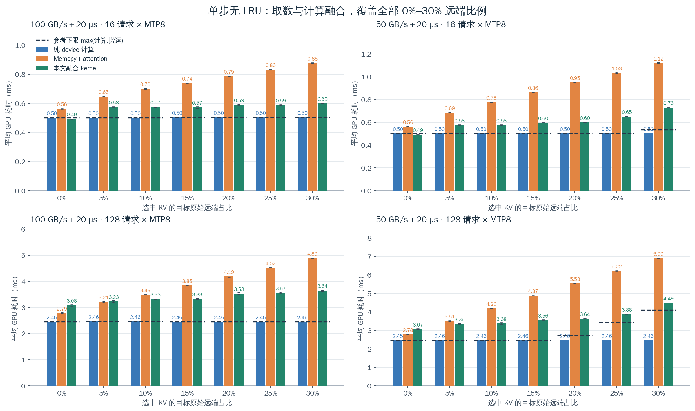
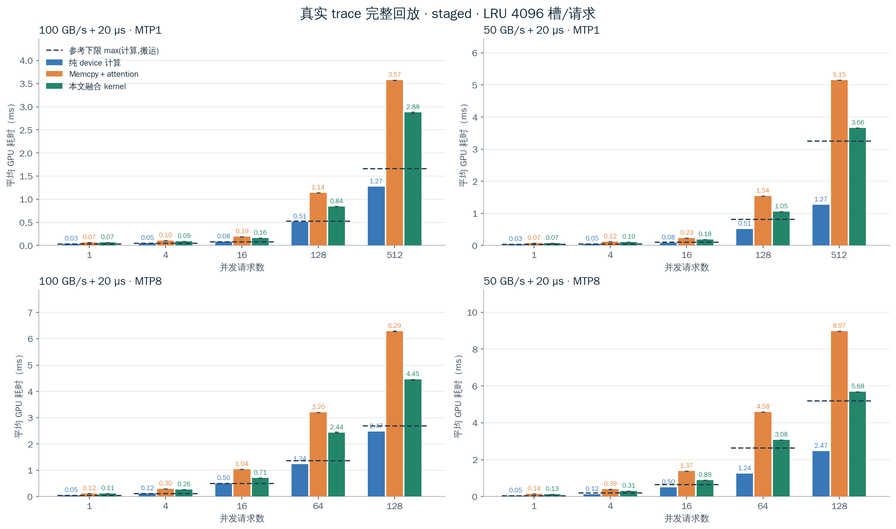
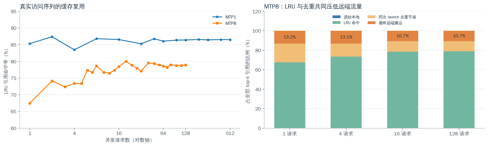
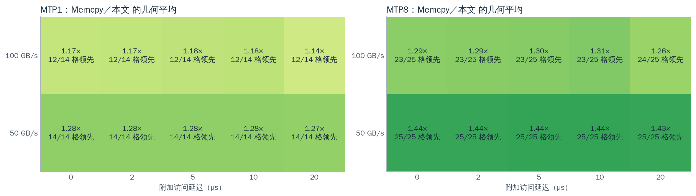
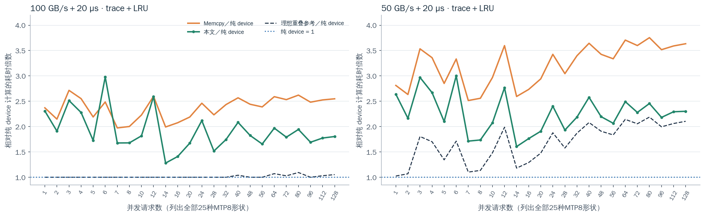
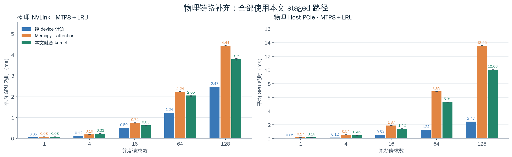

# 远端 KV 稀疏 MLA 融合算子性能汇报

**基于 GLM-5.3 真实访问 trace｜A100-SXM4｜单算子 GPU 实测｜2026 年 10 月 30 日**

**最新更新**：100 GB/s的大batch已加入整行staged优化，最终实现、全形状回测及5pass确认见§7.6。图1–6和原5304格主矩阵保留优化前的固定fetch16/split on配置，作为统一覆盖的基准；新实现另列，避免混用。

## 1. 工作成果与核心结论

本阶段完成了远端 KV sparse MLA decode 的单 kernel 融合方案，将**跨 query 去重、跨步 LRU、远端取数、attention 计算及结果合并**放入同一次 cooperative kernel 启动。目标是在 KV 放到Host DRAM 或其他 GPU 后，尽量把传输隐藏在计算期间，减少相对纯 device 计算增加的耗时。

本次已完成 **39 种 batch/MTP 形状 × 17 种链路**的系统测试：无 LRU 再扫描 7 个远端比例，共 **4,641 个单步比较格＋663 个真实 trace/LRU 比较格**，另有 312 个纯 device 参考格。全部参数覆盖与数值检查审计通过。

**阅读口径**：文中“快”指算子GPU平均耗时更低；“接近极限”分别指纯device零传输参考，或按实际unique未命中字节计算的完美重叠参考。主矩阵是固定参数的实测，尚未证明每种形状已达到最优配置。

| 实验部分 | 索引来源与回放 | 本文LRU | 本文路径 | Memcpy对照 |
|---|---|---|---|---|
| 单步扫描：§5、图1 | GLM-5.3真实trace的四个间隔快照 | 关闭，容量0 | staged，fetch16/item64 | 同输入，无LRU，先去重搬运再attention |
| 连续回放：§6、§7.2–7.3、图2–6 | 相同真实trace，完整1024位置 | 开启，4096槽/请求，每pass冷启动 | staged，fetch16/item64/split on | 同输入，同容量离线LRU，GPU搬运＋缓存写入＋attention |
| 路径对照：§7.4 | 相同真实trace，完整1024位置 | 两路径均开启4096槽/请求 | staged与原地读分别列出 | 每轮均保留同容量LRU的Memcpy计时 |
| 参数核查：§7.5 | 相同真实trace，完整1024位置，128请求×MTP8 | 开启4096槽/请求 | 全部staged，只改fetch/item/split | 每轮均保留同容量LRU的Memcpy计时 |
| 纯device参考 | 与对应实验相同query和selected KV，全部预置本地 | 无远端LRU维护 | 正常构建的本地attention | 只计attention，准备在事件外 |

| 汇报要点 | 本次实测证据 |
|---|---|
| **与 Memcpy 相比，中大 batch 的融合收益明显** | 真实trace完整回放、staged＋LRU4096、MTP8、16–128请求的全部14种形状，100 GB/s＋20 µs下均领先，耗时降低14.0%–32.1%；50 GB/s＋20 µs下均领先，降低29.3%–38.1%。 |
| **单步计算可接近纯 device 参考** | 真实trace快照、staged、无LRU、100 GB/s＋20 µs、MTP8/16请求、远端10%–30%时，本文耗时为纯device的1.14–1.19倍；物理NVLink、远端10%时为1.021倍。 |
| **带宽受限的大 batch 已接近理想重叠下限** | 真实trace完整回放、staged＋LRU4096、50 GB/s＋20 µs、MTP8/128请求：本文5.679 ms，Memcpy 8.969 ms，耗时降低36.7%；理想重叠参考5.192 ms，本文高出9.4%。物理PCIe的32/64/128请求高出约8.8%／8.4%／4.8%。 |

**结论的适用范围**：中大 batch、有限带宽场景已体现稳定且可观的融合收益；低远端比例或较快链路可以接近纯 device 计算。原始远端流量较高时，物理传输预算会高于纯 device 时间，此时应考察与计算/传输共同决定的理想重叠下限的距离。主矩阵原固定配置中，100 GB/s的128请求、MTP8、staged＋LRU高于参考65.3%，不能概括为所有链路都接近极限；小batch和部分NVLink参数也仍有改进空间，完整汇总见第8节。

## 2. Kernel 设计与本次启用配置

Memcpy 方案先把所需远端页搬到本地，再执行 attention；搬运和计算在依赖关系上串行。本文先统一解析整个 batch 的 top-k，识别本地页、LRU命中页和远端未命中页；fetch线程块只取唯一未命中页，attention线程块先处理可用数据，并随远端分块到达继续计算。最后在同一kernel内完成分片结果合并。

本报告的Memcpy基线同样对未命中页去重，并在trace部分使用同容量LRU。速度收益体现融合执行、取数/计算重叠等实现差异；本轮比较整条执行路径，单项设计的贡献可通过后续消融进一步量化。

| 设计 | 实现与作用 |
|---|---|
| 统一地址空间 | CUDA UVA/VMM统一访问本地HBM、peer GPU HBM或Host pinned内存，输入页号保留真实访问关系。 |
| 跨query去重 | 在batch索引中识别重复远端页；本测试请求地址独立，复用主要来自同请求MTP多行，共享页只搬一次。 |
| 融合LRU | 每请求独立4096槽；命中检测、淘汰、未命中页写入与attention共处一个kernel，跨decode步骤保留缓存。 |
| Staged取数与计算重叠 | fetch CTA分块写本地staging和缓存；attention CTA处理本地/命中页，并在远端块就绪后继续，无需先完成整批搬运。 |
| 批量处理与结果合并 | 一次启动处理全部请求及MTP行，分片softmax/输出在同一cooperative kernel内合并。 |

**主矩阵与图1–6的本文数据均为 staged 路径，包括物理 NVLink；§7.4另外列出原地读路径对照。**

| 测试部分 | 本文LRU | 本文取数路径 | 其他固定参数 |
|---|---|---|---|
| 单步、指定远端比例 | 关闭（容量0） | batched staged；MTP内去重仍开启 | fetch CTA=16，Host item=64条目，host_split=on |
| 连续真实trace回放 | 开启，每请求4096槽 | 同一batched staged路径，融合LRU | 同上，每pass冷启动 |
| 纯device参考 | 不需要远端缓存 | 正常构建的本地attention | 全部选中KV预置本地，只计attention |

本报告的远端比例指top-k引用落到原始远端的比例，与LRU命中率不同；该定义同时适用于Host和peer存储。无LRU的0%–30%为目标值，固定页映射下实际比例略有波动，完整矩阵同时记录实际值。

主矩阵中单query也固定使用batched staged实现；可选SMALL_PREPARE优化本轮关闭。主矩阵评估同一套固定配置，并未按参数点重新调优。产品实现同时支持原地读；§7.4补充路径对照，§7.5补充现有参数扫描。host_split控制尾部attention工作项是否拆成本地/远端两类，关闭它仍可使用staged，并不等于原地读。

## 3. GLM-5.3 trace 采集与回放方法

使用GLM-5.3权重对软件开发agent的多轮轨迹进行离线因果前向计算。原始语料来自`nebius/SWE-rebench-openhands-trajectories`，按模型原生聊天及工具调用模板构造4篇64K文档，每篇来自一条轨迹。逐层记录indexer选出的top-2048 token位置、对应index score及窗口/层来源。模型共有21个实际执行indexer的层；其余层复用映射另行保留。采集使用A800上的BF16逐层prefill，输入已知语料的真实token前缀（teacher forcing），记录每位置的因果top-k；不是在线自由生成或真实MTP草稿过程的计时trace。

正式性能回放选取**4段完整、连续的1024位置assistant窗口**，起点为文档1的35184/41887/48296和文档3的50621；每窗口21层，共84组层×窗口访问序列。窗口内不跳过位置、不拼接不连续token，请求在不同batch之间使用相同前缀绑定，整个回放期间不换层或窗口。

| 项目 | 回放方式 |
|---|---|
| MTP1 / MTP8 | 每请求每launch处理1/8个连续实测位置；1024位置分别对应1024/128次launch。MTP8不模拟推测接受率。 |
| 单步无LRU | 取窗口偏移0/256/512/768的四个分组；按固定(request,token位置)映射指定远端比例0/5/10/15/20/25/30%，保留MTP重复关系。 |
| Trace＋LRU | 除每个query最新token外，原始KV驻留远端；每pass冷启动并回放完整窗口，命中率由真实访问序列和缓存政策决定。 |
| 数据载荷 | Q/KV为固定seed生成的相同BF16数据；真实的是top-k访问序列，不是完整模型生成出的Q/KV值。 |
| 并发请求 | 不同请求可绑定不同层/窗口，构成真实访问序列的合成batch；超过84请求会重复capture，远端及LRU地址仍独立。 |

因此，这部分实验衡量的是**真实访问局部性驱动下的算子性能**：命中、去重和远端流量均来自实际kernel回放，不包含模型其他层、调度或服务端延迟，也不能直接换算成整模型吞吐提升。

## 4. 带宽与访问延迟模拟

在A100双卡真实NVLink远端路径上，对远端读取使用共享虚拟链路时钟：每块数据按字节数预约传输预算，预算由设置带宽决定；数据被使用前，再等到预约完成时间加附加延迟。真实读取仍发出，多个CTA和多块请求可同时在途。这样限制的是整张GPU的远端总带宽与数据可用时间，取数/计算仍可重叠。

```text
块可用时间 = 链路预约完成时间 + 附加访问延迟
该块传输预算 = 字节数 / 设置带宽
```

带宽扫描不限速、100、50 GB/s，附加延迟扫描0/2/5/10/20 µs，形成15个排列组合；另测未注入模拟的物理NVLink和物理Host PCIe，共17种链路。本文fetch路径与Memcpy的GPU gather共用同一模拟机制；延迟施加在搬运块/访存tile上，不是在整个kernel结束后统一加一个固定时间。

| 校准项目 | 实测结果 |
|---|---|
| 设置100 GB/s，覆盖全部5种延迟 | 实测99.72–99.96 GB/s |
| 设置50 GB/s，覆盖全部5种延迟 | 实测50.00–50.05 GB/s |
| 附加20 µs的依赖读校准 | 实测20.510–20.526 µs |
| 校准判据 | 带宽误差≤5%；延迟误差≤10%＋0.6 µs；15种组合全部通过 |

纯device参考使用正常构建，移除模拟钩子和远端传输。模拟构建自身有额外开销，因而本文/纯device比值包含这部分成本；模拟结果用于评估指定链路约束，不代表某一未来硬件或H800的直接实测。

柱状图中的黑虚线统一表示逐步完美重叠参考：先对每一步计算max(纯device时间,unique未命中字节/带宽)，再对完整窗口求平均。模拟链路用设置带宽；物理链路使用本次补测的max(DMA,SM gather)带宽，是乐观传输预算，不把Memcpy实测总时间当作传输时间。

| 物理链路补测 | 连续DMA GB/s | 随机gather GB/s | 参考带宽 GB/s |
|---|---:|---:|---:|
| 物理 NVLink | 281.12 | 263.96 | 281.12 |
| 物理 Host PCIe | 27.04 | 27.04 | 27.04 |

## 5. 真实 trace 快照、staged、无 LRU：单步取数融合收益

**本节全部数据：GLM-5.3真实trace四快照；本文staged、LRU关闭；Memcpy也关闭LRU。**



图1　真实trace四个快照；本文staged、LRU关闭，Memcpy同样无LRU。MTP8、16/128请求，100/50GB/s＋20µs，全部七个远端比例。黑虚线为逐步max(纯device计算,unique搬运预算)的平均；细线为三次pass范围。

在100 GB/s＋20 µs、MTP8/16请求下，远端比例从10%到30%，本文分别为574.21和599.89 µs，对应Memcpy 700.84和876.46 µs，耗时降低18.1%和31.6%。传输量增加后，融合kernel仍能把相当部分传输隐藏在计算期间。

| 链路 | MTP | 请求 | 目标远端比例 | 本文 µs | Memcpy µs | 纯 device µs | 重叠参考 µs | 耗时降低 | 本文/纯device | 本文/重叠参考 |
|---|---|---|---|---|---|---|---|---|---|---|
| 100 GB/s＋20 µs | 8 | 16 | 10% | 574.21 | 700.84 | 501.93 | 501.93 | 18.1% | 1.144× | 1.144× |
| 100 GB/s＋20 µs | 8 | 16 | 30% | 599.89 | 876.46 | 503.47 | 503.47 | 31.6% | 1.192× | 1.192× |
| 100 GB/s＋20 µs | 8 | 128 | 10% | 3329.02 | 3487.74 | 2458.88 | 2458.88 | 4.6% | 1.354× | 1.354× |
| 100 GB/s＋20 µs | 8 | 128 | 30% | 3644.25 | 4886.44 | 2456.58 | 2456.58 | 25.4% | 1.483× | 1.483× |
| 50 GB/s＋20 µs | 8 | 16 | 10% | 575.49 | 776.19 | 501.93 | 501.93 | 25.9% | 1.147× | 1.147× |
| 50 GB/s＋20 µs | 8 | 16 | 30% | 729.26 | 1119.83 | 503.47 | 534.51 | 34.9% | 1.448× | 1.364× |
| 50 GB/s＋20 µs | 8 | 128 | 10% | 3376.38 | 4199.94 | 2458.88 | 2458.88 | 19.6% | 1.373× | 1.373× |
| 50 GB/s＋20 µs | 8 | 128 | 30% | 4487.17 | 6903.72 | 2456.58 | 4104.36 | 35.0% | 1.827× | 1.093× |

图1完整展示所选形状的全部远端比例，包括0%和低远端比例的开销：并非每个格子都领先。例如低流量时，Memcpy搬运成本较小，融合调度与staging成本可能抵消重叠收益。本图固定16和128请求，未按优胜结果筛选参数点。

### 5.1 MTP1 与小 batch 补充

以下仍为真实trace四快照、staged、LRU关闭；固定远端目标30%，补充MTP1的1/4/16/128请求。小batch的融合准备开销更突出；耗时降低为负值表示本文较慢，这些格子作为后续优化方向保留。

| 链路 | MTP | 请求 | 目标远端比例 | 本文 µs | Memcpy µs | 纯 device µs | 重叠参考 µs | 耗时降低 | 本文/纯device | 本文/重叠参考 |
|---|---|---|---|---|---|---|---|---|---|---|
| 100 GB/s＋20 µs | 1 | 1 | 30% | 86.10 | 69.72 | 32.94 | 32.94 | -23.5% | 2.614× | 2.614× |
| 100 GB/s＋20 µs | 1 | 4 | 30% | 115.29 | 116.31 | 47.96 | 47.96 | 0.9% | 2.404× | 2.404× |
| 100 GB/s＋20 µs | 1 | 16 | 30% | 236.80 | 248.23 | 83.97 | 113.11 | 4.6% | 2.820× | 2.093× |
| 100 GB/s＋20 µs | 1 | 128 | 30% | 1317.46 | 1526.19 | 511.32 | 907.14 | 13.7% | 2.577× | 1.452× |
| 50 GB/s＋20 µs | 1 | 1 | 30% | 88.49 | 74.58 | 32.94 | 32.94 | -18.6% | 2.687× | 2.687× |
| 50 GB/s＋20 µs | 1 | 4 | 30% | 132.69 | 139.35 | 47.96 | 55.95 | 4.8% | 2.767× | 2.372× |
| 50 GB/s＋20 µs | 1 | 16 | 30% | 317.01 | 354.30 | 83.97 | 226.23 | 10.5% | 3.775× | 1.401× |
| 50 GB/s＋20 µs | 1 | 128 | 30% | 2028.97 | 2420.99 | 511.32 | 1814.27 | 16.2% | 3.968× | 1.118× |

## 6. 真实 trace 完整回放、staged＋LRU：中大 batch 的收益

**本节全部数据：完整1024位置；本文staged、每请求4096槽LRU；Memcpy使用同容量LRU；三次冷启动pass的全步骤平均。**



图2　真实trace完整1024位置回放；本文staged＋LRU4096槽/请求，Memcpy同容量LRU。MTP1固定1/4/16/128/512请求，MTP8固定1/4/16/64/128请求。黑虚线为逐步max(计算,unique搬运)的平均。

- **100 GB/s＋20 µs**：全部39个形状中36个快于Memcpy，等权几何平均加速1.217倍；MTP8、16–128请求的全部14种形状均领先，几何平均加速1.369倍。
- **50 GB/s＋20 µs**：全部39个形状中39个快于Memcpy，等权几何平均加速1.374倍；MTP8、16–128请求的全部14种形状均领先，几何平均加速1.541倍。

收益出现在已经为Memcpy基线预先完成CPU LRU规划和Host数据整理的条件下。表中仅比较其GPU搬运、必要缓存scatter及完整attention，本文仍完成融合LRU。因此这些结果已经体现GPU执行路径上的改进，无需把未计时的CPU工作加入基线来获得优势。

| 链路 | MTP | 请求 | 本文 µs | Memcpy µs | 纯 device µs | 重叠参考 µs | 耗时降低 | 本文/纯device | 本文/重叠参考 | LRU引用命中率 |
|---|---|---|---|---|---|---|---|---|---|---|
| 100 GB/s＋20 µs | 8 | 1 | 112.39 | 115.44 | 48.71 | 48.77 | 2.6% | 2.307× | 2.304× | 67.51% |
| 100 GB/s＋20 µs | 8 | 4 | 264.67 | 296.42 | 116.17 | 119.25 | 10.7% | 2.278× | 2.220× | 73.38% |
| 100 GB/s＋20 µs | 8 | 16 | 709.03 | 1044.07 | 502.99 | 504.93 | 32.1% | 1.410× | 1.404× | 78.46% |
| 100 GB/s＋20 µs | 8 | 64 | 2435.39 | 3203.46 | 1236.77 | 1367.74 | 24.0% | 1.969× | 1.781× | 78.57% |
| 100 GB/s＋20 µs | 8 | 128 | 4450.15 | 6287.30 | 2467.18 | 2691.45 | 29.2% | 1.804× | 1.653× | 78.94% |
| 50 GB/s＋20 µs | 8 | 1 | 128.53 | 136.98 | 48.71 | 54.13 | 6.2% | 2.639× | 2.374× | 67.46% |
| 50 GB/s＋20 µs | 8 | 4 | 310.14 | 390.27 | 116.17 | 197.59 | 20.5% | 2.670× | 1.570× | 73.54% |
| 50 GB/s＋20 µs | 8 | 16 | 886.76 | 1374.82 | 502.99 | 650.52 | 35.5% | 1.763× | 1.363× | 78.47% |
| 50 GB/s＋20 µs | 8 | 64 | 3082.23 | 4584.64 | 1236.77 | 2649.33 | 32.8% | 2.492× | 1.163× | 78.57% |
| 50 GB/s＋20 µs | 8 | 128 | 5679.23 | 8968.73 | 2467.18 | 5191.78 | 36.7% | 2.302× | 1.094× | 78.94% |

### 6.1 缓存与去重如何减少远端流量



图3　真实trace完整回放、本文staged＋LRU4096槽/请求，100GB/s＋20µs的实际miss计数；各项以全部top-k引用为分母并合计100%。原始本地约0.05%，左下角单独放大；LRU命中属于另外的本地读取。

**图中原始本地不是0。**本轮连续trace采用历史KV远端驻留、最新token本地驻留的设置；最新token约占top-k引用的1/2048，因此原始本地只有约0.05%，在0%–100%堆叠柱中很薄。图3已增加放大图与明确数值；LRU命中后从本地HBM读取的约67%–87%远端引用，计入绿色LRU部分。

| MTP8请求数 | 原始本地/全部引用 | LRU命中后本地读取/全部引用 | 原始本地＋LRU命中/全部引用 |
|---:|---:|---:|---:|
| 1 | 0.0488% | 67.47% | 67.52% |
| 4 | 0.0488% | 73.34% | 73.39% |
| 16 | 0.0488% | 78.43% | 78.47% |
| 128 | 0.0475% | 78.91% | 78.95% |

以100 GB/s＋20 µs、MTP8/128请求为例：原始远端引用占99.95%，LRU引用命中率为78.94%；按全部top-k条目计，未命中引用降至21.05%，再经同launch去重，实际搬运unique页仅占10.75%。缓存命中与MTP去重共同降低必须跨链路搬运的字节数，融合流水再隐藏剩余取数与计算。

引用命中率的分母是原始远端引用，最终搬运比例的分母是全部top-k条目，二者不能直接相减。命中率来自指定驻留规则、4096槽容量和逐launch LRU政策下的实测回放，并非线上生产缓存计数。

Memcpy使用同容量的离线LRU规划，本文使用GPU并行融合LRU；同stamp淘汰并列次序可不同，因此完整矩阵分别记录两者实际未命中量。本节命中率与黑虚线的unique字节采用本文实测值。

### 6.2 对不同带宽与延迟组合的覆盖



图4　真实trace完整回放、本文staged＋LRU4096槽/请求，Memcpy同容量LRU；每格覆盖该MTP全部batch形状；数值为等权几何平均加速比，另标严格快于Memcpy的形状数。

图4对每个MTP的全部batch等权统计，覆盖100/50 GB/s与五档延迟的所有组合。50 GB/s下，MTP1与MTP8的全部形状、全部五档延迟均快于Memcpy。100 GB/s下，中大MTP8 batch持续受益，小batch的准备和同步成本仍会影响领先幅度。

## 7. 距离纯 device 与理想重叠下限还有多远

### 7.1 纯 device 是零传输计算参考

真实trace快照、staged、无LRU、物理NVLink、MTP8/16请求、远端10%时，本文512.43 µs，纯device 501.93 µs，差2.1%；真实trace完整回放、staged＋LRU4096、NVLink、MTP8/14请求时，本文556.62 µs，纯device 500.69 µs，差11.2%，同时比Memcpy降低22.6%耗时。后者是特定形状的接近device实例，不作为所有batch的代表；高延迟16请求的范围见第1节与图1。

纯device数值来自相同query和完整selected KV的全本地attention实测，代表本报告所用attention实现的零传输参考，不是对所有可能GPU kernel的数学绝对下界。

### 7.2 完美重叠参考：传输主导时已接近链路极限

**本节图5：真实trace完整回放、staged＋LRU4096。下表另列无LRU快照作对照，各行标明。**

```text
每步理想传输时间（µs）= 该步unique未命中字节数 / (1000 × 带宽GB/s)
每步完美重叠参考 = max(该步纯device平均时间, 该步理想传输时间)
完整窗口参考 = 所有步骤完美重叠参考的算术平均
```

本版按逐步数据重新核对参考值，修正了上一版先平均再取max的汇总顺序。对于流量随trace步骤变化的场景，mean(max)通常高于max(mean)。例如100 GB/s＋20 µs、MTP8/128请求的trace参考从2595.96修正为2691.45 µs，kernel计时保持4450.15 µs，对应高于参考65.3%，而非上一版的71.4%。



图5　真实trace完整回放、本文staged＋LRU4096槽/请求，完整25种MTP8形状；黑虚线为逐步max(纯device计算,实际unique未命中字节/设置带宽)的平均，不包含附加延迟。

图5列出全部25种MTP8形状。纯device基线始终为1；黑虚线加入必需传输预算，便于区分带宽约束与kernel额外开销。这一参考假设完美重叠，不含附加访问延迟、LRU处理及同步成本，是乐观参考，不能替代实测或当作所有实现的数学下界。

| 场景：MTP8 / 128请求 | 本文 µs | Memcpy µs | 纯device µs | 理想重叠参考 µs | 本文高于重叠参考 |
|---|---:|---:|---:|---:|---:|
| trace快照／无LRU／staged／远端30%，物理 Host PCIe | 7947.26 | 10055.51 | 2456.58 | 7589.44 | 4.7% |
| trace快照／无LRU／staged／远端30%，50 GB/s＋20 µs | 4487.17 | 6903.72 | 2456.58 | 4104.36 | 9.3% |
| trace快照／无LRU／staged／远端30%，100 GB/s＋20 µs | 3644.25 | 4886.44 | 2456.58 | 2456.58 | 48.3% |
| trace完整回放／LRU4096／staged，物理 Host PCIe | 10058.17 | 13553.39 | 2467.18 | 9599.49 | 4.8% |
| trace完整回放／LRU4096／staged，50 GB/s＋20 µs | 5679.23 | 8968.73 | 2467.18 | 5191.78 | 9.4% |
| trace完整回放／LRU4096／staged，100 GB/s＋20 µs | 4450.15 | 6287.30 | 2467.18 | 2691.45 | 65.3% |

在50 GB/s＋20 µs的真实trace大batch中，本文5.679 ms距离理想重叠参考仅9.4%，说明此格已经较充分利用受限链路。同格纯device为2.467 ms，本文为其2.30倍。9.4%衡量距理想重叠的距离；要进一步缩小这类场景的device差距，还需要减少必需远端流量或提高有效带宽。

**新旧实验均支持：传输主导的大batch可以接近完美重叠参考。**

此前接近下限的结果主要出现在物理PCIe约27 GB/s或50 GB/s的传输主导场景，并非100 GB/s及所有batch均如此。本次真实trace也复现了相同趋势：PCIe、MTP8的32/64/128请求距参考为8.8%/8.4%/4.8%；50 GB/s＋20 µs、128请求为9.4%。旧代理trace的PCIe单步112请求、远端25%曾为约1.01倍；它与本轮GLM-5.3完整窗口的访问序列、流量、缓存和聚合口径不同，应保留各自来源。

其中旧表的1.01倍还采用两组索引搬运预算中的较大值；用两组预算的均值重算为约1.036倍。两者都支持该传输主导场景接近下限，但本报告统一按完整窗口的逐步均值统计。

100 GB/s时，必需传输预算缩短，固定staged取数、LRU、staging及attention调度的额外成本更显著。旧代理trace的100 GB/s＋20 µs、MTP8/128请求同样曾为5585.41 µs，传输参考3584.34 µs，约高55.8%；这不是本次独有的现象。本轮不限速模拟的同形状staged耗时约4.056 ms，而纯device为2.467 ms，说明差距不只来自100 GB/s带宽和20 µs等待；各项成本的贡献仍需单独消融确认，§7.5给出本次参数核查。

**关键点独立复测**：均为staged＋LRU4096；在原矩阵之外，使用相同脚本、同一对GPU、完整1024位置、3次冷启动pass重新测量，结果如下。

| MTP8 / 128请求 | 原本文 µs | 复测本文 µs | 变化 | 原Memcpy µs | 复测Memcpy µs |
|---|---:|---:|---:|---:|---:|
| 100 GB/s＋20 µs | 4450.15 | 4376.00 | -1.67% | 6287.30 | 6258.66 |
| 50 GB/s＋20 µs | 5679.23 | 5682.67 | +0.06% | 8968.73 | 8969.36 |

纯device也从2467.18 µs复测为2457.21 µs。复测输出校验通过，三项计时均与原矩阵接近；报告继续采用同一完整矩阵，不用单次复测替换更慢格子。详细流量、逐步参考与新旧对照证据见本报告的数据复核记录。

### 7.3 物理 PCIe / NVLink 的补充验证

**本节全部数据：真实trace完整1024位置、MTP8；本文staged＋LRU4096，Memcpy同容量LRU。物理链路未注入额外带宽/延迟限制。**



图6　真实trace完整回放、本文staged＋LRU4096槽/请求，Memcpy同容量LRU，MTP8固定1/4/16/64/128请求；黑虚线为逐步max(计算,unique搬运)的平均，PCIe/NVLink使用本次补测的物理带宽。

物理Host PCIe的连续LRU全部39个形状均快于Memcpy，等权几何平均加速1.241倍；32/64/128请求同时距完美重叠参考8.8%/8.4%/4.8%，是本轮真实trace中接近链路极限的直接证据。物理NVLink下，固定staged方案对大部分中大MTP8 batch有收益，但小batch存在回退；全39形状平均接近持平，后续应针对准备/同步成本和取数路径继续优化。

### 7.4 补充对照：100 GB/s 是否改为原地读更好

进一步在相同真实trace、MTP8、4096槽LRU和完整窗口3pass条件下，只切换现有staged/原地读选项，补测16/64/128请求、四种链路，共24格。此处单独呈现路径对照，前述固定staged矩阵和全参数汇总保持原口径。

| 链路 | 请求 | staged µs | 原地读 µs | 原地读/staged | 较快路径 |
|---|---:|---:|---:|---:|---|
| 100 GB/s＋0 µs | 16 | 679.57 | 865.53 | 1.274 | staged |
| 100 GB/s＋20 µs | 16 | 709.69 | 1755.06 | 2.473 | staged |
| 50 GB/s＋20 µs | 16 | 888.13 | 1968.47 | 2.216 | staged |
| 物理 NVLink | 16 | 620.90 | 557.74 | 0.898 | 原地读 |
| 100 GB/s＋0 µs | 64 | 2188.12 | 3000.40 | 1.371 | staged |
| 100 GB/s＋20 µs | 64 | 2428.22 | 6120.62 | 2.521 | staged |
| 50 GB/s＋20 µs | 64 | 3081.77 | 6838.77 | 2.219 | staged |
| 物理 NVLink | 64 | 2032.87 | 1707.81 | 0.840 | 原地读 |
| 100 GB/s＋0 µs | 128 | 4058.97 | 5763.21 | 1.420 | staged |
| 100 GB/s＋20 µs | 128 | 4361.09 | 11956.27 | 2.742 | staged |
| 50 GB/s＋20 µs | 128 | 5661.50 | 13248.88 | 2.340 | staged |
| 物理 NVLink | 128 | 3744.73 | 3290.95 | 0.879 | 原地读 |

三个所测batch的物理NVLink均是原地读更快，100/50 GB/s的所测条件则均是staged更快。128请求时，原地读未命中引用约509 MB/步，staged去重后约260 MB/步；100 GB/s下，仅原地读的逻辑字节传输预算约5.09 ms，已经高于staged总耗时。更快的物理NVLink较容易隐藏重复读取代价，因此省去staging中转能带来收益。

路径应随链路及访问模式选择。100 GB/s下继续优化的方向是staged内部开销与并发取数，本次切换原地读未带来提升；物理NVLink可采用原地读以获得额外收益。[完整路径对照与流量记录](mla_host_glm53_route_comparison.md)。

### 7.5 100 GB/s差距核查：仍有优化空间，尚非最优

**本节全部数据：GLM-5.3真实trace完整1024位置、128请求×MTP8、staged、LRU4096槽/请求。**100 GB/s的绝对耗时低于50 GB/s；较差的是相对完美重叠参考的效率。这个差距不能全部解释成必需传输，也不能直接称为不可避免的LRU开销。

| 主矩阵链路对照 | 本文 µs | Memcpy µs | 纯device µs | 重叠参考 µs |
|---|---:|---:|---:|---:|
| 不限速＋0 µs | 4056.09 | 4703.18 | 2467.18 | 2467.18 |
| 100 GB/s＋0 µs | 4099.12 | 6251.25 | 2467.18 | 2691.32 |
| 100 GB/s＋20 µs | 4450.15 | 6287.30 | 2467.18 | 2691.45 |
| 50 GB/s＋20 µs | 5679.23 | 8968.73 | 2467.18 | 5191.78 |

从100 GB/s＋0 µs到＋20 µs，本文由4.099增至4.450 ms，增加约0.351 ms；延迟按块施加，不能简单理解为整次launch只多20 µs。不限速、零附加延迟的模拟构建也需4.056 ms，所以仅靠降低注入延迟不足以消除差距。该对照仍含融合LRU、staging、工作项调度和模拟构建成本，不能用差值精确归因其中任意一项。

另外，§7.2中的真实trace快照、无LRU、staged、100 GB/s＋20 µs、128请求×MTP8、远端30%也高于重叠参考48.3%，说明LRU维护并非差距的唯一来源。快照与完整回放的驻留规则不同，不能将二者差值当作LRU开销消融。

为核查是否已经最优，补测fetch CTA=8/16/32/64、host_split开/关，以及item64/256的共10套现有参数，各测100 GB/s的0/20 µs两种链路，共20格、每格3次冷启动pass。随后将20 µs候选最优与默认配置倒序复测，每格5pass，共4格；生产kernel未改。下表列100 GB/s＋20 µs的默认/候选对照，全部扫描与0 µs结果另行保留。

| 参数核查阶段 | fetch CTA | item | host split | 本文 µs | 同轮Memcpy µs | 纯device µs | 重叠参考 µs | 高于参考 | LRU引用命中率 |
|---|---:|---:|---|---:|---:|---:|---:|---:|---:|
| 扫描3pass·默认 | 16 | 64 | on | 4400.24 | 6260.11 | 2467.18 | 2691.61 | 63.5% | 78.929% |
| 扫描3pass·候选 | 32 | 64 | off | 4230.80 | 6268.61 | 2467.18 | 2691.19 | 57.2% | 78.944% |
| 倒序确认5pass·默认 | 16 | 64 | on | 4428.17 | 6265.41 | 2467.18 | 2691.59 | 64.5% | 78.929% |
| 倒序确认5pass·候选 | 32 | 64 | off | 4222.93 | 6258.75 | 2467.18 | 2691.18 | 56.9% | 78.941% |

5pass确认中，候选比同轮默认降低4.6%，但仍高于重叠参考56.9%，并非已逼近下限。这证明默认参数仍有改进空间，但本次现有参数扫描只消除了一小部分差距；没有证明候选是全局最优。原主矩阵4450.15 µs继续保留，参数搜索结果作为独立补充，未替换其中个别格子。

从实现看，max模型假设attention和搬运能同时达到各自独占资源的速度，而本kernel的fetch和attention共享SM与本地HBM，还存在staging写读、部分结果合并、就绪等待及工作项尾部。50 GB/s的较长传输可以掩盖部分成本，100 GB/s下它们更显著。这个解释与参数扫描一致：fetch8明显不足，fetch64也回退，单纯增加取数CTA没有持续收益。本节参数核查时尚未取得阶段计时，不能把65.3%直接当作已定位的固定开销；10月31日已对§7.6整行实现补充独立插桩诊断，见下文。

因此，100 GB/s接下来的优化应先定位prepare/resolve、fetch完成和attention尾部的时间，再调整取数资源分配、先到数据的消费顺序及staging写回；不应假定现有差距已不可缩小。[全部24格、逐pass数据及审计](../temp/glm_trace/100gb_review_20261030/README.md)。

### 7.6 最新实现：大batch整行staged路径

**本节全部数据：完整GLM-5.3 trace、LRU4096槽/请求、staged、100 GB/s＋20 µs，5次冷启动pass全部步骤平均。**新路径使每行直接完成attention并写最终输出，省去尾部分片及merge；编译期排除原地读写回和零远端模拟检查。实际fetch处仍使用原带宽/延迟模拟规则，staging就绪等待保留。仍为单个cooperative kernel，缓存容量和计算不变。

启用条件为64 heads、staged、host_split=False、query行数≥4×SM数且staging能容纳全部选中条目。A100-SXM4的100 GB/s大形状推荐fetch24/split off；较小形状沿用fetch16/split on。六个原通用kernel的反汇编指令文本及资源与旧构建一致。完整195格100 GB/s trace矩阵、无LRU对照与物理链路回测另见优化记录。

| 新实现确认：MTP | 请求 | 旧默认 µs | 旧同参数 µs | 新实现 µs | Memcpy µs | 纯device µs | 重叠参考 µs | 较旧默认降低 | 高于参考 |
|---:|---:|---:|---:|---:|---:|---:|---:|---:|---:|
| 1 | 512 | 2885.27 | 2521.29 | 2193.83 | 3565.37 | 1270.29 | 1664.31 | 24.0% | 31.8% |
| 8 | 64 | 2462.30 | 2180.34 | 1833.68 | 3220.56 | 1236.77 | 1367.67 | 25.5% | 34.1% |
| 8 | 128 | 4388.65 | 4160.36 | 3560.53 | 6300.64 | 2467.18 | 2691.16 | 18.9% | 32.3% |

旧默认为fetch16/split on，旧同参数与新实现均为fetch24/split off。整体收益包含参数和代码改进，同参数控制用于核对代码本身的贡献；没有用搜索结果替换原主矩阵。剩余差距继续按实测呈现，不把大batch收益推广至全部小形状，也不宣称所有100 GB/s格子均已在参考10%以内。[完整优化结果、验证和新旧对照](mla_host_a100_100gb_optimization_20261030.md)。

10月31日阶段诊断：MTP8、128请求、完整1024位置、LRU4096、fetch24/split off，每格1次冷启动插桩pass。100 GB/s＋20 µs下，fetch约190.81 µs开始、最晚3064.77 µs结束、最晚attention于3479.67 µs结束；物理NVLink分别为196.28、2393.22、3348.56 µs。时间相对每步最早CTA进入，完成值逐步取各CTA最大值再平均。fetch、LRU与attention有重叠，不能相加归因；支持继续检查计算效率及fetch/attention资源争用。插桩不是正式新旧性能对照。[诊断、独立候选与原始数据审计](mla_host_a100_readiness_20261031.md)。

## 8. 全参数汇总、计时口径与结论边界

### 8.1 全部17种链路汇总

**全部主矩阵采用staged；无LRU列为真实trace四快照，LRU列为真实trace完整1024位置、4096槽/请求。**

无LRU列覆盖全部39形状×7远端比例＝273格，包含0%远端；trace列覆盖39形状。加速比为Memcpy/本文的等权几何平均，大于1表示本文更快。下表保留不限速和NVLink平均未领先的结果。

| 链路 | 无LRU领先格/273 | 无LRU平均加速 | Trace＋LRU领先格/39 | Trace＋LRU平均加速 |
|---|---:|---:|---:|---:|
| 不限速＋0 µs | 90 | 0.892× | 20 | 0.976× |
| 不限速＋2 µs | 86 | 0.897× | 20 | 0.978× |
| 不限速＋5 µs | 94 | 0.903× | 21 | 0.988× |
| 不限速＋10 µs | 96 | 0.909× | 23 | 1.001× |
| 不限速＋20 µs | 69 | 0.890× | 23 | 0.984× |
| 100 GB/s＋0 µs | 170 | 1.033× | 35 | 1.246× |
| 100 GB/s＋2 µs | 172 | 1.038× | 35 | 1.249× |
| 100 GB/s＋5 µs | 175 | 1.042× | 35 | 1.255× |
| 100 GB/s＋10 µs | 176 | 1.048× | 35 | 1.261× |
| 100 GB/s＋20 µs | 176 | 1.036× | 36 | 1.217× |
| 50 GB/s＋0 µs | 201 | 1.127× | 39 | 1.377× |
| 50 GB/s＋2 µs | 203 | 1.130× | 39 | 1.378× |
| 50 GB/s＋5 µs | 200 | 1.132× | 39 | 1.377× |
| 50 GB/s＋10 µs | 204 | 1.136× | 39 | 1.377× |
| 50 GB/s＋20 µs | 205 | 1.142× | 39 | 1.374× |
| 物理 NVLink | 91 | 0.896× | 21 | 0.989× |
| 物理 Host PCIe | 235 | 1.170× | 39 | 1.241× |

### 8.2 测量设置与正确性

| 项目 | 统一设置 |
|---|---|
| 设备 | A100-SXM4-40GB双卡，GPU0计算、GPU1为NV12 peer；Host pinned内存绑定NUMA0。全部数据来自A100。 |
| Attention形状 | 64 heads，BF16，KV维度512＋64，page size=1，top-k=2048，每KV行1152 B。 |
| 请求数 | MTP1：1/2/4/8/16/32/48/64/96/128/192/256/384/512；MTP8：1/2/3/4/5/6/7/8/10/12/14/16/20/24/28/32/40/48/56/64/72/80/96/112/128。 |
| 平均口径 | 主矩阵为三次pass、全部步骤的算术平均；LRU每pass从冷缓存开始，含第一步；无LRU取四个trace分组。§7.5另标5pass确认；均不使用后半段或最好样本代替均值。 |
| GPU计时 | CUDA event；guard验证的预入队或16步CUDA Graph，避免CPU逐步发射间隙进入事件；每步记录原始时间。 |
| 本文范围 | 单个cooperative kernel，含去重、LRU（如开启）、取数、attention和合并。主矩阵为staged；§7.4原地读另标。 |
| Memcpy范围 | 实际远端gather/H2D、必要cache scatter和完整本地attention；CPU LRU规划、Host CPU gather及索引上传在外。无LRU直接写连续staging，无冗余scatter。 |
| 纯device范围 | 相同query/selected KV均在本地，正常构建，只计attention；无LRU逐远端比例匹配布局，LRU用完整窗口均值。 |
| 验证 | 1,955,940次计时launch、143,745段有效队列；指定step/query锚点对数学参考校验，采样最大绝对误差0.00692034；独立CPU oracle核对缓存映射及完整真实trace payload。 |

三次pass的范围反映测量波动，不是统计置信区间；较小的百分比差异不作为稳定收益的主要依据。本报告重点强调数十个百分点的中大batch收益，并保留全部形状和各pass均值供核查。

### 8.3 结论边界

本次证明的是指定访问模式和链路约束下的**kernel GPU执行优势**，不是端到端模型吞吐。真实trace组成合成batch；超过84请求重复capture，超过128请求时near物理KV按128请求复用以适配40GB，远端地址和LRU仍独立。MTP8是连续8位置分组，不含推测接受率。

所用assistant窗口的top-k完整性、因果性和assistant检查通过；完整语料的全角色loss gate未全部通过，本报告只据此评价访问模式下的kernel表现。无LRU指定0%–30%原始远端驻留，LRU几乎全部原始KV驻留远端，两部分各自与相同输入的baseline比较；开启LRU的净收益需另外做同输入消融。

## 9. 结论与后续方向

**本文融合kernel在有限带宽、中大batch场景下已显著优于先搬后算的Memcpy路径。**真实GLM-5.3 trace完整回放、staged＋LRU4096下，MTP8、16–128请求的全部14个形状在100/50 GB/s＋20 µs均领先；几何平均加速分别为1.369倍和1.541倍。

**接近极限已有明确实例，且不同极限的含义清晰。**低远端比例的单步场景可做到接近纯device计算；物理PCIe的32–128请求真实trace距离理想重叠参考约4.8%–8.8%，50 GB/s＋20 µs的128请求约9.4%。后续主要空间集中在小batch固定成本、staged内部调度和更充分的链路利用，以及继续减少必需远端字节数。补充路径对照表明，所测100/50 GB/s条件保留staged，物理NVLink采用原地读更合适。100 GB/s＋20 µs、128请求的现有参数补测确认仍能再降约4.6%，但仍高于重叠参考约57%，这是§7.5中代码优化前的参数核查。若采用最新整行实现，应以§7.6的确认数据评价改进和剩余差距。

---

数据来源：[完整5304格实验报告](mla_host_glm53_kernel_matrix_20261029.md)、[全量CSV](../temp/glm_trace/kernel_report_20261029/matrix.csv)、[原始审计](../temp/glm_trace/kernel_report_20261029/audit.json)。实验数据提交`8c624445`；本汇报的作图脚本、图数据和来源SHA保存在`temp/glm_trace/briefing_report_20261030/`。[下限与计时复核记录](../temp/glm_trace/briefing_report_20261030/verification_notes.md)。所有图的kernel计时均来自同一GLM-5.3/A100完整矩阵，参考线按逐步数据重新计算。
