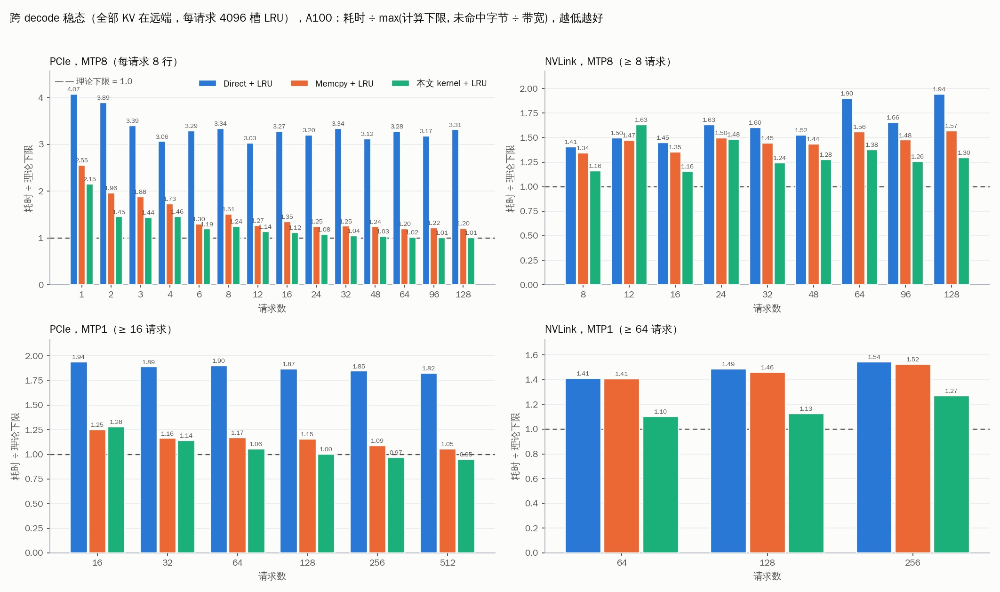
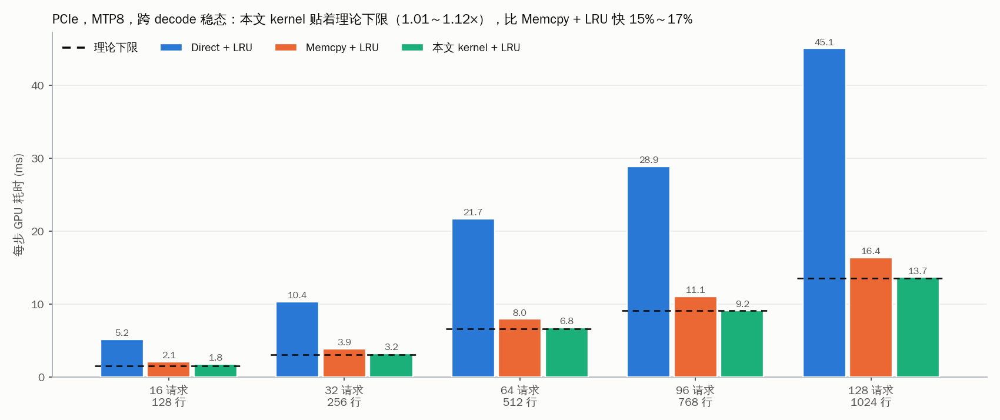
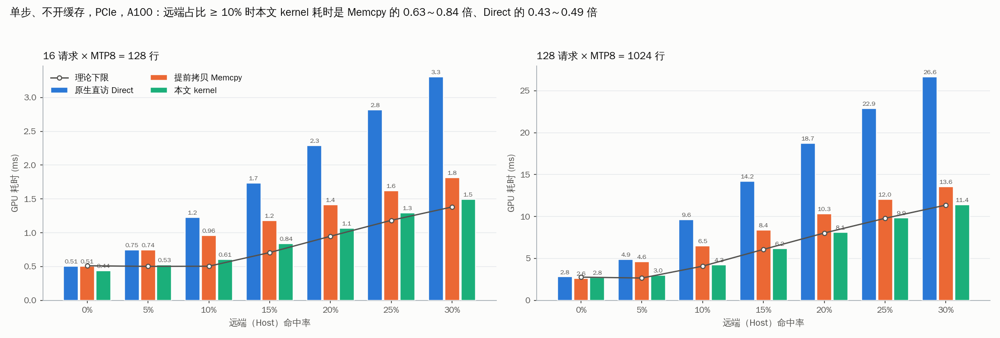
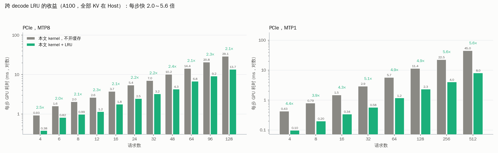

# 远端 KV 稀疏 MLA decode 算子：测试报告

**一句话结论**：同一个 cooperative kernel 把「远端页去重搬运 + 跨 decode LRU 缓存 + attention」融在一次 launch 里。远端是 PCIe Host DRAM 时，MTP8 ≥ 32 请求时跨 decode 稳态贴着理论下限（1.01～1.04×），1～128 请求全部比同样配了 LRU 的 Memcpy 快 8%～26%，比 Direct 快 1.9～3.3 倍；远端是 NVLink peer HBM 时，中大 batch（MTP8 ≥ 32 请求、MTP1 ≥ 64 请求）比两种朴素方法快 11%～23%。在 H800 上与 SGLang HiSparse 对比，同样开 LRU 的跨 decode 稳态快 1.8～5.5 倍（验证作业，小规模）。

## 结论

| 场景（A100，跨 decode 稳态，开 LRU，每请求 4096 槽） | 本文 ÷ 理论下限 | 本文 ÷ 朴素较快者 | 开 LRU 比不开快 |
|---|---:|---:|---:|
| PCIe，MTP8，1～128 请求（8～1024 行） | 1.01～2.15（≥ 32 请求：1.01～1.04） | **0.74～0.92**（14 个点全部更快） | 2.0～2.5× |
| PCIe，MTP1，32～512 请求 | 0.95～1.14 | **0.87～0.98** | 4.9～5.6× |
| NVLink，MTP8，8～128 请求 | 1.16～1.63 | **0.82～0.89**（12、24 请求除外：0.99～1.11） | 2.1～2.9× |
| NVLink，MTP1，64～256 请求 | 1.10～1.27 | **0.77～0.83** | 2.1～2.5× |
| 单步不开缓存，PCIe，MTP8，远端 5%～30% | 128 请求 1.00～1.12 | **0.61～0.94**（175 格中只有 1 请求、5% 一格输） | — |
| **H800，PCIe，对比 SGLang HiSparse**（小规模） | — | **HiSparse 耗时为本文的 1.8～5.5 倍** | — |

优势来源：
1. **全 batch 去重 + 只搬未命中**：一个远端页在整个 batch 里只搬一次（MTP8 时去重后只剩约 41%），命中 LRU 的页完全不走远端链路。
2. **搬运与计算重叠在一个 kernel 里**：attention 先算本地 tile，远端 tile 到了再算；Memcpy 和 HiSparse 都是先搬后算，两步串行。
3. **LRU 在 kernel 内完成**：命中检测、淘汰选择（radix select）、写缓存都在同一次 launch 里，没有额外的 kernel 和 CPU 同步。
4. **按链路选择搬运方式**：PCIe 带宽低，用少量 fetch CTA 去重搬运；NVLink 带宽高，由全部 attention CTA 原地读并顺手写回缓存。

## 1. 算子写法（简述）

PCIe 和 NVLink 用的是**同一个 kernel**（`include/flashinfer/attention/mla_host_batch.cuh` 中的 `BatchMLAHostBatchKernel`），由两个运行时开关选择分支：`host_stage`（staged / 原地读）和是否调用 `set_host_cache`（开 / 关 LRU）。kernel 只用「页号 ≥ `host_page_start`」判断一页在远端，远端是 Host DRAM 还是 peer GPU HBM 只取决于这段虚拟地址映射到哪里。一次 cooperative launch 的流程：prepare（行内分类 + 全 batch 原子去重）→ grid barrier → resolve（给远端页编号）→ attention items（原生 MLA tile 循环）→（小 batch 拆 KV 时）合并。

| 配置 | 远端页怎么到 attention | LRU 怎么维护 | 用在 |
|---|---|---|---|
| staged，不开缓存 | 8 个 fetch CTA 把去重后的远端页 `cp.async` 进 HBM staging，按块发布就绪标志；attention 先算本地 tile，用到远端 tile 前等对应块的标志 | — | PCIe 单步 |
| staged + LRU | 同上，但命中的页直接读缓存槽，只有未命中的页才搬 | 每个池一个 LRU item（radix select 选最久未用的槽）；fetch CTA 从 shared memory 顺手把页写进 victim 槽 | **PCIe 推荐** |
| 原地读，不开缓存 | 每个引用直接读远端（等同原生 kernel，wrapper 直接调原生） | — | NVLink 单步 |
| 原地读 + LRU | 命中读缓存；未命中由 attention 原地读远端，108 个 SM 一起读 | 第一次 barrier 后每池选好 victim；tile 落地后，认领这一页的行把 shared memory 里的数据写到 victim 槽 | **NVLink 推荐** |

为什么两种链路要不同写法：PCIe（约 27 GB/s）瓶颈在带宽，去重直接减少搬运字节；NVLink（约 262 GB/s）的瓶颈是单个 SM 的远端读能力（每 SM 约 21 GB/s），8 个 fetch CTA 喂不满，必须让全部 SM 一起读。在 PCIe 上用原地读，MTP8 时会慢 1.94×（重复读共享页）。

各对象（包括朴素方法和下限）的完整实现说明见 [`mla_host_a100_full.md`「各比较对象的实现」](mla_host_a100_full.md#各比较对象的实现)。

## 2. 测试设置

| 项目 | 设置 |
|---|---|
| GPU | A100-SXM4-40GB（GPU0，108 SM）。PCIe 远端：NUMA0 pinned DRAM，实测 SM gather 25～26 GB/s；NVLink 远端：GPU1 HBM（NV12），实测 260～263 GB/s |
| 模型参数 | GLM-5.2 风格 DSA sparse MLA：BF16，576 维（每 token 每层 1152 B），top-k 2048，64 头 |
| 索引 | 回放实测的 DSA 代理 MTP top-k，最近 4096 个位置始终在本地 |
| 跨 decode | 32 个连续 token（MTP8 为 4 步，MTP1 为 32 步），除最新 token 外的 KV 全在远端，取后一半步的平均；每请求一个 LRU 池，默认 4096 槽 |
| 计时 | CUDA event，只计 GPU 执行；单步每格 8 轮 × 2 组索引取中位数 |
| 代码 | `dbbc02c6` |

**理论下限** = max(计算下限, 传输下限)。计算下限：所有选中行都在本地 HBM 时原生 attention 的耗时（零传输）；传输下限：本步必须搬的去重远端字节（跨 decode 时为本文 kernel 实际的未命中页）÷ 实测随机 gather 带宽。实测 gather 带宽略低于 kernel 实际达到的值，所以 PCIe 大 batch 的比值会略低于 1（最低 0.95），可以视为已贴着下限。

**朴素方法**：
- **Memcpy**：先把（去重后的）远端页拷到本地 staging，再跑原生 attention。PCIe 上 CPU gather 到 pinned 内存**不计时**，只计 H2D DMA；NVLink 上 GPU gather，计时。
- **Direct**：原生 kernel 原地读远端，每个引用读一次，不去重。
- **+ LRU**：跨 decode 时两者都配上与本文完全相同的逐步 LRU，只搬未命中的页。**LRU 记账放在 CPU 上提前算好，不计时**，所以这个对比对朴素方法偏宽松。

## 3. 跨 decode 稳态（目标场景，开 LRU）

图中每组柱是一个 batch 点，纵轴是「耗时 ÷ 理论下限」，虚线 1.0 就是理论下限，越低越好。为了把重点放在目标规模上，NVLink MTP8 从 8 请求、PCIe MTP1 从 16 请求、NVLink MTP1 从 64 请求开始画；更小的 batch 见下面的完整表格和第 7 节。

### 3.1 PCIe，MTP8（全部 14 个 batch 点，µs）

| 请求 | 行 | 本文 kernel + LRU | Memcpy + LRU | Direct + LRU | 本文不开缓存 | 计算下限 | 传输下限 | **本文 ÷ 理论下限** | **本文 ÷ 朴素较快者** | LRU 加速 |
|---:|---:|---:|---:|---:|---:|---:|---:|---:|---:|---:|
| 1 | 8 | 130 | 154 | 246 | 273 | 50 | 60 | 2.15 | **0.84** | 2.10× |
| 2 | 16 | 266 | 358 | 713 | 566 | 79 | 183 | 1.45 | **0.74** | 2.13× |
| 3 | 24 | 297 | 389 | 701 | 756 | 80 | 207 | 1.44 | **0.77** | 2.54× |
| 4 | 32 | 379 | 449 | 794 | 934 | 112 | 259 | 1.46 | **0.84** | 2.47× |
| 6 | 48 | 817 | 890 | 2253 | 1599 | 142 | 685 | 1.19 | **0.92** | 1.96× |
| 8 | 64 | 986 | 1195 | 2644 | 2043 | 281 | 792 | 1.24 | **0.82** | 2.07× |
| 12 | 96 | 1154 | 1286 | 3074 | 2632 | 257 | 1015 | 1.14 | **0.90** | 2.28× |
| 16 | 128 | 1772 | 2134 | 5185 | 3748 | 505 | 1584 | 1.12 | **0.83** | 2.12× |
| 24 | 192 | 2474 | 2866 | 7328 | 5422 | 505 | 2293 | 1.08 | **0.86** | 2.19× |
| 32 | 256 | 3236 | 3887 | 10352 | 7039 | 754 | 3101 | 1.04 | **0.83** | 2.18× |
| 48 | 384 | 4260 | 5127 | 12858 | 10247 | 1003 | 4125 | 1.03 | **0.83** | 2.41× |
| 64 | 512 | 6762 | 7965 | 21744 | 14412 | 1248 | 6636 | 1.02 | **0.85** | 2.13× |
| 96 | 768 | 9171 | 11076 | 28884 | 20792 | 1973 | 9100 | 1.01 | **0.83** | 2.27× |
| 128 | 1024 | 13695 | 16379 | 45078 | 29126 | 2487 | 13606 | 1.01 | **0.84** | 2.13× |

- 14 个点**全部**快于两种带 LRU 的朴素方法，是较快者的 0.74～0.92 倍；比 Direct + LRU 快 1.9～3.3 倍。
- ≥ 32 请求时离理论下限只有 1%～4%：此时瓶颈是 PCIe 本身，kernel 已经把每个未命中页都按满带宽搬完，同时把计算完全藏在了传输后面。

### 3.2 NVLink，MTP8（µs）

| 请求 | 行 | 本文 kernel + LRU | Memcpy + LRU | Direct + LRU | 本文不开缓存 | 计算下限 | 传输下限 | **本文 ÷ 理论下限** | **本文 ÷ 朴素较快者** | LRU 加速 |
|---:|---:|---:|---:|---:|---:|---:|---:|---:|---:|---:|
| 1 | 8 | 98 | 63 | 68 | 101 | 51 | 6 | 1.93 | 1.54 | 1.04× |
| 2 | 16 | 125 | 105 | 116 | 174 | 78 | 18 | 1.60 | 1.19 | 1.38× |
| 3 | 24 | 150 | 109 | 115 | 247 | 80 | 21 | 1.87 | 1.38 | 1.65× |
| 4 | 32 | 188 | 146 | 150 | 324 | 112 | 26 | 1.68 | 1.29 | 1.72× |
| 6 | 48 | 260 | 232 | 273 | 471 | 143 | 69 | 1.82 | 1.12 | 1.81× |
| 8 | 64 | 325 | 376 | 394 | 673 | 280 | 80 | 1.16 | **0.86** | 2.07× |
| 12 | 96 | 422 | 380 | 388 | 903 | 259 | 102 | 1.63 | 1.11 | 2.14× |
| 16 | 128 | 581 | 679 | 727 | 1270 | 502 | 159 | 1.16 | **0.86** | 2.19× |
| 24 | 192 | 752 | 759 | 827 | 1805 | 507 | 231 | 1.48 | **0.99** | 2.40× |
| 32 | 256 | 936 | 1088 | 1206 | 2385 | 753 | 311 | 1.24 | **0.86** | 2.55× |
| 48 | 384 | 1276 | 1434 | 1523 | 3561 | 999 | 412 | 1.28 | **0.89** | 2.79× |
| 64 | 512 | 1715 | 1945 | 2371 | 4753 | 1247 | 665 | 1.38 | **0.88** | 2.77× |
| 96 | 768 | 2477 | 2910 | 3267 | 7263 | 1972 | 914 | 1.26 | **0.85** | 2.93× |
| 128 | 1024 | 3223 | 3909 | 4838 | 9474 | 2488 | 1364 | 1.30 | **0.82** | 2.94× |

- 8、16、32～128 请求时为朴素较快者的 0.82～0.89 倍，128 请求时比 Memcpy + LRU 快 18%（3223 vs 3909 µs）、比 Direct + LRU 快 33%。
- 离计算下限还有 1.16～1.38×（大 batch），原因是原地读不在行之间去重：同一步里 MTP 的 8 行平均每个未命中页读 2.1 次（128 请求时每步约 704 MB 引用 vs 336 MB 去重页），704 MB ÷ 262 GB/s = 2.7 ms，已经超过 2.45 ms 的计算时间。原地读模式下真正可达的下限是「命中读本地 + 未命中原地读」，本文离它 1.02～1.19×（见 [`mla_host_a100_lru.md` 第 7 节](mla_host_a100_lru.md)）。

### 3.3 PCIe，MTP1（µs）

| 请求 | 行 | 本文 kernel + LRU | Memcpy + LRU | Direct + LRU | 本文不开缓存 | 计算下限 | 传输下限 | **本文 ÷ 理论下限** | **本文 ÷ 朴素较快者** | LRU 加速 |
|---:|---:|---:|---:|---:|---:|---:|---:|---:|---:|---:|
| 1 | 1 | 58 | 53 | 57 | 121 | 33 | 10 | 1.76 | 1.09 | 2.09× |
| 2 | 2 | 86 | 84 | 98 | 237 | 42 | 31 | 2.05 | 1.03 | 2.76× |
| 4 | 4 | 98 | 101 | 115 | 427 | 48 | 41 | 2.05 | **0.97** | 4.37× |
| 8 | 8 | 201 | 185 | 282 | 794 | 50 | 136 | 1.47 | 1.09 | 3.95× |
| 16 | 16 | 343 | 334 | 518 | 1488 | 81 | 268 | 1.28 | 1.03 | 4.34× |
| 32 | 32 | 578 | 589 | 957 | 2921 | 119 | 507 | 1.14 | **0.98** | 5.05× |
| 64 | 64 | 1177 | 1302 | 2118 | 5733 | 285 | 1115 | 1.06 | **0.90** | 4.87× |
| 128 | 128 | 2321 | 2675 | 4327 | 11359 | 504 | 2317 | 1.00 | **0.87** | 4.89× |
| 256 | 256 | 4021 | 4519 | 7664 | 22539 | 758 | 4152 | 0.97 | **0.89** | 5.61× |
| 512 | 512 | 8040 | 8916 | 15441 | 44994 | 1313 | 8464 | 0.95 | **0.90** | 5.60× |

- ≥ 32 请求时快于两种朴素方法，128～512 请求时贴着理论下限（0.95～1.00×）。
- MTP1 时每个请求只有 1 行，没有可去重的页，LRU 的作用最大：开 LRU 比不开快 4.9～5.6 倍（512 请求：45.0 → 8.0 ms）。

### 3.4 NVLink，MTP1（µs）

| 请求 | 行 | 本文 kernel + LRU | Memcpy + LRU | Direct + LRU | 本文不开缓存 | 计算下限 | 传输下限 | **本文 ÷ 理论下限** | **本文 ÷ 朴素较快者** | LRU 加速 |
|---:|---:|---:|---:|---:|---:|---:|---:|---:|---:|---:|
| 1 | 1 | 60 | 40 | 43 | 39 | 33 | 1 | 1.82 | 1.49 | 0.65× |
| 2 | 2 | 64 | 52 | 55 | 49 | 42 | 3 | 1.53 | 1.23 | 0.77× |
| 4 | 4 | 68 | 59 | 62 | 63 | 48 | 4 | 1.42 | 1.15 | 0.93× |
| 8 | 8 | 89 | 71 | 75 | 101 | 50 | 13 | 1.77 | 1.26 | 1.14× |
| 16 | 16 | 125 | 114 | 117 | 175 | 81 | 25 | 1.54 | 1.09 | 1.40× |
| 32 | 32 | 190 | 177 | 177 | 325 | 120 | 48 | 1.58 | 1.07 | 1.71× |
| 64 | 64 | 314 | 401 | 402 | 672 | 285 | 105 | 1.10 | **0.78** | 2.14× |
| 128 | 128 | 567 | 735 | 749 | 1270 | 504 | 218 | 1.13 | **0.77** | 2.24× |
| 256 | 256 | 964 | 1156 | 1170 | 2392 | 759 | 390 | 1.27 | **0.83** | 2.48× |

- ≥ 64 请求时比两种朴素方法快 17%～23%（128 请求：567 vs 735 µs）。

## 4. 单步、不开缓存（PCIe）

### 4.1 PCIe，MTP8：每格为本文 µs（÷ 理论下限 / ÷ 朴素较快者），加粗表示快于两种朴素方法

| 请求 | 行 | 0% | 5% | 10% | 15% | 20% | 25% | 30% |
|---:|---:|---:|---:|---:|---:|---:|---:|---:|
| 1 | 8 | 47 (1.06 / 1.06) | 75 (1.69 / 1.39) | 78 (1.75 / **0.88**) | 100 (1.92 / **0.90**) | 118 (1.70 / **0.93**) | 126 (1.51 / **0.89**) | 142 (1.43 / **0.92**) |
| 2 | 16 | 69 (0.95 / 0.95) | 91 (1.25 / **0.87**) | 119 (1.63 / **0.79**) | 139 (1.49 / **0.80**) | 167 (1.37 / **0.83**) | 197 (1.30 / **0.85**) | 230 (1.28 / **0.88**) |
| 3 | 24 | 97 (1.26 / 1.26) | 118 (1.55 / **0.87**) | 143 (1.61 / **0.79**) | 191 (1.41 / **0.86**) | 240 (1.33 / **0.87**) | 274 (1.27 / **0.91**) | 306 (1.20 / **0.89**) |
| 4 | 32 | 131 (1.17 / 1.17) | 150 (1.34 / **0.79**) | 191 (1.57 / **0.76**) | 257 (1.41 / **0.84**) | 321 (1.32 / **0.90**) | 388 (1.28 / **0.90**) | 434 (1.24 / **0.93**) |
| 5 | 40 | 170 (0.96 / 0.96) | 188 (1.06 / **0.71**) | 226 (1.27 / **0.66**) | 308 (1.21 / **0.73**) | 398 (1.19 / **0.78**) | 461 (1.14 / **0.82**) | 544 (1.17 / **0.89**) |
| 6 | 48 | 183 (1.27 / 1.25) | 195 (1.36 / **0.79**) | 246 (1.23 / **0.74**) | 344 (1.16 / **0.80**) | 446 (1.12 / **0.87**) | 532 (1.07 / **0.88**) | 627 (1.05 / **0.94**) |
| 7 | 56 | 233 (0.87 / 0.87) | 254 (0.95 / **0.64**) | 305 (1.14 / **0.61**) | 421 (1.24 / **0.69**) | 537 (1.22 / **0.75**) | 633 (1.22 / **0.80**) | 722 (1.20 / **0.83**) |
| 8 | 64 | 237 (0.85 / 0.85) | 273 (0.98 / **0.64**) | 367 (1.32 / **0.65**) | 509 (1.26 / **0.73**) | 641 (1.21 / **0.79**) | 755 (1.16 / **0.83**) | 860 (1.14 / **0.84**) |
| 10 | 80 | 283 (0.98 / 0.98) | 368 (1.30 / **0.86**) | 398 (1.37 / **0.68**) | 561 (1.29 / **0.77**) | 716 (1.24 / **0.84**) | 845 (1.17 / **0.85**) | 981 (1.14 / **0.87**) |
| 12 | 96 | 343 (1.28 / 1.29) | 367 (1.41 / **0.80**) | 477 (1.26 / **0.75**) | 657 (1.17 / **0.81**) | 837 (1.15 / **0.86**) | 1000 (1.15 / **0.90**) | 1149 (1.13 / **0.91**) |
| 14 | 112 | 430 (0.87 / 0.87) | 478 (0.96 / **0.64**) | 588 (1.19 / **0.62**) | 814 (1.18 / **0.70**) | 1021 (1.15 / **0.75**) | 1228 (1.14 / **0.79**) | 1411 (1.12 / **0.81**) |
| 16 | 128 | 442 (0.86 / 0.87) | 528 (1.05 / **0.71**) | 605 (1.20 / **0.63**) | 843 (1.19 / **0.71**) | 1069 (1.13 / **0.75**) | 1296 (1.09 / **0.80**) | 1493 (1.08 / **0.82**) |
| 20 | 160 | 503 (0.99 / 0.96) | 667 (1.31 / **0.84**) | 730 (1.20 / **0.66**) | 1020 (1.12 / **0.74**) | 1315 (1.08 / **0.79**) | 1586 (1.06 / **0.83**) | 1819 (1.07 / **0.85**) |
| 24 | 192 | 670 (1.30 / 1.26) | 715 (1.39 / **0.78**) | 936 (1.21 / **0.74**) | 1304 (1.13 / **0.79**) | 1649 (1.11 / **0.83**) | 1978 (1.09 / **0.86**) | 2278 (1.08 / **0.88**) |
| 28 | 224 | 708 (0.89 / 0.92) | 754 (0.99 / **0.62**) | 998 (1.11 / **0.61**) | 1429 (1.07 / **0.70**) | 1824 (1.04 / **0.75**) | 2218 (1.03 / **0.78**) | 2581 (1.02 / **0.82**) |
| 32 | 256 | 783 (0.97 / 1.02) | 928 (1.22 / **0.74**) | 1109 (1.13 / **0.64**) | 1580 (1.08 / **0.73**) | 2028 (1.06 / **0.77**) | 2474 (1.06 / **0.81**) | 2894 (1.03 / **0.83**) |
| 40 | 320 | 1018 (1.23 / 1.26) | 1104 (1.40 / **0.77**) | 1477 (1.13 / **0.72**) | 2086 (1.10 / **0.79**) | 2682 (1.08 / **0.84**) | 3236 (1.06 / **0.86**) | 3727 (1.06 / **0.89**) |
| 48 | 384 | 1184 (1.10 / 1.11) | 1254 (1.22 / **0.70**) | 1629 (1.10 / **0.66**) | 2333 (1.06 / **0.73**) | 2992 (1.03 / **0.78**) | 3646 (1.02 / **0.82**) | 4242 (1.00 / **0.84**) |
| 56 | 448 | 1300 (0.98 / 0.96) | 1344 (1.04 / **0.61**) | 1937 (1.04 / **0.64**) | 2811 (1.01 / **0.72**) | 3663 (0.99 / **0.77**) | 4430 (0.98 / **0.81**) | 5078 (0.98 / **0.83**) |
| 64 | 512 | 1447 (1.06 / 1.05) | 1811 (1.38 / **0.77**) | 2253 (1.06 / **0.68**) | 3238 (1.02 / **0.75**) | 4112 (1.00 / **0.80**) | 4871 (1.00 / **0.82**) | 5556 (1.00 / **0.84**) |
| 72 | 576 | 1808 (1.09 / 1.13) | 1785 (1.18 / **0.67**) | 2436 (1.05 / **0.65**) | 3528 (1.03 / **0.73**) | 4608 (1.02 / **0.78**) | 5565 (1.02 / **0.81**) | 6422 (1.01 / **0.83**) |
| 80 | 640 | 1866 (1.13 / 1.12) | 1910 (1.21 / **0.68**) | 2701 (1.07 / **0.68**) | 3924 (1.05 / **0.75**) | 5080 (1.04 / **0.81**) | 6161 (1.03 / **0.84**) | 7199 (1.02 / **0.86**) |
| 96 | 768 | 2326 (1.06 / 1.08) | 2206 (1.08 / **0.64**) | 3070 (1.05 / **0.63**) | 4487 (1.02 / **0.72**) | 5867 (1.01 / **0.77**) | 7196 (1.01 / **0.80**) | 8408 (1.00 / **0.83**) |
| 112 | 896 | 2634 (1.05 / 1.08) | 2523 (1.05 / **0.62**) | 3664 (1.03 / **0.64**) | 5352 (1.00 / **0.73**) | 6978 (0.99 / **0.78**) | 8469 (0.98 / **0.81**) | 9771 (0.98 / **0.83**) |
| 128 | 1024 | 2758 (0.99 / 1.06) | 2998 (1.12 / **0.65**) | 4261 (1.04 / **0.66**) | 6205 (1.02 / **0.74**) | 8119 (1.01 / **0.79**) | 9875 (1.01 / **0.82**) | 11418 (1.00 / **0.84**) |

- 远端占比 > 0 的 175 个格子里，只有「1 请求、5%」一格慢于 Direct（75 vs 54 µs），其余都是朴素较快者的 0.61～0.94 倍。
- 远端占比 10%～30% 时，128 请求离理论下限 1.00～1.04×，≥ 28 请求都在 0.98～1.13× 之内。
- 0% 远端时没有可省的传输，部分小 batch 会多出 prepare 阶段的开销（最多 1.30×）。

### 4.2 其他单步结果

- **PCIe，MTP1**：每个请求只有 1 行，没有可以去重的页，staging 只是多一次中转，单步基本都慢于 Direct（大 batch 慢 2%～5%）。这个场景的收益全部来自跨 decode 缓存（第 3.3 节），单步应直接用原生 kernel。
- **NVLink**：原生 Direct 已经只比计算下限慢 1.00～1.15×，推荐配置（原地读、不开缓存）在 wrapper 里直接走原生 kernel，所以单步 NVLink 上本文的结果等于 Direct。

全表：[`full_tables.md`](../temp/a100_full/full_tables.md)（每种方法的中位数和 p10～p90）、[`tables.md`](../temp/a100_full/tables.md)（比值）。

## 5. LRU 的收益与容量

开 LRU 后每步快 2.0～2.5 倍（PCIe MTP8）和 3.9～5.6 倍（PCIe MTP1）。MTP1 的收益更大，因为跨 decode 相邻 token 选中的页大部分重叠，而单步内没有别的重叠可以利用。

LRU 容量（MTP8，每请求槽数），每格为 本文 / 朴素较快者 µs（比值）：

| 远端 | 请求 | 2048 槽：本文 / 朴素较快者 | 4096 槽：本文 / 朴素较快者 | 8192 槽：本文 / 朴素较快者 |
|---|---:|---:|---:|---:|
| PCIe | 1 | 193 / 203（0.95） | 130 / 154（0.84） | 115 / 110（1.05） |
| PCIe | 4 | 614 / 737（0.83） | 379 / 449（0.84） | 259 / 357（0.72） |
| PCIe | 16 | 2679 / 3176（0.84） | 1772 / 2134（0.83） | 1012 / 1325（0.76） |
| PCIe | 64 | 10254 / 11632（0.88） | 6762 / 7965（0.85） | 3737 / 4680（0.80） |
| PCIe | 128 | 20772 / 23730（0.88） | 13695 / 16379（0.84） | 7492 / 9423（0.80） |
| NVLink | 1 | 104 / 70（1.50） | 98 / 63（1.54） | 100 / 62（1.61） |
| NVLink | 4 | 250 / 176（1.42） | 188 / 146（1.29） | 204 / 136（1.50） |
| NVLink | 16 | 864 / 777（1.11） | 581 / 679（0.86） | 567 / 595（0.95） |
| NVLink | 64 | 3018 / 2312（1.31） | 1715 / 1945（0.88） | 1586 / 1597（0.99） |
| NVLink | 128 | 6096 / 4654（1.31） | 3223 / 3909（0.82） | 2913 / 3163（0.92） |

- PCIe 上耗时基本正比于未命中数：8192 槽比 4096 槽再快 1.4～1.8 倍，且朴素方法同样配 8192 槽时，本文仍快 20%～28%（≥ 4 请求）。
- NVLink 上 2048 槽太小：未命中多，原地读重复读远端，慢于朴素方法；4096 槽以上恢复领先。

## 6. 与 SGLang HiSparse 的单层对比（H800，验证作业，小规模）

| 项目 | 设置 |
|---|---|
| GPU | H800（g40），PCIe Gen5 x16，实测 DMA 55 GB/s，SM gather 35 GB/s |
| HiSparse | SGLang 原版实现：`load_cache_to_device_buffer_mla`（每请求 LRU，4096 槽 + 最新 token 一槽）把未命中页 swap-in 到设备 buffer，再调 `sgl_kernel` FlashMLA sparse decode。它的 decode 路径每个请求只接受 1 行，所以 MTP8 时 8 个 draft token 依次各做一次 swap-in 和一次 attention——这就是它实际的运行方式，不做跨行去重 |
| 本文 | 同一个 kernel，同样每请求 4096 槽；staged 与原地读都测 |
| 规模 | 1～4 请求，2 次 pass（验证作业 697235）。正式的全 batch 对比作业（700539、700540）在排队，结果会写进 [`mla_host_h800_lru.md`](mla_host_h800_lru.md) |

跨 decode 稳态（µs）：

| 场景 | 本文 staged + LRU | 本文原地读 + LRU | 本文不开缓存 | **HiSparse** | FA2 计算下限 | **HiSparse ÷ 本文较快者** |
|---|---:|---:|---:|---:|---:|---:|
| MTP1，1 请求 | 42.1 | 48.2 | 85.3 | 106.5 | 22.8 | **2.53×** |
| MTP1，4 请求 | 87.8 | 78.5 | 305.0 | 142.7 | 29.5 | **1.82×** |
| MTP8，2 请求（16 行） | 205.6 | 325.4 | 392.3 | 1124.6 | 34.8 | **5.47×** |

所有方法（含 HiSparse）的输出与参考实现的最大误差都在 0.0019～0.0041 之间（BF16）。

HiSparse 比本文慢的原因，对应本文 kernel 的设计：
1. **MTP 行一次 launch 处理 + 跨行去重**：HiSparse 每个 draft token 单独 swap-in、单独 attention，同一请求 8 行共享的页每行判断一次；MTP8 时差距最大（5.5×）。
2. **搬运与计算重叠**：HiSparse 先 swap-in 再 attention，两步串行；本文在同一个 kernel 里边搬边算。
3. **小 batch 拆 KV**：FlashMLA sparse decode 在 1～4 行时不拆 KV，SM 用不满；本文的 kernel 在小 batch 下把 KV 拆到多个 CTA 再合并。

## 7. 局限

- **小 batch 上未全面领先**：NVLink MTP8 ≤ 6 请求慢于朴素方法 12%～54%，12、24 请求持平或慢 11%；MTP1 PCIe ≤ 16 请求慢 3%～9%（4 请求除外），NVLink ≤ 32 请求慢 7%～49%。原因是每个池的 LRU 步骤（约 20～30 µs）和 prepare 阶段在关键路径上，而这些 batch 的整步计算本身只有 30～120 µs。
- **朴素方法的 LRU 记账不计时**，对它们偏宽松；真正带设备端 LRU 的对手是 HiSparse。
- **HiSparse 对比目前只有小规模数据**，全 batch 结果待 H800 作业。
- top-k 为 DSA 代理 trace（不是 GLM-5.2 indexer 的真实输出）；跨 decode 只有 32 个连续 token。
- A100 数据；H800 的全量 batch 扫描在排队。

## 文件

| 内容 | 位置 |
|---|---|
| 本报告的图 / 图与表的生成脚本 | [`temp/report_lru/*.png`](../temp/report_lru/)、[`plot.py`](../temp/report_lru/plot.py)、[`tables.py`](../temp/report_lru/tables.py) |
| A100 全量原始数据（12 个 JSON） | [`temp/a100_full/`](../temp/a100_full/)；复现 [`run.sh`](../temp/a100_full/run.sh) |
| A100 全量结果（每种方法每个测量值） | [`full_tables.md`](../temp/a100_full/full_tables.md)、[`tables.md`](../temp/a100_full/tables.md) |
| A100 详细报告（实现、方法定义、文件索引） | [`mla_host_a100_full.md`](mla_host_a100_full.md) |
| 开发过程（方案取舍、失败尝试） | [`mla_host_a100_lru.md`](mla_host_a100_lru.md) |
| H800 结果（验证作业 + 待补的正式结果） | [`mla_host_h800_lru.md`](mla_host_h800_lru.md)；原始数据 [`temp/h800/results/fi-validate-697235/`](../temp/h800/results/fi-validate-697235/) |
