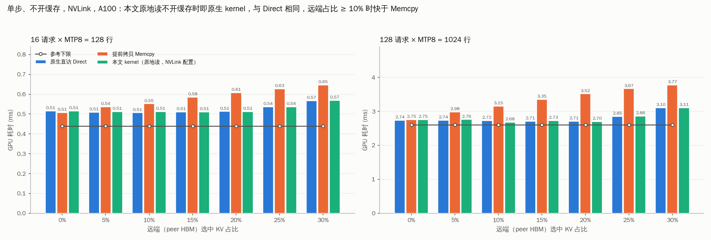

# 远端 KV 稀疏 MLA 算子优化报告

## 1. 工作进展与主要结论

本阶段完成了远端 KV 稀疏 MLA decode 的融合算子，将页去重、跨步 LRU 缓存、数据读取和 attention 计算合并到一次 GPU kernel 启动中。目标是在 KV 卸载到 Host DRAM 或其他 GPU 后，减少传输量和执行开销。

A100 已完成 PCIe / NVLink、MTP1 / MTP8 的单步与跨步测试。主要结果如下，耗时均为单层算子的 GPU 时间：

| 场景 | 测试结果 | 适用范围 |
|---|---|---|
| A100，PCIe，MTP8，跨步 LRU | 相比同样带 LRU 的较快基线，耗时降低 8%～26%；32 请求及以上为参考下限的 1.03～1.07 倍 | 已测 1～128 请求，14 个测试点均领先 |
| A100，PCIe，MTP1，跨步 LRU | 32 请求及以上，耗时降低 2%～13%；128～512 请求为参考下限的 1.04～1.10 倍 | 小 batch 未稳定领先 |
| A100，NVLink，跨步 LRU | MTP8 在 32～128 请求时耗时降低 11%～18%；MTP1 在 64～256 请求时降低 17%～23% | 小 batch 存在性能退化 |
| H800，PCIe，对比 SGLang HiSparse | 3 个小规模测试点中，HiSparse 耗时为融合算子的 1.6～5.5 倍 | 已完成 3 个配置的验证，全量测试待补齐 |

PCIe 大 batch 的主要约束已转为链路带宽，继续优化调度的空间有限。后续重点是补齐 H800 全量测试、降低小 batch 固定开销，并验证实际模型中的收益。

本阶段实测平台为 NVIDIA A100 和 H800。华为目标平台的适配与测试列入后续工作。

## 2. 场景与优化方案

### 2.1 测试场景

测试采用 GLM-5.2 风格的 DSA sparse MLA：每个 query 从所属请求中选择 2048 个 token，使用 64 个 attention head；每个 token 的 KV 为 576 维 BF16，每层占 1152 B，page size 为 1。远端存储分别为 PCIe 连接的 Host DRAM 和 NVLink 连接的其他 GPU HBM。

MTP1 表示每请求每步处理 1 个 query，MTP8 表示处理 8 个 query。单步测试扫描选中 KV 的远端占比；跨步测试将除最新 token 外的 KV 放在远端，通过本地 LRU 缓存复用历史读取。两类测试分别用于评估单步传输和跨步缓存收益。

### 2.2 核心优化

| 优化 | 实现方式 | 作用 |
|---|---|---|
| 统一地址访问 | 通过 CUDA UVA / VMM 将本地和远端内存映射到连续虚拟地址 | GPU 可直接访问远端 KV，减少 CPU 数据整理 |
| 跨行去重 | 在整个 batch 内识别重复远端页 | PCIe 路径中，每个未命中页每步最多读取一次 |
| 跨步 LRU | 在同一 kernel 内完成命中检测、淘汰和缓存写入；每请求独立管理缓存池 | 命中页直接读取本地 HBM，减少后续步骤的传输 |
| 读取与计算重叠 | 先处理本地 KV，远端数据分块到达后继续计算 | 缩短传输之外的额外耗时 |
| 多行合并与拆分计算 | MTP 多行一次启动；小 batch 将单行 KV 拆给多个线程块，最后合并 | 减少启动次数，提高 GPU 利用率 |

PCIe 和 NVLink 使用不同读取方式。PCIe 由少量 fetch 线程块去重搬运，写入本地暂存区和缓存；NVLink 由 attention 线程块直接读取远端并写回缓存，以利用更多 SM 的读取能力。NVLink 路径只对缓存写入去重，同一未命中页被多个 query 引用时仍可能重复传输。

### 2.3 与 HiSparse 的区别

本次测试中的 SGLang HiSparse 先执行 swap-in，再执行 FlashMLA sparse attention，两阶段串行。其 decode 接口每请求处理一个 query，MTP8 按 8 个 token 依次调用，共执行 16 个 kernel。融合算子一次处理全部 MTP 行，并在同一 kernel 内重叠搬运与计算。

性能收益来自多行合并、跨行去重、搬运与计算重叠，以及 attention 实现和小 batch 拆分策略的共同优化。

## 3. 测试设置与比较口径

| 项目 | 设置 |
|---|---|
| A100 | A100-SXM4-40GB，108 SM；Host 为 NUMA0 pinned DRAM；peer 为 GPU1 HBM，NV12 NVLink |
| 实测链路带宽 | PCIe：DMA 27.0 GB/s，SM gather 25～26 GB/s；NVLink：DMA 281 GB/s，SM gather 260～263 GB/s |
| 索引 | 回放 DSA 代理模型的 MTP top-k 重叠；不是 GLM-5.2 indexer 的真实输出 |
| 单步测试 | 远端占比 0%～30%，步长 5%；最近 4096 个位置保留本地 |
| A100 跨步测试 | 32 个连续 token：MTP8 为 4 步，MTP1 为 32 步；取后一半步骤平均耗时 |
| LRU 容量 | 默认每请求 4096 槽，另测 2048 / 8192 槽 |
| 计时 | CUDA event，仅 GPU 执行时间；单步每个配置 8 轮、2 组索引，取中位数 |
| 代码版本 | `dbbc02c6` |

比较基线为 FlashInfer FA2 MLA 的两条路径：Memcpy 先搬运远端页再计算，Direct 由原生算子直接读取远端。跨步测试中，两者均配相同的逐步 LRU；其 LRU 记账在 CPU 提前完成，不计入耗时。PCIe Memcpy 的 CPU gather 也不计时；NVLink Memcpy 的 GPU gather 计时。因此表中基线耗时未包含完整系统开销。

本报告采用**参考下限**衡量优化程度：`max(全本地 attention 实测耗时, 去重后的必需传输字节数 / 实测峰值带宽)`。跨步传输量按融合算子的实际未命中页统计。该指标衡量当前形状和缓存状态下，算子耗时与计算、传输预算的接近程度。全本地计时存在约 1%～4% 波动。

## 4. 关键测试结果

### 4.1 A100：跨步 LRU

以下选取代表性测试点。单位为 µs；“较快基线”取 Memcpy + LRU 和 Direct + LRU 中耗时较小者。全部跨步测试点见附录 A。

| 链路 | MTP | 请求数 | 融合算子 + LRU | Memcpy + LRU | Direct + LRU | 相比较快基线耗时降低 |
|---|---:|---:|---:|---:|---:|---:|
| PCIe | 8 | 1 | 130 | 154 | 246 | 16% |
| PCIe | 8 | 32 | 3236 | 3887 | 10352 | 17% |
| PCIe | 8 | 128 | 13695 | 16379 | 45078 | 16% |
| PCIe | 1 | 128 | 2321 | 2675 | 4327 | 13% |
| PCIe | 1 | 512 | 8040 | 8916 | 15441 | 10% |
| NVLink | 8 | 32 | 936 | 1088 | 1206 | 14% |
| NVLink | 8 | 128 | 3223 | 3909 | 4838 | 18% |
| NVLink | 1 | 128 | 567 | 735 | 749 | 23% |

PCIe MTP8 在 32 请求及以上达到 25.2～26.2 GB/s，为实测链路峰值的 93%～97%，表明传输是主要瓶颈。128 请求时，开启 LRU 将耗时从 29.1 ms 降至 13.7 ms；MTP1 的 512 请求从 45.0 ms 降至 8.0 ms。

两种链路接近参考下限的程度不同，原因是瓶颈不同。以 MTP8、128 请求为例，按原始 JSON 重新计算：

| 项目 | PCIe | NVLink |
|---|---:|---:|
| 全本地计算时间 | 2.487 ms | 2.488 ms |
| 去重未命中数据的传输预算 | 13.247 ms | 1.273 ms |
| 参考下限：两者取最大值 | 13.247 ms（传输主导） | 2.488 ms（计算主导） |
| 融合算子实际耗时 | 13.695 ms | 3.223 ms |
| 实际耗时 / 参考下限 | 1.034× | 1.295× |

PCIe 路径先去重再搬运，较长的传输过程覆盖了大部分计算，实际耗时接近传输预算。NVLink 将传输预算缩短到计算时间以下，此时准备、LRU、同步、缓存写回及远端读取等待的开销更加突出。其原地读取路径还会重复读取 MTP 行共享的未命中页：已有计数器测量约为每步 687 MB，按 281.7 GB/s 折算约 2.44 ms，接近全本地计算时间。参考下限假设计算与传输充分重叠，实际执行仍存在依赖和等待。

因此，NVLink 的绝对耗时从 PCIe 的 13.7 ms 降至 3.2 ms，约快 4.25 倍；同时，相对参考下限的差距从 3.4% 增至 29.5%。这反映了瓶颈从链路带宽转向计算与访存协同。图中各面板独立设置纵轴范围，横向比较绝对耗时需同时查看刻度。

### 4.2 A100：单步无缓存与容量扫描

PCIe MTP8 共测试 25 个 batch、7 个远端占比。在远端占比大于 0 的 150 个配置中，149 个快于两条基线，耗时降低 6%～39%；唯一例外是 1 请求、5% 远端，融合算子 75 µs，Direct 54 µs。128 请求、远端占比 10%～30% 时，为参考下限的 1.03～1.07 倍。

PCIe MTP1 单步内缺少跨行复用，暂存中转的收益不足以抵消开销，大 batch 比 Direct 慢约 2%～5%。NVLink 单步无缓存的推荐配置直接调用原生 Direct。

NVLink 图采用与 PCIe 图相同的 16、128 请求及 0%～30% 远端占比，数据来自 [`sweep_peer_mtp8_inplace.json`](../temp/a100_full/sweep_peer_mtp8_inplace.json)。绿色柱为本文在 NVLink 上的配置（原地读）：不开缓存时没有需要去重或写缓存的工作，wrapper 直接调用原生 kernel，所以耗时与 Direct 相同（0.98～1.01 倍）；远端占比 ≥ 10% 时为 Memcpy 的 0.77～0.93 倍。30% 远端时，16 请求的本文 / Direct / Memcpy 为 569 / 567 / 646 µs，128 请求为 3108 / 3101 / 3775 µs。NVLink 上本文 kernel 的收益来自跨 decode 的 LRU（第 3 节），单步无缓存时与原生持平。

容量扫描显示，PCIe 上每请求缓存从 4096 槽增至 8192 槽，耗时进一步下降，速度提升约 1.4～1.8 倍。容量需结合 HBM 预算选择：4096 槽的 KV 数据约占每请求每层 4.5 MiB，8192 槽约 9 MiB，均未包含元数据和暂存区。详细数据见附录 B。

### 4.3 H800：HiSparse 小规模验证

验证设备为 H800，132 SM、80 GB，PCIe Gen5 x16。实测 DMA 带宽 55.3 GB/s，SM 随机 gather 35.4 GB/s。每请求缓存均为 4096 槽，测试仅执行 2 次 pass。

| 场景 | 融合算子 staged + LRU（µs） | HiSparse（µs） | HiSparse / 融合算子 |
|---|---:|---:|---:|
| MTP1，1 请求 | 42.1 | 106.5 | 2.53× |
| MTP1，4 请求 | 87.8 | 142.7 | 1.63× |
| MTP8，2 请求 | 205.6 | 1124.6 | 5.47× |

`test_mla_host_batch.py` 的 71 项测试通过；各方法相对参考实现的最大绝对误差为 0.0019～0.0041，低于 BF16 测试容差 0.01。

H800 单步无缓存也出现了不利结果：30% 远端时，1 请求的融合算子为 109.4 µs，Memcpy 为 87.2 µs；16 请求分别为 1111.5 µs 和 779.4 µs。DMA 与 SM 随机读取带宽的差异可能是原因之一，后续通过全量测试分析带宽差异并调整读取策略。

## 5. 待优化问题与后续工作

- **小 batch 固定开销仍需降低。** NVLink MTP8 在 1～6 请求时比较快基线慢 12%～54%，12 请求慢约 11%，24 请求基本持平；NVLink MTP1 在 1～32 请求时慢 7%～49%。PCIe MTP1 在 1～16 请求时，除 4 请求外慢 3%～9%。LRU 和准备阶段的固定开销是主要原因。
- **补齐 H800 全量测试。** 已完成验证作业，3 个配置下 HiSparse 耗时为融合算子的 1.6～5.5 倍；下一步扩大 batch 和配置覆盖。
- **开展端到端验证。** 在当前单层测试基础上，接入模型其他层、索引器和 CPU 调度，使用真实 top-k 与更长连续序列评估长期缓存行为。

后续按以下顺序推进：

1. 补齐 H800 PCIe / NVLink 全量 batch、跨步 LRU 和 HiSparse 对比，分析单步搬运路径的退化。
2. 优化小 batch 的准备、同步及缓存管理开销，明确不同规模下的路径选择。
3. 使用目标模型的真实索引，验证长序列、请求进出及缓存回收，并开展端到端测试。
4. 在华为目标硬件上验证远端访存、缓存管理和计算重叠能力，再确定迁移方案和性能目标。

## 6. docs 中的测试结果索引

截至本次整理，docs 中共有 **11 篇 MLA 专题 Markdown 文档**，包含本报告；其中部分文档引用同一组测试结果。下表按内容列出已有结果，并区分最终数据、开发记录和推算分析。

| 文档 | 已记录的测试结果 | 使用说明 |
|---|---|---|
| [A100 全量测试](mla_host_a100_full.md) | PCIe / NVLink × MTP1 / MTP8 的单步扫描、跨步 LRU，以及 2048 / 4096 / 8192 槽容量扫描；索引指向 12 个原始 JSON | A100 最终版本 `dbbc02c6` 的主要数据来源 |
| [A100 LRU 开发记录](mla_host_a100_lru.md) | LRU 修改前后 A/B、单步扫描、跨步缓存、fetch CTA 数量扫描、NVLink 写回方案及失败尝试 | 含旧版本数据，最终性能以全量测试为准 |
| [H800 验证](mla_host_h800_lru.md) | 71 项测试通过；4 个单步配置、3 个跨步配置；HiSparse 对比及链路带宽 | 只有小规模验证；全量章节仍待补充 |
| [批量基准](mla_host_batch_baseline.md) | 独立随机 top-k 下，1～128 请求、MTP8、0%～30% 远端的 Memcpy / Direct；CPU gather；大页号偏移修复 | 含 419 项回归：376 通过、43 跳过；128K 重测 56 项正确性检查通过 |
| [批量融合算子](mla_host_batch_kernel.md) | MTP 重叠回放与独立随机索引各 56 个配置；零远端快速路径；跨步持久缓存模拟 | 早期无融合 LRU 版本；29 项单元测试通过，racecheck / synccheck / memcheck 均无错误 |
| [MTP top-k 重叠](mla_host_mtp_overlap.md) | 32K / 64K / 128K 上下文的跨 token 重叠、分层和分文档统计；远端去重后约保留 40%～41% | 代理模型统计，用于评估去重收益 |
| [单 query 设计与验证](mla_host_direct_design.md) | 128K～1M 上下文的分段直访、Memcpy / Direct 对比；带宽与物理驻留检查 | 576 项 FP32 输出检查、372 项功能检查；记录早期固定形状实现 |
| [单 query 优化汇报](mla_host_attention_report.md) | 分段直访在 1M、随机布局、0%～30% 远端的主要结果 | 上一阶段汇报摘要，与设计文档有重复 |
| [SM 负载均衡](mla_host_balance.md) | CTA 配比、混合计算、按就绪顺序合并；128K～1M 配对测量 | 最终默认版本 468 项功能检查、各实验 728 项配对 FP32 检查通过；racecheck / synccheck 无错误 |
| [PCIe 瓶颈分析](mla_host_pcie_roofline.md) | 带宽微基准、跨步缓存模拟、CPU attention、压缩与跳过读取等探索 | 包含实测、理论估算及相关工作；量化格式收益为预期估算 |
| [本报告](mla_host_lru_report.md) | 汇总 A100 最终结果与 H800 小规模验证 | 已有测试结果的汇报摘要 |

除上述 11 篇外，[`kernel_goal.txt`](kernel_goal.txt) 记录优化目标；`api/testing.rst`、`autotuning.rst` 等为接口或使用说明，不属于本项目的实测结果。目录中另有同名 PDF，本次仅更新 Markdown。

## 7. 数据与复现

| 内容 | 位置 |
|---|---|
| 图与表生成脚本 | [`plot.py`](../temp/report_lru/plot.py)、[`tables.py`](../temp/report_lru/tables.py) |
| A100 原始数据及脚本 | [`temp/a100_full/`](../temp/a100_full/)，复现命令：`bash temp/a100_full/run.sh` |
| H800 验证数据及日志 | [`fi-validate-697235`](../temp/h800/results/fi-validate-697235/) |
| A100 全量结果索引 | [mla_host_a100_full.md](mla_host_a100_full.md#结果文件索引) |

## 附录 A. A100 跨步稳态完整数据

每请求 4096 槽，单位为 µs。“较快基线”为 Memcpy + LRU 与 Direct + LRU 的较小耗时；LRU 加速比为同一融合算子无缓存耗时除以有缓存耗时。比值沿用原始统计，可能与表内取整耗时的商略有差异。

### A.1 PCIe，MTP8

| 请求 | 行 | 融合算子 + LRU | Memcpy + LRU | Direct + LRU | 融合算子无缓存 | 计算下限 | 传输下限 | **本文 ÷ 参考下限** | **本文 ÷ 较快基线** | LRU 加速比 |
|---:|---:|---:|---:|---:|---:|---:|---:|---:|---:|---:|
| 1 | 8 | 130 | 154 | 246 | 273 | 50 | 59 | 2.21 | **0.84** | 2.10× |
| 2 | 16 | 266 | 358 | 713 | 566 | 79 | 178 | 1.49 | **0.74** | 2.13× |
| 3 | 24 | 297 | 389 | 701 | 756 | 80 | 201 | 1.48 | **0.77** | 2.54× |
| 4 | 32 | 379 | 449 | 794 | 934 | 112 | 253 | 1.50 | **0.84** | 2.47× |
| 6 | 48 | 817 | 890 | 2253 | 1599 | 142 | 667 | 1.22 | **0.92** | 1.96× |
| 8 | 64 | 986 | 1195 | 2644 | 2043 | 281 | 771 | 1.28 | **0.82** | 2.07× |
| 12 | 96 | 1154 | 1286 | 3074 | 2632 | 257 | 988 | 1.17 | **0.90** | 2.28× |
| 16 | 128 | 1772 | 2134 | 5185 | 3748 | 505 | 1542 | 1.15 | **0.83** | 2.12× |
| 24 | 192 | 2474 | 2866 | 7328 | 5422 | 505 | 2233 | 1.11 | **0.86** | 2.19× |
| 32 | 256 | 3236 | 3887 | 10352 | 7039 | 754 | 3019 | 1.07 | **0.83** | 2.18× |
| 48 | 384 | 4260 | 5127 | 12858 | 10247 | 1003 | 4016 | 1.06 | **0.83** | 2.41× |
| 64 | 512 | 6762 | 7965 | 21744 | 14412 | 1248 | 6461 | 1.05 | **0.85** | 2.13× |
| 96 | 768 | 9171 | 11076 | 28884 | 20792 | 1973 | 8859 | 1.04 | **0.83** | 2.27× |
| 128 | 1024 | 13695 | 16379 | 45078 | 29126 | 2487 | 13247 | 1.03 | **0.84** | 2.13× |

### A.2 NVLink，MTP8

| 请求 | 行 | 融合算子 + LRU | Memcpy + LRU | Direct + LRU | 融合算子无缓存 | 计算下限 | 传输下限 | **本文 ÷ 参考下限** | **本文 ÷ 较快基线** | LRU 加速比 |
|---:|---:|---:|---:|---:|---:|---:|---:|---:|---:|---:|
| 1 | 8 | 98 | 63 | 68 | 101 | 51 | 6 | 1.93 | 1.54 | 1.04× |
| 2 | 16 | 125 | 105 | 116 | 174 | 78 | 17 | 1.60 | 1.19 | 1.38× |
| 3 | 24 | 150 | 109 | 115 | 247 | 80 | 19 | 1.87 | 1.38 | 1.65× |
| 4 | 32 | 188 | 146 | 150 | 324 | 112 | 24 | 1.68 | 1.29 | 1.72× |
| 6 | 48 | 260 | 232 | 273 | 471 | 143 | 64 | 1.82 | 1.12 | 1.81× |
| 8 | 64 | 325 | 376 | 394 | 673 | 280 | 74 | 1.16 | **0.86** | 2.07× |
| 12 | 96 | 422 | 380 | 388 | 903 | 259 | 95 | 1.63 | 1.11 | 2.14× |
| 16 | 128 | 581 | 679 | 727 | 1270 | 502 | 149 | 1.16 | **0.86** | 2.19× |
| 24 | 192 | 752 | 759 | 827 | 1805 | 507 | 215 | 1.48 | **0.99** | 2.40× |
| 32 | 256 | 936 | 1088 | 1206 | 2385 | 753 | 290 | 1.24 | **0.86** | 2.55× |
| 48 | 384 | 1276 | 1434 | 1523 | 3561 | 999 | 385 | 1.28 | **0.89** | 2.79× |
| 64 | 512 | 1715 | 1945 | 2371 | 4753 | 1247 | 620 | 1.38 | **0.88** | 2.77× |
| 96 | 768 | 2477 | 2910 | 3267 | 7263 | 1972 | 853 | 1.26 | **0.85** | 2.93× |
| 128 | 1024 | 3223 | 3909 | 4838 | 9474 | 2488 | 1273 | 1.30 | **0.82** | 2.94× |

### A.3 PCIe，MTP1

| 请求 | 行 | 融合算子 + LRU | Memcpy + LRU | Direct + LRU | 融合算子无缓存 | 计算下限 | 传输下限 | **本文 ÷ 参考下限** | **本文 ÷ 较快基线** | LRU 加速比 |
|---:|---:|---:|---:|---:|---:|---:|---:|---:|---:|---:|
| 1 | 1 | 58 | 53 | 57 | 121 | 33 | 9 | 1.76 | 1.09 | 2.09× |
| 2 | 2 | 86 | 84 | 98 | 237 | 42 | 29 | 2.05 | 1.03 | 2.76× |
| 4 | 4 | 98 | 101 | 115 | 427 | 48 | 37 | 2.05 | **0.97** | 4.37× |
| 8 | 8 | 201 | 185 | 282 | 794 | 50 | 124 | 1.62 | 1.09 | 3.95× |
| 16 | 16 | 343 | 334 | 518 | 1488 | 81 | 244 | 1.41 | 1.03 | 4.34× |
| 32 | 32 | 578 | 589 | 957 | 2921 | 119 | 462 | 1.25 | **0.98** | 5.05× |
| 64 | 64 | 1177 | 1302 | 2118 | 5733 | 285 | 1016 | 1.16 | **0.90** | 4.87× |
| 128 | 128 | 2321 | 2675 | 4327 | 11359 | 504 | 2111 | 1.10 | **0.87** | 4.89× |
| 256 | 256 | 4021 | 4519 | 7664 | 22539 | 758 | 3784 | 1.06 | **0.89** | 5.61× |
| 512 | 512 | 8040 | 8916 | 15441 | 44994 | 1313 | 7713 | 1.04 | **0.90** | 5.60× |

### A.4 NVLink，MTP1

| 请求 | 行 | 融合算子 + LRU | Memcpy + LRU | Direct + LRU | 融合算子无缓存 | 计算下限 | 传输下限 | **本文 ÷ 参考下限** | **本文 ÷ 较快基线** | LRU 加速比 |
|---:|---:|---:|---:|---:|---:|---:|---:|---:|---:|---:|
| 1 | 1 | 60 | 40 | 43 | 39 | 33 | 1 | 1.82 | 1.49 | 0.65× |
| 2 | 2 | 64 | 52 | 55 | 49 | 42 | 3 | 1.53 | 1.23 | 0.77× |
| 4 | 4 | 68 | 59 | 62 | 63 | 48 | 4 | 1.42 | 1.15 | 0.93× |
| 8 | 8 | 89 | 71 | 75 | 101 | 50 | 12 | 1.77 | 1.26 | 1.14× |
| 16 | 16 | 125 | 114 | 117 | 175 | 81 | 23 | 1.54 | 1.09 | 1.40× |
| 32 | 32 | 190 | 177 | 177 | 325 | 120 | 44 | 1.58 | 1.07 | 1.71× |
| 64 | 64 | 314 | 401 | 402 | 672 | 285 | 98 | 1.10 | **0.78** | 2.14× |
| 128 | 128 | 567 | 735 | 749 | 1270 | 504 | 203 | 1.13 | **0.77** | 2.24× |
| 256 | 256 | 964 | 1156 | 1170 | 2392 | 759 | 364 | 1.27 | **0.83** | 2.48× |

## 附录 B. A100 LRU 容量扫描

MTP8，每请求槽数；每格为融合算子 / 较快基线耗时，单位为 µs，括号内为耗时比。

| 远端 | 请求 | 2048 槽：本文 / 较快基线 | 4096 槽：本文 / 较快基线 | 8192 槽：本文 / 较快基线 |
|---|---:|---:|---:|---:|
| PCIe | 1 | 193 / 203（0.95） | 130 / 154（0.84） | 115 / 110（1.05） |
| PCIe | 4 | 614 / 737（0.83） | 379 / 449（0.84） | 259 / 357（0.72） |
| PCIe | 16 | 2679 / 3176（0.84） | 1772 / 2134（0.83） | 1012 / 1325（0.76） |
| PCIe | 64 | 10254 / 11632（0.88） | 6762 / 7965（0.85） | 3737 / 4680（0.80） |
| PCIe | 128 | 20772 / 23730（0.88） | 13695 / 16379（0.84） | 7492 / 9423（0.80） |
| NVLink | 1 | 104 / 70（1.50） | 98 / 63（1.54） | 100 / 62（1.61） |
| NVLink | 4 | 250 / 176（1.42） | 188 / 146（1.29） | 204 / 136（1.50） |
| NVLink | 16 | 864 / 777（1.11） | 581 / 679（0.86） | 567 / 595（0.95） |
| NVLink | 64 | 3018 / 2312（1.31） | 1715 / 1945（0.88） | 1586 / 1597（0.99） |
| NVLink | 128 | 6096 / 4654（1.31） | 3223 / 3909（0.82） | 2913 / 3163（0.92） |
