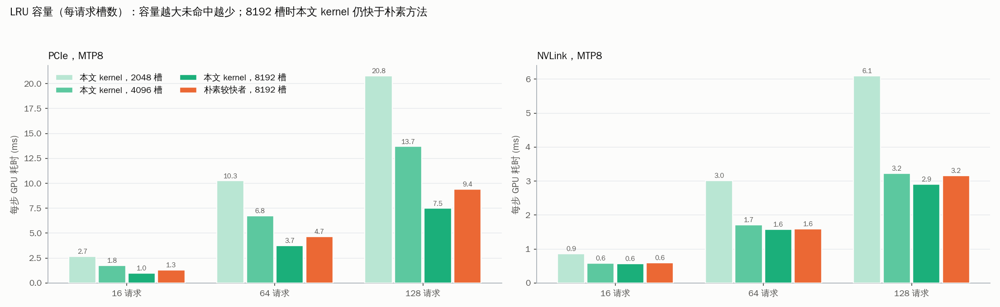
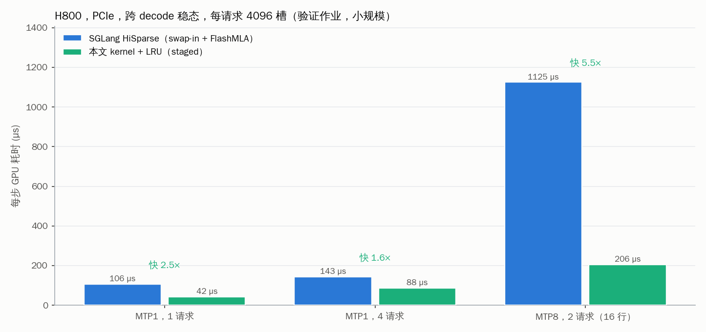

# 远端 KV 稀疏 MLA decode 算子：测试报告

**一句话结论**：同一个 cooperative kernel 把「远端页去重搬运 + 跨 decode LRU 缓存 + attention」融在一次 launch 里。远端是 PCIe Host DRAM 时，MTP8 ≥ 32 请求时跨 decode 稳态离理论下限只有 3%～7%（1.03～1.07×），1～128 请求全部比同样配了 LRU 的 Memcpy 快 8%～26%，比 Direct 快 1.9～3.3 倍；远端是 NVLink peer HBM 时，中大 batch（MTP8 ≥ 32 请求、MTP1 ≥ 64 请求）比两种朴素方法快 11%～23%。在 H800 上与 SGLang HiSparse 对比，同样开 LRU 的跨 decode 稳态快 1.6～5.5 倍（验证作业，小规模）。

## 结论

| 场景（A100，跨 decode 稳态，开 LRU，每请求 4096 槽） | 本文 ÷ 理论下限 | 本文 ÷ 朴素较快者 | 开 LRU 比不开快 |
|---|---:|---:|---:|
| PCIe，MTP8，1～128 请求（8～1024 行） | 1.03～2.21（≥ 32 请求：1.03～1.07） | **0.74～0.92**（14 个点全部更快） | 2.0～2.5× |
| PCIe，MTP1，32～512 请求 | 1.04～1.25 | **0.87～0.98** | 4.9～5.6× |
| NVLink，MTP8，8～128 请求 | 1.16～1.63 | **0.82～0.89**（12、24 请求除外：0.99～1.11） | 2.1～2.9× |
| NVLink，MTP1，64～256 请求 | 1.10～1.27 | **0.77～0.83** | 2.1～2.5× |
| 单步不开缓存，PCIe，MTP8，远端 5%～30% | 128 请求 1.03～1.21 | **0.61～0.94**（远端 > 0 的 150 格中只有 1 请求、5% 一格输） | — |
| **H800，PCIe，对比 SGLang HiSparse**（小规模） | — | **HiSparse 耗时为本文的 1.6～5.5 倍** | — |

这些优势来自第 1 节的几项设计：统一地址（UVA + VMM）让 kernel 直接读远端；全 batch 去重让每个远端页每步最多过一次链路；LRU 融合在同一个 kernel 里，命中的页不走链路，也没有额外的 kernel 和 CPU 同步；远端搬运与本地计算在同一个 kernel 内重叠；按链路特性选择由少量 fetch CTA 搬运（PCIe）还是由全部 attention CTA 原地读并写回缓存（NVLink）。

## 1. 算子设计

### 1.1 场景与对照：SGLang HiSparse 的做法

场景：DSA sparse MLA decode。每个 query 行从本请求的 KV 中选 top-k = 2048 个 token（page_size 1，一页 = 一个 token，576 维 BF16，每层 1152 B），对这 2048 个 token 做 MLA attention（64 头）。KV 的大部分放在远端：Host DRAM（经 PCIe）或其他 GPU 的 HBM（经 NVLink）；本地 HBM 只放最近的 token 和缓存。

SGLang HiSparse（原版）每步用两个 kernel：
1. **swap-in**（`load_cache_to_device_buffer_mla`，每个请求一个 CTA）：每个请求在 HBM 上有一块独立的设备 buffer（`capacity` 个槽 + 最新 token 1 槽），在请求内做 LRU。kernel 检查本请求的 top-k 哪些已在 buffer 里，把未命中的页从 Host 拷进 buffer（淘汰最久未用的槽），并输出每个 top-k 在 buffer 中的槽号。
2. **attention**（`sgl_kernel` FlashMLA sparse decode）：按槽号读 buffer 做 attention。

由此带来的特点：
- 两个 kernel 串行，必须先搬完再算，链路和计算单元不能同时忙。
- decode 路径每个请求只接受 1 个 query 行。MTP 的 k 个 draft token 要依次各做一次 swap-in 和一次 attention，同一请求不同行共享的页每行各判断一次。
- 缓存按请求划分，只能按请求内的槽号访问。

### 1.2 本文 kernel 的设计特色

1. **统一地址：UVA + VMM，kernel 直接读远端。** KV pool 用 CUDA 虚拟内存管理接口分配：`cuMemAddressReserve` 预留一段连续虚拟地址，`cuMemCreate` + `cuMemMap` 把本地 HBM 和远端物理内存（Host NUMA 上的 pinned DRAM，或 peer GPU 的 HBM）首尾相接映射进去。在 UVA 下，GPU 可以直接解引用这段地址。kernel 只拿一个基址，第 p 页的地址就是 `基址 + p × 1152 B`，本地页和远端页用同一种编码。地址翻译由 GPU MMU 完成，访问远端页时硬件直接走 PCIe 或 NVLink（零拷贝，不迁移页）。kernel 只用「页号 ≥ `host_page_start`」判断一页在远端，以决定是否去重、查缓存、搬运。
2. **一个 cooperative kernel 完成整步。** 分类、去重、查缓存、LRU 淘汰、远端搬运、attention、拆 KV 后的合并，全部在一次 launch 内用 grid barrier 分阶段完成。每步只有一次 kernel 启动，没有 CPU 参与，也没有 kernel 之间的同步。
3. **全 batch 去重。** 远端页用原子 CAS 在整个 batch（所有请求、所有 MTP 行）范围内去重，第一个 CAS 成功的行「认领」这一页。每个远端页每步最多搬一次；MTP8 时同一请求的 8 行选中的页大量重叠，去重后只剩约 41%。
4. **LRU 融合在算子内。** 缓存槽和 staging 在同一块 HBM buffer 里（前段是缓存槽，后段是 staging 槽），条目用负数编码指向这块 buffer，所以 attention 的 tile 加载只需要一个分支：
   - **全局表** `resident[远端页] = 缓存槽`：命中检测对所有请求的缓存都有效。
   - **每请求一个缓存池**（池号 = 请求的 `req_pool_idx`），淘汰和放置在池内进行。每个槽记录最近使用的 launch 编号；每步每池用 radix select 选出最久未用、且本步没被引用的槽作为 victim。
   - 命中检测、淘汰选择、写缓存都在同一次 launch 内完成，状态在 kernel 末尾由最后一个 CTA 复位，不需要 host 侧维护。
   - 配套接口：`set_host_cache` 设定池和容量，`release_host_cache` 在请求结束时释放池，`invalidate_host_pages` 在远端页被复用前作废。
5. **远端搬运与本地计算重叠。** attention 沿用原生 MLA 的 tile 循环（QK、online softmax、PV）。每个 item 先算本地 tile，只在用到远端 tile 前等待它就绪（按块发布的 release/acquire 标志），远端传输时间被本地计算覆盖。
6. **按链路特性选择搬运方式。** PCIe 带宽低（A100 约 27 GB/s），瓶颈在字节数，所以由少量 fetch CTA 去重搬运。NVLink 带宽高（约 281 GB/s），而单个 SM 的远端读上限约 21 GB/s，8 个 fetch CTA 远远喂不满，所以改为全部 attention CTA 原地读远端，并顺手把未命中页写进缓存。两种方式是同一个 kernel 的两个运行时分支。
7. **MTP 多行一次处理，小 batch 拆 KV。** 所有请求的所有 MTP 行在同一次 launch 内处理。batch 小、行数不足以占满 SM 时，把一行的 KV 拆成若干段分给多个 CTA，最后按 LSE 合并。

### 1.3 执行流程

所有配置共用同一个 kernel（`BatchMLAHostBatchKernel`），由两个运行时开关选择分支：`host_stage`（staged / 原地读）和是否调用了 `set_host_cache`（开 / 关 LRU）。

**staged，不开缓存**（PCIe 单步）
1. prepare：每行把条目分成本地和远端两类；远端页做全 batch 去重。
2. grid barrier → resolve：按行顺序给被认领的远端页编号，作为 staging 槽号，并把条目改写为指向 staging 的编码。
3. grid barrier → grid 末尾的 8 个 fetch CTA 按槽号顺序用 `cp.async` 把远端页读入 shared memory（shared memory 够时双缓冲，下一块的读取与本块的写出重叠），写到 HBM staging，每写完一块（16 或 64 行）发布一个就绪标志，然后转去做 attention item。其余 CTA 直接做 attention item：本地 tile 先算，staging tile 等对应标志。
4. （拆 KV 时）grid barrier → 合并。

**staged + LRU**（**PCIe 推荐**）
1. prepare：每个远端条目先查 `resident`。命中的改写为缓存槽编码并刷新时间戳，未命中的才进入去重。
2. resolve：同上，只给未命中页编号。
3. LRU item（每池一个，排在 attention item 之前）：为本池本步的未命中页选出同样数量的 victim 槽，更新 `resident`、槽→页映射和 victim 表。
4. fetch CTA 照常搬运并发布标志，同时从 shared memory 里的同一份数据把页写进它的 victim 槽。若这一块的 victim 还没选好，就记下来，等搬运循环结束后再从 staging 拷到缓存（HBM 到 HBM），所以 PCIe 读取从不等待 LRU。
5. 结果：每个远端页最多读一次，命中的页不走链路。

**原地读，不开缓存**（NVLink 单步）：每个条目直接按原页号读远端，与原生 kernel 完全相同，wrapper 直接调用原生 kernel。

**原地读 + LRU**（**NVLink 推荐**）
1. prepare：命中的条目同上改写为缓存槽；未命中的保留原页号（由 attention 原地读），其中认领这一页的条目打上标记位，并记下它是本行第几个认领。不需要 resolve 遍历。
2. grid barrier → 每个池由一个 CTA 选出 victim、完成绑定，并把 victim 写进认领条目对应的位置。
3. grid barrier → attention：加载每个 tile 时，用 `cp.async` 把这一 tile 各行的 victim 一起预取进 shared memory。tile 落地后，认领行把 shared memory 里的这一行写入 victim 槽。没有 fetch CTA，所有 SM 都参与读远端。
4. 代价：只有「写缓存」这一步去重。同一页被同一步的多个 MTP 行引用时，每个引用各读一次远端（MTP8 稳态平均 2.1 次）。NVLink 带宽足以承受，这比占用 SM 专门做 fetch 更快。

| | HiSparse | 本文 staged + LRU（PCIe） | 本文原地读 + LRU（NVLink） |
|---|---|---|---|
| kernel 数 / 步 | 2（swap-in → attention），MTP8 时 16 | 1 | 1 |
| 远端访问方式 | swap-in kernel 拷进设备 buffer | UVA + VMM 统一地址，fetch CTA 读 | UVA + VMM 统一地址，attention CTA 直接读 |
| 每个未命中页每步过链路的次数 | 每个引用它的 MTP 行各判断一次 | 1 | 每个引用 1 次（MTP8 平均 2.1） |
| 缓存命中范围 | 本请求的 buffer | 全局（任意请求的缓存池） | 全局 |
| 搬运与计算 | 串行 | 重叠（本地 tile 先算） | 重叠（全部 SM 读远端） |
| MTP 多行 | 逐 token | 一次 launch | 一次 launch |

## 2. 测试设置

| 项目 | 设置 |
|---|---|
| GPU | A100-SXM4-40GB（GPU0，108 SM）。PCIe 远端：NUMA0 pinned DRAM，实测 SM gather 25～26 GB/s；NVLink 远端：GPU1 HBM（NV12），实测 260～263 GB/s |
| 模型参数 | GLM-5.2 风格 DSA sparse MLA：BF16，576 维（每 token 每层 1152 B），top-k 2048，64 头 |
| 索引 | 回放实测的 DSA 代理 MTP top-k，最近 4096 个位置始终在本地 |
| 跨 decode | 32 个连续 token（MTP8 为 4 步，MTP1 为 32 步），除最新 token 外的 KV 全在远端，取后一半步的平均；每请求一个 LRU 池，默认 4096 槽 |
| 计时 | CUDA event，只计 GPU 执行；单步每格 8 轮 × 2 组索引取中位数 |
| 代码 | `dbbc02c6` |
| 原生 kernel | FlashInfer `BatchMLAPagedAttentionWrapper`（FA2 后端），Memcpy、Direct 和计算下限都用它 |

**理论下限** = max(计算下限, 传输下限)，两项都取实测的最好值，保证没有任何实现能低于它：
- **计算下限**：所有选中行都在本地 HBM、零传输时测得的最快 attention 耗时。单步测试取「原生 kernel 全本地」和「0% 远端时原生 / 本文 kernel」三者中最快的（原生 kernel 的 KV 拆分不是每种形状都最优，本文 kernel 在部分 batch 上全本地也更快）；跨 decode 测试取原生 kernel 全本地。
- **传输下限**：本步必须搬的去重远端字节（跨 decode 时为本文 kernel 实际的未命中页）÷ 远端链路实测峰值带宽 max(连续 DMA, SM 随机 gather)（A100 PCIe 27.0 GB/s，NVLink 281 GB/s）。本文 kernel 实际达到的最高搬运速率是 26.9 GB/s（PCIe），没有超过这个峰值。
- 计算下限本身有约 1%～4% 的测量波动（同一形状在不同远端占比下测得的全本地耗时相差这么多），比值在 1.00 附近时以此为误差范围。

**朴素方法**：
- **Memcpy**：先把（去重后的）远端页拷到本地 staging，再跑原生 attention。PCIe 上 CPU gather 到 pinned 内存**不计时**，只计 H2D DMA；NVLink 上 GPU gather，计时。
- **Direct**：原生 kernel 原地读远端，每个引用读一次，不去重。
- **+ LRU**：跨 decode 时两者都配上与本文完全相同的逐步 LRU，只搬未命中的页。**LRU 记账放在 CPU 上提前算好，不计时**，所以这个对比对朴素方法偏宽松。

## 3. 跨 decode 稳态（目标场景，开 LRU）

每组柱是一个 batch 点，纵轴是每步实际 GPU 耗时，黑色虚线是该 batch 的理论下限。图中每个面板选了 3～5 个代表性 batch；全部 batch 点见下面各小节的表格（小 batch 的情况另见第 7 节）。

### 3.1 PCIe，MTP8（全部 14 个 batch 点，µs）

| 请求 | 行 | 本文 kernel + LRU | Memcpy + LRU | Direct + LRU | 本文不开缓存 | 计算下限 | 传输下限 | **本文 ÷ 理论下限** | **本文 ÷ 朴素较快者** | LRU 加速 |
|---:|---:|---:|---:|---:|---:|---:|---:|---:|---:|---:|
| 1 | 8 | 130 | 154 | 246 | 273 | 50 | 59 | 2.21 | **0.84** | 2.10× |
| 2 | 16 | 266 | 358 | 713 | 566 | 79 | 178 | 1.49 | **0.74** | 2.13× |
| 3 | 24 | 297 | 389 | 701 | 756 | 80 | 201 | 1.48 | **0.77** | 2.54× |
| 4 | 32 | 379 | 449 | 794 | 934 | 112 | 253 | 1.50 | **0.84** | 2.47× |
| 6 | 48 | 817 | 890 | 2253 | 1599 | 142 | 667 | 1.22 | **0.92** | 1.96× |
| 8 | 64 | 986 | 1195 | 2644 | 2043 | 281 | 771 | 1.28 | **0.82** | 2.07× |
| 12 | 96 | 1154 | 1286 | 3074 | 2632 | 257 | 988 | 1.17 | **0.90** | 2.28× |
| 16 | 128 | 1772 | 2134 | 5185 | 3748 | 505 | 1542 | 1.15 | **0.83** | 2.12× |
| 24 | 192 | 2474 | 2866 | 7328 | 5422 | 505 | 2233 | 1.11 | **0.86** | 2.19× |
| 32 | 256 | 3236 | 3887 | 10352 | 7039 | 754 | 3019 | 1.07 | **0.83** | 2.18× |
| 48 | 384 | 4260 | 5127 | 12858 | 10247 | 1003 | 4016 | 1.06 | **0.83** | 2.41× |
| 64 | 512 | 6762 | 7965 | 21744 | 14412 | 1248 | 6461 | 1.05 | **0.85** | 2.13× |
| 96 | 768 | 9171 | 11076 | 28884 | 20792 | 1973 | 8859 | 1.04 | **0.83** | 2.27× |
| 128 | 1024 | 13695 | 16379 | 45078 | 29126 | 2487 | 13247 | 1.03 | **0.84** | 2.13× |

- 14 个点**全部**快于两种带 LRU 的朴素方法，是较快者的 0.74～0.92 倍；比 Direct + LRU 快 1.9～3.3 倍。
- ≥ 32 请求时离理论下限只有 3%～7%：此时瓶颈是 PCIe 本身，kernel 以 25.2～26.2 GB/s（链路峰值 27.0 GB/s 的 93%～97%）搬完每个未命中页，同时把计算完全藏在了传输后面。

### 3.2 NVLink，MTP8（µs）

| 请求 | 行 | 本文 kernel + LRU | Memcpy + LRU | Direct + LRU | 本文不开缓存 | 计算下限 | 传输下限 | **本文 ÷ 理论下限** | **本文 ÷ 朴素较快者** | LRU 加速 |
|---:|---:|---:|---:|---:|---:|---:|---:|---:|---:|---:|
| 1 | 8 | 98 | 63 | 68 | 101 | 51 | 6 | 1.93 | 1.54 | 1.04× |
| 2 | 16 | 125 | 105 | 116 | 174 | 78 | 17 | 1.60 | 1.19 | 1.38× |
| 3 | 24 | 150 | 109 | 115 | 247 | 80 | 19 | 1.87 | 1.38 | 1.65× |
| 4 | 32 | 188 | 146 | 150 | 324 | 112 | 24 | 1.68 | 1.29 | 1.72× |
| 6 | 48 | 260 | 232 | 273 | 471 | 143 | 64 | 1.82 | 1.12 | 1.81× |
| 8 | 64 | 325 | 376 | 394 | 673 | 280 | 74 | 1.16 | **0.86** | 2.07× |
| 12 | 96 | 422 | 380 | 388 | 903 | 259 | 95 | 1.63 | 1.11 | 2.14× |
| 16 | 128 | 581 | 679 | 727 | 1270 | 502 | 149 | 1.16 | **0.86** | 2.19× |
| 24 | 192 | 752 | 759 | 827 | 1805 | 507 | 215 | 1.48 | **0.99** | 2.40× |
| 32 | 256 | 936 | 1088 | 1206 | 2385 | 753 | 290 | 1.24 | **0.86** | 2.55× |
| 48 | 384 | 1276 | 1434 | 1523 | 3561 | 999 | 385 | 1.28 | **0.89** | 2.79× |
| 64 | 512 | 1715 | 1945 | 2371 | 4753 | 1247 | 620 | 1.38 | **0.88** | 2.77× |
| 96 | 768 | 2477 | 2910 | 3267 | 7263 | 1972 | 853 | 1.26 | **0.85** | 2.93× |
| 128 | 1024 | 3223 | 3909 | 4838 | 9474 | 2488 | 1273 | 1.30 | **0.82** | 2.94× |

- 8、16、32～128 请求时为朴素较快者的 0.82～0.89 倍，128 请求时比 Memcpy + LRU 快 18%（3223 vs 3909 µs）、比 Direct + LRU 快 33%。
- 离理论下限还有 1.16～1.38×（大 batch）。理论下限只按去重后的未命中字节算传输，而原地读模式对未命中页的每个引用各读一次（第 1.3 节）。128 请求时，NVLink 计数器实测每步读入 687 MB（去重后只有 355 MB），按 281 GB/s 峰值需要 2.44 ms，与 2.45 ms 的计算时间相当，两者无法完全重叠。

### 3.3 PCIe，MTP1（µs）

| 请求 | 行 | 本文 kernel + LRU | Memcpy + LRU | Direct + LRU | 本文不开缓存 | 计算下限 | 传输下限 | **本文 ÷ 理论下限** | **本文 ÷ 朴素较快者** | LRU 加速 |
|---:|---:|---:|---:|---:|---:|---:|---:|---:|---:|---:|
| 1 | 1 | 58 | 53 | 57 | 121 | 33 | 9 | 1.76 | 1.09 | 2.09× |
| 2 | 2 | 86 | 84 | 98 | 237 | 42 | 29 | 2.05 | 1.03 | 2.76× |
| 4 | 4 | 98 | 101 | 115 | 427 | 48 | 37 | 2.05 | **0.97** | 4.37× |
| 8 | 8 | 201 | 185 | 282 | 794 | 50 | 124 | 1.62 | 1.09 | 3.95× |
| 16 | 16 | 343 | 334 | 518 | 1488 | 81 | 244 | 1.41 | 1.03 | 4.34× |
| 32 | 32 | 578 | 589 | 957 | 2921 | 119 | 462 | 1.25 | **0.98** | 5.05× |
| 64 | 64 | 1177 | 1302 | 2118 | 5733 | 285 | 1016 | 1.16 | **0.90** | 4.87× |
| 128 | 128 | 2321 | 2675 | 4327 | 11359 | 504 | 2111 | 1.10 | **0.87** | 4.89× |
| 256 | 256 | 4021 | 4519 | 7664 | 22539 | 758 | 3784 | 1.06 | **0.89** | 5.61× |
| 512 | 512 | 8040 | 8916 | 15441 | 44994 | 1313 | 7713 | 1.04 | **0.90** | 5.60× |

- ≥ 32 请求时快于两种朴素方法，128～512 请求时离理论下限 4%～10%（1.04～1.10×，搬运速率 24.6～25.9 GB/s）。
- MTP1 时每个请求只有 1 行，没有可去重的页，LRU 的作用最大：开 LRU 比不开快 4.9～5.6 倍（512 请求：45.0 → 8.0 ms）。

### 3.4 NVLink，MTP1（µs）

| 请求 | 行 | 本文 kernel + LRU | Memcpy + LRU | Direct + LRU | 本文不开缓存 | 计算下限 | 传输下限 | **本文 ÷ 理论下限** | **本文 ÷ 朴素较快者** | LRU 加速 |
|---:|---:|---:|---:|---:|---:|---:|---:|---:|---:|---:|
| 1 | 1 | 60 | 40 | 43 | 39 | 33 | 1 | 1.82 | 1.49 | 0.65× |
| 2 | 2 | 64 | 52 | 55 | 49 | 42 | 3 | 1.53 | 1.23 | 0.77× |
| 4 | 4 | 68 | 59 | 62 | 63 | 48 | 4 | 1.42 | 1.15 | 0.93× |
| 8 | 8 | 89 | 71 | 75 | 101 | 50 | 12 | 1.77 | 1.26 | 1.14× |
| 16 | 16 | 125 | 114 | 117 | 175 | 81 | 23 | 1.54 | 1.09 | 1.40× |
| 32 | 32 | 190 | 177 | 177 | 325 | 120 | 44 | 1.58 | 1.07 | 1.71× |
| 64 | 64 | 314 | 401 | 402 | 672 | 285 | 98 | 1.10 | **0.78** | 2.14× |
| 128 | 128 | 567 | 735 | 749 | 1270 | 504 | 203 | 1.13 | **0.77** | 2.24× |
| 256 | 256 | 964 | 1156 | 1170 | 2392 | 759 | 364 | 1.27 | **0.83** | 2.48× |

- ≥ 64 请求时比两种朴素方法快 17%～23%（128 请求：567 vs 735 µs）。

## 4. 单步、不开缓存（PCIe）

### 4.1 PCIe，MTP8：每格为本文 µs（÷ 理论下限 / ÷ 朴素较快者），加粗表示快于两种朴素方法

| 请求 | 行 | 0% | 5% | 10% | 15% | 20% | 25% | 30% |
|---:|---:|---:|---:|---:|---:|---:|---:|---:|
| 1 | 8 | 47 (1.06 / 1.06) | 75 (1.69 / 1.39) | 78 (1.75 / **0.88**) | 100 (1.98 / **0.90**) | 118 (1.74 / **0.93**) | 126 (1.55 / **0.89**) | 142 (1.46 / **0.92**) |
| 2 | 16 | 69 (1.00 / 0.95) | 91 (1.31 / **0.87**) | 119 (1.71 / **0.79**) | 139 (1.53 / **0.80**) | 167 (1.41 / **0.83**) | 197 (1.34 / **0.85**) | 230 (1.31 / **0.88**) |
| 3 | 24 | 97 (1.28 / 1.26) | 118 (1.55 / **0.87**) | 143 (1.65 / **0.79**) | 191 (1.45 / **0.86**) | 240 (1.37 / **0.87**) | 274 (1.30 / **0.91**) | 306 (1.24 / **0.89**) |
| 4 | 32 | 131 (1.17 / 1.17) | 150 (1.35 / **0.79**) | 191 (1.61 / **0.76**) | 257 (1.44 / **0.84**) | 321 (1.36 / **0.90**) | 388 (1.31 / **0.90**) | 434 (1.28 / **0.93**) |
| 5 | 40 | 170 (1.00 / 0.96) | 188 (1.10 / **0.71**) | 226 (1.32 / **0.66**) | 308 (1.25 / **0.73**) | 398 (1.22 / **0.78**) | 461 (1.17 / **0.82**) | 544 (1.21 / **0.89**) |
| 6 | 48 | 183 (1.28 / 1.25) | 195 (1.37 / **0.79**) | 246 (1.27 / **0.74**) | 344 (1.19 / **0.80**) | 446 (1.15 / **0.87**) | 532 (1.10 / **0.88**) | 627 (1.08 / **0.94**) |
| 7 | 56 | 233 (1.00 / 0.87) | 254 (1.09 / **0.64**) | 305 (1.31 / **0.61**) | 421 (1.28 / **0.69**) | 537 (1.26 / **0.75**) | 633 (1.25 / **0.80**) | 722 (1.24 / **0.83**) |
| 8 | 64 | 237 (1.00 / 0.85) | 273 (1.15 / **0.64**) | 367 (1.36 / **0.65**) | 509 (1.30 / **0.73**) | 641 (1.24 / **0.79**) | 755 (1.19 / **0.83**) | 860 (1.17 / **0.84**) |
| 10 | 80 | 283 (1.01 / 0.98) | 368 (1.31 / **0.86**) | 398 (1.41 / **0.68**) | 561 (1.32 / **0.77**) | 716 (1.27 / **0.84**) | 845 (1.20 / **0.85**) | 981 (1.17 / **0.87**) |
| 12 | 96 | 343 (1.32 / 1.29) | 367 (1.41 / **0.80**) | 477 (1.30 / **0.75**) | 657 (1.20 / **0.81**) | 837 (1.18 / **0.86**) | 1000 (1.18 / **0.90**) | 1149 (1.16 / **0.91**) |
| 14 | 112 | 430 (1.00 / 0.87) | 478 (1.11 / **0.64**) | 588 (1.28 / **0.62**) | 814 (1.22 / **0.70**) | 1021 (1.19 / **0.75**) | 1228 (1.18 / **0.79**) | 1411 (1.15 / **0.81**) |
| 16 | 128 | 442 (1.00 / 0.87) | 528 (1.20 / **0.71**) | 605 (1.31 / **0.63**) | 843 (1.22 / **0.71**) | 1069 (1.16 / **0.75**) | 1296 (1.12 / **0.80**) | 1493 (1.11 / **0.82**) |
| 20 | 160 | 503 (1.01 / 0.96) | 667 (1.33 / **0.84**) | 730 (1.23 / **0.66**) | 1020 (1.15 / **0.74**) | 1315 (1.11 / **0.79**) | 1586 (1.09 / **0.83**) | 1819 (1.09 / **0.85**) |
| 24 | 192 | 670 (1.31 / 1.26) | 715 (1.40 / **0.78**) | 936 (1.24 / **0.74**) | 1304 (1.16 / **0.79**) | 1649 (1.14 / **0.83**) | 1978 (1.12 / **0.86**) | 2278 (1.10 / **0.88**) |
| 28 | 224 | 708 (1.00 / 0.92) | 754 (1.06 / **0.62**) | 998 (1.14 / **0.61**) | 1429 (1.10 / **0.70**) | 1824 (1.07 / **0.75**) | 2218 (1.05 / **0.78**) | 2581 (1.05 / **0.82**) |
| 32 | 256 | 783 (1.04 / 1.02) | 928 (1.23 / **0.74**) | 1109 (1.16 / **0.64**) | 1580 (1.11 / **0.73**) | 2028 (1.09 / **0.77**) | 2474 (1.09 / **0.81**) | 2894 (1.06 / **0.83**) |
| 40 | 320 | 1018 (1.33 / 1.26) | 1104 (1.44 / **0.77**) | 1477 (1.16 / **0.72**) | 2086 (1.12 / **0.79**) | 2682 (1.11 / **0.84**) | 3236 (1.09 / **0.86**) | 3727 (1.09 / **0.89**) |
| 48 | 384 | 1184 (1.17 / 1.11) | 1254 (1.24 / **0.70**) | 1629 (1.12 / **0.66**) | 2333 (1.08 / **0.73**) | 2992 (1.06 / **0.78**) | 3646 (1.04 / **0.82**) | 4242 (1.03 / **0.84**) |
| 56 | 448 | 1300 (1.04 / 0.96) | 1344 (1.08 / **0.61**) | 1937 (1.07 / **0.64**) | 2811 (1.04 / **0.72**) | 3663 (1.02 / **0.77**) | 4430 (1.01 / **0.81**) | 5078 (1.00 / **0.83**) |
| 64 | 512 | 1447 (1.15 / 1.05) | 1811 (1.44 / **0.77**) | 2253 (1.09 / **0.68**) | 3238 (1.05 / **0.75**) | 4112 (1.03 / **0.80**) | 4871 (1.02 / **0.82**) | 5556 (1.02 / **0.84**) |
| 72 | 576 | 1808 (1.21 / 1.13) | 1785 (1.20 / **0.67**) | 2436 (1.08 / **0.65**) | 3528 (1.05 / **0.73**) | 4608 (1.05 / **0.78**) | 5565 (1.04 / **0.81**) | 6422 (1.04 / **0.83**) |
| 80 | 640 | 1866 (1.23 / 1.12) | 1910 (1.26 / **0.68**) | 2701 (1.10 / **0.68**) | 3924 (1.07 / **0.75**) | 5080 (1.06 / **0.81**) | 6161 (1.06 / **0.84**) | 7199 (1.04 / **0.86**) |
| 96 | 768 | 2326 (1.16 / 1.08) | 2206 (1.10 / **0.64**) | 3070 (1.08 / **0.63**) | 4487 (1.05 / **0.72**) | 5867 (1.04 / **0.77**) | 7196 (1.03 / **0.80**) | 8408 (1.03 / **0.83**) |
| 112 | 896 | 2634 (1.18 / 1.08) | 2523 (1.13 / **0.62**) | 3664 (1.06 / **0.64**) | 5352 (1.03 / **0.73**) | 6978 (1.01 / **0.78**) | 8469 (1.01 / **0.81**) | 9771 (1.01 / **0.83**) |
| 128 | 1024 | 2758 (1.11 / 1.06) | 2998 (1.21 / **0.65**) | 4261 (1.07 / **0.66**) | 6205 (1.05 / **0.74**) | 8119 (1.04 / **0.79**) | 9875 (1.04 / **0.82**) | 11418 (1.03 / **0.84**) |

- 远端占比 > 0 的 150 个格子里（25 个 batch × 6 个占比），只有「1 请求、5%」一格慢于 Direct（75 vs 54 µs），其余都是朴素较快者的 0.61～0.94 倍。
- 远端占比 10%～30% 时，128 请求离理论下限 1.03～1.07×，≥ 28 请求都在 1.00～1.16× 之内。
- 0% 远端时没有可省的传输，部分小 batch 会多出 prepare 阶段的开销（最多 1.33×）。

### 4.2 其他单步结果

- **PCIe，MTP1**：每个请求只有 1 行，没有可以去重的页，staging 只是多一次中转，单步基本都慢于 Direct（大 batch 慢 2%～5%）。这个场景的收益全部来自跨 decode 缓存（第 3.3 节），单步应直接用原生 kernel。
- **NVLink**：原生 Direct 已经只比理论下限慢 1.0～1.3×，推荐配置（原地读、不开缓存）在 wrapper 里直接走原生 kernel，所以单步 NVLink 上本文的结果等于 Direct。

## 5. LRU 的收益与容量

开 LRU 后每步快 2.0～2.5 倍（PCIe MTP8）和 3.9～5.6 倍（PCIe MTP1）。MTP1 的收益更大，因为跨 decode 相邻 token 选中的页大部分重叠，而单步内没有别的重叠可以利用。

LRU 容量（MTP8，每请求槽数），每格为 本文 / 朴素较快者 µs（比值）：

| 远端 | 请求 | 2048 槽：本文 / 朴素较快者 | 4096 槽：本文 / 朴素较快者 | 8192 槽：本文 / 朴素较快者 |
|---|---:|---:|---:|---:|
| PCIe | 1 | 193 / 203（0.95） | 130 / 154（0.84） | 115 / 110（1.05） |
| PCIe | 4 | 614 / 737（0.83） | 379 / 449（0.84） | 259 / 357（0.72） |
| PCIe | 16 | 2679 / 3176（0.84） | 1772 / 2134（0.83） | 1012 / 1325（0.76） |
| PCIe | 64 | 10254 / 11632（0.88） | 6762 / 7965（0.85） | 3737 / 4680（0.80） |
| PCIe | 128 | 20772 / 23730（0.88） | 13695 / 16379（0.84） | 7492 / 9423（0.80） |
| NVLink | 1 | 104 / 70（1.50） | 98 / 63（1.54） | 100 / 62（1.61） |
| NVLink | 4 | 250 / 176（1.42） | 188 / 146（1.29） | 204 / 136（1.50） |
| NVLink | 16 | 864 / 777（1.11） | 581 / 679（0.86） | 567 / 595（0.95） |
| NVLink | 64 | 3018 / 2312（1.31） | 1715 / 1945（0.88） | 1586 / 1597（0.99） |
| NVLink | 128 | 6096 / 4654（1.31） | 3223 / 3909（0.82） | 2913 / 3163（0.92） |

- PCIe 上耗时基本正比于未命中数：8192 槽比 4096 槽再快 1.4～1.8 倍，且朴素方法同样配 8192 槽时，本文仍快 20%～28%（≥ 4 请求）。
- NVLink 上 2048 槽太小：未命中多，原地读重复读远端，慢于朴素方法；4096 槽以上恢复领先。

## 6. 与 SGLang HiSparse 的单层对比（H800，验证作业，小规模）

| 项目 | 设置 |
|---|---|
| GPU | H800（g40），PCIe Gen5 x16，实测 DMA 55 GB/s，SM gather 35 GB/s |
| HiSparse | SGLang 原版实现，按第 1.1 节的方式运行：每请求 4096 槽 + 最新 token 1 槽；MTP8 时 8 个 draft token 依次各做一次 swap-in 和一次 FlashMLA sparse decode，这是它实际的运行方式 |
| 本文 | 同一个 kernel，同样每请求 4096 槽。PCIe 推荐 staged，图和倍数都用 staged；原地读也列在表里 |
| 规模 | 1～4 请求，2 次 pass（H800 验证作业）。全 batch 对比在排队，结果出来后补入本节 |

跨 decode 稳态（µs）：

| 场景 | **本文 staged + LRU** | 本文原地读 + LRU | 本文不开缓存 | **HiSparse** | FA2 计算下限 | **HiSparse ÷ 本文 staged** |
|---|---:|---:|---:|---:|---:|---:|
| MTP1，1 请求 | 42.1 | 48.2 | 85.3 | 106.5 | 22.8 | **2.53×** |
| MTP1，4 请求 | 87.8 | 78.5 | 305.0 | 142.7 | 29.5 | **1.63×** |
| MTP8，2 请求（16 行） | 205.6 | 325.4 | 392.3 | 1124.6 | 34.8 | **5.47×** |

所有方法（含 HiSparse）的输出与参考实现的最大误差都在 0.0019～0.0041 之间（BF16）。

差距对应第 1.2 节的设计：
1. **MTP 多行一次 launch + 全 batch 去重**（特色 3、7）：HiSparse 每个 draft token 单独 swap-in、单独 attention，MTP8 时一步要 16 个 kernel；本文 1 个 kernel，共享页只搬一次。MTP8 时差距最大（5.5×）。
2. **搬运与计算重叠**（特色 2、5）：HiSparse 先 swap-in 再 attention，两步串行；本文在同一个 kernel 里边搬边算。
3. **小 batch 拆 KV**（特色 7）：1～4 行时 FlashMLA sparse decode 的纯计算就要 62 µs（FA2 为 23～30 µs）；本文把 KV 拆到多个 CTA 再合并，SM 利用率更高。

## 7. 局限

- **小 batch 上未全面领先**：NVLink MTP8 ≤ 6 请求慢于朴素方法 12%～54%，12、24 请求持平或慢 11%；MTP1 PCIe ≤ 16 请求慢 3%～9%（4 请求除外），NVLink ≤ 32 请求慢 7%～49%。原因是每个池的 LRU 步骤（约 20～30 µs）和 prepare 阶段在关键路径上，而这些 batch 的整步计算本身只有 30～120 µs。
- **朴素方法的 LRU 记账不计时**，对它们偏宽松；真正带设备端 LRU 的对手是 HiSparse。
- **HiSparse 对比目前只有小规模数据**，全 batch 结果待 H800 作业。
- top-k 为 DSA 代理 trace（不是 GLM-5.2 indexer 的真实输出）；跨 decode 只有 32 个连续 token。
- A100 数据；H800 的全量 batch 扫描在排队。

## 数据与复现

| 内容 | 位置 |
|---|---|
| 图与表的生成脚本 | [`temp/report_lru/plot.py`](../temp/report_lru/plot.py)、[`temp/report_lru/tables.py`](../temp/report_lru/tables.py) |
| A100 原始数据（12 个 JSON）与测量脚本 | [`temp/a100_full/`](../temp/a100_full/)，复现：`bash temp/a100_full/run.sh` |
| H800 原始数据 | [`temp/h800/results/fi-validate-697235/`](../temp/h800/results/fi-validate-697235/) |
