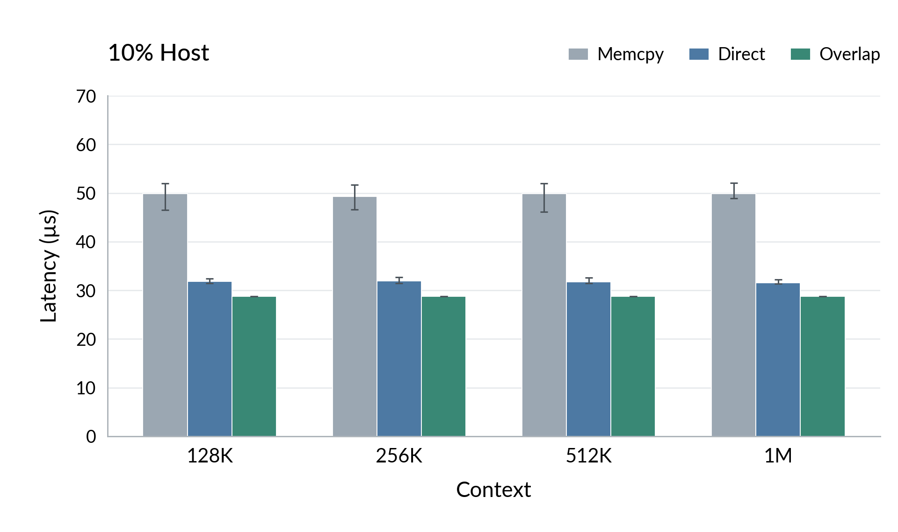
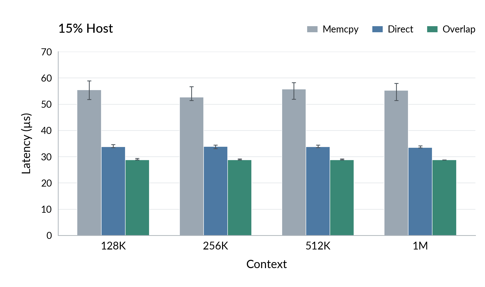
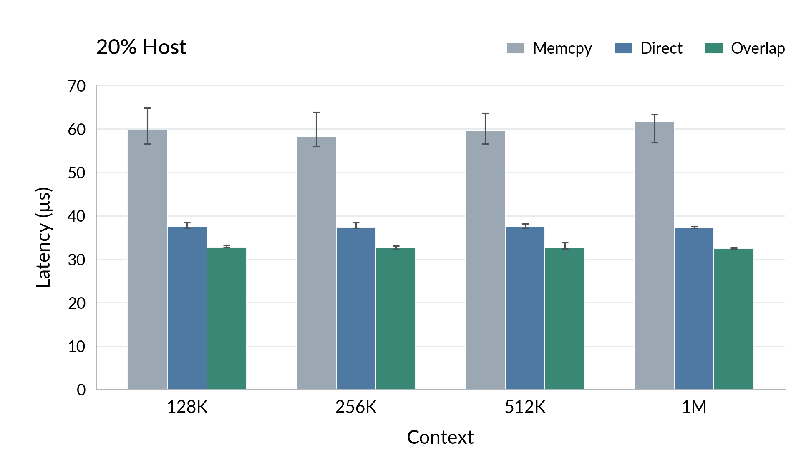

# Host attention: memcpy, direct access, and overlap

A100-SXM4-40GB GPU 1; BF16; one decode query; 64 heads; compressed rank 512; RoPE 64; top-k 2048; page size 1. A single attention layer is measured. Context labels are powers of two: 128K=131072, 256K=262144, 512K=524288, 1M=1048576.

Half of the physical cache resides in local HBM and half in pinned NUMA-0 Host memory. Hit fractions apply to the selected 2048 rows and are rounded to the nearest row. Random/head/tail describes their positions in the selected list; physical addresses are sampled across each tier.

## Measurement

- Memcpy: gather selected Host rows on CPU into a pinned buffer, then H2D DMA and native attention on one stream. Every repeated GPU cycle performs its own DMA. Local HBM is aliased directly, with no local gather or copy.
- Direct: native attention directly reads mapped Host memory.
- Overlap: the optimized fused attention kernel fetches Host rows concurrently with local computation.
- Main tables and charts report the median GPU cycle in µs. Memcpy includes DMA, its handoff/dependency cost, and attention. CPU packing is excluded from these GPU values and reported separately in details.md; serial wall time includes packing and synchronization.
- Each case uses the same KV data, query, and eight index sets across all three methods. Forty rounds are measured, with 100 serialized cycles per CUDA graph. Fraction and method order are shuffled. Error bars show the 10th-90th percentiles across rounds.
- Top-k selection, index updates/remapping, plan, initialization, and FP32 references are excluded. All measured cases passed independent FP32 comparisons.
- The 20% memcpy trace contains 100 actual pinned-Host-to-device copies and 100 native attention kernels on the same stream, with no overlap and no GPU gather kernels. Each copy moves 472320 bytes. See memcpy_verification.json for the checked timeline.

## Charts

The three main figures show random placement. Head and tail figures are in their corresponding subdirectories. PNG, SVG, and PDF versions are available.







## GPU cycle latency (µs)

### Random

#### 128K

| Host | Memcpy | Direct | Overlap |
|---:|---:|---:|---:|
| 0% | 27.45 | 27.38 | 27.69 |
| 5% | 44.24 | 30.12 | 28.74 |
| 10% | 49.84 | 31.81 | 28.74 |
| 15% | 55.43 | 33.79 | 28.74 |
| 20% | 59.79 | 37.52 | 32.76 |
| 25% | 64.53 | 41.67 | 40.93 |
| 30% | 68.61 | 46.04 | 45.22 |
| 35% | 73.07 | 50.41 | 50.08 |
| 40% | 76.72 | 54.79 | 55.11 |
| 60% | 93.21 | 72.24 | 75.93 |
| 80% | 110.02 | 89.74 | 97.33 |
| 100% | 128.12 | 107.58 | 118.00 |

#### 256K

| Host | Memcpy | Direct | Overlap |
|---:|---:|---:|---:|
| 0% | 27.42 | 27.38 | 27.71 |
| 5% | 43.56 | 29.98 | 28.75 |
| 10% | 49.31 | 31.96 | 28.74 |
| 15% | 52.67 | 33.83 | 28.74 |
| 20% | 58.24 | 37.37 | 32.63 |
| 25% | 64.01 | 41.67 | 40.94 |
| 30% | 67.91 | 46.05 | 45.36 |
| 35% | 70.88 | 50.42 | 50.11 |
| 40% | 75.87 | 54.76 | 55.09 |
| 60% | 92.99 | 72.30 | 75.93 |
| 80% | 109.89 | 89.73 | 97.36 |
| 100% | 127.72 | 107.28 | 117.89 |

#### 512K

| Host | Memcpy | Direct | Overlap |
|---:|---:|---:|---:|
| 0% | 27.35 | 27.39 | 27.71 |
| 5% | 43.82 | 30.09 | 28.77 |
| 10% | 49.88 | 31.75 | 28.74 |
| 15% | 55.71 | 33.79 | 28.74 |
| 20% | 59.53 | 37.49 | 32.68 |
| 25% | 65.11 | 41.89 | 40.96 |
| 30% | 70.11 | 46.16 | 45.33 |
| 35% | 74.14 | 50.55 | 50.08 |
| 40% | 77.79 | 54.88 | 55.17 |
| 60% | 94.28 | 72.30 | 75.92 |
| 80% | 111.07 | 89.83 | 97.45 |
| 100% | 128.36 | 108.07 | 119.16 |

#### 1M

| Host | Memcpy | Direct | Overlap |
|---:|---:|---:|---:|
| 0% | 27.48 | 27.29 | 27.71 |
| 5% | 43.97 | 29.82 | 28.76 |
| 10% | 49.91 | 31.59 | 28.74 |
| 15% | 55.26 | 33.51 | 28.74 |
| 20% | 61.61 | 37.22 | 32.52 |
| 25% | 64.95 | 41.58 | 40.92 |
| 30% | 68.40 | 45.95 | 45.26 |
| 35% | 73.66 | 50.31 | 50.05 |
| 40% | 78.43 | 54.64 | 55.09 |
| 60% | 93.27 | 72.08 | 75.87 |
| 80% | 109.81 | 89.58 | 97.31 |
| 100% | 127.15 | 107.07 | 117.62 |

### Head

#### 128K

| Host | Memcpy | Direct | Overlap |
|---:|---:|---:|---:|
| 0% | 27.42 | 27.36 | 27.69 |
| 5% | 45.06 | 30.11 | 28.69 |
| 10% | 50.48 | 31.29 | 28.72 |
| 15% | 56.70 | 36.31 | 29.61 |
| 20% | 61.46 | 39.65 | 33.42 |
| 25% | 66.16 | 43.32 | 41.53 |
| 30% | 69.94 | 46.88 | 45.66 |
| 35% | 75.91 | 50.80 | 50.23 |
| 40% | 79.49 | 54.90 | 55.36 |
| 60% | 95.40 | 72.31 | 75.96 |
| 80% | 109.83 | 89.81 | 97.34 |
| 100% | 127.48 | 107.25 | 117.80 |

#### 256K

| Host | Memcpy | Direct | Overlap |
|---:|---:|---:|---:|
| 0% | 27.38 | 27.36 | 27.72 |
| 5% | 44.21 | 29.72 | 28.73 |
| 10% | 50.08 | 30.83 | 28.73 |
| 15% | 55.32 | 34.02 | 28.73 |
| 20% | 60.31 | 38.04 | 32.62 |
| 25% | 65.10 | 41.85 | 40.89 |
| 30% | 69.07 | 46.14 | 45.17 |
| 35% | 72.67 | 50.31 | 50.04 |
| 40% | 77.11 | 54.55 | 54.97 |
| 60% | 92.83 | 72.03 | 75.85 |
| 80% | 108.42 | 89.57 | 97.31 |
| 100% | 127.03 | 107.05 | 117.54 |

#### 512K

| Host | Memcpy | Direct | Overlap |
|---:|---:|---:|---:|
| 0% | 27.47 | 27.39 | 27.74 |
| 5% | 44.64 | 30.00 | 28.74 |
| 10% | 49.90 | 30.97 | 28.74 |
| 15% | 55.76 | 34.34 | 28.74 |
| 20% | 59.95 | 38.85 | 32.71 |
| 25% | 65.36 | 42.14 | 40.95 |
| 30% | 71.13 | 46.33 | 45.28 |
| 35% | 74.23 | 50.54 | 50.07 |
| 40% | 78.56 | 54.72 | 55.13 |
| 60% | 94.58 | 72.18 | 75.86 |
| 80% | 109.40 | 89.64 | 97.29 |
| 100% | 127.44 | 107.16 | 117.75 |

#### 1M

| Host | Memcpy | Direct | Overlap |
|---:|---:|---:|---:|
| 0% | 27.45 | 27.45 | 27.73 |
| 5% | 44.75 | 30.34 | 28.74 |
| 10% | 50.96 | 31.39 | 28.74 |
| 15% | 56.80 | 34.93 | 28.77 |
| 20% | 61.59 | 39.20 | 32.82 |
| 25% | 65.78 | 43.89 | 41.04 |
| 30% | 69.98 | 48.75 | 47.43 |
| 35% | 76.44 | 52.52 | 52.39 |
| 40% | 79.12 | 54.97 | 55.34 |
| 60% | 95.72 | 72.33 | 75.92 |
| 80% | 110.62 | 89.83 | 97.37 |
| 100% | 127.31 | 107.30 | 117.82 |

### Tail

#### 128K

| Host | Memcpy | Direct | Overlap |
|---:|---:|---:|---:|
| 0% | 27.46 | 27.39 | 27.70 |
| 5% | 44.75 | 30.03 | 28.73 |
| 10% | 50.16 | 32.90 | 28.73 |
| 15% | 56.35 | 36.03 | 29.72 |
| 20% | 61.49 | 39.35 | 32.93 |
| 25% | 65.95 | 42.66 | 41.02 |
| 30% | 70.23 | 46.96 | 45.53 |
| 35% | 74.65 | 50.50 | 50.19 |
| 40% | 78.87 | 54.75 | 55.30 |
| 60% | 94.83 | 72.24 | 75.98 |
| 80% | 109.53 | 89.78 | 97.38 |
| 100% | 127.31 | 107.32 | 117.89 |

#### 256K

| Host | Memcpy | Direct | Overlap |
|---:|---:|---:|---:|
| 0% | 27.39 | 27.36 | 27.79 |
| 5% | 43.82 | 29.78 | 28.73 |
| 10% | 49.78 | 32.26 | 28.73 |
| 15% | 55.11 | 34.94 | 28.73 |
| 20% | 59.06 | 37.91 | 32.74 |
| 25% | 64.98 | 42.10 | 40.90 |
| 30% | 69.33 | 46.25 | 45.29 |
| 35% | 73.37 | 50.27 | 50.07 |
| 40% | 76.49 | 54.61 | 55.02 |
| 60% | 92.84 | 72.01 | 75.86 |
| 80% | 108.70 | 89.61 | 97.33 |
| 100% | 127.04 | 107.12 | 117.80 |

#### 512K

| Host | Memcpy | Direct | Overlap |
|---:|---:|---:|---:|
| 0% | 27.47 | 27.42 | 27.80 |
| 5% | 44.11 | 29.85 | 28.73 |
| 10% | 50.03 | 32.29 | 28.73 |
| 15% | 54.96 | 34.91 | 28.73 |
| 20% | 58.06 | 37.98 | 32.70 |
| 25% | 64.83 | 42.08 | 40.92 |
| 30% | 68.46 | 46.27 | 45.29 |
| 35% | 73.03 | 50.26 | 50.08 |
| 40% | 77.30 | 54.59 | 54.92 |
| 60% | 92.86 | 72.02 | 75.86 |
| 80% | 108.46 | 89.61 | 97.34 |
| 100% | 127.01 | 107.17 | 117.89 |

#### 1M

| Host | Memcpy | Direct | Overlap |
|---:|---:|---:|---:|
| 0% | 27.42 | 27.43 | 27.75 |
| 5% | 43.85 | 29.69 | 28.73 |
| 10% | 49.99 | 32.17 | 28.73 |
| 15% | 55.09 | 34.80 | 28.73 |
| 20% | 60.20 | 38.00 | 32.69 |
| 25% | 64.71 | 42.14 | 40.91 |
| 30% | 66.92 | 46.27 | 45.41 |
| 35% | 72.09 | 50.30 | 50.07 |
| 40% | 76.83 | 54.66 | 54.96 |
| 60% | 92.59 | 72.06 | 75.85 |
| 80% | 108.07 | 89.68 | 97.31 |
| 100% | 126.94 | 107.19 | 117.91 |

## Files

- [Component and serial-step tables](details.md)
- [Exploratory variants and legacy baseline tables](history.md)
- [CSV data](comparison.csv)

The old baseline artifacts are preserved. The new benchmark source is ../bench_glm52_host_comparison.py; raw JSON retains samples, source hashes, the Git commit, correctness errors, and GPU snapshots. GPU 1 shared the machine with unrelated workloads on other GPUs. This comparison does not measure a complete GLM model.

## Reproduce

```bash
PYTHONPATH=. /mnt/data/mhy-vllm-venv/bin/python temp/run_glm52_host_comparison.py
MPLCONFIGDIR=temp/matplotlib python temp/plot_glm52_host_comparison.py
```

Existing raw outputs are protected from overwrite. Choose new output names for a repeat run.
