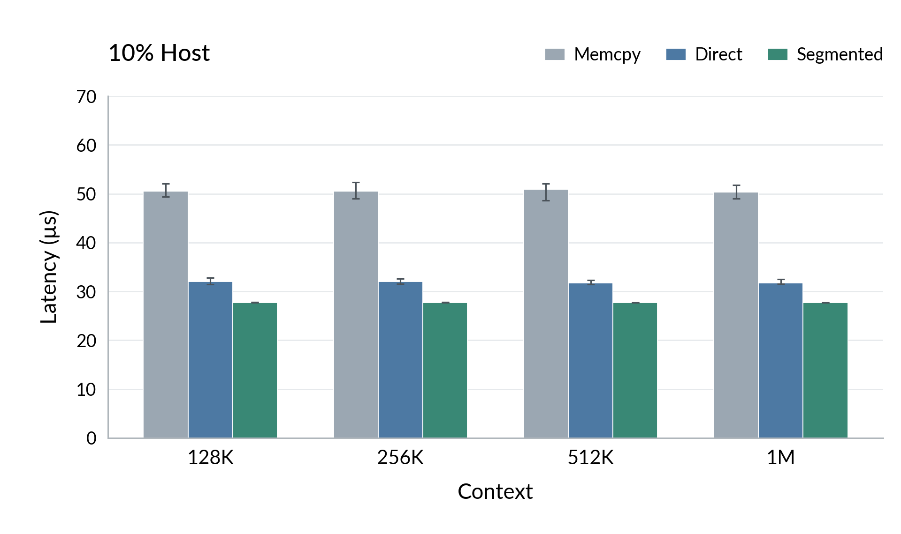
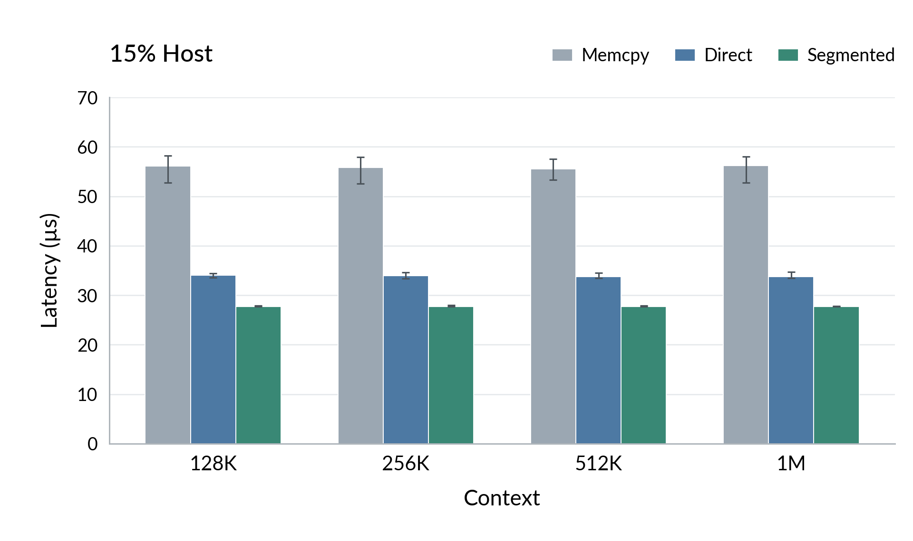
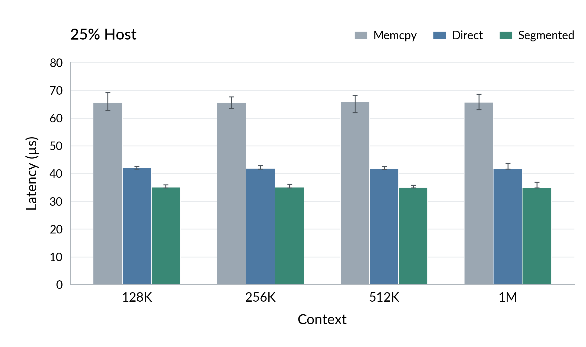
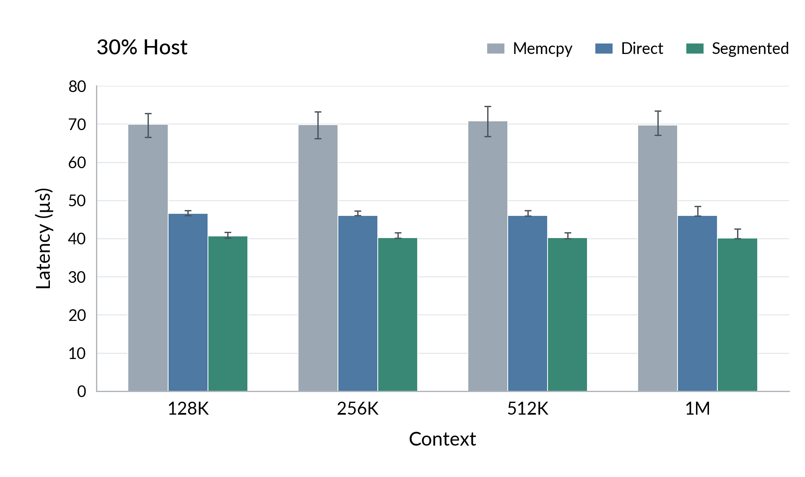

# Host attention: memcpy, direct access, and segmented reads

A100-SXM4-40GB GPU 1; BF16; one decode query; 64 heads; compressed rank 512; RoPE 64; top-k 2048; page size 1. A single attention layer is measured. Context labels are powers of two: 128K=131072, 256K=262144, 512K=524288, 1M=1048576.

Half of the physical cache resides in local HBM and half in pinned NUMA-0 Host memory. Hit fractions apply to the selected 2048 rows and are rounded to the nearest row. Random/head/tail describes their positions in the selected list; physical addresses are sampled across each tier.

## Measurement

- Memcpy: gather selected Host rows on CPU into a pinned buffer, then H2D DMA and native attention on one stream. Every repeated GPU cycle performs its own DMA. Local HBM is aliased directly, with no local gather or copy.
- Direct: native attention directly reads mapped Host memory.
- Segmented: the current optimized kernel uses 16 local and 32 Host compute partitions. It reads Host KV directly into shared memory in three groups and overlaps partial QK with later reads and local computation. HBM scratch stores partial attention outputs.
- Main tables and charts report the median GPU cycle in µs. Memcpy includes DMA, its handoff/dependency cost, and attention. CPU packing is excluded from these GPU values and reported separately in details.md; serial wall time includes packing and synchronization.
- Each case uses the same KV data, query, and eight index sets across all three methods. Forty rounds are measured, with 100 serialized cycles per CUDA graph. Fraction and method order are shuffled. Error bars show the 10th-90th percentiles across rounds.
- Top-k selection, index updates/remapping, plan, initialization, and FP32 references are excluded. All measured cases passed independent FP32 comparisons.
- The preserved 20% memcpy trace verifies 100 actual pinned-Host-to-device copies and 100 native attention kernels on one stream. Each copy moves 472320 bytes. See memcpy_verification.json. Latest profiling independently verifies full Host payload reads at 25% and 30%; see ../host_attention_pcie20/verification.json.
- Tables and plots use the latest complete after_random/head/tail.json data. The affected random 1M and head 128K/256K runs were repeated after external GPU 1 activity elevated their all-local references. Initial data and replacement provenance are retained. No samples were trimmed within a run.

## Charts

The main figures show random placement. Additional 25% and 30% figures are included. Head and tail figures are in their corresponding subdirectories. PNG, SVG, and PDF versions are available; charts.zip contains only the current figures.










## GPU cycle latency (µs)

### Random

#### 128K

| Host | Memcpy | Direct | Segmented |
|---:|---:|---:|---:|
| 0% | 27.46 | 27.40 | 27.69 |
| 5% | 44.63 | 30.15 | 27.79 |
| 10% | 50.51 | 32.01 | 27.74 |
| 15% | 56.09 | 34.03 | 27.72 |
| 20% | 60.62 | 37.70 | 30.98 |
| 25% | 65.54 | 42.09 | 35.07 |
| 30% | 69.89 | 46.60 | 40.67 |
| 35% | 73.70 | 50.98 | 45.32 |
| 40% | 78.37 | 55.36 | 49.27 |
| 60% | 94.49 | 72.76 | 71.19 |
| 80% | 111.96 | 90.60 | 89.44 |
| 100% | 129.11 | 108.03 | 106.40 |

#### 256K

| Host | Memcpy | Direct | Segmented |
|---:|---:|---:|---:|
| 0% | 27.35 | 27.37 | 27.68 |
| 5% | 44.47 | 30.11 | 27.75 |
| 10% | 50.55 | 32.03 | 27.73 |
| 15% | 55.85 | 33.97 | 27.72 |
| 20% | 60.60 | 37.71 | 30.82 |
| 25% | 65.59 | 41.83 | 35.03 |
| 30% | 69.86 | 46.08 | 40.20 |
| 35% | 74.29 | 50.44 | 45.12 |
| 40% | 79.34 | 54.92 | 49.33 |
| 60% | 95.19 | 72.34 | 71.07 |
| 80% | 112.55 | 90.32 | 88.84 |
| 100% | 129.25 | 107.85 | 106.47 |

#### 512K

| Host | Memcpy | Direct | Segmented |
|---:|---:|---:|---:|
| 0% | 27.44 | 27.40 | 27.69 |
| 5% | 44.31 | 30.11 | 27.74 |
| 10% | 50.95 | 31.72 | 27.72 |
| 15% | 55.51 | 33.76 | 27.73 |
| 20% | 62.02 | 37.48 | 30.88 |
| 25% | 65.90 | 41.75 | 35.01 |
| 30% | 70.85 | 46.07 | 40.22 |
| 35% | 74.39 | 50.45 | 45.30 |
| 40% | 78.31 | 54.78 | 49.31 |
| 60% | 94.79 | 72.39 | 70.77 |
| 80% | 111.98 | 90.49 | 88.87 |
| 100% | 129.72 | 107.36 | 105.85 |

#### 1M

| Host | Memcpy | Direct | Segmented |
|---:|---:|---:|---:|
| 0% | 27.44 | 27.38 | 27.68 |
| 5% | 44.12 | 30.10 | 27.72 |
| 10% | 50.39 | 31.76 | 27.71 |
| 15% | 56.16 | 33.72 | 27.71 |
| 20% | 60.66 | 37.34 | 30.69 |
| 25% | 65.67 | 41.66 | 34.89 |
| 30% | 69.75 | 46.02 | 40.06 |
| 35% | 74.66 | 50.40 | 44.92 |
| 40% | 77.35 | 54.75 | 49.21 |
| 60% | 94.01 | 72.23 | 70.71 |
| 80% | 109.30 | 89.69 | 88.12 |
| 100% | 127.10 | 107.16 | 105.53 |

### Head

#### 128K

| Host | Memcpy | Direct | Segmented |
|---:|---:|---:|---:|
| 0% | 27.47 | 27.40 | 27.69 |
| 5% | 44.67 | 30.11 | 27.77 |
| 10% | 50.74 | 31.30 | 27.74 |
| 15% | 56.44 | 35.22 | 27.80 |
| 20% | 61.23 | 39.00 | 31.79 |
| 25% | 66.23 | 43.83 | 36.99 |
| 30% | 70.19 | 46.75 | 40.95 |
| 35% | 74.80 | 53.06 | 47.14 |
| 40% | 78.61 | 54.97 | 49.23 |
| 60% | 94.20 | 72.40 | 70.73 |
| 80% | 109.45 | 89.76 | 88.16 |
| 100% | 127.33 | 107.27 | 105.58 |

#### 256K

| Host | Memcpy | Direct | Segmented |
|---:|---:|---:|---:|
| 0% | 27.36 | 27.40 | 27.68 |
| 5% | 44.33 | 29.69 | 27.71 |
| 10% | 50.21 | 30.79 | 27.71 |
| 15% | 54.78 | 33.96 | 27.71 |
| 20% | 60.11 | 38.18 | 30.69 |
| 25% | 65.31 | 41.83 | 34.88 |
| 30% | 68.78 | 46.04 | 40.03 |
| 35% | 73.58 | 50.40 | 44.79 |
| 40% | 77.99 | 54.67 | 49.21 |
| 60% | 93.42 | 72.14 | 70.71 |
| 80% | 109.83 | 89.61 | 88.12 |
| 100% | 127.12 | 107.11 | 105.53 |

#### 512K

| Host | Memcpy | Direct | Segmented |
|---:|---:|---:|---:|
| 0% | 27.42 | 27.38 | 27.69 |
| 5% | 44.26 | 29.93 | 28.43 |
| 10% | 50.05 | 30.93 | 28.19 |
| 15% | 55.88 | 34.26 | 27.96 |
| 20% | 62.04 | 37.84 | 30.86 |
| 25% | 65.70 | 41.86 | 35.32 |
| 30% | 69.97 | 46.05 | 41.01 |
| 35% | 74.14 | 50.29 | 45.16 |
| 40% | 78.13 | 54.71 | 49.27 |
| 60% | 94.30 | 72.17 | 70.86 |
| 80% | 110.03 | 90.44 | 88.74 |
| 100% | 128.98 | 107.24 | 106.08 |

#### 1M

| Host | Memcpy | Direct | Segmented |
|---:|---:|---:|---:|
| 0% | 27.41 | 27.46 | 27.69 |
| 5% | 44.19 | 30.00 | 28.45 |
| 10% | 49.83 | 31.06 | 28.18 |
| 15% | 56.04 | 34.35 | 27.98 |
| 20% | 60.90 | 37.89 | 30.83 |
| 25% | 64.74 | 41.97 | 35.32 |
| 30% | 69.70 | 46.24 | 41.13 |
| 35% | 73.62 | 50.57 | 45.15 |
| 40% | 78.05 | 54.85 | 49.34 |
| 60% | 94.32 | 72.35 | 70.87 |
| 80% | 110.91 | 89.84 | 88.73 |
| 100% | 128.27 | 107.39 | 106.12 |

### Tail

#### 128K

| Host | Memcpy | Direct | Segmented |
|---:|---:|---:|---:|
| 0% | 27.46 | 27.39 | 27.69 |
| 5% | 44.54 | 30.09 | 27.79 |
| 10% | 50.13 | 32.58 | 27.75 |
| 15% | 55.63 | 35.18 | 27.71 |
| 20% | 60.13 | 38.43 | 30.79 |
| 25% | 65.02 | 42.55 | 34.95 |
| 30% | 69.81 | 46.53 | 40.33 |
| 35% | 73.24 | 50.44 | 45.11 |
| 40% | 77.39 | 54.79 | 49.27 |
| 60% | 93.85 | 72.41 | 70.74 |
| 80% | 110.96 | 90.18 | 88.88 |
| 100% | 127.95 | 108.33 | 106.03 |

#### 256K

| Host | Memcpy | Direct | Segmented |
|---:|---:|---:|---:|
| 0% | 27.42 | 27.46 | 27.69 |
| 5% | 44.66 | 30.22 | 27.75 |
| 10% | 50.10 | 32.73 | 27.73 |
| 15% | 54.86 | 35.49 | 27.72 |
| 20% | 59.17 | 38.37 | 30.73 |
| 25% | 65.23 | 42.55 | 34.93 |
| 30% | 68.31 | 46.82 | 40.05 |
| 35% | 73.40 | 50.76 | 45.06 |
| 40% | 76.73 | 54.91 | 49.38 |
| 60% | 93.49 | 72.18 | 70.88 |
| 80% | 110.57 | 90.38 | 88.15 |
| 100% | 127.86 | 108.14 | 106.56 |

#### 512K

| Host | Memcpy | Direct | Segmented |
|---:|---:|---:|---:|
| 0% | 27.31 | 27.38 | 27.69 |
| 5% | 44.44 | 30.05 | 27.75 |
| 10% | 49.93 | 32.51 | 27.72 |
| 15% | 55.93 | 35.50 | 27.71 |
| 20% | 61.85 | 38.47 | 30.74 |
| 25% | 64.90 | 42.57 | 34.90 |
| 30% | 70.05 | 46.61 | 40.08 |
| 35% | 74.17 | 50.51 | 45.11 |
| 40% | 77.17 | 54.92 | 49.32 |
| 60% | 94.33 | 72.51 | 70.73 |
| 80% | 110.79 | 89.86 | 88.76 |
| 100% | 128.65 | 107.30 | 106.23 |

#### 1M

| Host | Memcpy | Direct | Segmented |
|---:|---:|---:|---:|
| 0% | 27.44 | 27.43 | 27.69 |
| 5% | 43.99 | 30.00 | 27.77 |
| 10% | 50.40 | 32.49 | 27.74 |
| 15% | 56.18 | 35.29 | 27.71 |
| 20% | 60.69 | 38.33 | 30.71 |
| 25% | 65.24 | 42.55 | 34.89 |
| 30% | 69.92 | 46.61 | 40.14 |
| 35% | 73.71 | 50.38 | 44.98 |
| 40% | 77.56 | 54.84 | 49.23 |
| 60% | 93.41 | 72.16 | 70.76 |
| 80% | 110.17 | 89.70 | 88.20 |
| 100% | 127.94 | 107.20 | 106.26 |

## Files

- [Component and serial-step tables](details.md)
- [Exploratory variants and legacy baseline tables](history.md)
- [CSV data](comparison.csv)
- [Core design](../../docs/mla_host_direct_design.md)
- [Previous V35 tables and figures](archive/v35/README.md)
- [PCIe budget and paired V44 comparison](../host_attention_pcie20/report.md)

The previous baseline artifacts are preserved. Current measurement sources are ../host_attention_pcie20/after_random/head/tail.json; original V35 data remains in raw_random/head/tail.json. Raw data retains samples, source hashes, commits, correctness errors, GPU snapshots, and rerun provenance. This comparison measures a single attention layer, not a complete GLM model.

## Reproduce

```bash
MPLCONFIGDIR=temp/matplotlib python temp/plot_glm52_host_comparison.py
```

This command regenerates the main tables and figures from existing measured data. Use --input-dir to select a new directory containing after_random/head/tail.json. Benchmark reproduction is described in the core design document; choose fresh output names for new measurements.
